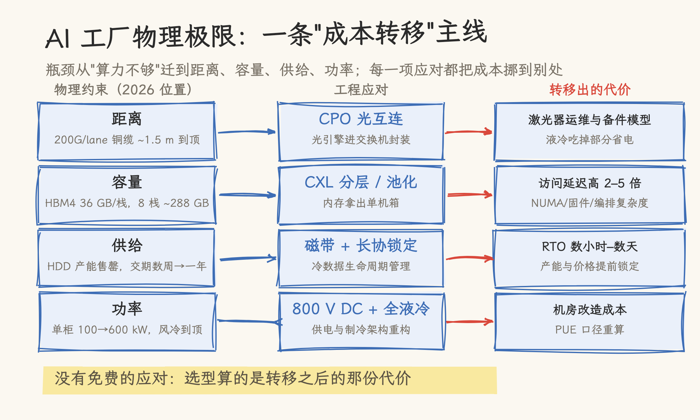
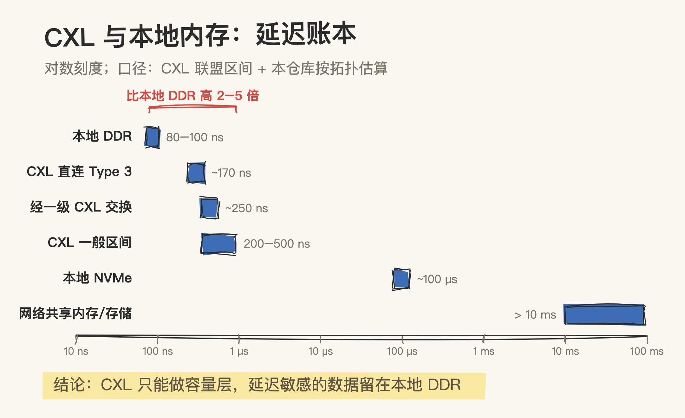
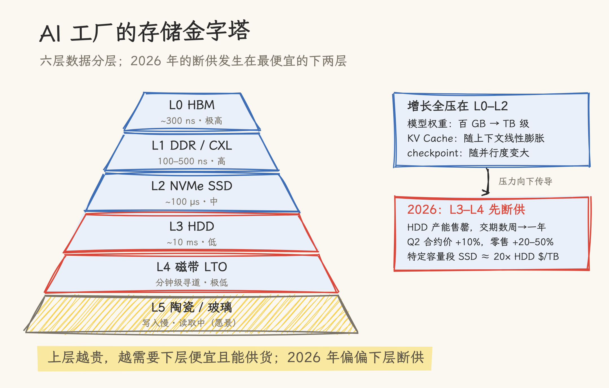

# AI 工厂的物理极限：CPO 光互连、CXL 解耦内存与冷存储

> 整理日期：2026-11-26｜线索来自 SC26（芝加哥，11/15–20）现场议程与 2026 年产品化进展
>
> 口径约定：厂商公开材料优先；二手转述、第三方分析单独标注；能效、价格、可靠性数字均为 as-of 2026-11-26，标注「厂商口径」的条目未经独立验证。

**一句话结论**：AI 工厂的瓶颈正在从"算力不够"迁移到"距离、容量与供给不够"——光互连接管了电信号传不远的距离问题，CXL 把内存从机箱里拿出来，而存储则卡在寡头产能与 AI 需求的双重挤压上。这些应对都不是免费的：光互连换来激光器运维，CXL 换来延迟分层，存储换来成本倒挂，供电则换来机房改造。

---

## 一、先把"物理极限"定义清楚

"物理极限"这个词容易被滥用。在 AI 集群里，真正撞墙的是四组互相耦合的约束：

| 维度          | 物理量                          | 2026 年的位置                                                                                                                                                   | 现场症状                                                               |
| ------------- | ------------------------------- | --------------------------------------------------------------------------------------------------------------------------------------------------------------- | ---------------------------------------------------------------------- |
| 电信号传输    | 200G/lane 下的铜缆可达距离      | 无源铜缆约 1.5 m（PCIe Gen7 128 GT/s、-24 dB 损耗预算口径）；scale-up 域想跨机柜即失效                                                                          | 面板密度、链路功耗、误码率同时恶化                                     |
| 功率密度      | 单机柜功率                      | NVL72 级已过 100 kW（GB200 NVL72 公开报道口径约 120–132 kW，HPE 建议按 192 kW 峰值规划）；MGX 1.2 规格支持 250 kW；Kyber（Rubin Ultra NVL576）公开口径约 600 kW | 风冷在 50 kW 以上基本失效（工程经验）；供电转 800 V DC；存储也被迫液冷 |
| 内存容量/带宽 | 单封装可挂的 HBM 站点与堆栈容量 | HBM4 单栈 36 GB、>2.8 TB/s；8 栈约 288 GB（按 36 GB×8 推算）                                                                                                    | 模型权重与 KV Cache 溢出到 DRAM、NVMe、远端存储                        |
| 存储成本/供给 | 每 TB 成本与产能弹性            | HDD 2026 年产能售罄、合约价上行；SSD 特定容量段约为 HDD 的 20 倍 $/TB；磁带单盘 30 TB 原生                                                                      | 冷数据分层倒挂，归档成本上升                                           |

这四组约束的共同点是：**它们都不是"再投钱就能线性解决"的问题**。铜缆传不远是信道损耗的指数规律；HBM 容量受封装基板与堆叠工艺限制；HDD 产能受三家寡头的资本开支节奏限制。工程上的应对，本质都是把成本从一个维度转移到另一个维度：

- **距离问题** → 转成光器件的功耗与运维成本（CPO）
- **容量问题** → 转成访问延迟与软件复杂度（CXL 分层/池化）
- **成本问题** → 转成供给锁定与数据生命周期管理（磁带、陶瓷、长协）
- **功率问题** → 转成机房改造成本（800 V DC、全液冷、PUE 重算）

这条"成本转移"主线会贯穿下文各节。

---

## 二、CPO：把光引擎搬进交换机封装

### 2.1 铜缆到顶的三个数字

铜缆不是"慢"，而是"高频下传不远"。三个数字足以说明问题：

1. **22 dB**：传统可插拔方案里，信号从交换 ASIC 出发，经过 PCB 走线、连接器，再进入光模块完成电光转换，200 Gb/s 通道上的电损耗最高可达 22 dB（NVIDIA 技术博客口径）。为补偿损耗，需要 DSP、Retimer 和更多有源器件。
2. **30 W**：一个 800G 可插拔接口的典型功耗，其中相当一部分花在上述电补偿与 DSP 上。
3. **约 1.5 m**：PCIe Gen7（128 GT/s PAM4）在 -24 dB 总插入损耗预算下，无源铜缆只能支撑的距离量级。200G/lane 的以太网/scale-up 场景同理，铜缆在机架内尚可，跨机架就出局。

AI 工厂的拓扑变化放大了这件事：传统企业数据中心把 Tier1 交换机放在机柜里，服务器用铜缆直连；AI 工厂为了把上万张 GPU 组成一个作业域，把交换机移到列末（end of row），服务器到交换机的距离从"机柜内"变成"列内甚至跨列"。从这一刻起，光互连不再是可选项，而是拓扑的前提。

### 2.2 CPO 改变了什么

CPO（Co-Packaged Optics，共封装光学）把光引擎从"面板上的可插拔模块"搬到了"交换 ASIC 旁边的同一基板"上。电信号不再需要穿过 PCB、连接器和模块外壳，只在封装内走毫米级距离：

- 电损耗从 22 dB 降到约 4 dB（NVIDIA 口径），DSP 与 Retimer 大幅简化；
- 单 800G 接口功耗从约 30 W 降到最低约 9 W；
- 光引擎使用**微环调制器（MRM）**，单波长直接调制 200 Gb/s PAM4，配合 WDM（波分复用）减少光纤数量；
- 激光器外置为**可更换激光源模块（ELS）**，每个 ELS 集成 8 颗激光器，坏了换模块而不是换整机；
- 交换 ASIC 与光引擎共用基板，采用硅光共封装，整机为液冷设计。

NVIDIA 给出的收益清单如下（全部为厂商口径）：

| 指标             | 相对传统可插拔                 | 备注                                            |
| ---------------- | ------------------------------ | ----------------------------------------------- |
| 能效             | 3.5×                           | 同等端口数下功耗降至约 1/3.5                    |
| 激光器数量       | 降至 1/4                       | WDM + MRM 的直接结果                            |
| 信号完整性       | 63×（新闻稿）/ 64×（博客图注） | 两个数字同源，表述略有差异                      |
| 大规模组网可靠性 | 10×                            | 与 SC26 现场提到的 15× 不是同一测试口径，见 2.4 |
| 部署速度         | 提升 1.3×                      | 省去大量模块插拔与调试                          |

### 2.3 产品与规格（2026 年 11 月）

| 产品                                         | 交换容量   | 端口             | 形态                                                                          | 状态                          |
| -------------------------------------------- | ---------- | ---------------- | ----------------------------------------------------------------------------- | ----------------------------- |
| NVIDIA Quantum-X Photonics（InfiniBand）     | 115 Tb/s   | 144 × 800G       | 液冷，内置 4 代 SHARP（14.4 TFLOPS 网络内计算）                               | 2026 年初起供货               |
| NVIDIA Spectrum-X Photonics SN6810（以太网） | 102.4 Tb/s | 128 × 800G       | 液冷                                                                          | 2026 下半年                   |
| NVIDIA Spectrum-X Photonics SN6800（以太网） | 409.6 Tb/s | 512 × 800G       | 液冷                                                                          | 2026 下半年                   |
| Broadcom Tomahawk 6 – Davisson               | 102.4 Tb/s | 16 × 6.4T 光引擎 | 业界首款 102.4T CPO 以太网交换芯片，200G/lane（Condor 212.5G PAM4），3nm 工艺 | 2025-10 发布，2026 年整机落地 |
| Celestica DS6005                             | 102.4 Tb/s | 64 × 1.6TbE      | 1.5OU 全液冷 ORv3 整机，基于 Tomahawk 6 – Davisson                            | 2026 年 OCP 展出              |
| Q.ANT NPU Gen 2+                             | —          | —                | 光子傅里叶变换 NPU，SC26 上与 AMD GPU 组成混合系统跑 LLM                      | 研究/演示阶段                 |

Broadcom 一侧的功耗口径是"相比可插拔方案降低 70% 以上"；第三方分析给出的单 800G 端口功耗约 3.5 W；NVIDIA 一侧是 3.5× 能效。两家在 3–3.5 倍这个区间上是一致的，差异主要来自对比基线（可插拔模块 vs LPO vs 传统 Retimer 方案）。

### 2.4 SC26 现场与口径差异

SC26 上 NVIDIA 特别演讲提到，首批落地的 CPO 交换机之一部署在 Lambda，可靠性（误码与链路抖动）相比传统方案提升 **15×**。这与官方博客的 **10×** 并不矛盾，但确实不是同一个数：

- 10× 是平台级、面向大规模组网的可靠性口径（NVIDIA 新闻稿/博客）；
- 15× 是特定部署场景下、针对误码与链路抖动的实测口径（SC26 演讲，厂商口径）。

写作或选型引用时，应写清"哪个口径、在什么场景下"，而不是笼统地说"可靠性提升 10–15 倍"。

### 2.5 标准化：OCI-MSA 与 OCP SROI

CPO 要成为多厂商生态，缺的不是芯片而是接口标准。2026 年两条线值得关注：

- **OCI-MSA**（Optical Compute Interconnect MSA）：由 AMD、Broadcom、Meta、Microsoft、NVIDIA、OpenAI 六家发起，目标是基于 WDM 的开放、以硅光为核心的 scale-up 光互连规范，让不同厂商的光引擎/交换机可以互操作。它解决的是"scale-up 域用光延伸"的接口问题。
- **OCP SROI**（Short Reach Optical Interconnect）：2026-08-05 发布 v1.0 白皮书，定义的是 **30 m 以内**的短距光互连区间，覆盖 AI Pod 内机架间与机架内连接，强调多协议支持。它解决的是"多短算短、指标怎么定"的工程定义问题。

两者与 UCIe 的边界可以这样记：**UCIe 管封装内（mm 级），CPO/OCI 管板级到机架/列级（cm–数百 m），可插拔光模块管机架到数据中心（数十 m–km）**。这条分工线在 2026 年基本稳定，本仓库的 [UCIe 4.0 笔记](../ucie/README.md) 里有完整的能耗-距离分层表。

### 2.6 厂商没重点讲的三件事

1. **激光器的寿命与维护**。CPO 把光引擎焊死在交换机上，可维护的只剩外置激光源。ELS 可更换降低了风险，但激光器仍是整个系统里寿命最短的有源器件之一，备件模型和可插拔时代完全不同。
2. **光纤布线与清洁**。单机端口数从 128 提到 512（SN6800），意味着一台交换机要接几百根光纤。布线、极性、清洁、弯折半径都会成为现场故障来源，而这部分工作量在 TCO 里经常被低估。
3. **故障域上移**。可插拔模块坏了换模块；CPO 光引擎坏了要换整机或返厂。可靠性数字提升的同时，单次故障的爆炸半径也变大了，备机策略必须跟着改。

另外，NVIDIA 的 CPO 交换机是液冷的——省下来的光模块功耗，有一部分会被 CDU、快接头和漏液检测吃掉。**"3.5× 能效"是端口级口径，不是整机 PUE 口径**。

### 2.7 什么时候该上 CPO：一个可复算的规模阈值

CPO 的收益与端口数成正比，成本（备件、液冷、运维培训）与机型种类数成正比。做一个粗略估算：

- 每张 GPU 在 scale-out 方向通常对应 1 个 800G NIC 端口；
- CPO 目前主要替换**交换机侧**光口，NIC 侧仍是可插拔（或 LPO，线性直驱可插拔光模块），所以每张 GPU 约对应 1 个可被 CPO 替换的端口；
- 单端口省电按 21 W 计（30 W − 9 W，厂商口径）；

| GPU 规模 | 交换机侧 800G 端口（估） | 省电（估） | 判断                               |
| -------- | ------------------------ | ---------- | ---------------------------------- |
| 1,000    | 1,000                    | 约 21 kW   | 收益有限，可插拔/LPO 更灵活        |
| 10,000   | 10,000                   | 约 210 kW  | 开始有账可算，但要看电价与运维能力 |
| 100,000  | 100,000                  | 约 2.1 MW  | 结论明确，CPO 是默认选项之一       |

表中的端口数与省电是**线性估算**，未计入收敛比、东西向流量、交换机层级和液冷代价；实际项目应按"电价 × 年运行小时 × PUE 增量"复算。万卡以上再谈 CPO 省钱，千卡以内优先可插拔/LPO。

---

## 三、CXL 与解耦内存：把内存从机箱里拿出来

### 3.1 HBM 的三重约束

HBM 是 AI 芯片的"燃料管道"，但这条管道在三个方向上同时受限：

- **容量**：HBM4 单栈 36 GB（12-Hi），8 栈约 288 GB；再往上要增加堆栈数或层数，受封装基板、interposer 尺寸和散热限制。Rubin Ultra 一代把单 GPU 的 HBM 推到 1 TB 量级（HBM4E，公开报道口径），代价是封装复杂度与成本陡增。
- **带宽**：HBM4 单栈 >2.8 TB/s。带宽上去了，但容量/带宽比并没有同步改善——每 GB 容量要配的带宽越来越贵。
- **成本**：HBM 每 GB 成本远高于 DDR 与 SSD，用 HBM 存冷数据在经济上不成立。

结果就是一条必然的分层：**HBM 放热数据（权重、激活、热 KV），DRAM 放温数据，NVMe 放冷 KV 与 checkpoint，HDD/磁带放数据集与归档**。CXL 要解决的，是"DRAM 这一层怎么不被单机箱限制"。

HBM 本身的代际演进与本仓库的 [HBM 显存技术演进](../performance/01_hbm_evolution.md) 互补，那篇覆盖到 HBM3e，本文只补 HBM4 的容量/带宽位置。

### 3.2 CXL 的能力与延迟账本

CXL 在 PCIe 物理层上复用三套协议（CXL.io / CXL.cache / CXL.mem），定义 Type 1/2/3 三类设备。与本文相关的是 Type 3 内存扩展器，以及 CXL 2.0 引入的池化、CXL 3.x 引入的多级交换与多主机共享。协议细节本仓库已有两篇长文，不再重复：

- [CXL 互联协议全景解读](../pcie/08_cxl_interconnect_overview.md)：三代协议的动机、Flit 布局、池化机制、实测延迟拆解；
- [CXL 命令行工具链全景](../pcie/09_cxl_cli_tools.md)：`cxl` / `daxctl` / `ndctl` 的实操与排障。

这里只留一张"延迟账本"，因为它是所有架构决策的起点：

| 访问路径                    | 延迟量级     | 来源/口径                 |
| --------------------------- | ------------ | ------------------------- |
| 本地 DDR（CPU load-to-use） | 约 80–100 ns | 业界通用量级              |
| CXL 直连 Type 3（无交换）   | 约 170 ns    | 本仓库 CXL 长文按拓扑估算 |
| 经一级 CXL 交换             | 约 250 ns    | 同上                      |
| CXL 内存一般区间            | 200–500 ns   | CXL 联盟博客口径          |
| 本地 NVMe                   | 约 100 μs    | CXL 联盟对比口径          |
| 网络共享内存/存储           | >10 ms       | CXL 联盟对比口径          |

> 注：170 ns 是本仓库按直连拓扑推算的下沿，200–500 ns 是 CXL 联盟给出的通用区间（含不同拓扑与设备），两套口径不要交叉引用。

两个结论：

1. CXL 比典型 RDMA 访问（2–4 μs）低约一个数量级，但比本地 DDR 高 2–5 倍。**它只能做"容量层"，做不了"延迟敏感层"**。
2. 延迟可感知性取决于排队。系统繁忙时，CXL 的高带宽可能反超拥塞的本地 DDR——这也是 Tiered Memory 把 CXL 当冷层仍然有效的原因。

### 3.3 2026 年的产品化清单

CXL 从"纸面协议"走到"可采购设备"，2026 年是分水岭。SC26 现场设有 CXL 联盟展台，主要玩家与产品如下：

| 厂商/产品                                   | 规格                                           | 关键点                                          | 状态（口径）                          |
| ------------------------------------------- | ---------------------------------------------- | ----------------------------------------------- | ------------------------------------- |
| Samsung MD310                               | 256 GB，72 GB/s，CXL 3.2 + PCIe 6.0            | 数十条模块可池化为 10–80 TB                     | 2027 年初送样，下半年量产（厂商口径） |
| SK hynix CMM-DDR5 二代                      | 256 GB，80 GB/s，CXL 3.2                       | 能效提升约 30%，支持池化，配 MARS 机架          | 2026 年展出（厂商口径）               |
| XCENA MX1                                   | CXL 3.2 Type 3，PCIe 6.0 双 x8，最高 2 TB DRAM | "计算型内存"，主打跨推理服务器共享 KV Cache     | 2026 OCP 展出                         |
| Marvell Structera X + Penguin SMART CXL AIC | 基于 Structera X 的 CXL 加速卡                 | 把回收的 DDR4 做成可跨主机分配的池              | 2026 SC26 联合展示                    |
| Marvell Photonic Fabric 内存模块            | 光互连内存                                     | 把 CXL 内存的距离延伸到机架间                   | 2026 SC26 展示                        |
| XConn / Astera Labs CXL 交换                | 单级/多级交换                                  | 池化的物理基础                                  | 已可评估                              |
| MemChannel（NSDI'26）                       | 交换式 CXL 池化传输                            | 基于 XConn B2 Apollo（14 端口）做 CSEQ 风格传输 | 学术原型                              |

一个值得注意的趋势：**CXL 的竞争点已经从"能不能扩内存"转向"能不能跨主机共享"**。前者是容量问题，后者是利用率问题——也是云厂商和推理服务商真正愿意付钱的地方。KV Cache 共享是 2026 年最受关注的落地场景之一：同一模型的多个推理副本共享前缀缓存，比每个副本各自囤一份 DRAM 划算得多。

### 3.4 三种形态：扩容、池化、共享

| 形态            | 粒度               | 延迟       | 软件栈                                            | 典型场景                               | 成熟度         |
| --------------- | ------------------ | ---------- | ------------------------------------------------- | -------------------------------------- | -------------- |
| 扩容（Tiering） | 单机，NUMA 节点级  | 170–250 ns | 内核热插拔、TPP/分层调度、numactl                 | 单机内存不够，冷页下沉                 | 高，已量产     |
| 池化（Pooling） | 机架级，按主机分配 | 250–500 ns | Fabric Manager、MLD（Multi-Logical Device）、CDAT | 多主机按均值配置，降低 stranded memory | 中，设备已上市 |
| 共享（Sharing） | 多主机一致共享     | 300–500 ns | 硬件一致性、专用 runtime                          | KV Cache 共享、细粒度协作              | 低，生态早期   |

工程上最常见的误区，是把"池化"当成"共享"来卖。池化是把物理内存切成逻辑设备分给不同主机，主机之间并不共享同一份数据；共享才需要硬件一致性支持，CXL 3.x 才具备，且软件生态远未成熟。采购时如果厂商说"内存池"，要问清楚是 MLD 静态切分，还是真正的多主机共享。

### 3.5 工程约束

- **NUMA 与固件**：CXL 内存热插后由 ACPI/CDAT 描述，OS 需要正确编程 HDM decoder；BIOS 版本、内核版本不匹配时，最常见的结果是"设备识别到了，但内存不可用"。
- **页迁移成本**：Tiering 的收益取决于冷热识别准确率。迁移本身消耗带宽，误判会把热页搬到慢层，性能反而下降。
- **故障域**：一台 CXL 交换机或内存池故障，影响的是多台主机。池化提高了利用率，也放大了单点故障的影响面。
- **多租户安全**：共享内存设备的隔离依赖硬件与固件，云环境要确认清除与配额机制。
- **编排**：Kubernetes 侧仍缺成熟的 CXL 设备插件与拓扑感知调度，2026 年多数公开案例仍以"静态分区 + 人工编排"为主。

本仓库 [CXL 命令行工具链全景](../pcie/09_cxl_cli_tools.md) 里记录了一个现实边界：跨主机形态在 Linux CXL 子系统的成熟度地图上仍是 0 分，设备池化相关能力只有"初始可用"。协议就绪和部署成熟之间，隔着系统软件的长周期演进。

---

## 四、冷存储：最不起眼、但最先断供

### 4.1 存储金字塔

| 层级 | 介质              | 容量量级           | 带宽/延迟                                    | $/TB 量级 | AI 工厂里的角色               |
| ---- | ----------------- | ------------------ | -------------------------------------------- | --------- | ----------------------------- |
| L0   | HBM               | 数十–数百 GB/封装  | 数 TB/s，~300 ns                             | 极高      | 权重、激活、热 KV             |
| L1   | DDR/CXL           | 数 TB–数十 TB/机架 | 数百 GB/s，~100 ns（DDR）/ 200–500 ns（CXL） | 高        | 温数据、KV 溢出、元数据       |
| L2   | NVMe SSD          | 数十–数百 TB/机架  | 数十 GB/s，~100 μs                           | 中        | checkpoint、冷 KV、数据集缓存 |
| L3   | HDD（nearline）   | PB 级              | 数百 MB/s，~10 ms                            | 低        | 数据集、日志、备份            |
| L4   | 磁带（LTO）       | PB–EB 级           | 数百 MB/s，分钟级寻道                        | 极低      | 归档、合规、离线副本          |
| L5   | 陶瓷/玻璃等新介质 | EB 级（愿景）      | 写入慢、读取中等                             | 目标极低  | 长期不可变归档                |

AI 工厂的特殊之处在于 L0–L2 的增长远快于 L3–L4：模型从百 GB 到 TB 级，KV Cache 随上下文长度线性膨胀，checkpoint 随并行度增加而变大。**上层越贵，越需要下层便宜且能供货**——而 2026 年恰恰是下层出了问题。

### 4.2 HDD：寡头 + AI 挤兑

HDD 全球只剩三家（Seagate、Western Digital、Toshiba），这是典型的寡头市场。2026 年的情况：

- **产能售罄**：WD 与 Seagate 已确认 2026 年产能基本售完（heise 报道）；Toshiba 在扩产，但扩产周期以年计。
- **交期拉长**：nearline HDD 交期从数周拉长到一年（TrendForce 口径，二手转述）。
- **价格上行**：2026 年 Q2 标杆产品合约价环比上涨约 10%（此前季度涨幅通常只有 1–4%）；德国零售市场相较 2025 年中上涨约 20–50%。
- **容量仍在推进**：44 TB 盘已开始交付（Seagate Mozaic 4+ 已量产），厂商路线图大多指向 2029–2031 年的 100 TB 级。
- **SSD 并不便宜**：按 TrendForce 的比较，特定容量段下 SSD 每 TB 成本约为 HDD 的 20 倍。用 SSD 全面替代 nearline HDD 在经济上不成立。

一个容易被忽略的传导链：HDD 缺货 → 部分冷数据被迫放在 QLC（四层单元）SSD → NAND 需求增加 → NAND 合约价上涨（2026 年预期 5–10%）→ KV Cache offload 用的 SSD 也涨价。**冷存储的短缺，最终会推高推理成本**。

### 4.3 磁带：LTO-10 与 Fujifilm 扩产

磁带是这轮 AI 数据潮里少见的"逆势回暖"品类：

- LTO-10 单盘原生容量 30 TB、压缩后 75 TB（部分资料给出 40 TB/100 TB 口径，属产品型号差异）；单盘容量是 LTO-9 的约 1.7 倍。
- 供给同样紧张：30 TB 版本交期约 3 个月、40 TB 版本约 12 个月（渠道口径）；Fujifilm 在 2026-10 宣布把 LTO 磁带产能扩到约 5 倍，预计 2027 年 Q3 落地，分析师预计可让全球 LTO 供给增加 12–15%（厂商/分析口径）。
- 磁带的核心优势不只是 $/TB：**离线、不可篡改、离线存放不耗电**。在勒索软件与合规归档场景里，这些属性比容量更重要。

对 AI 工厂而言，磁带不是"在线层"，而是"最后一份副本"和"训练数据原始存档"。把它纳入分层，重点不是性能，而是**恢复时间目标（RTO）**——从磁带恢复 PB 级数据集可能需要数小时到数天，这个时间必须写进训练任务的调度假设里。

### 4.4 新介质：陶瓷与玻璃

Cerabyte 是这一赛道最有代表性的公司：用飞秒激光在陶瓷-玻璃介质上写入纳米级数据层，目标是"无需迁移、无需供电、可保存数十年"的归档介质。其公开口径包括：

- 激光能量只需传统方案的一小部分（"100× 更低"的写入能量口径）；
- 长期 TCO 目标是 **$6–8/PB/月**（厂商愿景，2030 年目标，未经独立验证）；
- 2026 年在 OCP 与 SC26 上做了演示（包括把 1927 年电影《大都会》存进去的公关案例）。

这类介质的现实定位是 L5 归档层：写入吞吐低、随机读差、生态早期。它不会替代 HDD 或磁带，但在"EB 级、几十年、不可变"这个细分场景里，确实补上了一个空档。Cerabyte 自己在 FMS 2026 的提法是"The Missing Tier"——缺失的那一层。

### 4.5 "垂直市场失败"到底指什么

SC26 有一场 panel 直接把这个问题摆上台面：**The Empty Shelf: Vertical Market Failure in Data Storage for HPC and AI**（11 月 20 日 10:30–12:00，W185abc）。讨论嘉宾包括 LANL 的 Gary Grider、Candace Culhane 与 Cerabyte 的 Steffen Hellmold，主持人是 Matt Klusas。Cerabyte CEO Christian Pflaum 给的说法是：存储行业正面临"垂直市场失败"，同时带来两个挑战——满足增长的需求，以及为新兴用例开发技术。

"垂直市场失败"（vertical market failure）通常指：**买方愿意付钱，但供应链没有能力或意愿提供该产品**。放到存储上，成因有三：

1. **研发周期与财报周期错配**。新介质（HAMR 热辅助磁记录、陶瓷、DNA）研发以十年计，上市公司按季度考核，资本开支天然偏向"改良现有产线"而不是"押注新介质"。
2. **寡头的供给纪律**。三家 HDD 厂商在经历过多轮价格战后，更倾向于"保价格、不保份额"，扩产决策保守。AI 需求突然放量时，供给弹性几乎为零。
3. **AI 需求不付"冷数据溢价"**。训练数据、checkpoint、日志都要求"便宜且大"，但 AI 客户愿意为 GPU 付溢价，不愿意为归档付溢价。冷存储的利润率最低，最容易被产能挤到后面。

后果是一个负反馈：冷数据成本上升 → 企业把更多数据留在热层 → 热层（SSD/HDD）更紧张 → 价格继续上行。成因是供给与需求两侧的结构错配，很难用常规的景气周期解释。

### 4.6 AI 工厂的存储账

把四类数据分开算，策略就清楚了：

| 数据类型   | 特征                         | 推荐层级                                  | 关键指标                            |
| ---------- | ---------------------------- | ----------------------------------------- | ----------------------------------- |
| 训练数据集 | 一次写入、多次读取、越大越好 | HDD/并行文件系统，原始副本进磁带          | 顺序带宽、$/TB                      |
| Checkpoint | 周期性突发写、必须能快速恢复 | NVMe（近线）+ 对象存储（远线）            | 写入带宽、RTO                       |
| KV Cache   | 低延迟、可重建、生命周期短   | HBM → DRAM/CXL → 本地 NVMe → 共享 NVMe-oF | 命中率、TTFT（首 token 时延）、$/GB |
| 模型权重   | 只读、多副本分发             | NVMe/对象存储 + CDN 式分发                | 分发时延、版本一致性                |

两个常被低估的点：

- **本地 NVMe 的容量其实很小**。一个 GPU 机架能塞的本地盘通常只有几十 TB 量级（厂商给出的区间约 0.06–0.2 PB/机架），面对 TB 级 KV Cache 很快见底，所以"KV Cache 下沉"最终一定要走到共享 NVMe-oF（NVMe over Fabrics）或 CXL 池，而不是靠加盘。
- **冷数据不等于可丢弃**。合规、复现、审计都要求原始数据可回溯，归档层的成本必须进 TCO，而不是当成"以后再说"。

---

## 五、总评与口径折扣

### 5.1 四条极限如何互相放大

四条极限的耦合放大了各自的影响：

| 耦合        | 机制                                                                                                                                   | 设计后果                                            |
| ----------- | -------------------------------------------------------------------------------------------------------------------------------------- | --------------------------------------------------- |
| CPO × 电力  | CPO 省下光模块功耗，但交换机改为液冷，CDU/泵/漏液检测增加功耗与复杂度                                                                  | 省电要按"整机 + 冷却"算，不能只算端口               |
| CPO × 运维  | 光引擎不可热插拔，故障域从模块上移到整机                                                                                               | 备机比例、备件库存、现场可更换单元（FRU）设计都要改 |
| CXL × 网络  | 池化降低 stranded memory，但机架内多一层 CXL 交换网，跨机架还需光互连                                                                  | 机架内多了一张网，监控与编排复杂度上升              |
| CXL × 软件  | 容量层延迟高 2–5 倍，冷热识别不准就掉性能                                                                                              | 需要 NUMA/分层调度与业务侧配合，不能"插上就用"      |
| 存储 × 推理 | HDD 缺货 → 冷数据挤到 QLC → NAND 涨价 → KV offload 成本上升                                                                            | 推理 TCO 对存储价格敏感，需提前锁价                 |
| 功率 × 存储 | 机柜功率 100 kW 级→600 kW（250 kW 为 MGX 1.2 档），风冷失效，存储阵列也被迫液冷（Dell 已预告 2027 上半年推出直液冷存储，媒体报道口径） | 存储选型要和机房制冷方案一起做                      |

功率这条线在本文只作为约束与代价出现（表 1 与上表），不单独成节：800 V DC、CDU 与机房供电架构属于数据中心基础设施工程，展开会偏离互连、内存、存储三条主线。

### 5.2 分级判断

- **互连**：CPO 的经济性看 scale-out 光口总量，万卡以上才明显；千卡以内的集群，CPO 更多是技术验证而非省钱手段。scale-up 域跨机柜是 OCI-MSA/光背板要解决的问题，和 CPO 交换机不是同一件事。
- **内存**：CXL 的 TCO 甜点在机架内（sub-rack），做容量层、不做延迟敏感层，不取代以太网/InfiniBand；细粒度、load-store 语义走 CXL，粗粒度、容错走网络。2026–2027 年最现实的落地形态是"每机架一个内存池 + KV Cache 分层"。
- **存储**：最先紧张的是 HDD 与磁带这两层（L3–L4），HDD 已售罄、磁带交期拉长但正在扩产；成因是供给与需求的结构错配，冷数据涨价会沿"QLC 替代 → NAND 涨价"的链条推高推理成本。
- **电力与供给**：2026–2027 年 AI 基础设施的最短板不是 GPU，而是"电力 + 存储供给"。GPU 可以加价买，电力和 HDD 产能不行；集群规划先把这两笔账算清，再定 GPU 规模。

### 5.3 口径折扣与复核触发

本文数字分三类，引用时请保留标签：

- **厂商口径**：NVIDIA 的 3.5×/10×/63×、激光器 4× 缩减、Broadcom 的 >70%、Samsung/SK hynix/XCENA 的容量与带宽、Cerabyte 的 TCO 目标、HDD 厂商的容量路线图。这类数字通常来自特定基线，未经独立复现。
- **第三方/媒体口径**：TrendForce 的合约价与交期、heise 的零售涨幅、CXL 联盟的延迟区间。可信度较高，但仍是估算或抽样。
- **本文估算**：2.7 节的端口数/省电表（表头已标注"估"）；4.1 节的 $/TB 为定性分级，不是精确报价。复算时请替换为项目实际参数与当期渠道价。

需要等一手材料确认的：

- SC26 两场 panel（CXL、冷存储）的现场结论，目前只有议程与厂商新闻稿，完整观点要等会议录像/Proceedings；
- CPO 的长期失效率数据，目前只有厂商的"可靠性提升倍数"，没有独立第三方现场统计；
- CXL 4.0（2025-11-18 发布，128 GT/s、bundled port 最高 1.5 TB/s）的设备落地时间，2026 年内仍以 3.x 为主。

复核触发条件：CPO 交换机出货量季度数据、CXL 4.0 首款量产设备、HDD 产能扩张落地、LTO-10 渠道价格。复核节奏：2027 年 Q1、Q2 各看一次，触发条件命中随时提前。

---

## 六、来源索引

**SC26 议程与现场**：

- [SC26 Panels 总览（20 场）](https://sc26.supercomputing.org/2026/09/hpcs-big-questions-take-the-stage-sc26-welcomes-20-panels-to-chicago/)
- [The Empty Shelf: Vertical Market Failure in Data Storage（11/20，W185abc）](https://www.storagenewsletter.com/2026/11/10/sc26-cerabyte-to-address-the-future-of-data-storage-for-hpc-and-ai/)
- [CXL 与解耦内存 panel（11/18 13:30，W185abc）](https://sc26.conference-program.com/session/?sess=sess463)
- [Penguin Solutions SC26 议程（含 CXL panel 与 Photonics BoF）](https://www.rutlandherald.com/news/business/penguin-solutions-to-showcase-full-stack-ai-factory-platform-innovations-at-sc26/article_2e517820-4bd3-5998-b738-5ceb822b7805.html)
- [NVIDIA SC26：Ian Buck 特别演讲（CPO 在 Lambda 的 15× 口径）](https://blogs.nvidia.cn/blog/ian-buck-sc26/)

**CPO / 光互连**：

- [NVIDIA：Scaling AI Factories with CPO（22 dB→4 dB、30 W→9 W、3.5×）](https://developer.nvidia.com/blog/scaling-ai-factories-with-co-packaged-optics-for-better-power-efficiency/)
- [NVIDIA：Spectrum-X Photonics 发布（4× 激光器、63× 信号完整性）](https://nvidianews.nvidia.com/_gallery/download_pdf/67d9bf5b3d6332b0a6d11f0e/)
- [NVIDIA：CPO 产业协作（MRM、ELS 八激光器）](https://developer.nvidia.com/blog/how-industry-collaboration-fosters-nvidia-co-packaged-optics/)
- [Broadcom Tomahawk 6 – Davisson 发布](https://jp.broadcom.com/company/news/product-releases/63626)
- [Broadcom Davisson 技术简报（>70% 功耗下降）](https://docs.broadcom.com/doc/enabling-ai-infrastructure-davisson-briefing)
- [OCI-MSA 创始成员与目标](https://www.lightwaveonline.com/home/article/55365387/ofc-2026-optical-scale-up-consortium-sets-path-for-an-open-ai-infrastructure-specification)
- [OCP SROI 白皮书 v1.0（30 m 短距光互连）](https://www.opencompute.org/documents/sroi-white-paper-1-0-0-pdf)
- [铜缆在 200G/lane 下的距离极限（行业分析）](https://cloud.tencent.com.cn/developer/article/2745125)
- [Celestica DS6005 发布（102.4T CPO 整机，OCP 2026）](https://corporate.celestica.com/news-releases/news-release-details/celestica-introduces-ds6005-data-center-switch-co-packaged)
- [Q.ANT NPU Gen 2+ 发布（SC26 与 AMD GPU 组混合系统跑 LLM）](https://uk.finance.yahoo.com/news/q-ant-unveils-npu-gen-123000042.html)

**CXL / 解耦内存**：

- [CXL 联盟：用 CXL 内存池跨越 AI 内存墙（200–500 ns 口径）](https://computeexpresslink.org/blog/overcoming-the-ai-memory-wall-how-cxl-memory-pooling-powers-the-next-leap-in-scalable-ai-computing-4267/)
- [CXL 4.0 规范解读（128 GT/s、bundled port）](https://computeexpresslink.org/blog/introducing-the-cxl-4-0-specification-webinar-qa-recap-4386/)
- [Samsung MD310（256 GB / 72 GB/s / 2027 量产）](https://www.thelec.net/news/articleView.html?idxno=15904)
- [SK hynix CMM-DDR5 二代（256 GB / 80 GB/s / 池化）](https://m.eepw.com.cn/article/202610/484067.html)
- [XCENA MX1（CXL 3.2 计算型内存、KV Cache 共享）](https://www.storagereview.com/news/xcena-mx1-cxl-computational-memory-kv-cache-sk-hynix-ocp-2026)
- [Marvell × Penguin：CXL + 光互连内存](https://www.storagenewsletter.com/2026/11/18/sc26-marvell-and-penguin-solutions-collaborate-to-address-data-center-ai-memory-and-accelerate-inference-at-scale/)
- [MemChannel：交换式 CXL 池化传输（NSDI'26）](https://www.usenix.org/system/files/nsdi26_slides-guo-zerui.pdf)

**存储**：

- [WD/Seagate 确认 2026 年 HDD 产能售罄、零售涨 20–50%](https://www.heise.de/en/news/WD-and-Seagate-confirm-Hard-drives-for-2026-sold-out-11178917.html)
- [TrendForce：2026 Q2 HDD 合约价环比 +10%](https://www.lanjinger.com/t/2398259)
- [Nearline 交期拉长与 SSD/HDD 价差（TrendForce 转述）](https://www.ainvest.com/news/toshiba-hdd-division-doubling-capacity-shortage-isn-capacity-2610/)
- [Seagate Mozaic 4+ 44TB 量产交付（2026-03，官方新闻稿）](https://investors.seagate.com/news/news-details/2026/Seagate-Delivers-Industrys-Highest-Capacity-Hard-Drives-with-Next-Generation-Mozaic-4/default.aspx)
- [HDD 容量路线图：三家的 100TB 竞速（Tom's Hardware）](https://www.tomshardware.com/pc-components/hdds/high-capacity-hdd-roadmap-the-race-to-100tb-and-zettabyte-scale-storage-toshiba-seagate-and-wd-outline-three-distinct-strategies)
- [LTO-10 容量口径与 AI 驱动的磁带需求](https://www.heise.de/news/KI-befeuert-die-Nachfrage-nach-LTO-Baendern-11440362.html)
- [LTO-10 30 TB/40 TB 版本交期约 3/12 个月（渠道口径）](https://www.stutchdata.com.au/news/long-wait-for-both-lto10-ultrium-10-data-cartridges-in-30tb-40tb-native-capacity/)
- [Fujifilm 宣布 LTO 磁带产能扩至约 5 倍（2026-10）](https://ltoshow.com/fujifilm-to-boost-tape-production-5x-as-ai-fuels-archiving-demand-ars-technica/)
- [Micron HBM4 36GB 12-Hi 量产（>2.8 TB/s）](https://tech.yahoo.com/computing/articles/micron-enters-high-volume-production-224735579.html)
- [Cerabyte 陶瓷存储白皮书（厂商愿景与 TCO 目标）](https://www.cerabyte.com/wp-content/uploads/2026/03/Cerabyte_white-paper_26_3.pdf)
- [Dell SC26：存储密度 +67%、2027 上半年直液冷存储](https://qifukexue.com/?p=45777)

**功率密度**：

- [GB200 NVL72 约 120–132 kW，HPE 建议按 192 kW 峰值规划（DCD）](https://datacenterdynamics.com/en/opinions/the-density-gap-in-data-center-real-estate/)
- [NVIDIA Kyber 机架约 600 kW（媒体报道）](https://shiftdelete.net/nvidia-kyber-raf-600-kw-elektrik)
- [Dell MGX 1.2 规格 250 kW](https://m.eepw.com.cn/article/202610/483966.html)

**本仓库关联文章**：

- [CXL 互联协议全景解读](../pcie/08_cxl_interconnect_overview.md)
- [CXL 命令行工具链全景](../pcie/09_cxl_cli_tools.md)
- [HBM 显存技术演进](../performance/01_hbm_evolution.md)
- [AI 基础设施延迟金字塔](../performance/ai_latency_pyramid.md)
- [UCIe 4.0 芯粒互连](../ucie/README.md)
- [GB300 NVL72 机架级架构](../superchips/nvidia_gb300.md)
- [NVLink 技术入门](../nvlink/nvlink_intro.md)
