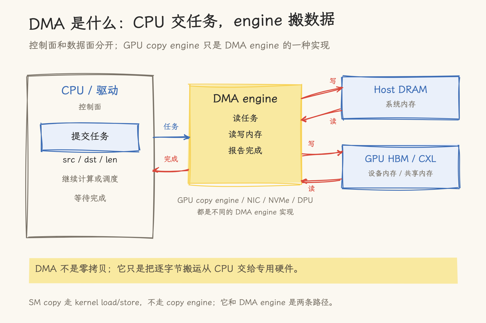
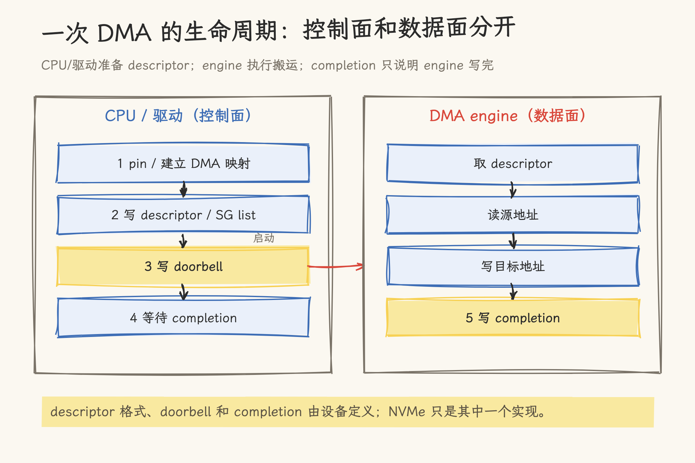
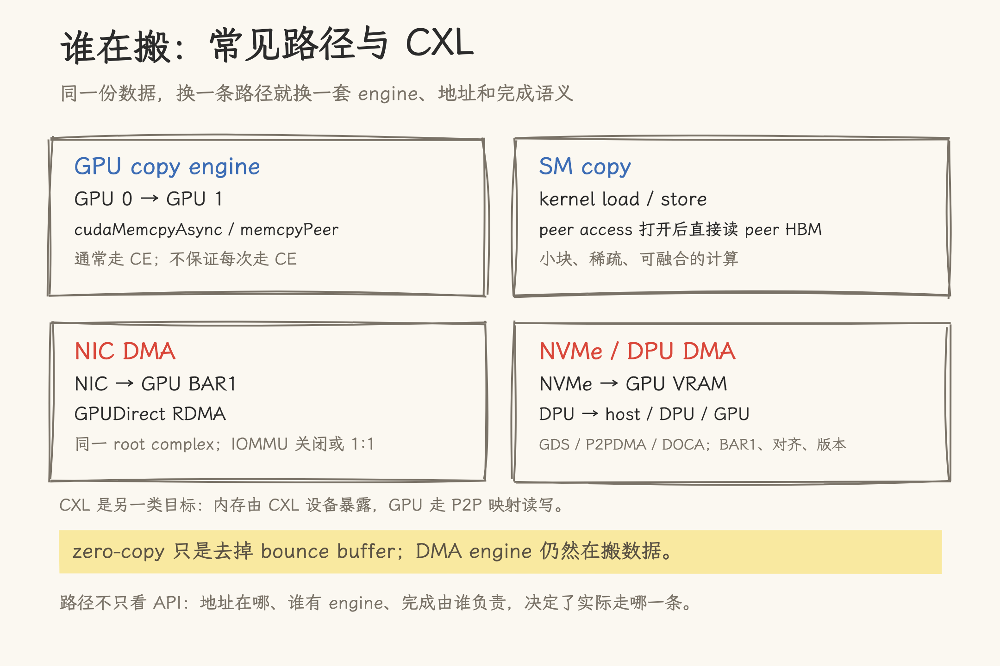
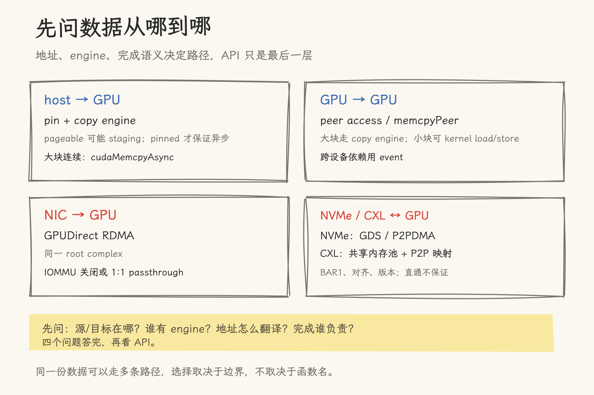

# DMA engine：从描述符到完成，一次搬运发生了什么

> Linux 侧按 kernel DMA-API、DMA engine provider 与 PCI P2PDMA 文档核对；CUDA 侧按 CUDA 13.4 Runtime API 与 Programming Guide 核对；GPUDirect RDMA / Storage、DOCA DMA 按 NVIDIA 官方文档核对；CXL 部分按 CXL Consortium 文档核对。

一台训练机在加载 checkpoint。`nvidia-smi` 显示显存占用在涨，CPU 核并没有忙着逐字节拷贝；一次推理请求要把 KV cache 从一张卡送到另一张卡，应用只提交了一个 `cudaMemcpyAsync`。数据是谁搬的？

`memcpy` 是接口名，真正执行搬运的通常是 DMA engine。它不跑模型计算，也不执行 CUDA kernel；它读描述符、访问内存、写完成记录。理解这条路径，才能回答几个实际问题：为什么小拷贝不一定快，为什么 pinned memory 重要，为什么 `cudaMemcpyAsync` 没有让计算和传输重叠，以及为什么 GPUDirect 有时快、有时退回 CPU 中转。

## 1. 先建立直觉：DMA 是什么

把 DMA 想成一次“委托”。CPU 不亲自逐字节搬数据，而是把源地址、目标地址、长度写成一个任务，交给专门的搬运硬件；CPU 继续做调度或计算，硬件在后台读写内存，完成后通知 CPU。控制面在 CPU/驱动，数据面在 DMA engine，这是理解后面所有路径的起点。

DMA 解决的是“CPU 亲自搬数据太浪费”的问题，不是“零拷贝”的同义词，也不保证一定比 CPU 拷贝快。数据小、映射开销高、engine 被占满时，DMA 可能并不划算；它真正的价值通常在于把搬运和计算重叠。

DMA（Direct Memory Access）是一种访问机制：设备不经过 CPU 的逐字节搬运，直接读写内存。DMA engine 是执行这件事的硬件单元。GPU 里的 copy engine（CE）是 DMA engine 的一种实现，专门承担拷贝；NIC、NVMe 控制器、DPU 也各自有 DMA engine。

| 概念        | 是什么                             | 不要混淆                                   |
| ----------- | ---------------------------------- | ------------------------------------------ |
| DMA         | 设备直接访问内存的机制             | 不是某个函数，也不等于一定比 CPU 拷贝快    |
| DMA engine  | 读描述符、发起读写、报告完成的硬件 | 不是 CPU 核，也不一定是 GPU 的 copy engine |
| copy engine | GPU 上承担拷贝的 DMA engine        | 不是每次 `cudaMemcpy*` 都必然走它          |
| SM copy     | kernel 里的普通 load/store         | 不走 copy engine，但仍可能发生跨设备访问   |

_图 1：CPU/驱动负责提交任务，DMA engine 执行数据面搬运；Host DRAM、GPU HBM/CXL 都可能成为源或目标。_

## 2. 一次 DMA 的生命周期

### 2.1 Buffer、pin 和地址映射

DMA 的目标内存必须对设备可见。GPU 访问 host 内存时，页被换出会破坏正在进行的传输，所以驱动通常要求 page-locked（pinned）内存；普通 pageable 内存则可能先被复制到临时 pinned buffer，再交给 engine。`cudaHostAlloc` / `cudaHostRegister` 的意义就在这里：它们让 host 内存保持驻留，并建立设备可访问的映射。

另一个容易写错的点是地址。CPU 虚拟地址不能直接交给设备；驱动要建立 DMA/bus address（在虚拟化平台通常是 IOVA），再由 IOMMU 或设备页表翻译到物理内存。说“DMA 只认物理地址”不准确，应该说“DMA 使用 DMA/bus address，是否需要翻译取决于平台和 IOMMU”。

这一步也解释了为什么“把 `malloc` 的指针直接传给 GPU”不是好的路径。CUDA 可能替你做 staging，但 staging 有额外拷贝，异步性也可能丢失。

### 2.2 Descriptor 和 doorbell

驱动把源地址、目标地址、长度、方向、完成标记写进 descriptor。大块传输常用 scatter-gather list，把一个逻辑传输拆成多个物理页或段。随后 CPU 写 doorbell 或设备寄存器，告诉 engine“这组 descriptor 可以取了”。

NVMe 的 Submission/Completion Queue 和 doorbell 是这套流程的一个具体例子。descriptor 的格式、启动方式和完成通知由设备定义，不存在所有 DMA engine 通用的描述符规范。

doorbell 是 MMIO 写。某些总线上，CPU 的写是 posted write，CPU 可以在事务真正到达设备前继续执行；需要确认设备已经看到 doorbell 时，驱动会读回一个寄存器或执行 barrier。这个细节在“拷贝已经提交”和“engine 已经开始搬运”之间划出边界。

### 2.3 Engine 执行与完成

engine 按 descriptor 读源、写目标，完成后更新 completion 记录。CPU 可以通过中断或轮询知道完成。完成有两种常见含义：engine 已经把数据写完，和 CPU/GPU 已经能看到新数据。两者不是同一件事。

对 coherent allocation，设备写通常能被处理器直接看到；对 streaming/non-coherent 内存，需要 `dma_sync_single_for_device()` / `dma_sync_single_for_cpu()` 这类 ownership 转移。GPUDirect RDMA 的顺序更严格：NVIDIA 文档只承诺 CUDA synchronization 和 work submission API 提供内存序；GPU 可能在后续同步前看到旧数据或乱序数据。

_图 2：控制面准备 descriptor，数据面由 engine 执行；completion 只说明 engine 写完。_

## 3. GPU 的 copy engine

### 3.1 Copy engine 与 SM copy

GPU 有两类搬运路径。copy engine 独立于 SM，适合大块、连续、可以和计算重叠的 H2D/D2H/D2D 拷贝；SM copy 是 kernel 里的 load/store，适合小块、稀疏、需要和其他计算融合的访问。peer access 打开后，GPU 0 的 kernel 可以直接解引用 GPU 1 的指针，这条路径走 SM，不走 `cudaMemcpyPeer`。

CUDA 设备属性 `asyncEngineCount` 表示异步引擎数量，官方最佳实践用它说明 GPU 可以同时做异步传输和 kernel 执行；双 copy engine 的 GPU 可以同时做一路 H2D、一路 D2H 和执行 kernel。这个字段只能说明潜在并发上限，不能证明任意多 stream 一定各占一个 engine。不同 stream 的拷贝可能落到同一 work queue，产生 false dependency，实际并发要用 Nsight Systems 看时间线。

### 3.2 `cudaMemcpyAsync` 的承诺与边界

`cudaMemcpyAsync` 对 host 异步，可以绑定 stream，H2D/D2H 在非零 stream 上可能与其他 stream 的操作重叠。但它不保证一定走 copy engine：CUDA 文档说会利用 dedicated copy engine 和 NVLink，Tegra 平台甚至明确由驱动在 SM 和 copy engine 之间做 heuristic 选择。

pageable memory 是另一个边界。只有 pinned memory 才保证 host 异步；pageable H2D 可能先做 stream sync，函数返回时只完成了到 staging buffer 的拷贝，最终 DMA 可能还没完成。`cudaMemcpyAsync` 遇到 pageable 内存也可能同步。不要把“异步 API”直接等同于“已经异步执行”。

`cudaMemcpy` 本身也不能简单写成“host 同步”。按 CUDA Runtime API 的口径：pageable H2D 可能在 staging 后返回，pinned H2D 对 host 同步，D2H 等拷贝完成，D2D 不做 host-side 同步，H2H 完全同步。`cudaMemcpyPeer` 的文档同时出现“异步于 host”和“多数场景同步”两种说法，跨设备依赖不要依赖它的阻塞行为，统一用 stream/event。

`cudaMemcpyPeerAsync` 只有一个 stream 参数，官方没有定义这个 stream 属于源 GPU 还是目标 GPU，也没有说它同时给两个设备排序。正确做法是用 event 建依赖：生产者在自己的 stream 上 record，拷贝 stream 上 `cudaStreamWaitEvent`，拷贝完成后再 record 给消费者。`cudaEventRecord` 要求 event 和 stream 属于同一 device，`cudaStreamWaitEvent` 可以跨 device。

## 4. 设备侧 DMA：NIC、NVMe、DPU 与 CXL

| 路径           | 谁发起搬运                       | 目标                               | 关键前提                                               |
| -------------- | -------------------------------- | ---------------------------------- | ------------------------------------------------------ |
| GPU → host     | GPU copy engine                  | pinned host buffer                 | pageable 需要 staging                                  |
| GPU → GPU      | GPU copy engine 或 SM load/store | peer HBM                           | peer access、拓扑、PCIe/NVLink                         |
| NIC → GPU      | NIC DMA engine                   | GPU BAR1/显存                      | 同一 upstream root complex、IOMMU 关闭或 1:1、驱动支持 |
| NVMe → GPU     | NVMe 控制器 DMA                  | GPU 显存                           | nvidia-fs/P2PDMA、BAR1 aperture、对齐                  |
| DPU → host/GPU | DPU DMA engine                   | host 或 DPU 内存；GPU 需 GPUDirect | DOCA DMA API、版本和映射                               |
| GPU → CXL      | GPU copy engine 或 SM load/store | CXL 共享内存                       | CXL BAR/DAX、P2P、GPU 映射                             |

### 4.1 GPUDirect RDMA

GPUDirect RDMA 让 NIC 通过 PCIe 读写 GPU BAR1，把 GPU 显存当作对端设备内存。它要求 NIC 和 GPU 共享 upstream PCI root complex；IOMMU 需要关闭或配置成 1:1 passthrough；`nvidia-peermem` 是 InfiniBand/RoCE 路径上把 GPU 页固定并暴露给 NIC 的桥接模块，其他驱动可以直接使用 `nvidia_p2p_*` API。

这条路径的控制面仍由 CPU 驱动完成，数据面由 NIC 的 DMA engine 执行。CUDA 侧的同步 API 负责内存序，应用不能只看“DMA 完成中断”就假设 GPU 一定看到了完整数据。

### 4.2 GPUDirect Storage

GPUDirect Storage 让 NVMe 控制器把数据直接 DMA 到 GPU 显存，绕过 CPU 内存里的 bounce buffer。控制路径仍然经过 CPU 上的 VFS 和驱动；数据路径可以经过 CPU root port，但不经过 CPU memory。`nvidia-fs.ko` 负责 GPU 虚拟地址到物理地址的回调和 DMA 映射。CUDA 12.8 以后，受支持的 NVMe 配置可以走 Linux 内核的 P2PDMA 基础设施（例如 Ubuntu 6.2+、OpenRM 570+），不再依赖 `nvidia-fs.ko` 或定制的 `nvme.ko`；非 NVMe 挂载和更早版本仍走原有路径。

这里有几个常见误写。O_DIRECT 是常见的直通条件，但 CUDA 12.2 以后对页对齐 buffer 有例外；直接传输也不是永远可行，超过 BAR1 aperture、地址不对齐或文件系统不支持时会回退。GDS 不是“只要打开就 2 倍带宽”，NVIDIA 的口径是部分系统上可能达到传统路径的两倍，不能外推成通用数字。

### 4.3 DPU 的 DMA

DOCA DMA 提供 `doca_dma_task_memcpy`、`doca_mmap`、`doca_task_submit` 等 API，在 host 内存、DPU 本地内存之间做硬件加速拷贝，任务和事件可以异步提交。GPU 显存不是 DPU 的普通本地 buffer，仍然需要 GPUDirect 路径。DOCA 的版本和可用的 memory region 类型要看对应版本文档，文章不把 DPU 内部 descriptor 或引擎数量写成公开事实。

### 4.4 GPU → CXL

CXL Type-3 内存可以以 PCIe BAR 或 DAX 形式暴露。GPU 侧完成地址映射后，kernel load/store 或 `cudaMemcpy` 可以直接读写。多张 GPU 映射同一个 CXL BAR 时，一张卡写入的数据可以被另一张卡读取，不需要 CPU memory 中转。

它适合做共享 KV Cache 池或容量层，不适合替代本地 HBM：CXL 的延迟和带宽通常低于 HBM，且依赖 CXL 设备、PCIe P2P/ACS 和驱动支持。这里只把它作为“设备侧 DMA 到共享内存”的一个例子，不展开设备配置。

_图 3：GPU copy engine、SM copy、NIC DMA、NVMe/DPU DMA 的路径与边界；CXL 是另一类共享内存目标。_

## 5. 性能：带宽、延迟与并发

DMA engine 的性能没有单一数字。它受 PCIe/NVLink 代际和 lane 数、拓扑、transfer size、engine 数量、stream/work queue、IOMMU/ACS 以及目标内存的带宽共同影响。下面这些仓库数字只能作为量级参考，不能跨平台横向比较：

| 场景                   | 数字                    | 口径                                    |
| ---------------------- | ----------------------- | --------------------------------------- |
| A100 NVLink P2P        | 239.28 GB/s             | `simpleP2P`，64 MB，单向                |
| A100 CPU relay         | 11.76 GB/s              | 128 MB 往返测试的每方向等效速率         |
| A100 copy engine vs SM | ~818 GB/s vs ~1453 GB/s | HBM D2D 测试，分别约占峰值的 40% 和 71% |
| 两台 H100 节点 GDR     | ~23 GB/s                | 跨节点 RDMA 验证，网络和拓扑相关        |

copy engine 的数字不能当作 HBM 峰值。它说明 D2D 拷贝经过 engine 后，有效带宽可能只有 SM copy 的一部分；但不同 buffer 大小、方向和测试方法会改变结论。小传输的固定开销占比高，官方建议合并小传输；是否该用 copy engine、SM copy 还是 CPU copy，要在目标平台实测。

诊断时至少看三层：`nvidia-smi topo -m` 和 `nvidia-smi topo -p2p r` 看拓扑；`nvidia-smi dmon -s pucv` 看 PCIe 吞吐；nsys 的 `cuda_gpu_mem_time_sum` 看拷贝时间线；需要看单个 kernel 的访存效率时再用 ncu。`asyncEngineCount` 只能告诉你潜在引擎数量，实际是否并行要以时间线为准。

## 6. 常见误解与怎么选

| 误解                                    | 更准确的说法                                                       |
| --------------------------------------- | ------------------------------------------------------------------ |
| zero-copy 就没有 DMA                    | zero-copy 通常指去掉 CPU bounce buffer，DMA 仍然存在               |
| P2P 就没有拷贝                          | P2P 可以是 copy engine 拷贝，也可以是 kernel 直接 load/store       |
| `cudaMemcpyAsync` 就是 copy engine 拷贝 | 官方只承诺拷贝语义，具体走 CE、NVLink 还是其他路径由平台和驱动决定 |
| pageable 内存不能异步                   | pageable 不保证 host 异步，驱动可能 staging 并同步                 |
| GDS 一定绕过 CPU、一定有 2 倍带宽       | 控制面仍走 CPU；数据面可能经过 root port；直通和收益都受平台限制   |
| ACS 一开就一定不能用 P2P                | ACS 会重定向流量，影响程度取决于拓扑和配置                         |

选择时先问四个问题：

1. 数据从哪到哪：host、GPU、NIC、NVMe、DPU，还是 CXL 共享内存？
2. 谁有 DMA engine，目标内存是否对该 engine 可见？
3. 地址怎么翻译：IOMMU、GPU 页表、BAR1、P2PDMA 还是 CXL 映射？
4. 完成和可见性谁负责：stream/event、CUDA sync、`dma_sync_*`，还是驱动回调？

这四个问题答完，再决定用 `cudaMemcpyAsync`、kernel load/store、GPUDirect RDMA、GDS、DOCA DMA 还是 CXL 共享内存映射。API 只是最后一层，engine、地址和完成语义才是决定性能与正确性的部分。

_图 4：先问数据从哪到哪，再决定 engine、地址和同步方式。_

## 源文件索引

### Linux 与 PCIe

| 资料                                                                                                                                  | 内容                                                         |
| ------------------------------------------------------------------------------------------------------------------------------------- | ------------------------------------------------------------ |
| [Linux DMA-API](https://docs.kernel.org/core-api/dma-api.html)                                                                        | DMA/bus address、coherent/streaming 内存、`dma_sync_*`       |
| [Linux DMA-API-HOWTO](https://docs.kernel.org/core-api/dma-api-howto.html)                                                            | bus address 与 CPU 虚拟地址的区别、映射与所有权              |
| [Linux DMA engine provider](https://docs.kernel.org/driver-api/dmaengine/provider.html)                                               | descriptor/SG、`issue_pending`、完成回调；强调硬件相关格式   |
| [Linux PCI P2PDMA](https://docs.kernel.org/driver-api/pci/p2pdma.html)                                                                | P2PDMA、ACS、跨 hierarchy domain、whitelist                  |
| [Linux PCI 驱动文档](https://docs.kernel.org/PCI/pci.html)                                                                            | MMIO posted write 与读回 flush                               |
| [NVMe Base Specification 2.0e](https://nvmexpress.org/wp-content/uploads/NVM-Express-Base-Specification-2.0e-2024.07.29-Ratified.pdf) | Submission/Completion Queue、doorbell、completion 的典型实现 |

### CUDA 与 GPUDirect

| 资料                                                                                                                                                       | 内容                                                          |
| ---------------------------------------------------------------------------------------------------------------------------------------------------------- | ------------------------------------------------------------- |
| [CUDA Programming Guide: Multi-GPU Systems](https://docs.nvidia.com/cuda/cuda-programming-guide/03-advanced/multi-gpu-systems.html)                        | peer access、copy engine/NVLink、ACS 与 IOMMU                 |
| [CUDA Programming Guide: Page-Locked Host Memory](https://docs.nvidia.com/cuda/archive/12.8.0/cuda-c-programming-guide/index.html#page-locked-host-memory) | pinned memory 与异步传输                                      |
| [CUDA Runtime API: API Synchronization Behavior](https://docs.nvidia.com/cuda/cuda-runtime-api/api-sync-behavior.html)                                     | pageable/pinned、H2D/D2H/D2D 的同步语义                       |
| [GPUDirect RDMA](https://docs.nvidia.com/cuda/gpudirect-rdma/index.html)                                                                                   | BAR1、同一 root complex、IOMMU、`nvidia-peermem`、CUDA 内存序 |
| [GPUDirect Storage Overview](https://docs.nvidia.com/gpudirect-storage/overview-guide/index.html)                                                          | NVMe 到 GPU 的 DMA、bounce buffer、BAR1 与回退条件            |
| [GPUDirect Storage Release Notes](https://docs.nvidia.com/gpudirect-storage/release-notes/index.html)                                                      | 支持矩阵、GDS 模式与兼容模式                                  |
| [DOCA DMA](https://docs.nvidia.com/doca/sdk/DOCA-DMA/index.html)                                                                                           | DPU 侧 DMA API、buffer 与异步任务                             |
| [CXL Consortium](https://computeexpresslink.org/)                                                                                                          | CXL Type-3 memory、BAR/DAX 与内存语义                         |

### 仓库内文章与实测

- [GPU 内存管理](../../02_gpu_programming/02_cuda/12_gpu_memory_management.md)：pinned/pageable、GDS 链条与内存层级。
- [GPU 访问系统内存](../../02_gpu_programming/02_cuda/19_gpu_system_memory_access.md)：MMU/IOMMU/MMIO/mmap/ioremap 与五条路径。
- [GPU 显存互访](../../02_gpu_programming/02_cuda/20_gpu_peer_memory_access.md)：peer access、cudaIpc、VMM 与 P2P 顺序。
- [Multi-GPU CUDA 编程](../../02_gpu_programming/02_cuda/15_multi_gpu_programming.md)：P2P memcpy、NCCL 与拓扑。
- [GPU P2P 带宽实测](../../02_gpu_programming/04_profiling/08_p2p_bandwidth.md)：A100 `simpleP2P` 239.28 GB/s，64 MB 单向。
- [GPU 间数据传输方法实测](../../02_gpu_programming/04_profiling/09_gpu_transfer_methods.md)：A100 128 MB 往返口径，CPU relay 11.76 GB/s。
- [HBM 带宽测试](../../02_gpu_programming/04_profiling/03_hbm_bandwidth_test.md)：A100 copy engine ~818 GB/s、SM ~1453 GB/s。
- [GPUDirect RDMA 跨节点验证](../../01_hardware_architecture/gpudirect/04_gpudirect_rdma_verification.md)：两台 H100 节点单向 ~23 GB/s。
