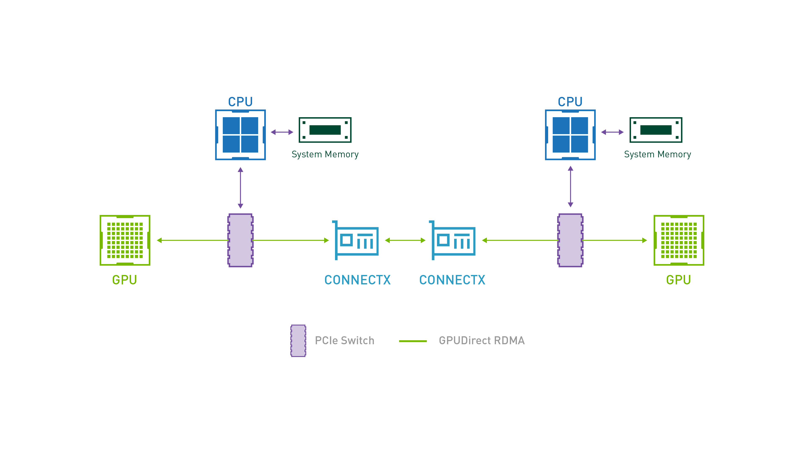
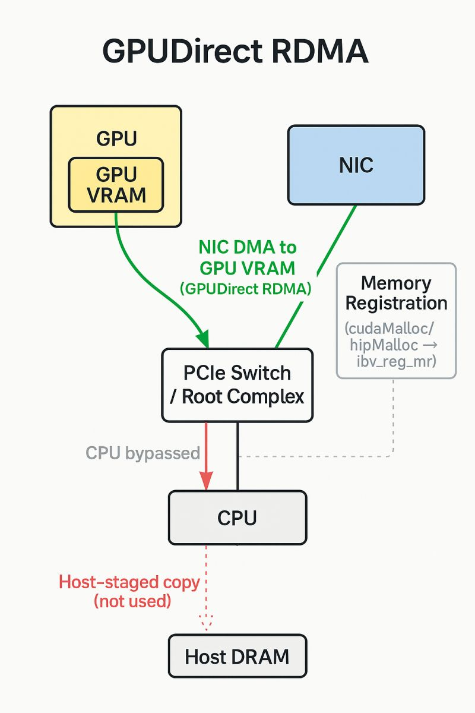
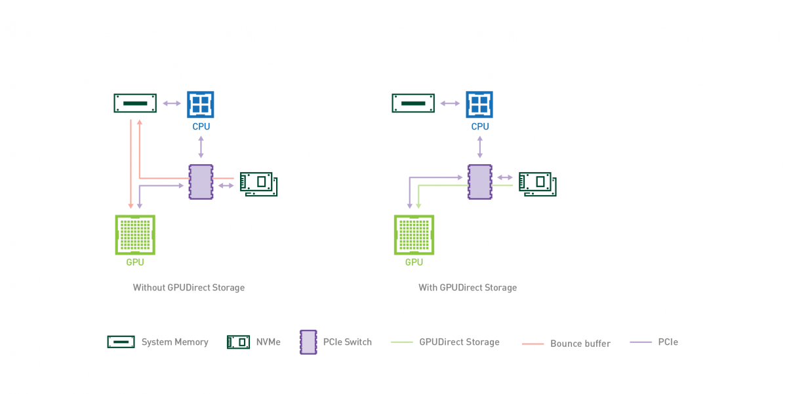

# NVIDIA GPUDirect RDMA 与 Storage 技术详解

## 1. 引言

GPU 和网卡、存储设备之间交换数据，默认路径要经过 CPU 内存：发送前先从显存搬到系统内存，接收后还要再搬一次。这段中转消耗 PCIe 带宽和 CPU 内存带宽，也让 CPU 被迫参与数据搬运。

GPUDirect 系列技术做的事情，就是把 CPU 从数据路径上拿掉：节点内 GPU 之间走 [GPUDirect P2P](02_gpudirect_p2p.md)，跨节点 GPU 与网卡走 **GPUDirect RDMA**，GPU 与 NVMe 存储走 **GPUDirect Storage (GDS)**。本文讲后两个的机制、部署前提和边界；P2P 的原理与代码见 GPUDirect P2P 篇。

## 2. GPUDirect RDMA 技术

> 官方文档参考：[GPUDirect RDMA Documentation](https://docs.nvidia.com/cuda/gpudirect-rdma/index.html)

GPUDirect RDMA (Remote Direct Memory Access) 是一项允许第三方 PCIe 设备（如网络接口卡 NIC、存储适配器等）直接访问 NVIDIA GPU 显存的技术。这项技术最早在 Kepler 架构 GPU 和 CUDA 5.0 中引入，旨在消除 GPU 与第三方设备通信时 CPU 的介入和不必要的系统内存拷贝。

整体架构：



### 2.1 技术背景与痛点

在未启用 GPUDirect RDMA 的传统架构中，当 GPU 需要通过网络发送数据时，数据流必须经历“GPU 显存 -> 系统内存 (CPU 参与) -> 网卡”的路径：

1. **数据拷贝**：GPU DMA 引擎将数据从 GPU 显存搬运到源主机的系统内存 (CPU 内存)，CPU 不参与数据搬运。
2. **网络传输**：CPU 参与控制，网卡 (NIC) 通过 DMA 从系统内存读取数据并通过网络发送。
3. **接收与拷贝**：目标主机网卡通过 DMA 将数据写入系统内存，再由 GPU DMA 引擎搬运到目标 GPU 显存。

这带来了显著的性能瓶颈：

- **高延迟**：数据在 PCIe 总线上往返，且需要 CPU 处理中断和上下文切换。
- **带宽瓶颈**：数据流经系统内存，受限于 CPU 内存带宽。
- **CPU 负载**：CPU 必须参与缓冲区管理和 DMA 描述符设置，无法专注于计算任务。

### 2.2 工作原理详解

GPUDirect RDMA 利用了标准 PCIe 总线的功能，使第三方设备能够通过 **PCI BAR (Base Address Register)** 直接对 GPU 显存进行读写操作。

#### 2.2.1 核心机制

当两个 PCIe 设备（例如 GPU 和 NIC）共享同一个上游 Root Complex 时，它们可以通过物理地址直接通信。路径质量取决于中间经过什么：路径上只有 PCIe Switch 时最优；经过单个 CPU/IOH 时可用，但部分处理器平台的 P2P 读带宽严重受限；跨 QPI/HT（跨 CPU Socket）路径可能严重受限甚至不可靠。

IOMMU 是硬性前提：GPUDirect RDMA 假设所有 PCI 设备看到同一套物理地址，所以开启地址翻译的 IOMMU 必须关闭或配置成 1:1 passthrough。ACS 重定向也会影响 P2P 流量的走向，配置细节见 [Linux PCIe P2PDMA 技术介绍](../pcie/02_p2pdma_technology.md)。

- **PCI BARs 映射**：GPU 将其显存的一定区域通过 BARs 暴露在物理地址空间中。
- **P2P Direct Access**：NIC 可以像访问系统内存一样，直接向这些 GPU BAR 地址发起 PCIe Read/Write 事务。



#### 2.2.2 驱动层交互 (Kernel & Userspace)

GPUDirect RDMA 的实现依赖于 NVIDIA Kernel Driver 和用户态 CUDA 库 (Userspace CUDA Library) 的协同工作：

1. **地址区分**：用户态 CUDA 库提供 API 帮助通信库（如 MPI, NCCL）区分指针是指向 CPU 内存还是 GPU 显存。
2. **Pinning GPU Memory (页面锁定)**：
   - 对于 CPU 内存，Linux 内核使用 `get_user_pages()` 进行 Pinning。
   - 对于 GPU 显存，NVIDIA Kernel Driver 提供了专用的内核 API（`nvidia_p2p_get_pages` 等）来锁定 GPU 页面，并将其总线地址（bus address）列表返回给 NIC 驱动。
   - NIC 驱动用这些总线地址编程 DMA 引擎，从而建立直接的数据传输通道。

### 2.3 性能优势

GPUDirect RDMA 在 GPU 和第三方设备之间建立直接的数据传输通道，消除了系统内存拷贝和 CPU 介入。

- **Zero-Copy (零拷贝)**：完全消除了 GPU 显存到系统内存的缓冲拷贝。
- **降低延迟**：数据直接在设备间传输，少一次 PCIe 穿越和系统内存中转。
- **完全卸载**：CPU 仅需负责建立连接和控制流，数据路径完全旁路 CPU。

还有一个容易忽略的正确性问题：NIC 的 DMA 写完 GPU 显存，不等于 GPU 上后续 kernel 已经能看到新数据。官方只承诺 CUDA synchronization 与 work submission API 提供内存序，通信库仍要遵守 stream/event 顺序，不能只看 RDMA 完成中断就认为数据可见。

### 2.4 开发者视角：代码与 API

虽然上层应用通常使用 CUDA-aware MPI 或 NCCL 来隐式使用 GPUDirect RDMA，但在底层驱动开发中，涉及以下关键步骤：

```c
// 伪代码示例：展示 NIC 驱动如何注册 GPU 显存以进行 RDMA
// 实际上，这通常由 InfiniBand Verbs (libibverbs) 库在用户态封装

// 1. 用户态分配 GPU 内存
void* d_buffer;
cudaMalloc(&d_buffer, size);

// 2. 注册内存区域 (Memory Region Registration)
// 此时，libibverbs 会检测指针类型。如果是 GPU 指针，
// 它会调用 NVIDIA 内核驱动提供的 nvidia_p2p_get_pages 等接口
// 来获取 GPU 页面的物理地址，并将其写入 NIC 的页表 (MTT/MKEY)。

struct ibv_mr *mr = ibv_reg_mr(pd, d_buffer, size,
                               IBV_ACCESS_LOCAL_WRITE |
                               IBV_ACCESS_REMOTE_WRITE |
                               IBV_ACCESS_REMOTE_READ);

if (!mr) {
    // 注册失败，可能因硬件不支持或未加载 nvidia-peermem 模块
    fprintf(stderr, "GPUDirect RDMA registration failed\n");
}

// 3. 执行 RDMA 操作 (Send/Recv/Write/Read)
// NIC 硬件 DMA 引擎直接通过 PCIe 总线访问 d_buffer 的物理地址
ibv_post_send(qp, &wr, &bad_wr);
```

**注意**：要启用此功能，系统需要加载 `nvidia-peermem` 内核模块，该模块充当 NVIDIA 驱动与 InfiniBand 核心驱动之间的桥梁。它要求内核带 RDMA peer memory 支持（上游内核或 MLNX_OFED 提供），NIC 侧 ConnectX-3 VPI 及更新版本可用，InfiniBand 和 RoCE 都支持。旧版 `nv_peer_mem` 与 `nvidia-peermem` 只能加载一个，启用前先卸载旧模块。

内存类型也有边界：GPUDirect RDMA 只作用于 `cudaMalloc()` 分配的 GPU 页；Unified Memory 没有被官方支持，注册后可能读到旧数据甚至丢数据。BAR1 页 pinning 是毫秒级开销，驱动靠延迟解映射来摊薄，频繁注册/注销小块显存会放大这个成本。

节点内的实际验证流程和实测数字见 [GPUDirect RDMA 跨节点验证](04_gpudirect_rdma_verification.md)；从 DMA engine 视角看描述符、地址映射和完成语义，见 [DMA engine：从描述符到完成，一次搬运发生了什么](../dma/01_dma_engine.md)。

---

## 3. GPUDirect Storage (GDS) 技术

> 官方文档参考：[GPUDirect Storage Documentation](https://docs.nvidia.com/gpudirect-storage/)

随着 AI、HPC 以及数据分析领域的数据集规模持续增长，数据加载所消耗的时间开始对应用整体性能产生显著影响。高速 GPU 往往受限于缓慢的 I/O，尤其是在将数据从存储系统加载到 GPU 显存以进行计算处理的过程中。

GPUDirect Storage (GDS) 旨在建立一条在本地或远程存储（如 NVMe 或 NVMe over Fabrics, NVMe-oF）与 GPU 内存之间的直接数据通路。该技术避免了通过 CPU 内存中的中转缓冲区（Bounce Buffer）进行额外的数据拷贝，使位于网卡或存储设备附近的直接内存访问（DMA）引擎能够沿着一条直达路径将数据直接传入或传出 GPU 内存，全程无需给 CPU 带来额外负担。

整体架构：



### 3.1 技术背景与痛点

在传统的存储 I/O 路径中，将数据从磁盘读取到 GPU 显存是一个多阶段、低效率的过程：

1. **内核态缓冲**：存储设备（如 NVMe SSD）通过 DMA 将数据写入操作系统内核空间的 Page Cache。
2. **用户态拷贝**：CPU 将数据从内核空间拷贝到用户空间的应用程序缓冲区 (CPU 内存)。
3. **H2D 拷贝**：GPU DMA 引擎将数据从 pinned buffer 搬运到 GPU 显存 (Host-to-Device)，CPU 仅设置 DMA 描述符，不参与数据搬运。

这种被称为“Bounce Buffer”效应的机制存在三大问题：

- **CPU 瓶颈**：CPU 必须参与中间的 memcpy（page cache → user buffer），随着 NVMe 速度提升，CPU 逐渐成为瓶颈。
- **延迟增加**：多次数据搬运（DMA + CPU memcpy）和上下文切换显著增加了端到端延迟。
- **PCIe 带宽浪费**：数据在 PCIe 总线上来回传输（SSD -> CPU -> GPU），实际上占用了两倍的 PCIe 带宽。

### 3.2 工作原理与软件架构

GPUDirect Storage 不仅是一项硬件技术，更依赖于一套深度的软硬件协同栈，引入了全新的文件系统直通机制。

#### 3.2.1 软件架构与依赖

GDS 的实现依赖于以下核心软件组件：

- **cuFile API (libcufile)**：用户态核心库。它提供了类似于 POSIX (`read`/`write`) 的 API，但专门针对 GPU 显存指针进行了重载。它负责拦截 I/O 请求，进行参数检查，并智能选择最佳的传输路径（GDS 路径或兼容回退路径）。
- **nvidia-fs.ko (cufile.ko)**：这是 GDS 的核心内核模块。由于标准的 Linux 内核 VFS（虚拟文件系统）和块设备层无法直接处理 GPU 显存地址，`nvidia-fs` 必须介入。它负责：
  - 与文件系统（如 ext4, xfs）交互以获取文件元数据和物理块布局。
  - 调用 NVIDIA GPU 驱动接口锁定 GPU 显存页面。
  - 将 I/O 请求转换为下层驱动可理解的格式。
- **存储驱动适配**：
  - **传统模式 (Legacy / MOFED)**：标准的 NVMe 驱动通常期望 DMA 目标是系统内存。为了支持 P2P DMA，旧版本的 GDS 往往需要经过补丁修改的 NVMe 驱动（通常由 MOFED 提供）或特定的内核补丁。在这种模式下，`nvidia-fs` 通过特定的回调接口与块设备层交互，甚至可能传递特殊的“伪地址”或句柄，以便驱动能识别并正确建立指向 GPU 显存的 DMA 映射。
  - **原生 P2PDMA 模式 (Modern / Upstream)**：随着 Linux 内核的发展（Kernel >= 6.2），上游内核引入了标准的 **PCI P2PDMA** 基础设施。从 CUDA 12.8 开始，GDS 可以利用这一标准机制，无需修改 NVMe 驱动即可实现 P2P 传输。这显著降低了部署门槛，消除了对定制内核或驱动的依赖。

#### 3.2.2 核心流程：地址转换与 DMA

GDS 的 I/O 流程并非简单的“把 GPU 地址给硬盘”，而是一个复杂的地址转换与编排过程。由于 PCIe 设备间无法直接通过 GPU 虚拟地址通信，且操作系统内核主要管理 CPU 物理内存，因此需要经过多层转换：

1. **用户态请求**：应用程序调用 `cuFileRead`，传入 GPU 虚拟地址（Device Virtual Address, DVA）。
2. **内核态捕获**：`libcufile` 将请求传递给内核模块 `nvidia-fs`。
3. **地址转换与锁定 (Pinning)**：
   - `nvidia-fs` 无法直接将 GPU DVA 传递给 NVMe 驱动。它首先需要调用 NVIDIA GPU 驱动 API，将 GPU 虚拟地址锁定，并获取对应的 **GPU 物理地址 (GPU Physical Address)** 或 **PCIe 总线地址 (Bus Address)**。
   - **Legacy 模式实现细节**：为了适配现有的内核块设备接口，`nvidia-fs` 可能会构建包含特殊标记（如“伪 CPU 地址”）的 BIO（Block I/O）结构体。当底层的 NVMe 驱动（需支持 GDS）识别到这些特殊标记时，会通过回调 `nvidia-fs` 提供的接口，将这些伪地址替换为真实的 GPU BAR 物理地址，从而构建正确的 DMA 描述符（PRP/SGL）。
4. **DMA 描述符构建**：
   - 最终，DMA 引擎的目标地址被填入了 GPU 的 BAR 空间物理地址，而非 CPU 内存地址。
5. **P2P 直接传输**：NVMe 控制器启动 DMA，数据通过 PCIe 总线直接写入 GPU 显存，完全绕过 CPU 内存和 CPU 缓存。

#### 3.2.3 路径选择与回退

如果硬件或系统配置不支持 P2P（例如设备不在同一个 PCIe Root Complex 下，ACS 未旁路，或 IOMMU 未设为 passthrough），`libcufile` 会自动检测并回退到兼容模式（System Memory Bounce Buffer），但仍会尝试优化路径。

> **GDS 硬件前提条件**：ACS bypass（PCIe Switch 下行端口关闭 ACS 转发限制）、`iommu=pt`（内核启动参数，避免 DMA 地址转换开销）、O_DIRECT 对齐（文件打开必须使用 O_DIRECT 标志）。任一条件不满足将导致回退。

### 3.3 核心优势

GDS 通过构建存储到 GPU 的直通高速公路，打破了传统 I/O 的带宽和延迟瓶颈，并彻底解放了 CPU 算力。

- **带宽提升**：直接利用 PCIe P2P 特性，吞吐量可接近存储设备或 PCIe 总线的物理极限。官方口径是绕开 CPU 的直达路径"峰值带宽至少是经过 CPU 路径的两倍"；这是对硬件路径的判断，不是对所有配置都成立的通用加速倍数。
- **延迟最小化**：消除了中间的内存拷贝步骤，I/O 延迟显著降低。
- **CPU 卸载 (CPU Offloading)**：CPU 仅需处理控制流，不再参与繁重的数据搬运，从而释放 CPU 算力用于预处理或其他逻辑。

### 3.4 部署与上手

GDS 的部署前提已在 3.2.3 覆盖（ACS、IOMMU、O_DIRECT）。cuFile API 的完整调用流程（包括缓冲注册 `cuFileBufRegister`）、环境检查脚本与前置条件核对，见 [GPU Direct Storage 基础](03_gds_basics.md)；该文基于 RTX 5090 + CUDA 12.8 (GDS 1.13.1) 环境，可直接照做。

## 4. GPUDirect 生态系统支持

GPUDirect 技术（涵盖 RDMA 和 Storage）已经建立了庞大的软硬件生态系统，从底层的网卡和存储设备，到中间件通信库，再到上层的 AI 框架，均有广泛支持。

### 4.1 GPUDirect RDMA 生态

- **网络硬件**：NVIDIA Mellanox ConnectX 系列（`nvidia-peermem` 从 ConnectX-3 VPI 起支持，5/6/7 代最完善）、AWS EFA、Broadcom/Chelsio 的部分网卡。
- **通信库**：NCCL 的集合通信、CUDA-aware MPI（OpenMPI/MVAPICH2）、NVSHMEM 的单边通信、UCX 框架，都在检测到可用拓扑后自动走 GPUDirect RDMA，应用层通常无感。

### 4.2 GPUDirect Storage (GDS) 生态

本地文件系统 ext4、xfs 原生支持；Lustre、IBM Spectrum Scale、WekaFS、VAST、BeeGFS 等并行/分布式文件系统经各自集成支持 GDS；NetApp、Dell PowerScale、Pure FlashBlade 等存储阵列也在产品层面做了集成。版本与功能的支持矩阵以 [NVIDIA GDS Release Notes](https://docs.nvidia.com/gpudirect-storage/release-notes/index.html) 为准。

### 4.3 上层框架集成

DALI 原生支持 GDS 加速数据预处理流水线；PyTorch 经 DALI 插件使用 GDS，分布式训练经 NCCL 走 GPUDirect RDMA；RAPIDS cuDF 用 GDS 读取 Parquet/CSV/ORC；TensorFlow 经 NCCL 和 I/O 插件获得同样的加速能力。具体版本与配置要求（内核、OFED）见各厂商文档与上面的支持矩阵。

---

## 5. 总结

RDMA 和 GDS 是同一个思想在两个方向上的应用：数据面绕开 CPU 内存，控制面留在 CPU。RDMA 管跨节点的梯度与 KV cache 传输，GDS 管存储到显存的数据加载，两者在一个大规模训练集群里通常同时存在。

决定能不能用、快多少的不是 API，而是三件事：设备的相对位置（是否同一 root complex、是否经 PCIe Switch）、地址翻译的配置（IOMMU 关闭或 1:1、ACS、BAR1）、以及内存类型是否在支持范围内（`cudaMalloc` 显存、对齐的 buffer）。部署前核对这三件事，验证流程见 [RDMA 跨节点验证](04_gpudirect_rdma_verification.md) 与 [GDS 基础](03_gds_basics.md)；把搬运放回完整 DMA 模型，见 [DMA engine](../dma/01_dma_engine.md)。
