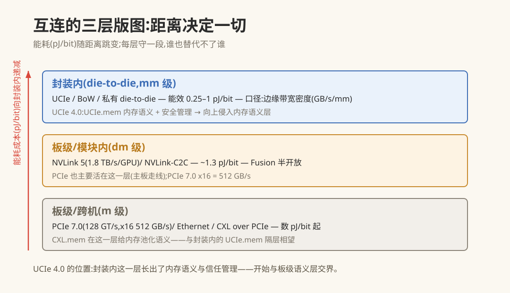
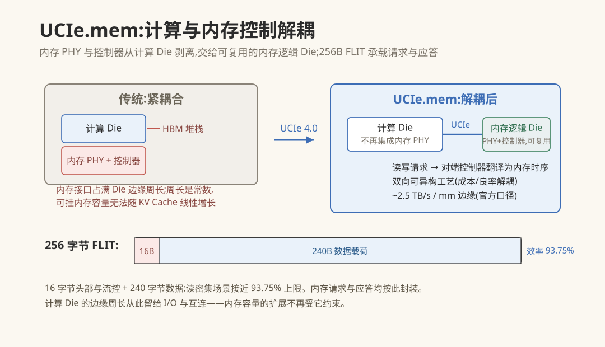
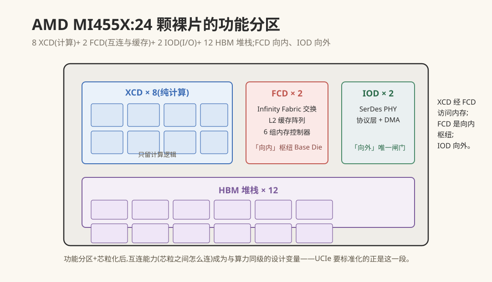

# UCIe 4.0 与 PCIe、NVLink：芯粒互连的三层版图

> 基于 2026-11-12 发布的 UCIe 4.0 规范与厂商解读写成，技术事实多源核对，厂商口径已标注。文末附参考资料与遗留问题清单。

芯粒(chiplet)把一颗大芯片拆成多颗小裸片，再封装在一起。拆开之后立刻遇到一个问题：裸片之间怎么连？历史上这个问题没有公开答案——AMD 用自己的 Infinity Fabric，NVIDIA 用 NVLink-C2C，各家管各家的。同一家的裸片互相咬合没问题，但不同厂商的裸片混在同一个封装里，谁也对不上谁。

UCIe(Universal Chiplet Interconnect Express)要解决的就是这件事：给 die-to-die 互连定一个开放标准，让任何厂商的裸片能按同一套电气、协议与封装规范互连。可以把它理解成「芯粒间的 PCIe」——PCIe 当年给板卡互连定了开放标准，UCIe 想在封装内重演这件事。

2026-11-12 发布的 4.0 规范是它的第四代。前三代的目标是让两颗芯粒「联得上、联得快」；4.0 把范围扩到系统层级：内存协议、安全管理、跨厂商信任。这篇文章把 UCIe 放进它与 PCIe、NVLink 共同构成的互连版图里，逐层对照。

## 一、互连的三层物理约束

数字系统的互连，按物理距离分三层：

| 层级               | 距离  | 代表协议                         | 能效(pJ/bit 量级) | 典型带宽                            |
| ------------------ | ----- | -------------------------------- | ----------------- | ----------------------------------- |
| 封装内(die-to-die) | mm 级 | UCIe、BoW、Infinity Fabric(片内) | 0.25–1            | 密度口径：每毫米边缘数百至数千 GB/s |
| 板级/模块内        | dm 级 | NVLink、NVLink-C2C               | ~1.3              | NVLink 5：单 GPU 1.8 TB/s           |
| 板级/跨机          | m 级  | PCIe、Ethernet                   | 数 pJ/bit 起      | PCIe 7.0 x16：512 GB/s              |

这张表的物理逻辑很朴素：距离越短，信道损耗越可控，可以用更多并行、更简单的信号方式，能耗就越低。UCIe 1.0 规范(2022)给出的参考数字：先进封装(2D，reach <2mm)0.25–0.5 pJ/bit，标准封装(reach ~25mm)0.5–1 pJ/bit；板级 SerDes 链路(PCIe/NVLink 这类长距、高速率)普遍在数 pJ/bit 以上。NVIDIA 公布的 NVLink 数字约为 1.3 pJ/bit，已属板级里的最优档。

三层不是竞争关系，是分工：封装内解决带宽密度与能耗，板级解决扩展与互通，机柜级解决规模与网络。

但 AI 推理的负载演变正在改变它们的相对地位。模型参数从百亿推向万亿，Agent 多轮对话让上下文从一次性输入变成持续累积的状态，KV Cache 随上下文长度与并发数近乎线性膨胀，并且必须在计算与存储之间高频搬运。传统做法把高带宽内存(HBM 类)堆叠在计算 Die 旁边，但这类内存的接口要沿 Die 边缘周长布置——Die 的周长是常数，KV Cache 的需求是线性增长的。封装内这一层从「够用」变成了「结构性瓶颈」。

## 二、UCIe 4.0 的三件事

2026-11-12 发布的 4.0 规范做了三件事。

### 2.1 UCIe.mem：把内存控制器从计算 Die 上剥离

影响最大的是 UCIe.mem 内存协议：首次为计算芯粒与内存逻辑 Die 之间的封装内连接提供标准方案。计算 Die 不再集成内存 PHY 与内存控制器，这部分功能剥离给一颗独立的、可复用的内存逻辑 Die，两者经 UCIe 标准接口连接。

链路工作方式：计算 Die 发读写请求，内存逻辑 Die 上的控制器把它翻译为具体内存时序；协议将请求与应答封装在 256 字节的 FLIT 里，240 字节承载数据、16 字节用于头部与流控，数据效率上限 93.75%（240/256，读密集场景接近该值）。

两个直接利好：计算 Die 不再为内存接口预留 PHY 边缘，有效面积得以全部用于计算；计算 Die 与内存工艺解耦，各自选最合适的工艺节点，成本与良率都受益。

HPCwire 的报道给出一个量化口径：UCIe.mem 路线下每毫米 Die 边缘约可提供 2.5 TB/s 内存带宽(官方白皮书口径；不同封装配置下数字不同，见下文奇异摩尔给出的两档)。

### 2.2 能耗与带宽密度：收益有前提

能效上，UCIe 4.0 给 UCIe-S 与 UCIe-A 引入可选的协同优化功耗配置：64 GT/s 下链路功耗降 30%–80%。前提要同时满足——对端工艺代兼容、共享电压域、互连距离约 5mm 以内。这是「近邻」场景的专项优化，不是普适的免费午餐。

带宽密度面对的约束更硬：几何尺寸。增强型 bump map 让 shoreline(边缘)带宽密度提升约 20%、面积带宽密度提升约 10%，覆盖 48 GT/s 与 64 GT/s 两档。标准封装 110μm 间距下每毫米边缘约 448 GB/s；先进节点 45μm 间距下约 2634 GB/s，两档相差近六倍。UCIe 4.0 的着力点已经从「信号跑多快」转向「有限边缘长度上塞进更多带宽」。

### 2.3 安全与管理：「管得住」

这是 4.0 在范围上最大的一步。此前 UCIe 的隐含假设是封装内的芯粒出自同一组织；当一颗封装里同时出现不同供应商的计算、内存与 I/O 芯粒，这个前提不再成立。UCIe 4.0 的回应分三层：

1. TRoCs(可信芯粒状态报告)：密码学挑战—应答机制，把芯粒身份、生命周期与安全状态报告给封装级信任根(Root of Trust)；
2. 双向完整性保护的管理通道：密钥建立遵循 NIST SP 800-56C；
3. 标准化的复位与资产配给流程：此类事件时延控制在 1μs 以内；另有一路独立于主通道的开漏信号，主链路失效时仍能传故障指示。

这些特性不直接提升性能，却是多厂商芯粒生态从「技术可行」走向「商业可用」的必要条件。「管得住」说的就是这一层。

## 三、与 PCIe 对照：板级语义之争

PCIe 与 UCIe 守着不同的层，谈「谁替代谁」没有意义。但 UCIe 4.0 之后，两条边界的交界处出现了正面交锋的点：内存语义。

| 维度          | UCIe(封装内)           | PCIe(板级)                           |
| ------------- | ---------------------- | ------------------------------------ |
| 距离          | mm 级                  | dm–m 级                              |
| 能效          | 0.25–1 pJ/bit          | 数 pJ/bit 起                         |
| 带宽形态      | 边缘带宽密度(GB/s/mm)  | 链路带宽(GB/s，x16 聚合)             |
| 速率代际      | 64 GT/s、密度优先      | PCIe 7.0：128 GT/s、x16 512 GB/s(2025-06 v1.0) |
| 内存语义      | UCIe.mem(原生，封装内) | CXL.mem(基于 PCIe 生态扩展)          |

CXL.mem 与 UCIe.mem 的对峙是交界处最值得看的部分。本仓库 [CXL 互联协议全景解读](../pcie/08_cxl_interconnect_overview.md)拆解过 CXL 的三代演进：它基于 PCIe PHY 与协议栈扩展出内存语义层，优势在生态成熟——x86 服务器、既有主板走线全部兼容。UCIe.mem 的优势在物理层效率(封装内距离，pJ/bit 低一个量级)与「内存逻辑 Die」这个更彻底的解耦形态。两条路线的边界目前画在封装边缘上：CXL 守板级与机柜内存池化，UCIe.mem 守封装内与近封装。这个边界会不会被任一方越过，行业没有共识。

生态与工具链的差距是另一个现实约束。PCIe 有三十年积累：仿真、测试、调试工具链、互操作性认证全部齐备；UCIe 的互操作性认证(UCIe Compliance)2023 年才开始，工具链仍在建设。做芯粒集成决策时，这是比带宽密度更现实的考量。

## 四、与 NVLink 对照：机柜规模之争

NVLink 与 UCIe 的关系比 PCIe 更近：NVLink 也是短距、高密度路线，但它的规模形态是机柜级(NVLink Switch 把 72 卡连成一个 domain)，而且长期私有。

| 维度           | NVLink 5 / Fusion                         | UCIe                        |
| -------------- | ----------------------------------------- | --------------------------- |
| 带宽           | 单 GPU 1.8 TB/s(NVLink 5)                 | 密度口径(GB/s/mm shoreline) |
| 覆盖           | 机柜级(NVLink Switch domain)              | 封装内(mm 级)               |
| 开放性         | 私有协议；2025 年 NVLink Fusion 半开放    | 开放联盟规范，成员可实施    |
| 与 UCIe 的交点 | NVLink Fusion 可为第三方芯粒暴露 UCIe PHY | —                           |

三个观察：

NVLink Fusion 是一个信号。NVIDIA 在 2025 年把 NVLink 开放给非 NVIDIA 的 CPU/ASIC 接入机柜，公开路径里包含「可为第三方芯粒暴露 UCIe PHY」。私有阵营开始接纳封装内互连的开放标准，但把「往上走」的权力(NVLink domain)留在自己手里。

Scale-Up 协议层的竞合刚起步。UCIe 只定义到 PHY 与 adapter 层，其上的 Scale-Up 协议(UALink、SUE、ESUN 等)各有阵营；奇异摩尔等厂商的 IO Die 同时兼容多协议，正是协议层未收敛的现状的产物。

能耗分层决定了融合边界。NVLink-C2C(约 1.3 pJ/bit，Grace↔Hopper 模块内)介于 UCIe 与 PCIe 之间：比封装内贵，比板级省。距离每上一个层级，能耗数量级跳一次。这个物理账本决定了哪些互连可以被封装吸收、哪些必须留在板级。

## 五、案例：功能分区成为主流

AMD 是最早以功能芯粒做模块化集成的公司之一。以 AMD MI455X(CDNA 5)为例，一颗封装由 8 颗 XCD(加速计算芯粒)、2 颗 FCD(互连与缓存芯粒)、2 颗 IOD(I/O 芯粒)与 12 个 HBM 堆栈，共 24 颗裸片组成：XCD 只留计算逻辑；FCD 承载完整的 Infinity Fabric 交换网络、L2 缓存与 6 组内存控制器，「向内」负责计算与内存之间的全部流量；IOD 集成 SerDes PHY、协议层与 DMA 引擎，「向外」是整颗复合芯片对外的唯一闸门。

NVIDIA Blackwell、Google 8i Max 也在不同程度上沿用功能分区。各家实现差异很大，但方向一致：芯片规模与系统复杂度上升后，功能划分与芯粒间互连能力成为架构设计的关键变量。差异在于互联实现——AMD/NVIDIA/Google 用私有方案深度定制，中小厂商往往只能选第三方通用方案。于是一颗封装里可能出现多供应商的芯粒组合，这正是 2.3 节安全管理成为必要条件的原因。

## 六、开放生态与中国站位

UCIe 联盟 2022 年成立，由 Intel、AMD、Arm、TSMC、Samsung、Microsoft、Google、Meta 等共同发起。中国阵营的对应动作：奇异摩尔是 UCIe 联盟首批中国成员之一，其 Central IO Die、超节点 G2G 互联 IO 芯粒、800G AI SNIC 平台均已支持 UCIe 标准；面向光互联的 Kiwi OSU IO 芯粒提供标准化 UCIe 接口并兼容 UALink、SUE、ESUN 等 Scale-Up 协议，厂商口径称相较可插拔光模块带宽密度可提升 10 倍(厂商口径，未独立验证)。

标准侧，中国移动牵头编制《人工智能加速器互联芯粒技术要求》，奇异摩尔任主编单位之一；另有 GCC 深联 Infra 社区与《智能计算集群卡间互联协议》国家标准编制组。这些动作的共同指向：在 UCIe 之外，为国内工艺与封装能力建一套平行的开放标准。以上是生态背景；本文不评价各标准的优劣。

## 七、边界与遗留

1. 协同优化功耗的前提苛刻：工艺代兼容、共享电压域、距离 5mm 以内。满足这三条的部署形态有限，「降 30%–80%」不是普适数字；
2. Die 边缘周长是物理极限：bump map 增强带来的 +20% 密度改善，面对线性膨胀的 KV Cache 需求只是延缓——UCIe.mem 的解耦把瓶颈从「边缘周长」换成「封装内互连带宽」，后者仍受 shoreline 约束；
3. UCIe.mem 尚无出货产品：4.0 规范 2026-11 才发布，内存逻辑 Die 的实际产品未出现，官方与厂商口径均为规划与 Demo；
4. 与 CXL 的竞合未收敛：封装内 UCIe.mem 与板级 CXL.mem 的边界、互通、谁是内存池化主战场，行业没有共识；
5. 本仓库的相关深读：PCIe 体系见 [PCIe 总线体系](../pcie/README.md)（含 [CXL 互联协议全景解读](../pcie/08_cxl_interconnect_overview.md)）；NVLink 见 [NVLink 与 NVSwitch](../nvlink/README.md)。

## 参考资料

1. UCIe Consortium. [UCIe 4.0 Specification](https://ucieconsortium.org/)（2026-11-12 发布；规范全文需成员账号）
2. HPCwire. [UCIe Consortium Tackles the Memory Wall with New 4.0 Chiplet Spec](https://www.hpcwire.com/2026/11/12/ucie-consortium-tackles-the-memory-wall-with-new-4-0-chiplet-spec)（2026-11-12）
3. 奇异摩尔. [UCIe 4.0 发布：从「联得上」到「管得住」，芯粒互连迈入系统级时代](https://mp.weixin.qq.com/s/H2ATnZqHWV1YlwhPRa-qZA). 微信公众号, 2026-11-24.（本文主要中文素材；厂商口径已标注）
4. PCI-SIG. [PCIe 7.0 Specification Version 1.0](https://pcisig.com/specifications/pcie-70-specification-version-03-now-available-members)（2025-06 定稿，128 GT/s）
5. NVIDIA. [NVLink & NVLink Switch](https://www.nvidia.com/en-us/data-center/nvlink)（NVLink 5：1.8 TB/s；NVLink Fusion）
6. UCIe 1.0 规范能效口径（0.25–0.5 / 0.5–1 pJ/bit）：UCIe 白皮书与 Cadence/Synopsys 公开技术资料
7. 本仓库相关深读：[CXL 互联协议全景解读](../pcie/08_cxl_interconnect_overview.md)、[NVLink 技术入门](../nvlink/nvlink_intro.md)
