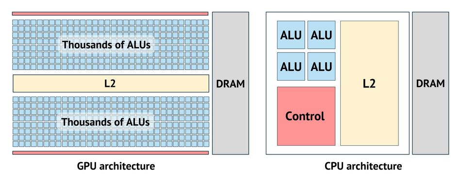

# 深入了解 Nvidia CUDA 核心

Nvidia 的 CUDA 核心是 Nvidia 显卡内的专门处理单元，旨在高效处理复杂的并行计算，使其成为高性能计算、游戏和各种图形渲染应用程序中的关键。

作者：`Ravi Rao`

CUDA 核心是现代 GPU 的基本计算单元。本文讲清楚它是什么、与 CPU 核心的差别、以及在不同工作负载下怎么看待"核心数量"这个指标。

## CUDA 核心和并行处理简介

CUDA 代表统一计算设备架构，这是 Nvidia 创建的专有并行计算平台和应用程序编程接口 (API) 模型。CUDA 核心旨在同时处理多个任务，使其能够高效地处理可分解为并行进程的任务。

在现代计算领域，CUDA 核心因其能够利用 GPU 的强大功能显著加快计算机程序的速度而变得越来越重要。与具有针对顺序串行处理进行优化的几个核心的中央处理器 (CPU) 不同，GPU 具有大规模并行架构，由数千个更小、更高效的核心组成，旨在同时处理多个任务。

这种架构允许 CUDA 核心同时执行数千个线程，从而显著提高旨在利用并行处理的应用程序的性能。这在游戏、科学计算和人工智能等领域尤其有益，因为这些领域需要同时处理大量数据。

例如，在游戏中，CUDA 核心可以更快更高效地渲染图形，从而带来更流畅的游戏体验和更逼真的视觉效果。在科学计算中，它们可以处理大型数据集并以比传统 CPU 快得多的速度执行复杂计算。在人工智能中，CUDA 核心可以加速机器学习算法，从而实现更快的数据分析和决策。

## GPU 架构的演变

多年来，图形处理单元 (GPU) 的架构经历了重大变化。最初，GPU 的设计目的只有一个：加速创建用于输出到显示器的图像。它们配备了固定功能管道，这是一种架构，其中管道中的每个阶段都有固定的功能，数据按顺序从一个阶段移动到下一个阶段。

固定功能管道在执行与渲染图形相关的特定任务时效率极高。然而，它们缺乏灵活性。管道中的每个阶段都旨在执行特定任务，不能用于其他任何用途。这意味着如果需要添加新特性或功能，通常需要完全重新设计 GPU 架构。

固定功能管道的局限性导致了可编程着色器的开发。着色器是在 GPU 上运行的小程序，可以进行编程以执行与渲染图形相关的各种任务。这标志着 GPU 架构的重大转变，因为它允许开发人员更好地控制渲染过程，并能够创建更复杂、更逼真的图形。

[**什么是着色器？**](https://youtu.be/sXbdF4KjNOc)

可编程着色器的推出为 CUDA 核心的出现创造了条件。着色器是指示如何在 GPU 上处理像素和顶点的程序。借助可编程着色器，开发人员可以编写直接在 GPU 上运行的代码——GPU 的用途不再局限于渲染图形，它的并行处理能力开始被用于各种计算密集型任务。

这导致了通用图形处理单元 (GPGPU) 计算概念的出现，即使用 GPU 执行传统上由 CPU 处理的计算。Nvidia 是首批接受这一概念的公司之一，他们开发了 CUDA，以便让开发人员更容易使用 GPGPU。

CUDA 核心就是这一演变的产物：Nvidia GPU 中的可编程着色器，可用于各种任务而不只是渲染图形。GPU 从此从仅用于图形渲染转向通用计算。

## CUDA 在 GPU 架构中的作用

CUDA 平台让开发人员能够直接访问 CUDA GPU 中并行计算元素的虚拟指令集和内存。使用 CUDA，GPU 可以用于数学密集型任务，从而释放 CPU 来执行其他任务。这与传统的 GPU 渲染 3D 图形的功能相比发生了重大转变。

CUDA 核心是 CUDA 平台的核心。它们是 GPU 内执行计算任务的并行处理器。GPU 拥有的 CUDA 核心越多，它可以同时处理的任务就越多，从而提高并行处理任务的性能。

在 GPU 架构中，CUDA 核心相当于 CPU 中的核心，但它们的设计和功能存在根本区别。CPU 核心设计用于顺序处理，一次可以处理几个软件线程，而 CUDA 核心是高度并行架构的一部分，可以同时处理数千个线程。

这种架构设计对于可以分解为并行进程的任务特别有用。例如，在图像处理中，图像的每个像素都可以独立处理。这意味着可以将任务分配给多个 CUDA 核心，每个核心同时处理不同的像素，从而显著缩短处理时间。

从本质上讲，CUDA 将 GPU 从主要用于为计算机游戏和电影创建图像的设备转变为通用并行处理器。这扩大了 GPU 在计算中的作用，并为计算科学和其他需要高性能计算的领域开辟了新的可能性。

## 了解 CUDA 核心

CUDA 核心是 GPU 内执行计算任务的并行处理单元——注意别和 CUDA 平台本身混淆：CUDA 是 Nvidia 创建的并行计算平台和编程模型，CUDA 核心是它在硬件侧的执行单元。GPU 拥有的 CUDA 核心越多，可并行的任务就越多。

每个 CUDA 核心都能够同时执行浮点运算和整数运算，这一设计选择显著提高了图形渲染和其他并行任务的计算效率。CUDA 核心被分组为更大的单元，称为流式多处理器 (SM)，每个 SM 可以同时执行数百个线程。这是 CUDA 架构的一个关键方面，使其能够实现高计算性能。

CUDA 核心的架构包括几个关键组件：

- **算术逻辑单元 (ALU)**：负责执行算术和逻辑运算，ALU 是 CUDA 核心的主力，能够快速处理图形渲染和模拟物理所需的数学计算。
- **寄存器文件**：寄存器文件是每个 CUDA 核心内的小型高速存储区域，用于存储计算过程中所需的变量和临时数据。寄存器文件的大小和效率对 CUDA 核心的性能至关重要。
- **共享内存**：同一流多处理器 (SM) 内的 CUDA 核心共享一个称为共享内存的公共内存空间，这有助于核心之间的快速数据交换和同步，从而减少了对缓慢的全局内存访问的需要。

GPU 中的 CUDA 核心数量因型号而异。例如 2017 年的高端游戏 GPU GeForce GTX 1080 Ti 有 3584 个 CUDA 核心；同年面向数据中心的 Tesla V100 SXM2 有 5120 个（PCIe 版为 2560，同型号不同封装核心数不同，注意区分）。核心数量只是粗粒度的能力指标，性能还取决于核心架构、代数、时钟速度、内存带宽等因素。

CUDA 核心不仅能够执行整数和浮点运算，还支持更复杂的数学函数，如三角函数、指数和对数。这使得它们具有高度的通用性，能够处理各种计算任务。

除了计算能力之外，CUDA 核心还可以访问 GPU 内不同类型的内存。每种类型的内存在大小、延迟和带宽方面都有自己的特点，了解如何有效使用这些不同类型的内存是优化 CUDA 应用程序的一个关键方面。

## GPU 中的内存管理

乍一看，GPU 似乎只是由微小单元组成的集群，但就计算能力而言，它们却非常强大。例如，Nvidia RTX 4090 拥有超过 16,300 个核心和 24 GB 的 GDDR6X VRAM 内存，主频为 1313 MHz（有效速度为 21 Gbps）。\[b\]

用好 GPU 的关键在于细致的内存管理：上千个线程共享带宽有限的显存子系统，数据搬运方式直接决定有效算力。CUDA 内存模型定义了这套规则。\[a\]

这种内存模型将 GPU 线程组织成块，每个块最多 1,024 个线程。GPU 的内存层次结构分为四种类型：

- **主机内存**：由 CPU 管理的主系统 RAM，物理上与 GPU 分开，需要特定机制（DMA）来传输数据。
- **设备内存**：GPU 的板载 RAM（HBM/GDDR），容量从数十 GB 到上百 GB（如 B200 192GB），存放等待处理的数据。
- **共享内存**：块内所有线程可访问的小容量缓冲区（上限随架构变化：V100 96KB/SM，Hopper 227KB/block），延迟低于设备内存，适合存放频繁访问的数据。
- **寄存器内存**：CUDA 核心可用的最快内存形式，分配给各个线程。它用于存储需要快速访问的变量。当分配超出限制时，多余的数据将移动到速度较慢、延迟较高的本地内存。

在 GPU 处理方案中，每种算法都有其独特的用途。为了充分利用 GPU，高效的算法必须遵循四个指导原则：

- 促进块级并行，其中线程在其 CUDA 块内进行协作。
- 尽量减少主机到设备的内存传输以避免瓶颈。
- 减少设备到共享/寄存器的内存传输以获得最佳性能。
- 鼓励分块内存访问模式与 GPU 内存架构保持一致。

GPU 非常强大，但要充分发挥其潜力需要对内存管理有细致的了解。

## CUDA 核心与 CPU 核心

虽然 CUDA 核心和 CPU 核心都负责执行计算任务，但它们的设计、架构和预期用例存在很大差异。了解这些差异对于确定最适合特定任务的处理单元至关重要。

**设计与架构：**

CUDA 核心是 GPU 高度并行架构的一部分，旨在同时处理多个任务。它们经过优化，可同时执行数千个线程，非常适合可分解为并行进程的任务。相比之下，CPU 核心专为顺序处理而设计，每个核心一次可处理几个线程。CPU 针对需要复杂分支和决策的任务进行了优化。

图 1：GPU 和 CPU 架构的高级概览

**性能和效率：**

由于采用并行架构，CUDA 核心可以在可并行化的任务（例如图像处理、科学模拟和机器学习）中实现高性能。但是，它们在需要复杂分支或决策的任务中可能效率不高，而这些任务更适合 CPU 核心。另一方面，CPU 核心功能更丰富，可以处理更广泛的任务，但在可并行化任务中，它们可能不如 CUDA 核心那么高效。

[Mythbusters 演示 GPU 与 CPU 的对比](https://youtu.be/-P28LKWTzrI)

**内存访问：**

CUDA 核心和 CPU 核心在内存访问模式上也有所不同。CUDA 核心可以访问 GPU 内的各种类型的内存，例如全局内存、共享内存和本地内存。高效使用这些内存类型对于优化 CUDA 应用程序至关重要。相比之下，CPU 核心可以访问分层内存系统，包括寄存器、缓存和主内存 (RAM)。了解内存层次结构和优化数据访问模式对于在基于 CPU 的应用程序中实现高性能至关重要。

**编程和软件：**

CUDA 核心编程需要特定的并行编程知识。Nvidia 提供 CUDA，这是一种并行计算平台和编程模型，允许开发人员使用 C、C++ 和 Fortran 编写利用 CUDA 核心并行处理能力的软件。另一方面，CPU 核心可以使用多种编程语言和范例进行编程。它们在软件兼容性方面更灵活，并受到各种操作系统和软件工具的支持。

虽然 CUDA 核心在并行处理任务方面表现出色，但 CPU 核心功能更丰富，可以处理更广泛的应用程序。选择正确的处理单元取决于手头任务的具体要求和所需的性能特征。

## CUDA 核心和高性能计算

高性能计算 (HPC) 是一个专注于聚合计算能力以更快地解决科学、工程或商业中的复杂问题的领域。CUDA 核心凭借其并行处理能力，在 HPC 中发挥着重要作用。

高性能计算通常需要执行大量数学运算，而 CUDA 核心的并行架构非常适合这项任务。每个 CUDA 核心每次只能执行一条指令，但当数千个 CUDA 核心组合在一起时（现代 GPU 中是这样），它们可以并行处理大型数据集，从而显著缩短计算时间。

例如，在科学模拟中，通常需要求解复杂的数学模型，可以利用 CUDA 核心的并行处理能力同时对大型数据集进行计算。这可以大大减少完成模拟所需的时间，使科学家能够进行更复杂、更详细的模拟。

在机器学习领域，CUDA 核心用于加速深度学习模型的训练——训练的本质是海量矩阵乘法，天然并行。同样的训练任务，GPU 集群以小时/天计完成 CPU 需以周计的工作（具体倍数取决于模型与硬件）。

此外，由于 CUDA 核心可以访问 GPU 内的不同类型的内存，因此可以使用共享内存来存储经常访问的数据，从而减少耗时的内存访问的需要，从而提高应用程序的性能。

CUDA 核心具有并行处理能力和对各种内存的访问能力，在高性能计算中发挥着至关重要的作用。它们可以执行大规模科学模拟、训练复杂的机器学习模型等任务，为这些领域的进步做出重大贡献。

## 游戏中的 CUDA 核心

在游戏世界中，图形质量和 FPS（每秒帧数）至关重要。随着游戏玩家不断寻求更身临其境的体验，驱动这些体验的显卡规格变得越来越重要。CUDA 核心通过渲染图形和处理游戏物理来提高游戏的整体性能。CUDA 核心的并行处理能力使其在渲染图形方面特别有效，这涉及同时执行大量计算。

游戏中的图形渲染通常涉及复杂的任务，例如着色、纹理映射和抗锯齿。这些任务可以在 CUDA 核心上并行化并高效执行。例如，在着色中，可以独立处理图像的每个像素。这意味着可以将任务分配给多个 CUDA 核心，每个核心同时处理不同的像素。这种并行处理可以显著缩短渲染时间，从而产生更流畅、更逼真的图形。

除了图形渲染之外，CUDA 核心还承担游戏物理模拟——碰撞、流体动力学这类涉及求解复杂模型的计算，天然适合并行。把物理处理卸载到 GPU，游戏开发者就能以更低的帧开销换取更真实的物理效果。

### 实时光线追踪

实时光线追踪是最苛刻的图形渲染技术之一，它模拟光的物理行为，为游戏带来实时、电影级的渲染效果。Nvidia 的 RTX 系列 GPU 配备专用的光线追踪 (RT) 核心和深度学习超级采样 (DLSS)，利用 CUDA 核心来处理光线追踪所需的密集计算。这使得支持该技术的游戏中的灯光效果非常逼真。

图 2：光线追踪让电影级的反射效果栩栩如生。资料来源：漫威蜘蛛侠：迈尔斯·莫拉莱斯 PC 游戏

## 机器学习和人工智能中的 CUDA 核心

机器学习和人工智能 (AI) 是需要高计算能力的领域，因为算法复杂且涉及的数据集很大。 CUDA 核心凭借其并行处理能力在这些领域发挥着重要作用。

机器学习算法，尤其是深度学习算法，涉及执行大量矩阵乘法。这些操作可以在 CUDA 核心上并行化并高效执行。例如，在深度学习模型的训练中，可以独立计算层中每个神经元的输出。这意味着可以将任务划分到多个 CUDA 核心中，每个核心同时计算不同神经元的输出。这种并行处理可以显著缩短训练时间，从而能够训练更复杂的模型或使用更大的数据集。

除了加速机器学习模型的训练之外，CUDA 核心还在推理阶段发挥作用。推理涉及使用经过训练的模型对新数据进行预测。此任务还可以在 CUDA 核心上并行化并高效执行，从而缩短需要实时预测的应用程序（例如自动驾驶或语音识别）的响应时间。

人工智能，尤其是自然语言处理和计算机视觉等领域，也受益于 CUDA 核心的并行处理能力。图像识别或语言翻译等任务需要同时执行大量计算，而 CUDA 核心的功能非常适合这类任务。

## 如何确定所需的 CUDA 核心数量

确定所需的 CUDA 核心数量取决于应用程序的具体要求。不同的应用程序具有不同的计算需求，因此需要不同数量的 CUDA 核心才能获得最佳性能。

对于游戏应用程序，您需要的 CUDA 核心数量取决于游戏图形和物理的复杂程度。图形和物理更复杂的游戏需要更多的 GPU 核心才能流畅地玩游戏。例如，具有高清图形和逼真物理模拟的现代 AAA 游戏可能需要具有大量 CUDA 核心的 GPU 才能流畅地渲染游戏。但是，要求较低的游戏或较旧的游戏可能不需要那么多 CUDA 核心。

GPU 的架构、核心效率以及 Tensor 和光线追踪核心等各种组件之间的平衡也发挥着至关重要的作用。不同的架构可能会更有效地利用 CUDA 核心，这意味着具有较少 CUDA 核心但更新、更先进的架构的 GPU 可能会胜过具有更多核心数的旧 GPU。此外，游戏性能还受到其他因素的影响，例如内存带宽、时钟速度以及处理 AI 驱动增强和实时光线追踪等任务的专用核心的存在。因此，虽然 CUDA 核心数是一个重要指标，但必须在 GPU 的整体设计和技术生态系统的更广泛背景下考虑它，才能准确衡量游戏性能。

对于机器学习和 AI 应用，所需的核心数量取决于模型复杂性和数据集规模：大模型 + 大数据集吃满算力，多核心才有意义；简单模型或小数据集用不到那么多核心。

从这个角度来看，基准测试成为必不可少的工具，可以对 GPU 在现实条件下的表现进行实用评估。基准测试在各种任务（包括游戏、渲染和计算工作负载）中测试 GPU，从而深入了解其效率、热管理和功耗。它们将 GPU 的理论能力（例如 CUDA 核心数量和架构改进）转化为切实的性能指标。这有助于消费者和专业人士根据实际游戏帧速率、渲染时间和其他关键性能指标做出明智的决策。

## 利用 CUDA 进行并行编程

CUDA 编程是一套专业技能，使开发人员能够直接利用 Nvidia GPU 的计算能力，用于传统图形渲染以外的广泛应用。它涉及编写同时在数千个线程上执行的代码，使其成为可以有效并行化的任务的理想选择。

CUDA 平台提供了全面的生态系统，包括带有编译器、库和调试器的工具包，旨在促进高性能 GPU 加速应用程序的开发。CUDA 程序通常涉及定义内核，这些内核是由 GPU 上的多个线程并行执行的函数。

- **内核**：内核是 CUDA 编程的核心，允许在 GPU 上执行并行代码。它们使用标准 C++ 语法和一些扩展来定义，并从主机 (CPU) 代码启动。
- **线程层次结构**：CUDA 引入了灵活的线程块和网格层次结构，可高效组织和协调并行任务。此层次结构允许开发人员根据其应用程序的特定需求定制执行配置。
- **内存管理**：有效利用 GPU 的内存层次结构（包括全局、共享和本地内存）对于优化性能至关重要。CUDA 提供对内存分配、移动和管理的明确控制，从而实现复杂的优化策略。

要开始 CUDA 编程之旅，开发人员需要具有 CUDA 功能的 Nvidia GPU，以及最新版本的 CUDA 工具包。该工具包全面支持所有主流操作系统，包括 Windows、Linux 以及运行在 AMD 和 Intel 处理器硬件上的操作系统。

由于 CUDA 使用专为并行编程而设计的结构扩展了 C++，因此坚实的 C++ 基础至关重要。Nvidia 通过提供大量文档、示例代码和教程来帮助开发人员快速掌握 CUDA 编程，从而帮助开发人员快速掌握 C++ 编程。

## Nvidia GPU 中 CUDA、Tensor 和光线追踪核心的协同作用

在 Nvidia GPU 的先进领域中，除了作为图形和计算任务基础的多功能 CUDA 核心外，还有另外两种专用核心类型：Tensor 核心和光线追踪 (RT) 核心。这些核心旨在增强 CUDA 核心的功能，突破游戏和 AI 应用程序的极限。

### Tensor Core：AI 加速引擎

Tensor 核心专为深度学习和 AI 计算设计，专攻矩阵运算（神经网络的基础运算）。DLSS（深度学习超级采样）就建立在这一能力上：用 AI 实时升级图像，在不牺牲帧率的前提下提高分辨率。

### 光线追踪核心：光线模拟专用单元

Turing 架构（2018）起加入的 RT 核心专用于处理光线与场景求交的计算密集型过程，让反射、折射和阴影的实时渲染成为可能——在此之前的这类效果只能出现在预渲染场景中。

### 三种核心的分工

CUDA 核心提供通用并行能力（3D 渲染到科学计算），Tensor 核心提供矩阵/AI 专用加速，RT 核心提供光线追踪加速，三者各管一段。

| **功能**         | **CUDA 核心**               | **Tensor 核心**                          | **光线追踪核心**                |
| ---------------- | --------------------------- | ---------------------------------------- | ------------------------------- |
| **主要功能**     | 图形和计算的通用并行处理    | 加速深度学习和人工智能计算               | 加速实时光线追踪计算            |
| **应用**         | 3D 渲染、科学计算、视频处理 | AI 模型训练和推理、DLSS                  | 逼真的灯光和阴影、反射、折射    |
| **性能**         | 并行处理任务效率高          | 针对高吞吐量矩阵运算进行了优化           | 针对射线/路径追踪算法进行了优化 |
| **引入于**       | GeForce 8 系列 (2006 年)    | Volta 架构 (2017 年)                     | Turing 架构 (2018 年)           |
| **精度**         | 浮点和整数                  | 混合精度（FP16、FP32）矩阵运算           | 专用于光线追踪计算              |
| **对游戏的影响** | 改善整体图形渲染和计算任务  | 增强图像升级 (DLSS) 等人工智能驱动的功能 | 实时实现逼真的灯光和视觉效果    |

三种核心各司其职：CUDA 管通用计算，Tensor 管 AI 矩阵运算，RT 管光追求交。按工作负载选择硬件特性，比单纯堆核心数量更有效。

## 超越 CUDA 的并行处理技术：AMD 流处理器

AMD 流处理器是 AMD 并行计算方法的核心，嵌入其 Radeon 图形处理单元 (GPU) 中。这些处理器是 AMD 能够同时执行各种并行计算的主要力量，对于从复杂的科学计算到渲染高清视频游戏等任务来说，它们都是必不可少的。

AMD 流处理器基于可扩展架构运行，可同时处理多个操作。该架构经过优化，可充分利用计算任务的并行特性，从而显著减少处理大型数据集或执行复杂计算所需的时间。

AMD 流处理器的主要优势之一是它们支持 OpenCL（开放计算语言）等开放标准。OpenCL 提供了一个框架，允许开发人员编写可在不同类型的硬件平台上运行的程序。这种开放性确保为 AMD GPU 开发的应用程序不仅可以在不同的 AMD 设备之间移植，还可以在支持 OpenCL 的其他制造商的设备上运行。

[为什么 CUDA“核心”实际上并不是核心，David Kanter 著](https://youtu.be/x-N6pjBbyY0)

此外，AMD 对开源开发的承诺还体现在其对 Radeon 开放计算平台 (ROCm) 的支持上。ROCm 是一个为开发人员提供必要工具和资源的平台，可让开发人员在其应用程序中充分利用 GPU 计算的潜力。该平台旨在促进创新并加速高性能、节能计算系统的开发。

与其他并行处理技术相比，AMD 流处理器兼具性能、灵活性和开放生态系统支持。对于希望突破并行计算极限而又不被专有技术堆栈束缚的开发人员来说，AMD 流处理器是一个有吸引力的选择。

## 结论

CUDA 核心在游戏、机器学习和人工智能等各种应用中发挥着重要作用。它们的并行处理能力使它们能够同时执行大量计算，从而缩短处理时间，并提高需要高计算能力的应用程序中的性能。

但是，GPU 的性能不仅仅由 CUDA 核心的数量决定。其他因素（例如 GPU 的时钟速度、内存带宽和 CUDA 核心的架构）也起着至关重要的作用。因此，在根据特定需求选择 GPU 时，考虑所有这些因素非常重要。

## 常见问题 (FAQ)

1. **什么是 CUDA 核心？**  
   CUDA 核心是 Nvidia GPU 中执行计算的并行处理器。它们旨在同时处理多个任务，非常适合需要高计算能力的应用程序，例如游戏、机器学习和 AI。
2. **CUDA 核心如何影响游戏性能？**  
   CUDA 核心通过渲染图形和处理游戏物理来提高游戏性能。它们的并行处理能力使它们能够同时执行大量计算，从而带来更流畅、更逼真的图形和更身临其境的游戏体验。
3. **CUDA 核心如何影响 AI 性能？**  
   CUDA 核心通过加速模型训练和加快推理来增强 AI 性能。它们的并行处理能力使它们能够同时执行大量计算，从而缩短训练时间，并在需要实时预测的应用程序中缩短响应时间。
4. **如何确定我需要的 CUDA 核心数量？**  
   您需要的 CUDA 核心数量取决于应用程序的具体要求以及其他因素，例如 GPU 的时钟速度、内存带宽和 CUDA 核心的架构。在选择满足您特定需求的 GPU 时，考虑所有这些因素非常重要。

## 参考

[a] “什么是 GPU？ - KeOps。” Kernel-Operations.io。可从以下网址获取：[https://kernel-operations.io/keops/autodiff_gpus/what_is_a_gpu.html](https://kernel-operations.io/keops/autodiff_gpus/what_is_a_gpu.html)

[b] “GeForce RTX 4090 规格。”TechPowerUp。可从以下网址获取：[https://www.techpowerup.com/gpu-specs/geforce-rtx-4090.c3889](https://www.techpowerup.com/gpu-specs/geforce-rtx-4090.c3889)
