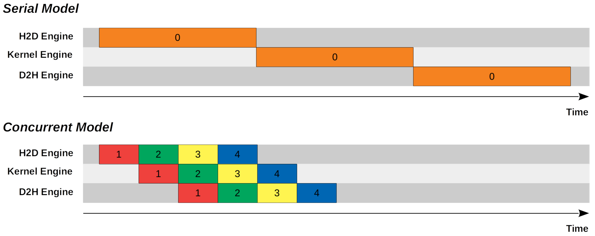
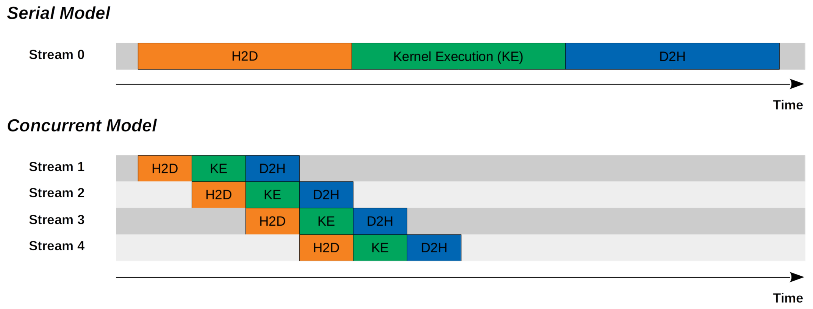

# CUDA Streams 介绍

一个 CUDA 程序的完整流程包含三步：H2D 内存复制、内核执行、D2H 内存复制。按"复制 → 计算 → 复制"的顺序串行执行最直观，但三个阶段并不必须互斥——用流（stream）把这三步组织成流水线，可以让 H2D、内核、D2H 重叠起来进一步提高性能。

## 1. 示例模型

### 1.1 例子

最简单的 CUDA 程序由三个步骤组成，包括将内存从主机复制到设备、内核执行以及将内存从设备复制到主机。在我们的特定示例中，我们有以下事实或假设：

* 内存复制（主机到设备，设备到主机）的时间与复制的内存大小线性相关。
* GPU 永远不会得到充分利用。
* 内核执行可以分为 N 个较小的内核执行，每个较小的内核执行仅需原始内核执行所需时间的 1/N。
* 从主机到设备的内存复制时间、内核执行和从设备到主机的内存复制时间相同。
* 每个 CUDA 引擎按顺序执行命令或内核。

我们可以提出两个模型，包括串行模型和并发模型，来实现该程序。



## 2. 串行模型与并发模型

### 2.1 串行模型

在串行模型中，我们首先将输入内存从主机复制到设备，然后执行内核计算输出，最后将输出内存从设备复制回主机。

### 2.2 并发模型

在并发模型中，我们把内存分成 `N` 个块（chunk），三步异步化。在上面的示例中 `N = 4`：第一个块 H2D 完成后，内核立即开始处理它，同时 H2D 引擎腾出手继续搬第二个块；第一个块算完后，D2H 引擎把结果搬回主机，此时 H2D 引擎和内核又已在处理第三个、第二个块。流水线上每个硬件引擎（H2D 引擎、SM、D2H 引擎）都保持忙碌。

从上图中可以看出，并发模型只需要串行模型约一半的时间。接下来的问题是如何编写 CUDA 程序：每个块的命令按顺序执行，不同块之间并发。答案是 CUDA 流。

## 3. CUDA 流

### 3.1 定义

根据[《CUDA 编程指南》](https://docs.nvidia.com/cuda/cuda-c-programming-guide/index.html#streams)，流是按顺序执行的一系列命令（可能由不同的主机线程发出）；不同流之间的命令可以并发或乱序执行——这正是并发模型需要的性质。

### 3.2 默认流

根据 CUDA 编程指南，内核启动、主机到设备内存复制以及未指定任何流参数（或将流参数设置为零）的设备到主机内存复制均发送到默认流。它也被称为`null`流或流 `0`。本质上，调用 `cudaMemcpy`、或给 `cudaMemcpyAsync` 的 stream 参数传 0，用的都是默认流。

随着新 CUDA 版本中的新功能，默认流的行为现在取决于编译标志。在传统模式下，默认流是与设备上的操作同步的流：在设备上的任何流中所有先前发出的操作完成之前，默认流中的任何操作都不会开始，并且默认流中的操作必须在任何其他操作（在设备上的任何流中）开始之前完成。因此，在传统模式下，默认流似乎对并发模型不友好，我们应该改用非默认流。

### 3.3 非默认流

非默认流需要声明、创建，用完销毁：

```cpp
cudaStream_t stream[nStreams];
for (int i = 0; i < nStreams; i ++)
{
    checkCuda(cudaStreamCreate(&stream[i]));
}
// ... 在这些 stream 上提交 H2D / kernel / D2H ...
for (int i = 0; i < nStreams; i ++)
{
    checkCuda(cudaStreamDestroy(stream[i]));
}
```

要实现并发模型，把同步的 `cudaMemcpy` 换成 `cudaMemcpyAsync` 并指定 `stream`，内核也放到同一个 stream 上。两个前提：缓冲区必须用 pinned memory（`cudaMallocHost`）——pageable 源的 async 拷贝会被 staging 阻塞，重叠不成立；调用返回只表示命令已入队，结果要等 stream 同步或 event 通知。

```cpp
for (int i = 0; i < nStreams; i ++)
{
    int offset = i * streamSize;
    checkCuda(cudaMemcpyAsync(&d_a[offset], &a[offset], streamBytes, cudaMemcpyHostToDevice, stream[i]));
    kernel<<<streamSize/blockSize, blockSize, 0, stream[i]>>>(d_a, offset);
    checkCuda(cudaMemcpyAsync(&a[offset], &d_a[offset], streamBytes, cudaMemcpyDeviceToHost, stream[i]));
}
// 全部提交完，等待所有 stream 完成
for (int i = 0; i < nStreams; i ++)
    checkCuda(cudaStreamSynchronize(stream[i]));
```

更多示例请查看 [Mark Harris 的示例代码](https://github.com/NVIDIA-developer-blog/code-samples/blob/master/series/cuda-cpp/overlap-data-transfers/async.cu)。

## 4. 带有 CUDA 流的示例模型

我们也可以从流的角度来看待串行模型和并发模型。



CUDA Stream：串行模型与并发模型

### 4.1 串行模型

我们只有一个（默认）CUDA 流。所有命令均按顺序执行。

### 4.2 并发模型

我们有 N 个（非默认）CUDA 流。同一流中的所有命令均按顺序执行。不同的流有重叠。

## 5. 笔记

### 5.1 内核并发执行

只要计算资源充足，不同 CUDA 流上的内核执行可以同时运行。上面的模型图展示的是理想情形——H2D、内核、D2H 三段时间相同，资源利用率最高。不同流上的内核在时间线上可能交错重叠，并不互斥；实际能否重叠取决于 SM 资源余量。
