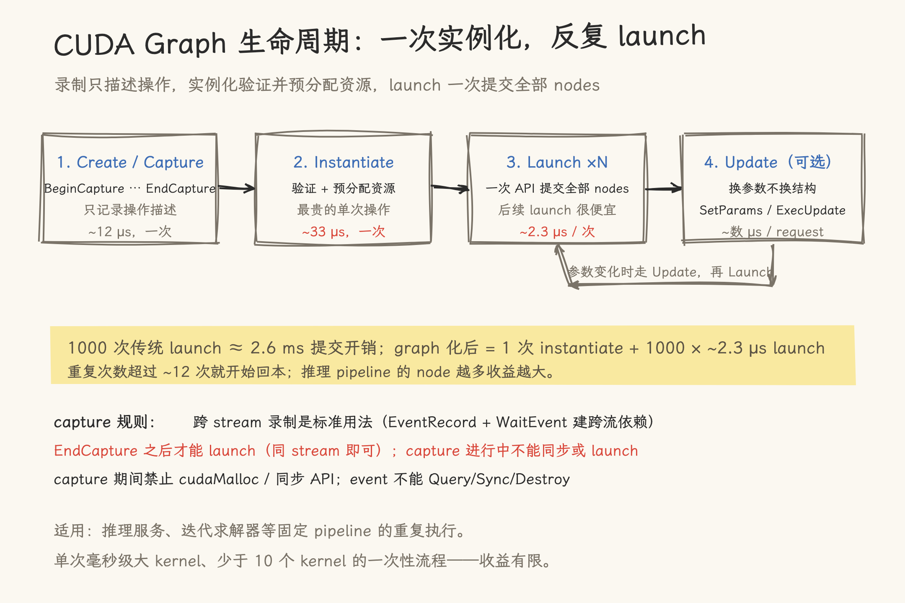

# CUDA Graphs 编程

> 基于 A100-SXM4-80GB + CUDA 13.1 实测。CUDA Graph 将多次 kernel launch 和 memcpy 合并为一次 graph launch，消除每个单独操作的 CPU 提交开销。本文覆盖从原理、两种创建方式到 A100 实测性能的完整流程。
>
> **验证代码**：本文所有实测数据来自配套 Demo：[09_cuda_graphs_demo.cu](code/09_cuda_graphs_demo.cu)。

---

## 1. CUDA Graph 解决什么问题

[`08_kernel_launch_latency.md`](08_kernel_launch_latency.md) 的实测结论：每个 CUDA kernel launch 有 ~2.6 μs（RTX 5090）/ ~2.3 μs（A100）的固定开销。当你的程序需要 launch 数千次小 kernel 时，launch 开销本身可能超过计算时间：

```text
1000 次空 kernel launch:  1000 × 2.6 μs = 2.6 ms   ← 提交开销
1000 次 1 MB H2D 传输:    1000 × 11 μs  = 11.0 ms   ← 大头是 DMA 传输本身，graph 省不掉
```

CUDA Graph 的思路是录制一次、重放多次：把整个 kernel 调用序列预录制为一个 graph，之后每次 launch 只需要一次 CPU→GPU 提交。

| 方式        | 1000 次调用的提交开销              | 开销来源                      |
| ----------- | ----------------------------------- | ----------------------------- |
| 传统 launch | ~2.6 ms                             | 每个 kernel 一次 CPU→GPU 往返 |
| CUDA Graph  | ~2-3 μs（复用已实例化的 graph）     | 录制和实例化只在首次发生      |
| + Update    | ~数 μs                              | 仅替换参数，无需重新录制      |

适用场景：

| 场景           | 解释                                                           |
| -------------- | -------------------------------------------------------------- |
| 推理服务       | 固定 pipeline（prefill → decode → output），每秒数千次重复执行 |
| 迭代求解器     | Jacobi、CG 等每轮 iteration 运行相同 kernel 序列               |
| 小 kernel 组合 | 多个轻量级 kernel 串联，每个单独 launch 开销占比高             |

---

## 2. Graph 生命周期

```text
 Create             Populate          Instantiate        Launch (多次)
 ┌──────┐    ┌─────────────────┐    ┌──────────┐       ┌──────────────┐
 │ 空图  │ →  │ 添加 nodes/edges│ →  │ 验证+优化  │   →   │ 一次性提交到   │
 └──────┘    └─────────────────┘    └──────────┘       │ GPU，反复执行  │
                                        │              └──────────────┘
                                        │ Update (可选)
                                        ▼
                                  ┌──────────┐
                                  │ 替换参数， │
                                  │ 无需重新   │
                                  │ 实例化    │
                                  └──────────┘
```

**录制阶段**：graph 记录的是操作描述（kernel name + params + dependencies），不执行任何计算。

**实例化阶段**：驱动验证 graph 合法性、预分配执行资源。实例化是最贵的操作（~30-40 μs），但只做一次。

**启动阶段**：`cudaGraphLaunch` 一次性下发整个 graph。后续启动几乎零 overhead。



_图 1：Capture → Instantiate → Launch 的生命周期与各阶段开销；参数变化走 Update 而非重新实例化。_

时间线对比：

```text
传统 launch (100 次 kernel):
  CPU:  [L][L][L][L][L][L][L]...[L]   ← 每次 L = ~2.6 μs
  GPU:    [K][K][K][K][K][K][K]...[K]  ← 每次 K 之间有 bubble

Graph launch (100 次 kernel):
  录制:  只做一次
  实例化: 只做一次 (~33 μs)
  CPU:  [L]                           ← 一次提交
  GPU:    [KKKKK...K]                 ← 无 bubble，连续执行
```

---

## 3. 两种创建方式

### 3.1 Stream Capture（推荐）

将现有代码夹在 `cudaStreamBeginCapture` 和 `cudaStreamEndCapture` 之间，CUDA runtime 自动将期间的 kernel launch 和 memcpy 记录为 graph nodes。

```c
// 创建 graph：在已有代码上加 2 行即可
cudaStreamBeginCapture(stream, cudaStreamCaptureModeGlobal);
{
    // 原本的代码 —— 这段期间的操作被录制为 graph nodes
    my_kernel<<<grid, block, 0, stream>>>(d_A, d_B, d_C, N);
    cudaMemcpyAsync(h_C, d_C, size, cudaMemcpyDeviceToHost, stream);
    another_kernel<<<grid, block, 0, stream>>>(d_A, d_C, N);
}
cudaStreamEndCapture(stream, &graph);

// 实例化 → 启动（可多次）
cudaGraphInstantiate(&instance, graph, 0);
cudaGraphLaunch(instance, stream);
cudaStreamSynchronize(stream);
```

**限制**：

- 跨 stream 录制是标准用法：capture 中用 `cudaEventRecord` + `cudaStreamWaitEvent` 建立跨 stream 依赖，全部录进同一个 graph。`cudaStreamCaptureMode*` 参数控制的是 capture 期间对"潜在不安全 API 调用"（如 `cudaMalloc`）的处理严格程度，与能否多 stream 无关
- 录制期间不能调用 `cudaStreamSynchronize`、`cudaDeviceSynchronize`
- 对录制中的 event 不能 Query/Synchronize/Destroy（`cudaEventRecord` + `cudaStreamWaitEvent` 用于跨 stream 依赖是合法且必需的）
- stream capture 无法录制 device 侧发起的子 kernel launch（CDP）；host 发起的 kernel 不受影响

### 3.2 Manual API

逐个创建 node 并手动连接依赖关系，提供最精细的控制。

```c
// 空 graph
cudaGraphCreate(&graph, 0);

// kernel node
cudaKernelNodeParams kp = {0};
kp.func = (void *)my_kernel;
kp.gridDim = dim3(grid, 1, 1);
kp.blockDim = dim3(block, 1, 1);
kp.kernelParams = args;
cudaGraphAddKernelNode(&kNode, graph, NULL, 0, &kp);

// memcpy node
cudaMemcpy3DParms mp = {0};
mp.srcPtr = make_cudaPitchedPtr(d_A, ...);
mp.dstPtr = make_cudaPitchedPtr(d_B, ...);
mp.extent = make_cudaExtent(size, 1, 1);
mp.kind = cudaMemcpyDeviceToDevice;
cudaGraphAddMemcpyNode(&mNode, graph, NULL, 0, &mp);

// edge (依赖)
cudaGraphAddDependencies(graph, &kNode, &mNode, 1);

// 实例化 + 启动
cudaGraphInstantiate(&instance, graph, 0);
cudaGraphLaunch(instance, stream);
```

### 3.3 对比

|          | Stream Capture        | Manual API                              |
| -------- | --------------------- | --------------------------------------- |
| 代码改动 | 加 2 行               | 重写 launch 逻辑                        |
| 灵活性   | 受限于 capture 限制   | 完全控制                                |
| 易出错   | 低                    | 高（手动管理依赖）                      |
| 适用场景 | 已有代码快速 graph 化 | 动态构建 graph、需要 host callback 节点 |

> **建议**：先尝试 Stream Capture。只有当 capture 限制无法满足（如需要 host callback、需要跨多 stream）时再用 Manual API。

---

## 4. 运行中更新 (Update)

推理服务中，graph 结构不变但 kernel 参数（如输入 tensor 地址）每 request 不同。`cudaGraphExecUpdate` 允许原地替换参数而无需重新实例化：

```c
// 首次：用 placeholder 参数录制 + 实例化
cudaGraphInstantiate(&instance, graph, 0);

// 每次请求：更新参数 → launch（比重新 instantiate 快 10-100×）
// 方式一：逐 node 更新（少量参数变化）
cudaGraphExecKernelNodeSetParams(instance, kNode, &newKernelParams);

// 方式二：改源 graph 后整体更新（大量参数或结构变化）
cudaGraphExecUpdate(instance, graph, &errorLog);

cudaGraphLaunch(instance, stream);
```

| 操作        | 时间 (A100) | 频率       |
| ----------- | ----------- | ---------- |
| Capture     | ~12 μs      | 一次       |
| Instantiate | **~33 μs**  | 一次       |
| Update      | ~数 μs      | 每 request |
| Launch      | **~2 μs**   | 每 request |

> 推理服务的典型模式：启动时 instantiate，每个 request 只做 update + launch + sync。instantiate 的 33 μs 平摊到数千次请求后接近零。

---

## 5. A100 实测案例

### 5.1 simpleCudaGraphs — 两种创建方式演示

使用官方 sample `simpleCudaGraphs`（利用 reduction kernel 演示 manual API 和 stream capture）：

```bash
cd cuda-samples/Samples/3_CUDA_Features/simpleCudaGraphs
nvcc -arch=sm_80 -I../../../Common -o simpleCudaGraphs simpleCudaGraphs.cu -lcudart
./simpleCudaGraphs
```

```text
GPU Device 0: "Ampere" with compute capability 8.0

16777216 elements
threads per block  = 512
Graph Launch iterations = 3

Num of nodes in the graph created manually = 7
[cudaGraphsManual] Host callback final reduced sum = 0.996214
[cudaGraphsManual] Host callback final reduced sum = 0.996214
[cudaGraphsManual] Host callback final reduced sum = 0.996214
Cloned Graph Output..
[cudaGraphsManual] Host callback final reduced sum = 0.996214
...

Num of nodes in the graph created using stream capture API = 7
[cudaGraphsUsingStreamCapture] Host callback final reduced sum = 0.996214
...
```

两种方式产生相同的 7-node graph（H2D → Kernel1 → D2D → Kernel2 → D2H → callback），输出一致。

**代码要点**（从 `simpleCudaGraphs.cu`）：

- Manual API 路线：`cudaGraphCreate` → `cudaGraphAddKernelNode` × 2 → `cudaGraphAddMemcpyNode` × 3 → `cudaGraphAddHostNode` → 手动连接 edge
- Stream Capture 路线：`cudaStreamBeginCapture(s, cudaStreamCaptureModeGlobal)` → 同样的 launch 序列 → `cudaStreamEndCapture(s, &graph)` — **更少的代码**，相同的结果
- Clone：`cudaGraphClone(&clonedGraph, graph)` — 复制 graph 结构，不需要重新 capture

### 5.2 cudaGraphsPerfScaling — 性能数据

```bash
cd cuda-samples/Samples/6_Performance/cudaGraphsPerfScaling
nvcc -arch=sm_80 -I../../../Common -o cudaGraphPerfScaling cudaGraphPerfScaling.cu -lcudart
./cudaGraphPerfScaling
```

A100 实测输出（CSV 首行解析）：

| 阶段                   | 时间         | 说明                                     |
| ---------------------- | ------------ | ---------------------------------------- |
| Capture                | **11.58 μs** | 录制 graph nodes                         |
| Instantiation          | **33.07 μs** | 驱动验证 + 优化，最贵的单次操作          |
| First Launch (API)     | 8.95 μs      | 首次 launch 含附加初始化                 |
| First Launch (Total)   | 37.28 μs     | API + device 侧全部完成                  |
| Repeat Launch (API)    | **2.27 μs**  | 后续 launch，一次 API 提交全部 nodes     |
| Repeat Launch (Total)  | 26.63 μs     | API + device                             |
| First Launch (Device)  | 26.88 μs     | GPU 侧首次执行                           |
| Repeat Launch (Device) | **24.48 μs** | GPU 侧重复执行（比传统 launch 稳定得多） |
| Upload API             | 5.61 μs      | 上传 graph 到 device                     |
| Upload Device          | 3.87 μs      | GPU 侧接收 graph                         |

**关键数字解读**：

- Instantiation（33 μs）≈ 12 个 kernel 的 launch 开销（12 × 2.6 μs）。如果你的程序重复执行超过 12 次，graph 就开始回本
- Repeat Launch API（2.27 μs）vs 传统的单 kernel launch（2.6 μs）—— graph 将 7 个 nodes 的提交压缩到比 1 个 kernel 还便宜
- Device 执行时间（24.48 μs）在不同 run 之间极其稳定——graph 消除了单次 launch 带来的 CPU→GPU 抖动

---

## 6. 常见陷阱

| 陷阱                                   | 现象                                     | 解决                                                                         |
| -------------------------------------- | ---------------------------------------- | ---------------------------------------------------------------------------- |
| Capture 期间调 `cudaDeviceSynchronize` | `cudaErrorStreamCaptureInvalidated`      | 同步放在录制前或结束后                                                       |
| Capture 期间创建/销毁 events           | graph 被 invalidated                     | 用 graph nodes 的 event-like 机制替代                                        |
| 忘记 `cudaGraphInstantiate`            | `cudaErrorInvalidValue`                  | graph 只是蓝图，必须实例化才能执行                                           |
| Memory allocation 在 capture 内        | `cudaMalloc` 在 captured stream 中不支持 | 用 `cudaGraphAddMemAllocNode`（Manual API）或预先分配好再 capture            |
| Debug 信息不直观                       | `cudaGraphLaunch` 的错误不指向具体 node  | 用 `cudaGraphDebugDotPrint` 输出 graph 结构图辅助排查                        |

---

## 7. 何时用 / 何时不用

| 场景                              | 用 Graph？                 | 理由                                                  |
| --------------------------------- | -------------------------- | ----------------------------------------------------- |
| 推理服务（固定 shape）            | **用**                     | pipeline 高度重复，录制一次无限重放                   |
| 训练循环（变长 sequence）         | 部分用                     | 每 step 用 update 替换参数，但 shape 变需要重新实例化 |
| 单次大 kernel（毫秒级）           | 不用                       | launch 开销 ~2.6 μs，以毫秒级的 kernel 时间来看可忽略 |
| 少于 10 个 kernel 的简单 pipeline | 效果有限                   | graph 加速比与 kernel 数量成正比                      |
| 迭代求解器（100+ 次重复）         | **用**                     | 迭代开销从 O(N×launch) 降为 O(instantiate+N×replay)   |
| 动态控制流（if/else 在 GPU 侧）   | 需 `graphConditionalNodes` | 进阶功能，CUDA 12+ 支持                               |

---

## 8. 端到端收益估算

以"每 iter 串 2 个 kernel"的循环为例，graph 的收益来自把每 iter 的 2 次 launch 压缩为 1 次 graph launch：

```text
传统：   每 iter 2 × ~2.3 μs launch ≈ 4.6 μs 提交开销（A100）
Graph：  每 iter 1 × ~2.3 μs（cudaGraphsPerfScaling 的 Repeat Launch API 口径）
         外加一次性 instantiate ~33 μs
```

提交开销约省一半；循环内的 kernel/node 数量越多省得越多。推理服务里几十上百个 node 的固定 pipeline 正是收益最大的场景。配套 Demo（[09_cuda_graphs_demo.cu](code/09_cuda_graphs_demo.cu)）可以复现这一对比；计时时要区分"提交开销"与"kernel 执行时间"——两者混在一个计时窗口里会高估 graph 的收益。

> **易错点**：capture 与 launch 不能同时进行。`cudaStreamEndCapture` 之后才能 launch（同一 stream 或其他 stream 均可）；Begin/End 之间的 capture 进行中不能 launch 或同步，否则 capture 失败。

## 9. 相关文档

- [`08_kernel_launch_latency.md`](08_kernel_launch_latency.md)：2.6 μs 的 launch 开销是本文的起点
- [`07_cuda_streams_concurrency.md`](07_cuda_streams_concurrency.md)：graph 与 stream 可以组合，同一实例的多次 launch 之间串行排队
- [`06_nsight_compute_cli.md`](../04_profiling/06_nsight_compute_cli.md)：用 `ncu` profile graph 中的单个 kernel，不影响 graph 结构
- [`simpleCudaGraphs`](https://github.com/NVIDIA/cuda-samples/tree/master/Samples/3_CUDA_Features/simpleCudaGraphs) / [`cudaGraphsPerfScaling`](https://github.com/NVIDIA/cuda-samples/tree/master/Samples/6_Performance/cudaGraphsPerfScaling)：本文使用的官方示例

## 参考

- [CUDA C Programming Guide: Graphs](https://docs.nvidia.com/cuda/cuda-c-programming-guide/index.html#cuda-graphs)
- [NVIDIA cuda-samples: simpleCudaGraphs](https://github.com/NVIDIA/cuda-samples/tree/master/Samples/3_CUDA_Features/simpleCudaGraphs)
- [CUDA Graphs 性能优化指南](https://developer.nvidia.com/blog/cuda-graphs/)
