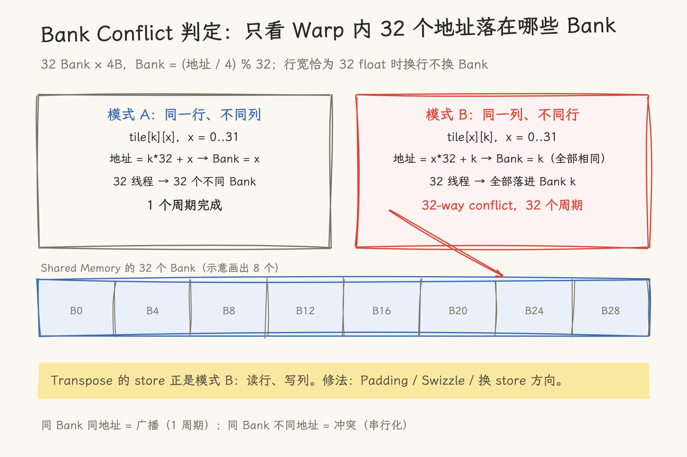

# Shared Memory 与 Bank Conflict——从原理到实战

你已经会用 Shared Memory 了——在 kernel 里加个 `__shared__`，把数据从 Global Memory 搬进来，然后享受 ~19TB/s 的片上带宽。一切都很美好，直到有一天你发现：同样的 Shared Memory，同样的数据量，别人的 kernel 比你快 3 倍。

你用 `ncu` 跑了一遍，报告说 Shared Memory 带宽只有 6TB/s——不是理论峰值的 19TB/s。**少了的那 13TB/s 去哪了？**

答案是一行你每天都在写、但很少有人真正理解的代码：`sdata[tid * STRIDE]`。那个 `STRIDE`，如果恰好是 2 的幂次，你的 32 个线程可能全部撞在同一个 Bank 上——32 个请求被串行化为 32 次，带宽直接降到 1/32。而编译器不会警告，profiler 默认也不标红。

本文按四步展开：理解 Bank 的硬件结构 → 识别冲突模式 → 用 Padding/Swizzle/Reorder 三种方法消除 → 做出"修还是不修"的工程决策。

> **前置要求**：你已经了解 CUDA 的 Thread/Warp/Block 执行模型（见 [GPU 编程导论](01_gpu_programming_introduction.md)）以及 `cudaMalloc` 分配的是 Global Memory（见 [GPU 内存管理](12_gpu_memory_management.md) 第 7 节"内存层级"）。本文假定你写过最简单的 `__shared__` kernel。
>
> **可交互概念图**：本文配有可交互的 Bank Conflict 概念图，覆盖 2 个图层（Stride 冲突模式、Transpose Padding 对比），建议在阅读对应章节时打开对照查看：[bank-conflict-visual.html](bank-conflict-visual.html)。
>
> **验证代码**：本文所有实测数据来自配套 Benchmark：[13_bank_conflict_bench.cu](code/13_bank_conflict_bench.cu)。三项测试（Stride 带宽、Transpose Padding、Reduction 寻址）可直接在 A100 上编译运行复现。

---

## 1. 前置概念——Shared Memory 是什么，为什么需要它

在进入 Bank Conflict 之前，先把 Shared Memory 在 GPU 内存体系中的位置定清楚。

### 1.1 Shared Memory 是程序员手动管理的可编程 Cache

当你在 kernel 里写 `float a = g_data[tid]` 时，这个 `g_data` 在 Global Memory（HBM）里——它不在 GPU 芯片上，每次读写需要 ~400ns（A100 HBM）。而 GPU 的 ALU 可以在 1 个周期内完成一次 FMA，等待 400ns 意味着 ALU 会空转几百个周期。

解决方法大家都很熟悉：Cache。CPU 有 L1/L2/L3 Cache，对程序员完全透明——你写 `array[i]++`，硬件自动决定什么数据留在 Cache 里。但 GPU 给了程序员一个更直接的工具：**Shared Memory**，一块在 SM（流式多处理器）上的 SRAM，你必须用 `__shared__` 关键字显式声明、显式加载、显式同步。

```text
CPU Cache（透明）                      GPU Shared Memory（显式）
─────────────                          ─────────────────────
int a = array[i];  ← 硬件自动缓存      __shared__ float tile[128];
// 程序员不知道也不关心                  // 程序员决定：放什么、何时放、何时同步
// 数据在 L1/L2/L3 的哪一层             // 这就是一块 128×4B = 512B 的 on-chip SRAM
```

### 1.2 为什么不用 Global Memory 直接算

| 层级                | 位置   | 延迟    | 带宽 (A100) | 容量 (per SM)        | 可见性           |
| ------------------- | ------ | ------- | ----------- | -------------------- | ---------------- |
| Register            | SM 内  | ~0 ns   | —           | 256KB                | 单线程           |
| Shared Memory       | SM 内  | ~5 ns   | ~19 TB/s    | 164KB (可配)         | Block 内所有线程 |
| L1 Cache            | SM 内  | ~28 ns  | —           | 192KB (与 SMEM 共享) | 透明             |
| L2 Cache            | 芯片上 | ~200 ns | ~4 TB/s     | 40MB                 | 透明             |
| Global Memory (HBM) | 芯片外 | ~400 ns | ~2 TB/s     | 80GB                 | 所有线程         |

数字很直观：Shared Memory 的延迟是 Global Memory 的 **1/80**，带宽是 Global Memory 的 **~10 倍**。注意 L1 与 Shared Memory 共享同一块 SRAM（A100 上总量 192KB），164KB 是 Shared Memory 可配置的上限，两者此消彼长。

### 1.3 典型使用模式

```cuda
__global__ void matmul_tile(float *A, float *B, float *C, int N) {
    __shared__ float As[TILE][TILE];   // 声明：SM 上的 SRAM
    __shared__ float Bs[TILE][TILE];

    // 1. 从 Global Memory 搬运到 Shared Memory（合作加载）
    As[threadIdx.y][threadIdx.x] = A[row * N + t * TILE + threadIdx.x];
    Bs[threadIdx.y][threadIdx.x] = B[(t * TILE + threadIdx.y) * N + col];
    __syncthreads();  // 确保所有数据到位

    // 2. 从 Shared Memory 反复读取、计算（这才是"快"的来源）
    for (int k = 0; k < TILE; k++)
        sum += As[threadIdx.y][k] * Bs[k][threadIdx.x];

    __syncthreads();
    // 3. 结果写回 Global Memory
    C[row * N + col] = sum;
}
```

Shared Memory 的使用遵循一个固定模式：**Load → Sync → Compute → Sync → Store**。但本文关注的不是这个模式本身，而是 Compute 阶段的那行 `As[threadIdx.y][k]`——如果 tile 的宽度选错了，这一行的读取就会被 Bank Conflict 拖慢。

---

## 2. 背景——Shared Memory 为什么被设计成 Bank 结构

### 2.1 GPU 的吞吐量优先哲学

GPU 的设计目标从来不是"让单个线程跑得快"，而是"让 10000 个线程的总吞吐量最大化"。这意味着内存子系统必须在**一个时钟周期内**服务 32 个线程（一个 Warp）的并发访问请求。如果 Shared Memory 只提供单个读写端口，32 个线程排队，延迟直接翻 32 倍。

解决方案是**多 Bank**：把 Shared Memory 物理上切成 32 个独立的 SRAM 模块，每个模块有自己的地址解码器和数据总线。

```text
Shared Memory 的物理结构（概念图）

        线程 0    线程 1    线程 2    ...    线程 31
         ↓         ↓         ↓                ↓
    ┌─────────┬─────────┬─────────┬─────┬─────────┐
    │ Bank 0  │ Bank 1  │ Bank 2  │ ... │ Bank 31 │
    │ 128B ×  │ 128B ×  │ 128B ×  │     │ 128B ×  │
    │ N rows  │ N rows  │ N rows  │     │ N rows  │
    └─────────┴─────────┴─────────┴─────┴─────────┘
         ↑         ↑         ↑                ↑
      每个 Bank 有独立的地址解码器和数据总线
      32 个 Bank 可以同时服务 32 个不同的地址请求
```

这就是 Shared Memory 能做到 19TB/s 带宽的原因——不是一根水管特别粗，而是 **32 根水管并联**。

CPU 类比：这和 DRAM 的多 Bank 设计是一样的思路——DDR4/DDR5 有 8/16 个 Bank Group，通过流水线化的 Bank 切换来掩盖 Row Buffer 的 precharge 延迟。GPU 的 Shared Memory Bank 更简单直接：没有 Row Buffer 的概念，随机访问延迟恒定（SRAM），纯粹靠并行度提带宽。

### 2.2 Bank 的编址规则

32 个线程同时访问 32 个不同 Bank → 1 个周期完成。但如果两个线程访问同一个 Bank 的不同地址呢？

关键在于 Bank 编号是怎么计算的。所有主要 GPU 架构使用同样的规则（只有 Bank 位宽不同）：

```text
Bank 编号 = (字节地址 / Bank 位宽) % 32

CC < 8.0 (V100 及之前):  Bank 位宽 = 4 字节
CC ≥ 8.0 (A100 及之后):  Bank 位宽 = 4 字节  (注意：依然是 4B！)
```

> **易混淆点**：CC 8.0+ 的 Bank 在部分文档中被描述为 8 字节宽。准确说，**每次 bank transaction 是 4 字节**（128 字节 / 32 bank = 4 字节），但硬件支持在同一 Bank 内通过两路通道同时读取 8 字节中的不同 4 字节。对 FP32 编程来说，行为等价于 4B Bank。对 FP16/BF16（2 字节元素）来说，8B 的"子 Bank"才发挥作用。本文第 7 节会展开讲这一点。为便于理解，前 6 节统一用"32 Bank × 每 Bank 4B"的模型——这是 FP32 编程的正确心智模型。

具体到 `float` 类型（4 字节），Bank 编号简化为：

```text
Bank ID = (偏移量 / sizeof(float)) % 32

例子：
sdata[0]   → 偏移量 0  → Bank 0
sdata[1]   → 偏移量 1  → Bank 1
...
sdata[31]  → 偏移量 31 → Bank 31
sdata[32]  → 偏移量 32 → Bank 0  ← 绕回来了！
sdata[33]  → 偏移量 33 → Bank 1
```

规律：**地址每隔 32 个 float（128 字节）就绕回同一个 Bank**。这个规律是理解后续所有 Bank Conflict 场景的基础。

### 2.3 Broadcast 机制：同 Bank 同地址的特权

Bank Conflict 规则有一个重要例外：如果 Warp 内多个线程访问**同一个 Bank 的完全相同的地址**，硬件会将这次读取广播给所有请求线程——**1 个周期完成，无冲突**。

```cuda
// 无冲突：Broadcast — 32 个线程全读 sdata[0]
float x = sdata[0];  // Bank 0, 偏移量 0 — 所有线程同一地址 → Broadcast → 1 cycle

// 有冲突：32-way Conflict — 32 个线程读 32 个不同地址，但全在 Bank 0
float x = sdata[tid * 32];  // tid=0→Bank0, tid=1→Bank0(偏移32), tid=2→Bank0(偏移64)...
                             // 32 个不同地址，全在 Bank 0 → 串行化 → 32 cycles
```

口诀：同 Bank **同地址** → 广播，快；同 Bank **不同地址** → 冲突，慢。

---

## 3. 问题——Bank Conflict 的"隐形"代价

### 3.1 Bank Conflict 的定义与分级

当同一 Warp 内 ≥2 个线程访问同一 Bank 的**不同地址**时，这些访问无法在一个周期内完成，被串行化为多次 Transaction。

```text
n-way Bank Conflict: n 个线程访问同一 Bank 的不同地址
→ 串行化为 n 次 transaction
→ 这个 Bank 的访问耗时 n 个周期
→ 带宽退化为 1/n
```

分级示例（32 线程 Warp，float 类型）：

| 冲突级别 | 每 Bank 的线程数 | 周期数 | 有效带宽 (% of 峰值) |
| -------- | ---------------- | ------ | -------------------- |
| 无冲突   | 每 Bank ≤1       | 1      | 100%                 |
| 2-way    | 2                | 2      | 50%                  |
| 4-way    | 4                | 4      | 25%                  |
| 8-way    | 8                | 8      | 12.5%                |
| 32-way   | 32               | 32     | 3.125%               |

> **理论 vs 实测**：以上带宽退化比例是**最坏情况**理论值——假设每个 cycle 只有当前 warp 在访问 Shared Memory。实际 GPU 有大量 warp 可以切换（latency hiding），因此实际退化通常小于理论值。以下为 A100 (108 SM, 27648 并发线程) 上的实测数据：
>
> | 冲突级别 (stride)            | 理论带宽占比 | A100 实测占比     | 说明                             |
> | ---------------------------- | ------------ | ----------------- | -------------------------------- |
> | 无冲突 (stride=1,3,31,33)    | 100%         | 100% (~2563 GB/s) | 基线                             |
> | 2-way (stride=2,6)           | 50%          | 97%               | 864 warps 几乎完全掩盖           |
> | 4-way (stride=4,12)          | 25%          | ~100%             | **实测不可见**——延迟隐藏完全覆盖 |
> | 8-way (stride=8,24)          | 12.5%        | 91%               | 轻微下降                         |
> | 16-way (stride=16)           | 6.25%        | 47%               | 显著退化但优于理论               |
> | 32-way (stride=32,64,96,128) | 3.125%       | 24%               | 退化 4.2x，最严重                |
>
> 关键结论：**4-way 及以下 Bank Conflict 在高 Occupancy 场景下几乎无影响**——这与第 8 节"什么时候不值得修"的讨论一致。16-way 以上才需要认真对待。

### 3.2 场景一：Stride 访问——最常见也最隐蔽

这是新手最容易写出来的 Bank Conflict 代码。当你用 `tid * stride` 做索引，stride 恰好是 2 的幂次时：

```cuda
__shared__ float sdata[1024];
int tid = threadIdx.x;

// 场景 A：stride = 2  →  2-way conflict
float x = sdata[tid * 2];
// tid=0→Bank0, tid=1→Bank2, tid=2→Bank4, ..., tid=16→Bank0(偏移32)!
// Bank 0 被 tid=0 和 tid=16 同时访问不同地址 → 2-way conflict
// 同理：Bank 2 被 tid=1 和 tid=17 共享，Bank 4 被 tid=2 和 tid=18 共享...

// 场景 B：stride = 32 →  32-way conflict（最坏情况）
float x = sdata[tid * 32];
// tid=0→Bank0(偏移0), tid=1→Bank0(偏移32), tid=2→Bank0(偏移64)...
// 全部 32 个线程落在 Bank 0 → 串行化 → 32 个周期！
```

为什么会这样？把手算一遍就清楚了：

```text
stride = 2 时, float 元素：

tid=0:  sdata[0]   → Bank (0 % 32)  = Bank 0
tid=1:  sdata[2]   → Bank (2 % 32)  = Bank 2
tid=2:  sdata[4]   → Bank (4 % 32)  = Bank 4
...
tid=16: sdata[32]  → Bank (32 % 32) = Bank 0  ← 撞！
tid=17: sdata[34]  → Bank (34 % 32) = Bank 2  ← 撞！
...

每个 Bank 被 2 个线程撞上 → 2-way conflict。
```

通用公式：

```text
对于 float 类型，Bank ID[thread_i] = (tid_i × stride) % 32

当 stride 和 32 存在公因子 d = gcd(stride, 32) 时：
  实际被使用的 Bank 数 = 32 / d
  每个 Bank 被 d 个线程共享 → d-way conflict

stride = 2:  gcd(2, 32) = 2   → 使用 16 个 Bank → 2-way
stride = 3:  gcd(3, 32) = 1   → 使用 32 个 Bank → 无冲突！
stride = 4:  gcd(4, 32) = 4   → 使用 8 个 Bank  → 4-way
stride = 8:  gcd(8, 32) = 8   → 使用 4 个 Bank  → 8-way
stride = 32: gcd(32, 32) = 32 → 使用 1 个 Bank  → 32-way
```

反直觉的一点：stride = 3 这样的奇数 stride 天然无冲突。有冲突的 stride 不是"比较大的数"，而是**和 32 共享因子的数**——包括所有 2 的幂次。

### 3.3 场景二：矩阵的行列访问

矩阵在 Shared Memory 里按行优先存储。判断冲突只看一件事：**同一时刻 Warp 内 32 个线程的地址落在哪些 Bank 上**。以 `__shared__ float tile[32][32]`、Warp 内 `threadIdx.x = 0..31` 为例：

```cuda
// 模式 A：同一行、不同列（地址连续）——无冲突
// 线程 x 读 tile[k][x]：地址 = k*32 + x，Bank = x → 32 线程落进 32 个 Bank
float a = tile[5][threadIdx.x];

// 模式 B：同一列、不同行（地址差 = 行宽 32 float）——32-way conflict
// 线程 x 读 tile[x][k]：地址 = x*32 + k，Bank = (x*32 + k) % 32 = k → 全部落进 Bank k
float b = tile[threadIdx.x][5];
```

模式 B 是"每行 32 个 float 正好绕回同一批 Bank"的直接后果：行宽等于 Bank 数时，换一行等于 Bank 不变。

Transpose 是两个模式的相遇：读全局按行（连续），写 Shared Memory 按列（模式 B）：

```cuda
// Transpose: 读行、写列
__shared__ float tile[32][32];
int x = threadIdx.x, y = threadIdx.y;

float val = g_in[y * N + x];        // 读 Global Memory（连续）
tile[x][y] = val;                    // 写 Shared Memory —— 模式 B！
__syncthreads();
float out = tile[y][x];             // 读 Shared Memory —— 模式 A，无冲突
g_out[x * N + y] = out;             // 写 Global Memory（stride = N）
```

`tile[x][y]` 这一步：对 Warp（`threadIdx.x` = 0..31，`threadIdx.y` 固定）：

- 线程 0 写 `tile[0][y]` → Bank y
- 线程 1 写 `tile[1][y]` → Bank (1 × 32 + y) % 32 = Bank y ← 撞！
- 线程 2 写 `tile[2][y]` → Bank y ← 撞！
- ...

32 个线程的地址 mod 32 全都等于 `y`——**32-way conflict**。而读回那一步 `tile[y][x]` 是模式 A，无冲突。问题出在 store。



_图 1：同一行不同列（模式 A，无冲突）与同一列不同行（模式 B，32-way conflict）的对比。_

### 3.4 为什么 Bank Conflict 容易被忽视

1. **编译器不报 Warning**。Bank Conflict 是行为正确但性能差——NVCC 没有任何 flag 能标出来。
2. **ncu 默认报告不标红**。`ncu` 的默认 summary 不显示 Bank Conflict。你需要手动加 `--section MemoryWorkloadAnalysis_Tables`。
3. **小 kernel 不明显**。Shared Memory 用量不到几十 KB 时，Bank Conflict 的绝对耗时可能被 launch overhead 掩盖。问题在 kernel 变大（tile 更大、数据更多）时才暴露。
4. **换架构、换数据类型后表现不同**。主流架构的 Bank 位宽都是 4B，但 FP16（2B 元素）的冲突判定与 FP32 不同（第 7 节展开）。开发机上无冲突的 kernel，换数据类型或架构后要重新验证。

---

## 4. 诊断——如何检测 Bank Conflict

从"我怀疑有 Bank Conflict"到"我确认有 n-way Bank Conflict"。

### 4.1 Nsight Compute Memory Workload Analysis

最可靠的方法是用 `ncu` 的 Memory 分析：

```bash
ncu --set memory \
    --section MemoryWorkloadAnalysis_Tables \
    ./a.out
```

输出中找 Shared Memory 相关指标（以 A100 为例）：

```text
Section: MemoryWorkloadAnalysis_Tables
────────────────────────────────────────────────
Shared Memory:
  shared_load_transactions      256    ← 实际发生的 load transaction 次数
  shared_store_transactions     128    ← 实际发生的 store transaction 次数
  ...
```

**Bank Conflict 的判定公式**：

```text
理想 transaction 数 = 访问次数（无冲突）
实际 transaction 数 = 理想 × (n-way conflict 的 n)

冲突因子 = 实际 / 理想

无冲突 → 冲突因子 ≈ 1.0
2-way   → 冲突因子 ≈ 2.0
32-way  → 冲突因子 ≈ 32.0
```

具体判断需要结合你的代码分析"理想 transaction 数"。比如一个 block 有 256 线程，每个线程做一次 `sdata[tid]` 的读——理想 load transaction 数 = 256 / 32 × 1 = 8（每 warp 一次）。如果 ncu 报告 `shared_load_transactions = 256`，那冲突因子 = 256 / 8 = 32 → **32-way conflict**。

### 4.2 笔算验证

在依赖工具之前，用纸笔（或 Python）快速验证是最快的方法：

```python
def analyze_bank_conflict(stride, num_threads=32, bank_width=4, elem_size=4):
    """分析给定 stride 的 Bank Conflict 模式"""
    banks = {}
    for tid in range(num_threads):
        addr = tid * stride * elem_size
        bank_id = (addr // bank_width) % 32
        if bank_id not in banks:
            banks[bank_id] = []
        banks[bank_id].append(tid)

    max_conflict = max(len(tids) for tids in banks.values())
    print(f"stride={stride}: {len(banks)} banks used, "
          f"max {max_conflict}-way conflict")
    for bank_id, tids in sorted(banks.items()):
        if len(tids) > 1:
            print(f"  Bank {bank_id}: threads {tids}")

# 测试
for s in [1, 2, 3, 4, 8, 16, 32, 33]:
    analyze_bank_conflict(s)
```

输出：

```text
stride=1: 32 banks used, max 1-way conflict    ← 无冲突（连续访问）
stride=2: 16 banks used, max 2-way conflict    ← 2-way
stride=3: 32 banks used, max 1-way conflict    ← 无冲突！（奇数）
stride=4: 8 banks used, max 4-way conflict
stride=8: 4 banks used, max 8-way conflict
stride=16: 2 banks used, max 16-way conflict
stride=32: 1 banks used, max 32-way conflict   ← 最坏情况
stride=33: 32 banks used, max 1-way conflict   ← 无冲突！（33 % 32 = 1）
```

这个脚本几秒就能跑完——写代码之前先跑一次，把冲突消灭在动手之前。

### 4.3 编译器标志能告诉我们什么

`--ptxas-options=-v` 能看到 Shared Memory 的静态用量，但它**不透露 Bank Conflict 信息**：

```bash
nvcc -arch=sm_80 --ptxas-options=-v kernel.cu -o kernel
# ptxas info: Used 64 registers, 8192 bytes smem, 400 bytes cmem[0]
```

`8192 bytes smem` 只告诉你用了 8KB——不告诉你这 8KB 是怎么被访问的。

PTX 层面也无法判断 Bank Conflict，因为 Bank Conflict 是 SASS 指令在 SM 硬件上执行时的动态行为。PTX 里同样一个 `ld.shared.f32`，在运行时可以是 1 cycle 也可以是 32 cycles，完全取决于地址模式。

---

## 5. 方案——消除 Bank Conflict 的三种武器

三种方法形成一个工具箱，从简单到复杂递进。

### 5.1 Padding：空间换时间

**原理**：在 Shared Memory 数组的每一行末尾插入无用元素，人为改变 stride，使得下一行的起始 Bank ID 偏移，从而打破冲突模式。

以 32×32 float 矩阵的列写入为例：

```cuda
// 有冲突的写法：32-way conflict
__shared__ float tile[32][32];       // 每行正好 32 个 float = 32 个 Bank
tile[x][y] = val;                    // Bank = (x*32 + y) % 32 = y
                                     // 同 y 的线程全部撞在同一个 Bank

// Padding 解法：每行 33 个 float
__shared__ float tile[32][32 + 1];   // 每行 33 个 float → 跨过了 33 个 Bank
tile[x][y] = val;                    // Bank = (x*33 + y) % 32 = (x + y) % 32
                                     // 现在 x 不同则 Bank 不同 → 无冲突！
```

为什么有效？因为 33 % 32 = 1，所以第 0 行从 Bank 0 开始，第 1 行从 Bank 1 开始，第 2 行从 Bank 2 开始... 每一行比上一行偏移 1 个 Bank。这样写同一列时：

```text
行 0, 列 0 → Bank (0*33 + 0) % 32 = 0
行 1, 列 0 → Bank (1*33 + 0) % 32 = 1
行 2, 列 0 → Bank (2*33 + 0) % 32 = 2
...
行 31, 列 0 → Bank (31*33 + 0) % 32 = 31
```

每一行的同一列落在不同的 Bank → 无冲突。

**代码完整示例**：

```cuda
// 有冲突的 Transpose（列写入 32-way conflict）
__global__ void transpose_naive(float *odata, float *idata, int N) {
    __shared__ float tile[32][32];
    int x = blockIdx.x * 32 + threadIdx.x;
    int y = blockIdx.y * 32 + threadIdx.y;

    tile[threadIdx.x][threadIdx.y] = idata[y * N + x];   // ← 32-way conflict store!
    __syncthreads();
    odata[x * N + y] = tile[threadIdx.y][threadIdx.x];
}

// Padding 修复后的 Transpose
__global__ void transpose_padded(float *odata, float *idata, int N) {
    __shared__ float tile[32][32 + 1];                    // ← +1 padding
    int x = blockIdx.x * 32 + threadIdx.x;
    int y = blockIdx.y * 32 + threadIdx.y;

    tile[threadIdx.x][threadIdx.y] = idata[y * N + x];   // ← 无冲突！
    __syncthreads();
    odata[x * N + y] = tile[threadIdx.y][threadIdx.x];
}
```

**A100 实测**（`transpose_naive` vs `transpose_padded`，2000 次迭代，2048×2048 矩阵）：

| 版本                      | 每次 Transpose 耗时 | 加速比    |
| ------------------------- | ------------------- | --------- |
| 无 Padding (32-way store) | 0.0578 ms           | —         |
| 有 Padding (+1 column)    | 0.0278 ms           | **2.08x** |

> 32-way store conflict 被 Padding 完全消除后，Transpose 快了一倍多。这 2.08x 的差异**完全来自 Shared Memory 写入阶段的 Bank Conflict**——两个 kernel 的计算量和 Global Memory 访问量完全相同，唯一的变量是 `tile[32][32]` vs `tile[32][33]`。
>
> 完整可运行代码见 [transpose_naive / transpose_padded](code/13_bank_conflict_bench.cu)（Test 2）。

**Padding 量的计算**：

```text
原始 stride = 每行元素数（列宽）
目标：使每一行的 Bank 起始位置偏移，使得同列不同行的地址落到不同 Bank

对于 32 个 Bank（4B Bank，float 元素）：
  Padding 数 = 1（使每行 = 33 float → 33 % 32 = 1 的偏移）
  或 Padding = 3（每行 = 35 float → 35 % 32 = 3 的偏移）
  但不要用偶数的 padding（如 2 或 4）——gcd 仍然是 > 1

一般规律：
  需要 gcd(每行元素数 + padding, 32) = 1
  最简：padding = 1（如果原始宽度是 32 的倍数）
```

**代价**：Shared Memory 用量增加 `1/32 ≈ 3.1%`。如果 tile 是 32×32 float = 4KB，加 1 列 padding 后变成 4.125KB。对大多数 kernel 来说，这点浪费不影响 Occupancy。

**适用场景**：

- Shared Memory 用量不紧张时（SMEM 用量 < SM 容量的 70%）
- 冲突模式简单、可以一行 padding 解决时
- 不想增加地址计算逻辑复杂度时

### 5.2 Swizzle：地址变换消冲突

**原理**：不改物理布局、不加 Padding，而是在算下标时把行号混进 Bank 位（低 5 位），让"同一列"的地址散开到不同 Bank。核心要求：**读写两侧必须用同一个变换**（XOR 自身是逆变换，同一函数应用两次即还原）。

先看错误示范——把行号 XOR 进地址高位是无效的：

```cuda
// 错误：width=32 时 (row & 0x1F) << 5 与 linear 的高位完全相同，XOR 后高位互相抵消，
// 结果只剩 col → 同列元素全部写到同一个下标，数据被破坏
int linear = row * 32 + col;
int bad = linear ^ ((row & 0x1F) << 5);   // = col，错！
```

XOR 的对象必须是 **Bank 位本身**（低 5 位）：

```cuda
// 正确：把 row 的低 5 位 XOR 进 col（Bank 位）
__device__ inline int swizzle(int row, int col, int width) {
    return row * width + (col ^ (row & 0x1F));
}
// width=32 时，存储地址 = row*32 + (col ^ row)
// Bank = (col ^ row) % 32：col 固定、row 变化 → 32 个不同 Bank → 列访问无冲突
```

**用 Swizzle 修 Transpose**：

```cuda
__global__ void transpose_swizzled(float *odata, float *idata, int N) {
    __shared__ float tile[32 * 32];   // 1D 数组，下标经 swizzle 计算
    int x = blockIdx.x * 32 + threadIdx.x;
    int y = blockIdx.y * 32 + threadIdx.y;

    // 写：threadIdx.x 作 row、threadIdx.y 作 col（对应 3.3 节的冲突方向）
    tile[swizzle(threadIdx.x, threadIdx.y, 32)] = idata[y * N + x];
    __syncthreads();

    // 读：想要 tile[y][x]，就用同一函数计算 (y, x) 的 swizzled 下标
    odata[x * N + y] = tile[swizzle(threadIdx.y, threadIdx.x, 32)];
}
```

正确性：写入方 (ty, tx) 与读取方查的是同一个下标函数，XOR 自逆，读回的必然是刚写入的元素。冲突性：写 Warp（tx 变、ty 定）的 Bank = tx ^ ty，互不相同；读 Warp（tx 变、ty 定）的 Bank = tx ^ ty 同样互不相同——两个阶段都无冲突。

**GEMM 中常用的交替 Swizzle**：

```cuda
// 更复杂的 Swizzle 模式——GEMM 的 B tile 使用
// 核心思想：奇偶行配对，奇数行偏移到 Bank 后半段
// 前提：ld ≥ 2 × 实际使用列数，否则偶数行 [0,16) 与奇数行 [16,32) 的地址区间重叠
__device__ inline int gemm_swizzle(int row, int col, int ld) {
    if (row % 2 == 0)
        return (row / 2) * ld + col;
    else
        return (row / 2) * ld + col + 16;  // 奇数行偏移到 Bank 后半段
}
```

**代价**：

- 每次访问多一条 XOR 指令（~1 cycle）
- 地址计算略微复杂，但通常可以被指令流水线隐藏
- **不浪费 Shared Memory**——这是相比 Padding 的核心优势

**适用场景**：

- Shared Memory 用量紧张（SMEM 用量 > SM 容量的 80%），不能承受 Padding 的空间浪费
- 冲突模式确定且规则（不是随机冲突），可以用一个简单的 XOR 或位操作解决
- 追求极致性能（如 FlashAttention、GEMM 的高性能实现）

### 5.3 Reorder：从源头设计无冲突的访问模式

**原理**：不用 Padding，也不用 Swizzle，而是在设计算法时就选择天然无冲突的访问模式。这是最根本的方案，但需要从算法层面重构。

**经典案例——Reduction 的两种寻址**：

回顾 [Reduction](10_reduction.md) 一文中的两个 kernel：

```cuda
// Interleaved Addressing
for (unsigned int s = 1; s < blockDim.x; s *= 2) {
    if (tid % (2 * s) == 0)
        sdata[tid] += sdata[tid + s];
    __syncthreads();
}

// Sequential Addressing
for (unsigned int s = blockDim.x / 2; s > 0; s >>= 1) {
    if (tid < s)
        sdata[tid] += sdata[tid + s];
    __syncthreads();
}
```

一个容易想错的地方：这两种写法用的都是 `tid + s`（加法），按第 6.3 节的推导，它们在任意 s 下都**没有 Bank Conflict**——加法寻址只是把 0..31 的 Bank 排列轮转一下，32 个地址仍落在 32 个不同的 Bank。Interleaved 版真正的代价是 **Warp Divergence**（每步只有一半线程活跃）和 `%` 取模运算。Sequential 版同时解决了这两个问题。

那 Reorder 对 Bank Conflict 的价值在哪里？在于**设计时的方向选择**：3.3 节的 transpose，冲突来自"把列方向安排给了 Shared Memory 的 store"。把哪一维映射给 store、哪一维映射给 load，布局时选对了，冲突根本不会出现；选错了才需要回过头来 Padding 或 Swizzle。Reorder 排在最前，因为它决定你后面要不要用另外两种工具。

**方法总结**：

| 方法    | 空间     | 指令       | 复杂度 | 何时用               |
| ------- | -------- | ---------- | ------ | -------------------- |
| Padding | 浪费 ~3% | 无额外开销 | ★☆☆    | SMEM 不紧张时        |
| Swizzle | 无       | ~1 XOR     | ★★☆    | SMEM 紧张 + 规则冲突 |
| Reorder | 无       | 无         | ★★★    | 算法层面可调整时     |

---

## 6. 实战——三个经典场景拆解

### 6.1 GEMM 的 Shared Memory Tile 为什么选 128

在 GEMM 实现中（见 [Tensor Core GEMM](11_tensor_core_gemm.md)），tile 大小通常选 128×128 或 256×128。这正好和 Bank 结构有关。

```cuda
__shared__ float As[128][128];   // 128×128 float = 64KB
```

每个 thread block 里的 warp 需要沿 K 方向遍历 `As[threadIdx.y][k]`——对 warp 内 32 个线程（同一 y，x = 0..31），这是**行访问**：

```text
线程 (x, y) 访问 As[y][k*32 + x]
Bank = (y*128 + k*32 + x) % 32
     = (x) % 32  （y*128 和 k*32 都是 32 的倍数，模 32 为 0）
     = x → 每个线程不同的 Bank → 无冲突！✓
```

那对 B 矩阵呢？`Bs[k][threadIdx.x]`，这是**列访问**：

```text
线程 (x, y) 访问 Bs[k*32 + y][x]
Bank = ((k*32 + y)*128 + x) % 32
     = (x) % 32  ← 同样！无冲突！
```

关键就在于：**128 是 32 的倍数**。这样每一行的开始正好对齐到 Bank 0，使得同列访问时 Bank ID = column % 32 = 不同线程 → 不同 Bank → 无冲突。

假设把 tile 宽度改成 127：

```text
Bank = ((k*32 + y)*127 + x) % 32
     = (y*127 + x) % 32
     = (y*(128-1) + x) % 32
     = (y*128 - y + x) % 32
     = (x - y) % 32           ← y 不同时 Bank 不同，但某些 (x,y) 组合会碰撞！
```

会导致某些线程对落在同一 Bank。而 128 = 4 × 32 = 完美的 Bank 对齐——这就是为什么几乎所有高性能 GEMM 的 tile 宽度都是 32 的倍数。

### 6.2 FlashAttention 中的 Swizzle 应用

FlashAttention 的 forward pass 将 Q 和 K^T 的 tile 加载到 Shared Memory，然后在片上计算 Attention Score。复杂度在于：Q tile 是行优先读取，而 K^T tile（即 K 的转置）是列优先读取——两者的访问方向不同，必然会有一个方向产生 stride 访问。

为了消除这个 stride 带来的 Bank Conflict，FlashAttention 使用了 XOR Swizzle：

```cuda
// FlashAttention 风格的 Swizzle（简化版）
// 对 Q tile：沿 head_dim 方向读 → 行优先，Bank = col % 32 → 无冲突
// 对 K tile：沿 seq 方向读 → 列优先，Bank = row % 32 — 需要 Swizzle

template<int HEAD_DIM>
__device__ inline int fa_swizzle(int row, int col) {
    // 针对 HEAD_DIM = 64 或 128 做的优化 Swizzle
    // 核心思想：让 row 信息进入 Bank ID 的低 5 位
    int phase = col / 16;                // col 的高位
    int col_swizzled = col ^ (phase * 2); // XOR phase into col
    return row * HEAD_DIM + col_swizzled;
}
```

没有 Swizzle 时，K tile 的列方向访问会集中到同一批 Bank，Shared Memory 阶段的吞吐明显下降。FlashAttention 的整体加速主要来自算法层级的 I/O 节省；Swizzle 的作用是确保 Shared Memory 阶段不拖后腿。

### 6.3 Reduction 的"天然无冲突"设计

5.3 节已经解释了加法寻址（`tid + s`）在模 32 下只是轮转 Bank 排列、天然无冲突的原因，这里补上它与乘法寻址的对照：

```text
tid * s:  Bank = (tid * s) % 32   → gcd(s, 32) = d 时 d-way conflict（第 3.2 节公式）
tid + s:  Bank = (tid + s) % 32   → 32 个地址轮转排列，始终无冲突
```

**A100 实测**（`reduce_interleaved` vs `reduce_sequential`，5000 次迭代，2048 元素）：

| 寻址方式     | 每次 Reduction 耗时 | 加速比    |
| ------------ | ------------------- | --------- |
| Interleaved  | 0.0039 ms           | —         |
| Sequential   | 0.0032 ms           | **1.24x** |

> 1.24x 的收益主要来自 Warp Divergence 的消除（Interleaved 每步只有一半线程活跃），而不是 Bank Conflict——两种写法都没有冲突。这也印证第 8 节的分级结论：小 kernel 里 divergence 的影响比想象中大。
>
> 完整可运行代码见 [reduce_interleaved / reduce_sequential](code/13_bank_conflict_bench.cu)（Test 3）。

---

## 7. 进阶——跨架构迁移与 Bank 宽度演进

### 7.1 FP16 时代：Bank 判定随元素宽度变化

前面所有讨论基于 `Bank 宽度 = 4 字节` + `float = 4 字节` 的假设。主流架构（V100/A100/H100）的 Bank 位宽都是 4B，但当元素是 FP16/BF16（2 字节）时，判定方式变化：

```text
每个 4B 的 Bank 字里放得下 2 个 FP16：
  → 地址相邻的两个 half 属于同一个 Bank
  → FP32 下无冲突的访问模式，换成 half 可能产生冲突

例：
  __shared__ half sdata[64];        // 128 字节 = 32 Bank × 4B
  // 线程 x 读 sdata[2*x]：字节偏移 4*x，Bank = x → 无冲突
  // 线程 x 读 sdata[x]  ：字节偏移 2*x，Bank = (2*x)/4 % 32 = x/2
  //   → x 与 x+1 共享一个 Bank → 2-way conflict
```

**实践中最重要的结论**：在 A100/H100 上用 FP16 写 kernel 时，不能直接照搬 FP32 时代的 Shared Memory 优化结论，要用 `ncu` 重新验证 Bank Conflict。

### 7.2 不同 GPU 架构的 Shared Memory 参数

| 参数                    | V100 (CC 7.0) | A100 (CC 8.0) | H100 (CC 9.0) |
| ----------------------- | ------------- | ------------- | ------------- |
| SMEM per SM             | 96KB (可配)   | 164KB (可配)  | 228KB (可配)  |
| Bank 数量               | 32            | 32            | 32            |
| Bank 宽度 (FP32)        | 4B            | 4B            | 4B            |
| `cp.async` 支持         | ✗             | ✓             | ✓             |
| Max SMEM per Block      | 48KB (默认)   | 163KB         | 227KB         |

> A100 的 SMEM 总量 164KB 与每 Block 最大 163KB 之间有 1KB 的差值——这 1KB 被保留用于架构开销（如栈指针、barrier 等），不可被应用程序分配。这是正常的硬件设计，不是 Bug。

---

## 8. 权衡——什么时候不值得修 Bank Conflict

### 8.1 Occupancy 优先 vs Bank Conflict 优先

Padding 会多占 Shared Memory，这可能降低 Occupancy（每个 SM 能驻留的 Block 数）。Occupancy 降低意味着更少的 Warp 可供调度、更差的延迟隐藏能力。

```text
决策不等式：
  (修后速度 × 修后 Occupancy) ≥ (修前速度 × 修前 Occupancy)
  则值得修；否则不值得。

具体例子：
  - 修前: Shared Memory 带宽退化 53% (16-way conflict), Occupancy = 4 blocks/SM
  - 用 Padding 后: 完整带宽, Occupancy = 4 blocks/SM （16-way → 无冲突，SMEM 用量几乎不变）
  - 如果 kernel 是 Memory-Bound: 修后有效算力 ↑↑，值得修 ✓
  - 如果冲突是 4-way (实测几乎不可见): 即使 Memory-Bound，收益也可能被测量误差淹没 ✗
```

**判断 kernel 的瓶颈类型**：

```bash
ncu --section ComputeWorkloadAnalysis --section MemoryWorkloadAnalysis ./a.out
```

看 `memory_throughput` vs `sm_throughput`：

- Memory throughput > 80% → Memory-Bound → **修 Bank Conflict 值得**
- SM throughput > 80% → Compute-Bound → 修 Bank Conflict **不一定有效**
- 两者都 < 60% → Latency-Bound → 先检查 Occupancy

### 8.2 Bank Conflict 的严重程度分级

并非所有级别的 Bank Conflict 都值得修。A100 实测（108 SM、864 warps 并发）为这个决策提供了数据支撑：

| 冲突级别     | 实测带宽占比    | 建议                                     |
| ------------ | --------------- | ---------------------------------------- |
| 4-way 及以下 | ~100%（不可见） | **忽略**——延迟隐藏完全覆盖               |
| 8-way        | ~91%            | 视情况——若 kernel 为 Memory-Bound 可调查 |
| 16-way       | ~47%            | **值得修**——退化已超 50%                 |
| 32-way       | ~24%            | **必须修**——退化 4.2x                    |

经验法则：

- 16-way 及以上 → 必须修
- 8-way → 先确认 Shared Memory 确实是瓶颈（`ncu --section MemoryWorkloadAnalysis`），再决定
- 4-way 及以下 → 在高 Occupancy 下通常可以忽略；如果 Occupancy 很低（< 2 blocks/SM），才需要关注

### 8.3 编译器优化能帮你到什么程度

NVCC 在 SASS 代码生成时会做指令重排，少量的 Bank Conflict 可能被流水线化而掩盖。但编译器只在编译期可知的**常量索引**模式上工作：

```cuda
// 编译器可以优化：常量索引
sdata[0] = 1.0f;  // 固定地址 → 编译器知道 Bank，可以调度

// 编译器不能优化：动态索引
sdata[tid * stride] = 1.0f;  // stride 是 kernel 参数 → 编译期未知
```

**不要指望编译器帮你修 Bank Conflict**。它是硬件行为，编译器主要关注指令选择和寄存器分配。

---

## 9. 总结——Shared Memory 优化的完整知识地图

### 9.1 诊断 SOP（标准操作流程）

```text
1. ncu --section MemoryWorkloadAnalysis_Tables ./a.out
   → 看 shared_load_transactions / shared_store_transactions
   → actual / ideal > 1.5? → 有 Bank Conflict

2. 手算（或 Python 脚本）确认冲突模式
   → 哪个 stride？gcd 是多少？n-way？

3. 判断 Shared Memory 用量
   → --ptxas-options=-v 看 smem 字节数
   → SMEM 有富余 → Padding
   → SMEM 紧张    → Swizzle
   → 算法可改     → Reorder

4. 修后验证
   → 再次 ncu，确认 conflict 因子降回 ~1.0
   → 检查 Occupancy 是否受影响（ncu --section Occupancy）

5. 端到端实测
   → 实际 wall-clock 是否下降？（ncu 的指标正确不代表墙钟变快）
```

### 9.2 核心概念回顾

```text
GPU 内存层级
  │
  ├─ Global Memory (HBM): 400ns, 2TB/s  — 慢但大 (80GB)
  │     │
  │     └─ 搬运 ──→ Shared Memory (on-chip SRAM): 5ns, 19TB/s  — 快但小 (164KB/SM)
  │                      │
  │                      ├─ 32 Bank × 4B — 每周期 32 个请求并行
  │                      │
  │                      ├─ Broadcast: 同 Bank 同地址 → 1 cycle
  │                      │
  │                      └─ Bank Conflict: 同 Bank 不同地址 → n-way serialization
  │                            │
  │                            ├─ Stride 访问 (tid * s): gcd(s, 32) = d → d-way
  │                            ├─ 列优先写入: 同列线程 = 同 Bank
  │                            └─ 修复: Padding / Swizzle / Reorder
  │
  └─ Register: 0ns, 256KB/SM  — 最快但最小 (255 个 4B registers/thread max)
```

### 9.3 与其他文章的衔接

| 本文涉及的                             | 详见                                                    |
| -------------------------------------- | ------------------------------------------------------- |
| Grid/Block/Warp/Thread 执行层次        | [GPU 编程导论](01_gpu_programming_introduction.md)      |
| Global Memory 是什么、怎么访问         | [GPU 内存管理](12_gpu_memory_management.md) 第 7 节     |
| Reduction 的 Interleaved vs Sequential | [Reduction：从朴素实现到 Warp Shuffle](10_reduction.md) |
| Tensor Core GEMM 的 tile 选型          | [Tensor Core GEMM 性能实测](11_tensor_core_gemm.md)     |
| CUDA Stream 与异步执行                 | [CUDA 流处理](03_cuda_streams.md)                       |
| CUDA Graphs 的 Shared Memory 用量      | [CUDA Graphs 编程](09_cuda_graphs.md)                   |

---

## 附录：快速参考

### A. Bank Conflict 判定速查表（float 类型，32 线程 Warp，4B Bank）

| Stride | gcd(stride, 32) | Conflict Level | 有效带宽 (% 峰值) |
| ------ | --------------- | -------------- | ----------------- |
| 1      | 1               | 无             | 100%              |
| 2      | 2               | 2-way          | 50%               |
| 3      | 1               | 无             | 100%              |
| 4      | 4               | 4-way          | 25%               |
| 5      | 1               | 无             | 100%              |
| 6      | 2               | 2-way          | 50%               |
| 7      | 1               | 无             | 100%              |
| 8      | 8               | 8-way          | 12.5%             |
| 16     | 16              | 16-way         | 6.25%             |
| 32     | 32              | 32-way         | 3.125%            |
| 33     | 1               | 无             | 100%              |

规律：**stride 和 32 互质 (gcd = 1) → 无冲突**。换句话说，stride 是奇数 → 大概率无冲突。

### B. Python 验证脚本

```python
def check_conflict(stride, num_threads=32, bank_bytes=4, elem_bytes=4):
    from math import gcd
    banks = {}
    for tid in range(num_threads):
        addr = tid * stride * elem_bytes
        bank = (addr // bank_bytes) % 32
        banks.setdefault(bank, []).append(tid)
    d = gcd(stride * elem_bytes // bank_bytes, 32)
    max_way = max(len(v) for v in banks.values())
    return d, max_way

for s in range(1, 65):
    d, w = check_conflict(s)
    if w > 1:
        print(f"stride={s:3d}: gcd={d:2d}, {w}-way conflict")
```
