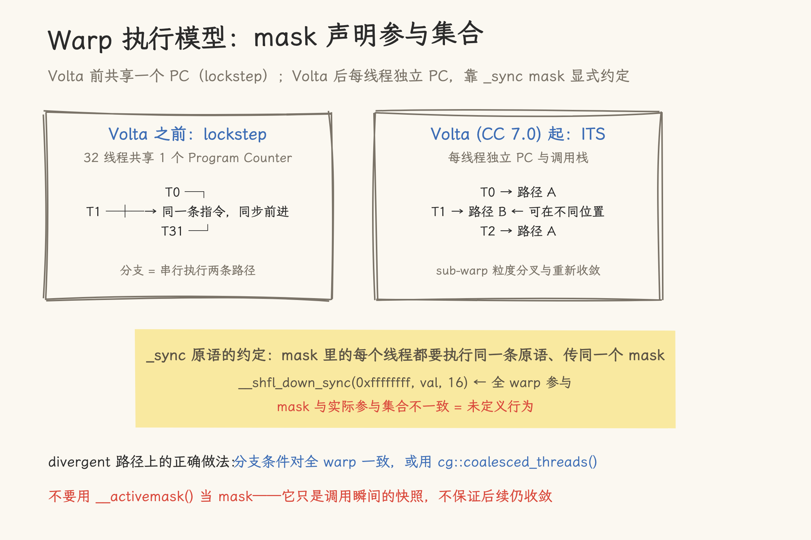

# Warp-level Programming——从 Shuffle 到 Cooperative Groups

你已经在 [Reduction](10_reduction.md) 里见过 `__shfl_down_sync`，在 [Shared Memory 与 Bank Conflict](13_shared_memory_bank_conflict.md) 里理解了 `__syncthreads()` 的代价——每次 barrier 都是几十个 cycle 的 stall。但你可能还没有系统地回答这些问题：

- `__shfl_down_sync` 的 `_sync` 后缀是什么意思？那个 `0xffffffff` 参数可以改吗？
- 除了 Reduction 的 `shfl_down`，还有 `shfl_up`、`shfl_xor`——它们分别用于什么场景？
- `__ballot_sync` 是什么？为什么 FlashAttention 和 vLLM 的 kernel 里到处是它？
- 在 `if (tid < 32)` 这样的 divergent 路径上调用 shuffle 安全吗？如果不安全，`__activemask()` 能救吗？
- A100 号称有硬件 `__reduce_add_sync`——它和手写 shuffle 哪个更快？

这些问题的共同点：它们都围绕 CUDA 编程中最底层的执行单元——Warp。Warp 内的寄存器是互通的：通过一组名为 Warp Primitives 的指令，数据可以在 1 个 cycle 内完成线程间交换，不需要 Shared Memory、不需要 `__syncthreads()`。

本文按 Shuffle → Vote → Match → Cooperative Groups → 硬件 Reduce 的顺序讲解这组指令，每个 API 都给出适用场景与不适用时的替代方案。

> **前置要求**：你已经理解 Thread/Warp/Block 执行模型（见 [GPU 编程导论](01_gpu_programming_introduction.md)），用过 Shared Memory 并理解 `__syncthreads` 的作用（见 [Shared Memory 与 Bank Conflict](13_shared_memory_bank_conflict.md)），知道 Reduction 的基本概念（见 [Reduction](10_reduction.md)）。
>
> **验证代码**：本文所有实测数据来自配套 Benchmark：[14_warp_level_bench.cu](code/14_warp_level_bench.cu)。包含 Shuffle/SMEM Reduce、Prefix Sum Scan、Ballot Filter、Match Dedup 四项测试。

---

## 1. Warp 执行模型——所有 Warp 原语的共同前提

在学 API 之前，必须先理解 Warp 的硬件行为。这是后续所有讨论的基础。

### 1.1 SIMT 执行模型与收敛

GPU 的 SIMT（Single Instruction, Multiple Threads）模型：一个 Warp 执行一条共同指令，线程各自持有自己的寄存器值。分支行为分两个时代：

- **Volta 之前**：整个 Warp 共享一个 Program Counter（lockstep），32 个线程在每条指令上严格同步前进。
- **Volta (CC 7.0) 起**：Independent Thread Scheduling（ITS）为每个线程维护独立的 PC 与调用栈，线程可以在 sub-warp 粒度分叉、重新收敛（见 PTX Machine Model §3.2）。

```text
同一 Warp 的执行（Volta 后）：
  SIMT 单元在每次发射时，把当前"活跃且路径一致"的线程分组执行；
  分叉的线程各自走自己的路径，之后在同步点重新收敛。

  → 任何"假设 Warp 内天然同步"的旧代码（无同步的 warp 内归约等）
    在 Volta 后都必须重新审视。
```

Shuffle 这类原语不依赖 lockstep：`_sync` 版本用显式 mask 声明"哪些线程参与这次通信"，参与线程集体等待，语义与调度方式解耦。真正的约束是参与集合的一致性，见 1.2 与 1.3 节。



_图 1：Volta 前后 Warp 执行模型的差异，以及 `_sync` mask 的参与集合约定。_

CPU 类比：SIMD（如 AVX-512）在一个 core 上操作 512-bit 寄存器（16 个 float）。GPU 的 Warp 可以看作把 32 个 scalar 线程映射到一个 SIMD 单元的 32 条 lane 上，只是 GPU 的分支模型更灵活。

### 1.2 Active Mask 与 Divergence

当 Warp 遇到 `if-else` 分支时，不同线程可能走不同路径。Warp 在任一时刻只执行一条共同指令，所以 GPU 会**串行执行两条分支路径**，只激活对应路径上的线程：

```cuda
if (tid < 16) {
    // 路径 A：只有 tid 0-15 活跃，tid 16-31 空闲（mask = 0x0000FFFF）
    x = a + b;
} else {
    // 路径 B：只有 tid 16-31 活跃，tid 0-15 空闲（mask = 0xFFFF0000）
    x = c + d;
}
```

硬件维护一个 **Active Mask**——一个 32-bit 的位掩码，bit i = 1 表示 thread i 当前活跃。Divergent 路径上的指令只对 active 线程产生效果。

**关键约束**：在 divergent 路径上调用带全 mask 的 Warp 原语（shuffle、vote 等）是未定义行为——mask 声明的参与集合必须与实际执行的线程集合一致。这就是 `_sync` 后缀的作用：显式告诉硬件**哪些线程应该参与这次通信**。

### 1.3 `_sync` 后缀与 Mask 参数

CC 7.0 (Volta) 引入了显式的 `_sync` 版本：

```cuda
// 旧 (CC < 7.0, 隐式假定全 warp 参与)
int val = __shfl_down(val, offset);

// 新 (CC ≥ 7.0, 显式指定参与线程)
int val = __shfl_down_sync(0xffffffff, val, offset);
//                           ^~~~~~~~~~
//                           32-bit mask: bit i = 1 → thread i 参与
```

`0xffffffff` = 全部 32 线程参与。如果你在 divergent 路径上，mask 必须匹配当前活跃的线程集合——**少一个线程都会导致 UB**。

```cuda
// 安全：分支条件对全 warp 一致（每个线程算出同一个值），全 32 线程一起进入
bool uniform = (blockIdx.x == 0);
if (uniform) {
    val = __shfl_down_sync(0xffffffff, val, 8);
}

// 危险：在可能 divergent 的路径上
if (lane_id % 2 == 0) {
    val = __shfl_down_sync(0xffffffff, val, 8);  // ← UB! 奇数 lane 不参与
}
```

后面第 5 节会讲 divergent 路径上的正确处理方式。

### 1.4 Warp vs Block：通信边界

| 属性     | Warp 内                | Block 内 (跨 Warp) |
| -------- | ---------------------- | ------------------ |
| 通信方式 | Shuffle / Vote / Match | Shared Memory      |
| 延迟     | ~1 cycle               | ~20-30 cycles      |
| 同步需要 | 不需要（mask 声明参与集合） | `__syncthreads()`  |
| 线程数   | ≤ 32                   | ≤ 1024             |

**Warp Shuffle 不能替代 Shared Memory**：跨 Warp 的数据交换必须回到 Shared Memory。Shuffle 的优势仅在 Warp 内部——对于许多算法（Reduction、Scan、Filter），Warp 内的操作可以完全在寄存器中完成。

---

## 2. Shuffle——Warp 内最快的线程间通信

### 2.1 四种模式

Shuffle 允许一个线程从 Warp 内**另一个线程的寄存器**读取数据。四种模式对应四种线程间通信的拓扑：

| 模式                                    | 语义                                      | 数据流    | 典型用途              |
| --------------------------------------- | ----------------------------------------- | --------- | --------------------- |
| `__shfl_sync(mask, val, src_lane)`      | 所有线程读 lane `src_lane` 的 `val`       | Broadcast | 分发常量、warp leader |
| `__shfl_up_sync(mask, val, delta)`      | thread i 读 thread `i-delta` 的 `val`     | 向上传递  | Prefix Sum (Scan)     |
| `__shfl_down_sync(mask, val, delta)`    | thread i 读 thread `i+delta` 的 `val`     | 向下传递  | Reduction             |
| `__shfl_xor_sync(mask, val, lane_mask)` | thread i 读 thread `i^lane_mask` 的 `val` | Butterfly | All-to-all、FFT       |

图示（以 8 线程为例）：

```text
__shfl_down_sync(mask, val, 2):

  thread:  0   1   2   3   4   5   6   7
            ↓   ↓   ↓   ↓   ↓   ↓   ↓   ↓
  源:      2   3   4   5   6   7   ?   ?    ← 越界的 lane 保持原值

  结果:   val[2] val[3] val[4] val[5] val[6] val[7] val[6] val[7]


__shfl_xor_sync(mask, val, 1):  ← Butterfly (lane_mask = 1)

  thread:  0⟷1   2⟷3   4⟷5   6⟷7
  交换:   每个线程读 (自己的 lane_id ^ 1) 的值
```

### 2.2 实战：Warp Reduction with `__shfl_down_sync`

这是最常见的用法——在 [Reduction](10_reduction.md) 中已经展示过。核心代码只需 3 行：

```cuda
// Warp reduce: 32 elements → 1 (在 thread 0)
__device__ inline float warpReduceSum(float val) {
    for (int offset = 16; offset > 0; offset /= 2)
        val += __shfl_down_sync(0xffffffff, val, offset);
    return val;
}
```

执行过程（以 8 线程为例）：

```text
offset=4:  t0←t0+t4  t1←t1+t5  t2←t2+t6  t3←t3+t7
offset=2:  t0←t0+t2  t1←t1+t3
offset=1:  t0←t0+t1

最终 t0 = sum(all 8 threads)，共 3 次 shuffle (log₂8 = 3)
对于 32 线程：5 次 shuffle (log₂32 = 5) → 共 ~5 cycles
```

对比 Shared Memory 版：每个 `sdata[tid] += sdata[tid + s]` 都需要一次 SMEM 读（~20 cycles）+ `__syncthreads()`（~10 cycles）→ 总共 ~150 cycles。Shuffle 版节省了 **~145 cycles**。

### 2.3 实战：Warp-level Prefix Sum (Scan) with `__shfl_up_sync`

Prefix Sum（每个元素 = 前面所有元素之和）是 Filter、Radix Sort 等算法的基础。用 `shfl_up` 实现：

```cuda
__device__ inline float warpPrefixSum(float val) {
    for (int offset = 1; offset < 32; offset *= 2) {
        float tmp = __shfl_up_sync(0xffffffff, val, offset);
        if (lane_id >= offset) val += tmp;
    }
    return val;
}
```

执行过程（8 线程示例）：

```text
初始:      t0=v0  t1=v1  t2=v2  t3=v3  t4=v4  t5=v5  t6=v6  t7=v7

offset=1:  t0=v0  t1=v0+v1  t2=v1+v2  t3=v2+v3  ...  t7=v6+v7
offset=2:  t0=v0  t1=∑v0:1  t2=∑v0:2  t3=∑v1:3  ...  t7=∑v5:7
offset=4:  t0=v0  t1=∑v0:1  t2=∑v0:2  t3=∑v0:3  t4=∑v0:4 ... t7=∑v3:7

最终每个线程持有 [0..lane_id] 的前缀和。
```

### 2.4 实战：Butterfly Broadcast with `__shfl_xor_sync`

`shfl_xor` 实现的是 Butterfly（蝶形）交换——lane i 和 lane `i ^ lane_mask` 互相读取。这在需要成对交换的算法中很常见（FFT、Bitonic Sort）：

```cuda
// Warp 内成对交换数据
for (int mask = 16; mask > 0; mask >>= 1) {
    float other = __shfl_xor_sync(0xffffffff, my_val, mask);
    my_val = fmaxf(my_val, other);  // Bitonic Sort 的比较步骤
}
```

### 2.5 Shuffle vs Shared Memory 性能实测

| 通信方式                        | 延迟          | 何时用             |
| ------------------------------- | ------------- | ------------------ |
| Shuffle (`__shfl_down_sync`)    | ~1 cycle      | Warp 内数据交换    |
| Shared Memory (无 conflict)     | ~20-30 cycles | Block 内任意线程间 |
| Shared Memory (32-way conflict) | ~600+ cycles  | 需要优化（见 #13） |

> Warp 内的数据交换优先用 Shuffle；Shared Memory 的价值在跨 Warp 场景。

---

## 3. Vote——Warp 内条件聚合与判断

Shuffle 交换的是数据，Vote 交换的是**条件——每个线程贡献 1 bit**，32 个线程聚合为 32-bit 的结果。

### 3.1 `__ballot_sync(mask, predicate)`：Warp 级的条件路由

`ballot` 是最强大的 Vote 原语——每个线程提交一个 bool，返回一个 32-bit 掩码，其中 bit i = 1 当且仅当 thread i 的 predicate 为 true：

```cuda
// 哪些线程的 lane_id 是偶数？
unsigned mask = __ballot_sync(0xffffffff, (lane_id % 2) == 0);
// mask = 0x55555555

// 哪些线程的值 > 阈值？
unsigned mask = __ballot_sync(0xffffffff, val > threshold);
```

**用法一：知道"还有哪些线程需要处理"：**

分批处理不规则数据——FlashAttention 用 ballot 来确定哪些 query 需要继续 causal mask 检查：

```cuda
unsigned remaining = __ballot_sync(0xffffffff, need_more_work);
while (remaining) {
    int next_lane = __ffs(remaining) - 1;  // 找到下一个需要处理的 lane
    // ... 处理 ...
    remaining &= remaining - 1;  // 清除这个 lane 的 bit
}
```

**用法二：Warp 级数据压缩 (Compact)：**

将满足条件的线程数据紧凑排列到前半部分：

```cuda
// 输入: 每个线程有一个值和一个 bool (keep)
// 输出: 前 N 个线程存放被 keep 的值

unsigned keep_mask = __ballot_sync(0xffffffff, keep);
int prefix = __popc(keep_mask & ((1u << lane_id) - 1));  // 排在当前线程之前的 keep 线程数
```

CPU 类比：`__ballot_sync` 相当于 32 个 bit 的 SIMD compare + movemask。在 AVX 中，`_mm256_movemask_ps` 将 8 个 float 的符号位压缩为 8-bit 整数——GPU 的 ballot 将 32 个 bool 压缩为 32-bit 整数。

### 3.2 `__all_sync` / `__any_sync`：Warp 级 AND / OR

这两个是 ballot 的简化版——只需知道"全部为真"还是"存在为真"，不需要知道具体哪些线程：

```cuda
// 所有线程都完成了它们的工作？
bool all_done = __all_sync(0xffffffff, is_done);

// 至少有一个线程发现了需要 refine 的元素？
bool needs_refine = __any_sync(0xffffffff, found_better);
```

实际使用场景：迭代算法中检测收敛条件——`__all_sync` 判断是否所有线程都收敛了，`__any_sync` 判断是否有任何线程需要继续迭代。

### 3.3 实战：Warp 内 Filter (Compact)

利用 ballot + popc 的组合实现零 Shared Memory 的 warp 内 filter：

```cuda
// 保留 warp 内 > 0 的元素，紧凑写入 output 的前部（示意：output 指向本 warp 的私有区段）
__device__ int warpCompact(float *output, float val) {
    unsigned keep = __ballot_sync(0xffffffff, val > 0.0f);

    // 当前线程在 keep 线程中的 rank（排在前面的 keep 线程数）
    int local_rank = __popc(keep & ((1u << lane_id) - 1));

    if (val > 0.0f)
        output[local_rank] = val;   // keep 线程把自己的值写到紧凑位置

    return __popc(keep);            // keep 的总数（= 写入的元素数）
}
```

### 3.4 实战：Ballot + `__popc` 做 Warp-level Histogram

```cuda
// 每个线程有一个类别标签 (0-31)，统计每个类别在 warp 内的数量
int hist = 0;
unsigned mask = __ballot_sync(0xffffffff, category == my_category);
hist += __popc(mask);  // 这个类别在 warp 内的计数
```

---

## 4. Match——Warp 内去重与分组

### 4.1 `__match_any_sync`：找出"谁和我的值相同"

```cuda
// 线程 i 想知道 warp 内哪些线程和它有相同的 key
unsigned mask = __match_any_sync(0xffffffff, key);
// mask 中所有 key == key[i] 的线程的 bit 被置位
```

用途：哈希表 conflict resolution。如果多个线程哈希到同一个 slot，用 match_any 检查 warp 内是否有冲突。

### 4.2 `__match_all_sync`：检查全 warp 的值是否一致

```cuda
// 返回值是 mask，第三个参数接收 pred（int*）
// 所有线程值相同 → mask = 0xffffffff、pred = 1
// 存在不同值     → mask = 0、pred = 0
int pred;
unsigned mask = __match_all_sync(0xffffffff, key, &pred);
```

### 4.3 实战：Warp 内去重 (Dedup)

```cuda
// 每个线程有一个 key，找出 warp 内唯一的 key
unsigned seen = 0;
int is_unique = 0;

// 每个 key，只有 lane_id 最小的那个线程标记为 unique
unsigned same_key = __match_any_sync(0xffffffff, key);
if ((same_key & ((1u << lane_id) - 1)) == 0)  // 我是第一个
    is_unique = 1;
```

### 4.4 适用场景

| 场景       | 原语        | 作用                     |
| ---------- | ----------- | ------------------------ |
| 哈希表探测 | `match_any` | 检测 warp 内 slot 冲突   |
| 图算法     | `match_any` | 邻接去重                 |
| 字典压缩   | `match_any` | 相同 key 只保留一份      |
| 收敛检测   | `match_all` | 检查全 warp 达到一致状态 |

---

## 5. Divergent 路径上的正确写法

### 5.1 `__activemask()` 返回什么

```cuda
unsigned active = __activemask();
```

返回调用瞬间 Warp 内活跃线程的位掩码，一个运行时状态查询，类似 CPU 上读当前 PID。

### 5.2 为什么不能用 `__activemask()` 当 shuffle 的 mask

直觉上"在 if 分支里用 `__activemask()` 做 mask"最保险，但官方文档明确不推荐：

- 返回值只保证在**调用瞬间**有效。Volta 之后的硬件可以在指令边界重新收敛线程，几行代码之后，实际活跃集合可能已经和快照不同。
- `_sync` 原语要求**mask 里的所有线程执行同一条原语、传同一个 mask**。快照里的线程如果已经走到别处，这条指令永远等不到它们——未定义行为。

### 5.3 官方推荐的三种模式

```cuda
// 模式一：分支条件对全 warp 一致，从源头避免 divergence
bool uniform = (blockIdx.x == 0);
if (uniform) {
    val = __shfl_down_sync(0xffffffff, val, 16);
}

// 模式二：coalesced_group，参与集合由 cooperative groups 保证一致
if (complex_condition) {
    auto g = cg::coalesced_threads();   // 此刻活跃线程构成的组
    float partial = g.shfl_down(my_val, 16);
}

// 模式三：参与集合固定时，用 tiled_partition 显式声明
auto tile8 = cg::tiled_partition<8>(this_thread_block());
```

原则：mask 必须来自你能**推理出参与集合**的结构（全 warp、固定 tile、coalesced group），而不是运行时快照。

---

## 6. Cooperative Groups `tiled_partition`——现代抽象

### 6.1 为什么需要 CG

手写 `__shfl_down_sync(0xffffffff, val, offset)` 有三个问题：

1. **mask 是魔法数字**：`0xffffffff` 看起来和 32 无关
2. **易出错**：在 divergent 路径上忘记改 mask → UB
3. **不可移植**：假设 warp size = 32——虽然目前所有 NVIDIA GPU 都如此，但未来可能改变

Cooperative Groups 提供了类型安全的抽象：

```cuda
#include <cooperative_groups.h>
namespace cg = cooperative_groups;

auto cta = cg::this_thread_block();           // Block-level CG
auto tile32 = cg::tiled_partition<32>(cta);   // Warp-sized tile

// 替代 __shfl_down_sync(0xffffffff, val, offset)
float res = tile32.shfl_down(val, offset);    // ← mask 自动推导，永远正确
```

### 6.2 CG API 与原语对照

| CG API                          | 等价原语                                    |
| ------------------------------- | ------------------------------------------- |
| `tile32.shfl_down(val, offset)` | `__shfl_down_sync(0xffffffff, val, offset)` |
| `tile32.shfl_up(val, offset)`   | `__shfl_up_sync(0xffffffff, val, offset)`   |
| `tile32.shfl(val, src_lane)`    | `__shfl_sync(0xffffffff, val, src_lane)`    |
| `tile32.shfl_xor(val, mask)`    | `__shfl_xor_sync(0xffffffff, val, mask)`    |
| `tile32.ballot(pred)`           | `__ballot_sync(0xffffffff, pred)`           |
| `tile32.any(pred)`              | `__any_sync(0xffffffff, pred)`              |
| `tile32.all(pred)`              | `__all_sync(0xffffffff, pred)`              |
| `tile32.match_any(val)`         | `__match_any_sync(0xffffffff, val)`         |
| `tile32.match_all(val, &mask)`  | `__match_all_sync(0xffffffff, val, &mask)`  |

### 6.3 CG vs 原语的性能差距

零差距：Cooperative Groups 的 `tiled_partition` 在编译期完全展开为原始 PTX 指令，模板参数 `<32>` 是编译期常量，所有 shuffle/vote 调用在 SASS 层面与原语完全相同。代价是多一行 `tiled_partition` 构造和 `#include <cooperative_groups.h>`。

### 6.4 灵活 Tile 大小

CG 的真正优势不在于替换 Warp 原语，而在于**支持任意 2 的幂次的 tile 大小**：

```cuda
auto tile16 = cg::tiled_partition<16>(cta);  // 16 线程 tile
auto tile8  = cg::tiled_partition<8>(cta);
auto tile4  = cg::tiled_partition<4>(cta);

// tile16 内的 shuffle 仅在 16 线程间进行
float res = tile16.shfl_down(val, 8);
```

这在需要分层 reduce 的算法中非常有用——先 tile8 内 reduce，再在 Shared Memory 中跨 tile 合并。

---

## 7. A100 硬件加速——`__reduce_add_sync` 与局限

### 7.1 硬件 Reduce 指令 (SM 8.0+)

SM 8.0 引入了硬件 Warp Reduce 指令（PTX: `redux.sync`），整个 32 线程的 reduce 在**一条指令**内完成：

```cuda
// 手写 shuffle reduce：对 int/float 都适用
float sum = warpReduceSum(my_val);  // 见 2.2 节

// SM 8.0 硬件 reduce：1 条 redux.sync 指令，~1 cycle
// 注意：add 只支持整型（int/unsigned）
int sum_i = __reduce_add_sync(0xffffffff, my_int);
```

支持的硬件 reduce 操作：

| 指令                           | 操作     | 支持类型                       |
| ------------------------------ | -------- | ------------------------------ |
| `__reduce_add_sync(mask, val)` | 求和     | `int` / `unsigned`             |
| `__reduce_min_sync(mask, val)` | 最小值   | `int` / `unsigned`（PTX 另有 `.f32` 形式，需内联 PTX） |
| `__reduce_max_sync(mask, val)` | 最大值   | 同 min                         |
| `__reduce_and_sync(mask, val)` | 按位与   | `unsigned`                     |
| `__reduce_or_sync(mask, val)`  | 按位或   | `unsigned`                     |
| `__reduce_xor_sync(mask, val)` | 按位异或 | `unsigned`                     |

PTX `redux.sync.add` 只有 `.u32/.s32` 类型（`.f32` 仅用于 `.min/.max`），所以求 float 的和没有硬件指令，只能手写 shuffle 循环。

### 7.2 性能差异

```text
Warp Reduce 32 ints (A100):

  Shuffle loop (__shfl_down_sync):    ~5 cycles  (5 次 shuffle)
  Hardware reduce (__reduce_add_sync): ~1 cycle   (1 条 redux.sync 指令)

  差异: 5x，但绝对值仅 4 cycles → 对于大 kernel，差距可忽略
```

### 7.3 局限

1. **仅整型**：float 求和无硬件指令（min/max 可走 PTX `.f32` 形式）
2. **仅固定操作**：不能做自定义 combiner（如 `fmaxf(fabs(x), fabs(y))`）
3. **仅 CC ≥ 8.0**：V100 (CC 7.0) 不可用
4. **按全 warp 使用**：PTX 语义按 membermask 定义，子集 mask 理论可行，但官方示例与常见实现都以全 warp 为前提，依赖子集行为前先实测

### 7.4 何时用 shuffle vs 硬件 reduce

```text
需要 Warp Reduce？
  ├─ int 求和/求最值 → __reduce_add_sync / min / max (CC 8.0+)
  ├─ float 求和 → 手写 shuffle loop
  ├─ 自定义 combiner → 必须手写 shuffle loop
  └─ 需要 < 32 线程 partial reduce → 手写 shuffle loop 或 CG tile
```

---

## 8. 权衡——Warp 原语的边界

### 8.1 Shuffle vs Shared Memory 的决策树

```text
数据在 Warp 内通信？
  ├─ 是 → 优先用 Shuffle
  │   ├─ 全 32 线程 → __shfl_down_sync / CG tiled_partition<32>
  │   └─ divergent 路径 → cg::coalesced_threads()（不要用 __activemask() 当 mask）
  └─ 否 → 必须用 Shared Memory
      ├─ Warp 间通信 → sdata + __syncthreads
      └─ Block 间通信 → Global Memory + atomic / cooperative groups
```

### 8.2 Divergent 路径上的安全法则

```cuda
// 错误：__activemask() 快照不保证后续仍收敛，官方明确不推荐
// float res = __shfl_down_sync(__activemask(), val, offset);

// 正确：coalesced_threads 让 CG 保证参与集合一致
if (some_condition) {
    auto g = cg::coalesced_threads();
    float res = g.shfl(val, 0);  // g 内任意线程的值
}
```

mask 与实际参与集合不一致是未定义行为，症状是"有时对有时错"，很难排查。判断标准只有一条：你能不能在编译期（或通过 CG 类型）说出哪些线程参与。

### 8.3 Cooperative Groups 的取舍

|                | 原始 `_sync` 原语 | Cooperative Groups       |
| -------------- | ----------------- | ------------------------ |
| 代码量         | 少                | 多一行 `tiled_partition` |
| 正确性保证     | 手动管理 mask     | 编译器自动               |
| 可移植性       | 假设 warp_size=32 | 类型系统保护             |
| 灵活 tile 大小 | 不支持            | 支持任意 2 的幂次        |
| 性能           | 完全一样          | 完全一样                 |

**建议**：新代码用 CG。只有面向 CC < 7.0 的旧 GPU 时才用不带 `_sync` 的原始原语（`__shfl_down` 等）；`_sync` 版本本身就要求 CC ≥ 7.0。

---

## 9. 总结——Warp 原语选型速查

### 9.1 选型表

| 你想做什么                  | 用哪个                                     | 示例                        |
| --------------------------- | ------------------------------------------ | --------------------------- |
| Warp 内求和/求最值          | `__shfl_down_sync` 或 `__reduce_add_sync`  | Reduction                   |
| Warp 内前缀和               | `__shfl_up_sync`                           | Scan / Filter               |
| Warp 内广播                 | `__shfl_sync`                              | 分发 warp leader 的值       |
| 成对交换                    | `__shfl_xor_sync`                          | Bitonic Sort / FFT          |
| 收集所有满足条件的线程 mask | `__ballot_sync`                            | Filter / Compact / 条件路由 |
| 检查全 warp 条件            | `__all_sync` / `__any_sync`                | 收敛检测                    |
| 查找相同 key 的线程         | `__match_any_sync`                         | 去重 / 哈希表探测           |
| Divergent 路径安全 shuffle  | `cg::coalesced_threads()` + `.shfl_down()` | 分支内 partial reduce       |
| 现代抽象（推荐）            | `cg::tiled_partition<32>` + `.shfl_down()` | 以上全部                    |

### 9.2 与其他文章的衔接

| 本文涉及的                              | 详见                                                                        |
| --------------------------------------- | --------------------------------------------------------------------------- |
| Reduction 中的 shuffle 用法             | [Reduction](10_reduction.md) 第 5 节                                        |
| Shared Memory 与 `__syncthreads` 的开销 | [Shared Memory 与 Bank Conflict](13_shared_memory_bank_conflict.md) 第 1 节 |
| Global Memory coalesced access          | [GPU 内存管理](12_gpu_memory_management.md) 第 1 节                         |
| Tensor Core 与 Warp 的关系              | [Tensor Core GEMM](11_tensor_core_gemm.md)                                  |

---

## 附录：Warp 原语速查

### A. Shuffle

```cuda
float __shfl_sync(unsigned mask, float val, int src_lane, int width=32);
float __shfl_up_sync(unsigned mask, float val, unsigned delta, int width=32);
float __shfl_down_sync(unsigned mask, float val, unsigned delta, int width=32);
float __shfl_xor_sync(unsigned mask, float val, int lane_mask, int width=32);
```

### B. Vote

```cuda
unsigned __ballot_sync(unsigned mask, int predicate);
int      __all_sync(unsigned mask, int predicate);
int      __any_sync(unsigned mask, int predicate);
```

### C. Match

```cuda
unsigned __match_any_sync(unsigned mask, int value);
unsigned __match_all_sync(unsigned mask, int value, int *pred);  // pred: 全部相同为 1，否则 0
```

### D. Active Mask

```cuda
unsigned __activemask();  // 返回当前 cycle 的活跃线程 mask
```

### E. A100 Hardware Reduce (CC ≥ 8.0)

```cuda
int   __reduce_add_sync(unsigned mask, int val);
int   __reduce_min_sync(unsigned mask, int val);
int   __reduce_max_sync(unsigned mask, int val);
unsigned __reduce_and_sync(unsigned mask, unsigned val);
unsigned __reduce_or_sync(unsigned mask, unsigned val);
unsigned __reduce_xor_sync(unsigned mask, unsigned val);
```
