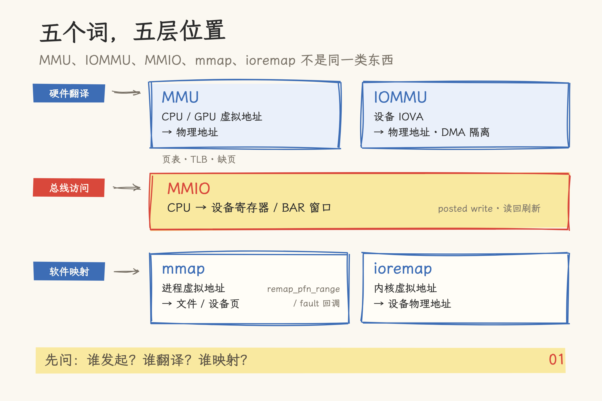
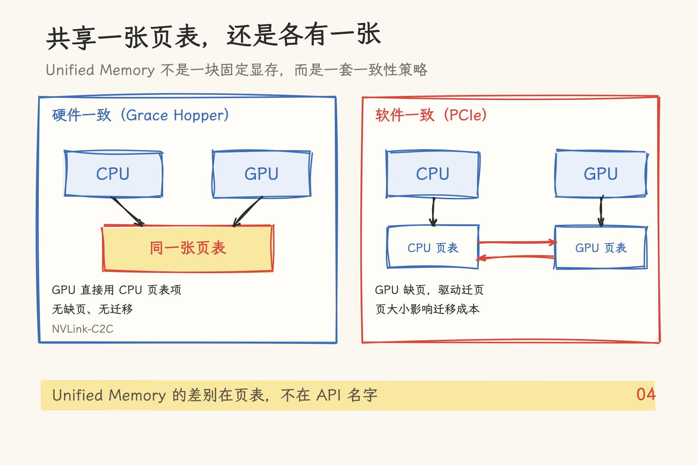
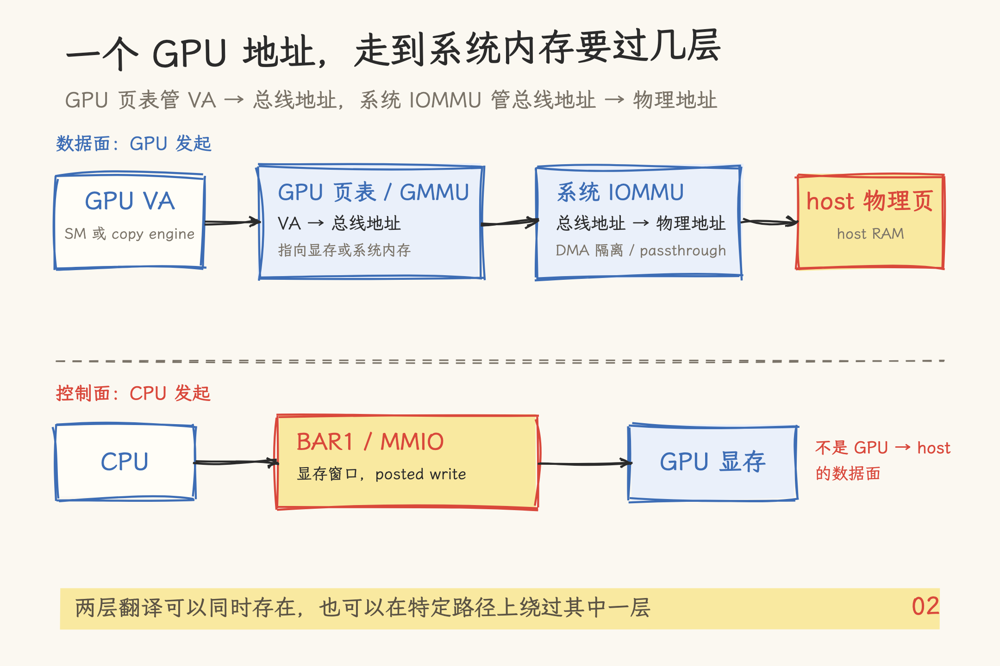
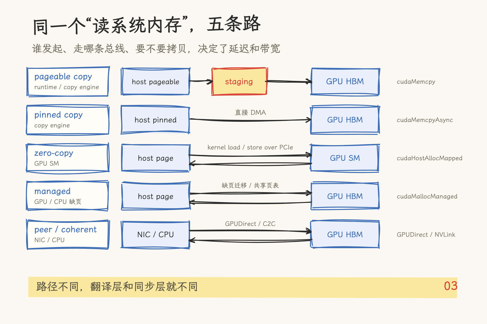

# GPU 访问系统内存：MMU、IOMMU、MMIO、mmap、ioremap 五种机制对照

> 写作日期 2026-10-31。Linux 侧按 v6.18 源码（`b6d993310a65`）与 docs.kernel.org 核对；NVIDIA 侧按 CUDA 13.4 文档、CUDA Runtime / Driver API 13.4 和开源内核模块 610.57.04（`e4a5faa`）核对。文中带宽数字区分规范推导、厂商口径与仓库实测，引用时请保留口径。

先看三段代码。它们都在做同一件事：让 GPU 读系统内存。

```c
// A：普通 malloc 缓冲区
float *h = malloc(N * sizeof(float));
cudaMemcpy(d, h, N * sizeof(float), cudaMemcpyHostToDevice);

// B：映射的页锁定内存
float *hmap;
cudaHostAlloc(&hmap, N * sizeof(float), cudaHostAllocMapped);
// 64 位 UVA 下，hmap 可以直接在 kernel 里用
kernel<<<blocks, threads>>>(hmap);

// C：managed memory
float *p;
cudaMallocManaged(&p, N * sizeof(float));
kernel<<<blocks, threads>>>(p);
```

A 能跑，是因为驱动会先把 pageable 数据变成 DMA 能访问的形式：常见做法是 stage 到 pinned 缓冲，或者临时 pin 相关页；B 能跑，是因为 host 页被映射进了 GPU 的地址空间；C 能跑，是因为 GPU 缺页后驱动迁移页面，或者在硬件一致的平台上直接共享页表。

三种写法都叫“GPU 访问系统内存”，但地址经过的翻译层、映射层和同步层并不一样。这篇文章不教 API 调参，而是把 Linux 的五个内存机制当作五面镜子，照出 GPU 侧的对应结构。读完你应该能回答：一个地址从 CPU 或 GPU 发出，到最终落到物理内存，中间经过了谁。

## 一、五个词不在一个层次

MMU、IOMMU、MMIO、mmap、ioremap 经常被并列，但它们解决的不是同一类问题。

| 机制    | 所在层       | 地址方向                     | 谁发起     | GPU 侧对应物             |
| ------- | ------------ | ---------------------------- | ---------- | ------------------------ |
| MMU     | 硬件地址翻译 | 虚拟地址 → 物理地址          | CPU 或 GPU | GPU 页表 / GMMU          |
| IOMMU   | 硬件地址翻译 | 设备 IOVA → 物理地址         | DMA 设备   | 系统 IOMMU               |
| MMIO    | 总线访问方式 | CPU → 设备寄存器 / 设备窗口  | CPU        | BAR0 / BAR1              |
| mmap    | 软件映射接口 | 进程虚拟地址 → 文件 / 设备页 | 用户进程   | CUDA VMM / 设备节点 mmap |
| ioremap | 软件映射接口 | 内核虚拟地址 → 设备物理地址  | 内核驱动   | 驱动映射 BAR             |

这里有两个翻译单元、一个总线访问方式、两个软件映射接口。它们共同回答一个问题：地址从谁发出，由谁翻译，被谁映射，最后靠什么同步。

把它们当成五个可以互换的 API，是很多误解的起点。比如“GPU DMA 不经过 MMU”这句话，漏掉了 GPU 自己的页表，也漏掉了系统 IOMMU；“mmap 就是零拷贝”则把建立映射和搬运数据混成了一件事。



_图 1：MMU/IOMMU 是硬件翻译，MMIO 是总线访问，mmap/ioremap 是软件映射。_

## 二、Linux 侧：五种机制各自解决什么

### 2.1 MMU：把虚拟地址翻译成物理地址

CPU 侧的 MMU 是地址翻译硬件。程序读写一个虚拟地址，MMU 查页表，把虚拟页号翻译成物理页号，再拼上页内偏移。页表本身在内存里，逐级查找很慢，所以 MMU 旁边有 TLB，缓存最近用过的翻译。

如果页表里没有这个映射，或者权限不匹配，就会触发缺页。Linux 的缺页处理最终走到 `handle_mm_fault()`（`mm/memory.c:6470`）和 `__handle_mm_fault()`（`:6245`）。但缺页不等于每次都要分配新物理页：可能是页已经在 page cache 里，只缺 PTE；可能是写时复制；可能是 swap-in；也可能是非法访问，最后给进程一个 SIGSEGV。

页越大，TLB 覆盖的范围越大，缺页和页表遍历的次数越少；代价是内部碎片和迁移成本更高。大页的取舍在 CPU 和 GPU 上都存在，只是页面大小和 TLB 结构不同。

GPU 也有自己的地址翻译硬件和页表。区别在于，GPU 页表可以把一个 GPU 虚拟地址翻译到显存，也可以翻译到系统内存。后者就是“GPU 访问系统内存”的起点。

### 2.2 IOMMU：把设备发出的地址翻译成物理地址

CPU 有 MMU，设备不跑 CPU 的 MMU。设备发起 DMA 时，它拿到的是驱动建立好的 DMA 地址，通常叫 IOVA。IOMMU 把 IOVA 翻译成物理地址，同时检查这个设备有没有权限访问这段内存。

Linux 的 IOMMU 支持覆盖 Intel VT-d、AMD-Vi 和 ARM SMMU。隔离不是“有 IOMMU 就自动成立”：它按 IOMMU group 和 domain 组织，PCIe 拓扑、ACS 配置、桥设备都会影响隔离粒度。一个 group 里的设备，可能无法单独分配给不同的虚拟机。

`iommu.passthrough=1` 会把 DMA 做成 1:1 映射，也就是 IOVA 基本等于物理地址。这样开销最低，但设备失去了翻译层的保护。老的 x86 参数 `iommu=pt` 是它的历史写法，新内核更推荐通用参数 `iommu.passthrough=1`。

这里有一个和 GPU 直接相关的边界：普通 GPU DMA 可以经过 IOMMU 翻译；GPUDirect RDMA 这类 peer 访问不行。NVIDIA 的文档写得很直接：GPUDirect RDMA 假设所有 PCIe 设备看到的物理地址相同，所以 IOMMU 必须关闭，或者配置成 1:1 passthrough。

### 2.3 MMIO：CPU 通过地址窗口访问设备

MMIO 是把一部分 CPU 物理地址空间解释成设备访问。CPU 对这段地址做 load/store，总线把它变成 PCIe Memory Read/Write TLP，落到设备的寄存器或显存窗口上。PCIe 的 BAR 就是这些窗口的地址资源。

MMIO 写有一个容易忽略的性质：PCIe MMIO 写是 posted。CPU 的 store retire 了，不代表事务已经到了设备。要确认写完成，驱动通常从同一个设备读回一个寄存器，用这次读的完成来“冲刷”前面的写。只加 CPU 侧屏障不够，屏障约束的是 CPU 的访存顺序，不是 PCIe 事务的完成。

MMIO 适合控制面：写门铃、读状态、配置寄存器。它不适合搬大块数据。逐字节通过 BAR 读显存，延迟和带宽都会被 PCIe 事务开销吃掉。

这也是理解 GPU 的关键区分：CPU 通过 BAR1 读显存，是 MMIO；GPU 通过 PCIe 读系统内存，是 GPU 发出的 Memory Read/Write，不是 CPU 的 MMIO。两者都走 PCIe，但发起者和地址翻译层不同。

### 2.4 mmap：把文件或设备映射进进程地址空间

`mmap()` 在进程虚拟地址空间里建立一段映射。映射可以来自文件，也可以来自设备；可以是 `MAP_SHARED`，也可以是 `MAP_PRIVATE`。对文件映射来说，访问到还没读入的页会触发缺页，由 page cache 把文件页读进来。

设备驱动的 mmap 有两条常见路径：

- `remap_pfn_range()` 或 `vm_insert_page()`：在 `mmap()` 系统调用期间就把 PTE 装好。前者把内核物理页映射给用户，后者把驱动分配的页插入用户 VMA。
- `vm_operations_struct->fault`：`mmap()` 只建立 VMA，第一次访问时缺页，驱动在 fault 回调里决定映射哪一页。`vmf_insert_pfn()` 是这条路径常用的辅助函数。

所以“mmap 一定靠缺页建立映射”并不准确。设备 mmap 可能在建映射时就把 PTE 装好了；只有 fault 回调路径才是按需缺页。

mmap 也不等于零拷贝。它省掉的是“用户态缓冲区和内核/设备缓冲区之间的一次复制”，但页表建立、缺页、PCIe 传输、TLB 失效仍然存在。映射只是地址空间的契约，不是数据搬运本身。

### 2.5 ioremap：把设备物理地址映射进内核虚拟地址

`ioremap()` 把一段设备物理地址映射到内核虚拟地址空间，返回一个 `__iomem` 指针。它用于 MMIO 寄存器、设备窗口这类 I/O 内存，不能用于系统 RAM。x86 的 `arch/x86/mm/ioremap.c:212-219` 在检测到 System RAM 时会直接告警并返回 NULL。

`ioremap_wc()` 建立 write-combining 映射，适合 framebuffer 这类只写或少读的设备内存；`memremap()` 把物理地址范围映射成普通指针，`MEMREMAP_WB` 会复用系统 RAM 的直接映射，也可以用 WT/WC 映射设备内存，但它没有 `__iomem` 那层类型语义。

内核驱动访问设备还有一套 DMA API：

- `dma_alloc_coherent()` 分配一致性内存，同时返回 CPU 虚拟地址和 DMA 地址。设备和 CPU 的读写不需要额外的 cache 维护。
- `dma_map_single()` / `dma_map_page()` 把已有的 buffer 临时映射给设备，属于流式 DMA。方向、同步和 unmap 都要成对处理。

`ioremap` 和 DMA API 的分工可以这样记：ioremap 管“CPU 怎么访问设备内存”，DMA API 管“设备怎么访问内存”。两者都属于内核驱动，用户态看不到。

## 三、GPU 侧：五面镜子

### 3.1 GPU 的 MMU：页表、UVA 与缺页

GPU 有自己的页表。CUDA 文档里常把它写成“GPU page tables”，驱动源码里则常出现 GMMU 这个词。一个 GPU 虚拟地址可以被翻译到显存，也可以被翻译到系统内存；NVIDIA 的 UVM 代码里，系统内存走 `UVM_APERTURE_SYS` 这条地址窗口。

64 位 Linux 上，CUDA 使用统一虚拟地址空间（UVA）：一个进程里，CPU 和所有 GPU 共享同一个虚拟地址空间，CPU 和每张 GPU 各占一段范围。`cudaPointerGetAttributes()` 能告诉你这个指针是 host、device 还是 managed，但它只说明“内存是怎么分配的”，不说明“数据现在在哪”。官方文档的原话是：指针属性不表示内存驻留位置，只表示分配或注册方式。

GPU 访问系统内存有两条一致性路径：

- 硬件一致：Grace Hopper、Grace Blackwell 这类通过 NVLink-C2C 连接 CPU 的平台，CPU 和 GPU 逻辑上共享一张页表。GPU 访问系统内存时，直接使用 CPU 建立的页表项，不需要缺页，也不需要把页搬到显存。
- 软件一致：CPU 和 GPU 各有自己的页表。GPU 访问一个还没有映射到它页表里的系统内存页时，会触发 GPU 缺页；驱动更新页表，必要时把整页迁移到 GPU 显存。迁移的成本和页大小成正比。

`cudaMallocManaged()` 在软件一致平台上走这套缺页和迁移逻辑：分配时不一定建立物理页，第一次访问才填充；驱动可以在显存和系统内存之间迁移，也可以在显存不足时把页换出到 host。在硬件一致平台上，它可以利用共享页表直接访问。`cudaMemAdvise()` 和 `cudaMemPrefetchAsync()` 是给驱动的放置提示和预取手段，不是强制命令。

页大小在这里很关键。CUDA 文档的分配器表里，`cudaMallocManaged` 的 GPU 常驻页常见为 2MB，CPU 常驻页用系统页大小，常见 4KB 或 64KB。GPU 的 TLB miss 通常比 CPU 更贵，所以小页随机访问在 GPU 上更容易被 TLB 拖慢。64KB 是 UVM 内部的 big page 或 Arm CPU 页大小，不能简单说成“Unified Memory 固定 64KB 页”。

还有一个容易混淆的点：ATS/PASID。PCIe ATS 允许设备缓存 CPU 页表的翻译，PASID 给每个进程一个地址空间标识。CUDA 文档明确提到的 ATS 可用场景，是 GPU 通过 NVLink-C2C 连接 CPU 的平台，不能推广到普通 PCIe 独显。Linux 的 HMM 框架则允许设备驱动镜像 CPU 页表；NVIDIA 的 UVM 代码里确实有 HMM 支持，并在缺页路径调用 `hmm_range_fault()`。这两条都属于“页表共享/镜像”的路线，不是所有 GPU、所有平台都默认开启。



_图 2：硬件一致平台共享页表；软件一致平台各有一张页表，靠缺页和迁移。_

### 3.2 系统 IOMMU：GPU DMA 到系统内存的翻译层

以 GPU 访问系统内存为例，copy engine 或 SM 发出的地址可以理解为两层翻译后的结果：

1. GPU 页表把 GPU 虚拟地址翻译成 GPU 物理地址或系统内存窗口。
2. 系统 IOMMU 把总线地址翻译成 host 物理地址。

方向反过来时，两层仍然存在，但谁先谁后取决于访问的是源还是目标。普通 GPU DMA 可以走 IOMMU。这样驱动只需要给设备一个 IOVA，IOMMU 负责落到物理页，同时提供隔离。虚拟机直通和 VFIO 依赖这一层；容器是否使用 IOMMU，取决于运行时和设备插件。

GPUDirect RDMA 是例外。它的数据路径是 NIC 直接读写 GPU 的 BAR 地址，NIC 和 GPU 都假设彼此看到的物理地址一致。NVIDIA 文档要求 IOMMU 关闭或 1:1 passthrough；否则地址翻译会让 peer 访问落到错误的位置。`iommu.passthrough=1` 是满足这个要求的常见配置，但不是唯一写法。

不要把“GPU 页表”和“系统 IOMMU”混成一层。前者管 GPU 虚拟地址到设备/总线地址，后者管总线地址到物理地址。两层可以同时存在，也可以在某些平台或配置下绕过其中一层。



_图 3：一个 GPU 地址先过 GPU 页表，再过系统 IOMMU；BAR1/MMIO 是 CPU 看显存的控制面。_

### 3.3 BAR 与 MMIO：CPU 看 GPU 的窗口

GPU 通过 PCIe BAR 暴露两类窗口：

- BAR0：寄存器和控制窗口。驱动通过 MMIO 读写这些寄存器，提交命令、读状态。
- BAR1：显存窗口。CPU 可以通过 BAR1 读写一部分显存；窗口大小由 GPU 型号、固件和 Resizable BAR 决定。

消费级显卡的 BAR1 往往只有 256MB，数据中心 GPU 可以大得多；开启 ReBAR 后，BAR1 可以扩到接近整块显存。NVIDIA 驱动会检查 BAR1 的 ReBAR 能力，并尝试把它调整到支持的最大尺寸。`nvidia-smi -q` 能看到 BAR1 的 Total / Used / Free。

但 BAR1 不是“GPU 访问系统内存”的通道。它的方向是 CPU → GPU 显存，属于控制面或小数据面。GPU 读系统内存走的是另一条路：GPU 页表把系统内存页映射进 GPU 地址空间，SM 发起 PCIe 读写，或者 copy engine 发起 DMA。两者都经过 PCIe，但发起者、地址翻译和访问语义不同。

一个实用的判断：CPU 通过 BAR1 读 GPU 显存，落在 MMIO 窗口里，访问是非缓存、按事务计的；GPU kernel 读 host 内存，走 GPU 页表加 PCIe 读写，不是 CPU 的 MMIO。

CXL 自己就把控制面和内存面分开了：CXL.io 是 PCIe 兼容的控制面（配置、MMIO、DMA），CXL.mem 不是 MMIO，它把设备内存映射成可缓存的主机内存（HDM），CPU 用普通 load/store 访问。判断一条路径，先看它用的是哪种协议和内存语义，不要只看地址离谁近。

### 3.4 mmap 与 CUDA VMM：用户态的地址空间契约

CUDA 驱动 API 提供了一套虚拟内存管理（VMM）接口，和 Linux 的 mmap 在思路上很像：

```c
CUdeviceptr va;
cuMemAddressReserve(&va, size, 0, 0, 0);   // 先保留一段虚拟地址
CUmemGenericAllocationHandle handle;
cuMemCreate(&handle, size, &prop, 0);      // 再创建物理分配，此时还没有映射
cuMemMap(va, size, 0, handle, 0);          // 把物理分配映射到保留的 VA
cuMemSetAccess(va, size, &desc, 1);        // 最后授予访问权限
```

这四步对应 mmap 的地址保留、建立映射和设置权限三个动作，外加一次物理分配，只是对象换成了 GPU 物理内存。`cuMemCreate()` 创建的分配没有任何 device 或 host 映射；`cuMemMap()` 才把它挂到保留的 VA 上；`cuMemSetAccess()` 决定哪些设备能访问这段 VA。官方文档没有说明 `cudaMalloc()` 内部一定走这套 API，所以文章只说公开的 VMM 语义，不猜 `cudaMalloc` 的实现。

设备节点上的 `mmap` 也能把 BAR 映射到用户态。NVIDIA 驱动的 `nv-mmap.c:574` 就把设备节点的 mmap 落到 BAR 内存上。UVM 的 mmap 更特殊：`uvm.c:745` 的注释说，`UVM_VA_RANGE_TYPE_MANAGED` 支持 mmap，但 mmap 本身会创建 managed VA range，而不是对已有 range 做映射。用户态看到的 mmap 是入口，背后创建的是 UVM 管理的地址区间，不是“把一块已经分配的 managed memory 再映射一次”。

`cudaHostRegister()` 则把已有的 host 内存注册给 CUDA，包括 `malloc` 或 `mmap` 出来的内存。注册后，这块内存可以被 GPU DMA 访问；如果还要在 kernel 里直接解引用，需要 `cudaHostRegisterMapped`。在 64 位 UVA 下，`cudaHostAlloc()` / `cudaMallocHost()` 返回的指针本身就可以直接在 kernel 里用，`cudaHostGetDevicePointer()` 主要留给 `cudaHostRegister()` 注册的内存。

### 3.5 ioremap 与驱动：内核怎么摸到 GPU

用户态看不到 ioremap，它是内核驱动的事。NVIDIA 开源内核模块的 `os-interface.c:988-1035` 里，`os_map_kernel_space()` 按缓存模式分派 `nv_ioremap_cache()`、`nv_ioremap_nocache()`、`nv_ioremap_wc()`；`kernel-open/common/inc/nv-linux.h:362` 的 `nv_ioremap()` 最终调用的就是 Linux 的 `ioremap()`。

驱动在 probe 阶段会 `request_mem_region()` 申请 BAR 资源，再用 ioremap 把 BAR0 映射到内核虚拟地址，之后通过 MMIO 读写寄存器。BAR1 也会被驱动记录到 `nv->bars[]`，用于显存窗口和 peer 访问。

`nvidia-peermem` 是另一条线。它把 GPU 注册成 RDMA 的 peer memory 客户端，让 NIC 可以通过 PCIe 直接读写 GPU 显存。底层要用 `nvidia_p2p_get_pages()` 拿到 GPU 页表，用 `nvidia_p2p_dma_map_pages()` 把 GPU BAR 页映射到 peer 设备的 I/O 地址空间。这条路径和 ioremap 的“CPU 访问设备”是反方向：peer 设备访问 GPU 显存。

## 四、五条端到端路径

把上面的机制拼起来，GPU 访问系统内存可以归成五条路径。

| 路径             | 谁发起                     | 翻译 / 映射                | 数据路径                                | 典型 API               | 适用                     |
| ---------------- | -------------------------- | -------------------------- | --------------------------------------- | ---------------------- | ------------------------ |
| pageable copy    | CUDA runtime / copy engine | GPU 页表 + IOMMU + staging | host pageable → pinned staging → GPU    | `cudaMemcpy`           | 一次性、非性能关键       |
| pinned copy      | copy engine                | GPU 页表 + IOMMU           | host pinned → GPU                       | `cudaMemcpyAsync`      | 大块、可重叠传输         |
| zero-copy mapped | GPU SM                     | GPU 页表 + IOMMU           | GPU SM ↔ host over PCIe                 | `cudaHostAllocMapped`  | 小数据、偶尔访问         |
| managed memory   | GPU / CPU 缺页             | GPU 页表 + IOMMU + 迁移    | 页在 host / device 之间迁移，或共享页表 | `cudaMallocManaged`    | 原型、易用性优先         |
| peer / coherent  | NIC / GPU                  | IOMMU、NVLink-C2C          | device ↔ GPU，或 CPU ↔ GPU 相干互连     | GPUDirect RDMA、NVLink | 高性能通信、Grace Hopper |



_图 4：五条路径的发起者、数据流向和典型 API。_

### 4.1 pageable copy：驱动先帮你 staging

`cudaMemcpy()` 从 `malloc` 的缓冲区拷贝时，pageable 内存不能直接给 DMA 用。CUDA Runtime 的同步行为文档写得很清楚：对于 pageable 的 H2D 拷贝，调用可能在数据被复制到 staging memory 之后就返回，真正的 DMA 传输还在后面。如果驱动需要先把 pageable 内存 stage 到 pinned 内存，它可能同步流，再做这次 staging 拷贝。

所以 pageable copy 的瓶颈通常落在 CPU 侧的 staging 和同步上。它适合一次性加载、对延迟不敏感的路径。大块、频繁传输应该用 pinned memory。

### 4.2 pinned copy：page-locked，直接 DMA

`cudaMallocHost()` / `cudaHostAlloc()` 分配 page-locked 内存。页被锁定，不会被换出，驱动可以直接把它的物理页交给 DMA 引擎。`cudaHostRegister()` 可以把已有的 `malloc` 或 `mmap` 内存补注册成 pinned。

pinned 不等于物理连续。它只保证页面不会被换出或移动，DMA 引擎仍然通过 scatter-gather list（或 IOMMU 映射）访问分散的物理页。把 pinned 理解成“物理连续的大块内存”，会在排查 IOMMU、NUMA 和 BAR 问题时得出错误结论。

pinned 的代价是占用系统 RAM，分配太多会让其他进程可用内存变少，内核开始回收或换出。经验上常把 pinned 控制在总内存的 10%–20%，并尽量在 GPU 所在的 NUMA 节点上分配。`cudaMemcpyAsync()` 配合 pinned 内存，可以把 H2D 拷贝和 kernel 执行重叠起来。

### 4.3 zero-copy mapped：kernel 直接读 host 内存

`cudaHostAllocMapped` 或 `cudaHostRegisterMapped` 把 host 内存映射进 GPU 地址空间。64 位 UVA 下，`cudaHostAlloc()` 返回的指针可以直接在 kernel 里解引用；`cudaHostRegister()` 注册的内存则需要 `cudaHostGetDevicePointer()` 拿设备指针。

zero-copy 没有显式的 `cudaMemcpy`，但每次访问都要穿过 PCIe。CUDA 文档明确说，kernel 直接访问 host memory 的带宽不如 device memory；它适合小数据、偶尔访问、或者需要 CPU 和 GPU 同时看到同一块数据的场景。它不适合大块流式数据。

同步也要自己负责。mapped memory 在 host 和 device 之间共享，读写之间要用 stream/event 或显式同步来避免 RAW/WAR/WAW 冒险。CUDA 文档还特别提醒：对 mapped host memory 的原子操作，从 host 或其他设备的角度看不是原子的；需要跨设备原子性时，要看 system-scope 原子和平台支持，不能默认可用。

### 4.4 managed memory：缺页驱动，或者共享页表

`cudaMallocManaged()` 分配的是一块“受管理”的地址范围。它不等于“分配时就在显存里”：在支持并发管理的 GPU 上，内存可能到第一次访问才填充，之后可以随时在 host 和 device 之间迁移；显存不够时，驱动还可以把其他 managed 分配的页换出到 host。

硬件一致的平台（Grace Hopper / Grace Blackwell）走另一条路：CPU 和 GPU 共享页表，GPU 访问系统内存不需要缺页和迁移。CUDA 文档把这类平台叫 hardware coherent；普通 PCIe 平台则是 software coherent，靠缺页和迁移维持一致性。

managed memory 的优点是编程简单：一个指针，CPU 和 GPU 都能用；缺点是性能不可预测。页大小、访问模式、迁移频率、TLB 命中率都会影响结果。`cudaMemAdvise()` 可以设置 preferred location、read-mostly、accessed-by 等提示，`cudaMemPrefetchAsync()` 可以提前把页迁到目标位置。它们都是提示，不是硬保证。

### 4.5 peer / coherent：设备之间，或者 CPU 与 GPU 之间

GPUDirect RDMA 让 NIC 直接读写 GPU 显存。NIC 和 GPU 必须共享同一个上游 PCIe root complex，GPU 显存通过 BAR 暴露给 peer，`nvidia-peermem` 把 GPU 注册成 RDMA 的 peer memory 客户端。IOMMU 需要关闭或 1:1 passthrough；内存顺序只能靠 CUDA 的同步和工作提交 API 来保证，不能假设 NIC 的写入和 GPU kernel 之间自动有序。

NVLink-C2C 是另一条路。Grace Hopper 通过 C2C 把 CPU 和 GPU 连成硬件一致的系统，GPU 可以使用 CPU 建立的页表项访问系统内存，不需要把数据来回拷贝。NVIDIA 给的数字是 900 GB/s 的 coherent interface 带宽，这是厂商口径的互连总量，不适合直接和 PCIe 的单向带宽做一一对比。

这两条路径都不是“普通 GPU 访问系统内存”的默认方式。它们需要特定硬件、拓扑和软件栈，选型时要先确认平台能力，再谈 API。

### 4.6 性能边界

把常见数字放在一张表里，方便建立量级感。注意口径不同，不要跨行直接比较。

| 路径                           | 量级                | 口径                                                  |
| ------------------------------ | ------------------- | ----------------------------------------------------- |
| PCIe Gen4 x16                  | ~31.5 GB/s 单向理论 | 规范推导                                              |
| PCIe Gen5 x16                  | ~63 GB/s 单向理论   | 规范推导                                              |
| pinned H2D，Gen4 / Gen5        | ~26 / ~55 GB/s      | 仓库 A100 / H100 实测，2GB 单次 `cudaMemcpy`          |
| zero-copy（GPU↔GPU 测试）      | ~2.9 GB/s           | 仓库 A100，mapped memory 参考                         |
| managed memory（GPU↔GPU 测试） | ~2.1 GB/s           | 仓库 A100，128MB 数据量                               |
| NVLink P2P                     | ~249 GB/s           | 仓库 A100 实测，NVLink 3.0                            |
| NVLink-C2C                     | 900 GB/s            | NVIDIA Grace Hopper 厂商口径，coherent interface 总量 |

这些数字只用来判断“哪条路值得测”，不能直接当容量规划的依据。实际选型时，要在自己的拓扑、模型和负载上测。

## 五、常见误解

“GPU DMA 不经过 MMU。” GPU 有自己的页表，DMA 地址也可能经过系统 IOMMU。准确说法是：DMA 引擎不跑 CPU 的 MMU，但它不等于没有地址翻译。

“pinned 就是物理连续。” pinned 只保证页面被锁定、不会被换出或移动；物理页仍然可以是分散的，DMA 用 scatter-gather list 访问。

“mmap 就是零拷贝。” mmap 省掉一次用户态和内核/设备之间的复制，但页表建立、缺页、PCIe 传输仍然存在。映射不是搬运。

“BAR1 就是全部显存。” BAR1 是一个窗口，大小受 GPU 型号、固件和 ReBAR 影响。消费卡常见 256MB，数据中心卡可以大得多，但不是“整块显存随便访问”。

“Unified Memory 就是共享显存。” managed memory 是一种迁移和一致性模型，物理页可能在 host、device 或 peer 上。`cudaPointerGetAttributes()` 只看分配方式，不看当前驻留位置。

“MMIO 是 GPU 读系统内存的方式。” MMIO 是 CPU 访问设备寄存器/窗口的方式。GPU 读系统内存走的是 GPU 页表 + PCIe 读写或 DMA，发起者和语义都不同。

“ATS / PASID 是所有 GPU 的默认路径。” CUDA 文档明确提到的 ATS 场景是 NVLink-C2C 平台；普通 PCIe 独显不走这条路。Linux 的 HMM 是另一套页表镜像框架，是否启用取决于驱动、内核版本和平台。

“GPU 缺页固定 10µs。” NVIDIA 官方只把缺页描述为“expensive”，没有给固定的微秒数。具体延迟取决于页大小、迁移量、拓扑和驱动版本，不要拿一个网络数字做容量规划。

## 六、诊断与选择

先问三个问题：

1. 谁发起访问：CPU、GPU SM，还是 copy engine / NIC？
2. 数据方向是什么：host→device、device→host，还是 device↔device？
3. 你优化的是延迟还是带宽：小数据偶发访问，和大块流式传输，选型完全不同。

常用命令：

```bash
# BAR1 使用情况
nvidia-smi -q -i 0 | grep -A4 BAR1

# GPU 间拓扑（NVLink / PCIe / SYS）
nvidia-smi topo -m

# IOMMU 是否开启、是否 passthrough
dmesg | grep -i iommu
cat /proc/cmdline

# PCIe BAR 与 ACS
lspci -vv -s <bdf>

# 指针类型（不是物理位置）
# cudaPointerGetAttributes()
```

选择路径时可以按这张表粗筛：

| 场景                  | 优先路径                     | 说明                              |
| --------------------- | ---------------------------- | --------------------------------- |
| 小数据、偶尔访问 host | zero-copy mapped             | 避免显式拷贝，但每次访问都过 PCIe |
| 大块、频繁 H2D/D2H    | pinned + `cudaMemcpyAsync`   | 直接 DMA，可和 kernel 重叠        |
| 原型、易用性优先      | managed memory               | 编程简单，性能要实测              |
| 多机/多卡通信         | GPUDirect RDMA / NVLink      | 需要拓扑、IOMMU、驱动一起配合     |
| CPU 读 GPU 结果       | BAR1 / `cudaMemcpy` D2H      | 小数据用 BAR1，大数据先拷回 host  |
| 需要 CPU/GPU 同时访问 | 硬件一致平台或 mapped memory | 先确认平台一致性和同步语义        |

## 七、结语

GPU 访问系统内存的复杂度，藏在地址经过的几次翻译、几次映射、几次同步里。

MMU 和 IOMMU 管翻译，MMIO 管 CPU 访问设备窗口，mmap 和 ioremap 管软件映射。GPU 侧对应的是 GPU 页表、系统 IOMMU、BAR0/BAR1、CUDA VMM 和驱动 ioremap。五条端到端路径，是这些层在不同组合下的结果。

如果要把这些机制落到调优，下一篇可以接着读[《GPU 内存管理》](12_gpu_memory_management.md)；BAR1 和 ReBAR 的实测细节在[《GPU BAR1 内存映射机制》](../../01_hardware_architecture/pcie/05_bar1_memory_mapping.md)；P2P、GPUDirect 和 GDS 的路径分别在[PCIe P2PDMA](../../01_hardware_architecture/pcie/02_p2pdma_technology.md)和[GPUDirect](../../01_hardware_architecture/gpudirect/01_gpudirect_technology.md)里展开。

## 源文件索引

### Linux

| 文件 / 文档                                           | 关键内容                                                         | 引用点                             |
| ----------------------------------------------------- | ---------------------------------------------------------------- | ---------------------------------- |
| `Documentation/mm/page_tables.rst`                    | MMU、TLB、page fault 的总体说明                                  | `:157-168`、`:181-183`、`:231-244` |
| `mm/memory.c`                                         | `handle_mm_fault()`、`__handle_mm_fault()`                       | `:6470`、`:6245`                   |
| `Documentation/core-api/dma-api.rst`                  | coherent / streaming DMA、`dma_alloc_coherent`、`dma_map_single` | DMA API 章节                       |
| `Documentation/driver-api/vfio.rst`                   | IOMMU group、设备隔离、VFIO                                      | `:7`                               |
| `Documentation/admin-guide/kernel-parameters.txt`     | `iommu.passthrough=`                                             | `:2553-2557`                       |
| `Documentation/ABI/testing/sysfs-kernel-iommu_groups` | identity domain 的语义                                           | `:48-50`                           |
| `Documentation/driver-api/device-io.rst`              | MMIO、posted write、ioremap / ioremap_wc                         | device-io 章节                     |
| `Documentation/PCI/pci.rst`                           | PCI MMIO 写与读回刷新                                            | `:541-571`                         |
| `mm/memory.c`                                         | `vm_insert_page()`、`remap_pfn_range()`、fault 路径              | `:2472`、`:3020`、`:2903-2952`     |
| `arch/x86/mm/ioremap.c`                               | ioremap 不允许映射 System RAM                                    | `:212-219`                         |
| `kernel/iomem.c`                                      | `memremap()` 与 System RAM                                       | `:42-58`                           |
| `Documentation/mm/hmm.rst`                            | HMM 地址空间镜像、`hmm_range_fault()`                            | `:136-166`                         |
| `Documentation/arch/x86/sva.rst`                      | ATS / PASID / SVA                                                | SVA 章节                           |

### NVIDIA

| 文件 / 文档                                      | 关键内容                                                           | 引用点                        |
| ------------------------------------------------ | ------------------------------------------------------------------ | ----------------------------- |
| CUDA C++ Programming Guide §2.6.3                | page-locked host memory、mapped memory、`cudaHostRegister`         | Page-Locked Host Memory       |
| CUDA C++ Programming Guide §3.2.10               | UVA、`cudaHostAlloc` 指针可直接使用                                | Unified Virtual Address Space |
| CUDA C++ Programming Guide §4.1                  | managed memory、迁移、prefetch、页大小                             | Unified Memory                |
| CUDA C++ Programming Guide §4.1.1.2.1.2          | hardware coherent vs software coherent                             | CPU and GPU Page Tables       |
| CUDA C++ Programming Guide §4.17                 | CUDA VMM API                                                       | Virtual Memory Management     |
| CUDA C++ Programming Guide §19.1.2.4 / §19.1.2.5 | UM vs mapped、pointer attributes                                   | Unified Memory                |
| CUDA Runtime API                                 | pageable staging、同步行为、`cudaPointerGetAttributes`             | API Synchronization Behavior  |
| CUDA Driver API `group__CUDA__VA`                | `cuMemAddressReserve`、`cuMemCreate`、`cuMemMap`、`cuMemSetAccess` | VMM                           |
| GPUDirect RDMA 文档 §3.4 / §3.5 / §4.7           | BAR、IOMMU passthrough、`nvidia-peermem`                           | GPUDirect RDMA                |
| NVIDIA Grace Hopper 产品页                       | 900 GB/s coherent interface                                        | Grace Hopper                  |
| `kernel-open/nvidia/nv-pci.c`                    | BAR1 ReBAR、ATS/SVA 初始化、BAR1 日志                              | `:340`、`:2129-2162`、`:2224` |
| `kernel-open/nvidia/os-interface.c`              | `os_map_kernel_space`、`nv_ioremap_*`、`iommu_sva_bind`            | `:988-1035`、`:780-812`       |
| `kernel-open/common/inc/nv-linux.h`              | `nv_ioremap()` 转调 `ioremap()`                                    | `:362`                        |
| `kernel-open/nvidia/nv-mmap.c`                   | 设备节点 mmap 映射 BAR                                             | `:574`                        |
| `kernel-open/nvidia-uvm/uvm.c`                   | UVM mmap 创建 managed VA range                                     | `:745-750`                    |
| `kernel-open/nvidia-uvm/uvm_hmm.c`               | UVM 的 HMM 支持                                                    | `:27`                         |
| `kernel-open/nvidia-uvm/uvm_va_range.c`          | `hmm_range_fault()` 调用                                           | `:840`                        |
| `kernel-open/nvidia-uvm/uvm_mmu.h`               | ATS / GMMU 页表查找                                                | `:104`                        |

### 仓库内相关文章

- [GPU 内存管理——从推理工程师的日常问题出发](12_gpu_memory_management.md)
- [GPU BAR1 内存映射机制](../../01_hardware_architecture/pcie/05_bar1_memory_mapping.md)
- [CXL 互联协议全景解读](../../01_hardware_architecture/pcie/08_cxl_interconnect_overview.md)
- [Linux PCIe P2PDMA 技术](../../01_hardware_architecture/pcie/02_p2pdma_technology.md)
- [NVIDIA GPUDirect RDMA 与 Storage 技术详解](../../01_hardware_architecture/gpudirect/01_gpudirect_technology.md)
- [CUDA NUMA API 编程实践](05_cuda_numa_api.md)
- [GPU 间数据传输方法实测](../../02_gpu_programming/04_profiling/09_gpu_transfer_methods.md)
