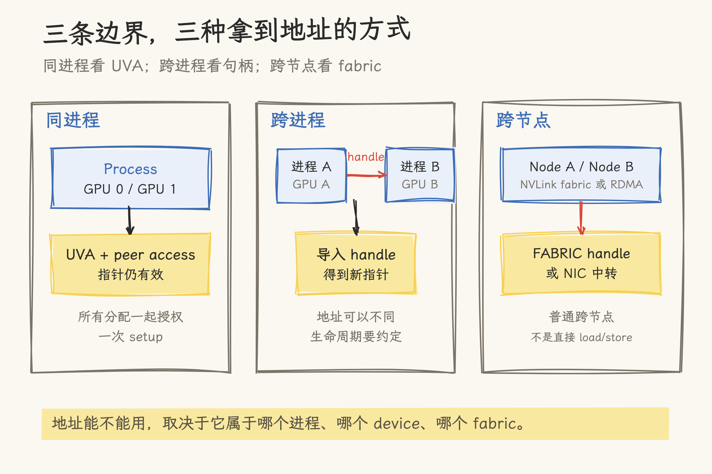
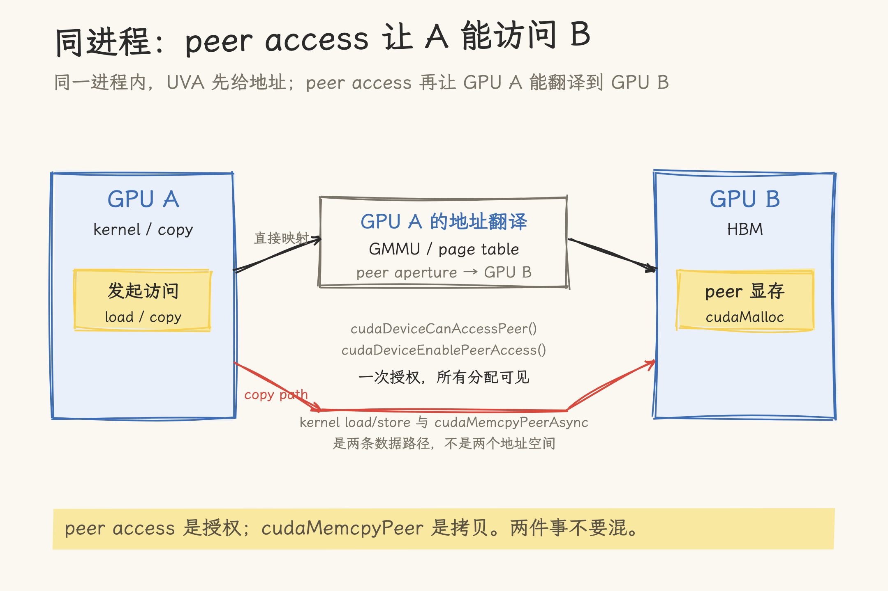
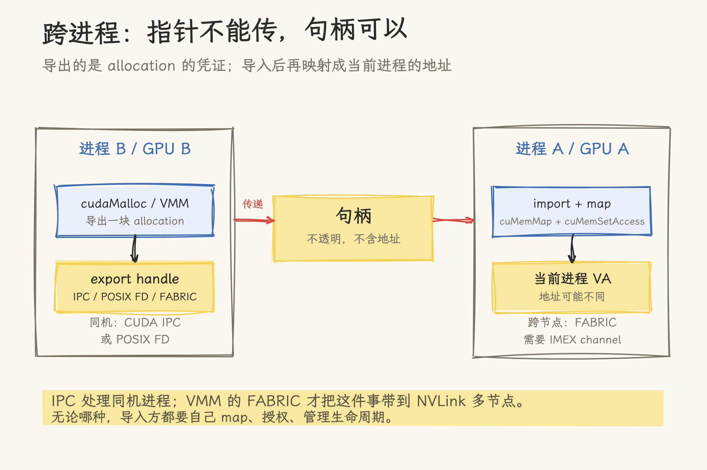
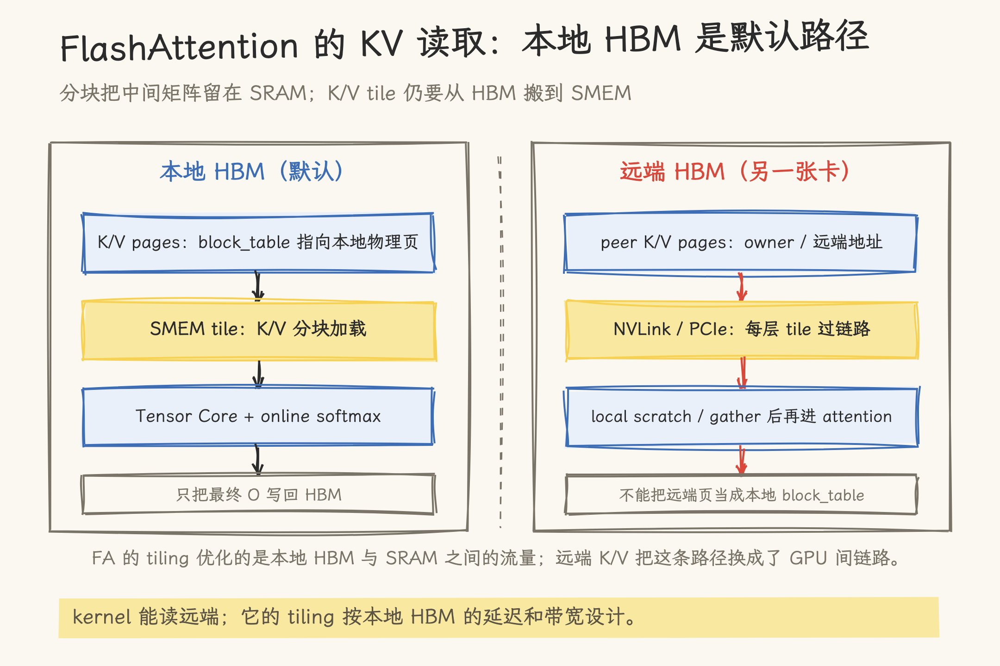
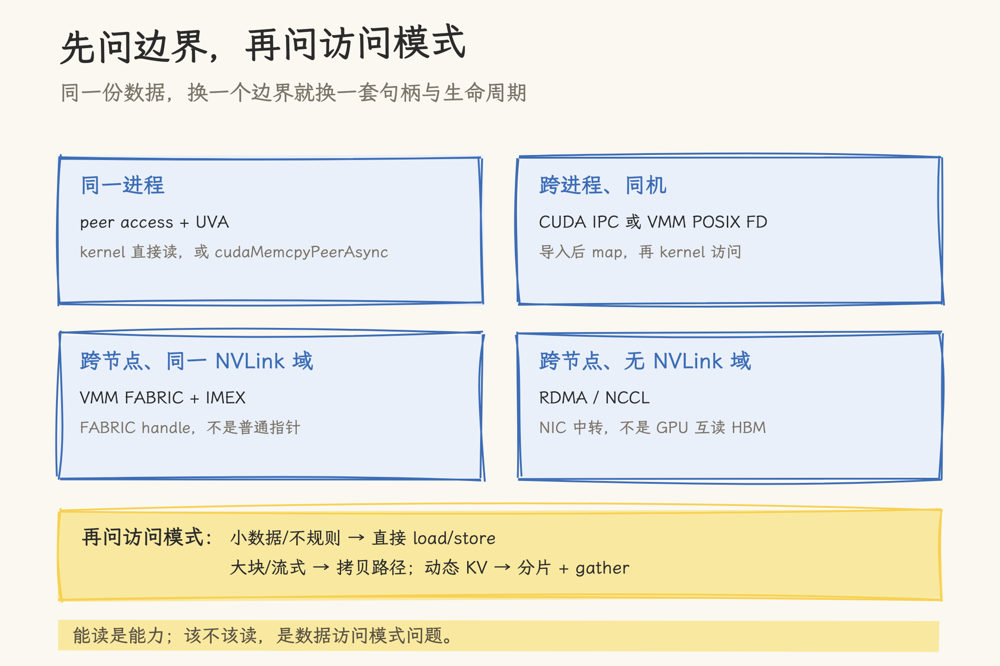

# GPU 如何访问另一块 GPU 的显存：同进程 P2P、跨进程 IPC 与 VMM Fabric

> 写作日期 2026-11-01。CUDA 侧按 CUDA 13.4 Runtime / Driver API 与 Programming Guide 核对；SGLang 侧按 upstream `main` `928e285b`（2026-11-01）核对。P2P、`cudaIpc`、VMM POSIX FD 有同机实测数据；PCIe P2P、ACS/IOMMU 配置变化、FABRIC/IMEX 与远端 attention 未测。文中带宽数字区分规范值、仓库测试和补充测量。

八张 GPU 各跑一个推理副本，同一段长 system prompt 会在每张卡上生成一份相同的 KV。八份副本占八份显存，一个自然的想法是让 GPU 0 直接读 GPU 1 的 KV，而不是再复制一份。

但要让 GPU 0 直接读，先得解决地址问题。GPU 1 的 `cudaMalloc` 返回的是它所在 context 里的地址，不能直接当作 GPU 0 或另一个进程可用的指针。同一进程里，UVA 会让地址看起来在同一个空间，GPU 0 要真正解引用仍需要 peer access；跨进程时，地址空间各自独立，必须先传句柄、重新建立映射。

`cudaMemcpyPeer` 能完成拷贝，但它没有回答 GPU 0 如何拿到一个可解引用的 GPU 1 地址。本文先按同一进程、跨进程、跨节点三条边界拆地址机制，再看 kernel 访问、同步和拓扑；最后用两个实现回答另一个问题：地址可达之后，哪些数据真的适合直接读。

## 一、先分清：拷贝、映射和直接解引用

“GPU 访问另一块 GPU 的显存”常被说成一个动作，实际是三类动作（映射有两种句柄来源）。

| 操作       | 典型 API                                                     | 发生了什么                                             |
| ---------- | ------------------------------------------------------------ | ------------------------------------------------------ |
| 拷贝       | `cudaMemcpyPeer` / `cudaMemcpyPeerAsync`                     | 数据从一张卡搬到另一张卡；源地址不必在目标卡上可解引用 |
| 映射（IPC） | `cudaIpcOpenMemHandle`                                       | 导入即得到可解引用指针                                 |
| 映射（VMM） | `cuMemImportFromShareableHandle` → `cuMemMap`                | 导入 allocation handle，映射后才有 VA                  |
| 解引用     | kernel 里的普通 load/store                                   | 当前 GPU 的地址翻译把这个虚拟地址指到 peer 显存        |

拷贝不改变指针可见性，映射不搬数据，解引用要求映射和访问权限都已就绪。三类动作的失败方式不同：拷贝是 API 错误，映射是句柄或权限问题，解引用是地址在当前 context 里无效。



_图 1：同进程靠 UVA 和 peer access；跨进程靠句柄导入；跨节点要靠 fabric 或网卡中转。_

## 二、同一进程：UVA 与 peer access

### 2.1 一个指针为什么在另一张卡上无效

CUDA 给每张 GPU 维护独立的 primary context，里面有独立的分配堆、stream 池和 context 状态。`cudaSetDevice(1)` 之后拿到的 `float *d1`，只在 GPU 1 的 context 里有意义。切回 GPU 0 后，如果没有启用 peer access，这个指针不能直接解引用。

同一进程内，64 位 Linux 上多张 GPU 通常共享统一虚拟地址空间（UVA）；地址存在不等于可访问，GPU 0 读 GPU 1 的 HBM 还需要 peer access。

### 2.2 查询和启用 peer access

`cudaDeviceCanAccessPeer()` 查询一个方向是否支持直接访问：

```c
int can = 0;
cudaDeviceCanAccessPeer(&can, 0, 1);  // GPU 0 能否直接访问 GPU 1
```

返回 1 表示硬件和驱动允许，访问授权仍要调用 `cudaDeviceEnablePeerAccess()`。这个调用是单向的；要让 GPU 1 也能访问 GPU 0，需要反过来再调一次。授权成功后，peer 设备的所有 allocation 立刻可被当前设备访问，直到显式 disable 或 device reset。重复启用会返回 `cudaErrorPeerAccessAlreadyEnabled`。

```c
cudaSetDevice(0);
cudaDeviceEnablePeerAccess(1, 0);

// d1 是在 GPU 1 上通过 cudaMalloc 分配的指针
kernel<<<blocks, threads>>>(d1);
```

这类授权是 per-device 的，不是 per-allocation；通常在初始化时对所有 GPU 对一次做完，不要每次拷贝前重复调用。

### 2.3 kernel 直接读，和 copy 路径

启用 peer access 后，GPU 0 的 kernel 可以直接解引用 `d1`。CUDA 运行时和驱动负责让这段地址在当前设备上可访问，load/store 请求通过 NVLink 或 PCIe 发到目标 GPU。CUDA 文档把这类访问描述为 fine-grained peer-to-peer GPU load/store。

另一条路径是拷贝：

```c
cudaMemcpyPeerAsync(dst_on_gpu1, 1, src_on_gpu0, 0, bytes, stream);
```

`cudaMemcpyPeer` 异步于 host，但会与 current device、srcDevice、dstDevice 上已排队和后续提交的异步工作串行化。`cudaMemcpyPeerAsync` 可以避开这种同步。CUDA 文档说 P2P 拷贝可以利用专门的 copy engine 和 NVLink 硬件，但没有保证每条路径一定走哪个引擎。

小块、稀疏、需要即时读取的数据适合 kernel 直接 load/store；大块、连续、可以预取的数据适合拷贝。两者都要求拓扑支持，区别是访问暴露给 kernel，还是先把数据搬到本地显存。



_图 2：peer access 建立的是地址翻译权限；`cudaMemcpyPeerAsync` 走的是拷贝路径。_

## 三、跨进程：`cudaIpc` 的句柄与生命周期

### 3.1 指针不能直接传

两个进程各有独立的虚拟地址空间。进程 A 的 GPU 指针 `0x7f...` 在进程 B 里没有意义，哪怕它们在同一张 GPU 上。跨进程共享要传一个句柄，由运行时在导入进程里重新建立映射。

CUDA Runtime 提供了 `cudaIpcGetMemHandle` / `cudaIpcOpenMemHandle`：

```c
// 导出进程
cudaIpcMemHandle_t handle;
cudaIpcGetMemHandle(&handle, d_ptr);
// 通过 Unix socket、共享内存或其他 IPC 把 handle 交给对方

// 导入进程
void *remote = NULL;
cudaIpcOpenMemHandle(&remote, handle, cudaIpcMemLazyEnablePeerAccess);
kernel<<<blocks, threads>>>(remote);
cudaDeviceSynchronize();  // 等 kernel 用完 remote
cudaIpcCloseMemHandle(remote);
```

`cudaIpcOpenMemHandle` 把另一个进程导出的内存映射到当前进程的 device 地址空间。对不同 device 的 context，它会尝试像 `cudaDeviceEnablePeerAccess` 一样建立 peer access；是否可行仍要看 `cudaDeviceCanAccessPeer`。

### 3.2 句柄不是指针，也不是永久有效

`cudaIpcGetMemHandle` 接受由 `cudaMalloc` 分配的 device memory 基地址。它不是通用的“导出任意 GPU 内存”接口：

- `cudaMallocManaged` 分配不支持 IPC。官方 Programming Guide 写得很直接：IPC API 不支持 managed allocation。
- 句柄面向同一台主机上的进程，不是跨节点机制。跨节点要么用 VMM 的 FABRIC handle，要么走 RDMA/NCCL。
- 同一个 handle 在当前 context 重复打开会增加引用计数，返回已有指针；导入方必须用 `cudaIpcCloseMemHandle` 释放导入映射。
- 导出进程在导入方 close 之前对导出区域调用 `cudaFree`，是未定义行为。
- 同一个进程里，每张 device 的 IPC handle 在另一个进程中只能由一个 context 打开；多 context 共享要自己协调。
- 导入后的地址不保证和导出进程相同，不能把地址值当成跨进程标识。

句柄本身是一个能力凭证。拿到它的人可以在自己的进程里映射这块显存，所以传递句柄的通道要有访问控制。`cudaIpc` 解决的是地址映射，不解决权限模型。

### 3.3 `cudaIpc` 适合什么

它适合同一台机器上的多进程推理、前后端分离、共享一块固定的权重或缓存。它的 API 少，路径短，但分配来源被限制在 `cudaMalloc`，生命周期也要由应用自己协调。

如果分配来自 CUDA VMM 或新的 allocator（`cuMemCreate` 家族），`cudaIpcGetMemHandle` 会直接失败——这类分配要用下一节的 shareable handle。



_图 3：导出的是句柄；导入方负责映射、授权和释放。_

## 四、VMM：POSIX FD 与 Fabric

### 4.1 先把 allocation 和 mapping 分开

CUDA VMM 把一次分配拆成几步：

1. `cuMemAddressReserve` 保留一段虚拟地址。
2. `cuMemCreate` 创建物理 allocation，此时没有任何 device 或 host 映射。
3. `cuMemExportToShareableHandle` 把 allocation 导出成可传递的句柄。
4. 接收方 `cuMemImportFromShareableHandle` 导入句柄。
5. `cuMemMap` 把 allocation 映射到已保留的虚拟地址。
6. `cuMemSetAccess` 授予目标设备访问权限。

简化示意：

```c
CUmemAllocationProp prop = {0};
prop.type = CU_MEM_ALLOCATION_TYPE_PINNED;
prop.location.type = CU_MEM_LOCATION_TYPE_DEVICE;
prop.location.id = dev;
prop.requestedHandleTypes = CU_MEM_HANDLE_TYPE_FABRIC;

CUmemGenericAllocationHandle alloc;
cuMemCreate(&alloc, size, &prop, 0);

CUmemFabricHandle shareable;
cuMemExportToShareableHandle(&shareable, alloc, CU_MEM_HANDLE_TYPE_FABRIC, 0);

// 接收进程
CUmemGenericAllocationHandle imported;
cuMemImportFromShareableHandle(&imported, &shareable, CU_MEM_HANDLE_TYPE_FABRIC);

CUdeviceptr va;
cuMemAddressReserve(&va, size, 0, 0, 0);
cuMemMap(va, size, 0, imported, 0);

CUmemAccessDesc access = {0};
access.location.type = CU_MEM_LOCATION_TYPE_DEVICE;
access.location.id = dev;
access.flags = CU_MEM_ACCESS_FLAGS_PROT_READWRITE;
cuMemSetAccess(va, size, &access, 1);
```

`CU_MEM_HANDLE_TYPE_FABRIC` 的输出是 64 字节的 `CUmemFabricHandle` 结构体，不是指针；POSIX FD 分支则用 `int` 文件描述符。

这段代码省略了错误处理、释放顺序和 granularity 计算。实际使用时，`cuMemCreate` 的 size 必须是 `cuMemGetAllocationGranularity` 按 `CU_MEM_ALLOC_GRANULARITY_MINIMUM` 返回值的整数倍，`cuMemMap` 的地址、大小和偏移也要按同一粒度对齐。

`cuMemMap` 只建立映射，`cuMemSetAccess` 才授权；导入方必须自己完成这两步，不能假设 handle 导入后就得到可读写指针。示例省略了 unmap/release；跨设备导入时，`access.location.id` 要用导入方设备，不能沿用导出方的 `dev`。

### 4.2 POSIX FD 和 FABRIC 的边界

VMM 的 handle 类型决定共享范围：

| handle 类型                                | 范围                               | 典型场景                              |
| ------------------------------------------ | ---------------------------------- | ------------------------------------- |
| `CU_MEM_HANDLE_TYPE_POSIX_FILE_DESCRIPTOR` | 同一台主机                         | 本机多进程，OS 文件描述符传递         |
| `CU_MEM_HANDLE_TYPE_FABRIC`                | 同一或不同节点，需 NVSwitch fabric | MNNVL、GB200/GB300 NVL72 等 NVLink 域 |

FABRIC handle 不是“有 NVLink 就能用”。CUDA 文档要求导出和导入进程能访问同一个 IMEX channel；没有同一 channel 时，导入会返回 `CUDA_ERROR_NOT_PERMITTED`。IMEX 的权限按用户组织，多租户环境需要单独划分 channel。

VMM 的 host allocation 不支持 IPC。`CU_MEM_LOCATION_TYPE_HOST` 的 allocation 必须把 `requestedHandleTypes` 设为 0，设成其他值会返回 `CUDA_ERROR_INVALID_VALUE`。这条边界常被忽略：能通过 VMM 分配的 host 内存，不等于能通过 VMM 跨进程共享。

### 4.3 `cudaIpc` 与 VMM 怎么选

| 维度     | `cudaIpc`                      | CUDA VMM                                      |
| -------- | ------------------------------ | --------------------------------------------- |
| 分配来源 | `cudaMalloc`                   | `cuMemCreate`                                 |
| 句柄     | `cudaIpcMemHandle_t`           | POSIX FD / FABRIC                             |
| 映射     | 运行时完成                     | 显式 `cuMemMap` + `cuMemSetAccess`            |
| 范围     | 同机进程                       | 同机进程或 NVLink fabric                      |
| 适合     | 简单、固定的 device allocation | 现代 allocator、细粒度生命周期、跨节点 fabric |

还有第三条路径：`cudaMallocAsync` 的 memory pool。IPC-capable pool 可以用 `cudaMemPoolExportToShareableHandle` / `cudaMemPoolImportFromShareableHandle` 共享 pool，再用 `cudaMemPoolExportPointer` / `cudaMemPoolImportPointer` 共享具体指针。它共享的是 allocator 的 pool，不是逐块 `cudaMalloc`；创建 pool 时 handle type 不能是 None。

新代码如果要在 NVLink fabric 内跨节点，或者需要把 allocation 和 mapping 分开管理，VMM 更合适；没有 fabric 的跨节点仍走 RDMA/NCCL。`cudaIpc` 更简单，边界也更窄。

## 五、kernel 视角：FlashAttention 怎么读 KV

### 5.1 分块计算把中间矩阵留在 SRAM

FlashAttention 的 forward 没有改 attention 公式，改的是计算顺序。Q 按块进入 SRAM（CUDA 的共享内存，SMEM），K/V 也按块加载。每个 `(Q_i, K_j)` 的分数、online softmax 和输出累加都在 SRAM 完成，中间矩阵不写回 HBM，最后只写归一化的 O。算法流程与 HBM/SRAM 层级关系见文末参考的 [FlashAttention 深度解析](../../09_inference_system/vllm/module_analysis/flashattention_deep_dive.md)。

K/V tile 从 HBM 读入 SRAM，Tensor Core 和 softmax 在片上消费。HBM 流量与序列长度、head 维度、SRAM 大小有关。decode、长上下文里的小 batch 场景，attention 经常先撞 HBM 带宽，而不是 Tensor Core 算力。

### 5.2 推理时的 KV 是分页池，不是连续张量

推理引擎通常把 KV 放进分页池。block table 把逻辑 token 页映射到物理 block；FlashInfer 这类 paged attention kernel 直接接收 block table，在 kernel 内完成页地址转换，K/V tile 按转换后的块地址加载。`flashattention_deep_dive.md:249` 的原文是“KV cache 不是连续存储，而是分布在物理不连续的 block 中。FlashInfer 的 kernel 接受 block table 作为输入，在 SRAM 中做地址转换 + attention 计算”。

block table 里的编号是本地物理页的索引，kernel 的 tile load 和 SRAM 布局也围绕本地 HBM 设计。

### 5.3 远端 KV 会改变 kernel 的四个假设

把 K/V 换成另一张 GPU 的 HBM 后，地址可达只是第一步；kernel 的访问模型会跟着变。

- **带宽**：本地 HBM 是 TB/s 量级，NVLink 是数百 GB/s，PCIe Gen5 x16 单向约 63 GB/s。远端 K/V 的每次加载都可能落到 GPU 间链路，除非命中本地 L2。
- **延迟和流水**：FlashAttention 的 tiling、`cp.async` / TMA pipeline 按本地 HBM 设计。远端延迟更高，计算与搬运难重叠，SM 更容易等 K/V tile。
- **访问粒度和页表**：本地 block table 指向本地物理页。远端共享要么在 kernel 里做远端页 translation，要么先把页 gather 到本地 scratch；两种做法都要改 kernel，不是换个指针就能跑。
- **复用和生命周期**：每个 GPU 的 L2 是本地缓存，没有跨 GPU 共享的 L2。多个 rank 读同一页，会在每条链路上重复搬运。KV 页还有淘汰、引用计数、迁移，远端地址的生命周期和本地 allocator 也不一致。

K/V tile 可以从远端地址读进 SRAM，前提是地址已映射、kernel 用普通 load 取数；但 tiling、流水和页表仍按本地 HBM 设计，远端链路也不会变成本地 HBM 带宽。



_图 4：FlashAttention 的 tiling 假设 K/V tile 来自本地 HBM；远端 K/V 需要 gather 或远端页表。_

## 六、顺序和可见性

### 6.1 P2P 不自动提供跨设备顺序

peer access 只解决“能不能访问”，不解决“什么时候能看到”。GPU 0 写完 peer 显存后，GPU 1 上的 kernel 不会因为地址可达就自动看到新值。跨设备线程需要显式的同步和内存序。

常见做法有两类：

- 用 stream/event 建立执行顺序。`cudaEventRecord` 可以在一个 device 上记录，`cudaStreamWaitEvent` 可以在另一个 device 的 stream 上等待；CUDA 文档允许 event 来自不同 device。
- 用 system scope 的 fence 或原子操作建立可见性。`__threadfence_system()` 让调用线程之前的写对其他 device 和 host 可见；PTX 里的 `membar.sys` / `fence.sc.sys` 属于 system scope。跨设备通信时，release/acquire 要成对使用，不能只放一个 fence 就假设数据已经同步。

### 6.2 原子性和原子操作

普通 `atomicAdd` 是 device scope，不能拿来做跨 GPU 同步；跨 GPU 要用 `atomicAdd_system`（或 PTX `atom.system`），并确认平台条件和目标内存类型。PTX 文档还提示，和 host 通信时某些 system scope 的强操作在部分系统上不能保证原子性。

## 七、拓扑、性能和诊断

### 7.1 NVLink、PCIe 和 NVSwitch

GPU 间 P2P 可以走 NVLink，也可以走 PCIe。NVLink 通过 NVSwitch 可以构建全互联拓扑，带宽和延迟通常优于 PCIe；PCIe P2P 则受 PCIe switch、Root Complex、ACS 和 IOMMU 影响。

PCIe P2P 有两个配置边界：

- ACS：CUDA 文档说 PCI ACS 会把点对点流量重定向到 CPU root complex，造成显著性能损失。它不是“开 ACS 就一定不能用”，但高性能裸机通常会关闭 ACS 或配置为允许 P2P。
- IOMMU：IOMMU 翻译模式下，裸机 PCIe P2P 需要关闭 IOMMU，避免静默的 device memory corruption。`iommu=pt` 只是关闭地址翻译、保留 IOMMU，不能当成 IOMMU 已完全关闭；是否能满足 P2P 要按平台验证。

GPUDirect RDMA 另有自己的要求（关闭 IOMMU 或 passthrough），但那是 NIC 访问 GPU 显存，和 GPU 间 P2P 不是一条路径。

MNNVL 是另一条边界。GB200 NVL72、GB300 NVL72 这类系统把 NVLink 域扩展到机架级，多个节点可以落在同一个 NVLink fabric 里；FABRIC handle 在同节点 NVLink 域也能用，跨节点时才要求 NVSwitch fabric。普通跨节点没有 NVLink fabric，就走 RDMA/NCCL，数据经过 NIC，不是 GPU 直接 load/store 对端 HBM。

### 7.2 带宽数字要带口径

仓库里的 NVLink P2P 数据来自已有测试（平台与测试方法见文末 P2P 带宽实测），口径不同，不能混用：

| 路径          | 数值                | 口径                            |
| ------------- | ------------------- | ------------------------------- |
| NVLink P2P    | 239 GB/s            | `simpleP2P`，64 MB，单向        |
| NVLink P2P    | 249 GB/s            | 128 MB 往返测试的每方向等效速率 |
| NVLink P2P    | 269 GB/s            | 64 MB × 200 次，单向            |
| PCIe Gen4 x16 | ~31.5 GB/s 单向理论 | 规范推导                        |

239、249、269 是不同 benchmark、迭代次数和往返口径的数，不能互相否定。换平台要重测。

### 7.3 补充数据

下面是一组同平台补充数据，只用于比较 copy 与 direct read 的相对差距；绝对值和 7.2 的仓库数据不可横向比较。数据覆盖 P2P copy、direct peer read、`cudaIpc` 和 VMM POSIX FD。

| 用例                 | 条件                     | 结果                                     |
| -------------------- | ------------------------ | ---------------------------------------- |
| `cudaMemcpyPeer`     | 128 MB/方向，往返，20 次 | 357.3 GB/s                               |
| CPU relay            | 同上                     | 25.6 GB/s                                |
| direct peer read     | 64 MB，单向，20 次       | 323.6 GB/s；memcpyPeer 346.6 GB/s；0.93× |
| direct peer read     | 256 MB，单向，20 次      | 338.4 GB/s；memcpyPeer 365.1 GB/s；0.93× |

表中的 P2P copy（357.3）与 direct read（323.6/338.4、memcpyPeer 346.6/365.1）都是**双方向合计**口径：往返测试把两个方向的传输量相加除以总时间，因此数字可以超过单向上限（A100 NVLink 3.0 单向 ~300 GB/s），换算到单方向约为表值的一半。CPU relay 25.6 GB/s 与 P2P 差约 14 倍。direct peer kernel 在一张 GPU 上直接读另一张 GPU 的指针，sentinel 和 checksum 都通过；direct read 比 copy 路径慢约 7%。

`cudaIpc` 用例用 64 MB：进程 B 读到进程 A 的 `0x5A`，写入 `0xA5`，A 校验通过；close 在 free 之前。VMM POSIX FD 用例用 16 MB：A 导出 fd，B 导入、map、set access，B 的 kernel 读 `0x5A`、写 `0xA5`，A 校验通过；B 先 unmap/release，A 后 release。

### 7.4 诊断命令

```bash
# 拓扑类型和 NVLink 连接
nvidia-smi topo -m

# GPU 间 P2P 矩阵（如果当前驱动支持）
nvidia-smi topo -p2p r

# NVLink 链路状态
nvidia-smi nvlink -s
```

拓扑标签只能说明物理连接的上限，不能替代运行时查询。`cudaDeviceCanAccessPeer` 返回 0 时，NVLink 标签再好也不能直接解引用；返回 1 时，仍要确认 peer access 已启用、句柄已正确导入。

## 八、两个实现：Engram 的 peer read 与 KV Cache 去重

### 8.1 Engram：静态表的直接 peer read

SGLang 的 DeepSeek-V4.1 Engram 表提供了一个 direct peer read 实现。Engram 表是静态、只读的 n-gram 表，按张量并行（TP）组分片，每个 rank 持有 `1 / tp_size` 的行。`peer_read` 模式下，每个 rank 通过 NVLink 直接读持有该分片的 GPU 上的 shard，不需要 id gather、reduce-scatter 或 all-to-all。

实现走 CUDA VMM：`VmmReservation` 预留 VA，`map()` 创建并映射本地 allocation；`exchange_shareable_handles` 在 TP 组内交换 handle，`import_and_map_alloc` 把 peer allocation 映射进当前进程，`engram_gather_peer` 按 token 行读取远端 VA。handle 选择上，代码优先 FABRIC，所有 rank 都能导出 FABRIC 时才使用；否则回退 POSIX fd。POSIX fd 只能覆盖同一主机，跨主机且没有 FABRIC 时会失败。因此 Engram 的 `peer_read` 不是 KV Cache 的通用方案。

### 8.2 KV Cache：为什么 SGLang 选择分片和 gather

KV Cache 的访问模式不同。它按页分配、动态增长，需要引用计数和淘汰。attention kernel 还期望通过本地 block table 读一整段 KV。直接让 attention 读远端 HBM，会把每一层访问绑到 GPU 间链路上，还要处理跨进程所有权、页表、生命周期和故障隔离。

SGLang 的 `--enable-kv-cache-sharding` 采用了另一种办法：每个逻辑页（logical page）在分片组（shard group）内只保留一份持久副本，每个 rank 只存自己拥有的页；attention 前按层 all-gather 到临时 buffer，再在本地 scratch 上做 attention。

prefix 命中能省掉重算，但仍要支付 gather 成本。这个开关只支持 prefill/decode 分离（PD）的 prefill worker；decode 不启用，decode 收到完整、未分片的 KV。它还有 radix cache backend、page size 等约束，也不能和 `--dcp-size` 以及 `--enable-hierarchical-cache` 下的 `--hicache-storage-backend` 同时开。

decode 侧另有一套解码上下文并行（DCP）：MLA KV 按 token 位置分片，每个 rank 只算自己那一段的 partial attention，再用 log-sum-exp（LSE）精确合并。

host 侧还有 `--enable-linker-mla-dedup`（需要 rank-replicated pool、TP>1 和 Mooncake linker）：组内第一个 rank 从 Mooncake 加载 replicated MLA KV，按层 broadcast 给其他 TP rank，去重的是 host 副本，GPU 上的 KV 副本仍然存在。

这几条路径都在回答同一个问题：数据放在哪、计算端怎么拿到。就 `928e285b` 的 `mem_cache` 与 `disaggregation` 代码看，没有找到“一个 GPU 的 attention 直接读另一个 GPU 的 KV 池”的实现；KV 的动态生命周期和 attention 的本地访问模式，让分片加 gather 更容易集成。



_图 5：先看地址跨到哪一层，再看数据是直接读、拷贝还是分片聚合。_

## 九、怎么选

| 场景                           | 优先路径                        | 说明                                   |
| ------------------------------ | ------------------------------- | -------------------------------------- |
| 同进程、同节点、小块或稀疏访问 | peer access + kernel load/store | 地址可解引用，访问直接过 NVLink/PCIe   |
| 同进程、同节点、大块连续数据   | `cudaMemcpyPeerAsync`           | 拷贝路径，通常比逐元素远端读更稳       |
| 跨进程、同机                   | `cudaIpc` 或 VMM POSIX FD       | 句柄导入，地址可能不同                 |
| 跨节点、同一 NVLink 域         | VMM FABRIC + IMEX               | 需要 fabric handle 和同一 IMEX channel |
| 跨节点、无 NVLink 域           | RDMA / NCCL                     | NIC 中转，不是 GPU 直接读 HBM          |
| 静态只读表、按行查             | `peer_read` 模式                | Engram 的做法，数据不淘汰、不写回      |
| 动态 KV Cache（prefill）       | 页分片 + 按层 all-gather        | 每页一份持久副本，gather 到临时 buffer |
| 动态 KV Cache（decode）        | DCP + LSE 合并                  | 按 token 位置分片，partial attention 后合并 |

可以按三个问题判断：

1. 地址属于哪个进程、哪个 device、哪个 fabric？
2. 数据是直接读，还是先拷贝？
3. 读完之后，谁负责顺序、生命周期和失败处理？

先回答这三个问题，再决定用直接读、拷贝还是分片。

## 源文件索引

### CUDA 文档与 API

| 资料                                                                                                                                                          | 内容                                                                                    |
| ------------------------------------------------------------------------------------------------------------------------------------------------------------- | --------------------------------------------------------------------------------------- |
| [CUDA Runtime API: Peer Device Memory Access](https://docs.nvidia.com/cuda/cuda-runtime-api/group__CUDART__PEER.html)                                         | `cudaDeviceCanAccessPeer`、`cudaDeviceEnablePeerAccess`、单向授权、所有 allocation 可见 |
| [CUDA Runtime API: cudaIpcGetMemHandle / cudaIpcOpenMemHandle](https://docs.nvidia.com/cuda/cuda-runtime-api/group__CUDART__DEVICE.html)                      | `cudaMalloc` 限制、导入映射、引用计数、`cudaIpcCloseMemHandle`                          |
| [CUDA Runtime API: cudaMemcpyPeer / cudaMemcpyPeerAsync](https://docs.nvidia.com/cuda/cuda-runtime-api/group__CUDART__MEMORY.html)                            | 同步语义、异步版本、device-to-device 拷贝                                               |
| [CUDA Runtime API: Memory Pools](https://docs.nvidia.com/cuda/cuda-runtime-api/group__CUDART__MEMORY__POOLS.html)                                             | `cudaMallocAsync` mempool 的 export/import、IPC-capable pool                             |
| [CUDA Driver API: Virtual Memory Management](https://docs.nvidia.com/cuda/cuda-driver-api/group__CUDA__VA.html)                                               | `cuMemCreate`、export/import、`cuMemMap`、`cuMemSetAccess`、granularity、FABRIC/IMEX    |
| [CUDA Programming Guide: Multi-GPU Systems](https://docs.nvidia.com/cuda/cuda-programming-guide/03-advanced/multi-gpu-systems.html)                           | P2P 拓扑、ACS、IOMMU、copy engine/NVLink、fine-grained peer load/store                  |
| [CUDA Programming Guide: Inter-Process Communication](https://docs.nvidia.com/cuda/cuda-programming-guide/04-special-topics/inter-process-communication.html) | 同机 IPC 范围、managed memory 不支持 IPC                                                |
| [CUDA Programming Guide: Virtual Memory Management](https://docs.nvidia.com/cuda/cuda-programming-guide/04-special-topics/virtual-memory-management.html)     | POSIX FD 单机、FABRIC 单节点/多节点                                                     |
| [PTX ISA: Memory Consistency Model](https://docs.nvidia.com/cuda/parallel-thread-execution/#memory-consistency-model)                                         | system scope、`membar.sys`、跨设备内存序                                                |

### SGLang 上游

| 文件                                                                                                                                                                                                                                                         | 内容                                                                                            |
| ------------------------------------------------------------------------------------------------------------------------------------------------------------------------------------------------------------------------------------------------------------ | ----------------------------------------------------------------------------------------------- |
| [`docs/docs/advanced_features/engram.mdx`](https://raw.githubusercontent.com/sgl-project/sglang/928e285bc10fc4119277e73ee2d3d29b6412bec6/docs/docs/advanced_features/engram.mdx)                                                                                   | `L24-L103`：`peer_read` 通过 NVLink 读持有分片的 GPU；POSIX FD / FABRIC 的范围                        |
| [`python/sglang/srt/layers/engram.py`](https://raw.githubusercontent.com/sgl-project/sglang/928e285bc10fc4119277e73ee2d3d29b6412bec6/python/sglang/srt/layers/engram.py)                                                                                     | `L820-L963`：`_PeerShards`、peer shard 映射、`engram_gather_peer`                                      |
| [`python/sglang/srt/utils/cuda_vmm_utils.py`](https://raw.githubusercontent.com/sgl-project/sglang/928e285bc10fc4119277e73ee2d3d29b6412bec6/python/sglang/srt/utils/cuda_vmm_utils.py)                                                                       | `L515-L980`：`VmmReservation`、`exchange_shareable_handles`、`import_and_map_alloc`、FABRIC/POSIX fd |
| [`docs/docs/advanced_features/kv_cache_sharing.mdx`](https://raw.githubusercontent.com/sgl-project/sglang/928e285bc10fc4119277e73ee2d3d29b6412bec6/docs/docs/advanced_features/kv_cache_sharing.mdx)                                                                | `L7-L42`：每个 page 一份持久副本、按层 all-gather、gather 成本                                            |
| [`python/sglang/srt/arg_groups/kv_shard_hook.py`](https://raw.githubusercontent.com/sgl-project/sglang/928e285bc10fc4119277e73ee2d3d29b6412bec6/python/sglang/srt/arg_groups/kv_shard_hook.py)                                                                | `L99-L186`：KV sharding 仅 PD prefill；与 DCP、storage backend 的限制                                       |
| [`docs/docs/advanced_features/dcp.mdx`](https://raw.githubusercontent.com/sgl-project/sglang/928e285bc10fc4119277e73ee2d3d29b6412bec6/docs/docs/advanced_features/dcp.mdx)                                                                                       | `L7-L9`：MLA KV 按 token 位置分片、partial attention、LSE 合并                                           |
| [`python/sglang/srt/mem_cache/mla_host_dedup.py`](https://raw.githubusercontent.com/sgl-project/sglang/928e285bc10fc4119277e73ee2d3d29b6412bec6/python/sglang/srt/mem_cache/mla_host_dedup.py)                                                                      | `L1-L205`：host MLA/DSA cache 去重、逐层 broadcast                                                         |
| [`python/sglang/srt/mem_cache/storage/mooncake_store/mooncake_direct_linker.py`](https://raw.githubusercontent.com/sgl-project/sglang/928e285bc10fc4119277e73ee2d3d29b6412bec6/python/sglang/srt/mem_cache/storage/mooncake_store/mooncake_direct_linker.py) | `L251-L289`：`--enable-linker-mla-dedup` 的组内首个 rank 加载与广播                                          |

### 仓库内相关文章

- [GPU 访问系统内存：MMU、IOMMU、MMIO、mmap、ioremap 五种机制对照](19_gpu_system_memory_access.md)
- [GPU 内存管理：从推理工程师的日常问题出发](12_gpu_memory_management.md)
- [Multi-GPU CUDA 编程：从 P2P 到 NCCL](15_multi_gpu_programming.md)
- [FlashAttention 深度解析：从 IO-Aware Tiling 到 Hopper 异步计算](../../09_inference_system/vllm/module_analysis/flashattention_deep_dive.md)：`L17-L20` HBM/SRAM 层级、`L85-L103` tiling 与 online softmax、`L249` paged KV 与 block table。
- [PCIe 与 NVLink 速度参考](../../01_hardware_architecture/performance/05_pcie_nvlink_speed_reference.md)：各代 PCIe/NVLink 带宽口径。
- [GPU P2P 带宽实测：NVLink vs PCIe](../04_profiling/08_p2p_bandwidth.md)
- [GPUDirect P2P 技术详解](../../01_hardware_architecture/gpudirect/02_gpudirect_p2p.md)
- [GPUDirect RDMA 与 Storage 技术详解](../../01_hardware_architecture/gpudirect/01_gpudirect_technology.md)
- [NVLink 技术入门](../../01_hardware_architecture/nvlink/nvlink_intro.md)
