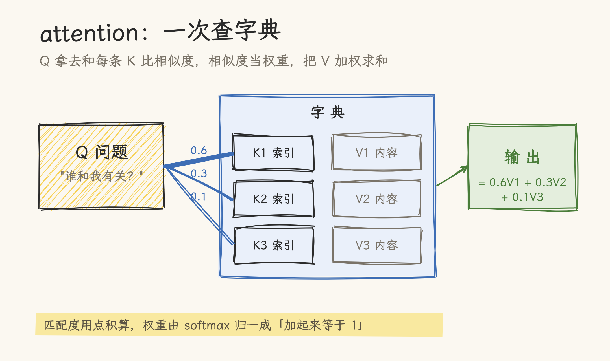
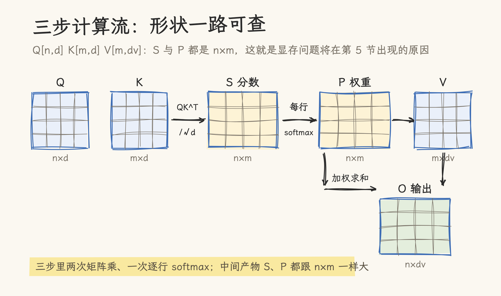
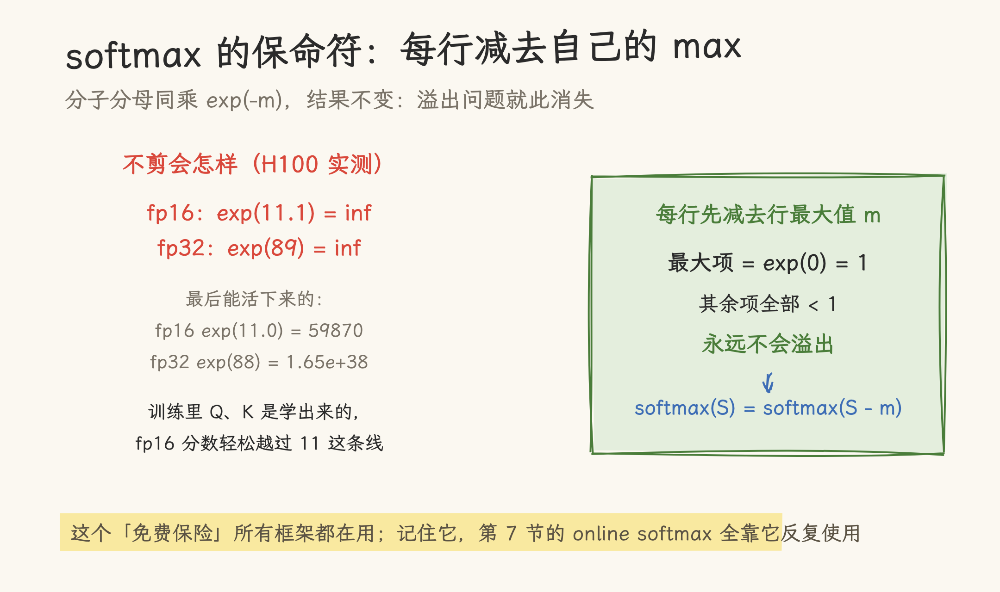
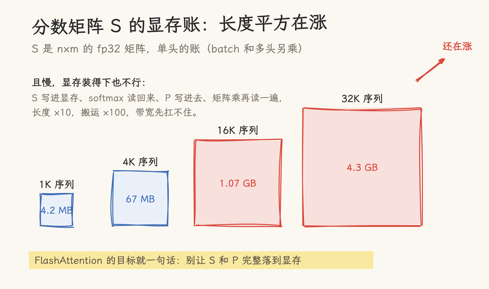
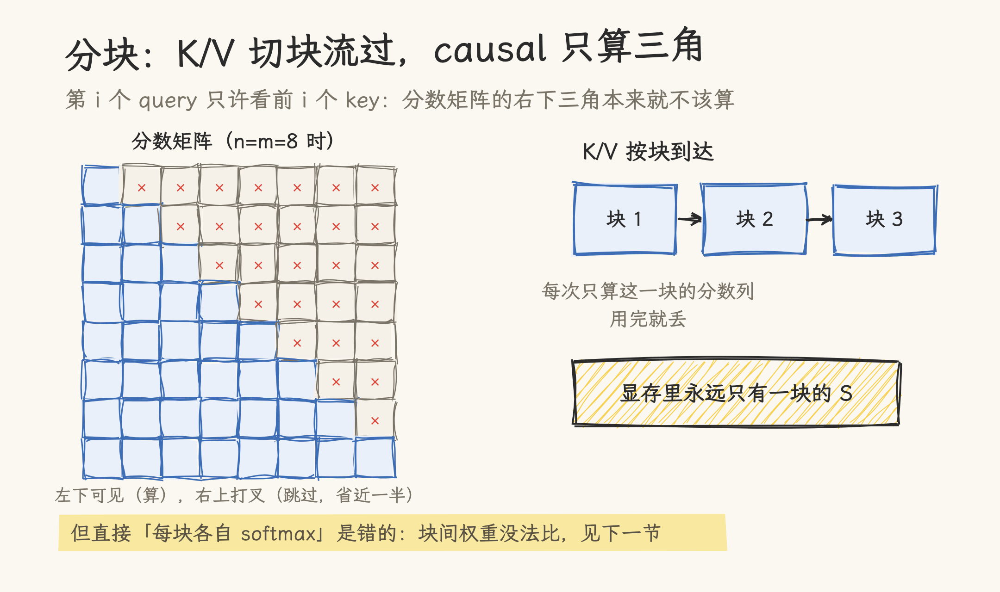
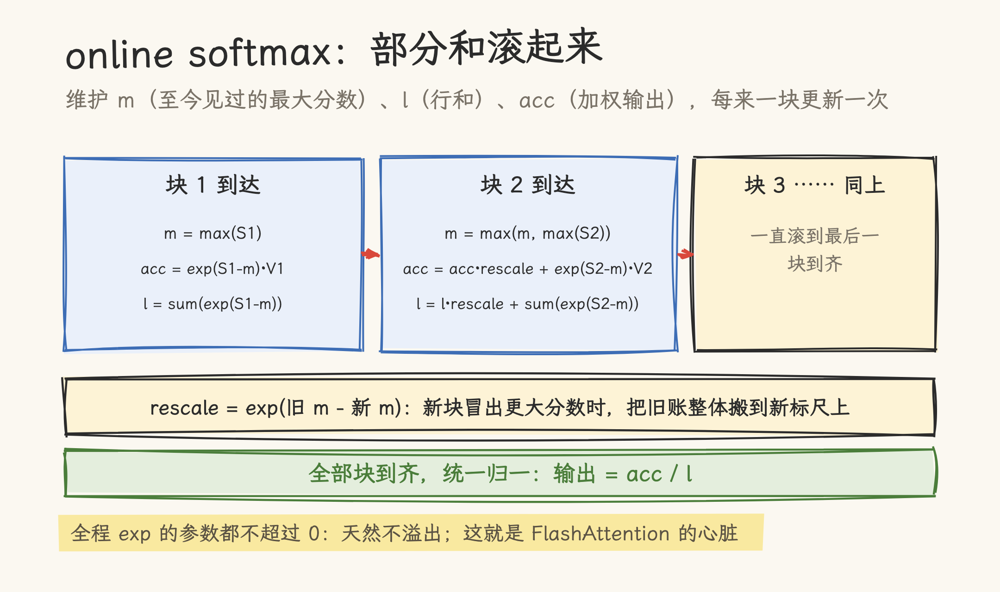

# 手搓 Attention：从三行循环到看懂 FlashAttention

Attention 是大模型里最核心的一步运算，听起来神秘，其实一个能跑的最小实现只要十几行。真正的麻烦在规模：32K 序列下，中间的分数矩阵单头就要 4.3 GB，几十个头乘上来，没有卡愿意接。这篇文章从三重循环写起，把同一个 attention 改出四个版本：矩阵化、减 max、分块、online softmax。每版代码都能跑，版本之间的对错全部实跑验证过；改到最后一版就会发现，FlashAttention 论文里那个吓人的名字，拆开正是我们已经手搓过的东西。

这也是手搓系列最早写成的一篇，系列阅读顺序见[手搓系列导航](../../hand_roll_series.md)。

> 核对基准：FlashAttention（arXiv:2205.14135）、online softmax（arXiv:1805.02867）与 Attention Is All You Need（arXiv:1706.03762）。四个版本合在一个脚本里实跑（numpy 2.3.2，CPU），互相核对输出；溢出行为另在真实 GPU 上实测（torch 2.11.0+cu130，NVIDIA H100 80GB，2026-11-06）。文中所有数字都来自这两次运行。四版代码已入库 [code/21_attention_versions.py](code/21_attention_versions.py)，跑一遍即可复现文中全部数字。

## 一、Attention 在算什么

用一个查字典的比喻：手上有一个问题（query），字典里有一排索引词条（key）和对应的内容（value）。要做的事是：拿问题去和每条索引比对相似度，相似度越高，那条词条的内容在最终答案里占的比重就越大。

注意力机制把这个动作数学化。每个 token 都有一份 Q、K、V（都是向量），计算分三步：

$$S = \frac{Q K^{T}}{\sqrt{d}} \qquad P = \mathrm{softmax}(S) \qquad O = P V$$

第一步算相似度：Q 的每一行（一个 token 的问题）和 K 的每一行（一条索引）做点积，得到分数矩阵 S。除以 $\sqrt{d}$ 是因为点积的大小随维度增长，不除的话 softmax 会被推进饱和区（d=128 时点积的标准差就有 11 左右）。第二步把 S 的每一行做 softmax，变成一排加起来等于 1 的权重。第三步拿权重对 V 加权求和，得到输出 O。



三个角色的形状（下文全程用这组记号）：Q 有 n 行，K 有 m 行，维度都是 d；V 有 m 行、维度 dv。输出 O 是 n 行、dv 列。

## 二、版本 0：三重循环

先不追求任何效率，用最笨的方式把它写出来。一个 query 一个 query 地处理，每个 query 对每个 key 算点积，softmax 变权重，再加权求和：

```python
import numpy as np

SCALE = np.float32(1.0 / np.sqrt(128))

def softmax_naive(x):                     # 先用最直白的 softmax，下一节会改它
    e = np.exp(x)
    return e / np.sum(e, axis=-1, keepdims=True)

def attention_v0(Q, K, V):
    n, m = Q.shape[0], K.shape[0]
    out = np.zeros((n, V.shape[1]), dtype=np.float64)
    for i in range(n):                              # 每个查询
        scores = np.zeros(m)
        for j in range(m):                          # 和每个键做点积
            scores[j] = Q[i] @ K[j] * SCALE
        weights = softmax_naive(scores)             # 行 softmax
        for j in range(m):                          # 加权求和
            out[i] += weights[j] * V[j]
    return out
```

三重循环对应的计算流如下图，看代码时对着图走一遍，每个下标是干什么的一目了然：



这一版累加器特意用了 float64，当作后面所有版本的**参考基准**：别的版本算得对不对，都跟它对。

## 三、版本 1：矩阵化，三行

三重循环里的两层 j 循环，本质都是矩阵运算：所有点积合起来就是 `Q @ K.T`，所有加权求和合起来就是 `P @ V`。中间只剩 softmax 是逐行的。矩阵化之后：

```python
def attention_v1(Q, K, V):
    S = (Q @ K.T) * SCALE
    P = softmax_naive(S)
    return P @ V
```

三行。GPU 特别爱这个形态：矩阵乘是 Tensor Core 和 BLAS 库的主场，几行矩阵运算会被调度成几千个线程并行；而三重循环版把矩阵乘拆成了标量运算，等于让 GPU 排队做标量乘加。框架里的 attention（比如 PyTorch 2.0 起内置的 `scaled_dot_product_attention`）全是矩阵化的写法。

## 四、版本 2：减 max，softmax 的保命符

朴素 softmax 有个隐藏炸弹：`np.exp` 会溢出。溢出点不是玄学，在真实 GPU 上实测过（torch 2.11，H100）：

| 精度 | 还能算             | 已经溢出        |
| ---- | ------------------ | --------------- |
| fp16 | exp(11.0) = 59870  | exp(11.1) = inf |
| fp32 | exp(88) = 1.65e+38 | exp(89) = inf   |

fp16 下分数只要超过 11.1，exp 就直接变 inf。真实训练里 Q、K 是学出来的，幅度没人保证，fp16 的分数轻松越过这条线。

修法利用 softmax 的一个性质：分子分母同乘一个正常数，结果不变。那就把每行减去自己的最大值再 exp：最大的一项变成 exp(0) = 1，任何情况下都炸不了：

```python
def softmax_safe(x):
    m = np.max(x, axis=-1, keepdims=True)
    e = np.exp(x - m)
    return e / np.sum(e, axis=-1, keepdims=True)

def attention_v2(Q, K, V):
    S = (Q @ K.T) * SCALE
    P = softmax_safe(S)
    return P @ V
```



这一版的实测对比（把 Q、K 幅度放大 10 倍制造「热」数据，最大分数到 310）：v1 的输出 512 个元素全部变成 inf 或 NaN；v2 干干净净，与 float64 参考基准的最大偏差 2.8e-06，就是 float32 的正常舍入水平。

还有个实测花絮：验证脚本第一版的「溢出演示」居然不溢出。查下来是 `SCALE = 1.0 / np.sqrt(128)` 写的：`np.sqrt` 返回 float64 标量，把整条分数矩阵静默升成了 float64（exp 到 310 才到 1.3e134，远炸不了）。dtype 纪律这种事，连写演示脚本都会踩。

## 五、问题的种子：S×S 有多大

到目前为止两个版本都是对的，但都埋着同一个问题：分数矩阵 S 是 n×m 的，Q 和 K/V 的全长都参与，S 的元素个数是长度乘长度。



按 fp32 存，一行序列的账是：

| 序列长度 | S 矩阵大小（单头） |
| -------- | ------------------ |
| 1K       | 4.2 MB             |
| 4K       | 67 MB              |
| 16K      | 1.07 GB            |
| 32K      | 4.3 GB             |

单头 4.3 GB，乘上几十个注意力头和 batch，显存装不下。而且这不是「买大显存」能解决的事：S 算完要写进显存，softmax 要读回来，P 再写进去，最后一个矩阵乘再读一遍：长度每涨 10 倍，这些来来回回的搬运涨 100 倍，带宽先扛不住。

FlashAttention 要解决的就是这一步：**别把 S 和 P 完整落到显存**。它怎么做到的？先把 K/V 切块。

## 六、版本 3：分块，以及它的 bug

把 K 和 V 沿 key 维度切成块，一次只来一块：每块只算这一块对应的分数列，用完就丢，显存里永远只有一块的 S。causal 场景还有额外便宜：第 i 个 query 只允许看前 i 个 key，分数矩阵的右下三角本来就不该算，分块后正好整块跳过：



最直接的分块写法：

```python
def attention_v3(Q, K, V, block=16):
    outs = []
    for s in range(0, K.shape[0], block):
        S_blk = (Q @ K[s:s+block].T) * SCALE     # 只算这一块的分数
        outs.append(softmax_safe(S_blk) @ V[s:s+block])
    return np.sum(outs, axis=0)
```

内存确实省了。但这版是错的：每块各自做了 softmax，等于各自归一化。第一块的权重在自己块内加起来等于 1，第二块的权重也在自己块内等于 1，两块的输出直接相加，权重整体加起来是 2 不是 1。实测常规数据下 v3 与 v2 的最大偏差就有 2.1，完全不能用。

卡住的地方只有一处：softmax 的分母需要整行的和，而整行要等所有块到齐才知道。怎么办？

## 七、版本 4：online softmax，把部分和滚起来

解法的思路是记账。既然分母要到最后才齐，那就维护一个「到目前为止的部分和」，每来一块就更新一次，最后再除。

设滚动状态：`m` 是至今见过的最大分数，`l` 是重标定过的行和，`acc` 是重标定过的加权输出。每来一块：

```python
def attention_v4(Q, K, V, block=16):
    n = Q.shape[0]
    out = np.zeros((n, V.shape[1]), dtype=np.float32)
    m_run = np.full(n, -np.inf, dtype=np.float32)    # 滚动行最大值
    l_run = np.zeros(n, dtype=np.float32)            # 滚动分母
    for s in range(0, K.shape[0], block):
        S_blk = (Q @ K[s:s+block].T) * SCALE
        m_blk = np.max(S_blk, axis=1)                # 本块行最大
        m_new = np.maximum(m_run, m_blk)             # 新旧 max 合并
        p = np.exp(S_blk - m_new[:, None])           # 本块未归一权重
        rescale = np.exp(m_run - m_new)              # 旧账的重标定系数
        out = out * rescale[:, None] + p @ V[s:s+block]
        l_run = l_run * rescale + np.sum(p, axis=1)
        m_run = m_new
    return out / l_run[:, None]                      # 全部块到齐，统一归一
```



关键在 `rescale` 这一步：如果新块里冒出了更大的分数，旧的部分和是按旧 max 算的，要整体乘一次 exp(旧max − 新max) 搬到新的标尺上；行和 l 同样滚。数学上这就是第 4 节「分子分母同乘正常数」的反复使用：每来一块重标定一次，全程任何一项 exp 的参数都不超过 0，天然不会溢出。

实跑验证：v4 与 v2 的最大偏差 1.2e-07，与参考基准一致；而 v3 是 2.1 的实打实错误。四个版本的对错账：

| 版本                       | 与 float64 参考的最大偏差 | 判定                       |
| -------------------------- | ------------------------- | -------------------------- |
| v1（朴素 softmax，热数据） | 输出全为 inf/NaN          | 数值炸弹                   |
| v2（减 max）               | 2.8e-06                   | 正确，但 S 全量落显存      |
| v3（朴素分块）             | 2.1                       | 错：块间各自归一化         |
| v4（online softmax）       | 1.2e-07                   | 正确，且显存里只有一块的 S |

这就是 FlashAttention 的心脏。论文（arXiv:2205.14135）做的事，是把 v4 的思想搬到 GPU 上并把工程细节做满：Q 常驻片上寄存器、K/V 块异步搬运、滚动状态全不落显存、causal 时跳过整个三角块。所以它叫「IO-aware」，省的是读写而不是乘法。本站的[TileLang FlashAttention 拆解](../03_tilelang/02_tilelang_flash_attention.md)里能看到这套递推在真实 kernel 里的样子（五个 fp32 fragment，就是这里的 m、l 和 acc）。

## 八、总评

四个版本递进下来，FlashAttention 不再是吓人的名字：它的心脏就是 v4 的 online softmax，省的是读写不是乘法。对错账是本篇骨架：v3 块内各自归一化的偏差 2.1，对照 v4 的 1.2e-07；32K 序列下单头 S 矩阵 4.3 GB 的账，解释了减 max 和分块为什么都是必需品。fp16 下 exp(11.1)=inf 的实测，把溢出从玄学落到了具体数字。

这些判断的适用边界：

- 对错结论的参考基准是 float64 累加器，数据为常规与放大 10 倍两组（§二、§四、§七）；bf16 精度与多头/批量场景未测
- 溢出阈值（fp16 exp(11.1)=inf、fp32 exp(89)=inf）在 H100 与 torch 2.11.0 上实测（§四）；不同硬件与库版本的舍入边界可能有 ULP 级差异
- v3 的 2.1 偏差证明的是「块内各自 softmax」这一种写法是错的（§六）；分块本身不是错，v4 同样分块而正确（§七）
- 全文只有对错验证，没有性能计时；「GPU 爱矩阵化」是结构性论述，不能当 benchmark 引用
- 「v4 就是 FlashAttention 的心脏」是机制等价（§七）；Q 常驻寄存器、异步搬运等工程细节来自论文描述，本篇未在 GPU 复现 FA kernel（GPU 只用于溢出实测）

生产环境直接用现成实现，它们比手写的版本快得多也稳得多。自己写一遍的价值在别处：S 为什么不能落显存、减 max 为什么是标配、分块之后 softmax 的分母为什么难拿、online softmax 又是怎么把这笔账滚对的，这四件事我们都亲手跑过一遍。往后读任何 attention 优化的文章（FlashAttention、PagedAttention 一类的缓存设计、TileLang 算子），第一步都是把它的做法对应到这四版里的某一版上。

想往下一步走，有两篇接得上：本站[TileLang FlashAttention 前向拆解](../03_tilelang/02_tilelang_flash_attention.md)是本文 v4 的 GPU 实体版；[CUDA 调试实战](18_cuda_debugging.md)和[性能调优方法论](17_roofline_optimization.md)覆盖把 demo 变成生产 kernel 途中会遇到的工具与瓶颈分析。

## 源文件索引

| 来源 | 引用点 |
| --- | --- |
| FlashAttention（arXiv:2205.14135） | v4 机制对应（§七、§八） |
| Online normalizer calculation for softmax（arXiv:1805.02867） | 滚动 max 技巧（§四、§七） |
| 本仓：`code/21_attention_versions.py` | 四版实现与全部实测数字 |
| 本仓：`03_tilelang/02_tilelang_flash_attention.md` | v4 的 GPU 实体版（§八） |

## 参考资料

- Vaswani et al., 2017, _Attention Is All You Need_（arXiv:1706.03762）：Q/K/V 与缩放点积的出处
- Dao et al., 2022, _FlashAttention: Fast and Memory-Efficient Exact Attention with IO-Awareness_（arXiv:2205.14135）：分块 + online softmax 的 GPU 实现
- Milakov & Gimelshein, 2018, _Online normalizer calculation for softmax_（arXiv:1805.02867）：滚动 max 技巧的早期文献
- 本站[TileLang FlashAttention 前向拆解](../03_tilelang/02_tilelang_flash_attention.md)：同一递推的源码级版本
