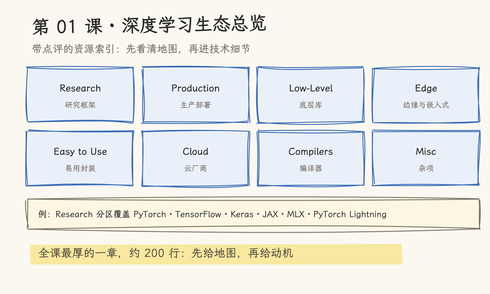
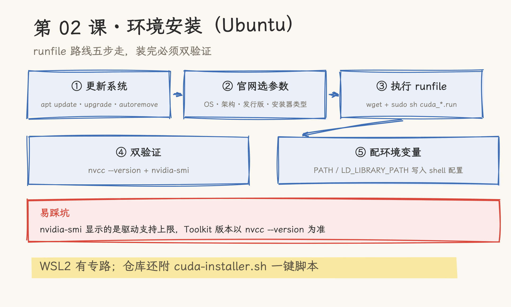
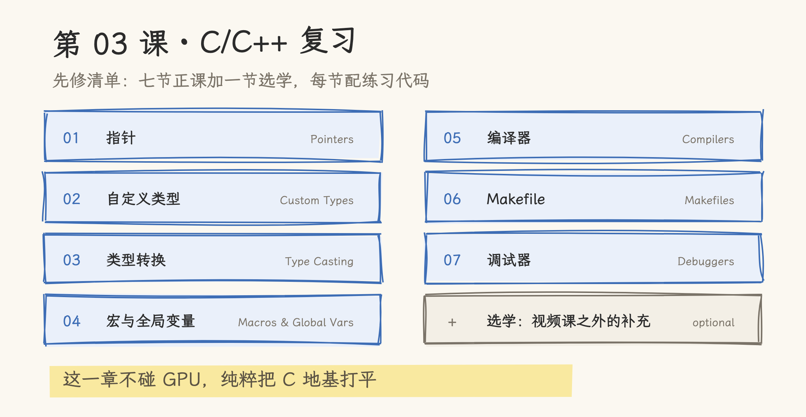
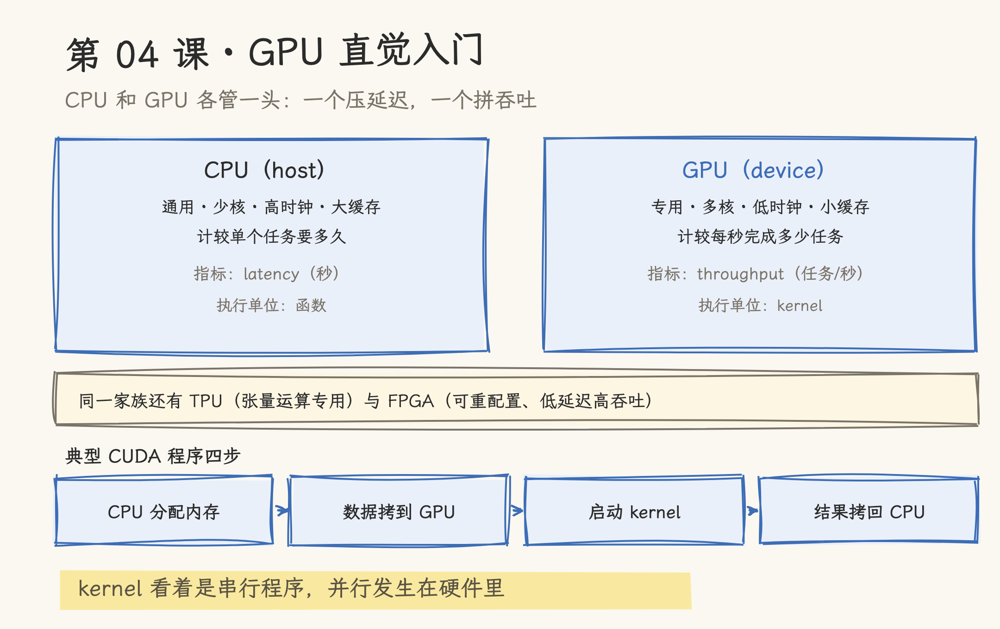
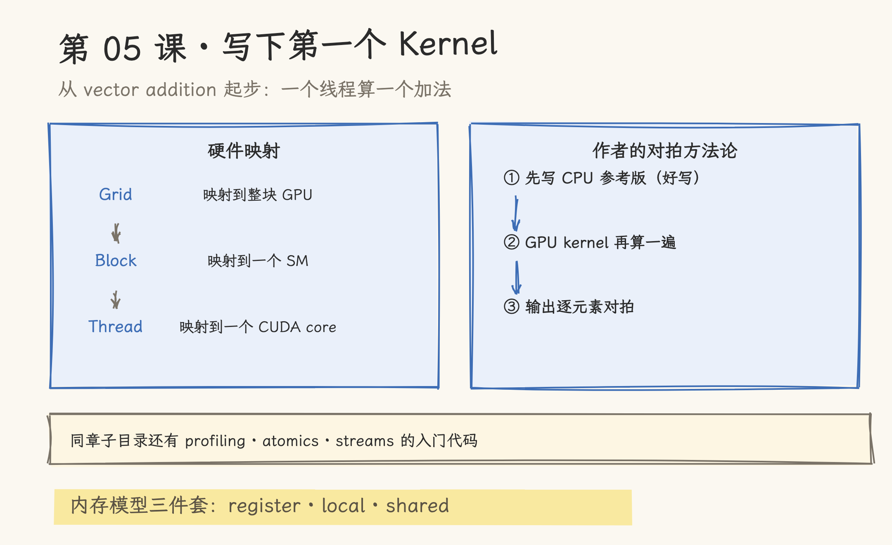
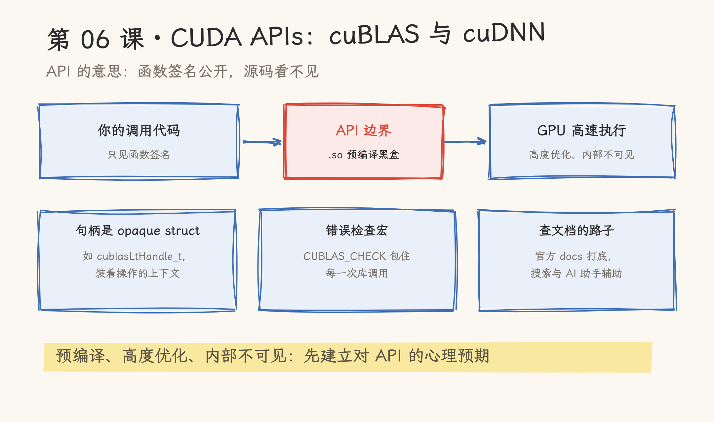
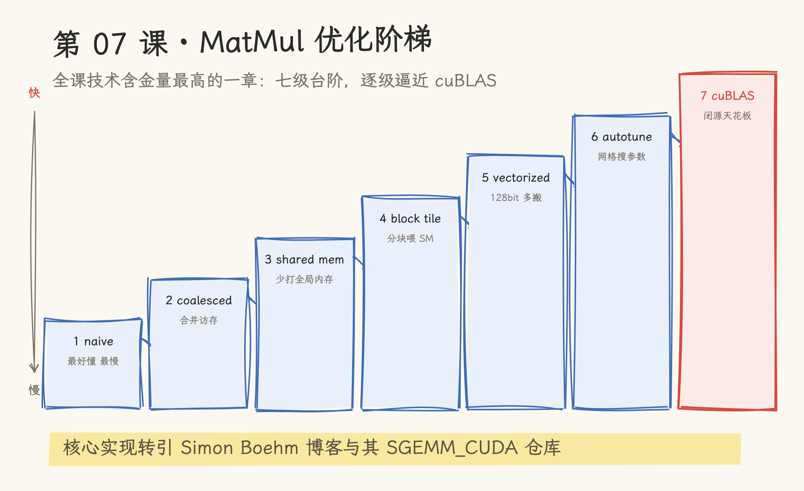
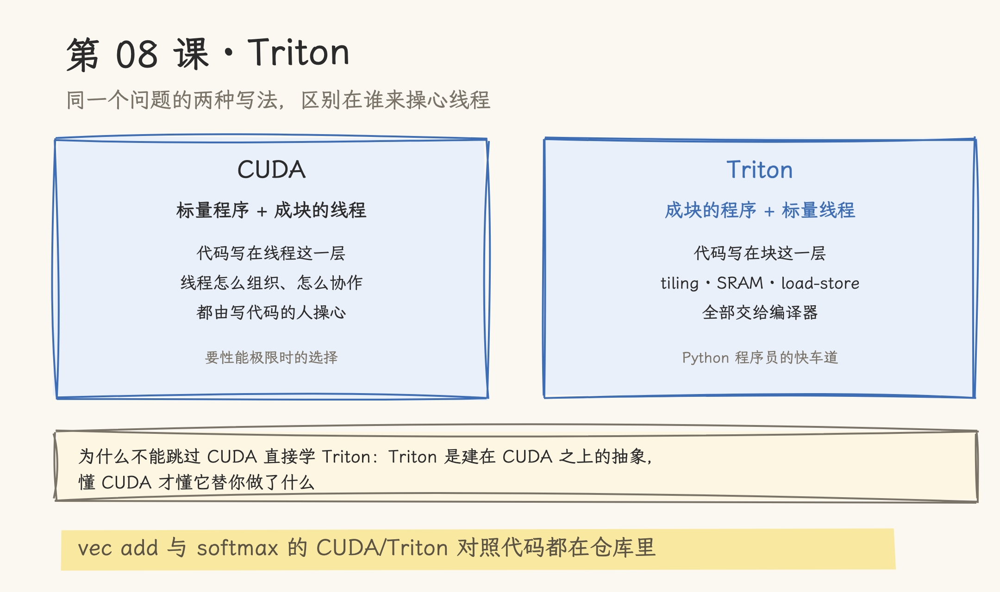
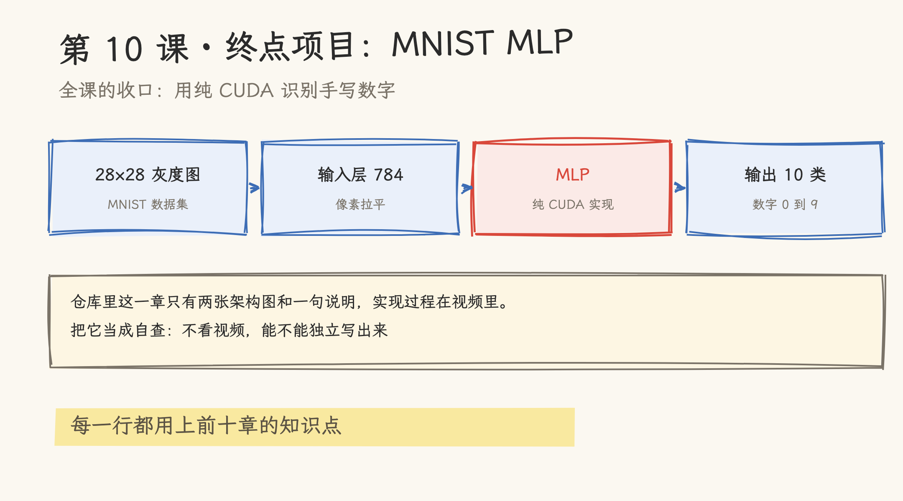
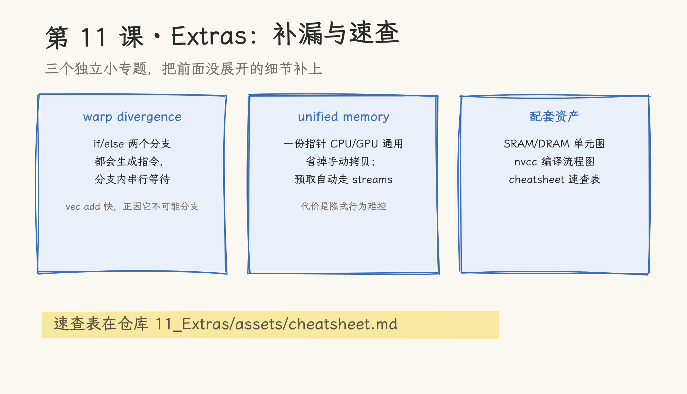

# FreeCodeCamp CUDA 课 · 从 C/C++ 基础到亲手写神经网络

> 仓库：[Infatoshi/cuda-course](https://github.com/Infatoshi/cuda-course) · 作者 Elliot Arledge · 视频课发布在 freeCodeCamp YouTube（全长 12 小时上下，以课程页标注为准）
> 核对基线：仓库 HEAD `79681bf`（2026-03-10）；星数 2,660、月增 396（核实于 2026-11-27）；课程面向 Ubuntu Linux

## 定位

[本目录的 21 篇系列](../README.md)默认读者已经会写代码、能直接进 CUDA 语境。这门课补的正好是缺的那段：从 C/C++ 复习开始，一步步走到用纯 CUDA 手写一个神经网络，识别 0 到 9 的手写数字（MNIST 数据集）。两个用途：

- 给没写过 kernel 的人一条平缓的入口，梯度刻意放得很低，连 Makefile 和调试器都先复习再进正题；
- 作为 [Stanford CS336](../../../10_ai_related_course/university_courses/stanford-cs336.md) 作业 2（CUDA/Triton kernel、flash attention、环形 all-reduce）的前置热身，CS336 不教 CUDA 基础。

仓库本体是视频课的配套讲义：11 章 README 合计约 700 行，多数章节是笔记式导读和资源索引，单看仓库学不完整，需要配视频。

## 课程主线

11 章分三段。

**地基（01–04）**：

- 01 深度学习生态总览：框架（PyTorch/TensorFlow/JAX/MLX）、生产部署、边缘推理、云厂商、编译器，仓库里最厚的一章（约 200 行），本质是带点评的资源索引，不涉技术细节；

  

- 02 环境安装：Ubuntu 路线的驱动与 CUDA Toolkit 安装，附安装脚本；

  

- 03 C/C++ 复习：指针、自定义类型、类型转换、宏与全局变量、编译器、Makefile、调试器，每节配练习代码；

  

- 04 GPU 直觉入门：CPU 与 GPU 的分工，不带代码。

  

**动手（05–07）**：

- 05 第一个 kernel：以 vector addition 起步，讲硬件映射（thread→CUDA core、block→SM、grid→GPU）和内存模型；子目录里还有 profiling、atomics、streams 的代码。作者的方法论是先写 CPU 参考版，与 GPU 结果逐元素对拍；

  

- 06 CUDA APIs：讲 cuBLAS/cuDNN 这类「opaque」库是什么（预编译二进制、只见函数签名不见源码）、句柄类型、错误检查宏；

  

- 07 MatMul 优化阶梯，全课技术含金量最高的一章：naive → coalesced access → shared memory → 1D/2D block tiling → vectorized load → autotune → cuBLAS。核心实现没有自己写，直接转引 Simon Boehm 的[博客](https://siboehm.com/articles/22/CUDA-MMM)和 [SGEMM_CUDA 仓库](https://github.com/siboehm/SGEMM_CUDA)。

  

**出山（08–11）**：

- 08 Triton：核心视角是「CUDA 写标量程序、组织成块的线程；Triton 写块程序、线程交给编译器」，附 vec add 与 softmax 的 Triton 实现（softmax 另带 CUDA 对照版）；

  

- 09 PyTorch 扩展：polynomial activation 的完整 CUDA 扩展示例，含 `setup.py`；

  

- 10 终点项目：CUDA 手写 MNIST MLP，README 只放了两张架构图，细节在视频里；

  

- 11 Extras：warp divergence、unified memory 取舍、SRAM/DRAM 单元图、[cheatsheet](https://github.com/Infatoshi/cuda-course/blob/master/11_Extras/assets/cheatsheet.md)。

  

## 资源地图

| 资源        | 位置                                                       | 说明                                                                           |
| ----------- | ---------------------------------------------------------- | ------------------------------------------------------------------------------ |
| GitHub 仓库 | <https://github.com/Infatoshi/cuda-course>                 | 本档案核对基线                                                                 |
| 视频课      | <https://www.youtube.com/watch?v=86FAWCzIe_4>              | freeCodeCamp《CUDA Programming Course – High-Performance Computing with GPUs》 |
| 文字课页    | <https://www.freecodecamp.org/news/learn-cuda-programming> | freeCodeCamp 站内配套文章                                                      |
| Cheatsheet  | 仓库 `11_Extras/assets/cheatsheet.md`                      | 速查表                                                                         |

仓库本身的两个坑，核对基线 `79681bf` 时点均存在：README 目录的第 9–11 项链接指向 `08_PyTorch_Extensions`、`09_Final_Project`、`10_Extras` 前缀，实际目录是 `09_`、`10_`、`11_`，GitHub 上点不开；README 只写了「on FreeCodeCamp」，视频直链要自己找（上面表格已补）。

## 学习建议

与本仓库内容的衔接，按学习顺序：

- 02 环境章以 Ubuntu runfile 裸装为主线；生产容器路线见[环境准备目录](../../01_environment/README.md)，裸金属安装步骤可对照[裸金属 CUDA 环境安装指南](../../01_environment/03_cuda_metal_install_guide.md)；
- 07 的 MatMul 优化阶梯学完后，往深处走是本系列的[Roofline 调优方法论](../17_roofline_optimization.md)与[Tensor Core GEMM 实测](../11_tensor_core_gemm.md)；quantized GEMM 方向接[量化 GEMM 深读目录](../../06_quant_gemm/README.md)（Marlin/UMMA）；
- 08 Triton 之后可以对比 [TileLang](../../03_tilelang/README.md)：两者都是把线程细节交给编译器的 tile 抽象。Triton 用 Python 直接写，性能可比 cuBLAS/cuDNN；TileLang 覆盖 CUDA/HIP/Metal/Ascend 多后端，长于逼近硬件极限的 GEMM/FlashAttention 实现；
- 终点项目（MNIST MLP）做完，就可以进本系列压轴的[手搓 Attention](../21_write_attention_from_scratch.md)。

实操提示：macOS 机器没有 NVIDIA GPU，02 章装不了，走远程云 GPU 或实验室服务器；课程自己说明 Windows 需要借道 WSL 或 Docker。深度上这门课止步于入门，07 章之后的真正优化要靠 siboehm 博客和本系列进阶篇补。

## 同类对照

同类免费资源里，GPU MODE（YouTube 社区 + Discord）偏专题深挖，CoffeeBeforeArch 的 from-scratch 系列偏单点（cache-tiled matmul 等）。这门课的差异在一条从零到 MNIST 的完整线：C 复习、环境、kernel、API、优化、Triton、扩展一次走通，且全程有免费视频可跟。freeCodeCamp 2026-04 另发布了 [H100 CUDA 课](https://www.freecodecamp.org/news/cuda-programming-for-nvidia-h100s)，讲 Hopper 架构、TMA、WGMMA 流水线、CUTLASS 与 NCCL 多卡；与这门（GTX/RTX/数据中心卡通吃）是两门课，进阶可看。

## 参考资料

- [GitHub 仓库](https://github.com/Infatoshi/cuda-course)（核对基线 HEAD `79681bf`，2026-03-10）
- [freeCodeCamp 视频课](https://www.youtube.com/watch?v=86FAWCzIe_4)
- [freeCodeCamp 文字课页](https://www.freecodecamp.org/news/learn-cuda-programming)
- [Simon Boehm: How to Optimize a CUDA Matmul Kernel for cuBLAS-like Performance: a Worklog](https://siboehm.com/articles/22/CUDA-MMM)（07 章核心实现来源）
