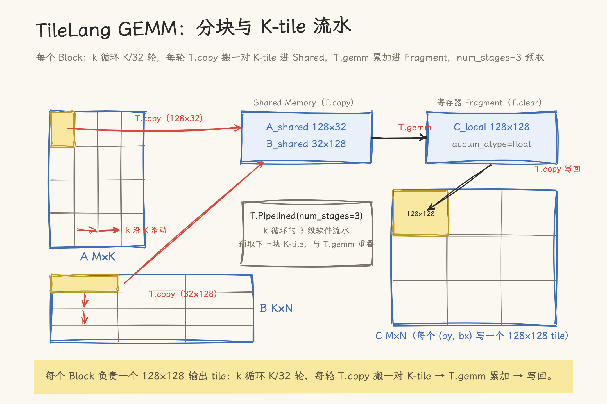

# TileLang 快速入门

TileLang 是 tile-ai 开源的面向 GPU/CPU/NPU 高性能 Kernel 的 DSL，语法是 Python，底层编译器是 TVM TIR。开发者描述数据分块与计算逻辑，分块、流水线、指令选择由编译器完成。

> 本文基于 tilelang v0.1.15（2026-11 核对，commit 8587866）。TileLang 迭代很快（0.1.12 加 LLVM 后端、0.1.13 移除多个旧 API、0.1.15 为当前版），安装要求与 API 以官方仓库为准；文中安装要求在 v0.1.6.post2 之前不同（当时还是 Python 3.8）。

## 1. 为什么需要 TileLang？

手写高性能 CUDA Kernel 要同时处理大量与算法无关的细节。一个分块矩阵乘法 Kernel 涉及的事项：

| 关注点        | 手写 CUDA 需要做什么                                    |
| ------------- | ------------------------------------------------------- |
| 共享内存      | 手动 `__shared__` 声明、加载、边界填充、`__syncthreads` |
| 寄存器布局    | 手动分配合适数量的寄存器变量，避免 spill                |
| 指令选择      | 手写 WMMA/MMA 指令，管理 Fragment 布局                  |
| 流水线        | 手写 multi-buffering，管理 `cp.async` 和 commit group   |
| 跨平台        | 为不同 GPU 架构编写不同的 Kernel 变体                   |
| Bank Conflict | 手动 padding shared memory                              |

这些工作易出错，且与具体硬件绑定。新架构（Hopper → Blackwell）出现时，大量优化代码需要重写。

### 1.1 编译器驱动的算子开发

TileLang 的思路与 LLVM 类似：将算法描述与硬件适配解耦。开发者用 Pythonic DSL 描述做什么（数据分块、计算逻辑），编译器负责怎么做（内存分配、指令调度、流水线优化）。

- 底层：基于 [TVM](https://tvm.apache.org/) 编译器基础设施，复用成熟的 TIR 优化和 CodeGen
- 语法：Python 原生风格，`@tilelang.jit` 装饰器标记编译入口
- 后端：CUDA（NVIDIA）、HIP（AMD，PyPI wheel 为 CUDA+ROCm 合包）、LLVM（CPU）、Metal（Apple Silicon）、Ascend（华为 NPU）、CuTe DSL、WebGPU

> 项目地址：<https://github.com/tile-ai/tilelang/>
> 文档地址：<https://tile-ai.github.io/tilelang/>

---

## 2. 环境搭建

### 2.1 系统要求（v0.1.15）

**PyPI 安装**：glibc ≥ 2.28（Ubuntu 20.04+）、Python ≥ 3.10、NVIDIA GPU 需主机 CUDA ≥ 10.0（或用 pip 提供的 CUDA 工具链 ≥ 13.0，免装主机 CUDA）；AMD GPU 需主机 ROCm（JIT 编译用 `hipcc`）

**源码编译**：Linux 或 Windows、Python ≥ 3.10、CUDA ≥ 10.0（或 pip 工具链）

**后端支持**（当前 README 口径）：CUDA（含 Blackwell）、ROCm（含 CDNA4 MXFP4）、Metal（含 Apple M5 cooperative-tensor GEMM）、Ascend 950、LLVM CPU、WebGPU。

### 2.2 安装

PyPI 安装（Linux x86_64 wheel 为 CUDA+ROCm 合包，同一命令两种卡通用）：

```bash
pip install tilelang

# 或开发版本
pip install git+https://github.com/tile-ai/tilelang.git
```

AMD GPU 需先装 ROCm 版 PyTorch（默认 PyPI 的 torch 认不出 AMD 卡），再装 tilelang：

```bash
pip install torch --index-url https://download.pytorch.org/whl/rocm7.0
pip install tilelang
```

源码编译——注意 `--recursive` 必须带上，TileLang 依赖定制版 TVM 子模块，缺了无法编译：

```bash
git clone --recursive https://github.com/tile-ai/tilelang.git
cd tilelang
pip install . -v
```

没有主机 CUDA 时可用 pip 提供的 CUDA 工具链（见官方 Installation.md 的 "pip-provided CUDA toolchain" 一节）。

> 更多方式（Docker、已有 TVM 复用）见[官方安装指南](https://github.com/tile-ai/tilelang/blob/main/docs/get_started/Installation.md)。

### 2.3 验证安装

通过 JIT 编译一个二维向量加法 Kernel，验证编译链路与硬件后端调用。

> 代码参考：[example_elementwise_add.py](https://github.com/tile-ai/tilelang/blob/main/examples/elementwise/example_elementwise_add.py)

```python
import tilelang
import tilelang.language as T
import torch

# 打印基础环境信息
print(f"TileLang 版本: {tilelang.__version__}")
print(f"CUDA 可用: {torch.cuda.is_available()}")

# jit 装饰器即时编译；out_idx=[-1] 指定最后一个参数是输出，
# 由适配器自动分配，调用时只传输入
@tilelang.jit(out_idx=[-1])
def vector_add(M, N, block_M, block_N, dtype="float32"):
    @T.prim_func
    def add_kernel(
        A: T.Tensor((M, N), dtype),
        B: T.Tensor((M, N), dtype),
        C: T.Tensor((M, N), dtype),
    ):
        # 划分 Grid 和 Block，每个 Block 包含 128 个线程
        with T.Kernel(T.ceildiv(N, block_N), T.ceildiv(M, block_M), threads=128) as (bx, by):
            # 自动并行化二维循环
            for i, j in T.Parallel(block_M, block_N):
                # 计算全局坐标
                row = by * block_M + i
                col = bx * block_N + j
                # 边界检查并执行逐元素加法
                if row < M and col < N:
                    C[row, col] = A[row, col] + B[row, col]
    return add_kernel

M, N = 1024, 1024
kernel = vector_add(M, N, 128, 128)

a = torch.randn(M, N).cuda()
b = torch.randn(M, N).cuda()
c = kernel(a, b)          # 只传输入；输出由适配器分配并返回

ref_c = a + b
torch.testing.assert_close(c, ref_c, rtol=1e-5, atol=1e-5)
print("TileLang 安装验证成功！")
```

---

## 3. 核心概念与第一个算子

TileLang 用 `@tilelang.jit` 标记编译入口，用 `T.Kernel` 等原语描述分块与数据流。

### 3.1 基础语法结构

```python
import tilelang
import tilelang.language as T

@tilelang.jit(out_idx=[-1])   # target 可省略（默认 auto），或指定 "cuda"/"hip"/"llvm"/"metal"
def my_kernel(M, N, K, block_M, block_N, block_K,
              dtype="float16", accum_dtype="float"):
    @T.prim_func                         # 标记为原始函数
    def actual_kernel(
        A: T.Tensor((M, K), dtype),      # 类型注解即形状声明
        B: T.Tensor((K, N), dtype),
        C: T.Tensor((M, N), accum_dtype),
    ):
        gx = T.ceildiv(N, block_N)       # Grid 尺寸由形状参数计算
        gy = T.ceildiv(M, block_M)
        with T.Kernel(gx, gy, threads=128) as (bx, by):  # 定义 Grid + Block
            A_shared = T.alloc_shared((block_M, block_K), dtype)          # 共享内存
            C_local  = T.alloc_fragment((block_M, block_N), accum_dtype)  # 寄存器
            # 计算逻辑 ...
    return actual_kernel
```

| 原语                           | 作用                                |
| ------------------------------ | ----------------------------------- |
| `T.Kernel(gx, gy, threads=t)`  | 定义 Block 网格与每 Block 线程数    |
| `T.alloc_shared(shape)`        | 声明共享内存（相当于 `__shared__`） |
| `T.alloc_fragment(shape)`      | 声明寄存器片段（Tile 级别变量）     |
| `T.Parallel(m, n)`             | 自动并行化迭代                      |
| `T.Pipelined(n, num_stages=k)` | 循环级软件流水线（多缓冲预取）      |
| `T.copy(src, dst)`             | 自动并行数据传输                    |
| `T.gemm(A, B, C)`              | 调用最优矩阵乘实现                  |

### 3.2 实战：矩阵乘法

传统 CUDA 写一个分块矩阵乘法 Kernel 需要手动管理共享内存加载、边界检查、`__syncthreads()` 同步、流水线；优化版本行数远多于朴素实现，且大部分代码与算法逻辑无关。

TileLang 实现约 30 行：

> 代码参考：[example_gemm.py](https://github.com/tile-ai/tilelang/blob/main/examples/gemm/example_gemm.py)

```python
import tilelang
import tilelang.language as T
import torch

@tilelang.jit(out_idx=[-1])
def matmul(M, N, K, block_M, block_N, block_K, dtype="float16", accum_dtype="float"):
    @T.prim_func
    def gemm(
        A: T.Tensor((M, K), dtype),
        B: T.Tensor((K, N), dtype),
        C: T.Tensor((M, N), dtype),
    ):
        # 划分 Grid 和 Block，并指定每 Block 的线程数
        with T.Kernel(T.ceildiv(N, block_N), T.ceildiv(M, block_M), threads=128) as (bx, by):
            # 声明位于共享内存中的张量
            A_shared = T.alloc_shared((block_M, block_K), dtype)
            B_shared = T.alloc_shared((block_K, block_N), dtype)
            # 声明位于寄存器中的本地累加片段
            C_local  = T.alloc_fragment((block_M, block_N), accum_dtype)

            # 初始化寄存器片段为 0
            T.clear(C_local)
            # 开启 3 级流水线循环，自动处理异步加载与计算重叠
            for k in T.Pipelined(T.ceildiv(K, block_K), num_stages=3):
                # 将全局内存中的数据分块拷贝到共享内存
                T.copy(A[by * block_M, k * block_K], A_shared)
                T.copy(B[k * block_K, bx * block_N], B_shared)
                # 调用矩阵乘法指令，编译器将自动映射为 Tensor Core 指令
                T.gemm(A_shared, B_shared, C_local)

            # 计算完成后，将寄存器片段中的结果写回全局内存
            T.copy(C_local, C[by * block_M, bx * block_N])
    return gemm

# 编译并使用
M, N, K = 1024, 1024, 1024
kernel = matmul(M, N, K, 128, 128, 32)

a = torch.randn(M, K, device="cuda", dtype=torch.float16)
b = torch.randn(K, N, device="cuda", dtype=torch.float16)
c = kernel(a, b)

ref_c = a @ b
torch.testing.assert_close(c, ref_c, rtol=1e-2, atol=1e-2)
print("矩阵乘法验证通过")
```



_图 1：一个 Block 内的分块搬运与计算——A/B 的 K-tile 经 `T.copy` 进 Shared Memory，`T.gemm` 累加进寄存器 Fragment，`T.Pipelined` 让下一块的预取与当前块的计算重叠。_

核心 API：

- `T.Pipelined(n, num_stages=3)`：循环级软件流水线，自动多缓冲预取，隐藏全局内存延迟
- `T.copy`：自动并行数据传输，处理合并访问与边界填充
- `T.gemm`：编译器自动映射到目标架构最优的 Tensor Core/Warp 级指令

### 3.3 CUDA → TileLang 对照表

TileLang 编译器接管了传统 CUDA 编程中的共享内存同步、边界检查与指令调度，开发者只需描述高层数据流。

| CUDA 概念               | TileLang 原语      | 变化                                                                                               |
| ----------------------- | ------------------ | -------------------------------------------------------------------------------------------------- |
| `__shared__` 手动管理   | `T.alloc_shared`   | 声明式，编译器自动处理加载/同步                                                                    |
| `__syncthreads()`       | — (隐式)           | 编译器自动插入，消除遗漏风险                                                                       |
| 手动边界检查            | — (隐式)           | 编译器根据形状自动生成                                                                             |
| `cudaMalloc`/`cudaFree` | — (自动)           | 张量生命周期由 PyTorch/TileLang 管理                                                               |
| WMMA/MMA 指令           | `T.gemm`           | 一行调用，编译器选最优指令                                                                         |
| `cp.async` + multi-buf  | `T.Pipelined`      | 编译器自动插入异步拷贝与多缓冲                                                                     |
| 手动循环展开            | — (自动)           | TVM TIR 自动应用分块/融合/展开                                                                     |
| CUDA Streams            | —（无对应原语）    | Streams 是跨 Kernel 并发调度；TileLang 的 `T.Pipelined` 是 Kernel 内循环级软件流水，两者不是一回事 |
| 寄存器分配              | `T.alloc_fragment` | 声明式，编译器优化 spill                                                                           |

硬件映射由编译器完成；开发者仍然控制分块大小、流水级数这些算法层面的决策。

---

## 4. 进阶：编译原理与调试

TileLang 依托 TVM TIR（Tensor Intermediate Representation）：DSL 先下沉为 TIR，经过与硬件无关的通用优化，再由各后端（如 `src/cuda/codegen/codegen_cuda.cc`）生成特化的 CUDA 源码。理解这一流程有助于在性能不达预期时判断瓶颈出在算法描述层还是代码生成层（只关心业务集成的开发者可跳过本章）。

### 4.1 JIT 编译流程

TileLang 采用 JIT 模式：首次调用时编译，编译结果缓存。

```python
@tilelang.jit(target="cuda")
def my_kernel(...): ...

result = my_kernel(input)    # 首次调用 → 编译 + 执行
result2 = my_kernel(input2)  # 后续调用 → 缓存命中，直接执行
```

编译流程：`TileLang DSL` → `TVM TIR` → `优化后的 TIR` → `CUDA C++` → `PTX` → `可执行 Kernel`

关键特性：

- **参数特化**：编译器根据首次调用的形状和 dtype 生成特化代码
- **缓存机制**：编译结果缓存到磁盘（`tilelang/cache/`，可用 `TILELANG_CACHE_DIR` 重定向），跨进程复用；近期版本还支持在兼容主机间复用 CUDA 二进制缓存（以 release notes 为准）
- **多目标**：同一份 DSL 可编译到 CUDA / HIP / LLVM / Metal / Ascend

### 4.2 TVM TIR 到 CUDA 的转换

编译器自动应用的优化：

| 类别     | 优化策略                                        |
| -------- | ----------------------------------------------- |
| 循环     | 分块 (Tiling)、重排 (Reorder)、融合 (Fusion)    |
| 内存访问 | 合并访问 (Coalesced)、共享内存分块、预取        |
| 计算     | 循环展开、指令级并行 (ILP)、Tensor Core MMA     |
| 算子融合 | 垂直融合（生产者-消费者）、水平融合（独立算子） |

**性能特点**：DSL 无运行时开销、硬件感知（按 SM 版本选策略）；官方 README 给出了 H100 上 matmul/FlashAttention 与手写 CUDA 的对比基准，具体数字以其为准——「接近手写 CUDA」是官方口径，落到自己的算子上仍需实测。

### 4.3 查看生成代码与调试

通过 `tilelang.compile` 导出 CUDA 源码或注册 `postproc_callback` 钩子函数，可以下钻到指令层级排查瓶颈：

```python
# 查看生成的 CUDA 源码
kernel = tilelang.compile(your_function, target="cuda")
print(kernel.get_kernel_source())

# 编译过程回调
from tilelang.engine.callback import register_cuda_postproc_callback

@register_cuda_postproc_callback
def debug_cuda_code(code, target):
    print("Final CUDA code:", code)
    return code
```

---

## 5. 实践建议

在生产环境中引入 TileLang 前，需评估 JIT 编译延迟对系统的影响，并结合目标硬件选择后端。

### 5.1 适合与不适合的场景

适合 TileLang：

- 需要快速开发一个性能接近手写 CUDA 的 Kernel，不想花几天调 Bank Conflict 和寄存器 spill
- 需要跨 NVIDIA/AMD 的算子，不想维护两套代码；或目标是 Metal / Ascend 这类新兴后端
- 算子研发的快速迭代阶段，后期可替换为手写 CUDA

不建议（改用手写 CUDA 或 Triton）：

- 需要极致性能的最后一两个百分点（如做 cuBLAS 竞品），必须控制每条指令
- 算法依赖非标准 Warp 级原语或 TileLang 尚未暴露的硬件特性
- 工作流中 JIT 编译延迟不可接受（如高频推理服务的热更新）
- 团队已有成熟的手写 CUDA 资产，迁移成本高于收益

| 对比维度     | TileLang                        | Triton            | 手写 CUDA         |
| ------------ | ------------------------------- | ----------------- | ----------------- |
| 性能天花板   | 接近手写                        | 接近手写          | 最高              |
| 开发效率     | 高                              | 高                | 低                |
| AMD GPU      | 支持（ROCm 后端）               | 支持（ROCm 后端） | 不支持（需 ROCm） |
| 跨架构兼容   | 强（CUDA/HIP/Metal/Ascend/CPU） | 中                | 弱                |
| JIT 启动延迟 | 编译约秒级                      | 编译约秒级        | 无（AOT）         |
| 学习曲线     | 中（需理解 DSL）                | 中                | 高                |

### 5.2 内存管理

TileLang 复用 PyTorch 的显存分配器。输出张量有两种管理方式，**取决于编译时是否指定 `out_idx`**：

```python
# 方式一（前文示例的用法）：带 out_idx=[-1] 编译
# 输出由适配器自动分配，调用时只传输入
c = kernel(a, b)

# 方式二：预分配输出、跨调用复用——编译时不带 out_idx
# 此时 C 是普通入参，调用时 A、B、C 三个参数全部显式传入
@tilelang.jit()          # 注意：没有 out_idx
def matmul_manual(M, N, K, block_M, block_N, block_K,
                  dtype="float16", accum_dtype="float"):
    @T.prim_func
    def gemm(A: T.Tensor((M, K), dtype),
             B: T.Tensor((K, N), dtype),
             C: T.Tensor((M, N), dtype)):
        # ... Kernel 体与 3.2 节完全相同 ...
    return gemm

kernel2 = matmul_manual(M, N, K, 128, 128, 32)
c = torch.empty(M, N, device="cuda", dtype=torch.float16)
kernel2(a, b, c)   # 三个参数全部显式传入，c 跨调用复用
```

常见错误：带 `out_idx` 编译的 kernel 传入预分配输出（多传一个参数），会直接报参数个数不匹配（如 "Kernel expected 2 inputs, but 3 are provided"）——两种方式二选一，不能混用。

| 错误               | 原因                | 解决                          |
| ------------------ | ------------------- | ----------------------------- |
| CUDA out of memory | 形状或分块过大      | 减小 `block_M/N/K` 或清理缓存 |
| 编译错误           | 参数类型/形状不匹配 | 检查 `@T.prim_func` 签名      |
| 运行时错误         | 张量不在正确设备上  | 确保 `.cuda()` 且 dtype 匹配  |

### 5.3 延伸阅读

- [SIMT vs Tile-Based：CUDA 编程范式的演进与对比](../02_cuda/04_simt_vs_tile_based.md)：Tile-Based 编程范式的设计哲学
- [GPU 编程导论](../02_cuda/01_gpu_programming_introduction.md)：CUDA Grid/Block/Warp/Thread 基础
- [TileLang 官方文档](https://tile-ai.github.io/tilelang/)
- [TileLang 示例仓库](https://github.com/tile-ai/tilelang/tree/main/examples)
