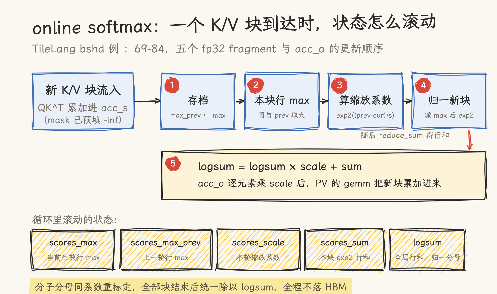
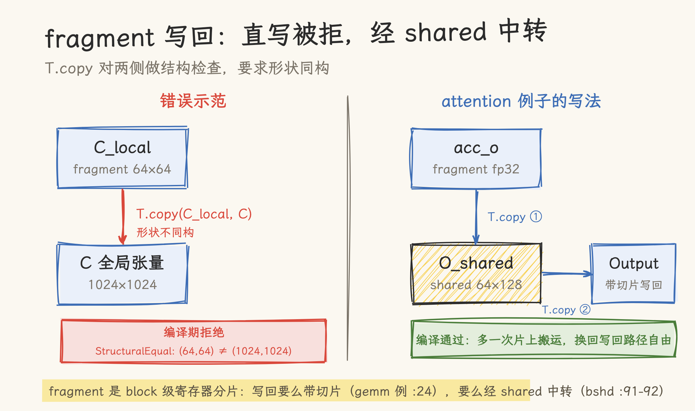

# 57 行代码的 FlashAttention：TileLang 前向算子源码级拆解

> 本文基于 tilelang v0.1.15（tag 指向 a35f8ddf，2026-11 核对）。三个 dense 前向例子在该 tag 与 main 分支字节相同，文中行号对两者都有效；两个 varlen 例子的 kernel 零改动，main 只在 host 侧增加了 flash-attn 探测与 PyTorch 兜底。涉及历史版本（v0.1.8）的地方单独标注。TileLang 迭代很快，安装与 API 以官方仓库为准。

TileLang 仓库的 `examples/flash_attention/` 目录下有五个前向例子，共享同一副骨架。dense 的 bshd 版从 `with T.Kernel` 到最后一行写回共 57 行，在 H100、非 causal、B8/H32/S4096/D128 的默认形状上跑出 248 TFLOPs。这 57 行里看不到共享内存同步，看不到 MMA 指令，也看不到流水线编排：这些细节全部交给了编译器，留在代码里的只有 online softmax 的状态递推和两次 `T.gemm`。

## 1. Attention kernel 难在哪

FlashAttention 的前向要同时翻两座山。

第一座是 HBM 带宽墙。attention 的中间矩阵 S（QK^T 分数）与 P（softmax 权重）的尺寸是 S×S，序列长度上万时来回搬它们本身就耗尽带宽：FA 的核心动作是把 K/V 按块流过片上，分数、softmax、加权求和在块内做完，S 和 P 从头到尾不落显存。

第二座是 online softmax 的状态管理。分块算 softmax 的麻烦在于每块的行最大值都可能刷新全局最大值，旧的部分和必须跟着重新标定。kernel 要维护一组长度为 block_M 的运行状态（行最大值、缩放系数、行和、logsum），每块 K/V 到货就走一轮「合并 max、缩放旧值、归一新块、累加」，顺序错一步或精度选错一档，输出就以 NaN 或精度损失的形式报警。

手写 CUDA 时，这两座山周围还站着一圈与算法无关的杂务：Q/K/V tile 的异步拷贝与多缓冲、mma 指令的 fragment 布局、行 max 与行和的跨线程归约、写回路径的地址计算。TileLang 版把这层杂务整个接走：`T.alloc_shared` 声明片上缓冲，`T.copy` 负责搬运与边界，`T.gemm` 在 sm_90 目标上自动落到 warpgroup 级 MMA，`T.Pipelined` 让下一块 K/V 的预取与当前块计算重叠。开发者留下的是算法本身：分块大小、流水级数、softmax 状态怎么递推。

## 2. 五个例子与一副骨架

先看目录全景：

| 文件                        | 布局                    | 相对基线的增量                       |
| --------------------------- | ----------------------- | ------------------------------------ |
| `example_mha_fwd_bshd.py`   | BSHD dense              | 基线，本文主线                       |
| `example_mha_fwd_bhsd.py`   | BHSD dense              | 换轴存储，causal 多一个 `past_len`   |
| `example_mha_fwd_varlen.py` | 紧凑布局 + `cu_seqlens` | 变长序列，mask 用 -1e9               |
| `example_gqa_fwd_bshd.py`   | BSHD dense + `groups`   | K/V 头按 groups 复用                 |
| `example_gqa_fwd_varlen.py` | 紧凑布局 + `groups`     | 前两者叠加，唯一没挂 autotune 的例子 |

五个例子共用同一副 kernel 骨架，流程是：`T.Kernel` 开网格，`T.alloc_shared` 声明 Q/K/V/O 四块共享内存，`T.alloc_fragment` 声明三个计算缓冲加五个 softmax 状态，预载 Q，进 `T.Pipelined` 主循环做「拷 K、填 mask、gemm、softmax 递推、缩放旧输出、拷 V、gemm」，循环外归一并写回。以 bshd 为底（代码取自 `example_mha_fwd_bshd.py`，注释里的行号即此文件）：

```python
@tilelang.jit(out_idx=[3], pass_configs={...})      # :17-22，out_idx 指定第 4 参为自动分配的输出
def flashattn(batch, heads, seq_len, dim, is_causal,
              block_M=64, block_N=64, num_stages=1, threads=128):
    scale = (1.0 / dim) ** 0.5 * 1.44269504         # :24，log2(e) 折进 scale

    @T.prim_func
    def main(Q, K, V, Output):                      # :29-34，实参带形状注解，均为 [B, S, H, D]
        with T.Kernel(T.ceildiv(seq_len, block_M), heads, batch,
                      threads=threads) as (bx, by, bz):    # :36，x 切 Q 行，y 一个头，z 一个 batch
            Q_shared = T.alloc_shared([block_M, dim], dtype)          # :37-40，共享内存四块
            K_shared = T.alloc_shared([block_N, dim], dtype)
            V_shared = T.alloc_shared([block_N, dim], dtype)
            O_shared = T.alloc_shared([block_M, dim], dtype)
            acc_s = T.alloc_fragment([block_M, block_N], accum_dtype)  # :41，QK^T 累加器
            acc_s_cast = T.alloc_fragment([block_M, block_N], dtype)   # :42，fp16 副本
            acc_o = T.alloc_fragment([block_M, dim], accum_dtype)      # :43，输出累加器
            scores_max = T.alloc_fragment([block_M], accum_dtype)      # :44-48
            scores_max_prev = T.alloc_fragment([block_M], accum_dtype) # 五个 softmax 状态
            scores_scale = T.alloc_fragment([block_M], accum_dtype)
            scores_sum = T.alloc_fragment([block_M], accum_dtype)
            logsum = T.alloc_fragment([block_M], accum_dtype)

            T.copy(Q[bz, bx * block_M:(bx + 1) * block_M, by, :], Q_shared)  # :50，Q 只载一次
            T.fill(acc_o, 0)                          # :51-53，状态初始化
            T.fill(logsum, 0)
            T.fill(scores_max, -T.infinity(accum_dtype))

            loop_range = ...                          # :55-57，causal 时截掉对角线之后的块

            for k in T.Pipelined(loop_range, num_stages=num_stages):   # :59，软件流水
                T.copy(K[bz, k * block_N:(k + 1) * block_N, by, :], K_shared)  # :60
                if is_causal:                         # :61-66，gemm 前预填 mask
                    for i, j in T.Parallel(block_M, block_N):
                        acc_s[i, j] = T.if_then_else(bx * block_M + i >= k * block_N + j,
                                                     0, -T.infinity(acc_s.dtype))
                else:
                    for i, j in T.Parallel(block_M, block_N):
                        acc_s[i, j] = T.if_then_else(k * block_N + j >= seq_len,
                                                     -T.infinity(acc_s.dtype), 0)
                T.gemm(Q_shared, K_shared, acc_s, transpose_B=True,
                       policy=T.GemmWarpPolicy.FullRow)                # :67，C += A·B
                ...                               # :69-80，online softmax 递推，第 3 节拆
                T.copy(acc_s, acc_s_cast)         # :81，fp32 降 fp16
                for i, j in T.Parallel(block_M, dim):
                    acc_o[i, j] *= scores_scale[i]                    # :83-84，旧输出缩放
                T.copy(V[bz, k * block_N:(k + 1) * block_N, by, :], V_shared)  # :86
                T.gemm(acc_s_cast, V_shared, acc_o,
                       policy=T.GemmWarpPolicy.FullRow)                # :87，PV 累加

            for i, j in T.Parallel(block_M, dim):
                acc_o[i, j] /= logsum[i]          # :89-90，全部块处理完后归一
            T.copy(acc_o, O_shared)               # :91-92，fragment 经 shared 中转写回
            T.copy(O_shared, Output[bz, bx * block_M:(bx + 1) * block_M, by, :])

    return main
```

骨架里几处值得停一下：

- 网格三个轴是 `(ceildiv(seq_len, block_M), heads, batch)`：每个 block 独立算出一个 `(block_M, dim)` 的输出 tile，头与头、batch 与 batch 之间零通信。
- 主循环从 :59 到 :87 共 29 行。五个 softmax 状态的递推全部在循环体内完成，循环外只有初始化和收尾归一，没有可外提的状态。
- dtype 与 accum_dtype 是两个独立参数（:26-27）：计算用 float16，累加用 float32。这套组合贯穿目录里全部前向例子，第 4 节会回到它。

## 3. Online softmax：五个 fp32 fragment 的递推

### 3.1 五个状态

五个 `[block_M]` 形状的 fp32 fragment（:44-48）各管一件事：

| fragment          | 职责                                       |
| ----------------- | ------------------------------------------ |
| `scores_max`      | 当前生效的行最大值，随块滚动               |
| `scores_max_prev` | 上一轮的行最大值，算缩放系数用             |
| `scores_scale`    | 本轮缩放系数，同时作用于旧部分和与 acc_o   |
| `scores_sum`      | 本块 exp2 之后的行和                       |
| `logsum`          | 全部块的行和（带缩放修正），最后归一的分母 |

### 3.2 递推本体

主循环内 :69-80 是完整递推：

```python
T.copy(scores_max, scores_max_prev)             # 旧 max 存档
T.fill(scores_max, -T.infinity(accum_dtype))    # max 重置
T.reduce_max(acc_s, scores_max, dim=1, clear=False)   # 本块行 max
for i in T.Parallel(block_M):
    scores_max[i] = T.max(scores_max[i], scores_max_prev[i])   # 新旧合并
for i in T.Parallel(block_M):
    scores_scale[i] = T.exp2(scores_max_prev[i] * scale
                             - scores_max[i] * scale)          # 缩放系数
for i, j in T.Parallel(block_M, block_N):
    acc_s[i, j] = T.exp2(acc_s[i, j] * scale
                         - scores_max[i] * scale)              # 本块分数归一
T.reduce_sum(acc_s, scores_sum, dim=1)          # 本块行和
for i in T.Parallel(block_M):
    logsum[i] = logsum[i] * scores_scale[i] + scores_sum[i]    # logsum 滚动
```

acc_o 按同一系数缩放（:83-84），随后 PV 的 gemm 把新块累加进来。整个递推的顺序与状态滚动如下图：



数学上这是恒等变形：softmax 的分子分母都按新 max 重新标定，等全部块处理完再统一除一次 logsum（:89-90）。写成公式即：

$$o_i \leftarrow o_i \cdot \exp2\bigl((m_i^{\text{prev}} - m_i^{\text{cur}}) \cdot \text{scale}\bigr) + P_{i,:}\,V$$

这些 `T.Parallel` 小循环操作的都是 fragment（寄存器分片），行 max、行和在源码层面就是一次 `reduce_max`、一次 `reduce_sum`，看不到 warp shuffle：跨线程归约与广播由编译器展开。

### 3.3 mask 为什么写在 gemm 之前

`T.gemm` 是累加语义（C += A·B）。先 gemm 再补 mask 是来不及的：被遮位置的分数已经被写进累加器，softmax 拿到的是污染值。所以写法是 gemm 前把 acc_s 预填成「可见位置 0、被遮位置 -inf」（:61-66）：gemm 累加后，被遮位置是 -inf 加上一个有限的 qk，仍为 -inf；可见位置是 0 加 qk，就是分数本身。到 exp2 阶段，-inf 一律塌缩成 0 权重。

非 causal 分支的 mask 也在干活：seq_len 不是 block_N 整数倍时，最后一块的越界列靠 `k * block_N + j >= seq_len` 这个条件填 -inf。causal 分支则把对角遮挡和越界遮挡合进一条 `q_idx >= k_idx`。

### 3.4 log2(e) 折进 scale

:24 是全文件信息密度最高的单行：

```python
scale = (1.0 / dim) ** 0.5 * 1.44269504  # log2(e)
```

softmax 用自然指数，而 GPU 上的快速指数指令以 2 为底。利用

$$\exp(x) = \exp2(x \cdot \log_2 e)$$

把 $\log_2 e \approx 1.44269504$ 乘进 scale，一次乘法同时完成 $1/\sqrt{d}$ 缩放与底数变换，循环体内的指数运算全部走 `T.exp2`（目录里 grep 不到 `T.exp`）。附带收益写在 varlen 例子 :122-124 的注释里：`x * scale - max * scale` 这种形态让编译器熔出 ffma 指令，省掉独立的加法与乘法。这行代码从 2025 年 1 月仓库的初始迁移提交（57ab687c）就在，第一版就定了下来。

### 3.5 max 合并两行的由来

第 4 步 `scores_max[i] = T.max(scores_max[i], scores_max_prev[i])` 是 2025 年 11 月的 PR #1269（提交 3ab93cd7）加上的，提交标题写明动机是数值稳定性。关键场景是全遮块：`reduce_max` 之后行最大值停在 -inf，第 5 步的缩放系数会出现 `-inf - (-inf)` 的未定义结果；合并历史 max 后，全遮块的 max 回退到上一轮值，系数恰好为 exp2(0) = 1，旧状态原样滚动，不产生 NaN。varlen 例子 :114-118 有一段注释掉的 Check_inf 处理，引用了 FlashAttention 3 的同名逻辑，是同一个问题的另一种解法。

### 3.6 两次「搬运即转换」

递推里藏着两次顺路完成的类型转换。`T.copy(acc_s, acc_s_cast)`（:81）把 fp32 分数降到 fp16，因为第二次 gemm 的 A 输入必须是计算 dtype，Tensor Core 不拿 fp32 当矩阵乘的输入格式。结尾 `T.copy(acc_o, O_shared)`（:91）把 fp32 结果经共享内存中转。为什么 fragment 不能直写全局张量，见下一节第一个坑。

## 4. 两个第一次写就会踩的坑

两个坑都在我们自己的 H100 环境里撞过，错误信息与修复结果均为实测。

### 4.1 fragment 直写全局张量：StructuralEqual 拒绝

写验证脚本时最顺手的外层写法：

```python
C_local = T.alloc_fragment((block_M, block_N), accum_dtype)
...
T.copy(C_local, C)      # C 是 (1024, 1024) 的全局张量
```

编译期直接报 StructuralEqual 形状不等：(64, 64) 对 (1024, 1024)。`T.copy` 对两侧操作数做结构检查，fragment 是 block 级的寄存器分片，另一侧是完整全局张量，形状不同构，检查不放行。

出路有两条。带切片写 `T.copy(C_local, C[by * block_M, bx * block_N])`，这是官方 GEMM 例子的用法（`examples/gemm/example_gemm.py:24`）；attention 例子则统一经共享内存中转：先 `T.copy(acc_o, O_shared)`，再 `T.copy(O_shared, Output[切片])`（bshd :91-92）。



写复杂算子建议选后一种：多一次片上搬运的代价很小，写回路径从此不依赖 fragment 与全局内存的布局对应关系。

### 4.2 累加器声明成 fp16：K=1024 时 max diff 0.375

第二个坑藏在 dtype 参数里。图省事把累加器声明成计算 dtype：

```python
acc = T.alloc_fragment((block_M, block_N), dtype)   # float16，错误示范
```

K=1024 的矩阵乘，结果与 torch 的 fp16 matmul 对比，max diff 0.375；声明改成 accum_dtype（fp32）后 diff 降到 0.0。机制可以直接算出来：fp16 只有 11 位有效数字，数值过 2048 后 ulp 就到了 1；累加一千多项时部分和在几百上千的量级上反复舍入，误差轻松越过零点几的量级。TileLang 把 dtype 和 accum_dtype 拆成两个参数（bshd :26-27）就是给这里用的：矩阵内容以 fp16 进 Tensor Core，累加器用 fp32，需要降回 fp16 的场合（第二次 gemm 的 A）显式过一次 acc_s_cast。

两个坑的性状也不同：4.1 的报错发生在编译期，错误信息里只有两个 shape；4.2 的误差发生在运行期，更隐蔽，数值检查容差给宽了（比如 rtol=0.1）它就直接溜过去。

## 5. 流水线调度的演进：三张表交还给编译器

从 v0.1.2 起的历代例子里，这个目录陆续出现过 5 个 `*_wgmma_pipelined.py` 变体（mha 前向 bshd 与 bhsd 两份，gqa 前向、mha 反向、gqa 反向各一份），活到 v0.1.8（2026-02-16 发布）。拿 plain 版 diff 这些文件，kernel 主体逐行相同，全部差异集中在一处 `T.Pipelined` 调用（以 `example_mha_fwd_bshd_wgmma_pipelined.py:61-66` 为例）：

```python
for k in T.Pipelined(
    loop_range,
    num_stages=num_stages,
    order=[-1, 0, 3, 1, -1, 2],
    stage=[-1, 0, 0, 1, -1, 1],
    group=[[0], [1, 2], [3, 4, 5, 6, 7, 8, 9, 10, 11], [12], [13], [14]],
):
```

order、stage、group 是三张手工调度表：循环体里的语句按执行序编号，order 给出流水顺序，stage 指定每条语句进哪一级流水，group 把语句绑成不可拆分的组，编号 -1 表示不进流水线。配合更大的 config（变体写死 128×128、两级流水、256 线程；plain 例子的函数默认值是 64×64、1 级、128 线程），同一个 kernel 能再压出一段延迟。这三个参数没有文档化的语义保证，调它们基本靠试。

2026-03-18，PR #1909（提交 ded6a992）删掉了 examples/flash_attention/ 下全部 5 个 wgmma_pipelined 变体，同一提交引入 producer-consumer 形态的 warp specialization 与 `T.tma_copy()` API。现在的等价参考在 `examples/warp_specialize/`，拷贝与 mbarrier 的管理显式化，写法形如：

```python
T.tma_copy(A[by * block_M, ko * block_K], A_shared, barrier=data_is_ready)
# example_warp_specialize_gemm_copy_1_gemm_0.py:28
```

这里要点透一件容易误会的事：被删的 5 个文件名里都有 wgmma，但翻遍文件找不到一行 wgmma 指令，TileLang 从未把 wgmma 暴露成 API。在 sm_90 目标上，`T.gemm` 经编译器的指令选择自然落到 warpgroup 级 MMA；文件名里的 wgmma_pipelined 只是给人看的调优标注。所以这次删除不损失能力：plain 例子在 Hopper 上生成的依然是 wgmma，变化在调度控制权，从用户手里的三张表移交给编译器的 pass。

v0.1.15 之后唯一再碰这个目录的提交是 #3702（96b947db，2026-11-02，适配 sm_12x 的共享内存预算）：三个 dense 前向例子字节未动，varlen 两例只加了 flash-attn 探测与兜底，实质改动落在 gqa 反向例子的 config 自适应上。前向这套代码在两个版本之间保持稳定。

## 6. varlen 与 GQA：从 demo 到工程

### 6.1 varlen 的输入协议

变长 batch 用不了规整的 `[B, S, H, D]`。varlen 例子的 kernel 签名（`example_mha_fwd_varlen.py:39-45`）：

```python
Q_unpad: T.Tensor(q_shape, dtype),   # 紧凑张量，[全部 Q 行数, H, D]
K_unpad: T.Tensor(k_shape, dtype),
V_unpad: T.Tensor(v_shape, dtype),
cu_seqlens_q: T.Tensor([batch_size + 1], T.int32),   # :42-43，前缀和偏移数组
cu_seqlens_k: T.Tensor([batch_size + 1], T.int32),
max_seqlen_q: T.int32,               # :44，标量入参
Output_unpad: T.Tensor(o_shape, dtype),
```

kernel 内每个 block 先读自己 batch 的起止偏移（:64-70），随后所有拷贝都用 `q_start_idx + ...` 形式的动态切片。网格 x 维按 `max_seqlen_q` 除以 block_M 开满（:47）：序列不足 max 的 batch 多余 block 照常启动，靠 mask 屏蔽（:100-104），行号越过 `q_current_seqlen` 或列号越过 `kv_current_seqlen` 就填 -1e9；写回时再用一道 guard（:147-149）挡掉越界行。代价是短序列也占满网格，换来的是 host 侧不需要前缀和扫描就能确定网格形状。

causal 的要点是右对齐：`offset = kv_current_seqlen - q_current_seqlen`（:80，注释写着 always align on the right），遮挡条件随之变形为 `bx * block_M + i + offset < k * block_N + j`（:95）。

还有一处与 dense 版刻意不同：mask 值是有限数 -1e9（:97-98、:103），而非 `-T.infinity`。差别出在越界行：这种行在所有分块里都被遮，若用 -inf，行最大值会停在 -inf，exp2 环节出现 -inf 减 -inf；用 -1e9 则整行得到有限的（垃圾）结果，写回 guard 把这些行丢掉，不污染输出。

host 侧工具在 `varlen_utils.py:9-110`：unpad/pad 与 `generate_qkv` 复刻自 flash-attn 的 `bert_padding.py`（同目录就有一份拷贝）。参考校验优先调 `flash_attn.flash_attn_varlen_func`；装没装可用这件事不靠版本号判断，代码用一次 8×1×16 的最小 varlen 调用试跑探测（varlen_utils.py :113-139），因为 flash-attn 对没编译进去的架构要到第一次真正调用才报错。

这里有一段版本演进值得单独记：v0.1.15 的 varlen 例子把 `import flash_attn` 写死在校验路径里，环境装不上 flash-attn，`__main__` 就跑不完；main 分支加了探测加兜底，探测失败就逐 batch 调 PyTorch 的 `F.scaled_dot_product_attention`（fp32，varlen_utils.py :179）做参考。

### 6.2 GQA：一处整除

GQA 例子的网格 y 轴仍按 query 头数开（`example_gqa_fwd_bshd.py:83`），K/V 的头索引在两次 `T.copy` 里换成一个整除：`by // groups`（:107、:133）。`head_kv = heads // groups` 在 host 侧算好（:70），K/V 张量形状随之缩小，共享内存里 K/V 两块也跟着省。

varlen 版把整除提成具名变量 `kv_head_idx = head_idx // groups`（`example_gqa_fwd_varlen.py:52`），并多维护一个 `max_visible_k_idx`（:69）来计算 causal 循环上界。参考实现的对应动作是先把 K/V `repeat_interleave(groups, dim=2)` 回 MHA 形状再走同一套 einsum（`example_gqa_fwd_bshd.py:153-154`）。

autotune 侧两个例子走了两条路：gqa bshd 挂了 `FlashAttentionTuneSpace`（:11-58），按共享内存预算（100 KiB）与 warp 对齐（16）过滤 config，不做全排列硬扫；gqa varlen 干脆没挂 autotune，写死 128×128、两级流水、256 线程（:174），是五个例子里唯一没有调参空间的。

## 7. 实测：三个例子在 H100 上

用各例子 `__main__` 的默认路径实测（非 causal，默认形状与默认 config，数字为例子自身打印值）：

| 例子         | 形状                         | config                      | 手写参考                 | TileLang                 |
| ------------ | ---------------------------- | --------------------------- | ------------------------ | ------------------------ |
| mha_fwd_bshd | B8/H32/S4096/D128            | 128×128，stages=1，128 线程 | 81.84 TFlops（26.87 ms） | 248.38 TFlops（8.85 ms） |
| gqa_fwd_bshd | B1/H64/S4096/D128，groups=16 | 64×64，stages=2，128 线程   | 85.36 TFlops（6.44 ms）  | 360.27 TFlops（1.53 ms） |
| mha_fwd_bhsd | B1/H1/S256/D64               | 64×64，stages=1，128 线程   | 0.42 TFlops              | 1.84 TFlops              |

环境：NVIDIA H100 80GB（sm_90）、驱动 580.95.05、CUDA 13.0、tilelang 0.1.15、torch 2.11.0+cu130，2026-11-05 实测。

引用这些数字前先过一遍口径：

- FLOPs 按例子代码里的 `2 × 2 × B × H × S × S × D` 计算（非 causal 全量；causal 时例子自己会把总 FLOPs 乘 0.5，bshd :119-122）。
- 表中的「手写参考」是例子自带的 einsum + softmax 参考实现（bshd :97-108），跑在同一进程的 PyTorch 里。它衡量的是 TileLang kernel 相对朴素 PyTorch 的差距。dense 例子里没有 FA2 的位置，FA2 的运行时对比只存在于 varlen 例子（mha_varlen :227-234），且以装好 flash-attn 为前提。
- 计时用 tilelang 自带的 `do_bench`（`tilelang/profiler/bench.py:31`，event 后端、取均值、自动清 L2；dense 例子的调用把 warmup 拉到 500 ms）。

最显眼的一格是 gqa 的 360 TFLOPs。groups=16 让 K/V 头数缩到 4，同组的 16 个 query 头 block 命中同一份 K/V tile，L2 复用率上升，同样的 FLOPs 公式下带宽压力小了，64×64 加两级流水的小 config 也喂得饱 Tensor Core。这格数字同样受上面的口径约束：FLOPs 公式里的 H 是 query 头数，K/V 复用带来的便宜是 GQA 算法送的，不能全记在 kernel 头上。

## 8. 正确性口径、边界与总评

### 8.1 校验链路

三个 dense 例子的数值检查是 `profiler.assert_allclose(ref_program, rtol=0.01, atol=0.01)`（bshd :128），参考是手写 einsum + softmax。torch 的 `F.scaled_dot_product_attention` 在 dense 例子里没有出现，只活在 varlen 的兜底参考里（fp32，逐 batch 调用）。GQA 的参考先把 K/V `repeat_interleave` 回 MHA 形状再检查；varlen 优先对 flash-attn（装得上才对），否则退到 sdpa。

### 8.2 边界清单

- dtype 只有 fp16 计算 + fp32 累加一种组合，目录里没有 bf16。TileLang 语言层面支持 bfloat16（gemm 例子里在用），要换得自己改声明并重新过精度检查。
- 五个前向例子都没有架构 gate：不检查 compute capability，行为完全交给编译器按 target 决定。目录里唯一一处架构判断在测试文件（`requires_cuda_compute_version_eq(9, 0)`，`test_example_flash_attention.py:15`），也只罩着 gqa 反向的 tma_reduce 变体。
- autotune 空间比看起来保守：bshd 的 `get_configs()`（:11-13）只有一组 64×64/1/128，默认路径实际显式传 128×128/1/128（:125）。手工调 config 的空间存在，例子没替读者调。
- 仓库 README（`examples/flash_attention/README.md`）的教学伪代码与真实代码有四处刻意差异，照抄进生产会出错：
  1. README:44 的 causal `loop_range` 缺 `T.min` 上界保护（真实代码 bshd :55-57 有）；
  2. README:55 非 causal 分支用 `T.clear(acc_s)`，真实代码统一走 `if_then_else` 预填（非 causal 也要处理 seq_len 越界）；
  3. README:65 在 gemm 后乘 scale，真实代码把 scale 折进 exp2；
  4. README:103 从 acc_o 直写 Output，真实代码经 O_shared 中转。

### 8.3 总评

集中说一下判断。这套例子最稳的价值是当「TileLang 如何表达 online softmax」的教材：五个例子一副骨架，读懂 bshd 的 57 行，其余四个只是工程外壳（布局、变长、分组）；状态递推、mask 预填、exp2 折叠这些容易写错的环节都有可抄的正确写法。其次是当自己算子的起点：改 mask 语义、换 softmax 变体、加 bias，改动都落在算法层，编译器接走的部分不用动。把它当生产算子用则要过三道折扣：

- 数字折扣：表里是非 causal 全量 FLOPs 口径，参考是朴素 PyTorch 而非 FA2，248 与 360 不能拿去和 flash-attn 的公开基准对表；单卡单形状实测，没有扫 batch、序列长度、头数的组合。
- 功能折扣：只有 fp16，没有 bf16；varlen 例在 v0.1.15 硬依赖 flash-attn，环境受限时只有 main 分支能跑通校验。
- 精度折扣：0.01 的容差是例子作者选的口径，fp16 输入加 fp32 累加的方案对长序列的累计误差没有专门处理，落到自己的业务上建议按实际数据分布收紧容差复验。

反过来说，什么时候不该用 TileLang：需要对每条指令、每个 mbarrier 有绝对控制权的极限调优（冲 cuBLAS、FA3 的最后一两个百分点），仍然是 CUDA 与 CUTLASS 的地盘。TileLang 的舒适区在算法验证与「够快」之间：57 行换来 3 到 4 倍于朴素参考的吞吐，代价是放弃对最后几个百分点的指令级控制。

## 9. 源文件索引

行号基于 v0.1.15（a35f8ddf）；三个 dense 例子与 main 分支字节相同，行号通用。

| 文件                                                 | 关键内容                  | 引用点                                                                                                                 |
| ---------------------------------------------------- | ------------------------- | ---------------------------------------------------------------------------------------------------------------------- |
| `examples/flash_attention/example_mha_fwd_bshd.py`   | dense 基线，本文主线      | jit :17-22；scale :24；kernel 体 :36-92；softmax 递推 :69-80；参考实现 :97-108；容差 :128                              |
| `examples/flash_attention/example_mha_fwd_bhsd.py`   | BHSD 布局                 | kernel :40-100；past_len :30-31；config :135                                                                           |
| `examples/flash_attention/example_mha_fwd_varlen.py` | cu_seqlens 变长           | 输入协议 :42-44；偏移 :64-70；右对齐 :80；mask -1e9 :97-98/:103；ffma 注释 :122-124；guard :147-149；FA2 对比 :227-234 |
| `examples/flash_attention/example_gqa_fwd_bshd.py`   | GQA dense                 | TuneSpace :11-58；by//groups :107/:133；repeat_interleave :153-154；config :176                                        |
| `examples/flash_attention/example_gqa_fwd_varlen.py` | GQA + varlen，无 autotune | kv_head_idx :52；max_visible_k_idx :69；固定 config :174                                                               |
| `examples/flash_attention/varlen_utils.py`           | unpad 工具与参考兜底      | 工具 :9-110；flash-attn 探测 :113-139；sdpa 兜底 :179                                                                  |
| `tilelang/profiler/bench.py`                         | 计时                      | do_bench :31                                                                                                           |

## 参考资料

- tile-ai/tilelang 仓库：<https://github.com/tile-ai/tilelang>（本文锚定 v0.1.15，tag 指向 a35f8ddf）
- PR [1269](https://github.com/tile-ai/tilelang/pull/1269)：FlashAttention 跨块保留历史最大分数，改善数值稳定性（提交 3ab93cd7，2025-11-17）
- PR [1909](https://github.com/tile-ai/tilelang/pull/1909)：Producer-Consumer Warp Specialization 与 T.tma_copy API（提交 ded6a992，2026-03-18）
- PR [3702](https://github.com/tile-ai/tilelang/pull/3702)：attention 例子的 sm_12x 共享内存预算适配（提交 96b947db，2026-11-02）
- 本系列上一篇：[TileLang 快速入门](01_tilelang_quick_start.md)
