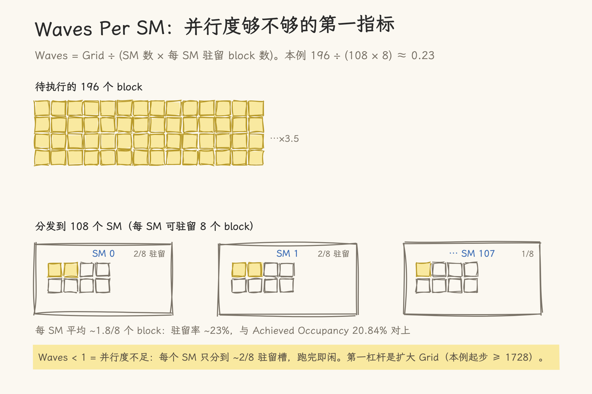

# Nsight Compute CLI (`ncu`) 实战

> 基于 A100-SXM4-80GB + CUDA 13.1 实测。`ncu` 是 NVIDIA 官方 CUDA kernel 级性能分析器，本文覆盖从安装、基础用法到逐 section 解读的完整流程。

---

## 1. 为什么需要 Kernel 级 Profiling

`04_profiling/` 下已有三类工具覆盖性能分析的不同层面，但每一层能回答的问题不同：

| 工具                       | 分析层级        | 能回答的问题                                                         | 不能回答的问题                      |
| -------------------------- | --------------- | -------------------------------------------------------------------- | ----------------------------------- |
| `nvbandwidth`              | 裸硬件          | HBM/PCIe 带宽是否达标？                                              | 为什么我的 kernel 只用到 30% 带宽？ |
| `nsys` (Nsight Systems)    | 系统时间线      | CPU 在等 GPU 吗？Stream 重叠了吗？                                   | Kernel 内部哪个阶段在等内存？       |
| **`ncu`** (Nsight Compute) | **单个 Kernel** | **SM 忙不忙？Memory bound 还是 Compute bound？Occupancy 为什么低？** | 多 kernel 之间如何调度？            |

`ncu` 的定位是**进入单个 kernel 内部**，给出 SM 利用率、显存吞吐效率、Occupancy、指令统计等指标。这些指标直接告诉你"为什么慢"以及"该往哪个方向优化"。

---

## 2. 快速上手

### 2.1 安装

`ncu` 随 CUDA Toolkit 分发，路径为 `<CUDA_PATH>/bin/ncu`。本环境：

```bash
/usr/local/cuda/bin/ncu --version
# NVIDIA (R) Nsight Compute Command Line Profiler
# Copyright (c) 2018-2026 NVIDIA Corporation
# Version 2026.1.1.0 (build 37634170) (public-release)
```

### 2.2 基本用法

```bash
# 最简：直接跑，屏幕输出关键指标
ncu ./my_kernel

# 基本集：LaunchStats + Occupancy + SpeedOfLight + WorkloadDistribution
ncu --set basic ./my_kernel

# 详细集：basic + ComputeWorkload + MemoryWorkload + Source + Tile + Roofline
ncu --set detailed ./my_kernel

# 全集：所有 section（数千个 metrics，随版本变化，以 --list-sections 为准），输出可达数百行，适合离线分析
ncu --set full -o report ./my_kernel

# 只 profile 特定的 kernel 函数
ncu --kernel-name myKernelName ./my_kernel

# 导出可交互报告（可在 Nsight Compute GUI 中打开）
ncu -o profile_report --set detailed ./my_kernel
```

### 2.3 自助查询

```bash
ncu --list-sections    # 查看所有可用的 profiling sections
ncu --list-sets        # 查看预定义的 metric 集 (basic/detailed/full/nvlink/roofline)
ncu --list-rules       # 查看自动瓶颈检测规则 (Occupancy/Memory/Compute/Divergence...)
```

### 2.4 编译与运行注意事项

- **编译时加 `-lineinfo`**：让 `ncu` 能将指标映射到源代码行
- **首次调用跳过去**：首个 CUDA 调用（含 context/module 初始化，约 10-15 ms）会让首次 launch 的 Profiling 结果失真。用 `--kernel-name` 指定非首次调用的 kernel 或先 warmup
- **Passes 含义**：`ncu` 的 kernel replay 是为了凑齐不同计数器组——一个 kernel 会被重复执行多轮，每轮收集一组指标，而不是同一指标重复采样取平均。pass 数取决于所选 section/metrics（basic 集实测约 10 passes，`--set full` 可达数十轮）；kernel 内部状态在轮间会被还原，但依赖外部状态的 kernel 会失真
- **性能影响**：profiling 会显著拖慢执行（尤其是 `--set full`），不要在生产环境运行

---

## 3. A100 实测案例：vectorAdd

以 NVIDIA 官方 cuda-samples 中的 `vectorAdd`（`0_Introduction/vectorAdd`）为目标 kernel。使用 `--set basic` 做初筛，这是日常使用最频繁的模式。

### 3.1 编译与 Profiling

```bash
cd cuda-samples/Samples/0_Introduction/vectorAdd
nvcc -arch=sm_80 -lineinfo -I../../../Common -o vectorAdd vectorAdd.cu
ncu --set basic --kernel-name vectorAdd ./vectorAdd
```

### 3.2 完整输出

```text
==PROF== Connected to process 1507692
==PROF== Profiling "vectorAdd": 0%....50%....100% - 10 passes
[Vector addition of 50000 elements]
Copy input data from the host memory to the CUDA device
CUDA kernel launch with 196 blocks of 256 threads
Copy output data from the CUDA device to the host memory
Test PASSED

  vectorAdd(const float *, const float *, float *, int)
  (196, 1, 1)x(256, 1, 1), Context 1, Stream 7, Device 0, CC 8.0

    Section: GPU Speed Of Light Throughput
    ----------------------- ----------- ------------
    Metric Name             Metric Unit Metric Value
    ----------------------- ----------- ------------
    DRAM Frequency                  Ghz         1.57
    SM Frequency                    Ghz         1.12
    Elapsed Cycles                cycle        4,309
    Memory Throughput                 %         5.21
    DRAM Throughput                   %         5.21
    L1/TEX Cache Throughput           %         4.85
    L2 Cache Throughput               %         8.35
    SM Active Cycles              cycle     1,783.23
    Compute (SM) Throughput           %         1.81
    ----------------------- ----------- ------------

    OPT   This kernel grid is too small to fill the available resources on this
          device, resulting in only 0.23 full waves across all SMs. Look at Launch
          Statistics for more details.

    Section: Launch Statistics
    -------------------------------- --------------- ---------------
    Metric Name                          Metric Unit    Metric Value
    -------------------------------- --------------- ---------------
    Block Size                                                   256
    Grid Size                                                    196
    Registers Per Thread             register/thread              16
    Shared Memory Configuration Size           Kbyte           32.77
    Threads                                   thread          50,176
    # SMs                                         SM             108
    Waves Per SM                                                0.23
    -------------------------------- --------------- ---------------

    OPT   If you execute __syncthreads() to synchronize the threads of a block, it
          is recommended to have at least two blocks per multiprocessor.

    Section: Occupancy
    ------------------------------- ----------- ------------
    Metric Name                     Metric Unit Metric Value
    ------------------------------- ----------- ------------
    Block Limit SM                        block           32
    Block Limit Registers                 block           16
    Block Limit Shared Mem                block           32
    Block Limit Warps                     block            8
    Theoretical Active Warps per SM        warp           64
    Theoretical Occupancy                     %          100
    Achieved Occupancy                        %        20.84
    Achieved Active Warps Per SM           warp        13.34
    ------------------------------- ----------- ------------

    OPT   Est. Local Speedup: 79.16%
          The difference between calculated theoretical (100.0%) and measured
          achieved occupancy (20.8%) can be the result of warp scheduling
          overheads or workload imbalances during the kernel execution.

    Section: GPU and Memory Workload Distribution
    -------------------------- ----------- ------------
    Metric Name                Metric Unit Metric Value
    -------------------------- ----------- ------------
    Average DRAM Active Cycles       cycle       314.60
    Total DRAM Elapsed Cycles        cycle      241,664
    Average L1 Active Cycles         cycle     1,783.23
    Total L1 Elapsed Cycles          cycle      451,786
    Average L2 Active Cycles         cycle     1,491.91
    Total L2 Elapsed Cycles          cycle      326,240
    Average SM Active Cycles         cycle     1,783.23
    Total SM Elapsed Cycles          cycle      451,786
    Average SMSP Active Cycles       cycle     1,713.90
    Total SMSP Elapsed Cycles        cycle    1,807,144
    -------------------------- ----------- ------------

    OPT   Est. Speedup: 6.516%
          One or more SMs have a much lower number of active cycles than
          the average. Maximum instance value is 15.29% above the average,
          while the minimum instance value is 21.55% below the average.
```

### 3.3 Section 1: GPU Speed Of Light Throughput

这是最高层级的"体检摘要"：用百分比告诉你离硬件峰值的距离。

| 指标                    | 值        | 含义                                                    |
| ----------------------- | --------- | ------------------------------------------------------- |
| Memory Throughput       | **5.21%** | 只用了 5% 的显存带宽                                    |
| Compute (SM) Throughput | **1.81%** | 只用了不到 2% 的计算能力                                |
| DRAM Throughput         | 5.21%     | 与 Memory Throughput 一致（这个 kernel 没有高缓存命中） |
| Elapsed Cycles          | 4,309     | 整个 kernel 只需 4309 个 SM 周期                        |

**解读**：5% memory + 2% compute = 这个 kernel 根本没对 GPU 形成任何压力。OPT 提示直接给出了原因："grid is too small"。

> **经验法则**：如果 Speed Of Light 中的 Memory Throughput < 30% 且 Compute Throughput < 30%，**优先怀疑 workload 太小**（而非代码质量）。

### 3.4 Section 2: Launch Statistics

| 指标         | 值         | 分析                   |
| ------------ | ---------- | ---------------------- |
| Grid Size    | 196 blocks | 总共只有 196 个 block  |
| Threads      | 50,176     | 每个线程处理 ~1 个元素 |
| Waves Per SM | **0.23**   | 这是关键瓶颈           |

**Waves Per SM** 是理解 GPU 利用率的核心概念。定义：Grid Size ÷ (SM 数 × 每 SM 可同时驻留的 block 数)。本例 A100 有 108 个 SM，该 kernel 每 SM 最多驻留 8 个 block（见 §3.5 的 Block Limit Warps = 8），所以一个"满波" = 108 × 8 = 864 blocks；196 blocks ÷ 864 ≈ 0.23——连一个满波的四分之一都不到。

它的含义不是"SM 只有 1/4 时间在工作"：196 个 block 轮询分发后每个 SM 都分到 1-2 个（88 个 SM 分 2 个、20 个分 1 个），没有任何 SM 完全空闲——真正的表现是驻留不满：每 SM 只用了 8 个驻留槽中的约 2 个（对应 Achieved Occupancy 20.84%），SM 满速跑完仅有的 block 后即转入空闲。Waves < 1 的真正教训是：**提交的并行度不足以填满 SM 的驻留槽位**，扩大 Grid 才是第一杠杆。

**理想值**：Waves ≥ 2（让尾部效应可被其他 block 掩盖），即 Grid ≥ 108 × 8 × 2 = 1728 blocks（本 kernel 的 196 差了一个数量级）。对于依赖 `__syncthreads` 的 kernel，更常用的下限是每 SM ≥ 2 block（Grid ≥ 216）——按驻留上限换算即可。

| Grid Size（本例，驻留上限 8/SM） | Waves Per SM | 效果                                                        |
| -------------------------------- | ------------ | ----------------------------------------------------------- |
| < 108                            | < 0.125      | 部分 SM 完全分不到 block                                    |
| 108-864                          | 0.125-1.0    | 所有 SM 有活但驻留不满（<8/8），跑完即闲，尾部效应明显      |
| 864-1728                         | 1.0-2.0      | 基本填满，尾部可接受                                        |
| > 1728                           | > 2.0        | 尾部效应被掩盖（`__syncthreads` 阻塞也能被其他 block 补位） |



_图 1：Waves Per SM 的计算与本例 0.23 的含义——并行度不足，而非「SM 只有 1/4 时间在工作」。_

### 3.5 Section 3: Occupancy

| 指标                         | 值         | 含义                                                                                                                                      |
| ---------------------------- | ---------- | ----------------------------------------------------------------------------------------------------------------------------------------- |
| Theoretical Occupancy        | **100%**   | 每 SM 硬件上限 32 blocks；本例实际限制取三者最小值：寄存器 16 blocks、warp 8 blocks、硬件 32 → 8 blocks |
| Achieved Occupancy           | **20.84%** | 实际只有 20.8%：workload 不足以填满 SM                                                                   |
| Achieved Active Warps Per SM | 13.34 / 64 | 每个 SM 理论上可跑 64 warps，实际只活跃了 ~13                                                                                             |

**三个 Limiters 的含义**：

- **Block Limit Registers = 16**：每个 block 用 16 registers × 256 threads = 4096 registers，SM 总共 65536 个，所以寄存器只能支撑 16 个 block
- **Block Limit Warps = 8**：每个 block 有 256/32=8 warps，SM 最多 64 warps，所以 warp 限制是 8 个 block
- **Block Limit SM = 32**：硬件最大 block 数

实际限制是寄存器（16 blocks），但 196 blocks / 108 SMs = 1.8 blocks/SM，远低于 16 的限制。所以瓶颈不在资源占用，而在**提交的 work 根本不够多**。

> **Occupancy 不是越高越好**：有时寄存器 spilling 到 local memory 反而更慢。Occupancy 25-50% 但每个线程用更多寄存器（更低 spill）常常比 100% Occupancy + spill 更快。

### 3.6 Section 4: GPU and Memory Workload Distribution

这个 section 展示各硬件单元（SM、L1、L2、DRAM）的活跃周期分布。重点看 `Average` vs `Total` 的关系以及 OPT 中的 imbalance 提示：

- **SM Active Cycles**：平均值 1783.23，Total 451,786 —— SM 们确实大部分时间在空闲
- **Workload Imbalance 6.5%**：各 SM 间活跃周期差距约 21%。对 vectorAdd 这种高度均匀的 kernel 来说，这个 imbalance 主要来自少量 SM 分到更多 block 而其他 SM 在空闲

---

## 4. 常用 Profiling 模式

### 4.1 瓶颈初筛 → `--set basic`

日常第一刀。四个 section（SpeedOfLight + LaunchStats + Occupancy + WorkloadDistribution）足以回答：

> 这个 kernel 是 Memory bound、Compute bound、还是 Occupancy/launch 配置有问题？

```bash
ncu --set basic --kernel-name myKernel ./my_app
```

当 Speed Of Light 显示 Memory Throughput > 60% 且 Compute(SM) Throughput < 20% → **Memory bound**，去查 coalescing 和 cache line 利用率
当 Compute(SM) Throughput > 60% 且 Memory Throughput < 20% → **Compute bound**，去查指令效率和 warp stall
两者都低 → **Launch/Occupancy bound**，先看 Waves Per SM

### 4.2 深入 Memory → `--set detailed`

在 basic 基础上增加了 Memory Workload Analysis（含 chart 和 tables）、Source Counters，能看到 L1/L2 hit rate、memory pipe utilization、global memory access pattern。

```bash
ncu --set detailed --kernel-name myKernel ./my_app
```

### 4.3 深入 Compute → `--set full`

全员出击：所有 sections 全部开启。包括指令统计（Instruction Statistics）、Scheduler Statistics（看 issue slot 利用率）、Warp State Statistics（看 warp 为什么 stall），以及完整的 Hierarchical Roofline。

```bash
ncu --set full -o my_report ./my_app
```

> `--set full` 输出非常详细，建议配合 `-o` 导出后在 GUI 中交互分析。

### 4.4 Roofline 分析 → `--set roofline`（预定义 set 以 `--list-sets` 输出为准）

直接将你的 kernel 标在 HBM/Shared/L1/Tensor Core 不同层级的 roofline 图中：

```bash
ncu --set roofline --kernel-name myKernel ./my_app
```

| Roofline 层级 | 峰值 (A100, GB/s)        | 适用场景                  |
| ------------- | ------------------------ | ------------------------- |
| DRAM          | ~1600                    | 常规 global memory access |
| L2            | ~4000                    | 高 L2 命中率              |
| L1/Shared     | ~12000（单 SM 口径约 12 TB/s 量级，随版本口径变化） | Shared memory 密集型      |
| Tensor Core   | ~312 TFLOPS (BF16, 原生累加) | MMA 指令                  |

### 4.5 单指标快速验证 → `--metrics`

当你已经有具体假设（"我认为 Occupancy 太低"或"我想确认 memory 带宽利用率"），直接查单个 metric：

```bash
# 查 SM 计算吞吐百分比
ncu --metrics sm__throughput.avg.pct_of_peak_sustained_elapsed ./my_kernel

# 查内存吞吐百分比
ncu --metrics dram__throughput.avg.pct_of_peak_sustained_elapsed ./my_kernel

# 一次查多个
ncu --metrics sm__throughput.avg.pct_of_peak_sustained_elapsed,dram__throughput.avg.pct_of_peak_sustained_elapsed ./my_kernel
```

---

## 5. 相关文档

- **HBM 带宽测试 (`03_hbm_bandwidth_test.md`)**：transpose 示例中 naive 实现只有 215 GB/s、optimized 达到 1168 GB/s。用 `ncu --set basic` 分别 profile 两个版本，Speed Of Light 的 Memory Throughput 差异直接量化了优化效果
- **Streams 并发 (`07_cuda_streams_concurrency.md`)**：当 stream 重叠没有产生预期的加速时，用 `ncu` 确认 kernel 的内部执行时间是否长于传输时间——这是判断"该优化 kernel 还是优化重叠策略"的关键
- **工作流公式**：`nvbandwidth` 建立硬件基线 → `nsys` 全局定位慢在哪个环节 → `ncu` 深挖具体 kernel（与 07 文 §5 的推荐顺序一致）

---

## 6. 常用 Sections 速查

| Section                  | 关键回答                                               | 启用 (`--set`) |
| ------------------------ | ------------------------------------------------------ | -------------- |
| Speed Of Light           | Memory bound 还是 Compute bound？                      | basic          |
| Launch Statistics        | Grid/Block 配置是否合理？Waves/SM 够不够？             | basic          |
| Occupancy                | Theoretical vs Achieved 差距多大？哪个资源是 limiter？ | basic          |
| Memory Workload Analysis | Cache hit rate、coalescing 好吗？                      | detailed       |
| Instruction Statistics   | 哪种指令在消耗执行时间？IPC 是多少？                   | full           |
| Scheduler Statistics     | Issue slot 利用率、哪条 pipe 在限速？                  | full           |
| Warp State Statistics    | Warp 为什么 stall？(memory、sync、math...)             | full           |
| Roofline Chart           | 算术强度（AI）打到硬件 roofline 的什么位置？           | roofline       |
| Source Counters          | 哪一行源代码消耗了最多时间？                           | detailed       |

---

## 参考

- [NVIDIA Nsight Compute Documentation](https://docs.nvidia.com/nsight-compute/)
- [Nsight Compute CLI 手册](https://docs.nvidia.com/nsight-compute/NsightComputeCli/)
- [CUDA 核心详解](../02_cuda/02_cuda_cores.md)
- [HBM 显存带宽测试](03_hbm_bandwidth_test.md)
