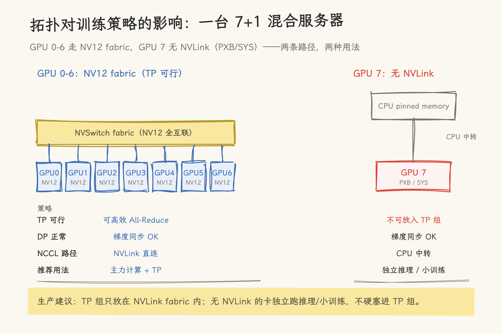

# GPU P2P 带宽实测：NVLink vs PCIe

> 基于 A100-SXM4-80GB (8 GPU, NVSwitch Gen2) 实测。`simpleP2P` 以 239 GB/s 验证了 NVLink 3.0 的 P2P 带宽；GPU 7（NVLink 故障，走 PCIe SYS 连接）则完全不支持 P2P——以此对比高速互连与常规 PCIe 路径的巨大差异。

---

## 1. 为什么 P2P 带宽重要

多 GPU 训练和推理中，数据需要在 GPU 间频繁搬移：

| 场景                    | P2P 流量                         | 带宽需求                   |
| ----------------------- | -------------------------------- | -------------------------- |
| Tensor Parallelism (TP) | 每层 All-Reduce，每 step 数百 MB | **对延迟和带宽极其敏感**   |
| KV Cache 跨卡搬运       | 每 decode step 搬运 KV block     | Disaggregated Serving 核心 |
| 梯度同步 (All-Reduce)   | 每 step 完整梯度                 | 数据并行的通信瓶颈         |

GPU 间通信有两条物理路径：

- **NVLink**：600 GB/s 双向 (A100)，GPU 直连或经 NVSwitch
- **PCIe**：~28 GB/s (Gen 4)，经过 PCIe Switch（如果存在）和 CPU Root Complex

> 前置阅读：[NVLink 技术入门](../../01_hardware_architecture/nvlink/nvlink_intro.md)、[PCIe 链路状态与带宽实测](02_pcie_bandwidth_measurement.md)

---

## 2. 拓扑确认

开始测试前，先确认 GPU 间的物理连接路径：

```bash
nvidia-smi topo -m
```

```text
（节选，完整矩阵为 8×8 对称）
        GPU0  GPU1  GPU2  GPU3  GPU4  GPU5  GPU6  GPU7
GPU0     X    NV12  NV12  NV12  NV12  NV12  NV12  NV12
GPU3    NV12  NV12  NV12   X    NV12  NV12  NV12  SYS
GPU7    SYS   SYS   SYS   SYS   NODE  NODE  PXB    X
```

| GPU 对        | 连接类型 | 物理路径                        | P2P 支持       | 期望带宽          |
| ------------- | -------- | ------------------------------- | -------------- | ----------------- |
| GPU 0 ↔ GPU 3 | **NV12** | NVLink 3.0 (12 links × 25 GB/s) | ✅             | ~240-300 GB/s     |
| GPU 3 ↔ GPU 7 | **SYS**  | QPI/UPI + PCIe Gen 4            | ❌             | N/A（不支持 P2P） |
| GPU 6 ↔ GPU 7 | **PXB**  | 同一 PCIe 域内经 Bridge/Switch  | ⚠️ 视 ACS 而定 | 受限于 PCIe       |

> **要点**：NV12 意味着 12 条 NVLink 全通 → P2P 可用且高速。SYS（跨 NUMA/CPU 互连）通信必须经过 CPU → P2P 不可用。PXB 只过 Bridge/Switch、不穿越 host bridge，ACS 关闭时 P2P 通常可用——实际以 `cudaDeviceCanAccessPeer` 实测为准。我们在 [NVLink 诊断与实操](../../01_hardware_architecture/nvlink/nvlink_diagnostics.md) 中详细分析了 GPU 7 的异常。

---

## 3. NVLink P2P 实测

使用官方 cuda-samples 的 `simpleP2P`（`0_Introduction/simpleP2P`），该 sample 测试 GPU 0 ↔ GPU 1 之间的 `cudaMemcpyPeer` 带宽。

```bash
cd cuda-samples/Samples/0_Introduction/simpleP2P
nvcc -arch=sm_80 -I../../../Common -o simpleP2P simpleP2P.cu -lcudart
CUDA_VISIBLE_DEVICES=0,3 ./simpleP2P
```

`CUDA_VISIBLE_DEVICES=0,3` 将物理 GPU 0 和 3 映射为 sample 中的 GPU 0 和 GPU 1。物理 GPU 0 和 3 均属于 NUMA node 0，通过 NVLink NV12 全互联。

### 完整输出

```text
[simpleP2P] - Starting...
Checking for multiple GPUs...
CUDA-capable device count: 2

Checking GPU(s) for support of peer to peer memory access...
> Peer access from NVIDIA A100-SXM4-80GB (GPU0) -> NVIDIA A100-SXM4-80GB (GPU1) : Yes
> Peer access from NVIDIA A100-SXM4-80GB (GPU1) -> NVIDIA A100-SXM4-80GB (GPU0) : Yes

Enabling peer access between GPU0 and GPU1...
Allocating buffers (64MB on GPU0, GPU1 and CPU Host)...

cudaMemcpyPeer / cudaMemcpy between GPU0 and GPU1: 239.28 GB/s

... (kernel 测试 + 验证) ...
Test passed
```

### 实战步骤拆解

1. **P2P 能力检查**：`cudaDeviceCanAccessPeer(&canPeer, gpu0, gpu1)` — 返回 `Yes` 意味着物理路径 (NVLink) 可用
2. **启用 P2P**：`cudaDeviceEnablePeerAccess(gpu1, 0)` — 允许 GPU 0 的 CUDA context 直接访问 GPU 1 的显存
3. **P2P Memcpy**：`cudaMemcpyPeer(dst_gpu1, 1, src_gpu0, 0, size)` — 64 MB 数据从 GPU 0 直接拷贝到 GPU 1，不经过 CPU 内存
4. **P2P Kernel**：Kernel 在 GPU 1 上运行，直接读取 GPU 0 的显存作为输入——**不需要先 H2D 再 D2D**

### 带宽对标

| 路径              | 实测带宽         | 理论带宽                | 效率 |
| ----------------- | ---------------- | ----------------------- | ---- |
| NVLink P2P (单向) | **239.28 GB/s**  | 300 GB/s (12 × 25 GB/s) | ~80% |
| PCIe H2D (Gen 4)  | ~28 GB/s         | 31.5 GB/s               | ~89% |
| HBM D2D (片内)    | ~1188 GB/s (4MB) | 2039 GB/s               | ~58% |

**NVLink P2P 比 PCIe H2D 快 8.5 倍**（239 vs 28 GB/s）。这就是为什么 Tensor Parallelism **必须**走 NVLink——每层 All-Reduce 如果走 PCIe，通信时间会放大近一个数量级。

---

## 4. PCIe 路径：P2P 不可用

我们尝试在 GPU 3 ↔ GPU 7（SYS 连接）上启用 P2P：

```bash
CUDA_VISIBLE_DEVICES=3,7 ./simpleP2P
```

结果：`cudaDeviceCanAccessPeer` 返回 `No`，sample 打印 "Two or more GPUs with Peer-to-Peer access capability are required..." 后退出。

**为什么 SYS 连接不支持 P2P？**

P2P 要求 GPU 能直接通过 DMA 访问对方显存，这需要：

- 同一 PCIe 根总线段内的设备（PIX/NV12）
- ACS (Access Control Services) 已禁用或配置允许 P2P
- 无 IOMMU 隔离阻止

SYS 连接跨越了两个 NUMA node 之间的 QPI/UPI 链路——PCIe 的 P2P DMA 无法穿越 CPU 间的 SMP 互连。

**NCCL 的 fallback 行为**：NCCL 检测到 SYS 连接后会自动降级为通过 CPU 中转的数据传输（GPU A → CPU pinned memory → GPU B），带宽相比 NVLink 下降一个数量级以上（本文口径：~12 vs ~249 GB/s）。

---

## 5. cudaMemcpyPeer vs cudaMemcpy 路径对比

`simpleP2P` 同时对比了两种方法：

| 方法                                     | 64 MB 带宽               | 解释                                         |
| ---------------------------------------- | ------------------------ | -------------------------------------------- |
| `cudaMemcpyPeer`（GPU0 → GPU1，NVLink）  | **239.28 GB/s**          | 直接 D2D，通常经 copy engine/NVLink          |
| `cudaMemcpy`（GPU0 → GPU1，启用 P2P 后） | 与 `cudaMemcpyPeer` 接近 | 可利用直接 P2P 路径，具体路径由拓扑/驱动决定 |
| `cudaMemcpy`（Host → GPU）               | ~28 GB/s (Gen 4)         | 经过 PCIe                                    |

**编程要点**：启用 peer access 后，CUDA runtime 不再需要把 P2P 拷贝 staged through host，通常会利用 copy engine 和 NVLink。但 API 文档没有承诺每一笔 `cudaMemcpy` 都走某一条固定硬件路径，实际路径仍要结合拓扑和驱动确认。

---

## 6. 拓扑对训练策略的影响



_图 1：7+1 混合服务器的两条路径——TP 组只放在 NVLink fabric 内，无 NVLink 的卡独立使用。_

**生产建议**：

- 将需要 P2P 的 workload（TP/PP）限制在 GPU 0-6 之间
- GPU 7 用于数据并行（DP）副本或独立推理任务——DP 的梯度同步可以容忍 PCIe 带宽
- 部署前用脚本检查所有 GPU 的 `nvidia-smi topo -m` 和 `cudaDeviceCanAccessPeer`，把 NVLink 异常的卡标记为 `no-p2p`

---

## 7. 相关文档

- [`02_pcie_bandwidth_measurement.md`](02_pcie_bandwidth_measurement.md)：H2D/D2H 的单卡 PCIe 带宽 —— P2P 带宽可与之对比
- [`03_hbm_bandwidth_test.md`](03_hbm_bandwidth_test.md)：片内 D2D 带宽 —— 与片间 P2P 形成层级对比
- [NVLink 诊断与实操](../../01_hardware_architecture/nvlink/nvlink_diagnostics.md)：如何检查 NVLink 链路状态，P2P 能力的前置检查
- [GPUDirect P2P 技术详解](../../01_hardware_architecture/gpudirect/02_gpudirect_p2p.md)：P2P 的硬件机制与软件生态

---

## 参考

- [NVIDIA cuda-samples: simpleP2P](https://github.com/NVIDIA/cuda-samples/tree/master/Samples/0_Introduction/simpleP2P)
- [CUDA Peer-to-Peer Memory Access](https://docs.nvidia.com/cuda/cuda-c-programming-guide/index.html#peer-to-peer-memory-access)
- [NCCL P2P 配置](https://docs.nvidia.com/deeplearning/nccl/user-guide/docs/env.html)
