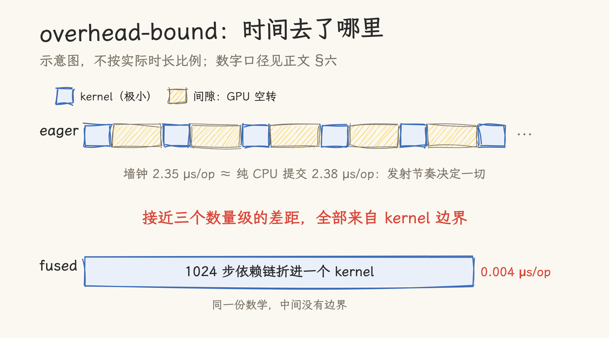
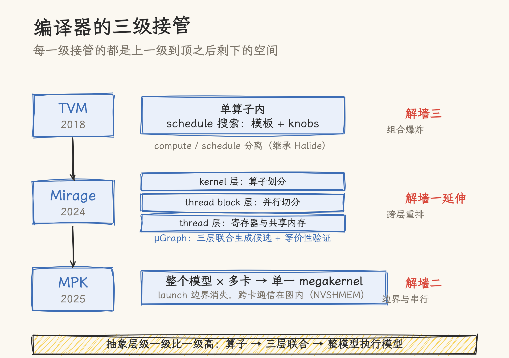
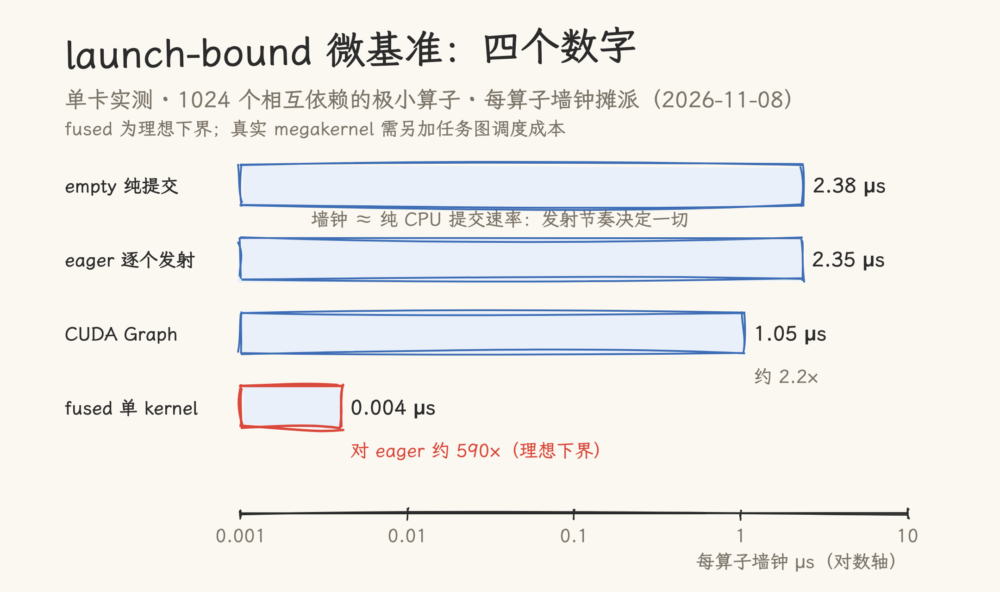

# launch、occupancy、overlap：什么时候手写 kernel，什么时候交给编译器

> 核对基准：TVM OSDI'18（[arXiv 1802.04799](https://arxiv.org/abs/1802.04799)）、Mirage OSDI'25（[arXiv 2405.05751](https://arxiv.org/abs/2405.05751)，v3）、MPK OSDI'26（[arXiv 2512.22219](https://arxiv.org/abs/2512.22219)，v2）、mirage-project `mpk` 分支 `d90383d`，核对日期 2026-11-08。微基准为公开环境单卡实测（2026-11-08）。pip 版本、分支状态等时效信息以核对日为准。

## 一、一个 token 要发射 293 个 kernel

Qwen3-8B 按 kernel-per-operator（每个算子单独一个 kernel）方式执行 decode 时，每个 token 要发射 293 个 kernel；在 B200 上，光是把它们送进 GPU 就要 1.1 ms（eager 模式单次 launch 3.8 μs）。换 CUDA Graph 之后单次发射降到 0.8 μs，还剩 0.2 ms。这组消融数据来自 MPK 论文（Mirage Persistent Kernel，§3.3 展开；§6.6）。

这剩下的 0.2 ms 是 CUDA Graph 也拿不回来的部分。Graph 摊薄了提交成本，但 kernel 之间的边界还在，每个边界上依然有调度与依赖同步的开销。

roofline 模型解释不了这类时间。roofline 的两个天花板（算力与带宽）都在 GPU 内部，launch 开销却发生在 host 与 GPU 之间、算子与算子之间。_Making Deep Learning Go Brrrr_ 把它单列为第三种 regime：compute-bound、memory-bandwidth bound 之外的 overhead bound。判别方法很直接：把 batch 翻倍，运行时长只涨 10% 左右，大概率是 overhead 主导。本仓《[CUDA 性能调优方法论](../02_cuda/17_roofline_optimization.md)》讲清了前两种 regime 的定位与诊断，本文处理第三种，以及它背后更大的问题：kernel 之间的边界什么时候值得消除、由谁来消除。

单卡上做过一个极简实验（口径见 §六）：1024 个相互依赖的极小 elementwise 算子逐个发射，墙钟摊到每个算子 2.35 μs；同一批算子的纯 CPU 提交速率是 2.38 μs 一个。两条数字几乎重合，说明墙钟完全被发射节奏绑死。而同样 1024 步数学折进一个 kernel，每算子只摊到 4 ns。接近三个数量级的差距，全部来自一个东西：kernel 边界。



## 二、手写 kernel 撞到的三堵墙

**墙一：单 kernel 的天花板。** 手写 kernel 优化的终点是 roofline 上的 speed-of-light：算术强度决定该看算力天花板还是带宽天花板，ncu 的 speed-of-light 指标给出距离。到顶之后，这个 kernel 内部已经没有空间了。

**墙二：边界锁死了重叠。** kernel-per-operator 执行模型里，下一个 kernel 要等上一个全部算完才启动。跨算子的软件流水（A 还没算完就开工 B 的就绪部分）、通信与计算的重叠（collective 等全部结果到齐才开始），在边界面前都无从下手。MPK 论文 §1 列出这个执行模型的三条限制，其中两条正落在这里。现行系统的补丁是 CUDA Graph：把发射序列录制回放（机制见本仓《[CUDA Graphs 深度解析](../../09_inference_system/vllm/module_analysis/cuda_graph_deep_dive.md)》）。Graph 管摊薄提交，管不了边界内的串行。

**墙三：组合爆炸。** TVM 论文 §3 指出，融合模式的实现数量随数据布局、数据类型、加速器指令的种类组合级增长；§7 补充，每个硬件后端与算子变体的组合都需要一份工程投入。手写 kernel 是逐点解题，覆盖不了这个乘积空间。

三堵墙性质不同：墙一在 kernel 内部，靠手写与 tile 库逼近天花板；墙二在 kernel 之间，靠执行模型解决；墙三在算子与硬件的乘积空间里，靠搜索与生成解决。下面三篇论文各自攻一堵，抽象层级一级比一级高。



## 三、三个编译器，三级接管

### 3.1 TVM：把 schedule 从算子里拆出来（2018）

TVM 采纳了 Halide 的 compute/schedule 解耦原则：张量算子只写「算什么」（compute expression），「怎么算」（schedule）是独立的表示，决定循环顺序、tiling 尺寸、循环展开因子、向量化标注与内存放置（TVM 论文 §4.1、§5）。

在这个表示之上，TVM 把「针对每个硬件手调」变成了「声明搜索空间，让机器搜」：开发者用 schedule 模板 API 声明 knob，系统用梯度树提升模型（XGBoost，rank objective，单次预测 0.67 ms）做 cost model，配并行模拟退火搜索（§5.1–5.3）。

结果覆盖四类后端：server GPU 上对 MXNet/TF（cuDNN+cuBLAS 后端）1.6–3.8×，嵌入式 GPU（Mali）对 ARM Compute Library 1.2–1.6×，嵌入式 CPU（ARM Cortex-A53）逐算子与端到端均超过 TFLite，FPGA（VDLA）offload 的卷积层比 Cortex-A9 CPU 核快 40×；整体贡献条写的是对既有手写库框架 1.2×–3.8×（§1、§6）。

TVM 的接管层级是算子：同一份 compute 配不同 schedule，就能在没写过的硬件上生成接近手写库的实现。墙三由此缓解。

### 3.2 Mirage：三层联合搜索（2024）

TVM 解决「跨硬件」，但它的搜索单元是单个算子的 schedule。Mirage 论文的观察是：性能还藏在层级之间。kernel 层的算子划分、thread block 层的并行切分、thread 层的寄存器与共享内存放置，三者联动才能触到的重排，逐层独立优化找不到。

Mirage 给出统一表示 μGraph：一份表示同时描述 kernel、thread block、thread 三个层级的程序结构（§3）。在这个表示上做超优搜索，流水线分四步（§1 Figure 1、§4–6）：先把程序划分成 LAX 子程序（论文 §5 定义的受限片段：矩阵乘、卷积这类多重线性算子，加上除法与有限的指数运算），再由 Expression-Guided μGraph Generator 生成候选 μGraph，交给 Probabilistic Equivalence Verifier 做等价性验证，最后 μGraph Optimizer 做 layout 优化、算子调度与内存规划。

等价验证走的是有限域上的随机测试：比对全部输出元素（多项式恒等测试），浮点输出本身不参与比对。理论上无假阴性、有假阳性，实践中未观察到；只适用于 LAX 片段，LAX 之外用 solver 兜底（§5、§7）。

论文报告：对广泛使用、已被重度优化的 DNN 负载（GQA、LoRA、GatedMLP 等六个 benchmark），Mirage 比现有最好实现最多快 3.3×，端点出现在 GatedMLP（Hopper 架构 GPU，batch 16）；对比对象包括 PyTorch（torch.compile+FlashAttention）、TensorRT、TensorRT-LLM、Triton、TASO/PET（§8.2）。case study 给的区间是 A100 1.5×、Hopper 架构 GPU 2.7–3.3×。

Mirage 的接管层级是层与层之间的联合重排：单 kernel 已经手写到顶之后，把工作在三层的表示之间重新分配，仍有空间。这是墙一的延伸：「kernel 内部」的边界被扩大到了整个 GPU 计算层级。

### 3.3 MPK：把整个模型编译成一个 kernel（2025）

第三级接管把优化单元从算子、从层级，直接换成了整个模型。Mirage Persistent Kernel（MPK）把多 GPU 模型推理自动编译成单一 megakernel：推理期间所有计算与通信都在一个 kernel 里完成，launch 边界不复存在（MPK 论文 Abstract、§1、§5）。

支撑它的是两个机制：

**SM 级任务图。** MPK 引入 tGraph：节点是运行在单个 SM 上的 task，边是 task 间细粒度依赖，算子被拆解成与 SM 数成比例的 task（§1、§4）。launch 边界消失后，重叠从「系统层可望不可即」变成「图上的依赖关系」：一个 task 就绪即可开工，跨算子的软件流水、计算与通信的重叠都是图调度的自然结果。

**静态角色分区。** 运行时把 GPU 的 SM 分成 worker 与 scheduler：每个 worker 维护专属 FIFO task 队列顺序执行；scheduler 以 warp 为粒度（每 SM 四个 scheduler warp），各自维护 event queue，轮询依赖事件、就绪即派发（§1、§5）。分配在 kernel launch 时固定，且必须与物理 SM 数一致，换来的是 kernel 内部零动态切换开销。

跨卡通信也在 kernel 内完成：task 的输入输出张量分 `cuda_tensor` 与 `nvshmem_tensor` 两类，后者经 NVSHMEM 支持远程 GPU 访问，all-reduce 这类 collective 以 task 形式融进同一张图（mpk 分支 README.md:81；论文 §1）。

论文口径的结果：对 SGLang、vLLM 这类 kernel-per-operator 系统，单卡与多卡部署的 serving 吞吐提升 1.0–1.7×（五个模型，跨 Ampere/Hopper/Blackwell 三代卡，batch 1–16）；单卡 decode 实例是 Qwen3-8B 在 A100 上每 token 14.5 ms 降到 12.5 ms（§6）。mirage 仓库 README 另有一个 1.2×–6.7× 的区间（README.md:14），出自官方博客的 decode latency 口径、含多卡配置，与论文的吞吐口径不可直接比较。

MPK 的接管层级是执行模型本身：墙二的 launch 边界与依赖串行，成了编译器可以整体重写的对象。这个方向仍在推进，mpk 分支最近还在为新模型添加支持（如 GLM-5.3-Flash 的 static megakernel，commit #819）。

## 四、决策轴：三种 regime，三种解法

前两节回答「编译器能做什么」，这一节回答「问题落在哪一格」。三种 regime 的判别全部用公开工具，判别方法的系统讲法见本仓《[Nsight Systems CLI 入门](../04_profiling/07_nsight_systems_cli.md)》与《[Nsight Compute CLI 实战](../04_profiling/06_nsight_compute_cli.md)》。

| regime                          | 时间去向           | 判别方法                                                                    | 解法梯度                                    |
| ------------------------------- | ------------------ | --------------------------------------------------------------------------- | ------------------------------------------- |
| launch-bound                    | 提交与算子间隙     | nsys timeline 上的空隙；墙钟 ≈ 提交速率；batch 翻倍运行时几乎不涨           | CUDA Graph → megakernel                     |
| 天花板受限（compute / bandwidth） | kernel 内部        | roofline 强度估算 + ncu speed-of-light（SM % / Memory %）                   | 手写 tile kernel / schedule 搜索 / 三层超优 |
| overlap-bound                   | 依赖链上的串行等待 | nsys 看 collective 是否把 kernel 隔成串行段；数每层 collective 的个数与时长 | kernel 内通信重叠 / 跨算子软件流水          |

**launch-bound。** 判别特征是墙钟与发射速率重合：§一 的实验里 eager 2.35 μs/op 对纯提交 2.38 μs/op，GPU 大部分时间在算子间隙空转。解法分两步：CUDA Graph 摊薄提交（实验中 2.35 → 1.05 μs/op，约 2.2×）；megakernel 消除边界，实验的 fused 模式 0.004 μs/op 是理想下界，真实 megakernel 还要付 worker/scheduler 协调成本，MPK 剩下的 0.2 ms/token 就是这类成本的度量。vLLM、SGLang 按 batch size 列表 capture CUDA Graph 的配置项，正是第一格的现行补丁。

**天花板受限。** 判别靠 roofline 与 ncu：算术强度离天花板的距离决定方向。这一格里手写（或用 TileLang 这类算子 DSL，见本仓《[TileLang 快速入门](../03_tilelang/01_tilelang_quick_start.md)》）与编译器 schedule 搜索抢的是同一片天花板，工具不同、目标相同。Mirage 的价值在于：单算子到顶后，跨三层的联合重排是手工难以为继的搜索空间。

**overlap-bound。** TP 推理每层都压着 collective：FLUX 论文统计参考模型一次 decode 迭代有 64 个 collective 排在依赖路径上，把通信与计算在 kernel 内分片重叠后，最多 96% 的通信被藏进 kernel，8 卡上对 vLLM prefill 1.66×、decode 1.30×，128 卡训练对 Megatron-LM 1.24×（FLUX 论文）。MPK 的跨算子软件流水与 in-kernel NVSHMEM all-reduce 走的是同一条路的编译器版本。

把选型收成一句判断。手写仍然对的情形：目标硬件单一，单 kernel 还没到 speed-of-light，对延迟边界有确定性要求。该交给编译器的情形：算子与硬件的组合大到人工覆盖不了，优化要跨层级联合移动，profile 显示 launch 边界与依赖链成了主导成本。现实工程多停在中间态：先用 CUDA Graph 补 kernel-per-operator，直到剩下的 0.2 ms 值得重写执行模型。

## 五、代价与边界

编译器接管的代价集中在四处：

**静态分区牺牲弹性。** worker 与 scheduler 的 SM 分配在 launch 时固定、必须等于物理 SM 数（MPK 论文 §5），零动态切换开销的另一面是：同一份产物换一张 SM 数不同的卡就不再成立，论文的验证范围覆盖 Ampere 到 Blackwell 三代卡。

**调试粒度变了。** megakernel 里没有 per-operator 边界，nsys timeline 上看不到「哪个算子慢」，定位对象变成 task 图的段落；ncu 仍能对整个 megakernel 做 speed-of-light，但归因要到 task 粒度重新建立。

**搜索与验证都要时间。** TVM 的 schedule 搜索、Mirage 的候选生成与等价验证都是编译期成本；等价验证只覆盖 LAX 片段，LAX 之外要 solver 兜底，验证通过的候选也可能含理论上的假阳性（实践中未观察到）。

**成熟度参差。** Apache TVM 是主线项目（MLC-LLM 构建其上）；Mirage 超优器有 PyPI 包（`pip install mirage-project`，0.2.2）；MPK 截至 2026-11 只能源码安装（README.md:26 自认 pre-built wheel in progress），且后端仅 NVIDIA CUDA。

## 六、微基准：launch-bound 的四个数字

复现代码：[`01_launch_overhead_bench.cu`](01_launch_overhead_bench.cu)。编译运行两行：

```bash
nvcc -O3 -std=c++17 -arch=sm_90 01_launch_overhead_bench.cu -o launch_overhead_bench
CUDA_VISIBLE_DEVICES=<空闲卡> ./launch_overhead_bench
```

单卡实测（2026-11-08）：

| 模式              | 墙钟 / op | 说明                                          |
| ----------------- | --------- | --------------------------------------------- |
| empty 纯提交      | 2.38 μs   | 20000 个空 kernel 的纯 CPU 入队速率，不含同步 |
| eager 逐个发射    | 2.35 μs   | 与提交速率几乎重合：墙钟被发射节奏绑死        |
| CUDA Graph replay | 1.05 μs   | 1024 个 op 整图一次提交，约 2.2×              |
| fused 单 kernel   | 0.004 μs  | 1024 步依赖链折进 1 个 kernel，理想下界       |

口径：1024 个相互依赖的 elementwise 算子，每算子处理 1024 个元素（刻意让 kernel 时间远小于 launch 时间），200 轮取均值，GPU 侧首尾跨度用 cudaEvent 对照墙钟。fused 是理想化的下界演示，真实 megakernel 含任务图调度成本，不可直接外推。



## 七、总评

三篇论文是一条递进的线：TVM 把「每个硬件手写一遍」变成 schedule 搜索，Mirage 把「逐层手调」变成三层联合超优，MPK 把「kernel-per-operator」变成整模型 megakernel。每一级接管的都是上一级到顶之后还剩的性能空间：天花板之下的余量、层级之间的重排、kernel 之间的边界。对推理引擎的读者，这条线解释了两件事的来龙去脉：CUDA Graph capture 列表是 kernel-per-operator 的补丁，而 megakernel 是补丁之后的下一步。

这些判断的适用边界：

- 论文对比基线有时代差：TVM 对比的框架是 2018 年版本，Mirage 的对比对象固定在 2024 年生态，放在今天宜取量级而非精确值
- MPK 的 1.0–1.7× 集中在小模型与 batch 1–16 的延迟敏感场景，大 batch 高吞吐负载收益未覆盖
- README 的 1.2×–6.7× 是博客的 decode latency 口径，与论文的吞吐口径不可直接比较
- fused 相对 eager 约 590× 是理想化下界演示，真实 megakernel 含调度协调成本
- 微基准为单点硬件（单卡）实测，未覆盖多卡与其他架构

## 源文件索引

| 来源                                                 | 关键内容                                                 | 引用点                         |
| ---------------------------------------------------- | -------------------------------------------------------- | ------------------------------ |
| arXiv 1802.04799（TVM）                              | compute/schedule 解耦、schedule 模板与搜索、多后端评估   | §3、§4.1、§5.1–5.3、§6         |
| arXiv 2405.05751（Mirage，v3）                       | μGraph 三层表示、超优流水线、概率等价验证、3.3×          | §1、§3、§4–6、§7、§8.2         |
| arXiv 2512.22219（MPK，v2）                          | tGraph、worker/scheduler 分区、launch 开销消融、1.0–1.7× | Abstract、§1、§4、§5、§6、§6.6 |
| mirage-project `mpk` 分支 `d90383d`                  | README 口径数字、静态分区配置、io_category               | README.md:14、:26、:61、:81    |
| horace.io/brrr_intro                                 | overhead-bound regime 与判别                             | 正文三分法与解法表             |
| FLUX（arXiv 2406.06858）                             | collective 在依赖路径的规模与 kernel 内重叠收益          | §四 overlap-bound 段           |
| 本仓：`02_cuda/17_roofline_optimization.md`          | roofline 定位与 ncu 诊断                                 | §一、§四                       |
| 本仓：`04_profiling/06、07`                          | nsys / ncu 判别方法                                      | §四                            |
| 本仓：`vllm/module_analysis/cuda_graph_deep_dive.md` | CUDA Graph 机制                                          | §二                            |

## 参考资料

- TVM: An Automated End-to-End Optimizing Compiler for Deep Learning. <https://arxiv.org/abs/1802.04799>（全文：<https://ar5iv.labs.arxiv.org/html/1802.04799>）
- Mirage: A Multi-Level Superoptimizer for Tensor Programs. <https://arxiv.org/abs/2405.05751>
- MPK: A Compiler and Runtime for Mega-Kernelizing Tensor Programs. <https://arxiv.org/abs/2512.22219>
- Mirage / MPK 开源仓库：<https://github.com/mirage-project/mirage>（MPK 位于 `mpk` 分支）
- Making Deep Learning Go Brrrr From First Principles. <https://horace.io/brrr_intro.html>
- FLUX: Fast Software-based Communication Overlap On GPUs Through Kernel Fusion. <https://arxiv.org/abs/2406.06858>
- Harvard CS2680 Modern AI Systems，Efficient LLM serving basics II readings：<https://cs2680.seas.harvard.edu/readings/oct-21>
