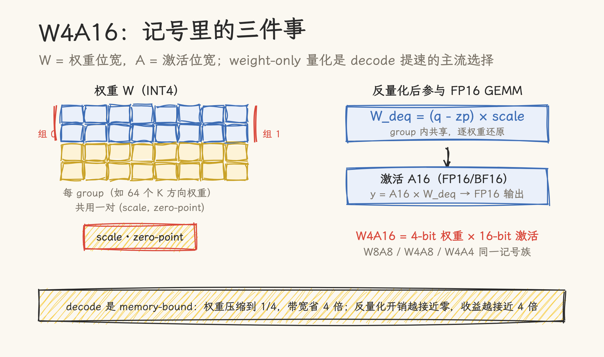
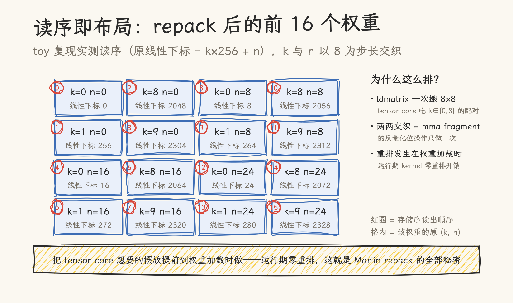

# Marlin 深拆：反量化不是免费，但可以藏进访存里

> **元信息**：源码基线为 vLLM `43d691ec6b`（2026-08-07）的 `csrc/quantization/marlin/`（Neural Magic 维护的移植版，原作 [IST-DASLab/marlin](https://github.com/IST-DASLab/marlin)，Elias Frantar）。算法论文《MARLIN: Mixed-Precision Auto-Regressive Parallel Inference on Large Language Models》（arXiv 2408.11743，Frantar / Castro / Chen / Hoefler / Alistarh）。核对日期 2026-11-12；本仓无 NVIDIA GPU，kernel 未实测，全部为源码走读与论文口径。配套复现代码 [marlin_toy.py](marlin_toy.py)（numpy，四组自验证，CPU 可跑）。

INT4 权重把显存占用压到 FP16 的四分之一，代价是 GPU 在做矩阵乘之前得先把每个 4-bit 数「还原」成半精度。这个还原动作（反量化）本身有开销：要有位操作拆包、要乘 scale、要减 zero-point，还要把结果摆成 tensor core 认的形状。做得不好，省下来的带宽全赔在还原上。

Marlin 是这个问题的经典答案：IST-DASLab 在 2023 年底发布的 FP16×INT4 GEMM kernel，论文口径将小 batch 场景推到接近理想加速（最高 ~3.87×），至今仍是 vLLM 里 GPTQ/AWQ 权重的默认高速路径。本文拆它的三个设计；设计一、二的每一步都在配套的 toy 代码里逐项验证。下一篇走向它的继任者：蚂蚁与 vLLM 社区的 JIT kernel 库 Humming。

## 一、先补记号：W4A16 到底是什么

**W4A16 = 4-bit 权重 × 16-bit 激活**。这个记号族里 W 指权重位宽、A 指激活位宽：W8A8 是权重激活都 8-bit（典型如 FP8 量化），W4A16 是权重 4-bit、激活保持 16-bit，后者也叫 weight-only 量化：只压权重、不动激活。对称/非对称量化、比例因子、零点这些量化基础概念，本仓的[量化技术可视化指南](../../06_llm_theory_and_fundamentals/llm_basic_concepts/quantization/visual_guide_to_quantization.md)有图文详解，本篇只补 GEMM 视角的三个概念。



为什么 LLM 推理偏爱 weight-only？decode 阶段每生成一个 token 都要把全部权重从显存读一遍，是典型的 memory-bound：算力在等带宽。权重压到 1/4，带宽需求就是 1/4，decode 提速的上限接近 4 倍。激活保持 16-bit 是因为激活是逐 token 的临时数据，压缩它省不了多少显存，却要额外处理动态范围。

三个配套概念贯穿全文：

- **group size**：反量化的粒度。INT4 只有 16 个取值，直接用精度太粗，于是把 K 维（比如 4096）按 group size（常用 64/128）分段，每段共享一对 (scale, zero-point) 做仿射还原：`W_deq = (q − zp) × scale`。
- **GPTQ / AWQ**：两种流行的权重量化算法，输出物都是 INT4 权重矩阵加每组的 scale/zp；它们管「怎么压」，不管「怎么算」。GPTQ 的算法原理见[可视化指南](../../06_llm_theory_and_fundamentals/llm_basic_concepts/quantization/visual_guide_to_quantization.md)的 4 比特量化一章。
- **repack**：压好的 INT4 权重按 GPTQ 的行列序摆放，而 kernel 需要另一种摆放。加载时做一次重排（repack）把两者接起来。Marlin 的第一个设计就在这里。

## 二、反量化的三笔税

把一个朴素的反量化 GEMM 直接写出来，会交三笔税：

- **计算税**：每个 4-bit 值要拆 nibble、转浮点、乘 scale、减 zp，这些 ALU 操作与矩阵乘本体抢寄存器和发射槽；
- **布局税**：INT4 紧排对 `ldmatrix` 和 mma fragment 不友好，运行期重排数据既费寄存器又费指令；
- **带宽税**：如果反量化逼得权重被读两遍，或者 scale 反复从显存拉取，压缩省下的带宽就被吐回去。

Marlin 的回答是一句设计原则：**把 tensor core 想要的摆放提前到权重加载时做，把还原计算折叠成一条位指令，把读写组织成流水线**。三笔税分别对应三个设计，下文逐一拆。

## 三、设计一：repack 布局：读序即布局

Marlin 的权重不是按 GPTQ 原序存放的。加载时经过 `marlin_permute_weights`：

```python
q_w = q_w.reshape((size_k // tile, tile, size_n // tile, tile))
q_w = q_w.permute((0, 2, 1, 3))            # 16×16 tile 块间转置
q_w = q_w.reshape((-1, perm.numel()))[:, perm].reshape(q_w.shape)
```

先按 16×16 的 tile 分块、块间转置，再按一个精心构造的 `perm` 表在 tile 内重排。`perm` 的构造（`get_weight_perm`）是一段循环展开：32 个 i 各生成 8 个下标，再做一次 `[0,2,4,6,1,3,5,7]` 的组内交织，编码的正是 ldmatrix 加载顺序与 mma fragment 期望的 nibble 次序。

这步是纯置换：数值一个不多一个不少，只是位置变了。专门为它做一个设计的理由是**读序即布局**：GPU 的 kernel 按存储序读数据，把读序提前编排好，kernel 内部就不需要任何重排指令。配套的 [marlin_toy.py](marlin_toy.py) 用索引矩阵追踪了每个元素的去向，128×256 的矩阵经 repack 后前 16 个权重的读序如下图：k 与 n 以 8 为步长交织，正好是 mma fragment 需要的两两配对：



toy 代码对这一设计的验证有三组：

1. repack 是纯置换（索引追踪，32,768 个元素一一换位）；
2. nibble 打包低 4 位在前（一个 uint32 装 8 个权重，`0x76543210`）；
3. 端到端等价：按存储序读出、scatter 累加的 GEMM，与朴素反量化路径误差 1.9e-4（FP32 舍入级）。重排只动读法，不动数学。

## 四、设计二：反量化的位技巧：一条 lop3 顶四条指令

INT4 值还原成 FP16，朴素做法是「取 nibble → 转浮点 → 减 zp → 乘 scale」四步。`dequant.h` 开头的注释把这账算得很清楚：**零点减法与 scale 乘法可以折叠进位操作之后的浮点乘加里**。对无 zero-point 的对称量化：

```text
scale(flop(bit_op(weight)))
  = scale(bit_op(weight)) − scale(bias)      ← bias 可在加载时预计算
  = fma(bit_op(weight), scale, −scale(bias)) ← 一条乘加
```

位操作本身也压缩到了极限。4-bit 反量化用的是一条 `lop3`（GPU 的三输入查找表逻辑指令，编译器未必自动生成），代码里显式写出：

```c
const int MASK = 0x000f000f;
const int EX   = 0x64006400;               // FP16 的指数偏置：1024.0
int lo = lop3<(0xf0 & 0xcc) | 0xaa>(q, MASK, EX);
```

LUT 常量 `(0xf0 & 0xcc) | 0xaa = 0xca` 编码的是 `(a & b) | c`：一条指令同时完成「取 nibble」和「塞进 FP16 位模式」。`0x6400` 是 FP16 格式下代表 1024.0 的位模式，`0x6400 | nibble` 按 FP16 读回恰好是 `1024 + nibble`：指数偏置把整数变成了浮点，随后的乘 scale 自然把 1024 抵消掉。INT8→BF16 的变体则改用 `prmt`（字节重排）指令。toy 代码的 demo 3 在 CPU 上用 numpy 的 uint16 视图复现了这套位技巧，与数值路径逐位相等。

这套技巧 vLLM 里还有一位近亲：TileLang 反量化 GEMM 一文拆过 LOP3/twiddling 的同族思路在 TileLang 里的写法，两篇可对读。Marlin 版的特殊处在于它和 repack 布局咬合：正因为 nibble 次序在 repack 时就排好了，这里的一次 lop3 才能直接产出 mma fragment 要的形状。

## 五、设计三：流水线与线程配置

计算与布局解决后，剩下的带宽问题靠流水线。`marlin_template.h` 的主循环（`:1382-1404`）是标准的软件流水：寄存器侧永远预取下一拍的数据，global→shared 的搬运提前一个 stage 拉起，计算与访存错开一拍、互不等谁：

```c
#pragma unroll
for (int pipe = 0; pipe < stages;) {
#pragma unroll
  for (int k = 0; k < b_sh_wr_iters; k++) {
    fetch_to_registers(k + 1, pipe % stages);          // shared→register，预取一位
    fetch_scales_to_registers(k + 1, pipe);            // scale / zp 与权重同拍预取
    fetch_zp_to_registers(k + 1, pipe);
    if (k == b_sh_wr_iters - 2) {
      fetch_to_shared((pipe + stages - 1) % stages, pipe,
                      slice_iters >= stages);          // global→shared，提前一个 stage
      pipe++;
      wait_for_stage();
    }
    matmul(k, pipe - (k >= b_sh_wr_iters - 2 ? 1 : 0)); // 一条 lop3 + mma.sync
  }
}
```

循环下方有一行注释值得抄下来（`:1406`）：「While this pattern may not be the most readable, other ways of writing the loop seemed to noticeably worse performance after compilation」。写法的可读性让位给编译产物，手写 kernel 的典型取舍。

三个 lambda 各管一段：`fetch_to_shared` 做 global→shared 的多 stage 双缓冲（A 激活、B 权重、scale/zp 各有自己的 stage 布局），`fetch_to_registers` 把数据经 `ldmatrix` 装进 mma fragment，`matmul` 里 dequant 与 `mma.sync` 一气呵成。scale 的搬运按 group 边界对齐（`pipe % div_ceil(group_blocks, thread_k_blocks) == 0` 时才发）：一个 pipeline stage 只在跨越 group 时才需要新 scale，避免重复搬运。

线程配置按 batch 大小分两档，按优先级排列在 `marlin.cu:75-90`：

```c
thread_config_t small_batch_thread_configs[] = {  // thread_k, thread_n, threads
    {128, 128, 256}, {64, 128, 128}, {128, 64, 128}};
thread_config_t large_batch_thread_configs[] = {
    {64, 256, 256}, {64, 128, 128}, {128, 64, 128}};
```

选择时按顺序试探，每档配 `get_scales_cache_size`（`marlin.cu:96`）按目标 SM 的 shared memory 容量校验，放不下就降级到下一档。输出 tile 还能按需切片（`slice_count > 1`）分摊给多个 CTA，出片时 fp16 累加器转 fp32（`use_fp16_accum`）、线程块内归约（`thread_block_reduce`），跨 slice 的同步靠 workspace 里的全局 barrier。归约路径有 atomic-add 与 fp32-reduce 两档，atomic-add 有启用门槛：M 分片折算行数 × N ≤ 2048 才用（`marlin.cu:388-389`）。这些开关在 vLLM 的封装层都自动选择。

## 六、数字与口径

- 论文口径（arXiv 2408.11743）：FP16×INT4 最高 ~3.87× 于 FP16 GEMM 基线，claim 为「接近理想 4× 加速」；
- 工程口径：vLLM 自带 [bench_marlin.py](https://github.com/vllm-project/vllm/blob/main/benchmarks/kernels/benchmark_marlin.py) 可复测；
- 后继口径：2026-10 发布的 Humming（蚂蚁 + vLLM 社区）博客给出 Dense W4A16 对 vLLM Marlin 最高 ~2×（H200）/ >3×（B300）的对比；这是新一代对旧一代的取代声明，均为各作者方自报，本仓无 NVIDIA GPU 未做复测。

三条口径来源不同、硬件不同，引用时不要混排。

## 七、总评与适用边界

判断一：Marlin 的核心遗产是「预处理换运行期」这条设计纪律。repack 把布局税移到加载时，lop3 把计算税压到一条指令，流水线把带宽税藏进双缓冲。三笔税一笔都没消失，只是全部挪到了不痛的地方。这个思路在今天的算子设计里仍然处处可见（TMA 的 swizzle、权重预变换的 KV 量化方案都是它的后代）。

判断二：Marlin 的形态是「为一种量化组合手写一个极致 kernel」。它的 template 支持矩阵（位宽 × group × thread config × act/order）靠 C++ 模板枚举展开，组合一多，编译时间与二进制体积就膨胀。当量化格式从 INT4/INT8 扩展到 MXFP4、NVFP4，硬件从 Ampere 走到 Blackwell 的 tcgen05，这个手写路线开始跟不上组合爆炸，这正是下一篇的主角 Humming 用 JIT 编译路线回答的问题。

适用边界：Marlin 适合 SM75+ 上的 GPTQ/AWQ 类 weight-only 推理，vLLM 至今默认启用；要写自己的反量化 kernel，`dequant.h` 的折叠代数与本文 toy 的 CPU 等价验证是两条可复用的捷径。本仓无 NVIDIA GPU，性能数字未经复测；机制描述以 `43d691ec6b` 源码为准。

## 源文件索引

| 文件                                                                 | 关键内容                                                                             | 本文引用 |
| -------------------------------------------------------------------- | ------------------------------------------------------------------------------------ | -------- |
| `csrc/quantization/marlin/marlin.cu`（672 行）                       | thread_config 两档表、`get_scales_cache_size`、入口与降级路径                        | 五       |
| `csrc/quantization/marlin/marlin_template.h`（1,567 行）             | 三个 lambda、软件流水主循环（`:1382-1406`）、scale 预取                              | 三、五   |
| `csrc/quantization/marlin/dequant.h`                                 | lop3/prmt 位技巧、bit_op→flop 折叠代数                                               | 四       |
| `vllm/model_executor/layers/quantization/utils/marlin_utils_test.py` | `get_weight_perm`、`marlin_permute_weights`、`marlin_weights`（toy 的 1:1 复现对象） | 三       |
| `benchmarks/kernels/benchmark_marlin.py`                             | 官方复测入口                                                                         | 六       |
| 本仓 [marlin_toy.py](marlin_toy.py)                                  | 四组自验证的 CPU 语义复现                                                            | 三、四   |

## 参考资料

- [MARLIN 论文（arXiv 2408.11743）](https://arxiv.org/abs/2408.11743) · [IST-DASLab/marlin 原作仓库](https://github.com/IST-DASLab/marlin)
- [Red Hat：How Marlin pushes the boundaries of mixed-precision LLM inference](https://developers.redhat.com/articles/2024/04/17/how-marlin-pushes-boundaries-mixed-precision-llm-inference)
- 本仓：[把权重压到 4-bit：TileLang 反量化 GEMM 源码级拆解](../03_tilelang/03_dequant_gemm_lowprecision.md)（LOP3/twiddling 的 TileLang 写法对读）· [launch、occupancy、overlap：什么时候手写 kernel](../05_compiler/01_kernel-compiler-megakernel.md) · [DeepGEMM 拆解（DeepSeek 昇腾栈）](../../09_inference_system/deepseek_ascend/deepseek-ascend-open-source.md)
- 下一篇：[Humming 深拆：不预制 kernel，把组合爆炸交给 JIT](02_humming-arch-jit.md)
