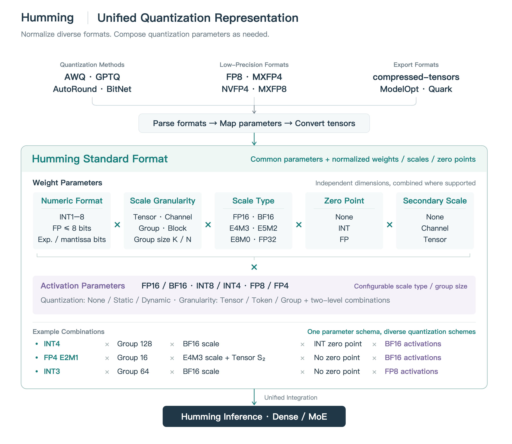
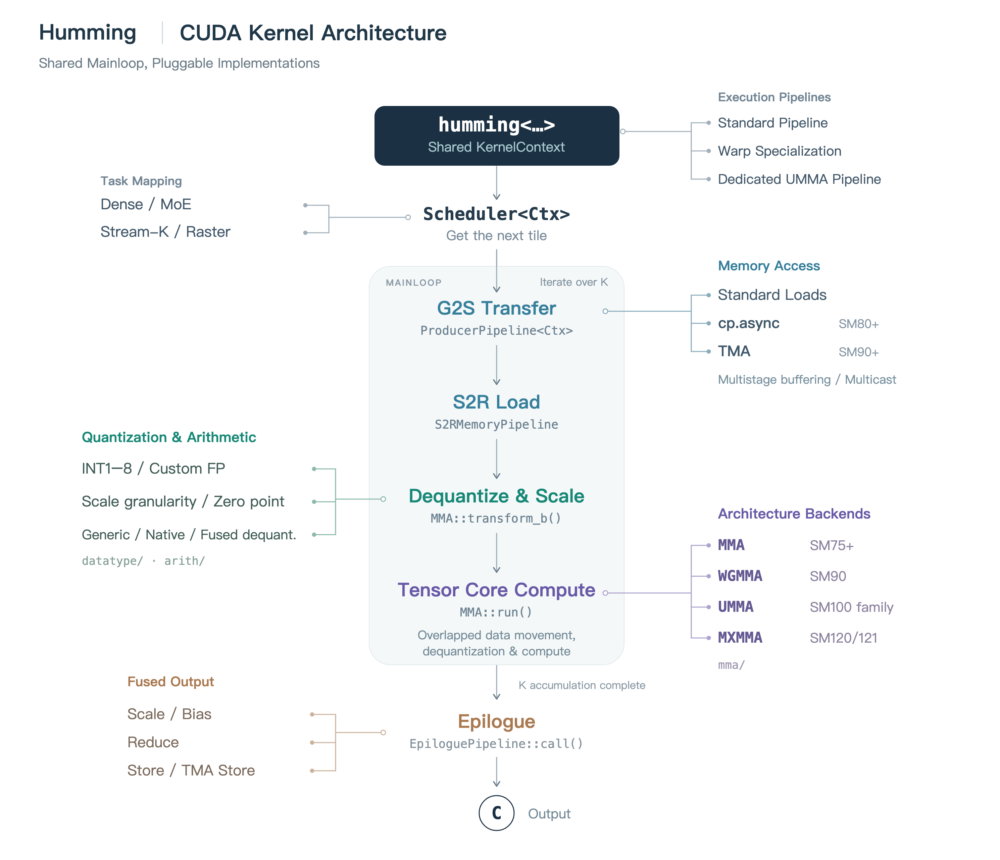
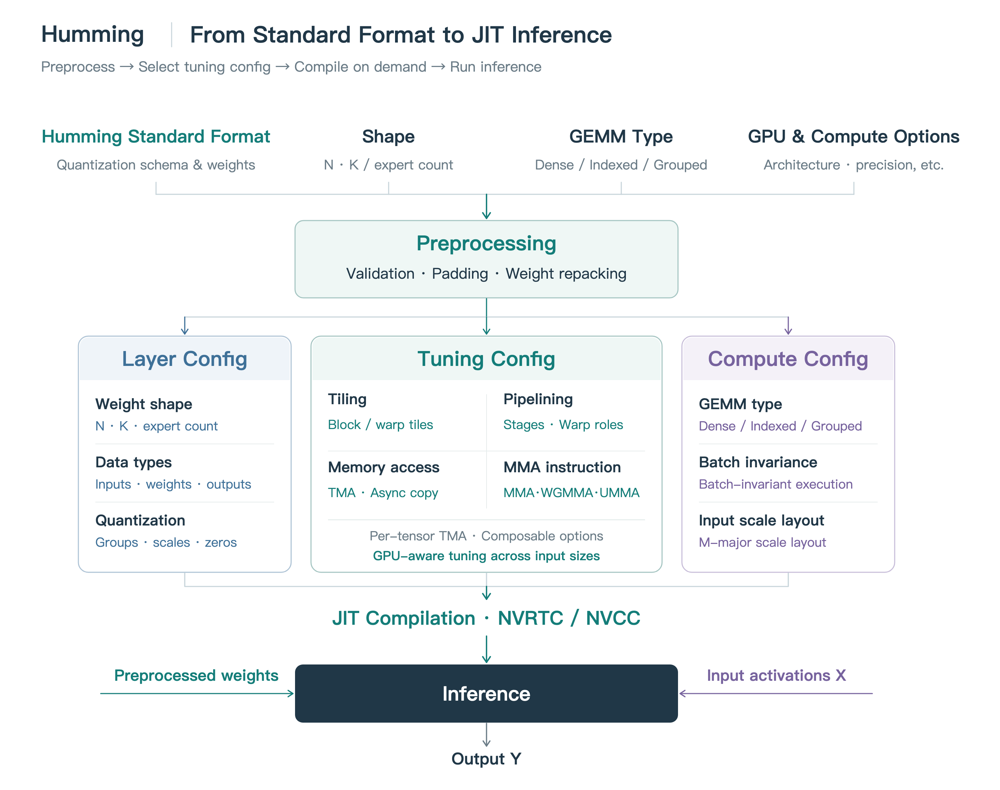
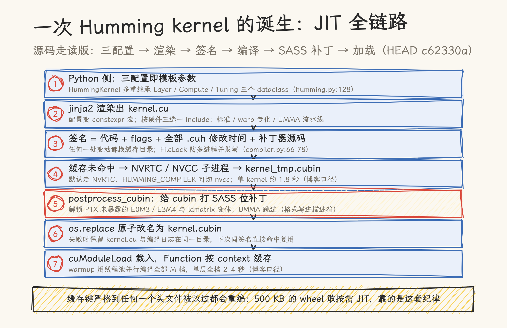

# Humming 深拆：不预制 kernel，把组合爆炸交给 JIT

> **元信息**：源码基线为 [vllm-project/humming](https://github.com/vllm-project/humming) `c62330a`（2026-11-11），发布博客 [Announcing Humming](https://vllm.ai/blog/2026-10-21-humming)（2026-10-21，蚂蚁集团 + vLLM 社区）。核对日期 2026-11-12；本仓无 NVIDIA GPU，kernel 与编译时长均未实测，性能数字全部为博客口径（作者方自报，microbench 由 vLLM 社区跑），引用时注意口径。系列第 2 篇，[篇 1（Marlin 深拆）](01_marlin-deep-dive.md)拆了手写极致 kernel 的三个设计，本篇回答篇 1 判断二留下的问题：组合爆炸来了怎么办。

Marlin 的答案停在 2024 年：为 FP16×INT4 这一种组合手写一个极致 kernel。2026 年的量化世界已经复杂得多：权重有 INT1 到 INT8、FP8、FP6、FP4，scale 有 tensor/channel/group/block 四种粒度和五种类型，硬件从 Turing 一路铺到 Blackwell 的 SM103/SM120/SM121，还有平头哥的 CUDA 兼容卡。为每个组合各写一个 kernel 再各自维护优化，是篇 1 判断二说的那条走不通的路。

Humming 的做法激进在哪：它的 PyPI wheel 只有约 500 KB，一个预编译 kernel 都不带。装上之后第一次推理，kernel 才在用户机器上按需编译（NVRTC/NVCC，单个约 2 秒），编完缓存复用。本文拆这套 JIT 路线的源码全链路，以及其中最特别的一步：给编译产物打 SASS 位补丁，解锁 PTX 里根本不存在的浮点格式。

## 一、组合爆炸到底有多大

博客把记号体系铺开：WNA16、W8A8、W4A8、W4A4，其中 N 表示可变位宽。真正让组合失控的是它下面这层参数。同一个「W4」可以是 INT4、NVFP4（E2M1）或 MXFP4，scale 策略互不相同；同一份权重，量化工具（GPTQ、AWQ、AutoRound、BitNet、ModelOpt、Quark）导出的参数组织又各有一套。

Humming 的解法第一步是把这些格式收拢成一个统一量化表示：权重侧五个参数各自独立（数值格式、scale 粒度、scale 类型、zero point、二级 scale），激活侧另有数值格式与量化设置（None/Static/Dynamic，粒度 tensor/token/group 及两级组合）。参数在格式与硬件约束内自由组合，比如 INT4 权重 × group 128 × BF16 scale × INT 零点 × BF16 激活，与 FP4 权重 × group 16 × E4M3 scale + tensor 二级 scale × 无零点 × BF16 激活，走的是同一套参数系统：



落到源码，`humming/dtypes.py:189-219` 定义的类型覆盖无符号整型 uint1 到 uint8、带符号 int2/3/4/6/8，以及 FP4 到 FP8（e2m1、e2m3、e3m2、e4m3、e5m2、e8m0）；还有一整族零指数位浮点 float2e0m1 到 float8e0m7，其中两个格式在 PTX 类型系统里查不到对应类型（第四节专讲）。`config/config.py` 的 LayerConfig 校验这些参数的合法组合，`schema/` 目录放与 compressed-tensors、BitNet 等导出格式的对接层。

统一表示只解决「怎么描述」。kernel 本身怎么来，是第二节；什么时候生成，是第三节。

## 二、三套配置与共享组件：kernel 是组装出来的

博客把执行路径概括为「表示量化计算、按硬件与负载选配置、从 CUDA 组件编译 kernel」三段。源码里的对应物非常直接：

```python
class HummingKernel(KernelRuntime, LayerConfig, ComputeConfig, TuningConfig):
```

（`humming/kernel/humming.py:128`）

博客里的三套配置，在源码里就是三个 dataclass 基类：

- **LayerConfig**：张量形状、数据类型、量化参数、目标架构；
- **ComputeConfig**：GEMM 类型（Dense/Indexed/Grouped）、batch 不变性、输入 scale 布局；
- **TuningConfig**：tile 形状、流水线 stage 数、warp 专化、访存路径（TMA/`cp.async`，可逐 tensor 配 TMA）、MMA 指令、CTA 并发与 Stream-K。

配置对象最终被渲染成 C++ 代码里的 `constexpr` 常量与宏（`to_cpp_str` / `to_macro_cpp_str`），kernel 模板参数里带着它们进出（`humming.py:188-206`）。

组件侧，博客给了一张六段式地图：Scheduler 取 tile、G2S 搬运（standard loads / `cp.async` / TMA）、S2R 装寄存器、Dequant & Scale（`MMA::transform_b()`）、Tensor Core 计算、Epilogue 融合 scale/bias 输出。三条执行流水线（标准、warp 专化、专用 UMMA）复用同一批组件，靠 TuningConfig 选边：



指令选择逻辑在 `config/mma.py:120-127`，四条路按硬件代际分：SM9x 走 WGMMA，block-scaled 低精度走 SM120/121 的 MXMMA，SM100 系支持 UMMA 就走 UMMA，其余回落到基础 MMA。小 batch 下 `cp.async` + MMA 流水线可能反超 TMA + UMMA，大 batch 则相反，两条路径在同一框架里按负载选（博客明确给了这个取舍）。寄存器预算有专门一套模型把关（`get_register_budget_error`，`mma.py:178-251`）：UMMA 累加器住 TMEM 不占寄存器，WGMMA 每条指令固定吃 26（SS）/ 32（RS）个寄存器开销，warp 专化时 producer 只给 24 或 40 个寄存器、其余全归 math 线程。



这套组装的下一个问题是怎么变成可执行文件。答案是本篇的主角。

## 三、JIT 链路源码走读：七个环节

从 Python 配置到能 launch 的 kernel，源码链路分七步（下面按顺序走读，`jit/compiler.py`、`jit/runtime.py` 均为 `c62330a` 行号）：



**① 配置即模板参数。** `init_kernel`（`humming/kernel/humming.py:155-231`）先选 MMA 数据类型与指令类，再把三个配置对象各自转成 C++ 代码段，用 jinja2 模板 `CODE_TEMPLATE` 渲染出整份 `kernel.cu`。模板按两个开关三选一 include 头文件：UMMA 流水线用 `humming_umma.cuh`，warp 专化用 `humming_ws.cuh`，其余用 `humming.cuh`（`humming.py:30-56`）。kernel 符号本身是一串 C++ 模板实例化表达式：`humming<MmaOpClass, Shape<...>, LayerConfig, ComputeConfig, TuningConfig>`，配置全部烧进了类型。

**② 签名决定缓存。** `Compiler.compile`（`jit/compiler.py:56-110`）把「类名 + 编译器版本 + 编译 flags + 模板实例化表达式 + 全部源码 + **每个 .cuh 头文件的修改时间** + 补丁器源码哈希」连成签名字符串，取哈希做缓存目录名。头文件改动任何一个字节、甚至只动一下 mtime，缓存键就变。目录内带 `kernel.cu`、`signature.txt`、`cmdline.json`、`stdout.log`、`stderr.log`，编译失败时现场全保留，报错信息直接指向这个目录（`compiler.py:101-107`）。并发安全靠 `FileLock`（`:77-80`），落盘用 `os.replace` 原子改名（`:109`），半成品不可能被别的进程读到。

**③ 编译器选择与 NVRTC 路径。** `_get_compiler`（`jit/runtime.py:63-78`）：环境变量 `HUMMING_COMPILER` 强制指定；平头哥 PPU 只走 NVCC；NVIDIA 默认尝试 NVRTC（cuda-python 绑定），失败回落 NVCC。NVRTC 不能直接解析真实的 `cuda.h`，`compiler.py:122-161` 为 `climits`/`type_traits`/`cuda.h` 等 6 个头文件准备了精简 shim，其中 `CUtensorMap` 是手写的 16 个 uint64 的不透明结构。编译 flags（`:193-220`）里几处细节与编译耗时直接相关：`--register-usage-level=10` 压寄存器；`-D_CCCL_META_UNROLL_LIMIT=10` 把 libcu++ 的元编程展开上限从 16 降回 10，注释写明省下每个 kernel 约 0.4 秒的 `type_list.h` 预处理；NVRTC ≥ 12.9 加 `-no-cache`，理由是「Humming 自己已经缓存 CUBIN，别再让 NVRTC 每个子进程初始化驱动缓存」。

**④ 编译耗时。** 博客口径（H200 服务器、CUDA 13.4、缓存禁用）编单个 W4A16 kernel：CUTLASS 走 NVCC 23.35 秒，Humming 走 NVCC 1.82 秒、走 NVRTC 1.88 秒。快的原因博客归为「轻量的 CUDA 实现、不依赖重型 kernel 框架」：头文件模板按需 include，一次只编选中的一条流水线与一种组合。warmup 阶段用线程池并行编（`KernelRuntime.compile_many`，`runtime.py:105-124`；调用点 `humming.py:750`），单层 GEMM 覆盖全部支持 M 档约 2–4 秒。

**⑤ SASS 位补丁。** 编译产物 `kernel_tmp.cubin` 先过 `postprocess_cubin`（`humming.py:237-260`），这是全文最特别的一步，单独立第四节。

**⑥ 加载。** `load_cubin`（`runtime.py:129-146`）用 cuda-python 的 `cuModuleLoad` 载入 cubin，从符号表里精确匹配到唯一 kernel 名，Function 句柄按 CUDA context 缓存。launch 时还支持 PDL（programmatic dependent launch，`runtime.py:148-155`，SM90+ 的 `PROGRAMMATIC_STREAM_SERIALIZATION` 属性），让前后 kernel 重叠执行。

## 四、隐藏格式：给编译产物打 SASS 位补丁

Blackwell 的 tensor core 硬件其实支持两个浮点格式，PTX 类型系统里没有对应类型：`float4e0m3`（0 指数位 4 尾数位，取值等价 ±0..7 的对称整数）和 `float8e3m4`（3 偏置 4 尾数的 FP8）。博客把这叫社区挖出的隐藏能力。等价物源码里写得很清楚，`config/mma.py:37-38` 的注释写明：硬件支持但 PTX 不暴露，MMA/MXMMA 用替代类型编译再补丁 cubin，UMMA 则直接把格式写进描述符。

替代类型在 `DTYPE_MAP` 里明示（`mma.py:39-40`）：`float8e3m4 → "e5m2"`，`float4e0m3 → "e2m1"`。NVRTC 先按替代类型正常编译出 SASS，然后 `csrc/patch_cubin.cpp`（466 行）接管：按 16 字节一条的粒度扫描 ELF 可执行段，匹配四类指令的操作码（OMMA `0x47f`、QMMA `0x47a/0x27a`、F2FP `0x23e`、ldmatrix `0x83b`），把操作数格式位从 E5M2/E2M1 翻成 E3M4/E0M3。文件头注释（`:8-11`）交代了这些位常量的来历：在 RTX PRO 6000（sm_120a，CUDA 13.3）上用位翻转 + GPU 数值回归试出来，再在 GB10（sm_121a）上验证。

这份自由有明确边界，源码里的守卫层层设卡：

- 架构白名单写死 SM100/103/120/121（`mma.py:46`），注释补刀：SM107 上这些编码直接非法指令。MMA 补丁只限 SM120/121，转换指令补丁放宽到 SM100/103（`patch_cubin.cpp:25`）；
- E0M3 只能与 `scale_vec::4X` 搭配，扫到 2X 变体直接拒绝改写，注释说那个编码 launch 就会 fault（`patch_cubin.cpp:193-200`）；
- 只翻「基底格式完全符合预期」的指令，其余跳过（`:23-24`）；
- 总开关 `HUMMING_DISABLE_PATCH_CUBIN=1`（`humming/utils/cubin.py:34-35`），关掉后整个能力失效，走常规类型路径。

还有一个细节能看出这套补丁的定位：`cubin_patch_buffer`（`patch_cubin.cpp:409-438`）提供内存内补丁入口，注释明说给「Triton 即将加载的字节」用。位补丁不是 Humming 的私藏，是一个可复用的后处理层。

依赖未文档化编码是红利也是负债：CUDA 或硬件任何一代收紧编码，这套补丁就失效，白名单本身就是对这个风险的承认。引用这个特性做方案时，把它当加速项用，别把它当依赖项。

顺带一个同思路的温和版本：博客提到零指数位浮点格式（如 `float8e0m7`）取值范围与同位宽对称整数完全一致，Humming 会自动把符合条件的对称整数量化权重转成这种格式，让反量化更快。格式表达力的边界即优化空间，这个观察和篇 1 的 lop3 魔数是同一件事的两个时代版本。

## 五、数字与口径

性能数字均为博客口径（2026-10-21 发布，作者方自报；microbench 由 vLLM 社区执行，M 取 1 到 8192 全 2 的幂，冷 L2 计时）。本仓无 NVIDIA GPU，未复测；这个领域迭代快，引用前建议复核仓库最新数据。

| 对比项                                 | 结果（博客口径）                                                                                      |
| -------------------------------------- | ----------------------------------------------------------------------------------------------------- |
| Dense W4A16 vs vLLM Marlin             | 多数配置持平或更优；小 batch 部分 GPU 约 3–4×（vs cuBLAS 基线图），大 batch H200 约 2×、B300 部分 >3× |
| MoE MXFP4 vs Marlin                    | H20/H200 中大 batch 约 2×；B300 Grouped 路径约 5×                                                     |
| W8A8 vs DeepGEMM Contiguous            | H20/H200 中小 batch 约 2.6× / 2.5×                                                                    |
| W4A8-MXFP4 vs DeepGEMM W8A8            | H20 约 4.2×、H200 约 4.5×（Hopper 无原生 MXFP4，kernel 内快速反量化到 INT8/FP8 计算）                 |
| B300 三种 MX 组合 vs DeepGEMM 对应精度 | W8A8 约 1.25×、W4A8 约 1.6×、W4A4 约 1.4×                                                             |
| 编译时长（单 W4A16 kernel，缓存禁用）  | CUTLASS+NVCC 23.35 s → Humming+NVCC 1.82 s / NVRTC 1.88 s                                             |
| warmup（单层全部 M 档，并行编译）      | 约 2–4 秒                                                                                             |

端到端口径（DeepSeek-V4.1-Flash，8×H20，TP=8，MoE 后端从 Marlin W4A16 换 Humming W4A8）：并发 1 到 64，输出吞吐 +14.1% 到 +43.3%，均值 TTFT −25% 到 −32%，并发 64 时输出吞吐 442.37 到 633.94 tokens/s、TPOT 约 −31%。这是拿 W4A8 对 W4A16 的代差收益，不只来自 kernel，也包含激活流量减半的贡献，引用时别全记在 kernel 头上。

| 并发 | 输出吞吐（tokens/s）      | TTFT（ms）        | TPOT（ms）     |
| ---- | ------------------------- | ----------------- | -------------- |
| 1    | 88.30 → 100.77（+14.1%）  | 543.13 → 383.80   | 9.24 → 8.46    |
| 8    | 287.04 → 383.04（+33.4%） | 2049.81 → 1386.91 | 19.90 → 15.49  |
| 32   | 398.83 → 560.49（+40.5%） | 3546.74 → 2465.47 | 66.44 → 47.48  |
| 64   | 442.37 → 633.94（+43.3%） | 5467.35 → 3882.94 | 123.25 → 85.70 |

工程口径：`pip install humming-kernels`（wheel 约 500 KB），无系统 CUDA 编译器时装 `humming-kernels[cu12]` 或 `[cu13]`；原则上能跑 PyTorch 2.7 的环境就能跑。vLLM 0.29.0 起 CUDA 安装自带 Humming 依赖，`--linear-backend humming` 与 `--moe-backend humming` 分别选它做 dense 与 MoE 后端；`--quantization humming` 只是兼容通道（vLLM 已不支持或尚未原生支持的格式，如 GPTQ INT3）。

## 六、总评与适用边界

判断一：JIT 路线没有推翻篇 1 的设计纪律，而是把它的适用范围又推了一层。Marlin 的公式是「预处理换运行期」：repack 把布局税挪到加载时。Humming 保留 repack（预处理仍在加载时做 pad + 重排），再把另一笔税挪进编译期：布局选择、分支消减、指令选择全在生成 `kernel.cu` 时做掉，运行期没有废分支。代价从「每次推理都在」变成「每份 (配置 × 硬件) 组合只付一次，约 2 秒」。

判断二：量化 GEMM 的实现路线可以摆成一条谱系。手写模板枚举（Marlin：一种组合一个极致 kernel，组合一多编译与维护都崩）；JIT 组件组装（Humming：共享组件 + 按需编译，组合空间由参数系统覆盖）；kernel 编译器搜索（TVM/Mirage 那条线，本仓 [05_compiler](../05_compiler/01_kernel-compiler-megakernel.md) 篇拆过：连调参都交给搜索）。选择轴是同一个：格式组合数 × 硬件代际数的维护矩阵有多大。矩阵小的领域手写仍然王道，矩阵爆炸的领域 JIT 是当下工程最优解。

判断三：Humming 的短板有三个。调参默认走设备启发式（`humming/tune/`），autotune 还在路线图上，非典型模型形状可能不是最优；首次运行依赖环境里有 CUDA 编译工具链，裸 PyTorch 容器要加 `[cu12]`/`[cu13]` extra；隐藏格式红利带截止日期，上第四节的三层守卫。另外本篇性能数字全部为作者方口径，社区复现结果出来之前，对「对比 Marlin/DeepGEMM/FlashInfer 的倍数」保留折扣。

适用边界：NVIDIA Turing（SM75）起全代际 + 平头哥 Zhenwu 810E；dense 与 MoE（Indexed/Grouped 两种 token 分发路径）都可用；已有 checkpoint 无需重新量化，加载时转换到统一表示。要研究 kernel 内部，篇 3 拆 UMMA 流水线的实现：scheduler 的 tile 分派、G2S/TMA 的多级缓冲、反量化变体族怎么接进 tcgen05、TMEM 上的 epilogue，那是「组件组装」四个字背后的实体裁剪。

## 源文件索引

| 文件                                     | 关键内容                                                                                               | 本文引用 |
| ---------------------------------------- | ------------------------------------------------------------------------------------------------------ | -------- |
| `humming/kernel/humming.py`              | `HummingKernel` 三配置多重继承、`init_kernel`、`kernel_expr`、`postprocess_cubin`、`compile_many` 调用 | 二、三   |
| `humming/jit/compiler.py`（326 行）      | 签名与缓存、FileLock、NVRTC 头 shim、编译 flags、NVCC 路径                                             | 三       |
| `humming/jit/runtime.py`（158 行）       | 编译器选择、`compile_many`、`load_cubin` 按 context 缓存、PDL                                          | 三       |
| `humming/config/mma.py`                  | 四路 MMA 指令选择、隐藏格式替换、寄存器预算模型、SM 白名单                                             | 二、四   |
| `humming/config/config.py`               | LayerConfig 组合校验、`use_ldmatrix_dequant`                                                           | 二、四   |
| `humming/csrc/patch_cubin.cpp`（466 行） | SASS 位补丁：四类指令操作码、格式位、白名单、内存补丁入口                                              | 四       |
| `humming/utils/cubin.py`                 | `is_cubin_patch_enabled` 开关、补丁器构建与 ctypes 调用                                                | 四       |
| `humming/dtypes.py`、`humming/schema/`   | 类型系统、导出格式对接层                                                                               | 一       |

## 参考资料

- [Announcing Humming: Fast, Flexible Kernels for Quantized Inference](https://vllm.ai/blog/2026-10-21-humming)（性能数字与编译时长均出自此博客）· [vllm-project/humming](https://github.com/vllm-project/humming)
- 本仓：[篇 1 Marlin 深拆](01_marlin-deep-dive.md)（手写路线与其遗产）· [launch、occupancy、overlap：什么时候手写 kernel](../05_compiler/01_kernel-compiler-megakernel.md)（编译器路线谱系）· [把权重压到 4-bit：TileLang 反量化 GEMM](../03_tilelang/03_dequant_gemm_lowprecision.md)
- 下一篇：[UMMA 深拆：tcgen05 上，反量化结果写进 TMEM](03_umma-deep-dive.md)（系列收官篇）
