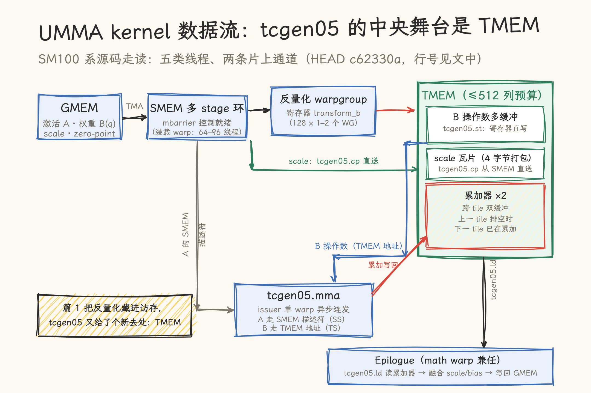

# UMMA 深拆：tcgen05 上，反量化结果写进 TMEM

> **元信息**：源码基线为 [vllm-project/humming](https://github.com/vllm-project/humming) `c62330a`（2026-11-11）的头文件模板层 `humming/include/humming/`（约 12,200 行 CUDA C++ 模板），目标硬件为 SM100/SM103 系（B200/B300，tcgen05 指令族）。核对日期 2026-11-12；本仓无 NVIDIA GPU，全部为源码走读，机制描述以该 commit 为准。系列第 3 篇：[篇 1（Marlin）](01_marlin-deep-dive.md)拆手写极致 kernel，[篇 2（Humming）](02_humming-arch-jit.md)拆 JIT 生成路线，本篇进到生成产物内部，看 tcgen05 时代的反量化 GEMM 长什么样。

篇 2 结尾留了个钩子：UMMA 流水线的格式写进描述符，不用打 SASS 补丁。本篇把这个钩子展开。Blackwell 的 tcgen05（第五代 tensor core 指令族）改的主要是数据流：MMA 的累加器从寄存器搬进一块独立的 TMEM（tensor memory），操作数可以住进去，指令由单个 warp 异步发射、批量完成。Marlin 时代「一条 kernel 里 256 个线程人人搬砖」的组织方式，在这里变成了五类角色的流水分工。

## 一、五种线程角色

kernel 入口在 `kernel/humming_umma.cuh:31`，先是两条 static_assert 把阵容钉死（`:66-68`）：总线程数 = 256 + 128 × 反量化 warpgroup 数（1 或 2），UMMA 的 SS 模式下反量化线程为零。按线程号分段（`utils/context.cuh:186-200`）：

- **装载 warp**（前 64–96 线程）：TMA/`cp.async` 把激活 A、原始权重 B(q)、scale 搬进 SMEM 多 stage 环。权重与激活的 TMA 通道可拆给两个 warp 并行（`kUseUmmaSplitLoads`，`:198-201`）；
- **发射 warp**（issuer，`:202-237`）：整个 CTA 只有一个 warp 负责发射 tcgen05.mma，等操作数就绪的 mbarrier，然后一批异步指令连发出去；
- **math warp**（128–255 线程）：SS 模式下负责把 scale 从 SMEM 打包写进 TMEM（`:238-279`）；非 SS 模式下兼任 epilogue；
- **反量化 warpgroup**（256 线程起，`:280-374`）：把 SMEM 里的原始权重读进寄存器，反量化成 tensor core 要的格式，写进 TMEM 操作数区；
- **epilogue 线程**：读 TMEM 累加器，融合 scale/bias，写回显存。

SS 与 TS 是两条模式。SS（shared-shared）指权重保持量化原样放在 SMEM，靠 MMA 描述符声明格式、由硬件解码，此时没有反量化 warpgroup。TS 模式里 B 操作数来自 TMEM，反量化 warpgroup 上场。开不开的判断在篇 2 的 Python 配置层（`use_raw_weight` 等属性），编译期就定了。

两 CTA 还能组 cluster 协作（`kUmmaCtaGroupSize == 2`）：mbarrier 到达经 `__cluster_map_shared_rank` 汇到 CTA0（`:114-128`），一条 tcgen05.mma 同时喂两个 CTA 的数据。

SMEM 侧的多 stage 环是装载 warp 与 math 侧的接合面。装载主循环（`:153-196`）的节奏：`next_tile` 取块 → `producer.seek` 定位该 tile 的 TMA 坐标 → 逐 iter 等 `math_mbar[stage]` 的空位信号（反向相位）→ `load_stage` 发起整段搬运 → `advance_stage` 推进环形下标。A、B、scale/zp 各有自己的 stage 布局与就绪条件，channel 数据（bias 等整 tile 共用一份）单独走 `load_channel`，且只在 epilogue 真正要读时才发（`kSeparateOutputStorage` 时先 `wait_channel` 再装，`:184-185`）。这一层与篇 1 Marlin 的 `fetch_to_shared` 是同构问题，答案从 warp 级手写换成了 TMA + mbarrier 相位机。

## 二、TMEM 布局账本

TMEM 总共 512 列，`mma/umma.cuh:18-67` 用一组 constexpr 把预算算到列级：

- **B 操作数多缓冲**：TS 模式下反量化后的权重直接写 TMEM，双 CTA 时 preferring 4 份轮转（`kPreferredOperandBuffers`，`:42-45`），装不下退到 2 份；
- **scale 瓦片**：weight scale 与 input scale 各占若干列，4 字节打包（`:32-35`）；
- **累加器 ×2**：每个 output group 一对，跨 tile 双缓冲。`accumulator_phase = tile % 2`（`:248`），上一个 tile 的 epilogue 在排空 0 号累加器时，下一个 tile 的 MMA 已经往 1 号里累加（`:57-66` 的注释把这层写得很直白）。

预算最后一道闸：`static_assert(kTmemColumns <= 512)`（`:84`）。

一个顺手的技巧：非 block-scale 路径也要复用同一批带 scale 参数的指令，`init` 时把常数 scale 列预填成「1.0」（E4M3 的 `0x38383838`、UE8M0 的 `0x7f7f7f7f`，`:31`、`:93-106`），乘 1 等于没乘，一条指令吃两种路径。

## 三、发射：单 warp 的异步连发

`issue()`（`umma.cuh:283-386`）是全文件的核心方法，一次调用把一个 K 切片的全部 tcgen05.mma 连发出去：

- **A 操作数**：激活在 SMEM，走 64 位描述符。`tcgen05_smem_desc`（`utils/ptx/tcgen05.cuh:55-61`）把地址、swizzle 步长、swizzle 模式编进位段；
- **B 操作数**：SS 模式同样给 SMEM 描述符，TS 模式直接给 TMEM 地址（`umma.cuh:334-337`）；
- **格式声明**：描述符位段声明操作数格式，权重格式码 E2M1=5、E3M2=4、E2M3=3、E3M4=2、E5M2=1、E4M3=0（`:339-344`）。篇 2 第四节的隐藏格式在这里揭晓答案：mxf4nvf4 指令的模板参数直接以 `!kIsE0M3` 翻描述符位，注释写明「未文档化的 E0M3 是格式 0，公开的 E2M1 是格式 1」（`tcgen05.cuh:292-294`）。UMMA 路线不需要 SASS 补丁，描述符就是接口；
- **K96 三段式**：SM103 上 FP4 走 K64+K96+K96 的三连发覆盖 256 个 K（`:291-295`），K96 的 SMEM 地址跨 swizzle 瓦片，专门的 `tcgen05_smem_desc_k96` 处理回绕（`tcgen05.cuh:64-68`）。SM107 则把 FP4/FP8 的 dense K 直接翻倍（`umma.cuh:20-24`）；
- **scale 选择**：block-scale 路径每条指令带 `scale_id`（`:351`），硬件从 TMEM 的 scale 瓦片里按 id 取对应组的因子。

发射完成的信号靠 `tcgen05.commit`（`tcgen05.cuh:47-52`）：MMA 批次全部执行完后向指定 mbarrier 到达，双 CTA 时用 multicast 一次通知两个 CTA。kernel 里围着一圈 mbarrier（`humming_umma.cuh:93-112`）：`operand_ready`（反量化+就绪线程到、发射线程等）、`operand_free`（TMEM 缓冲可以复用）、`weight_free`（原始权重 SMEM 可以覆盖）、`accumulator_ready/free`（累加器交接）、`row_index_free`（Indexed GEMM 的行号缓冲）。发射线程的主循环就是「等 ready → 发射 → commit」三拍（`:206-236`）。

## 四、反量化接进 tcgen05

反量化 warpgroup 的主循环在 `humming_umma.cuh:302-374`，节奏是：从 SMEM 装原始权重到寄存器（`s2r.load_stage_iter`）→ `transform_b` 反量化 → 攒够 4 个 fragment 拼成宽 store → 等 TMEM 缓冲空出来 → 写入。最后一步是 `mma.store_b`（`umma.cuh:113-128`）：`tcgen05.st.sync.aligned.16x128b` 指令把寄存器内容直写 TMEM。注意 `tcgen05.st` 的操作数顺序是 `{v0, v2, v1, v3}`（`tcgen05.cuh:156-158`），交织排布是 TMEM 布局的一部分。

`transform_b`（`mma/wmma.cuh:49-76`）按格式四路分发：MXFP8 权重走原生重排（`repack_native_mxf8f6f4`），MXFP4 走融合反量化+scale（`fused_dequant_for_mxfp4`），硬件有原生转换指令的走 `dequant_native`，其余走通用 `dequant` 再折叠 scale/zp。通用路径内部又分两族（`datatype/dequant.cuh:120-127`）：2/4/8-bit 对齐格式走 `dequant_b1248`，3/5/6/7-bit 非二次幂格式走 `dequant_b3567`，后者要按补齐位宽重新切分 nibble。scale 的反量化还有三层降级（`dequant_scale`，`:137-162`）：原生指令、经 FP16 中转、纯软件 + `byte_perm` 调序。

scale 因子进 TMEM 有两条路：TS 模式由 math 线程 `tcgen05.st.32x32b` 直写（`store_weight_scales`，`umma.cuh:130-160`），SS 模式先写 SMEM 再用 `tcgen05.cp` 一次搬运（`copy_scales`，`:218-244`；`tcgen05.cp.32x128b.warpx4`，`tcgen05.cuh:355-362`）。4 个 scale 字节打包进一个 uint32 的活儿在 `store_weight_scales` 里（`>> (phase * 8)`，`:149`）。

对照篇 1 能看清这条演化线：Marlin 用一条 lop3 把反量化压到极限，但结果仍要挤占 MMA 的发射路径；tcgen05 上反量化升格成专职 warpgroup，产物写进 tensor core 自己的操作数地盘，发射线程永远拿到现成格式。反量化的开销没有消失，它被挪到了并行角色上。

## 五、调度：DP + Stream-K 混合与 MoE 两形态

`scheduler.cuh` 的初始化（`:103-133`）先把输出 tile 分成两池：能整除 CTA 数的走常规 data-parallel（按 `gridDim / ctaGroup` 步进轮转，`get_next_block`，`:254` 起），余数 tile 进 Stream-K，按 K 切片分给各 CTA，切几片由 `slice_count`（上限 10）和每片最小迭代数兜底。要不要多拉一批 tile 进 Stream-K 还有启发式：SM10x 用 TMA store 时恒并入，SM89 无 TMA-C 时门槛翻倍，其余按「余数 × 10 ≤ CTA 数」判断。Stream-K 的跨 CTA 累加靠全局锁，见第六节。

MoE 有两种形态：Indexed GEMM 拿 `sorted_ids` 把 token 行映射回 expert（`fetch_moe_index_block`），Grouped GEMM 把 expert 偏移表整表load 进 SMEM 再逐 expert 推进（`calc_m_blocks`，`scheduler.cuh:154` 起）。篇 2 博客口径里的 Indexed/Grouped 两条路径，落到调度层就是这两个分支。

## 六、Epilogue：把 TMEM 排空

非反量化的 math 线程兼任 epilogue（`humming_umma.cuh:375-428`）：等 `accumulator_ready` 的 mbarrier，用 `tcgen05.ld` 把累加器读回寄存器（`load_output_chunk`，`umma.cuh:257-280`；双 CTA 时上下两半各读一次，`wait_ld` 等数据落地）。随后过一遍算术层融合 secondary scale 与 bias，写 SMEM，再由 `gmem_writer` 落盘（TMA store 或 `st.global`）。Block K 大于 warp K 时先过 `smem_reducer` 归约（`epilogue/pipeline.cuh:76`）。Stream-K 的多片累加靠 gmem 上的锁与原子加（`acquire_gmem_barrier`，`pipeline.cuh:109`）。

与累加器双缓冲咬合的细节：`kCanOverlapAccumulators` 成立时（`:57-66`），MMA 先读两块累加器的重叠行，epilogue 排剩下的行，下一个 tile 的计算与上一个 tile 的写回就并行起来了。Indexed GEMM 还有一层行号缓冲的接力（`row_index_free`，`:416-421` 的注释：累加器可能先于 scatter 写完被复用，行号槽要等所有读方松手）。

## 七、总评与适用边界

判断一：tcgen05 的数据流重构，本质是把「访存层次」又加了一层。Marlin 篇的三笔税（计算/布局/带宽）在这个语境里重新分账：布局税大部分进了编译期（篇 2 的配置渲染）与反量化 WG 的寄存器变换；带宽税靠 SMEM 多 stage 与 TMEM 多缓冲轮流吸收；计算税由 tensor core 独享现成格式。「把反量化藏进访存」的下一步是「藏进 TMEM」：反量化产物直接写进 tensor core 的操作数地盘，这也是本系列三篇的连贯线索。

判断二：这套设计的代价是编排复杂度。440 行的 kernel 主体几乎全是角色分工与 mbarrier 编排，任何一步就绪/释放的次序错了都是死锁或数据竞争；1.2 万行的头文件模板里，真正「算」的代码占比不高，多数是配置到指令位段的胶水。读这类代码的合理预期是：机制能走通、位段含义要查文档对照（本篇的 K96、描述符位段均以源码注释与 PTX ISA 语义互证），逐行记住没有意义。

判断三：本篇也是系列的收官坐标。三篇连起来是一条完整的选择轴：格式组合少、追求极限时，手写模板枚举（Marlin）仍然锋利；组合爆炸时，JIT 组件组装（Humming）是工程最优；而无论哪条路线，SM100 系上的终点数据流都收敛到「TMEM 中央舞台 + 角色分工」。Marlin 的设计纪律没有过时，它只是换了执行场地。

适用边界：本篇机制描述全部基于 SM100/SM103 系源码走读，无 GPU 实测；SM107 的 double-K、K96 三段式等硬件差异取自源码注释，引用前建议对照目标设备的 PTX ISA 文档。后续可选的拆解方向还有两个：SM120/121 的 MXMMA（warp 级 block-scale mma.sync）与 TMA 多级 swizzle 的 SMEM 布局，需要时再续。

## 源文件索引

| 文件 | 关键内容 | 本文引用 |
| --- | --- | --- |
| `kernel/humming_umma.cuh`（440 行） | kernel 入口、五类角色分段、mbarrier 环、反量化主循环、epilogue | 一、三、四、六 |
| `mma/umma.cuh`（392 行） | TMEM 布局账本、`issue()`、`store_b`、scale 打包与搬运、累加器双缓冲 | 二、三、四、六 |
| `utils/ptx/tcgen05.cuh`（362 行） | alloc/commit/ld/st/cp 原语、SMEM 描述符、K96 回绕、E0M3 描述符位 | 二、三、四 |
| `utils/context.cuh`（`:160` 起） | `UmmaPipelineContext` 线程角色判定、split loads、cooperative TMA | 一 |
| `mma/wmma.cuh` | `transform_b` 四路分发、`regs_b` 双缓冲 | 四 |
| `datatype/dequant.cuh`（198 行） | `dequant_b1248`/`dequant_b3567` 两族、scale 三层降级 | 四 |
| `scheduler.cuh`（423 行） | DP + Stream-K 混合决策、MoE indexed/grouped 取块 | 五 |
| `epilogue/pipeline.cuh`、`smem_writer.cuh`、`gmem_writer.cuh` | TMEM 读回、K 归约、Stream-K gmem 锁 | 六 |

## 参考资料

- [vllm-project/humming](https://github.com/vllm-project/humming)（本篇源码对象）· [Announcing Humming 博客](https://vllm.ai/blog/2026-10-21-humming)
- 本仓：[篇 1 Marlin 深拆](01_marlin-deep-dive.md)（lop3 位技巧与流水线）· [篇 2 Humming 深拆](02_humming-arch-jit.md)（JIT 链路与 SASS 补丁）· [SIMT 到 Tile-Based 编程范式的演进](../02_cuda/04_simt_vs_tile_based.md)（TMEM/TMA 所在的 Tile 范式背景）
