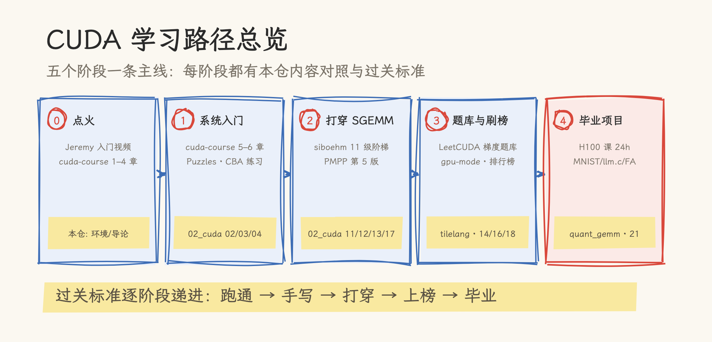
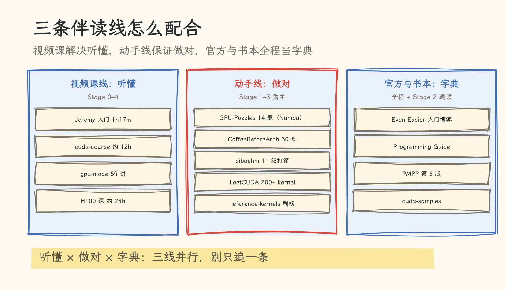
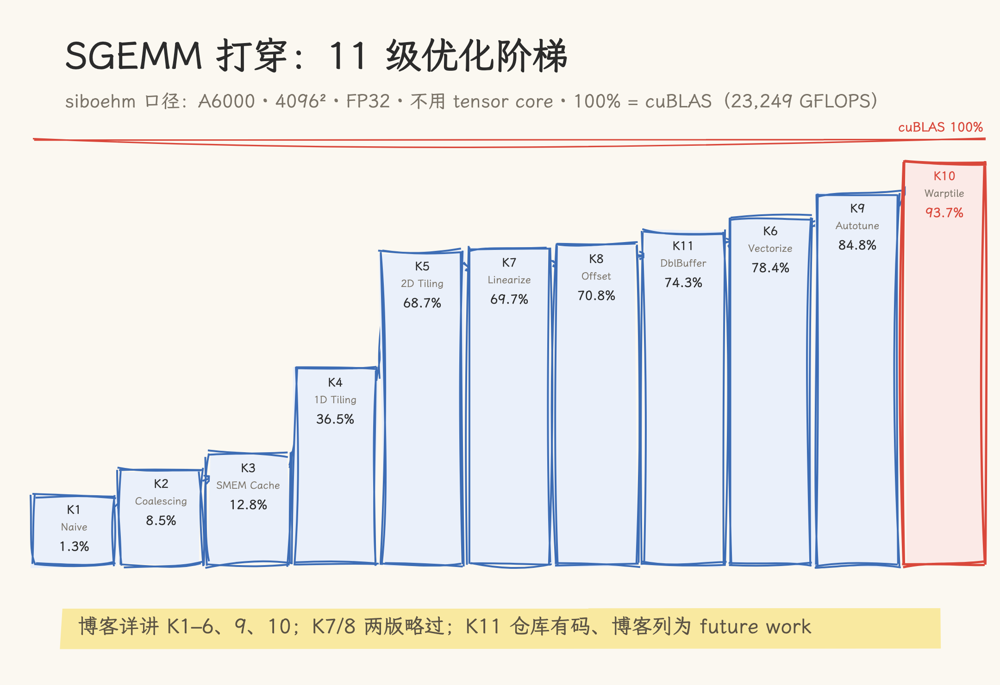

# CUDA 学习课程体系：外部开源资源 × 本仓内容的完整路径

> 调研口径：星数、更新时间来自 2026-11-28 当日 gh api；视频时长带「页面口径」或「二手来源」标注的条目见第八节。整合三类资源：外部开源课程与代码库、NVIDIA 官方资源、本仓 `02_gpu_programming` 自研内容。
> 配套档案：[FreeCodeCamp CUDA 课档案](freecodecamp-cuda-course.md)（本体系 Stage 0–1 主线课的逐章导读）；更多课程建档见 [课程索引](README.md)

## 一、体系总览

一条主线五阶段，三条伴读线贯穿全程：

| 阶段 | 名称                                | 主线资源                                        | 伴随练习                                    | 本仓对照                                        | 过关标准                                                        |
| ---- | ----------------------------------- | ----------------------------------------------- | ------------------------------------------- | ----------------------------------------------- | --------------------------------------------------------------- |
| 0    | 点火：心智模型与第一个 kernel       | Jeremy Howard 1h17m 视频；cuda-course 第 1–4 章 | 官方 blog 入门文                            | 01_environment 三篇；02_cuda 01 导论            | 装好环境跑通 vec add，能讲清 Grid/Block/Thread 到 SM 的映射     |
| 1    | 系统入门：一门主线课 + 两个伴随练习 | cuda-course 第 5–6 章全程                       | GPU-Puzzles 前 8 题；CoffeeBeforeArch 30 集 | 02_cuda 02/03/04                                | 不查资料能手写 reduction，说得出 bank conflict 是什么           |
| 2    | 核心机制打穿：SGEMM 完整项目        | siboehm 11 级阶梯（博客 + 仓库）                | cuda-course 第 7 章对照                     | 02_cuda 11/12/13/17                             | 把一个 kernel 从 1% 优化到 90%+ cuBLAS，用 ncu 说清每级为什么快 |
| 3    | 进阶题库与社区竞技场                | LeetCUDA 梯度题库；gpu-mode lectures 59 讲      | reference-kernels 排行榜；Triton-Puzzles    | 02_cuda 14/16/18；03_tilelang 三篇；05_compiler | 在 leaderboard 提交并上榜；能读懂 CUTLASS/CuTe 代码             |
| 4    | 专题收尾与毕业项目                  | freeCodeCamp H100 课（10 lesson）               | 毕业三选一（见第六节）                      | 06_quant_gemm 三篇；02_cuda 21 手搓 Attention   | 独立完成一个 Tensor Core 级 GEMM 或 Attention kernel            |

先修与硬件：任何 NVIDIA GPU（GTX/RTX/数据中心卡均可）；没有本地卡可用 Colab 免费 GPU runtime（GPU-Puzzles 官方推荐方式）；本仓环境三条路线见 [01_environment](../01_environment/README.md)。

## 二、Stage 0：点火——心智模型与第一支视频

这一阶段唯一的目标是建立「GPU 为什么快、kernel 长什么样」的直觉，不追求深度。

| 资源                                                                                                           | 形式                       | 说明                                                                                                                |
| -------------------------------------------------------------------------------------------------------------- | -------------------------- | ------------------------------------------------------------------------------------------------------------------- |
| [Jeremy Howard: Getting Started With CUDA for Python Programmers](https://www.youtube.com/watch?v=nOxKexn3iBo) | 单视频约 1h17m（页面口径） | 最低摩擦的 on-ramp：面向 Python 程序员，notebook 视角写第一个 kernel，绕开 C++ 工具链。与 GPU MODE Lecture 3 同内容 |
| [An Even Easier Introduction to CUDA](https://developer.nvidia.com/blog/even-easier-introduction-cuda/)        | 官方博客短文               | Mark Harris 的 saxpy 例子，配官方 Colab notebook 可直接跑                                                           |
| [Infatoshi/cuda-course](https://github.com/Infatoshi/cuda-course) 第 1–4 章                                    | 视频课约 12 小时中的前 1/3 | 深度学习生态总览、Ubuntu 环境安装、C/C++ 复习（指针/类型/宏/Makefile/调试器）、GPU 入门概念                         |
| 樊哲勇《CUDA 编程：基础与实践》第 1–5 章                                                                       | 中文书，约 184 页          | 清华社 2020-10；小书快读，先把语法框架过一遍                                                                        |

本仓对照：环境三路线（[容器](../01_environment/01_nvidia_container_setup.md)、[镜像构建](../01_environment/02_cuda_image_build_analysis.md)、[裸金属](../01_environment/03_cuda_metal_install_guide.md)）+ [GPU 编程导论](../02_cuda/01_gpu_programming_introduction.md)。

**过关标准**：本机或 Colab 跑通 vec add；不看资料能说出 thread→CUDA core、block→SM、grid→整卡的映射；知道 host/device 两个词分别指什么。

## 三、Stage 1：系统入门——一门主线课 + 两个伴随练习

主线选一门完整课走到底，伴随练习防止「看懂了但写不出」。

**主线：[Infatoshi/cuda-course](https://github.com/Infatoshi/cuda-course)**（4,192★，最后 commit 2026-03-10）。第 5 章第一个 kernel（硬件映射、内存模型、profiling/atomics/streams 子目录），第 6 章 CUDA APIs（cuBLAS/cuDNN 的 opaque 结构与错误检查）。配套免费视频与逐章导读见[本仓档案](freecodecamp-cuda-course.md)。

**中文通读线：[brucefan1983/CUDA-Programming](https://github.com/brucefan1983/CUDA-Programming)**（2,106★，push 2025-12-14）。14 章配套代码：线程组织、内存、共享内存、原子函数、warp 内建函数、**CUDA 流、统一内存**，第 13 章分子动力学完整案例。每章每知识点一个 .cu，README 附「文件→知识点」中英对照表。覆盖 cuda-course 没讲的 streams 细节与统一内存；不含 Graphs/多卡/Tensor Core。

**伴随练习一：[srush/GPU-Puzzles](https://github.com/srush/GPU-Puzzles)**（12,618★）。14 道谜题（Map→Zip→Guards→2D→Broadcast→Blocks→Shared→Pooling→Dot→Conv→Prefix Sum→MatMul），每题带 per-thread 读写计分表自检。解法语言是 **Numba CUDA**（不是 Triton，这是常见误解；Triton 版谜题另见 [gpu-mode/Triton-Puzzles](https://github.com/gpu-mode/Triton-Puzzles)，2,679★）。Colab 可跑，零环境门槛。

**伴随练习二：[CoffeeBeforeArch/cuda_programming](https://github.com/CoffeeBeforeArch/cuda_programming)**（994★）。YouTube「CUDA Crash Course」约 30 集的配套代码（集数为二手口径），按 5 个算法组织：vector addition、matmul、sum reduction、histogram、convolution。**诚实标签：push 停在 2023-07，CUDA 11 时代**，内容仍适用但工具链旧，当练习册别当主线。

**官方伴读**：CUDA C++ Programming Guide（当前 v13.5）只读 Part 1–2（教程性章节），Part 4–5 留作全程字典。DLI 免费自学线 2026 年已收缩到只剩 1 小时 Introduction to CUDA，核心课（8 小时 Accelerated Computing）约 $90，不作为默认路径。

本仓对照：[CUDA 核心详解](../02_cuda/02_cuda_cores.md)、[流处理机制](../02_cuda/03_cuda_streams.md)、[SIMT 到 Tile-Based 范式](../02_cuda/04_simt_vs_tile_based.md)——与主线课同主题的中文对照版，讲法不同。

**过关标准**：独立写出 sum reduction 并解释 warp divergence 在其中怎么出现；完成 GPU-Puzzles 前 8 题；知道 shared memory 和 L1 的关系。

## 四、Stage 2：核心机制打穿——SGEMM 是第一个完整项目

这一阶段的方法论是「单一专题打到底」：以矩阵乘为载体，把访存、tiling、流水线这些核心机制一次学透。

**主教材：[siboehm/SGEMM_CUDA](https://github.com/siboehm/SGEMM_CUDA)**（1,370★）+ [同名博客](https://siboehm.com/articles/22/CUDA-MMM)。仓库基准表共 **11 级 kernel**（A6000、4096²，相对 cuBLAS=100% 即 23,249 GFLOPS）：

| 级  | 优化                      | cuBLAS 相对性能 |
| --- | ------------------------- | --------------- |
| 1   | Naive                     | 1.3%            |
| 2   | GMEM Coalescing           | 8.5%            |
| 3   | SMEM Caching              | 12.8%           |
| 4   | 1D Blocktiling            | 36.5%           |
| 5   | 2D Blocktiling            | 68.7%           |
| 7   | 防 bank 冲突（Linearize） | 69.7%           |
| 8   | Offset                    | 70.8%           |
| 11  | Double Buffering          | 74.3%           |
| 6   | Vectorized Mem Access     | 78.4%           |
| 9   | Autotuning                | 84.8%           |
| 10  | Warptiling                | **93.7%**       |

博客详讲 kernel 1–6、9、10；7/8 两版略过，11（double buffering）仓库有码、博客列为 future work。全程 FP32、**不用 tensor core**（TF32/BF16 会让 cuBLAS 再快 2.5–3.5×，作者留作延伸）。README 说目标「状态好时到 cuBLAS 的 95%」。

**对照资源**：cuda-course 第 7 章的七级阶梯是这 11 级的子集导读，核心实现转引 siboehm；cuda-course 档案里有一张[七级阶梯图](assets/cuda-course-07-matmul-ladder.png)。

**教材通读**：PMPP《Programming Massively Parallel Processors》第 5 版（Hwu/Kirk/El Hajj，2026 年出，649 页；第 4 版 2022 仍被大量课程采用）。5 版新增章：Filtering、Wavefront Algorithms、Multi-GPU API、矩阵乘高级优化。UIUC ECE408 配套有官方 YouTube。第 4/5 版官方页均未列 Triton 专章（网传说法未核实，不采信）。

**本仓对照**（每级优化的中文深读）：[Tensor Core GEMM 实测](../02_cuda/11_tensor_core_gemm.md)、[GPU 内存管理](../02_cuda/12_gpu_memory_management.md)、[Shared Memory 与 Bank Conflict](../02_cuda/13_shared_memory_bank_conflict.md)、[Roofline 调优方法论](../02_cuda/17_roofline_optimization.md)。

**过关标准**：复跑 siboehm 全部 11 级并用 ncu 对比每一级的指标变化；能回答全表最大单级跳变出现在哪一级（1D→2D tiling，+32.2pp），以及为什么二维分块比一维多赚这么多。

## 五、Stage 3：进阶题库与社区竞技场

**题库主力：[xlite-dev/LeetCUDA](https://github.com/xlite-dev/LeetCUDA)**（12,227★，push 2026-11-24，活跃）。开源书形态：200+ kernel（README 自述口径）、600+ 页 PDF、中英在线文档。难度梯度 Easy / Medium / Hard / Hard+ / Hard++，另有 Triton 与 CUTLASS 板块：Easy/Medium 覆盖 element-wise、reduce、layer-norm、RMSNorm、online softmax（FP32/FP16/BF16/FP8）；Hard 系是 sgemv/sgemm/hgemm/FP8/FP4 GEMM 与 **6 种 FlashAttention 变体**（Split KV / Split Q / Shared KV / Fully Shared QKV / QK Tiling / QKV Tiling，大量 pure MMA PTX）。HGEMM 实测达 cuBLAS 98–100% TFLOPS。配套 100+ 篇中文博客。

**社区课：[gpu-mode/lectures](https://github.com/gpu-mode/lectures)**（7,141★，59 条讲座）。先用四讲打底：L1 Profiling、L8 Performance Checklist、L9 Reductions、L16 Hands-on Profiling。再按方向选专题：

- Triton：L14 实战 / L29 内部
- 注意力：L12 Flash Attention / L13 Ring Attention
- GEMM 与 Tensor Core：L15/36/57/103/114（CUTLASS · FA3 · CuTe）
- 量化：L7/30/33/34/69；多卡：L17/67 NCCL、L70 容错通信
- 推理系统：L22 投机解码、L28 Liger、L35 SGLang、L40 FlashInfer

**竞技场：[reference-kernels](https://github.com/gpu-mode/reference-kernels) 排行榜**（336★，配套 kernelbot 与 gpumode.com）。8 组比赛从 PMPP 练习题（vectoradd/histogram/prefixsum/matmul/conv2d）到 AMD/NVIDIA 百万美金赛与 NVFP4 专项；远端真卡评测，本地无需 GPU。讲座听懂之后，这里是把 kernel 拿去和人类与 AI 同榜比较的实战场。

**中文专题查阅库：[BBuf/how-to-optim-algorithm-in-cuda](https://github.com/BBuf/how-to-optim-algorithm-in-cuda)**（3,361★，push 2026-11-02）。笔记 + 代码混合：手写 reduce/softmax/GEMV/linear attention、CUDA-MODE 讲座笔记、CUTLASS/CuTe DSL（GEMM/TMA/WGMMA/swizzling）、PTX ISA、LLM serving 优化。中文知乎长文为主（[专栏入口](https://zhuanlan.zhihu.com/p/591058808)），与 gpu-mode 讲座配套使用最佳。无习题无梯度，纯查阅。

**本仓对照**：

- [Warp-level Programming](../02_cuda/14_warp_level_programming.md)、[异步拷贝与 Pipeline](../02_cuda/16_async_copy_pipeline.md)、[CUDA 调试实战](../02_cuda/18_cuda_debugging.md)
- [TileLang 快速入门](../03_tilelang/01_tilelang_quick_start.md)与[57 行 FlashAttention](../03_tilelang/02_tilelang_flash_attention.md)：tile 抽象路线的中文对照
- [kernel 编译器与 Megakernel 决策](../05_compiler/01_kernel-compiler-megakernel.md)

**过关标准**：在 leaderboard 提交至少一个 kernel 并进入榜单；能读懂一段 CuTe 或 MMA PTX 代码大意；用 Triton 重写一个自己早先用 CUDA 写过的算子。

## 六、Stage 4：专题收尾与毕业项目

**架构级专题：[freeCodeCamp H100 CUDA 课](https://www.freecodecamp.org/news/cuda-programming-for-nvidia-h100s)**（2026-04 出版，约 24 小时视频，10 lesson）。先修要求明确写着 C++ 基础与矩阵分块——这是整条线的收尾课而非入门课：

- 架构与机制：Hopper 架构（TMA / Transformer Engine / thread block clusters / distributed SMEM）、异步与 barrier（fence / m-barrier）、CuTensorMap 与 swizzling
- 计算核心：WGMMA 两讲（FP8）、kernel 设计（warp specialization / ping-pong / persistent / Split-K / Stream-K / epilogue fusion）
- 工程与多卡：CUTLASS 源码走读、NVSwitch / MPI / SLURM、NCCL ring 算法与四种并行

**毕业项目三选一**：

1. cuda-course 第 10 章：纯 CUDA 手写 MNIST MLP（全课程的收口，细节在视频）；
2. 读 [karpathy/llm.c](https://github.com/karpathy/llm.c)（31.6k★）：纯 C/CUDA 的 GPT-2 训练，cuda-course 官方自述的学习目标就是它；
3. LeetCUDA Hard++：独立完成一个 FlashAttention 变体或 FP8/FP4 GEMM。

**本仓压轴**：[手搓 Attention：从三行循环到看懂 FlashAttention](../02_cuda/21_write_attention_from_scratch.md)（四版递进实跑）与[量化 GEMM 深读](../06_quant_gemm/README.md)（Marlin/Humming/UMMA 三篇源码级拆解）。这两块是本仓内容相对外部资源的独有价值：从通用 CUDA 直接通向 LLM 推理场景。

**下游衔接**：走到这里的读者，后续方向是本仓 `10_ai_related_course` 的 [vLLM 十讲](../../10_ai_related_course/vllm_course/README.md)与 [KV Cache 八讲](../../10_ai_related_course/kv_cache_course/README.md)——把 kernel 能力放进推理系统语境。

**过关标准**：毕业项目之一完成并留档；能给别人讲清楚 WGMMA 和传统 MMA 的差别。

## 七、资源速查总表

| 资源                        | 形式                     | 语言                  | 水平        | 状态（2026-11-28）     | 费用         | 阶段 |
| --------------------------- | ------------------------ | --------------------- | ----------- | ---------------------- | ------------ | ---- |
| Jeremy Howard 入门视频      | 1h17m 单视频             | 英/Python             | 零基础      | 2024 发布              | 免费         | 0    |
| cuda-course（FreeCodeCamp） | ~12h 视频 + 11 章代码    | 英/CUDA C++           | 零基础→核心 | push 2026-03           | 免费         | 0–2  |
| GPU-Puzzles                 | 14 题 notebook           | Numba CUDA            | 零基础伴随  | push 2024-09           | 免费         | 1    |
| CoffeeBeforeArch            | ~30 集视频 + 代码        | 英/CUDA C++           | 入门练习    | **push 2023-07，偏旧** | 免费         | 1    |
| brucefan1983《CUDA 编程》   | 14 章代码 + 中文书       | 中/CUDA C++           | 入门通读    | push 2025-12           | 书付费码免费 | 1    |
| siboehm SGEMM               | 11 级 kernel + 博客      | 英/CUDA C++           | 核心        | push 2025-09           | 免费         | 2    |
| PMPP 第 5 版                | 649 页教材               | 英                    | 系统通读    | 2026 年出              | 付费         | 2    |
| LeetCUDA                    | 200+ kernel + 600 页 PDF | 中英/CUDA+Triton+CuTe | 进阶题库    | push 2026-11-24        | 免费         | 3    |
| gpu-mode lectures           | 59 讲                    | 英                    | 进阶专题    | push 2026-09           | 免费         | 3    |
| reference-kernels 排行榜    | 8 组比赛                 | 随题                  | 进阶竞技    | push 2026-11-23        | 免费         | 3    |
| BBuf 专题库                 | 笔记 + 代码              | 中文                  | 进阶查阅    | push 2026-11-02        | 免费         | 3    |
| freeCodeCamp H100 课        | ~24h 视频                | 英                    | 架构专题    | 2026-04 出版           | 免费         | 4    |
| llm.c                       | 生产级 C/CUDA 代码       | 英                    | 毕业读物    | 活跃                   | 免费         | 4    |
| Programming Guide v13.5     | 官方手册                 | 英                    | 全程字典    | 随 Toolkit 更新        | 免费         | 全程 |
| cuda-samples                | ~170 个官方示例          | 英                    | 全程模式库  | push 2026-11-04        | 免费         | 全程 |

## 八、口径与审慎

1. **星数与时间戳**：全部来自 2026-11-28 gh api 单次查询，会随时间漂移；cuda-course 的星数在一日内出现过两次口径（trending 页渲染 2,660 与 gh api 4,192），以 gh api 为准。
2. **二手来源**：CoffeeBeforeArch「约 30 集」与 cuda-course「约 12 小时」来自搜索结果与第三方目录，未逐集核对；Jeremy Howard 视频 1h17m 同为页面口径。
3. **GPU-Puzzles 的语言**：解法用 Numba CUDA 而非 Triton，网传「Triton 解谜」是把它和 gpu-mode/Triton-Puzzles 混为一谈；两者配合使用效果最好。
4. **PMPP 版本**：第 5 版出版日期在出版社不同页面间口径不一（2026-02 与 2026-06），引用时写「第 5 版（2026）」即可；「第 5 版含 Triton 专章」的说法未在官方目录核实到，不采信。
5. **DLI 免费线**：2026 年免费自学课约 10 门但偏 agentic AI/Omniverse 方向，CUDA 核心内容已基本付费化，本文不把付费课列为路径节点。
6. **LeetCUDA「200+ kernel」**为 README 自述口径，未逐目录清点。

## 九、来源索引

外部资源（全部于 2026-11-28 经 gh api 或页面实读核对）：

- [Infatoshi/cuda-course](https://github.com/Infatoshi/cuda-course) · [freeCodeCamp 视频课](https://www.youtube.com/watch?v=86FAWCzIe_4) · 本仓档案 [cuda-course.md](freecodecamp-cuda-course.md)
- [gpu-mode/lectures](https://github.com/gpu-mode/lectures) · [gpu-mode/reference-kernels](https://github.com/gpu-mode/reference-kernels) · [gpu-mode/Triton-Puzzles](https://github.com/gpu-mode/Triton-Puzzles)
- [srush/GPU-Puzzles](https://github.com/srush/GPU-Puzzles) · [xlite-dev/LeetCUDA](https://github.com/xlite-dev/LeetCUDA) · [siboehm/SGEMM_CUDA](https://github.com/siboehm/SGEMM_CUDA) · [siboehm 博客](https://siboehm.com/articles/22/CUDA-MMM)
- [brucefan1983/CUDA-Programming](https://github.com/brucefan1983/CUDA-Programming) · [BBuf/how-to-optim-algorithm-in-cuda](https://github.com/BBuf/how-to-optim-algorithm-in-cuda) · [BBuf 知乎专栏](https://zhuanlan.zhihu.com/p/591058808)
- [CoffeeBeforeArch/cuda_programming](https://github.com/CoffeeBeforeArch/cuda_programming) · [karpathy/llm.c](https://github.com/karpathy/llm.c)
- [CUDA C++ Programming Guide](https://docs.nvidia.com/cuda/cuda-c-programming-guide/) · [NVIDIA/cuda-samples](https://github.com/NVIDIA/cuda-samples) · [Even Easier Introduction to CUDA](https://developer.nvidia.com/blog/even-easier-introduction-cuda/)
- [freeCodeCamp H100 CUDA 课](https://www.freecodecamp.org/news/cuda-programming-for-nvidia-h100s) · [Jeremy Howard 入门视频](https://www.youtube.com/watch?v=nOxKexn3iBo)
- PMPP: Hwu, Kirk, El Hajj, _Programming Massively Parallel Processors_（Morgan Kaufmann，第 4 版 2022 / 第 5 版 2026）

本仓内容：

- [GPU 编程章节门户](../../README.md)（01_environment / 02_cuda 21 篇 / 03_tilelang / 04_profiling / 05_compiler / 06_quant_gemm）
- [FreeCodeCamp CUDA 课档案](freecodecamp-cuda-course.md)
- 下游：[vLLM 十讲](../../10_ai_related_course/vllm_course/README.md) · [KV Cache 八讲](../../10_ai_related_course/kv_cache_course/README.md)
