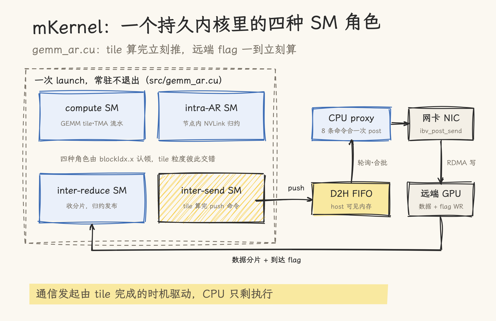
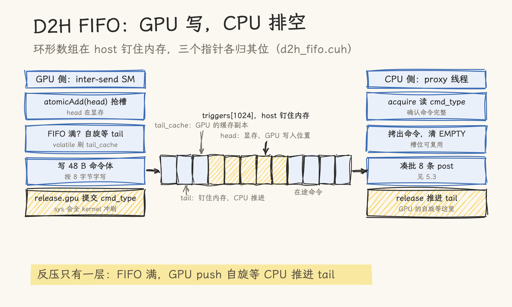
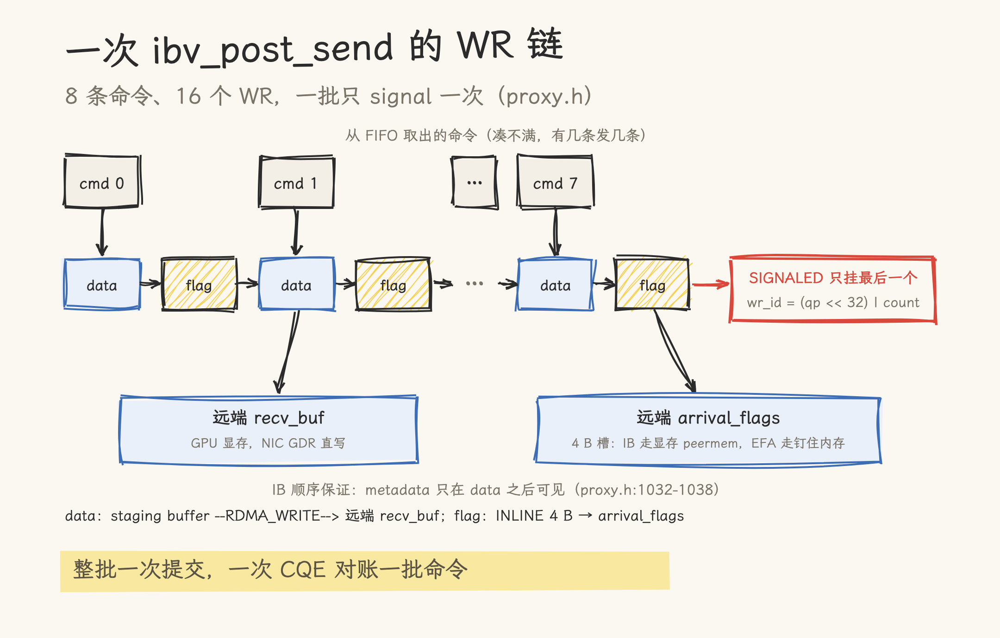
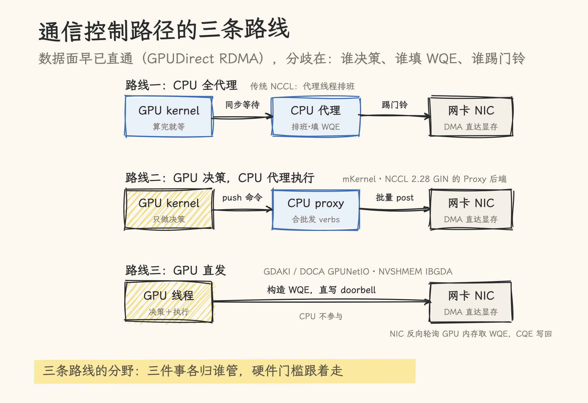

# GPUDirect Async 深拆：把通信的控制权从 CPU 手里拿回来

> **元信息**：主要基准为 NVIDIA 论文《GPU-Initiated Networking for NCCL》（[arXiv 2511.15076](https://arxiv.org/abs/2511.15076)，v2，NCCL 2.28 的 GIN 设计文档）、[mKernel](https://github.com/uccl-project/mKernel) 源码（`db74982`）、[DOCA GPUNetIO 文档](https://networking-docs.nvidia.com/doca/archive/3-1-0-core-update/doca-gpunetio)、[libgdsync 仓库](https://github.com/gpudirect/libgdsync)。核对日期 2026-11-13；本机无 InfiniBand 环境，性能数字全部为论文/仓库口径（NVIDIA EOS 集群 H100 实测为论文自报），引用时注意口径。

一次 MoE decode 的 token dispatch，要在几十个专家之间路由几百个 token，每个 token 只有几百字节。数据面早就不是瓶颈了：GPUDirect RDMA 让网卡直读 GPU 显存，这条道 2013 年就修通了。真正慢的环节在另一头：每发一次 RDMA，都得由 CPU 上的代理线程来排班，填描述符、踢门铃、盯完成。数据走得再直，发车的指令还是要绕道 CPU。

GPUDirect Async 是围绕这个环节的十年演进：从 2016 年把门铃寄存器映射进 GPU 地址空间，到 NVSHMEM 的 IBGDA，再到 NCCL 2.28 的 GIN 和 DOCA GPUNetIO，通信的发起权一步步从 CPU 手里挪到 GPU kernel 里。本文按这条线拆：先正名（这个词的窄义与广义），再拆三代机制的原理与取舍，最后进 mKernel 的源码，看一个不依赖 NCCL/NVSHMEM 的实现如何把计算、NVLink 传输和跨节点 RDMA 融进同一个持久内核。

## 一、正名：GPUDirect 家族里，Async 管的是控制面

NVIDIA 的 [GPUDirect](https://developer.nvidia.com/gpudirect) 官网页面列了四件套：RDMA、P2P、Storage、Video，没有给 Async 单独的页面。四件套管的是数据怎么搬，Async 管的是谁来发起搬运：

- **数据面**：字节从哪条路走。RDMA 让网卡 DMA 直达 GPU 显存，P2P 让 GPU 之间走 PCIe/NVLink，Storage 让 NVMe 直达显存。这条路 2013 年（RDMA）修通后，字节不再绕道 CPU 内存。
- **控制面**：谁决定发起传输、谁填传输描述符、谁触发网卡。这一面长期归 CPU：GPU kernel 把数据备好，退出或同步，CPU 上的代理线程填 Work Queue Element（WQE，描述「搬什么、从哪到哪」的队列项），再写网卡的 doorbell 寄存器（俗称踢门铃），网卡才开工。

「GPUDirect Async」这个词在十年里被用在两层含义上，引用前要先分辨：

**窄义（2016，随 CUDA 8.0 时代发布）**：把网卡的 doorbell 寄存器映射进 GPU 地址空间，GPU 线程可以直接触发通信。但 GIN 论文对它的限定很关键（§II-A 原文）：GPU 触发的是 **CPU 预先构造好的**通信操作，描述符仍由 host 填好，GPU 只是按门铃的那只手。控制权只下放了一半，这也是它后来被称为「partial control-path offload」的原因。当年配套的 libgdsync 库（IB Verbs 的 GPUDirect Async 支持）至今还在 GitHub 的 gpudirect 组织下。

**广义（今天语境下的 GPUDirect Async）**：泛指整个「GPU 发起通信」技术家族：NVSHMEM 及其 IBGDA 传输（IBGDA 全称就是 InfiniBand GPUDirect Async）、DOCA 文档正式定义的 **GDAKI**（GPUDirect Async Kernel-Initiated）、NCCL 2.28 的 GIN、以及 DeepEP 这类 MoE 通信库。这层的门槛高得多：GPU kernel 自己构造 WQE、自己踢门铃、自己盯完成，全程无 CPU。

本文标题里的「拿回控制权」，指后一种标准。下文按演进顺序拆。

## 二、CPU 代理的代价：host-initiated 模型慢在哪

要理解控制权为什么值钱，先看传统路径的完整流程。NCCL 的经典架构（GIN 论文 §II-D）：GPU kernel 把通信描述符写进 host 可见队列，CPU 代理线程轮询取出，经网络插件发起传输。这套设计在传统集合通信里被验证过，鲁棒、可扩展，但有三笔开销，负载一变碎就开始扎眼：

- **同步**：CUDA runtime 是 host-initiated 模型，通信操作与计算 kernel 之间要显式做 host-device 同步。细粒度通信意味着频繁同步，每次同步都是一次 kernel 边界往返。
- **调度**：代理线程是操作系统线程，CPU 排班延迟不稳定。通信越碎（MoE 的 all-to-all 恰好是碎通信的极端：消息不可预测、几百字节量级），代理线程越忙，越可能成为抖动源。
- **发射**：每个通信调用一次 kernel launch 或一次跨设备同步，把「算一点、传一点」的融合执行切成串行的大段。

MoE 推理把这三笔开销同时拉满：token 路由是动态的（消息大小和目标都不可预知），decode 又要求低延迟。编译器融合 kernel（Triton、JAX 生成的通信+计算一体 kernel）则从另一个方向提出同样诉求：kernel 里需要直接发通信原语，而不是退出去调 NCCL。GIN 论文 §I 把动机归结为一句话：applications requiring tight integration of computation and communication can benefit from device-initiated communication that eliminates CPU coordination overhead。

## 三、三代演进：从半卸载到 GPU 直发

**第一代：GDA（2016）。** 门铃寄存器映射进 GPU 地址空间，GPU 触发、CPU 预填描述符。消除的是「踢门铃」这一步的 CPU 往返，描述符构造与操作决策仍在 CPU。它验证了方向，也暴露了天花板：操作集是预配置的，动态负载玩不了。

**第二代：NVSHMEM + IBGDA。** NVSHMEM 把 OpenSHMEM 的单边语义（put/get/atomics）搬进 CUDA kernel，GPU 线程可以直接调用设备端通信原语。传输层 IBGDA（InfiniBand GPUDirect Async）解决了 WQE 的来源问题：GPU 线程在设备内存里构造 WQE，直接写网卡的 doorbell。这是第一次完整的 GPU 直发。代价是 NVSHMEM 是独立于集合通信框架的另一套 runtime，用它就要自己管通信器的初始化、拓扑与容错。

**第三代：GDAKI / DOCA GPUNetIO。** DOCA 把设备侧网络编程产品化：GPUNetIO 提供 device verbs，GPU kernel 直接对网卡编程（构造 WQE、写 doorbell、处理 CQE），文档正式把这套能力命名为 GPUDirect Async Kernel-Initiated（GDAKI）。硬件门槛也随之明确：ConnectX-6 Dx 或更新的网卡、CUDA 12.x、GPUDirect RDMA 内核模块（nv_peer_mem 或 dmabuf），且 GPU 与网卡最好挂在同一条 PCIe root complex 上。GIN 论文还描述了一个反直觉的细节：这套模式里，网卡会主动轮询 GPU 内存里的新 WQE，完成后把 CQE 写进 GPU 可见的内存。网卡在这里成了 GPU 的协处理器。

三代都建立在 GPUDirect RDMA 的数据直达之上，也都受同一个约束（GIN 论文 §II-A）：GPUDirect RDMA 的一致性保证只在 kernel 边界有效，GPU 内存模型的宽松排序与写回缓存，使得「kernel 执行中直接读写 RDMA 注册内存」需要额外的 fence 与同步设计。这也是早期尝试（GPUrdma、GIO）踩坑的地方，后文 GIN 的信号排序语义与 mKernel 的 flag 设计都在回答这个问题。

## 四、NCCL 2.28 GIN：把 GPU 直发装进生产级框架

NCCL 2.28 的 Device API 提供三种设备发起模式：**LSA**（Load/Store Accessible，NVLink/PCIe 的节点内通信）、**Multimem**（NVLink SHARP 硬件组播）、**GIN**（跨节点网络 RDMA）。前两种解决节点内，GIN 解决本文主题的节点间。

GIN 的三层架构：NCCL Core 管 host 侧（通信器初始化、集合内存窗口注册）；Device GIN API 暴露给 kernel 的单边原语；网络插件层带双语义后端。这套设计的关键取舍在双后端的选择逻辑：

- **GDAKI 后端**：GPU 线程直接构造 WQE、直写网卡 doorbell，走 DOCA GPUNetIO。小消息往返延迟最低，CPU 零参与。
- **Proxy 后端**：GPU 线程把 64 字节操作描述符 fire-and-forget 地写进 lock-free 队列（host 内存），每个通信器一个 CPU 代理线程（pin 在 GPU/NIC 的 NUMA 节点上）轮询发 verbs；完成状态经 GDRCopy 回写 GPU 可见内存。延迟略高，但任何 RDMA 网卡（InfiniBand/RoCE/iWARP）、Volta 起的 GPU 都能跑。

后端在通信器初始化时自动探测（有能力就 GDAKI，不行回落 Proxy），`NCCL_GIN_BACKEND` 环境变量可强制指定。硬件齐的集群走 GDAKI，其余走 Proxy，应用代码不用改。

设备侧 API 还有三个语义细节。其一，**信号排序**：默认无序，但同一 context 发往同一 peer 的操作里，signal 保证其前的所有 put 已完成且对端可见：用「批量 put + 末尾一个 signal」实现轻量排序，不做全局 fence。其二，**完成分两侧**：flush/counter 只证明本地完成（源缓冲可复用），signal 才证明远端可见。其三，signal/counter 用整数 ID 寻址而非内存地址，简化资源管理。论文 §III-B 的 ring exchange 示例只有五行：put（附带 SignalInc）、waitSignal、resetSignal，完整的跨节点环形交换。

**数字与口径**（论文 §V，NVIDIA EOS 集群 H100，NCCL 2.28 + NVSHMEM 3.4.5 + DeepEP 1.2.1，作者方自报）：

| 对比项                           | NCCL GIN                      | NVSHMEM 参照                 |
| -------------------------------- | ----------------------------- | ---------------------------- |
| 小消息（4–128 B）往返延迟        | GDAKI 16.7 μs / Proxy 18.0 μs | IBRC 16.0 μs / IBGDA 24.3 μs |
| HT dispatch 带宽（2 节点 BF16）  | 84.36 GB/s                    | 84.97 GB/s                   |
| LL dispatch（NVLink 开，1 节点） | 185.28 GB/s，40.62 μs         | 182.15 GB/s，41.43 μs        |
| LL dispatch 延迟（2 节点）       | 142.51 μs（低 9%）            | 157.00 μs                    |

这些数字要按用途读：它们证明的是「GIN 的设备发起没有用性能换生态」，与 NVSHMEM 打平或略优；更大的意义在论文结语说的生态统一：不用为了 MoE 的设备发起再部署一套独立 runtime。DeepEP 的集成实测给出了迁移成本样本：NVSHMEM 的指针寻址 + 内存原子同步，要翻译成 GIN 的窗口寻址 + signal 原子，QP 需求（HT 24 个、LL 8–16 个）要靠多 communicator 映射凑。

## 五、实践深拆：mKernel 的三路重叠与一条诚实的控制路径



[mKernel](https://github.com/uccl-project/mKernel)（uccl-project，`db74982`）是 UCCL 团队的多机多卡融合 kernel 库，它的口号是把计算、节点内 NVLink 传输、跨节点 RDMA 放进同一个持久内核，让三者在 tile 粒度上彼此重叠，而不是各跑各的。以 AllReduce 为例（`src/gemm_ar.cu`），本节把这个交互过程从头到尾走一遍：tile 怎么算完、完成怎么传递、命令怎么进 FIFO、CPU 代理怎么发、远端怎么收、归约怎么发布。

### 5.1 一次 launch，角色各就各位

主 kernel 固定 132 个 CTA（`gemm_ar.cuh:59` 的 `NUM_BLOCKS = 132`），按 `blockIdx.x` 的连续区间分发角色（`gemm_ar.cu:1344-1358`）。源码注释写的是四种角色（`gemm_ar.cu:64-74`），dispatch 链实际有五段：compute 跑 GEMM tile（TMA + warp 特化流水）；intra-AR 在节点内做 NVLink 归约；inter-send 盯着自己负责的输出 chunk，就绪即推跨节点通道；第四段 inter-recv-progress 默认不占 SM（host 侧默认分 0 个，`gemm_ar.cuh:1091`），到达队列由 inter-reduce 的 CTA 兼职排空；最后一段 inter-reduce 收远端分片、归约、发布。各角色的 SM 数量在 host 侧由 `gemm_ar_compute_role_split` 一次算定（`gemm_ar.cuh:1060-1098`），inter-send 可用环境变量 `GEMM_AR_INTER_SEND_SMS` 覆盖。

角色之间的完成传递没有用 TMA 完成事件或 scoreboard，全靠显存里的 u32 原子计数，两级接力。compute 侧每个 chunk 的最后一个 tile 发 per-chunk barrier（`gemm_ar.cu:140-155`）：

```cpp
uint32_t prev = atomicAdd(G.comp_chunk_tiles_done + flat_chunk, 1u);
if (prev == (uint32_t)(tiles_this_chunk - 1)) {
    ...
    comm::atomic_u32::release_store_sys(
        &G.barrier[G.dev_idx][{row_idx, chunk_col}], G.epoch);
}
```

intra-AR 归约完一个 chunk 的全部 tile 后置完成 flag，归约结果双写 `C_local` 与 staging buffer（后者是 RDMA 发送的源，`gemm_ar.cu:405-423`）：

```cpp
uint32_t prev = atomicAdd(G.intra_chunk_tiles_done + chunk_id, 1u);
if (prev + 1u == (uint32_t)tiles_this_chunk) {
    ...
    gemm_ar_release_store_u32(G.local_done_flag + chunk_id, 1u);
```

inter-send 的 0 号线程自旋等这个 flag（`gemm_ar.cu:497-503`）：

```cpp
while (gemm_ar_acquire_load_u32(G.local_done_flag + cc) == 0u) {
    __nanosleep(50);
}
```

acquire/release 是 PTX 级的显式排序（`ld.acquire.gpu` / `st.release.gpu`，`include/comm/atomic_u32.cuh`）。到这里为止一切都在 GPU 显存内，CPU 还没出场。

### 5.2 命令与 FIFO：GPU 侧把决策变成 48 字节

inter-send 等到 chunk 就绪，填一条 48 字节的 packed 命令（`types.h:28-56` 的 `TransferCmd`），push 进设备到主机的 FIFO（`gemm_ar.cuh:238` 的 `D2HFifoDeviceBundle`，`gemm_ar.cu:548-561` 逐字段填充）：

```cpp
struct TransferCmd {
    CmdType  cmd_type;       // WRITE or FENCE，最后提交
    uint8_t  dst_rank;       // 目标节点
    uint16_t lane_id;        // lane → QP 路由
    uint32_t tile_id;        // 本次传输的第一个 tile（到达元数据）
    uint64_t remote_offset;  // 远端 RDMA 注册缓冲内的字节偏移
    uint64_t local_offset;   // 本端 RDMA 注册缓冲内的字节偏移
    uint32_t bytes;          // 传输大小
    ...
    uint64_t enqueue_device_ns; // push 前的 GPU 时间戳
};
static_assert(sizeof(TransferCmd) == 48, "TransferCmd must be exactly 48 bytes");
```

地址全部用「注册缓冲内偏移」而不是绝对地址，基址与 rkey 在建连时交换；flag 的远端槽位 GPU 侧也不用填，由 proxy 从 `tile_id` 和 `lane_id` 推导（见 5.4）。



FIFO 本体是 mscclpp 风格的四件套（`include/comm/internode/d2h_fifo.cuh`）：`triggers[]` 是 `cudaHostAlloc(Mapped)` 的钉住内存（GPU 直写走 PCIe），`head` 在显存由 GPU `atomicAdd` 抢槽，`tail` 在钉住内存由 CPU 排空后推进，`tail_cache` 是 GPU 侧的缓存副本。`push()` 先抢槽，FIFO 满就自旋刷新 tail_cache（GPU 侧唯一的反压点，`d2h_fifo.cuh:56-72`），然后写命令体、最后用 release store 提交首字段 cmd_type。

这里有个能看出取舍的细节：提交用的是 `release.gpu` 而不是 `release.sys`，注释原话（`d2h_fifo.cuh:83-95`）：

> Use release.gpu (cheaper than release.sys) — sys-scope release on H100 forces a kernel-wide L2/HBM drain that serializes with hot-spinning compute CTAs and adds ~ms per push.

跨 CPU 可见性反而选了更弱的 scope，因为 sys-scope 的全 kernel 缓存冲刷在热自旋的 compute CTA 旁边代价是毫秒级；proxy 只需要对 cmd_type 做 acquire 就能安全拷出整条命令。同一个系统里，跨节点 stage_barrier 用的又是 `ld.acquire.sys`（`gemm_ar.cuh:557-562`，等 NIC 参与写入的 barrier）：scope 按路径代价逐处挑，不是一刀切。

### 5.3 CPU proxy：凑批、链式 WR、一批只 signal 一次

Proxy 线程（`proxy.h`，pin 在 GPU 的 NUMA 节点）的主循环每轮四步（`proxy.h:818-1221`）。

第一步凑批：非阻塞地从 FIFO 取命令，最多 `BATCH_SIZE = 8` 条（`proxy.h:115-116`）。批内命令必须走同一个 QP（lane→QP 路由的约束），碰到跨 QP 的命令就存起来下轮先发；凑不满不等，有几条发几条，一条没有也会去收完成队列。



第二步构造 WR 并一次 `ibv_post_send`：每条命令链两个 WR。数据 WR 用 `IBV_WR_RDMA_WRITE`，把 staging buffer 里的数据写到远端 `remote_data_addr + cmd.remote_offset`（lkey 来自建连时注册的 MR）；flag WR 是 4 字节 INLINE 写，把打包的到达元数据写进远端 arrival_flags 数组。顺序依据注释写得很清楚（`proxy.h:1032-1038`）："IB ordering guarantees the metadata is visible only after data." flag WR 用 `IBV_SEND_INLINE` 把 4 字节嵌进 WQE 本体，省掉一次 PCIe DMA 读 staging buffer（注释估 ~500ns）。整批只有最后一个 WR 置 `IBV_SEND_SIGNALED`，`wr_id` 编码 `(qp << 32) | count`，一次 CQE 对账一批命令。

第三步收完成：每轮 `ibv_poll_cq` 最多取 32 个 CQE，按 `wr_id` 里的计数递减 `inflight_`。

第四步推进 FIFO tail（`proxy.h:1207-1210`）：`count > 0` 才写。GPU 侧 push 的自旋，等的就是这个 tail。

### 5.4 远端：flag 落到哪，归约怎么发布

两个 WR 在远端的落点是两类内存。数据 WR 直接写进对端的 recv_buf：`cudaMalloc` 的 GPU 显存，建连时经 GPUDirect RDMA 注册（`session.h:414-428`），NIC 的 DMA 经 PCIe 直达对端 HBM，对端 CPU 不参与。flag WR 写对端的 arrival_flags 数组（4 字节槽）：IB 后端这块数组也在显存里，靠 nvidia_peermem 让 NIC 直写（`arrival.cuh:63-64`："Allocate in device memory (GPU HBM) for fast polling"）；EFA 后端才落钉住内存（`arrival.cuh:82-98`）。双方的地址与 rkey 在 TCP bootstrap 阶段交换（`types.h:146-186` 的 `ConnectionInfo`）。

flag 的值不是简单的 1：arrival-queue 布局下打包成 `(first_tile + 1) | ((num_tiles - 1) << 24)`（`types.h:79-90`），0 是「未到」哨兵，一个 flag 能携带一段连续 tile 的到达信息。

远端 GPU 侧，reduce CTA 兼职排空到达队列（`gemm_ar.cuh:703-737`）：volatile 读顺序扫描 `arrival_flags[q][head]`，解码出 tile 区间，`__threadfence_system()` 保证数据可见先于元数据发布，再 release-store 置 `remote_arrived_flag[chunk] = 1`。inter-reduce 等两个 flag 齐了才动手（`gemm_ar.cu:1128-1135`）：

```cpp
const bool remote_done =
    (gemm_ar_acquire_load_u32(G.remote_arrived_flag + chunk_id) != 0u);
const bool local_done =
    gemm_ar_acquire_load_u32(G.local_done_flag + chunk_id) == 1u;
if (remote_done && local_done) { break; }
__nanosleep(50);
```

归约是 uint4 向量的 `__hadd2`：本地分片加远端分片，结果经 NVSwitch multimem store 发布到 multicast 支撑的 `C_final`，本节点 8 卡同步可见（`gemm_ar.cuh:816-829`）。超过 16 个 chunk 的形状还会 launch 一个 epilogue kernel（`gemm_ar.cuh:1458-1479`），与主 kernel 同 stream 顺序执行，负责 multicast 收尾、到达 flag 重置和跨节点迭代 barrier；小形状为省 launch 开销，这些收尾留在主 kernel 内完成。

### 5.5 流控：SQ 深度倒推的限流

QP 的 SQ 深度硬编码 2048（`session.h:367`）。每个在途 chunk 消耗 `kWrsPerChunk` 个 SQ 槽（2 个起步，打开 remote-tail / forward-notify 选项时 3–4 个），proxy 按「深度 ÷ 每 chunk WR 数 − 64 个 CQE 余量」倒推每 QP 的在途 chunk 上限，再乘 QP 数得总上限（`proxy.h:130-152` 的注释逐项演算了这笔账，防的正是 `ibv_post_send: Cannot allocate memory`）。在途上限同时是 FIFO 的出队闸门：proxy 不取命令，FIFO 就涨满，GPU 侧 push 自旋等待。GPU 与网卡之间没有 SQ credit 协议，反压完全靠 FIFO 这一层。

### 5.6 控制路径的定性：同族于 GIN Proxy，而非 GDAKI

把这套机制摆回 §六 的谱里：mKernel 的控制路径与 NCCL GIN 的 Proxy 后端是同一族，**GPU 驱动决策、CPU 代理执行**，而不是 GDAKI 式的 GPU 直发。README 里的「GPU-driven networking, built from scratch」指重叠的发起与推进由 kernel 内逻辑驱动（tile 算完立刻推、远端 flag 一到立刻算），描述符构造仍在 CPU。远端同步用 flag WR 实现的做法，与 GIN 的 signal 排序语义是同一个思想在 verbs 层的手工实现。

为什么不直发？先看硬件覆盖面：mKernel 同时支持 ConnectX-7（IB/RoCE 的 RC 传输）与 AWS EFA（SRD 传输），两个后端共享同一份 GPU kernel，只有 proxy/session 实现不同（`session.h` 与 `session_efa.h`）。CPU 代理路径不挑网卡代际、不挑 CUDA 版本，调试时还能在 host 侧插桩。对一个大范围适配硬件的库，这是比极限延迟更重要的工程约束。

## 六、控制路径的三条路线



把传统 NCCL、GIN 双后端、mKernel 摆在一起，控制路径的设计空间是一条谱：

| 路线                | 决策者     | WQE 构造者   | 门铃     | 代表                          | 硬件门槛            |
| ------------------- | ---------- | ------------ | -------- | ----------------------------- | ------------------- |
| CPU 全代理          | CPU        | CPU          | CPU      | 传统 NCCL                     | 无                  |
| GPU 决策 + CPU 代理 | GPU kernel | CPU（proxy） | CPU      | mKernel、GIN Proxy 后端       | 任意 RDMA 网卡      |
| GPU 直发            | GPU kernel | GPU 线程     | GPU 线程 | GDAKI/GPUNetIO、NVSHMEM IBGDA | CX-6 Dx+，CUDA 12.x |

三条路线没有绝对优劣，选择变量是硬件代际、网卡类型、调试需求与延迟目标。GIN 的双后端自动探测本质上是让这个选择在运行时发生；mKernel 选择第二条路线并把它做进融合 kernel；DeepEP 走 NVSHMEM IBGDA 的第三条路线，正在经 GIN 迁回统一框架。路线一和路线二都有「代理」，但角色已经不同：路线二的代理只执行 GPU 已经做出的决策（FIFO 里是结构化的发送命令），不做调度决策，所以它的存在不再把计算通信融合切碎。

## 七、总评与适用边界

判断一：控制面是下一个十年的通信主战场。数据面（RDMA/P2P/Storage）十多年前就已修通，此后的延迟优化大多卡在同一个地方：发起权在 CPU。GDA 到 GDAKI 的十年，本质是把「谁构造描述符、谁踢门铃、谁盯完成」三个问题逐一从 CPU 迁往 GPU，而迁移的每一步都要重新回答 GPU 内存模型与网卡一致性之间的老问题。

判断二：双后端是生产化的钥匙。GIN 若只有 GDAKI，它就是 NVSHMEM 的子集；正是因为 Proxy 后端保住了任意网卡、旧 GPU、旧 CUDA 的兼容性，设备发起才能装进 NCCL 这个生产框架。mKernel 的 CPU proxy 是同一逻辑的独立验证。评估任何「GPU 直发」方案时，先问它的兼容回落路径是什么。

判断三：融合 kernel 改变的不只是延迟，是通信的形态。mKernel 的 tile 粒度重叠、DeepEP HT kernel 的 SM 角色分工，都指向同一个趋势：通信不再是计算之间的独立段落，而是 kernel 内部与计算并行的另一种「活」。这对调试与观测是新挑战（通信事件不再对应独立的 NCCL 调用，nsys 时间线上的形状会变），也给后续优化留了余地（batch WQE、摊薄 doorbell 成本，GIN 论文列为 future work）。

适用边界：本文机制描述基于 GIN 论文与 mKernel `db74982` 源码，性能数字全部为 NVIDIA EOS 集群与各仓库自报口径，本机无 InfiniBand 环境，未做复测。GDAKI 路线需要 ConnectX-6 Dx+ 与 CUDA 12.x，硬件不满足时 GIN 自动回落 Proxy；mKernel 的 EFA 后端面向 AWS p5/p5e。动手实验前建议先核对 DOCA 版本与 MOFED 驱动栈。

## 源文件索引

| 来源                                                        | 关键内容                                                                                                                                                                                        | 本文引用       |
| ----------------------------------------------------------- | ----------------------------------------------------------------------------------------------------------------------------------------------------------------------------------------------- | -------------- |
| GIN 论文（arXiv 2511.15076 v2）                             | GDA 窄义限定、三代演进、双后端、signal 排序语义、全部性能数字                                                                                                                                   | 一、二、三、四 |
| mKernel `src/gemm_ar.cu`                                    | 角色注释与 dispatch（:64-74、:1344-1358）、两级完成计数（:140-155、:405-423）、inter-send 自旋（:497-503）、cmd 填充（:548-561）、双 flag 等待与归约（:1128-1172）、epilogue（:1380-1397）      | 五             |
| mKernel `include/operators/gemm_ar/gemm_ar.cuh`             | `NUM_BLOCKS=132`（:59）、`D2HFifoDeviceBundle`（:238）、stage_barrier（:557-562）、到达队列排空（:703-737）、multimem 发布（:816-829）、role_split（:1060-1098）、epilogue launch（:1458-1479） | 五             |
| mKernel `include/comm/internode/proxy.h`                    | `BATCH_SIZE=8`（:115-116）、SQ 限流注释（:130-152）、WR 模板与 signaling（:568-583、:1032-1080）、主循环（:818-1221）、tail 推进（:1207-1210）                                                  | 五             |
| mKernel `include/comm/internode/types.h`                    | `TransferCmd` 48 字节（:28-56）、`pack_arrival_work`（:79-90）、`ConnectionInfo`（:146-186）                                                                                                    | 五             |
| mKernel `include/comm/internode/d2h_fifo.cuh`               | FIFO 四件套与 `push`（:56-95）、`poll`/`advance_tail`（:204-254）、分配与容量（:275-305）                                                                                                       | 五             |
| mKernel `include/comm/internode/arrival.cuh`                | 到达 flag 落点：IB 显存 peermem / EFA 钉住内存（:63-98）                                                                                                                                        | 五             |
| mKernel `include/comm/internode/session.h` 等               | recv_buf 注册（:414-428）、SQ depth 2048（:366-367）、FIFO 容量（:435）；`session.cuh` max_inflight 与 arrival-queue（:39-52）；`rdma_transport.h:105` `create_rc_qp`                           | 五             |
| DOCA GPUNetIO 文档                                          | GDAKI 定义、CX-6 Dx+ 门槛                                                                                                                                                                       | 三、四         |
| libgdsync 仓库                                              | 窄义 GPUDirect Async 的 IB Verbs 实现                                                                                                                                                           | 一             |
| 本仓 NCCL 文档（cuda-knowledge 技能 references/nccl-docs/） | NCCL 代理线程架构与 device API 背景                                                                                                                                                             | 二、四         |

## 参考资料

- [GPU-Initiated Networking for NCCL（arXiv 2511.15076）](https://arxiv.org/abs/2511.15076) · [HTML 全文](https://arxiv.org/html/2511.15076v2)
- [uccl-project/mKernel](https://github.com/uccl-project/mKernel) · [gpudirect/libgdsync](https://github.com/gpudirect/libgdsync)
- [DOCA GPUNetIO 文档](https://networking-docs.nvidia.com/doca/archive/3-1-0-core-update/doca-gpunetio) · [NVIDIA GPUDirect 官网](https://developer.nvidia.com/gpudirect)
- [NVIDIA 官方中文博客：NCCL 2.28 Device API 与基于拷贝引擎的集合通信](https://developer.nvidia.cn/blog/fusing-communication-and-compute-with-new-device-api-and-copy-engine-collectives-in-nvidia-nccl-2-28)
- 中文对读：[NCCL GIN 详解（知乎）](https://zhuanlan.zhihu.com/p/1976398901817909660) · [IBGDA 笔记（liujunming）](http://liujunming.github.io/2025/05/11/Notes-about-IBGDA-InfiniBand-GPUDirect-Async) · [GDR 与 GDA 的区别（博客园）](https://www.cnblogs.com/bandaoyu/p/19216931)
- 本仓：[launch、occupancy、overlap：什么时候手写 kernel](../../02_gpu_programming/05_compiler/01_kernel-compiler-megakernel.md)（融合 megakernel 的谱系位置）· [NCCL 集合通信](../)（本目录门户）
