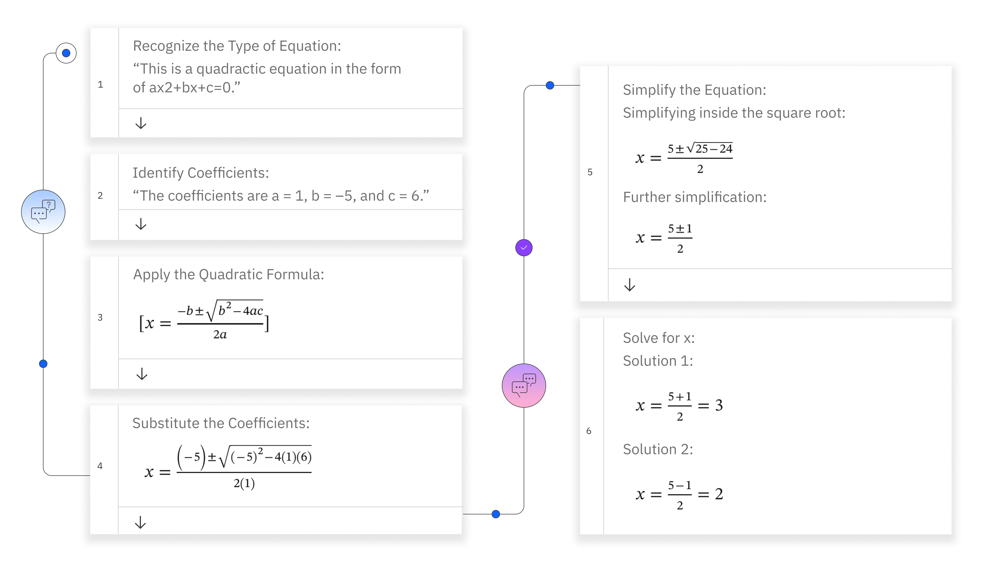
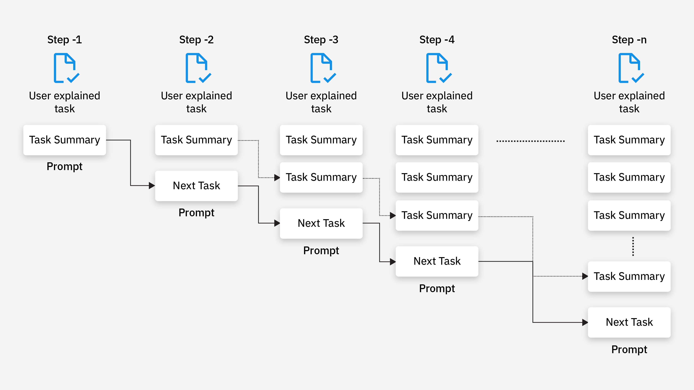

# 一文读懂思维链（Chain-of-Thought, CoT）

> **原文题目**：**What is chain of thought (CoT) prompting?**  
> **原文地址**：`https://www.ibm.com/think/topics/chain-of-thoughts`（第 3 节另参照 `https://www.ibm.com/think/topics/prompt-chaining`）  
> **作者**：IBM（IBM Think）  
> **说明**：本文为中文整理译介，文中配图来自 IBM 原文，已转存至本目录 `img/`。

## 1. 核心定义与起源

**思维链**（`Chain-of-Thought`, `CoT`）是一种通过引导**大型语言模型**生成中间推理步骤来提升复杂任务表现的提示方法。其核心思想是在**少样本学习**（`few-shot learning`）中，通过展示从输入到输出的**完整推理路径**，而非仅提供最终答案，从而激活模型的逻辑推理能力。少样本学习是指在训练数据有限的情况下，模型能够快速适应新任务并进行有效学习的一种学习方式，在思维链中，通过这种方式让模型理解并生成推理过程，进而提高其在复杂任务中的表现。

**关键突破**：

- **涌现性**：模型规模需达到约千亿量级时，`CoT`才能显著生效。Wei 等人（2022，[arXiv:2201.11903](https://arxiv.org/abs/2201.11903)）的实验显示，`PaLM-540B` 在数学推理任务 `GSM8K` 上的准确率从标准提示的 **17.9%** 提升至思维链提示的 **56.9%**；
- **可解释性**：中间推理步骤使模型决策过程透明化，便于调试错误。

## 2. 核心原理与优势

### 2.1 工作原理

`CoT`通过模拟人类分步推理的思维过程，将复杂任务分解为多个子步骤。例如，在解决二次方程时，模型会逐步执行以下操作（示例）：

```text
1. 识别方程类型：x² - 5x + 6 = 0（标准二次方程形式ax²+bx+c=0）
2. 因式分解：寻找满足m×n=6且m+n=-5的数（-2和-3）
3. 构建方程：(x-2)(x-3)=0
4. 应用零乘积定理：x=2或x=3
5. 验证解的正确性：代入原方程确认结果
```



### 2.2 **DeepSeek R1**模拟

**问题**：

```text
求解二次方程：x² - 5x + 6 = 0，如何模拟思维链？
```

**输出**：

要解二次方程 $ x^2 - 5x + 6 = 0 $，可以通过以下步骤模拟思维链：

#### **1. 因式分解法**

- **目标**：将方程分解为两个一次因式的乘积形式。
- **步骤**：
  1. 寻找两个数，使得它们的乘积为常数项 $ 6 $，和为一次项系数 $ -5 $。
  2. 通过尝试发现，$ -2 $ 和 $ -3 $ 满足条件：
     $$
     (-2) \times (-3) = 6, \quad (-2) + (-3) = -5.
     $$
  3. 将方程分解为：
     $$
     (x - 2)(x - 3) = 0.
     $$
  4. 解为：
     $$
     x = 2 \quad \text{或} \quad x = 3.
     $$

---

#### **2. 求根公式验证**

- **公式**：$ x = \frac{-b \pm \sqrt{b^2 - 4ac}}{2a} $，其中 $ a = 1 $，$ b = -5 $，$ c = 6 $。
- **计算**：
  1. 判别式：
     $$
     b^2 - 4ac = (-5)^2 - 4 \cdot 1 \cdot 6 = 25 - 24 = 1.
     $$
  2. 代入公式：
     $$
     x = \frac{5 \pm \sqrt{1}}{2} = \frac{5 \pm 1}{2}.
     $$
  3. 解为：
     $$
     x = \frac{5 + 1}{2} = 3 \quad \text{或} \quad x = \frac{5 - 1}{2} = 2.
     $$

#### **3. 配方法验证**

- **步骤**：
  1. 移常数项到右边：
     $$
     x^2 - 5x = -6.
     $$
  2. 配方（加 $ \left(\frac{5}{2}\right)^2 $）：
     $$
     x^2 - 5x + \frac{25}{4} = -6 + \frac{25}{4}.
     $$
  3. 左边化为完全平方：
     $$
     \left(x - \frac{5}{2}\right)^2 = \frac{1}{4}.
     $$
  4. 开平方求解：
     $$
     x - \frac{5}{2} = \pm \frac{1}{2} \quad \Rightarrow \quad x = \frac{5}{2} \pm \frac{1}{2}.
     $$
  5. 解为：
     $$
     x = 3 \quad \text{或} \quad x = 2.
     $$

---

#### **4. 验证解的合理性**

- **代入检验**：
  - 当 $ x = 2 $ 时：
    $$
    2^2 - 5 \cdot 2 + 6 = 4 - 10 + 6 = 0.
    $$
  - 当 $ x = 3 $ 时：
    $$
    3^2 - 5 \cdot 3 + 6 = 9 - 15 + 6 = 0.
    $$
    结果均成立。

### **最终答案**

$$
\boxed{ x = 2 \quad \text{或} \quad x = 3 }
$$

### 2.3 与传统提示的对比

| **方法**   | **输出形式**  | **适用场景** | **性能表现**     |
| ---------- | ------------- | ------------ | ---------------- |
| `标准提示` | 直接输出答案  | 简单任务     | 低（依赖直觉）   |
| `CoT提示`  | 答案+分步推理 | 复杂推理任务 | 高（依赖逻辑链） |

实验表明（Wei et al., 2022），`CoT` 在需要多步推理的任务上提升显著：`PaLM-540B` 在 GSM8K 上从标准提示的 17.9% 提高到 56.9%，相对提升约 2-3 倍，且这一成绩超过了当时在 GSM8K 上微调出的最优监督基线。

## 3. 提示链与思维链的区别

**提示链**（`prompt chaining`）是**任务级分解**：把一个复杂任务拆成多个串联的子任务提示，前一步的输出作为后一步的输入，每一环只优化自己负责的那一步。**思维链**则是**单次推理内部的步骤展开**，让模型在一次生成中显式写出中间推理。二者解决的是不同层面的问题，属于正交关系，并不存在"谁更基础、谁更高级"的从属关系——实践中两者经常组合使用：提示链负责把大任务切成小任务，每个子任务内部再用思维链展开推理。

试想，如果 AI 被问到“天空是什么颜色的？”，`AI` 会生成一个简单直接的回答，例如“天空是蓝色的。”然而，如果使用 `CoT` 提示要求 `AI` 解释为什么天空是蓝色的，`AI` 首先会说明太阳光由多种波长的可见光组成，然后推导出：阳光进入大气层后，波长较短的蓝光比波长较长的红光更容易被空气分子散射（瑞利散射，散射强度与波长的四次方成反比），被散射的蓝光从四面八方进入人眼，天空因此呈现蓝色。这一回答体现了 AI 构建逻辑论证的能力。



**提示链与思维链对比**：

| **特征** | **提示链**       | **思维链（CoT）**  |
| -------- | ---------------- | ------------------ |
| 作用层面 | 任务级分解（多提示串联） | 单次推理内的步骤展开 |
| 推理深度 | 单步推理         | 多步符号化推理     |
| 可解释性 | 低               | 高（展示中间步骤） |

## 4. 大模型推理与思维链的区别

**大模型推理**是指利用具有大量参数（通常数十亿甚至数千亿）的深度学习模型来进行复杂的逻辑推理和问题解决。这些模型通过在大规模数据上进行训练，学习到丰富的知识和**模式**，从而能够处理各种复杂的任务，如数学问题、逻辑推理、自然语言理解等。

大模型推理的工作原理主要包括以下几个方面：

1. **模型结构**：通常基于`Transformer`架构，这种架构能够有效地处理序列数据，并捕捉到数据中的长期依赖关系。
2. **训练过程**：通过在大规模的文本数据上进行无监督或有监督的训练，模型学习到语言的表示和语义理解能力。
3. **推理过程**：在面对具体问题时，模型会根据输入的提示或问题，生成相应的输出。这个过程可能涉及到模型内部的多步计算和逻辑推理。

大模型推理的优势在于其强大的知识表示能力和泛化能力，能够处理各种复杂的任务，并且随着模型规模的增大和训练数据的丰富，其性能也在不断提升。

**大模型推理与思维链对比**：

| **特征** | **大模型推理**     | **思维链（CoT）**  |
| -------- | ------------------ | ------------------ |
| 工作原理 | 模型内部隐式计算   | 显式生成推理步骤   |
| 可解释性 | 黑箱操作           | 白箱可视化         |
| 资源需求 | 高（依赖模型规模） | 低（少样本即可）   |
| 错误调试 | 困难               | 可通过中间步骤定位 |

总的来说，大模型推理和思维链都是提升模型在复杂任务上表现的重要方法，但它们在工作原理、适用场景、性能表现和可解释性等方面存在一定的差异。在实际应用中，可以根据具体任务的需求和特点，选择合适的方法来提升模型的推理能力。

## 5. 重要变体与后续研究

思维链自提出（Wei et al., 2022）以来，衍生出两条影响最大的分支：

**Zero-shot CoT（零样本思维链）**

Kojima 等人在《Large Language Models are Zero-Shot Reasoners》（Kojima et al., 2022, [arXiv:2205.11916](https://arxiv.org/abs/2205.11916)）中发现：不给任何示例，只要在提问末尾追加一句 "Let's think step by step"，就能显著激活模型的推理能力——InstructGPT 在 MultiArith 上从 17.7% 提升到 78.7%，在 GSM8K 上从 10.9% 提升到 40.7%。这说明 CoT 的核心在于"引导模型产出中间步骤"，而非依赖示例本身。

**Self-Consistency（自一致性）**

Wang 等人在《Self-Consistency Improves Chain of Thought Reasoning in Language Models》（Wang et al., 2022, [arXiv:2203.11171](https://arxiv.org/abs/2203.11171)）中提出：对同一个问题用思维链采样多条推理路径，再对最终答案做多数投票。单条链可能中途走错，但多条路径"殊途同归"的答案更可信——该方法把 PaLM-540B 在 GSM8K 上的成绩从 56.9% 进一步提升到 74.4%。

## 6. 局限性

1. **错误累积效应**  
   中间步骤的错误会直接影响最终结论的正确性。例如，若在因式分解时出现错误，如错误地将方程分解为 $(x-1)(x-6)=0$，则会得到错误的解 $x=1$ 和 $x=6$，导致整个推理过程失效。

2. **领域依赖性**  
   `CoT` 在不同领域中的表现存在差异。在创造性任务中，如诗歌生成，`CoT` 可能会限制模型的发挥，因为创造性任务更需要自由联想和灵感，而 `CoT` 的逻辑推理框架可能会束缚模型的创造力。

3. **提示敏感性**  
   推理步骤的粒度对结果有显著影响。例如，在解方程时：
   - 若提示过于简略，如仅分3步解方程，可能导致模型遗漏关键步骤，从而使准确率下降12%。
   - 若提示适度拆分，如分5步解方程，模型能够更全面地覆盖推理过程，准确率可提升至峰值。

## 7. 建议

对于普通用户而言，如果某个问题必须依赖 `COT` 才能准确解答，那就请忘掉 `COT`，直接让大模型自动推理即可。例如，`DeepSeek R1` 的深度思考模式下，`Think` 标签会展示推理过程，相当于隐式执行了 `COT`，但用户无需理解或关注这个术语——模型已经在后台完成了这一过程！
