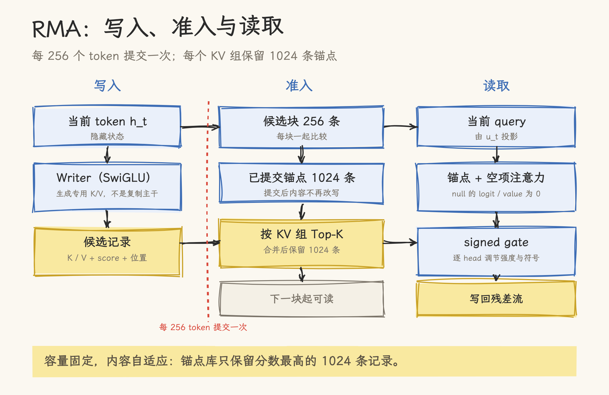
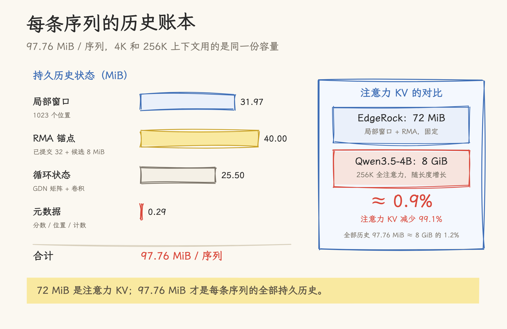
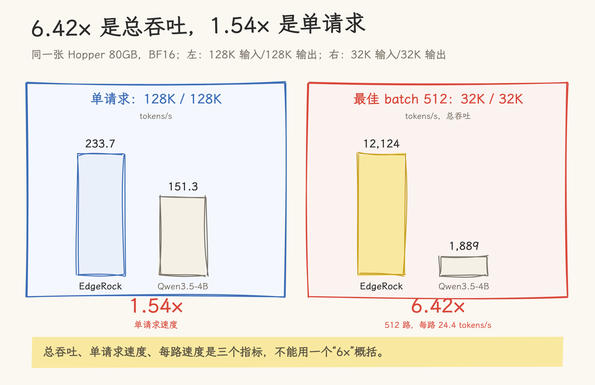

# EdgeRock-4B 拆解：把 KV Cache 变成固定容量记忆

> 2026-10-21 | 论文与源码解读。基于 [arXiv 2610.10118](https://arxiv.org/abs/2610.10118)（2026-10-19）、《EdgeRock：长程推理，恒定内存》中文技术报告、[rockmatrix-ai/EdgeRock](https://github.com/rockmatrix-ai/EdgeRock) HEAD `63df039` 与 Hugging Face 权重元数据；性能数字为论文/厂商口径，未独立复现。

一个 Agent 连续工作几小时，工具结果、失败日志、用户纠正不断追加。每生成一个 token，KV Cache 就多存一份。以 Qwen3.5-4B 为例，每个 token 新增 32 KiB；推理到 64K，一条序列就是 2 GiB；到 256K，就是 8 GiB。

EdgeRock 的出发点很直接：让这份历史不随长度增长。它把 Qwen3.5-4B 的 8 层全注意力换成 1024 token 局部窗口加 1024 条记忆锚点，论文报告单序列历史固定为 97.76 MiB，AIME 2024–2026 平均 82.9%，单卡 512 路并发输出吞吐 12,124 tokens/s。

## 一、长推理的显存账

全注意力把每个 token 的键和值都存进 KV Cache。序列越长，缓存越大，单卡能同时服务的请求越少。端侧还要和感知、控制模块争内存，问题更明显。

已有的办法大致两类。

一类是降低单个 token 的成本：MLA 压缩 KV 表示，KIVI 这类方法降低精度，DeepSeek 的稀疏注意力只读取部分条目。它们能把 32 KiB/token 降到更小，但缓存仍然随长度增长。另一类是有界状态模型：循环模型、状态空间模型、滑动窗口模型把历史压进固定状态，内存不涨，但远处细节容易丢。KV 淘汰方法也能给缓存设上限，不过模型训练时没学过只凭剩下的内容推理。

EdgeRock 换了一个目标：让历史容量与长度脱钩。它保留一个固定容量的锚点库，训练模型自己决定哪些内容值得留下。容量固定，内容自适应。

## 二、改造 Qwen3.5-4B：只动 8 层

EdgeRock-4B 的底座是 Qwen3.5-4B。Qwen3.5-4B 本身是混合架构：32 层里 24 层 Gated DeltaNet（GDN），8 层全注意力。EdgeRock 保留 24 层 GDN，把 8 层全注意力替换成：

```text
[GDN, GDN, GDN, SWA1024 ∥ RMA] × 8
```

每四层一个组合：三层循环层，一层“1024 token 滑动窗口 + RMA 记忆模块”。八个 RMA 模块各自有独立参数和状态，合计约 372M 参数。Hugging Face 权重显示总参数 4.58B，所以“4B”是系列名，不是精确参数量。

| 配置项 | 数值 |
| --- | --- |
| 底座 | Qwen3.5-4B |
| 层数 | 32 层：24 GDN + 8 个全注意力层 |
| 改造 | 8 层全注意力替换为 SWA1024 + RMA |
| RMA 参数 | 372M |
| 总权重 | 4.58B（BF16） |
| 注意力头 | 16 个 query head / 4 个 KV 组 / head dim 256 |
| 局部窗口 / 锚点容量 / 提交块 | 1024 / 1024 / 256 |

配置写在 `config.json:13-31`：`fixed_memory_swa_layers` 指定 8 个被替换的层，`fixed_memory_swa_window` 为 1024，`independent_memory` 里 `capacity=1024`、`max_commit_chunk=256`、`admission_rank=256`。图像输入沿用 Qwen 的视觉前端，和文本嵌入拼成统一序列。

这个改造只动 8 层，是 EdgeRock 能保住能力的前提。大部分语言能力来自原来的 24 层 GDN 和预训练权重，RMA 是在这个底座上加的一层记忆机制，不是从零训练一个新架构。

## 三、RMA：写入、准入与读取

RMA 的流程有四步。代码在 `modeling_edgerock.py:122-330`，论文对应 §3.1–3.5。

写入。每个 token 的隐藏状态先做归一化，得到 `u_t`；再经过一个 SwiGLU 式 writer：

```text
w_t = u_t + W_down(SiLU(W_gate u_t) ⊙ W_up u_t)
```

K/V 从 `w_t` 投影，query 从 `u_t` 投影。也就是说，锚点存的是 writer 生成的专用 K/V 记录，不是复制主干已有的 K/V。writer 的中间维度是 2560，和隐藏维度一致。

打分。一个小型 MLP 给每个 KV 组算保留分：

```text
a_t = W_a2 SiLU(W_a1 u_t),  a_t ∈ R^4
```

`W_a1` 是 2560×256，`W_a2` 是 256×4，无偏置，分数用 FP32 计算（`modeling_edgerock.py:173-175`）。四个 KV 组独立保留，不同组可以选中同一个来源位置。

准入。每 256 个 token 为一个候选块。块边界上，每个 KV 组把已提交的 1024 条锚点和本块的 256 条候选放在一起，按分数取 top-1024；同分时保留更早的位置。新选中的记录从下一块开始可读，块内查询只能看到上一块已提交的锚点。已提交的记录不会被改写；被淘汰的记录不会因为后续候选出现而重新进入，因为它的分数已经低于至少 1024 条记录。

这个设计有一个明确的因果不变量：容量限制的是记录条数，不是保留时长。只要一条记录没被更高分的记录挤掉，它的来源位置早已滑出局部窗口，仍然可以被查询读到。

读取。当前 query 在已提交锚点和“空项”之间做注意力。空项的 logit 和 value 都是 0，所以锚点库为空时读取结果严格为零。query 和 key 都做带可学习增益的 RMS 归一化，partial RoPE 只作用于 256 个坐标中的 64 个。每个 head 最多读 1024 条记录；每个 KV 组有独立的键值库，组内 query head 共享它，各 head 独立算注意力权重。

读出的记忆还要经过一个 query 相关的有符号门控：

```text
g = tanh(s) · 2σ(q̄·b / √d + c)
```

门控系数在 (-2, 2) 之间，符号由可学习尺度决定，幅度由当前 query 控制。最后把所有 head 的输出拼接，过 `W_O` 写回残差流，和局部注意力的输出相加（论文 §3.5，`modeling_edgerock.py:249` 附近）。



**图 1**｜每个 token 生成候选记录，每 256 个 token 按 KV 组做一次 top-k，查询从已提交锚点中读取。

和已有方法相比，RMA 的差异有三处：写入器生成独立的记忆记录；准入是每 256 个 token 一次的按组 top-k；读取有独立的归一化、空注意力和有符号门控。

## 四、内存与计算：O(1) 和 O(N) 的边界

论文把每条序列的持久历史拆得很细（表 3）：

| 组成部分 | 每序列 |
| --- | ---: |
| 局部窗口（1023 个位置） | 31.97 MiB |
| RMA 已提交锚点 | 32.00 MiB |
| RMA 待提交候选 | 8.00 MiB |
| 循环状态（GDN 矩阵 + 卷积状态） | 25.50 MiB |
| 元数据 | 0.29 MiB |
| **合计** | **97.76 MiB** |

其中注意力 KV 是局部窗口加 RMA，共 72 MiB。论文拿它和 Qwen3.5-4B 在 256K 上下文下的全注意力 KV 比：每 token 32 KiB × 262,144 = 8 GiB，72 MiB 约为 8 GiB 的 0.9%，所以减少 99.1%。

这组数字有两个边界。

第一，99.1% 指注意力 KV，不含权重、激活和缓冲区。加上循环状态，全部持久历史是 97.76 MiB/序列，约为 8 GiB 的 1.2%，也就是减少约 98.8%。权重仍有 4.58B 参数，BF16 约 9.2 GB；单请求 128K 输入/128K 输出时，论文报告张量显存峰值 16.02 GiB。

第二，历史状态是 O(1)，总显存不是。512 条序列并发时，97.76 MiB × 512 ≈ 50 GiB 历史，加权重和缓冲区，论文报告峰值 61.26 GiB。恒定内存的意思是“每条序列的历史不随长度增长”，不是“整张卡的内存恒定”。



**图 2**｜注意力 KV 72 MiB，加循环状态和元数据后，每条序列的全部持久历史为 97.76 MiB。

计算量方面，每生成一个 token，模型更新固定大小的循环状态，每组最多读 1024 个局部位置和 1024 条锚点；每 256 个 token 做一次 top-k，最多在 1280 条记录里选。decode 总计算量是 O(N)，prefill 是 O(P+N)，而全注意力在 decode 阶段是 O(PN+N²)。top-k 有固定开销，但它不随上下文长度增长。

## 五、训练：从强底座转换

EdgeRock-4B 的训练路径是从 Qwen3.5-4B 分四阶段转换，没有从零预训练（论文 §2.4）：

| 阶段 | 做什么 | 记忆查询准确率 | 四题全对比例 |
| --- | --- | ---: | ---: |
| RMA 适配 M0 | 让新增 RMA 学会保留和检索后续预测需要的信息 | 79.4% | 54.7% |
| 联合适配 R | RMA 与循环、局部注意力骨干共同训练 | 96.1% | 87.9% |
| 监督后训练 S | 在适配后的历史机制上训练通用回答能力 | 93.8% | 82.4% |
| RLVR | 用可验证奖励改答案正确性与任务完成度 | 94.1% | 80.1% |

这组数字有一个值得注意的取舍：联合适配阶段记忆准确率最高（96.1% / 87.9%），到监督后训练和 RLVR 后，查询准确率略降到 94.1%，四题全对比例降到 80.1%。后两个阶段在换更强的推理能力，记忆指标不是单调上升。

训练数据、算力、完整超参没有公开。仓库提供推理和评测代码，没有训练代码。论文的 82.9% 可以复现推理，但不能复现训练过程；你能拿到权重，不能自己重训一个同类模型。

## 六、结果：能力、记忆与吞吐

能力方面，EdgeRock-4B 的 AIME 2024–2026 平均 pass@1 是 82.9%，Qwen3.5-4B 是 86.1%，保留 96.3%；MiniCPM5-2B 是 87.8%，Granite4.2-3B 是 82.2%。它和领先的小尺寸模型在同一档，不是全面领先。

29 项文本基准的等权均值是 77.2%，MiniCPM5-2B 是 76.7%。EdgeRock 在其中 8 项超过 Qwen3.5-4B，包括 MMLU、MMLU-Pro、MMLU-Redux、SuperGPQA、HumanEval 和 MBPP；但也有一些明显回退：

| 基准 | EdgeRock-4B | Qwen3.5-4B | 差值 |
| --- | ---: | ---: | ---: |
| GPQA-Diamond | 64.6 | 77.3 | -12.7 |
| LiveCodeBench v6 | 61.6 | 75.7 | -14.1 |
| HellaSwag | 64.9 | 80.6 | -15.7 |
| CMMLU | 73.3 | 83.9 | -10.6 |
| LogiQA2 | 72.2 | 82.2 | -10.0 |

数学和部分知识任务保住了，代码、英文常识、中文知识有可见回退。论文的 29 项均值会把这些差异平均掉，读的时候要回到任务级。

记忆方面，论文用 256 段 16K–130K 的上下文、1,024 个查询做诊断：开着 8 个 RMA 模块，查询准确率 94.1%；全部关掉，只剩 0.4%。分任务看，精确检索 90.6%、状态更新 87.5%、跨文档组合 89.1%，变量绑定只有 53.1%（四题全对）。变量绑定是这套记忆机制目前最弱的一环。

吞吐方面，32K 输入、32K 输出、最佳 batch 512：EdgeRock 12,124 tokens/s，Qwen3.5-4B 1,889 tokens/s，6.42 倍。单请求 128K 输入/128K 输出：233.7 vs 151.3 tokens/s，1.54 倍。512 路并发时，每条活跃序列平均 24.4 tokens/s；峰值显存 61.26 GiB。



**图 3**｜单请求 1.54 倍，512 路总吞吐 6.42 倍；高并发下每路平均 24.4 tokens/s。

这三个数字要放在一起看：6.42 倍是高并发总吞吐，1.54 倍是单请求速度，24.4 tokens/s 是高并发下每路的速度。媒体标题里的“单卡吞吐飙 6 倍”对应的是第一个，不是单请求延迟。

## 七、口径与边界

把媒体说法和论文口径放在一起：

| 媒体说法 | 论文口径 | 注意事项 |
| --- | --- | --- |
| KV Cache 砍掉 99% | 256K 下 attention KV 72 MiB vs 8 GiB，-99.1% | 不含权重、激活；全部历史 97.76 MiB/序列 |
| 单卡吞吐 6 倍 | 最佳 batch 512：12,124 vs 1,889 tok/s | 高并发总吞吐；单请求 1.54 倍；512 路每路 24.4 tok/s |
| AIME 82.9 对 18.8 | 82.9 对 Qwen3.5-4B 86.1；18.8 是 RWKV-7 13.3B | 18.8 是较弱的有界状态基线；MiniCPM5-2B 为 87.8 |
| 恒定内存 | 每条序列历史 97.76 MiB，不随长度增长 | 总显存随并发数增长；512 路峰值 61.26 GiB |

评测范围上，长程记忆主要来自自建的 256 段诊断集，没有看到 RULER、LongBench、∞Bench 这类公开长上下文基准。94.1% 不能直接外推到真实长文档或 Agent 轨迹。

基线公平性也值得看。论文对比了 16 个有界状态模型，最强的 AIME 只有 18.8%。这些模型来自 RWKV、Mamba、GDN 等不同家族，训练数据、算力和底座都不同；EdgeRock 是从强 4B 全注意力模型转换来的。这个对比能说明有界状态模型整体偏弱，但不能说明 RMA 单独带来了 4 倍能力。更有意义的参照是 Qwen3.5-4B 的 86.1% 和 MiniCPM5-2B 的 87.8%。

可复现性方面，论文是技术报告，不是同行评审；性能数字由厂商自报，没有独立复现。仓库有推理和评测代码，没有训练代码、训练数据或完整超参。

许可方面，代码是 Apache-2.0；模型权重是自定义的 EdgeRock Model License 1.0。它允许商用、微调、蒸馏、量化、托管和再分发，但禁止未经授权把权重物理硬连线到芯片的非可重编程结构（`MODEL_LICENSE:62-95`）。这不是通常意义上的 Apache-2.0 模型。

端侧方面，论文的性能跑在 Hopper 80GB 加定制 CUDA 栈上。MLX 还没有验证 Apple Metal；ONNX 没有验证移动端 Runtime；GGUF 需要专用 RMA 后端，不能直接丢给 llama.cpp/Ollama；LiteRT 移动端还是开发预览，不包含图像输入（`README_zh-CN.md:77-97`）。97.76 MiB/序列对数据中心不算大，对手机和机器人仍要算账。

## 八、结论：它证明了什么，没证明什么

EdgeRock 证明了一件事：在强 4B 底座上，把历史改成固定容量，可以保住大部分数学推理能力，同时把长生成的服务容量做上去。它给了一条可复用的改造路径：只动 8 层全注意力，分阶段训练 RMA，不需要从零预训练。

它没有证明的是：任意长文档 QA、复杂变量绑定、Agent 工具轨迹、端侧部署都能同样好；也没有给出独立复现和训练配方。变量绑定 53.1%、GPQA/LiveCodeBench 的两位数回退、公开长上下文基准的缺失，都是读这篇论文时要保留的问号。

做长时 Agent 或高并发推理服务，EdgeRock 的 97.76 MiB/序列和 512 路并发值得研究；要选同规模最强小模型，Qwen3.5-4B 和 MiniCPM5-2B 仍然更有优势；要做端侧部署，当前的 Hopper 运行时和 4.58B 权重还是现实门槛。

97.76 MiB 是每条序列的历史，61.26 GiB 是 512 路并发时的峰值。把这两个数字放在一起，才是 EdgeRock 的完整内存账。

## 源文件索引

| 来源 | 关键内容 | 引用点 |
| --- | --- | --- |
| 论文《EdgeRock：长程推理，恒定内存》 | 架构、RMA、内存账、训练阶段、结果 | §2.1–2.4、§3.1–3.5、§4.1–4.2、§6–8 |
| `config.json` | SWA 层、窗口、RMA 容量/块大小 | `:13-31` |
| `modeling_edgerock.py` | RMA writer、打分、top-k、读取、门控 | `:51-77`、`:122-330` |
| `MODEL_LICENSE` | 商用许可与物理硬连线限制 | `:62-95` |
| `README_zh-CN.md` | 运行时、移动端/ONNX/GGUF 验证范围、许可 | `:77-97`、`:719-721` |
| `docs/results.md` | 29 项基准与对照结果 | 全文 |
| Hugging Face API | 权重参数量 4.58B | 2026-10-21 查询 |

## 参考资料

- 论文：[arXiv 2610.10118](https://arxiv.org/abs/2610.10118)｜[中文技术报告 PDF](https://rockmatrix.ai/documents/edgerock-report-zh.pdf)
- 代码：[rockmatrix-ai/EdgeRock](https://github.com/rockmatrix-ai/EdgeRock)，HEAD `63df039`
- 权重：[Hugging Face](https://huggingface.co/rockmatrix-ai/EdgeRock)
- 量子位：《[内存还会跌吗？KV Cache砍掉99%，单卡吞吐飙6倍，港科大、CMU联手岩山科技开源新模型](https://mp.weixin.qq.com/s/XlGTNPhtP88uAL5srNtoxQ)》，2026-10-19
- 本站：[当记忆成为模型状态：MemT-1.0 的架构、训练与边界](memt_1_0_memory_native.md)｜[AI 智能体记忆系统](../../../08_agentic_system/memory/README.md)
