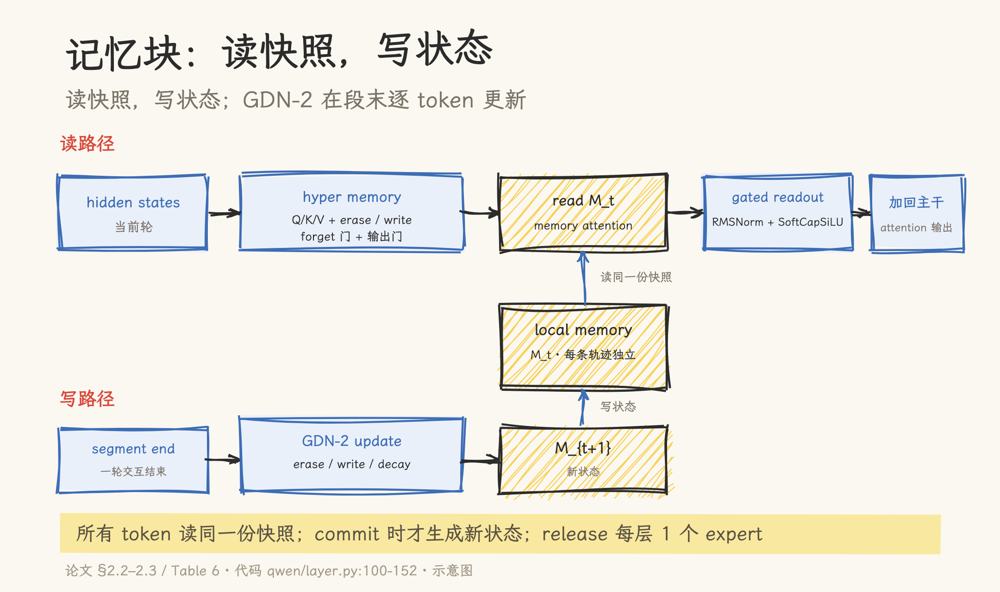
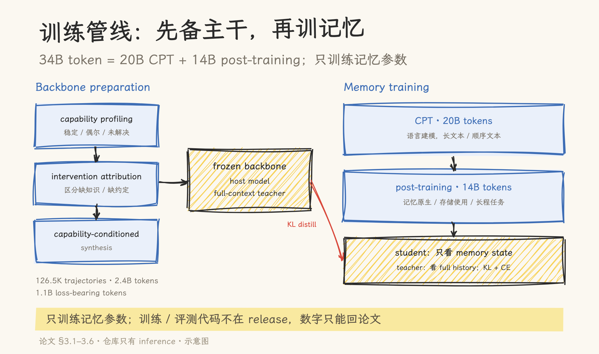

# 当记忆成为模型状态：MemT-1.0 的架构、训练与边界

> 论文：MemT-1.0: Towards Memory-Native Evolution（arXiv 2610.26825v1，2026-10-19，74 位作者）｜官方实现：MemTensor/MemT-1.0（HEAD e75c13d，inference release）｜模型：MemT-1.0-Nano / MemT-1.0-Flash（Hugging Face）｜核对日期：2026-10-20。性能数字来自论文与官方实现，未独立复现；代码行号指仓库当前 HEAD。

一个 coding agent 在仓库里连续工作三天。第一天试过的失败路径、第二天验证过的测试命令、用户纠正过的偏好，都堆在上下文里。上下文快满了，它只有三种选择：截断历史、把历史交给检索、或者重开会话。

这三种做法的共同点是，历史仍然以文本形式存在，模型每一步都要重新读它。MemT-1.0 想换一种存储位置：把历史写进模型内部一个固定大小的状态，生成时直接读这个状态，不再把历史放回 prompt。

这不是一个新想法。循环网络、状态空间模型、记忆增强网络都做过类似尝试；MemT 的特殊之处在于，它把记忆做成了 Transformer 里的一个并行模块，并且用 34B token 的训练语料把“读写记忆”当成一项模型能力来训练。这篇文章以论文为主，先讲清架构和训练，再核对哪些数字能从源码里站住，最后划出 release 的边界。

## 一、背景：记忆应该放在哪里

### 1.1 上下文窗口：最直接，也最贵

把历史放进 prompt 是最直接的做法。模型每次生成都重新读一遍完整历史，KV cache 让历史 token 的注意力计算可以复用，但 cache 本身随历史线性增长。上下文越长，显存占用、prefill 时间和每步注意力的成本都越高。到了窗口上限，只能截断或摘要；截断会丢信息，摘要会丢细节。

对 agent 来说，这个问题更明显：工具结果、失败日志、用户偏好会一轮一轮追加，历史每一轮都在变长。

### 1.2 参数化记忆：权重能改，但不适合每条轨迹

另一条路是把记忆写进参数：继续预训练、微调、LoRA。模型确实会“记住”训练中见过的东西，但这份记忆是全局的，不区分用户和任务轨迹；要为每个用户单独更新一份权重，成本很高，也会互相干扰。灾难性遗忘是另一层问题：新数据进来，旧能力可能被覆盖。

参数化记忆适合积累通用能力，不适合保存“这个用户在昨天那次任务里纠正过我什么”。

### 1.3 外部记忆与 RAG：证据强，但仍要回到上下文

RAG、MemOS、Mem0 这类系统把历史存成文本块、向量或图谱，查询时检索出证据再放进 prompt。它们的优势是证据可读、可更新、可审计；缺点是检索可能漏、可能错，检索到的文本仍要占用上下文。对需要精确引用原文的任务，这是合理的取舍；对只需要“记住经验”的任务，文本证据就显得笨重。Agent 侧的外部记忆系统（MemoryOS、Mem0、LangChain 等）见 [AI 智能体记忆系统](../../../08_agentic_system/memory/README.md)；本文只讨论模型内部状态。

### 1.4 原生状态：把记忆变成模型的一部分

MemT 走的是第四条路：模型内部维护一个固定大小的记忆状态，按轨迹隔离；生成时读状态，交互结束后写状态。状态大小不随历史增长，信息被压进一个 recurrent state，代价是容量有限、精确回忆会衰减。

论文把这条路线追溯到 Metis，并在其上做了三项升级：用 Gated DeltaNet-2 做稳定的逐 token 更新；用 Mixture-of-Storage 扩展记忆容量；用 backbone preparation 和 34B token 的两阶段训练把记忆能力训进模型。先理解这三项升级，后面的架构和训练才接得上。

## 二、架构：模型里的记忆块

### 2.1 总体结构

MemT 在选定的 Transformer 层里插入一个 Native Memory Block。backbone attention 和 memory attention 并行运行，记忆读出经过归一化和门控后，加回 backbone 的注意力输出。主干原有的 pre-attention、attention、post-attention 结构保持不变。

记忆分成两部分：

- Local memory：每条交互轨迹独立维护的动态状态，新轨迹从零开始；
- Hyper memory：可训练的 query/key/value 投影、erase/write/forget 门和输出门，在线推理时权重固定。

这个拆分对应两种时间尺度：local memory 记住“这次交互发生了什么”，hyper memory 学会“怎么读、怎么写”。

代码里，Nano 和 Flash 各自有独立的 memory block 实现：`qwen/layer.py:34-152` 和 `deepseek/layer.py:46-198`。模型在加载时按 `memory_config.layers` 创建这些 block（`qwen/model.py:30-65`、`deepseek/model.py:18-46`），并用 hooks 管理一次前向里的读、写和状态发布（`models/common/hooks.py`）。

### 2.2 Local memory

Local memory 是一个多通道矩阵。论文给出的形状是 `M_t^(l) ∈ R^{H_kv × d_k × d_v}`，每个记忆层一份，按轨迹初始化。Nano 的配置是 16 个 head、`d_k = d_v = 256`、10 个记忆层（第 3、7、…、39 层）；Flash 是 64 个 head、`d_k = d_v = 512`、20 个记忆层（第 4、6、…、42 层）。这些值写在论文 Table 6，也对应代码里的 `state_shapes`（`qwen/config.py:62-67`）。

多通道的作用是给不同 head 留出独立的记忆子空间，避免所有信息挤在一个矩阵里。状态在每条新轨迹开始时清零，之后只通过写路径更新；它不会随历史长度增加而扩张。

### 2.3 Hyper memory

Hyper memory 是“怎么读写”的参数化部分：

- 把 hidden state 投影成 query、key、value；
- 产生 erase、write、forget 三类门；
- 产生输出门，控制记忆读出如何融合回主干。

在线推理时这些参数固定，变化的只有 local memory。Nano 的实现里，`QwenMemoryBlock` 用 `in_proj` 一次产生 Q/K/V 和门控输入，`f_down`、`g_down` 生成 decay 和输出门，`decay_scale_log`、`decay_bias` 是可学习的衰减参数（`qwen/layer.py:34-76`）。Flash 的实现更复杂，把 Q/K/V 投影拆成 grouped-KV 形式，并保留 checkpoint 的参数名（`deepseek/layer.py:54-107`）。

### 2.4 读路径

读路径的输入是当前 hidden state 和上一轮留下的 local memory 快照。Q、K 先做 L2 归一化，memory read 用 Q 去查 local memory，得到每个 head 的读出；读出经过 RMSNorm，再乘上一个有 soft cap 的 SiLU 门控：

```text
R = Q M_t / sqrt(d_k)
A_mem = RMSNorm(R) ⊙ SoftCapSiLU(G)
```

论文里 `SoftCapSiLU(x) = τ · tanh(SiLU(x) / τ)`，`τ = 2`。门控和 soft cap 的作用是限制读出幅度，避免记忆信号压过主干注意力。所有 token 在同一轮里读的是同一份快照 `M_t`；写路径生成的是下一份状态 `M_{t+1}`，读写分离，避免一轮内部的状态互相污染。

代码里，Nano 的读路径走 `memt_gdn2_read_fwd`（`qwen/layer.py:127-130`）；Flash 在 `commit=False` 时走 `snapshot_read`（`deepseek/layer.py:172-180`）。

### 2.5 写路径

写路径基于 Gated DeltaNet-2，按 token 顺序更新记忆。对每个 head：

- 用 K、V 生成写内容；
- 用 erase 门决定旧记忆保留多少；
- 用 write 门决定新信息写入多少；
- 用 decay 门控制遗忘速度，`D = diag(exp(λ))`，λ 被约束为非正数，保证 decay 落在 `(0, 1]`。

论文把更新写成：

```text
U = sqrt(β) ⊙ K
M_i = (I - U^T U) D M_{i-1} + U^T (ω ⊙ V)
```

稳定机制在这里的作用很具体：decay 在 log 空间取负指数，避免数值爆炸；逐 token 更新让同一轮内的信息可以逐步修正，而不是等整轮结束再一次性写入。代码里，`QwenMemoryBlock._write_gates` 计算 erase、write、log_decay（`qwen/layer.py:77-98`），`token_memory_packed` 执行更新（`:132-152`）；Flash 的 `DeepSeekMemoryBlock.packed` 在 `commit=True` 时走同一套读写（`deepseek/layer.py:153-183`）。

读和写不是每一步都发生：查询时只读快照，不产生新状态；一轮交互结束后才 commit，把这一轮的输入和回答写进记忆。这个设计对 serving 很重要，它把“读”放在低延迟路径上，把“写”放在事务提交路径上。



### 2.6 Mixture-of-Storage

MoS 的思路是把每个记忆层扩展成多个专家，每个专家有独立的 local memory 和 hyper memory；读写时用 dense routing 对所有专家加权，而不是 top-k 稀疏路由。读出是各专家记忆注意力的加权和；写入时，routing 权重会缩放 write 和 erase 门，每个专家执行同一套 GDN-2 更新。论文还加了一个辅助路由损失，防止专家负载失衡。

这里要分清论文和 release：

- 论文的主评测配置每个记忆层只有 **1 个 expert**（Table 6），多专家扩容是单独的对照实验；
- release 的 inference 代码也只实现单专家，配置里没有多专家路由字段；代码搜索不到 `memory_experts` 或 `mixture_of_storage` 的实现，`num_experts` 只出现在 DeepSeek backbone 的 MoE 权重解包里（`deepseek/weights.py:60-85`），那是主干的 MoE，不是记忆路由。

所以 MoS 目前是论文级机制，不是 release 已交付的能力。文章里把它放在架构一节，是为了解释设计动机；读者不应把它当成“开箱即用的多专家记忆”。

### 2.7 状态尺寸

固定状态的大小可以直接算出来。Nano：

```text
10 层 × 16 head × 256 × 256 = 10,485,760 个元素
FP32: 10,485,760 × 4 B = 40 MiB
```

Flash：

```text
20 层 × 64 head × 512 × 512 = 335,544,320 个元素
FP32: 335,544,320 × 4 B = 1,280 MiB
```

这两个数字和论文 Table 6 的 “State elements per trajectory” 与 “FP32 state size” 完全一致，也和 Nano 的 `state_shapes` 代码对得上。它们只算每条轨迹的 local memory，不含共享模型权重和当前轮 KV cache；总存储仍会随会话数量增长。

## 三、训练：记忆怎么学会读写

### 3.1 Backbone preparation

MemT 没有直接在原模型上挂记忆模块。它先做一轮 backbone preparation，把主干在通用能力、agentic coding、agentic working 三条线上补齐，再冻结主干，同时作为 host model 和 full-context teacher。

论文的配方分三步：capability profiling，先反复尝试任务，判断哪些是稳定解决、偶尔解决、完全没解决；intervention attribution，把疑似缺失的约定、流程或事实放进上下文重跑，看失败是否消失，从而区分“缺知识”和“缺约定”；capability-conditioned synthesis，按类别合成数据，可靠任务做 replay，偶尔成功的任务用通过验证器的自采样，缺失约定/流程的用引导采样或强模型示范。

最终混合数据是 126.5K 条轨迹、2.4B token、1.1B loss-bearing token；按条数算，56.4% 通用、18.0% agentic coding、25.3% agentic working；按 loss-bearing token 算，agentic 轨迹约占 90%。这套配方跑了五轮全量混合、五十多次训练才定下来。

### 3.2 34B token 的记忆语料

记忆训练语料共 34B token，分两段：

- 20B token 的 continued pre-training：通用语言建模，包含长文本和顺序文本，目标是让模型习惯“通过记忆状态保持语言连贯”；
- 14B token 的 post-training：三类数据，记忆原生语言建模、摘要/续写/压缩等存储与使用任务、长程记忆任务。

所有数据采用统一的“context—query—answer”格式：先把 context 写进记忆，再只给 query，让模型从记忆状态回答。论文提到，部分数据来自 MemOS 的匿名化内部交互数据。

### 3.3 蒸馏目标

训练目标是 off-policy distillation。教师是冻结的 full-context backbone，学生是带记忆的 MemT；教师能看到历史文本 `C_<t`，学生只能看到当前输入和上一轮留下的记忆状态。两边都在教师生成的固定轨迹上做 teacher forcing。

教师输出截断到 top-64 token，温度 1.0；损失是重归一化后的教师分布到学生的 forward KL，加上对观测目标的 cross-entropy。只有记忆参数被优化，主干冻结。CPT 阶段用 cross-entropy，post-training 阶段用 KL 蒸馏；response token 参与损失，history/query/padding 不直接参与 token loss，但梯度会通过记忆写入传回去。

这个目标解释了为什么需要 backbone preparation：教师和学生的条件差异很大，教师看全文，学生只看记忆；如果主干本身不够强，蒸馏信号会很噪。

### 3.4 训练配置

Nano 和 Flash 共享同一套两阶段流程，但 batch 和学习率不同：

- Nano：global batch 64 个 packed sequence，最大 pack 64K token，segment/storage step 2K token；CPT 600 步 warmup 到 `1e-4` 后 constant；post-training 500 步 warmup 到 `1e-4`，最后 1,000 步 cosine 衰减到 `5e-6`。
- Flash：global batch 192 个 pack，同样的 64K pack 和 2K storage step；峰值学习率 `8e-5`，100 步 warmup，cosine 衰减；教师是 online backbone，top-64、温度 1、KL loss。

优化器是 AdamW，weight decay 0.01，梯度裁剪 1.0；主干 BF16，敏感部分和优化器状态用 FP32。



### 3.5 代码边界

这些训练细节只能回到论文。GitHub 仓库是一个 inference release：树里只有 `inference/` 和 examples，没有训练、评测、SWE-bench harness。代码里有少量“training projects packed …”的注释，说明推理实现来自训练代码的投影和 kernel 布局，但训练脚本本身没有发布。

这意味着 34B token、11 项基准、SWE-bench 结果都无法从仓库复跑；它们是论文口径，不是 release 自带的可复现实验。

## 四、证据：数字说明什么

### 4.1 评测设置

记忆评测覆盖 11 项基准，按交互轨迹长度分组：

- 16K 以下：MemBench、ImplicitMemBench；
- 16–32K：PersonaMem、PS-Bench、LoCoMo；
- 32–64K：PerMemSafe、Memora、MemOps；
- 64K 以上：LongMemEval-S、MemoryAgentBench、BEAM-1M。

流程是重置记忆、按时间顺序写入历史、然后在不提供原始历史文本的条件下回答多个问题；不同用户和历史严格隔离。评分用 gpt-4.1-mini 和 OmniMemEval prompt。

通用能力用 MMLU-Pro、GPQA Diamond、IFEval、LongBench v2、BigCodeBench-Hard、LiveCodeBench v6，在注入无关记忆的噪声设置下测，报告相对同一 backbone 的分数差。Agentic coding 用 SWE-bench Verified 的 500 项任务和 SWE-bench Multilingual 的 300 项任务，每项独立跑三次。

所有数字由论文和官方实现报告，我没有独立复现。

### 4.2 记忆基准：参数化方法里的第一、第二

MemT-1.0-Flash 平均 50.60，Nano 46.97，在参评的参数化记忆方法里排第一、第二。最强参数化基线是 Temp-LoRA，平均 38.08；两款 MemT 分别高出 12.5 和 8.9 分。

但这个“第一、第二”有明确限定：参评的是参数化记忆方法。文本记忆系统整体更强：

| 方法         | Flash |  Nano |
| ------------ | ----: | ----: |
| MemOS        | 68.55 | 68.46 |
| Full context | 64.98 | 66.27 |
| DenseRAG     | 57.28 | 56.49 |
| MemT-1.0     | 50.60 | 46.97 |

差距在长历史上更明显：LongMemEval-S、BEAM-1M 这类需要精确证据检索的任务，文本记忆仍然占优。MemT 的论点更窄：在不提供原文的条件下，参数化记忆可以做到这个水平。论文写得很清楚，文章也没有回避。

### 4.3 通用能力：整体持平，任务级有涨有跌

在噪声设置下，Flash 相对 backbone 的平均分是 0.0，Nano 是 −0.9。分项看：

| 基准              | Flash | Nano |
| ----------------- | ----: | ---: |
| MMLU-Pro          |  −1.8 | −1.6 |
| GPQA Diamond      |  −0.6 | −1.5 |
| IFEval            |  +0.9 | +3.3 |
| LongBench v2      |  +0.2 | −2.0 |
| BigCodeBench-Hard |  +2.0 | +2.0 |
| LiveCodeBench v6  |  −0.7 | −5.8 |

Flash 的指令遵循、长文本和代码生成基本稳住，LiveCodeBench v6 只掉 0.7；Nano 在 IFEval 和 BigCodeBench-Hard 上有提升，但 LiveCodeBench v6 掉了 5.8 分，LongBench v2 掉 2.0。论文的结论是“整体保留、任务级有差异”，这个说法比“通用能力不受影响”准确。

文章里给的绝对分（IFEval 93.9 / 92.6、BigCodeBench-Hard 34.4 / 27.7、LongBench v2 64.4）是 backbone 分加上差值算出来的，和论文 Table 3 对得上。

### 4.4 Agentic coding：平均提升不大，重复执行的一致性更明显

SWE-bench Verified 的结果：

| 设置                         | 无经验 | 文本经验 | MemT-Nano |
| ---------------------------- | -----: | -------: | --------: |
| Before Execution 平均成功率  |  66.07 |    68.87 |     69.33 |
| Harness-Triggered 平均成功率 |  66.07 |    69.13 |     69.73 |
| Harness-Triggered pass^3     |  54.00 |    61.80 |     62.80 |

MemT-Nano 相对无经验的平均成功率提升是 +3.26 / +3.66 个百分点；相对文本经验只高 0.46 / 0.60 个百分点。真正拉开差距的是 pass^3：Harness-Triggered 从 54.00 提到 62.80，提升 8.80 个百分点，比文本经验的 61.80 高 1.00。

Multilingual 的结论类似但更弱：Harness-Triggered 平均成功率 63.56，对无经验 60.00、文本经验 63.00；pass^3 从 45.33 提到 55.33。相对文本经验的平均优势只有 0.56 个百分点。

论文自己也写了：pass@3（至少成功一次）没有持续提高，收益主要体现在平均成功率和重复执行的一致性。这个结论比“SWE-bench 提升 8.8 个点”更准确；8.80 是 pass^3，不是平均成功率。

### 4.5 效率与存储：长历史才有优势

在 BEAM 历史上，Nano 的端到端延迟在短历史下比 full context 慢，64K 时约 1.20×，128K 时 1.86×，256K 时 3.99×。查询首 token 延迟（TTFT）在 512 到 256K 的范围内约 104–112 ms，基本稳定；full context 的 TTFT 在 128K 时约 257 ms，256K 时约 445 ms。

论文特别说明，端到端优势主要来自更低的历史准备成本；生成阶段仍要付固定 128-token 回答的成本。不要把 1.86× 直接当成“query 快 1.86 倍”。

存储方面，128K 历史下 Nano 的持久化状态约为 full context 的 1/66；每条轨迹的 FP32 状态是 40 MiB（Nano）或 1,280 MiB（Flash），不含共享权重和当前 KV cache。总存储仍随会话数量和配置容量增长。

### 4.6 模型尺寸的口径

论文正文有一处容易误读：§3.1 说 prepared Flash backbone 是 284B total / 13B active，模型卡和 Table 6 写的是 288B / 17B。两者并不矛盾：284B/13B 是加记忆参数之前的主干；加上 3.61B 记忆参数后，总量约 287.6B、激活约 16.6B，四舍五入就是 288B/17B。文章用最终模型口径，和 Table 6、HF 模型卡一致。

Nano 同理：Qwen3.6-35B-A3B 是主干名称，加 451M 记忆参数后是 36B total / 3B active；HF 侧栏的 35B 指的是主干，不是最终模型。

## 五、边界：论文之外，release 实际给了什么

### 5.1 源码能验证什么

- 记忆块确实存在于选定层，读写路径完整：`qwen/layer.py:34-152`、`deepseek/layer.py:46-198`；
- GDN-2 的 token-level 更新、erase/write/decay 门都在：`qwen/layer.py:77-152`；配置固定 `gdn_version: stable_gdn2`、`memory_update_mode: token`（`qwen/config.py:14-27`）；
- 状态尺寸精确对得上：`qwen/config.py:62-67` 的形状乘出来就是 40 MiB / 1,280 MiB；
- 记忆层选择按 attention interval 计算：Nano 每 4 层、Flash 每 2 层（`qwen/config.py:122-127`、论文 Table 6）；
- release 确实是单 memory expert：Table 6 写 1，代码没有多专家字段。

### 5.2 源码不能验证什么

训练语料、backbone preparation、11 项记忆基准、SWE-bench 结果，都不在仓库里。仓库是 inference release，只有 `inference/` 和 examples；没有训练脚本、评测 harness、SWE-bench agent。论文是 2026-10-19 的 arXiv v1，不是同行评审论文；这些数字只能按“作者报告”处理。

### 5.3 MoS 的交付状态

MoS 的论文实验存在，但 release 不是多专家：每层 1 个 expert，代码没有记忆路由。论文里的多专家扩容实验（2 到 4 个 expert）只在论文里；文章说“主评测模型每个记忆层使用一个专家，多专家扩容另行开展对照实验”，这句是准确的，但不要把 MoS 当成已交付的多专家能力。

### 5.4 许可：不是通常意义上的“开源”

这是最需要打折的一处：

- 仓库根 `LICENSE` 是 **PolyForm Noncommercial 1.0.0**；`inference/pyproject.toml:11` 写 `LicenseRef-PolyForm-Noncommercial-1.0.0 AND MIT`（MIT 部分是 vendored FLA）；根 `README.md:208-219` 明确写商业使用需要授权。
- 论文是 **CC BY-NC-SA 4.0**（`LICENSE-PAPER:1`）。
- Hugging Face 模型卡另标：Nano 权重 Apache 2.0、Flash 权重 MIT；Nano 卡片甚至称 adapted inference code 也是 Apache 2.0，这与仓库 LICENSE 不一致，需要向作者确认。

所以准确的说法是：代码是 source-available、非商业许可；权重另有许可；不能简单称为“开源”，商用前必须分别确认代码和权重。

### 5.5 部署门槛

`inference/README.md` 给出的启动配置是：

- Nano：2 张 GPU，TP2 / EP1 / DP1；
- Flash：8 张 GPU，TP8 / EP8 / DP8，attention TP1；
- 依赖 SGLang 0.5.16、PyTorch 2.11.0、Transformers 5.12.1、flashinfer-python 0.6.14、sglang-kernel 0.4.5；
- 单节点 eager 执行、未量化 BF16 safetensors；chunked prefill、radix cache、overlap scheduling、prefill/decode CUDA graphs 都要关闭；`max_prefill_tokens` 不能小于 checkpoint 的 `chunk_tokens`（两个 release 都是 2,048）。

接入成本落在整套定制的 SGLang serving 栈上，换一份权重解决不了。论文里的效率数字也是在这套条件下测的。

### 5.6 独立性

论文 2026-10-19 上 arXiv，74 位作者；GitHub 仓库 2026-10-19 创建，2026-10-20 推送，截至核对时 143 stars、2 forks。公众号发布稿与仓库、论文同一团队、同一时间窗口，属于官方发布，不是独立评测。截至我查到的公开材料，没有看到独立复现。

## 六、结语

MemT-1.0 把记忆从“上下文里的文本”换成“模型内部的状态”：local memory 记轨迹，hyper memory 学读写，GDN-2 负责稳定更新，34B token 的训练把这份能力训进模型。它的证据也清楚：参数化记忆里第一、第二，长历史下 1.86×–3.99× 的端到端优势，40 / 1,280 MiB 的固定状态，SWE-bench 上重复执行一致性的提升。

边界同样清楚：固定容量换不来精确回忆，文本记忆系统仍强 17–22 分；release 每层只有 1 个 memory expert，MoS 多专家还在论文里；代码是非商业许可，Nano 要 2 张卡、Flash 要 8 张卡，依赖一套很新的 SGLang 栈；训练和评测代码没有发布，数字只能按作者报告读。

如果要判断是否跟进，更具体的问题是三个：多专家 MoS 什么时候进 release；训练/评测代码什么时候公开；非商业许可会不会放开。这三个问题有答案之前，MemT 更适合作为一篇扎实的研究论文来读，而不是一个可以直接上生产的记忆方案。

## 源文件索引

| 来源                                             | 主要内容                                                              | 引用点                                |
| ------------------------------------------------ | --------------------------------------------------------------------- | ------------------------------------- |
| 论文 §2.2–2.3                                    | Native Memory Block、local/hyper memory、GDN-2、MoS                   | §2.2–2.3                              |
| 论文 §3.1–3.6                                    | Backbone preparation、34B 语料、训练目标、CPT/post-training、训练配置 | §3.1–3.6                              |
| 论文 §6.2–6.6                                    | 11 项记忆基准、通用能力、效率与存储                                   | Table 3–6、§6.2–6.6                   |
| 论文 §7.4                                        | SWE-bench Verified / Multilingual                                     | Table 5、§7.4                         |
| 论文 §8                                          | 固定容量、精确回忆、文本记忆优势等局限                                | §8                                    |
| `inference/memt_sglang/models/qwen/config.py`    | 固定算法、状态形状、记忆层选择                                        | `:14-27`、`:62-67`、`:122-127`        |
| `inference/memt_sglang/models/qwen/layer.py`     | Qwen memory block 的读写、GDN-2 门控                                  | `:34-152`                             |
| `inference/memt_sglang/models/deepseek/layer.py` | DeepSeek grouped-KV memory、FP32 状态                                 | `:46-198`                             |
| `inference/memt_sglang/models/qwen/model.py`     | 记忆块创建与 hooks 接入                                               | `:30-65`                              |
| `inference/memt_sglang/models/deepseek/model.py` | 记忆块创建与 hooks 接入                                               | `:18-46`                              |
| `inference/README.md`                            | 部署硬件、依赖栈、执行限制                                            | `:9-12`、`:23-35`、`:101`、`:421-425` |
| `inference/pyproject.toml`                       | 包名、版本、许可表达式                                                | `:6-11`                               |
| `LICENSE` / `LICENSE-PAPER`                      | PolyForm Noncommercial / CC BY-NC-SA                                  | 文件首行                              |
| `README.md`                                      | 许可说明、模型卡与仓库许可的边界                                      | `:208-219`                            |
| `deepseek/weights.py`                            | DeepSeek backbone MoE 的 `num_experts`，不是记忆路由                  | `:60-85`                              |
| Hugging Face 模型卡                              | Nano Apache 2.0、Flash MIT（权重）                                    | 模型页                                |

## 参考资料

- 论文：[arXiv 2610.26825v1](https://arxiv.org/abs/2610.26825)｜[HTML 全文](https://arxiv.org/html/2610.26825)
- 官方实现：[MemTensor/MemT-1.0](https://github.com/MemTensor/MemT-1.0)，HEAD `e75c13d`
- 模型：[Hugging Face collection](https://huggingface.co/collections/MemTensor/memt-1)｜[Nano](https://huggingface.co/MemTensor/MemT-1.0-Nano)｜[Flash](https://huggingface.co/MemTensor/MemT-1.0-Flash)
- 官方发布稿：[MemT 1.0 发布并开源：让记忆成为模型能力](https://mp.weixin.qq.com/s/h1DSQ2902c_Uo_2CGNkcEQ)
