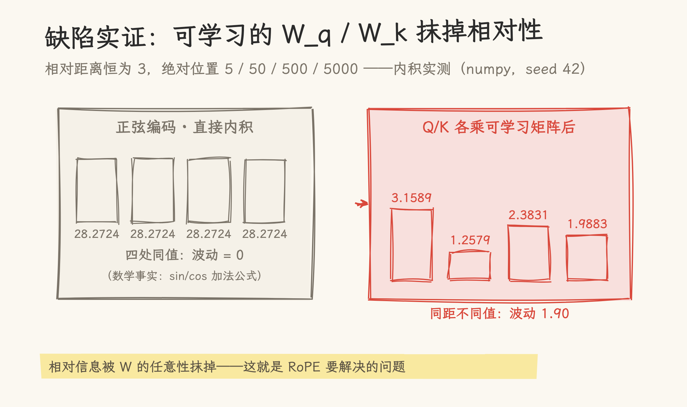
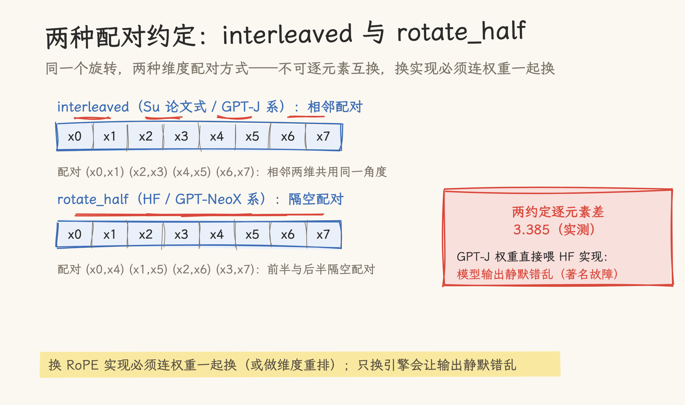
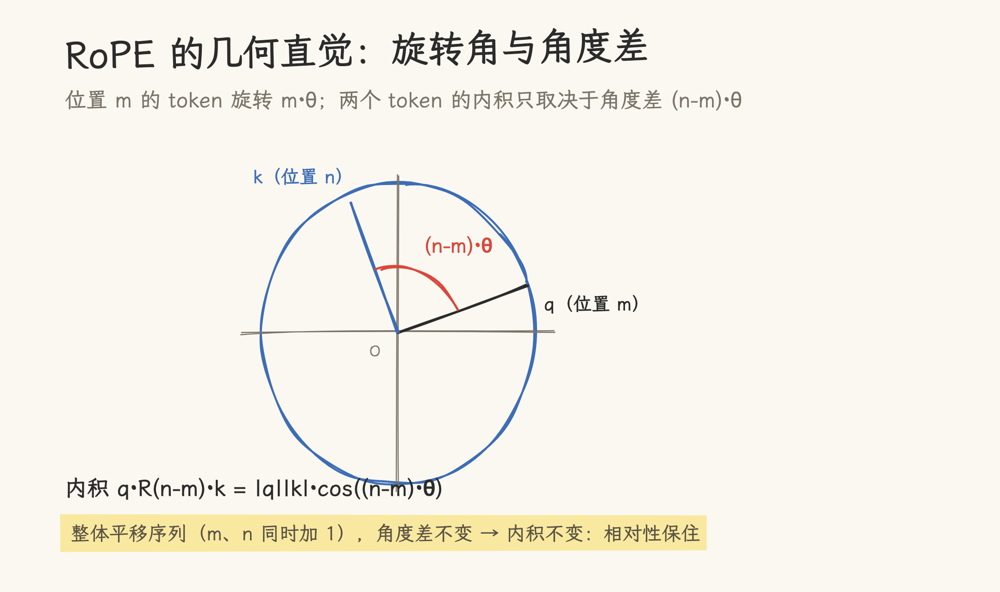
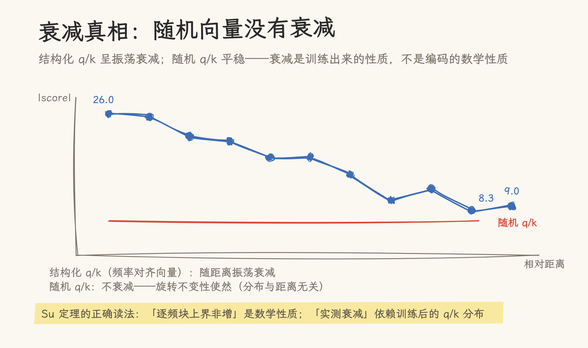
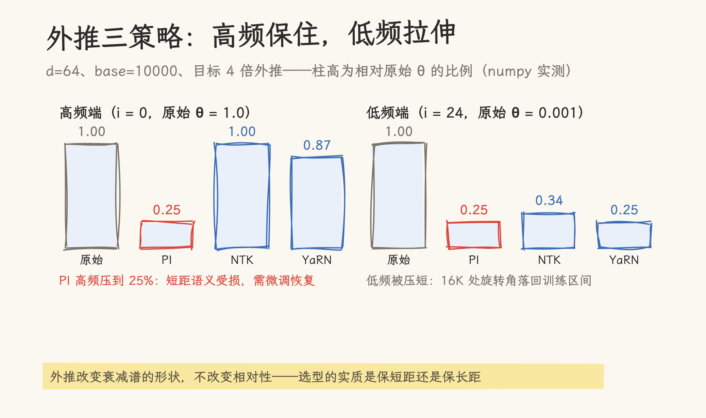

# 手搓 RoPE：一百行 numpy 讲透旋转位置编码

社区流传一个故障：模型换个推理框架，RoPE 的实现从一种约定换成另一种，权重一个没动，输出却错了。原因藏在这篇要手搓的机制里。自注意力对 token 的位置完全不敏感：打乱输入序列，计算结果不变，要恢复顺序感，就得给模型注入位置信息。这也是手搓系列的第二篇，阅读顺序见[手搓系列导航](../../../hand_roll_series.md)。这篇用纯 numpy 把旋转位置编码（RoPE）从推导写到实测：四个实验全部可复现，其中「长程衰减」的民间说法在实测中被当场纠正。

> 核对基准：Su et al. 2021 RoFormer（arXiv:2104.09864）、YaRN（arXiv:2309.00071）与 EleutherAI 博客的两种约定讨论；实现为纯 numpy 2.3.2（hand_roll_rope.py，105 行），2026-11-07 核对。实现命名有两套体系（interleaved ↔ Su 论文原式 / GPT-J 系，rotate_half ↔ HF / GPT-NeoX 系），文中桥接标注。四个实验的数字都是实跑输出，引用前可重跑复现。

## 一、位置注入的两难

Attention 的点积只看 token 的内容，不看先后顺序。「我打你」和「你打我」三个 token 相同，含义截然相反：位置信息必须从外部注入。注入方式两大流派：**绝对位置编码**（每个位置配一个固定向量，加到 token 向量上）和**相对位置编码**（把位置差写进 attention 的打分里）。

绝对派的问题是泛化：训练时见过的位置有限，推理时序列一长就抓瞎。相对派在理论上更优雅，但主流实现要在 attention 内部改打分公式，侵入性强。2021 年苏剑林提出的 RoPE 给出了第三条路：**用绝对位置的实现方式，编码相对位置的信息**。这一篇按手搓系列惯例，把这条路的每个论断都变成可跑的 numpy 代码。

## 二、版本 0：正弦绝对编码，与一个恒定的内积

Transformer 原版的正弦位置编码把位置 m 编码成一段固定波形，直接加到 token 向量上。实现只有几行：

```python
def sinusoidal_pe(pos, d, base=10000.0):
    angles = np.outer(pos, base ** (-np.arange(0, d, 2) * 2 / d))
    pe = np.zeros((len(pos), d))
    pe[:, 0::2] = np.sin(angles)
    pe[:, 1::2] = np.cos(angles)
    return pe
```

先记录一个常被忽略的数学事实：**正弦编码的两个位置向量直接做内积，结果只依赖位置的差**。实测：固定相对距离 3、扫绝对位置 5 / 50 / 500 / 5000，内积四处全部等于 28.272398，波动为 0。

这是三角函数加法公式的直接推论。也就是说，正弦编码的「裸内积」天然带相对位置信息。

## 三、缺陷实证：一个可学习的线性变换，把相对性破坏掉了

既然裸内积已经带相对信息，绝对编码的问题出在哪？答案是 Q/K 在进 attention 之前要各自乘一个**可学习的线性变换** $W_q$、$W_k$。实测同一件事：给四对「相对距离都是 3」的位置向量分别乘上两个固定的随机矩阵，再看内积：

| 绝对位置 (m, n=m+3) | 内积   |
| ------------------- | ------ |
| (5, 8)              | 3.1589 |
| (50, 53)            | 1.2579 |
| (500, 503)          | 2.3831 |
| (5000, 5003)        | 1.9883 |

相对距离完全相同，内积却从 3.16 漂到 1.26，相对信息被 W 的任意性抹掉了。这就是 Su 在 RoFormer 论文里给出的出发点：绝对位置编码经过线性变换后，无法保证「score 只依赖相对位置」。



他的解法是把绝对位置编码从「加在输入上」改造成「以旋转的形式作用在 Q/K 上」：任何旋转变换都保持向量内积只受相对角度影响。于是绝对位置的实现方式保住了，相对位置的信息也进来了。

## 四、版本 1：RoPE 的两种实现与一次著名的约定分歧

RoPE 把 d 维向量看成 d/2 个二维子空间，每个子空间按自己的频率 θ_i = 10000^(−2i/d) 做旋转。实现有两大流派，配对约定不同：

```python
def rope_interleaved(x, pos, base=10000.0):
    """Su 论文原式：相邻两维配对 (x0,x1)(x2,x3)..."""
    d = x.shape[-1]
    h = d // 2
    theta = base ** (-np.arange(h) * 2 / d)
    cos, sin = np.cos(pos * theta), np.sin(pos * theta)
    x1, x2 = x[..., 0::2], x[..., 1::2]
    out = np.empty_like(x)
    out[..., 0::2] = x1 * cos - x2 * sin
    out[..., 1::2] = x1 * sin + x2 * cos
    return out

def rotate_half(x):
    h = x.shape[-1] // 2
    return np.concatenate([-x[..., h:], x[..., :h]], axis=-1)

def rope_half(x, pos, base=10000.0):
    """HF/GPT-NeoX 式：前后两半配对"""
    d = x.shape[-1]
    h = d // 2
    theta = base ** (-np.arange(h) * 2 / d)
    cos, sin = np.cos(pos * theta), np.sin(pos * theta)
    x1, x2 = x[..., :h], x[..., h:]
    out = np.empty_like(x)
    out[..., :h] = x1 * cos - x2 * sin
    out[..., h:] = x1 * sin + x2 * cos
    return out
```

同一个向量、同一个位置，两种实现的输出逐元素差实测 3.385：约定不同，结果就是不同。这不是谁写错了：interleaved 是 Su 论文的原式（GPT-J 系），rotate_half 的前后分半配对是 GPT-NeoX 系的等价形式（HF 系），两者只相差一个维度排列，但权重不能互换。社区流传已久的「换推理框架后 RoPE 模型输出异常」故障，相当一部分源于此。



推论要记住一条：**换实现必须连权重一起换（或做维度重排）**。只把推理引擎从 GPT-J 写法换成 HF 写法而沿用原权重，模型输出会静默错乱。

## 五、核心定理实测：score 只依赖相对距离

RoPE 的核心承诺：q 与 k 分别旋转任意绝对位置 m、n 后，内积只依赖相对距离 n − m。用随机向量实测，相对距离恒为 3、绝对位置扫 5 / 50 / 500 / 5000：



| 实现                      | 四处内积           | 波动    |
| ------------------------- | ------------------ | ------- |
| interleaved               | 全部 −3.8099149169 | 3.2e-13 |
| rotate_half（前后分半式） | 全部 −7.1407347442 | 2.2e-13 |

两种实现的波动都在 float64 舍入级。定理成立，且与实现无关。

## 六、衰减真相：随机向量没有衰减

社区常说「RoPE 注意力随距离衰减」，给长文档的远距离 token 天然降权。这条说法需要精确化。实测两种情形：

**随机 q/k（20000 个高斯样本）**：|score| 均值在相对距离 1 到 512 之间保持在 6.4 上下平稳波动，无衰减。数学原因：随机高斯向量经任意角度旋转后分布不变，score 的期望与距离无关。

**结构化 q/k（频率对齐向量）**：score 呈振荡衰减，相对距离 1 时 |score| = 26.0，512 时降到 8.3，前半程均值 22.5、后半程 12.1。



正确的表述是：RoPE 论文（Su et al., 2021）证明的是一个**逐频块上界的非增性**，而实际衰减曲线依赖训练后 q/k 的分布，模型确实会学出「远距离降权」，但那是训练的结果，不是编码的数学性质。

## 七、外推：三种策略的频率谱

RoPE 直接外推（训练 4K、推理 16K）会失败，问题集中在频率谱的低频端：低频 θ 趋近 0，角度随距离增长、训练长度内几乎不回绕，超出训练长度的远距离 token 对会带来模型没见过的旋转角取值。修复手段都是改频率谱，差别在于代价落在哪一端。三种外推策略实测频率谱如下（d = 64，目标 4 倍外推）：

| 频率索引 i   | 原始 θ   | PI（线性插值） | NTK-aware | YaRN     |
| ------------ | -------- | -------------- | --------- | -------- |
| 0（高频端）  | 1.000000 | 0.250000       | 1.000000  | 0.872181 |
| 8            | 0.100000 | 0.025000       | 0.069925  | 0.025000 |
| 24（低频端） | 0.001000 | 0.000250       | 0.000342  | 0.000250 |

- **PI（位置线性插值）**：全部频率除以 4。低频端外推能力翻倍，但高频端被压掉 75%，短距语义受损，需要微调恢复。
- **NTK-aware**：不改频率公式，把 base 从 10000 抬高到 base × s^(d/(d−2))。实测高频端 θ = 1.000000 完全不动（θ 的指数含频率索引 i，i = 0 时抬 base 恰好不起作用），低频端被压到原始的 34%，获得外推能力。无需微调即可用。
- **YaRN**：按波长分频段 ramp，短波长（高频）基本不动（实测 0.87）、长波长（低频）插值，兼顾两端；配合注意力温度修正，是长上下文微调的主流选择（arXiv:2309.00071）。



## 八、总评

一百行 numpy 把 RoPE 的主张跑了一遍：相对不变性成立且与实现无关，两种约定的波动都在 3e-13 舍入级。要带走的是两个纠偏：interleaved 与 rotate_half 输出逐元素差实测 3.385，换实现必须连权重一起换；远距离衰减不是编码的数学性质，模型学出的降权是训练的结果。三种外推策略的差别在代价落点：PI 压高频、NTK 动低频、YaRN 分频段兼顾。LLaMA、Qwen 等主流开源模型全系采用 RoPE，读代码时认出 `rotate_half` 就能对上 §四 的约定。

这些判断的适用边界：

- 「随机向量无衰减」是高斯分布旋转不变的数学推论（§六）；真实模型的 q/k 是训练后的分布，衰减行为介于两者之间，本篇未用真实权重验证
- 「结构化向量振荡衰减」来自频率对齐构造（§六），不是从任何训练后的模型测出
- 外推三策略只比了频率谱（d=64、4 倍外推，§七）；「YaRN 是长上下文微调的主流选择」为文献口径（arXiv:2309.00071），本篇无 perplexity 实测
- 「换实现必须连权重换」在 numpy 两实现上验证（§四）；3.385 是特定输入的实测差，不是普适常数
- 全部波动结论都是 float64（§五）；bf16/fp16 训练精度下未测

接得上的几篇：同目录的[位置编码演进总览](positional_encoding.md)梳理 Sinusoidal 到 RoPE 的时间线；[手搓 Attention](../../../02_gpu_programming/02_cuda/21_write_attention_from_scratch.md)是本篇的上游（attention 机制本身的手搓）；[手搓 KV Cache](../../../09_inference_system/kv_cache/01_concepts/01_basic/03_hand_roll_kv_cache.md)是下游（缓存了 K/V 之后的管理账）。

## 源文件索引

| 来源                                 | 引用点                                |
| ------------------------------------ | ------------------------------------- |
| Su et al. 2021（arXiv:2104.09864）   | RoPE 定义与逐频块上界定理（§二、§六） |
| Peng et al. 2023（arXiv:2309.00071） | YaRN 分频段策略（§七）                |
| EleutherAI 博客（rotary-embeddings） | 两种约定的来源讨论（§四）             |
| 本仓：`hand_roll_rope.py`            | 105 行实现与全部实测数字              |

## 参考资料

- Su et al., 2021, _RoFormer: Enhanced Transformer with Rotary Position Embedding_（arXiv:2104.09864）：RoPE 原始论文
- Peng et al., 2023, _YaRN: Efficient Context Window Extension of Large Language Models_（arXiv:2309.00071）
- EleutherAI 博客 _Rotary Embeddings: A Relative Revolution_：interleaved 与 rotate_half 两种约定的来源讨论（<https://blog.eleuther.ai/rotary-embeddings/>）
- 本站[位置编码演进总览](positional_encoding.md)与[手搓 Attention](../../../02_gpu_programming/02_cuda/21_write_attention_from_scratch.md)
