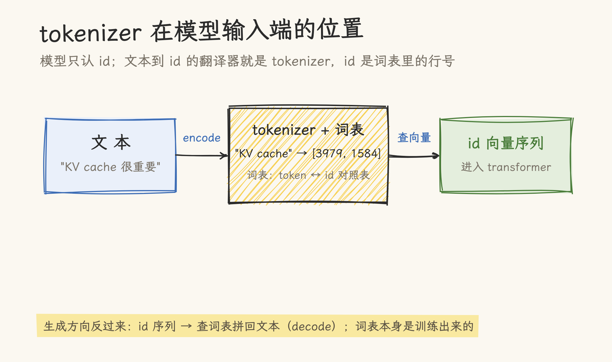
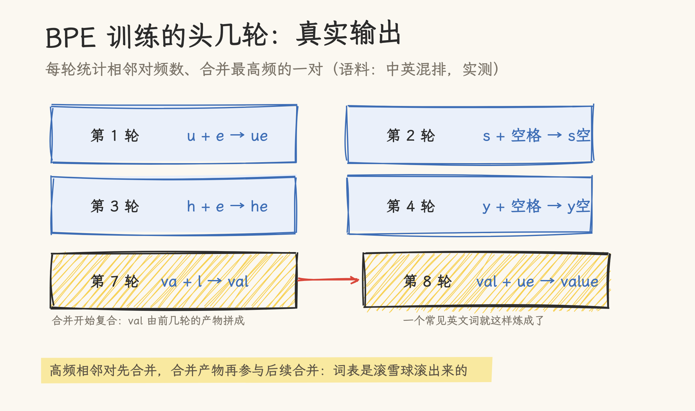
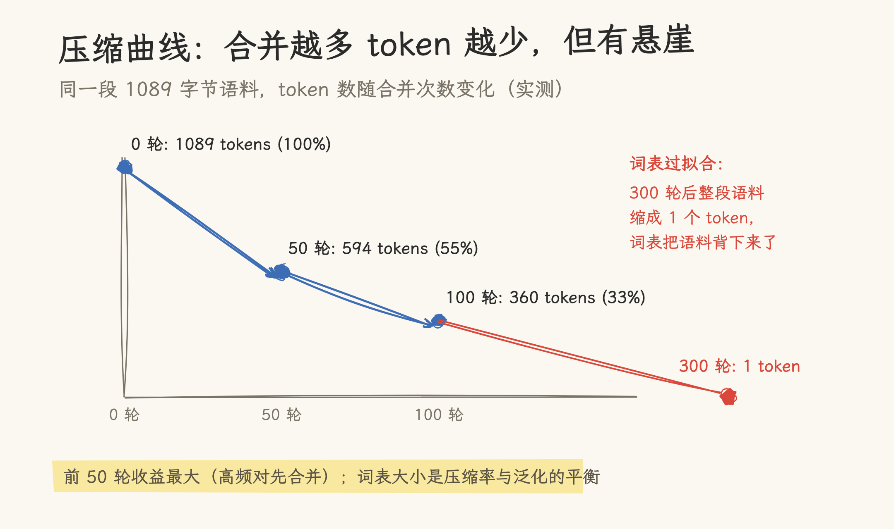
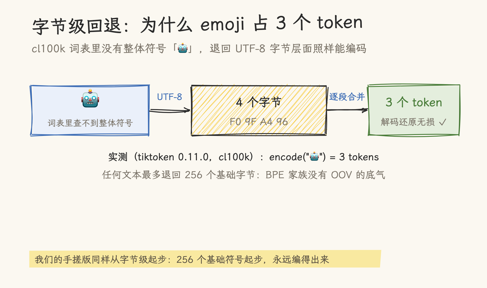

# 手搓 Tokenizer：从字符级到 BPE，看懂 tiktoken 在做什么

文本进模型前要先变成 token id，翻译器就是 tokenizer，平时它是个黑盒：`tiktoken.encode("KV cache")` 一行下去就出结果。token 越少，推理越便宜：attention 要读的 id 越少，显存与算力跟着省。但它的核心算法 BPE，一百行 Python 就能手搓出来。

这也是手搓系列的第一篇；从字符级写起，把 tokenizer 改出三个版本，每一版都能跑；改到最后拿 tiktoken 对照，词表从哪来、emoji 为什么占三个 token，就都有了着落。系列阅读顺序见[手搓系列导航](../../../hand_roll_series.md)。

> 核对基准：Sennrich et al. 2015（arXiv:1508.07909）与 karpathy/minbpe 的 BPE 参考实现；语料固定内嵌在脚本里（759 字符 / 1089 UTF-8 字节，中英混排，重复 3 份），三个版本合在一个脚本实跑（纯标准库 Python）；tiktoken 对照段实测于 tiktoken 0.11.0（cl100k 词表 100277，需联网下载词表）；核对日期 2026-11-06。脚本已入库同目录 [hand_roll_bpe.py](hand_roll_bpe.py)，文中所有数字可复现。

## 一、Tokenizer 在算什么

模型的输入层是一张 embedding 表：id 是行号，token 向量按行号查出来。所以送进模型之前，必须先把文本变成一串 id。干这件事的就是 tokenizer：文本进去，id 序列出来；生成完的 id 序列也由它翻译回文本。

id 从哪来？从词表来。词表是一张「token ↔ id」的对照表，而表里的每一个 token 是怎么造出来的，就是这篇要手搓的内容。



先从最笨的方案写起。

## 二、版本 0：字符级

把语料里出现过的每个字符收进词表，一个字符一个 id：

```python
chars = sorted(set(CORPUS))
char_to_id = {c: i for i, c in enumerate(chars)}

def encode_v0(text):
    return [char_to_id[c] for c in text]

def decode_v0(ids):
    return "".join(chars[i] for i in ids)
```

两行编码、两行解码，往返实测无损。词表 59 个字符，覆盖全部语料。看起来已经能用，问题藏在序列长度里：语料编成 1089 个 UTF-8 字节，字符级就是 1089 个 token。

token 数量不是免费的事。本站[手搓 Attention](../../../02_gpu_programming/02_cuda/21_write_attention_from_scratch.md)那篇算过：attention 的分数矩阵是 n×m，序列长度直接决定显存和算力。同样的文本，token 越少，推理越便宜。所以要有更粗的粒度。

## 三、版本 1：词级的诱惑与 OOV

最自然的想法是按词切：英文按空格，一个词一个 token。压缩率立刻上去，但两个新问题跟着来。中文没有空格，分词本身就是个难题；更致命的是词表封闭：今天的语料里没有「DeepSeek」，明天用户就要问它，词级方案直接抓瞎（out-of-vocabulary，OOV）。

需要一种介于字符和词之间的粒度：常见组合合并成 token，没见过的组合退回字符也还能编码。这就是子词（subword），BPE（Byte Pair Encoding）是最主流的实现。思想一句话：统计语料里最高频的相邻符号对，把它合并成一个新符号，反复做，直到词表够大。

## 四、版本 2：BPE，高频对合并

BPE 从字节级起步（UTF-8 编码，256 个基础符号），每轮统计相邻对频数、合并最高频的一对：

```python
def bpe_train(text, num_merges):
    ids = list(text.encode("utf-8"))
    merges = {}
    for step in range(num_merges):
        pairs = {}
        for a, b in zip(ids, ids[1:]):
            pairs[(a, b)] = pairs.get((a, b), 0) + 1
        best = max(pairs, key=pairs.get)
        new_id = 256 + step
        i, out = 0, []
        while i < len(ids):            # 顺序扫描：处理重叠对（如 aaa）不踩坑
            if i < len(ids) - 1 and (ids[i], ids[i + 1]) == best:
                out.append(new_id)
                i += 2
            else:
                out.append(ids[i])
                i += 1
        ids = out
        merges[best] = new_id
    return merges
```

编码时把学到的合并规则按先后顺序重放（先学的优先），解码时查一张「id → 字节串」的表拼回去。往返实测无损。合并的头几轮长这样：



还有个实现层面的坑：合并那一步最容易写成 `[new_id if (a, b) == best else a for a, b in zip(ids, ids[1:])]`，这种写法在重叠对上会错位：语料里出现 `aaa`、合并 `(a, a)` 时，三连 a 应该变成 `[新token, a]`，列表推导却会产出错误结果。顺序扫描、命中即跳两格，才是对的处理。这是手搓版第一个实测踩到的坑。

训练 100 轮后的实测压缩曲线：

| 合并次数 | token 数（1089 字节） | 压缩到 |
| -------- | --------------------- | ------ |
| 0        | 1089                  | 100%   |
| 50       | 594                   | 55%    |
| 100      | 360                   | 33%    |



前 50 轮收益最大：高频对（英文的常见字母组合、中文常用字的字节组合）先被合并；之后边际收益递减。

## 五、词表过拟合：合并 300 次会发生什么

那是不是合并越多越好？实测给了相反的答案：300 次合并后，整段 1089 字节的语料缩成了 1 个 token：词表把语料背下来了。因为语料重复了 3 份，合并到后期，「token 对」变成「整句对」，最后整段文本成了一个符号。

这就是词表大小的 trade-off：词表越大、压缩越猛，但 embedding 表跟着变大，低频 token 没有足够样本来学好。现代模型的词表控制在 10 万量级（cl100k 实测 100277），就是在压缩率和泛化之间取平衡。小语料上硬训 BPE，得到的会是一份语料索引。

## 六、与 tiktoken 对照

同一份语料交给 tiktoken 的 cl100k：294 个 token，压缩到 27%，好于我们 100 轮手搓的 33%。差距不在算法（cl100k 也是 BPE），在语料：它的合并规则是从海量语料学来的，规则泛化；我们的 360 个 token 里有一批只在本文语料里高频的合并，换个领域就退化。

两个行为逐条实测过：

| 探针                   | 结果                     |
| ---------------------- | ------------------------ |
| `encode("KV cache")`   | 2 个 token，解码还原无损 |
| `encode("注意力机制")` | 4 个 token，解码还原无损 |
| `encode("🤖")`         | 3 个 token，解码还原无损 |

emoji 那 3 个 token 是字节级回退（byte fallback）：🤖 的 UTF-8 编码有 4 个字节，cl100k 词表里没有「🤖」这个整体符号，就退到字节层面逐段编码。字节级起步正是我们手搓版本的起点，这也是 BPE 家族「没有 OOV」的底气：任何文本最多退回 256 个基础字节，永远编得出来。



## 七、总评

手搓一遍之后，tokenizer 的三个机制都对照过了：encode 是按学到的顺序重放合并规则，decode 是查表拼字节，词表是训练语料的函数（所以小语料会过拟合、emoji 要走字节回退）。100 轮合并把 1089 字节压到 360 个 token（33%），同一语料 tiktoken cl100k 给出 294 个（27%），差距不在算法，在语料。300 次合并的过拟合实验则是词表必须控规模的直观证据：整段语料缩成了一个符号。

这些判断的适用边界：

- 「300 次合并过拟合」只在 759 字符、重复 3 份的内嵌小语料上实证；数 GB 级真实语料的合并动态未测
- 「tiktoken 好于手搓（27% vs 33%）」的归因（语料而非算法）只对这一份中英混排语料成立；换词表与换领域未测
- 「emoji 3 token、cl100k 词表 100277」是 tiktoken 0.11.0 实测，库版本升级后结论可能变
- 「字节级起步所以没有 OOV」是 BPE 的机制性质，往返无损在脚本语料实测，未对任意 Unicode 输入穷举

什么时候轮到自己训：领域语料压缩率敏感（代码、医疗、小语种），通用 tokenizer 的压缩率不合算时，可以在自己的语料上训一个领域词表。平时一律用现成的：tokenizer 与预训练绑定，换 tokenizer 等于换输入分布，模型要重训。

接得上的几篇：本站 [Token 机制](README.md)目录下的[介绍文](llm_token_intro.md)讲 BPE/WordPiece 的策略差异；[手搓 Attention](../../../02_gpu_programming/02_cuda/21_write_attention_from_scratch.md)解释了为什么 token 数直接决定显存；[token_estimation.py](token_estimation.py)是现成的成本估算工具。

## 源文件索引

| 来源                                                      | 引用点                      |
| --------------------------------------------------------- | --------------------------- |
| Sennrich et al. 2015（arXiv:1508.07909）、karpathy/minbpe | BPE 算法参考（§四实现口径） |
| tiktoken 0.11.0（cl100k）                                 | §六对照数字、emoji 字节回退 |
| 本仓：`hand_roll_bpe.py`                                  | 三版实现与全部实测数字      |
| 本仓：`token_estimation.py`                               | 成本估算工具（§七）         |

## 参考资料

- Sennrich et al., 2015, _Neural Machine Translation of Rare Words with Subword Units_（arXiv:1508.07909）：BPE 用于神经机器翻译的原始论文
- karpathy/minbpe：极简 BPE 参考实现，本文顺序扫描的处理与之一致（<https://github.com/karpathy/minbpe>）
- openai/tiktoken：cl100k 词表与字节级回退的实测对象（<https://github.com/openai/tiktoken>）
