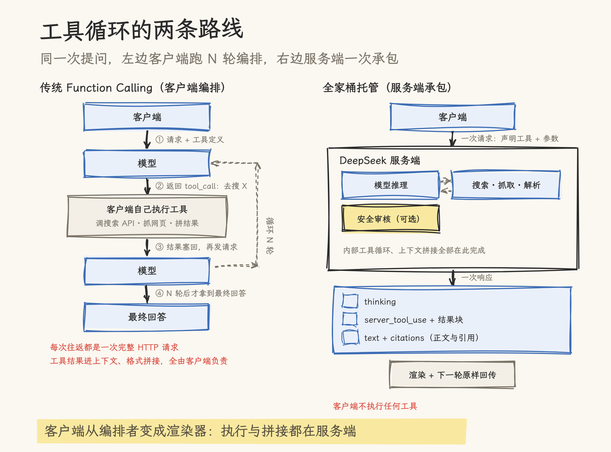
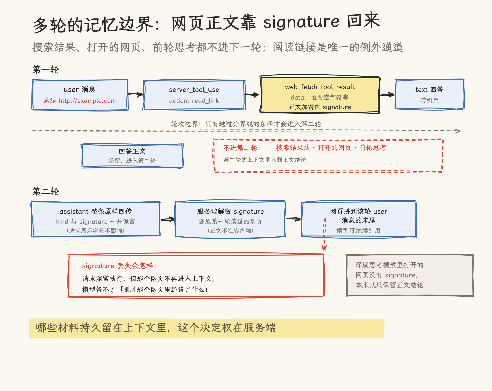
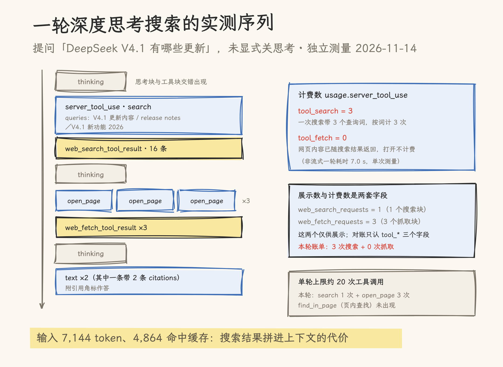

# DeepSeek 把整个 App 开放成了 API：全家桶应用 API 深拆

> 本文基于 DeepSeek 官方公告与 API 文档（2026-11-13 版：[全家桶应用 API 公告](https://api-docs.deepseek.com/zh-cn/news/news261113)、[构建 Chatbot 指南](https://api-docs.deepseek.com/zh-cn/guides/build_a_chatbot)、[联网工具指南](https://api-docs.deepseek.com/zh-cn/guides/web_tools)及 Search/OCR/ASR/TTS 接口页）与官方 Demo 仓库 [deepseek-ai/chat-demo](https://github.com/deepseek-ai/chat-demo)（v0.1.1，commit `5d5dd75`）撰写，2026-11-14 核对。第七章为作者用自有 API Key 做的独立测量（2026-11-14，Messages 协议两轮调用）。价格均为厂商口径，as-of 2026-11-13，工具类价格变动较快，使用前建议复核官方价格页。

---

## 一、App 里的默认体验，API 里的自建工程

在 DeepSeek App 里问一句「DeepSeek V4.1 有哪些更新」，背后发生的事情比一次模型推理多得多：模型自己判断要不要联网，发起搜索，打开网页，在页面里查找关键词，最后带着引用角标作答。用户上传一份 PDF，服务端解析后拼进上下文；按住语音键说话，识别成文字发送；回答生成完毕，还能合成语音朗读出来。这些能力在产品里是默认体验，在 API 里长期是另一回事。

11 月 13 日之前，开发者想在自研应用里复刻这套体验，要自己接一家搜索 API，自己处理搜索结果与对话上下文的拼接，自己部署 OCR 与 ASR/TTS 服务，再自己接一道内容风控。模型 API 只负责生成 token，外围能力全部自理。公告里把这称为「耗费大量精力去对接外部工具、处理调用衔接」，不算夸张。

11 月 13 日晚，DeepSeek 发布[全家桶应用 API](https://api-docs.deepseek.com/zh-cn/news/news261113)，动作有两个：

1. **开启参数即得能力**。在原有对话 API 的请求里声明工具或参数，搜索、抓取、文件解析、上下文拼接全部由服务端完成，客户端只负责展示。
2. **底层能力拆成独立接口**。Search、Fetch、OCR、ASR、TTS 五件套均可单独调用，不依赖对话接口。

公告还有一个说法：「开发者可以在自己的应用中……甚至 1:1 复刻出完整的 DeepSeek App」。为了验证这个说法，DeepSeek 同时开源了一个轻量前端 Demo（[chat-demo](https://github.com/deepseek-ai/chat-demo)），用这套 API 把 App 的核心体验重新实现了一遍。本文第四章拆这个 Demo。

按官方「构建 Chatbot」指南的功能对照表，这次开放的能力共九项，比公告正文列出的五项多出四项：

| 能力           | 开启方式                             | 说明                                            |
| -------------- | ------------------------------------ | ----------------------------------------------- |
| 联网搜索       | 声明 `deepseek_web_search`，关闭思考 | 模型按提问自动搜索，附引用作答                  |
| 深度思考搜索   | 声明 `deepseek_web_search`，开启思考 | 多步推理中自主搜索、打开网页、页内查找          |
| 文件输入       | 上传文件                             | PDF、Word、PowerPoint、图片等，解析后拼入上下文 |
| 阅读链接       | 声明 `deepseek_read_url`             | 自动识别用户消息里的链接，抓取后作答            |
| 模型内容安全   | 开启 `safety_check` 参数             | 审核输入输出，命中风险返回拒答标识              |
| 用户元信息标记 | 传入当前日期、所在地、语言           | 回答贴合用户所处环境                            |
| 会话标题       | 开启 `title` 参数                    | 回答结束时生成简短会话标题                      |
| 朗读回答       | 调用 TTS 接口                        | 回答合成语音播放                                |
| 语音输入       | 调用 ASR 接口                        | 语音识别为文字发送                              |

后四项在公告里没有展开，指南里才是完整清单。

## 二、接口全景：三条协议、两个工具、五个独立接口

### 2.1 三条协议，一个模型

对话能力在三条协议上同时提供，请求体格式各按所属协议的惯例：

| 协议             | 端点                                                  | 风格                  |
| ---------------- | ----------------------------------------------------- | --------------------- |
| Messages         | `POST https://api.deepseek.com/anthropic/v1/messages` | Anthropic 兼容        |
| Responses        | `POST https://api.deepseek.com/responses`             | OpenAI Responses 风格 |
| Chat Completions | `POST https://api.deepseek.com/chat/completions`      | OpenAI Chat 风格      |

模型统一使用 `deepseek-flash`。文档首页注明该模型名已升级为 DeepSeek-V4.1-Flash-1017，旧模型名 `deepseek-v4-flash` 仍可调用，请求由新模型服务并按 Flash 价格计费。

一条典型的 Messages 请求把工具、安全、标题一次声明齐：

```bash
curl https://api.deepseek.com/anthropic/v1/messages \
  -H "Content-Type: application/json" \
  -H "x-api-key: ${DEEPSEEK_API_KEY}" \
  -d '{
    "model": "deepseek-flash",
    "thinking": {"type": "enabled"},
    "tools": [
      {"type": "deepseek_web_search", "name": "deepseek_web_search"},
      {"type": "deepseek_read_url", "name": "deepseek_read_url"}
    ],
    "safety_check": {"level": "high"},
    "title": {"enabled": true},
    "messages": [{"role": "user", "content": "DeepSeek V4.1 有哪些更新？"}],
    "stream": true
  }'
```

Messages 协议兼容 Anthropic SDK：文档明确说明工具的 `name` 字段不在 Anthropic SDK 的类型定义里，但 SDK 运行时不校验。扩展字段（`input.action`、`kind` 等）借这层宽松校验搭在标准协议上。这是「协议兼容 + 私有扩展」的常见做法，DeepSeek 把它用在了两个生态（Anthropic 与 OpenAI）上。

### 2.2 两个服务端工具

`deepseek_web_search` 与 `deepseek_read_url` 是服务端工具：是否联网由模型判断，搜索和抓取都在服务端完成，客户端不执行任何工具。两条使用边界值得记住：

- `tool_choice` 不能强制指定这两个工具，指定了返回 400；`tool_choice: "none"` 会连阅读链接一起关闭。
- 同一个工具只能声明一次；官方文档明确写有「其他自定义工具目前不能与这四个扩展能力（两个工具、safety_check、title）同时声明」，同样返回 400。

### 2.3 五个独立接口

底层能力与语音能力拆成独立 REST 接口，Base URL 为 `https://api.deepseek.com`，Bearer 鉴权：

| 接口   | 端点                                                             | 用途                                                       |
| ------ | ---------------------------------------------------------------- | ---------------------------------------------------------- |
| Search | `POST /v1/tools/search`                                          | 按 query 搜索网页，返回结构化结果（DeepSeek 自研搜索引擎） |
| Fetch  | `POST /v1/tools/fetch`                                           | 抓取单个网页，返回 Markdown 文本                           |
| OCR    | `POST /v1/tools/ocr`                                             | 识别 PDF/Word/PPT/图片中的文字，按页返回                   |
| ASR    | `POST /v1/tools/asr`                                             | 音频转写文字                                               |
| TTS    | `POST /v1/tools/tts`；流式 `wss://api.deepseek.com/v1/tools/tts` | 文字合成语音                                               |

独立接口是给「想在程序里直接调用、不经过模型」的场景准备的。几个实用细节：

- **Search**：`count` 取 1～50（默认 10），`need_content` 控制是否返回网页正文，`ori_question` 可传入触发搜索的用户原始问题以帮助理解意图。支持搜索语法：`site:`、`-site:`、精确短语 `"..."`、排除 `-`、语言过滤 `lang:`。图片搜索暂不支持（只能通过对话里的联网工具使用）。
- **OCR**：文件上限 100 MiB、1000 页，`purpose` 分 `text_recognition`（纯文字文档直接提取）与 `rich_layout_recognition`（逐页识别）。逐页识别的输出保留 `<｜ref｜>标题<｜/ref｜><｜box｜>[[52, 40, 948, 96]]<｜/box｜>` 这类标记，坐标按页面宽高归一化到 0–1000，可以据此定位并裁切原图。
- **ASR**：支持 21 种语言，自动识别，无语种参数。16 位 PCM WAV 或 Ogg Opus，最大 8 MiB，单次最长 120 秒；双声道只识别左声道。
- **TTS**：两个音色，`stella`（海星，女声，默认）与 `tide`（暗潮，男声），10 种语言自动识别。单次最多 10,000 个计费字符、30 分钟音频；`filter_markdown` 默认开启，朗读前去掉 Markdown 格式。整段合成走 HTTP（音频在响应体中流式返回），边生成边合成走 WebSocket。

对话内能力与独立接口同价：联网工具里的一次搜索，与直接调 Search API，计费口径一致（见第五章）。

## 三、机制深拆：服务端承包了整个工具循环

### 3.1 内容块协议

一次开启联网的对话，响应内容不再是单一 text，而是一串类型化的内容块。Messages 协议下的核心块型：

```json
[
  {
    "type": "server_tool_use",
    "id": "srvtoolu_s_00_72b1a356...",
    "name": "deepseek_web_search",
    "input": {
      "action": "search",
      "queries": ["Iceland population 2024", "Iceland population 2025"]
    },
    "caller": { "type": "direct" },
    "kind": "search"
  },
  {
    "type": "web_search_tool_result",
    "tool_use_id": "srvtoolu_s_00_72b1a356...",
    "content": [
      {
        "type": "web_search_result",
        "title": "2024年冰岛人口总数...",
        "url": "https://www.huaon.com/channel/globaldata/1112834.html",
        "encrypted_content": "6sesWdNHoulpcfritukyowXu...",
        "page_age": "2025-10-15T16:00:00+00:00",
        "snippet": "华经产业研究院数据显示：...",
        "site_name": "华经情报网",
        "site_icon": "https://cdn.deepseek.com/site-icons/huaon.com"
      }
    ],
    "kind": "search"
  }
]
```

每次工具调用产生一个 `server_tool_use` 块加一个结果块，按 `tool_use_id` 关联。`kind` 字段标明能力类别：`search`（联网搜索）、`deep_search`（深度思考搜索）、`read_link`（阅读链接）、`image_search` / `deep_image_search`（图片搜索）。回答正文写在 `text` 块里，引用通过 `citations` 数组携带；流式输出时引用以 `citations_delta` 事件逐条下发。

有一个容易被忽略的细节：`cited_text` 是「当前块截至该引用处的回答文本」，不是从来源网页里摘录的原文。渲染引用角标时别把它当原文展示。

三种协议对这串内容块各有各的编码：Responses API 把工具调用编码为 `web_search_call` item、引用编码为 `url_citation` 注解；Chat Completions 把整轮调用放进扩展字段 `message.server_tool_calls`（按「步」分组，每步带该步的思考与本步的调用），流式过程通过扩展字段 `server_tool_event` 下发。语义一致，外壳各随各的生态。



### 3.2 深度思考搜索：search、open_page、find_in_page

开启思考模式后，`deepseek_web_search` 的工作方式切换为深度思考搜索：模型在多步推理中交错执行三类动作，官方说明一轮最多调用约 20 次工具：

| `input.action` | 步骤                            |
| -------------- | ------------------------------- |
| `search`       | 联网搜索，一次可带多个查询词    |
| `open_page`    | 打开搜索到的网页                |
| `find_in_page` | 在已打开的网页内按 pattern 查找 |

官方文档给了一个完整的调用序列示例（提问「埃菲尔铁塔和东京塔哪个高，去看官网」），模型的行为路径是：先搜索，打开两座塔的官网页面，在页面里分别查找 "330"、"meter"、"333" 这样的数字片段，再次搜索补充，最后作答。整个序列里思考块与工具块交错出现，客户端只需按顺序渲染。

这里有一处分工值得分清：深度思考搜索里的 `open_page` 属于 `deepseek_web_search`，模型打开的是自己搜到的网页；`deepseek_read_url` 负责的才是用户消息里给的链接。两件事在协议层是两个工具、两套块型，计费口径也不同（第五章展开）。

### 3.3 阅读链接与 signature：多轮对话的记忆边界

联网场景下，多轮对话有一条明确的记忆边界，官方文档的表述是：

> 搜索结果、打开的网页以及之前轮次的思考不会进入后续轮次的上下文，只保留回答正文。

也就是说，第一轮搜到的十页网页，第二轮就只剩回答正文里的结论。例外是阅读链接：`read_link` 结果块里，网页正文不放在 `data` 字段（它恒为空字符串），而是加密后放在 `signature` 字段。下一轮请求把这条 assistant 回复原样回传，服务端用 `signature` 还原网页，拼到该轮用户消息末尾，模型才能继续引用它。回传时丢了 `signature`，请求照常执行，只是那个网页不再进入上下文。

这个设计把「哪些材料持久留在上下文里」的决定权收归服务端：网页内容加密在 signature 里，客户端拿不到明文，也就无法篡改或私自留存；展示字段（`url`、`title`、`data`、`published_at`）文档明确说明「回传前修改它们不会产生影响」。对开发者，代价是必须老老实实原样回传整条 assistant 消息；对平台，多轮状态和内容合规都留在了服务端。



### 3.4 「被忽略的参数」：托管的代价

指南里有一节标题直白：「被忽略的参数」。只要声明了联网工具、`safety_check` 为 high、或开启了 `title`，一批采样参数就由服务端接管，请求里传的值不生效：

| 协议             | 被忽略的参数                                                                                                                                                            |
| ---------------- | ----------------------------------------------------------------------------------------------------------------------------------------------------------------------- |
| Messages         | `temperature`、`top_p`、`top_k`、`stop_sequences`、`thinking.budget_tokens`、`preserve_thinking`、`tool_choice.disable_parallel_tool_use`、`metadata`（`user_id` 除外） |
| Responses        | `temperature`、`top_p`、`reasoning.summary`、`text.verbosity`、`include`、`max_tool_calls`、`truncation`、`metadata`、`parallel_tool_calls`、`store`                    |
| Chat Completions | `temperature`、`top_p`、`frequency_penalty`、`presence_penalty`、`stop`、`seed`、`n`、`preserve_thinking`、`parallel_tool_calls`                                        |

`max_tokens`（Responses API 为 `max_output_tokens`）照常生效，但语义收窄：它限制一轮中每一步推理的输出长度，不限制整轮总输出。

这组清单划出了一条清楚的能力边界：进入「托管模式」后，生成过程的关键采样决策交给了服务端。对多数对话应用，温度之类的参数本来就少调；但对需要稳定采样行为的应用（评测、批量生成、对随机性敏感的业务），这套 API 在开启全家桶能力后就不提供那层控制了。用不用、怎么用，取决于应用对采样确定性的需求强度。

### 3.5 安全与合规：safety_check 与 refusal

`safety_check` 接受 `low` 或 `high` 两档。开启后服务端审核模型输入输出，命中风险时回答以 `stop_reason: "refusal"` 结束（Chat Completions 为 `finish_reason: "content_filter"`），客户端用拒答文案替换已展示的回答。

公告对这一点用了必须句式：对外提供应用服务的开发者「请务必开启该参数」，并自行承担内容安全审核、大模型登记、AI 标识等义务。平台提供基础风控，合规责任在服务提供方。安全开关还影响计费与可用性的细节：开启后，阅读链接的结果要先过审核才下发，未通过的网页返回 `url_not_allowed`，但这笔抓取费用照收（见第五章）。

## 四、Demo 拆解：纯前端复刻一个 App

### 4.1 架构：没有后端

官方 Demo [chat-demo](https://github.com/deepseek-ai/chat-demo)（v0.1.1，仓库只有两个 commit：initial 与 v0.1.1 修复）是一个 React 18 + rspack 构建的纯静态前端，没有自己的后端服务，浏览器直连 `api.deepseek.com`。README 的描述：

> Chat uses `deepseek-flash` by default through Anthropic-compatible Messages / Files APIs. Speech features use ASR / TTS endpoints. Requests include extensions for search, link reading, titles, and `latest_reminder`.

体验入口在 [cdn.deepseek.com/chat-demo](https://cdn.deepseek.com/chat-demo)（线上页面标注版本 0.1.1，与仓库一致），填自己的 API Key 即用。文档特别说明：API Key、历史对话、上传的图片只保存在浏览器本地。这个架构选择让 Demo 同时成了一份可信的接入示范：它没有任何服务端可以借助，能实现的功能就是 API 能力的真实边界。

### 4.2 功能与源码对照

Demo 覆盖的功能清单：联网搜索、深度思考搜索、阅读链接；上传图片与文档；模型内容安全（含图片审核）；会话标题、重命名与删除会话；编辑消息、重新生成、继续生成；朗读回答与语音输入；在设置中选择语言和所在地作为用户元信息；导入与导出历史对话；Markdown 渲染（含 Mermaid 图表）；中英文界面与深浅主题。

几个源码锚点（v0.1.1，`5d5dd75`）：

- 联网工具的声明在 `src/services/chat/store.ts:54`，按界面开关追加 `deepseek_web_search`；深度思考开关注释见 `src/services/chat/types.ts:82`（关闭思考时仍声明 `deepseek_read_url`）。
- 请求固定携带 `safety_check: { level: "high" }`，注入点在 `src/services/chat/store.ts:1006`，常量定义在 `src/services/api/types.ts:181`。官方自己的客户端默认全开安全审核，与公告的「务必开启」口径一致。
- 流式响应解析在 `src/services/api/parseEvent.ts:57`，对内容块的 `name` 做白名单过滤，只认两个官方工具名。
- 历史导入的格式转换在 `src/services/chat/history/toLocal.ts:64`，把官方导出格式里的工具调用按 `kind` 映射回本地工具名。

文件上传的白名单在 `src/services/uploadExts.ts`：数十种扩展名，除 PDF、Office、常见图片格式外还包括 `wxml`、`wxss`、`qml` 这类小程序代码文件，不含 `heic`/`heif`。代码文件能传，说明 OCR/文件解析链路对纯文本类文件也是放行的。

### 4.3 latest_reminder：一个没写进公告的扩展

Demo 的请求里有一个公告和指南正文都没提的消息角色：`latest_reminder`。类型定义在 `src/services/api/types.ts:158-159`，注释写着「Chat Engine 扩展角色，位于对应 user 前；需服务端支持」；注入逻辑在 `src/services/chat/reply.ts:315`。联网工具指南的 Chat Completions 小节里有一句对应：「支持 `latest_reminder` 消息」。从位置（用户消息之前）和名字看，它承载的是类似「当前提醒」的运行时信息，属于 App 体验的一部分。官方产品把它一并开放了出来，但文档只留了一句，细节要读 Demo 源码。

### 4.4 历史导入

Demo 支持导入从 DeepSeek 网页端导出的历史对话（ZIP），转换后继续对话；导入会覆盖本地已有对话。这条链路让「换到自研客户端」的迁移成本降到导入一个文件，历史轮次里的工具调用块也会随导入一并转换保留（`toLocal.ts:64` 按 `kind` 映射回本地工具名）。

## 五、定价与计费：按次付费的工具经济学

### 5.1 价格表

工具调用单独计费，与 token 费用分开。官方定价（as-of 2026-11-13，厂商口径）：

| 项目            | 价格                                      |
| --------------- | ----------------------------------------- |
| 文字/图片搜索   | 5 元/千次                                 |
| 网页抓取        | 5 元/千次                                 |
| 文字识别（OCR） | 1.5 元/千页                               |
| 语音识别（ASR） | 0.39 元/小时（刊例价 0.78 元，限时 5 折） |
| 语音合成（TTS） | 1.5 元/万字符（刊例价 3.0 元，限时 5 折） |

语音两项处于限时 5 折优惠期，截止时间官方未公布。搜索与抓取的千次单价对轻量应用很便宜，但下面的计费口径决定了实际账单可能比直觉高。

### 5.2 计费口径的细节

联网工具的计费规则里有几条容易踩的口径：

- **搜索按查询词条数计费**。模型一次搜索调用带 3 个查询词，计 3 次，不是 1 次。深度思考搜索一轮最多约 20 次工具调用，其中搜索类调用各按词条数累计。
- **图片搜索按图计费**，模型框选图片区域时每个区域另计 1 次。
- **抓取按成功数计费，且含被拦截的网页**。开启内容安全后，网页未过审核被替换为 `url_not_allowed` 或 `unavailable` 错误的，费用照收；只有抓取本身失败的才不计费。
- **深度思考搜索的打开网页有豁免**：只在实际从网络抓取时计费，重复打开同一网页、页内翻页、内容已随搜索结果返回的网页均不计费。页内查找（`find_in_page`）不计费。
- **生成失败也要付费**：回答开始生成后出错（推理超时或中断），HTTP 状态码已是 200，失败前已执行的推理、搜索与阅读照常计费。

这些规则合起来的指向是：深度思考搜索的单轮成本可能显著高于普通联网搜索（多步推理的 token 加上多轮搜索抓取的工具费），做成本预算时要把 20 步上限当成费用上限的近似来估。

### 5.3 usage 字段：展示数与计费数是两套

响应 `usage` 里的 `server_tool_use` 有两组字段，含义不同：

- `web_search_requests`、`web_fetch_requests`：响应中搜索结果块、抓取结果块的数量，**仅供展示，不是计费次数**；
- `tool_search`、`tool_fetch`、`tool_image_search`：计费的搜索次数（不含图片搜索）、抓取次数、图片搜索次数。

对账时以第二组为准。做用量统计时如果读错了字段，账单和报表会对不上。

## 六、边界与对照

### 6.1 限制清单

全家桶能力当前的限制，按官方文档整理：

- 自定义函数工具不能与两个联网工具、`safety_check`、`title` 同时声明（400）；要让模型调用自有工具，只能放弃全家桶能力或分两个请求走。
- 使用过联网工具的回复不能「继续生成」（400），只能重发上一次请求；Responses API 不支持继续生成。
- `tool_choice` 不能强制联网工具，是否联网由模型判断；`allowed_domains`、`blocked_domains` 这类域名过滤参数不支持。
- 联网工具只认最后一条用户消息里的链接，最多前 10 个不同 URL；开启思考且声明了搜索工具时，链接走深度思考搜索，不单独阅读。
- Chat Completions 协议下，网关或框架丢弃 `server_tool_calls` 后请求仍能执行，但之前读过的网页不再进上下文（signature 丢了）。

### 6.2 服务端工具路线上的位置

把搜索、抓取这类高频工具放进模型 API 由服务端执行，是 2025 年以来各家 API 的共同方向：Anthropic 在 Messages API 上提供 server tools（web search 等），OpenAI 在 Responses API 上提供内置工具。DeepSeek 这次的动作在同一方向上，差异在开放的幅度（以下是本文作者的分析判断）：

- **全栈开放**。搜索、抓取、文件解析、OCR、ASR、TTS、内容安全、会话标题、用户元信息一次到位，对照的是自己 App 的完整体验；多数同类 API 只开放搜索与代码执行等少数工具。
- **原子接口并行**。Search/Fetch/OCR/ASR/TTS 独立成 REST 接口，可以在不经过模型的情况下编进自己的 RAG 管道；工具能力同时以「服务端工具」和「原始 API」两种形态供货，这点在同类产品里少见。
- **协议覆盖**。Anthropic 兼容与 OpenAI 两种格式同支持，SDK 选型不被绑定。
- **合规内置**。`safety_check` 与「大模型登记、AI 标识」义务的显式提示，面向国内对提供服务方的合规场景。

同一方向上，文档首页还露出了另一条线：DeepSeek Harness 开发者预览版面向 Harness 开发者开放测试，Claude Code、GitHub Copilot、OpenCode 等编程工具可直接将 DeepSeek 作为后端模型。对话应用 API 与 Agent 基础设施两条线在同步推进。

### 6.3 什么时候不适合

两类场景对这套 API 要谨慎。其一，需要精细采样控制的应用（评测 harness、批量数据生成、对随机性敏感的业务）：开启全家桶能力后温度、top_p 等参数被服务端接管，§3.4 的清单要逐条对照。其二，需要混合编排自有工具的应用：自定义工具与全家桶工具不能同请求声明，工具循环要么全托管、要么全自建，中间态不存在。搜索抓取之外的能力需求，可以走独立接口（Search/Fetch 与自定义工具自由组合），把「对话内托管」换成「管道内自建」。

## 七、实测记录：文档口径之外的发现

2026-11-14 用 Messages 协议做了两轮独立测量：一轮默认参数 + 联网工具（问「DeepSeek V4.1 有哪些更新」），一轮显式关闭思考 + `safety_check` + `title`（问 DeepSeek 官网联系方式）。两轮合计计费 6 次搜索、约 1 万 input tokens，成本不到 0.1 元。以下按「文档没写」与「文档写了、实测验证」分两组。

**文档没写、实测看到的：**

1. **默认开启思考**。请求不传 `thinking` 参数时，模型默认执行思考并走深度思考搜索（`kind=deep_search`）；要拿到 §3.2 说的普通联网搜索（`kind=search`），必须显式传 `thinking: {"type": "disabled"}`。两种模式文档都写了，默认值没写。
2. **`safety_tokens` 字段**。开启 `safety_check` 后，`usage.output_tokens_details` 里多出 `safety_tokens`（实测为 13），是安全审核自身的 token 消耗。
3. **流式心跳是 `ping` 事件**。文档写「流式响应会发送 `: keep-alive` 注释」，实测中观察到的是标准事件 `event: ping` + `data: {"type": "ping"}`。客户端如果按文档只处理注释形式，可能漏掉心跳处理。
4. **模型自主使用搜索语法**。联网工具的搜索查询词里出现了 `site:deepseek.com`，§2.3 的搜索语法不只独立 Search API 可用，模型在工具调用里也会用。

**文档写了、实测验证的：**

1. **`max_tokens` 限制每步而非整轮**。传 `max_tokens: 500`，最终 `output_tokens` 为 806（含 thinking 255），`stop_reason: "max_tokens"`。与 §3.4 的描述逐字吻合。
2. **展示数与计费数是两套**。第一轮返回 1 个搜索结果块、3 个抓取结果块，而计费字段为 `tool_search: 3`（3 个查询词）、`tool_fetch: 0`（3 次 `open_page` 打开的网页内容已随搜索结果返回，未实际抓取不计费）。§5.2 的计费口径在这轮里全部得到印证。

第一轮完整的内容块序列如下（未显式关思考，实际走了深度思考搜索）：



## 八、源文件索引

Demo 仓库 deepseek-ai/chat-demo @ `5d5dd75`（v0.1.1）：

| 文件                                   | 关键内容                                                    | 引用点                                                               |
| -------------------------------------- | ----------------------------------------------------------- | -------------------------------------------------------------------- |
| `src/services/chat/store.ts`           | 请求组装：工具声明、safety_check 注入                       | `store.ts:54`、`store.ts:1006`                                       |
| `src/services/chat/types.ts`           | 开关语义：深度思考控制 web_search 声明                      | `types.ts:82`                                                        |
| `src/services/chat/reply.ts`           | latest_reminder 注入                                        | `reply.ts:315`                                                       |
| `src/services/api/types.ts`            | 协议类型：latest_reminder 角色、工具类型、safety_check 常量 | `types.ts:4`、`types.ts:158-159`、`types.ts:165-166`、`types.ts:181` |
| `src/services/api/parseEvent.ts`       | 流式事件解析、工具名白名单                                  | `parseEvent.ts:57`                                                   |
| `src/services/chat/history/toLocal.ts` | 官方导出格式到本地格式的转换                                | `toLocal.ts:64`                                                      |
| `src/services/uploadExts.ts`           | 上传扩展名白名单                                            | 全文件                                                               |

官方文档（2026-11-13 版）：

| 页面                                                                       | 关键内容                                                         |
| -------------------------------------------------------------------------- | ---------------------------------------------------------------- |
| [全家桶应用 API 公告](https://api-docs.deepseek.com/zh-cn/news/news261113) | 发布公告、定价表图片                                             |
| [构建 Chatbot](https://api-docs.deepseek.com/zh-cn/guides/build_a_chatbot) | 九项功能对照、三协议端点、被忽略的参数、SSE 事件流               |
| [联网工具](https://api-docs.deepseek.com/zh-cn/guides/web_tools)           | 内容块协议、深度思考搜索、signature 多轮机制、计费规则、错误语义 |
| [网页搜索与抓取](https://api-docs.deepseek.com/zh-cn/guides/search)        | Search/Fetch 独立接口、搜索语法                                  |
| [OCR](https://api-docs.deepseek.com/zh-cn/guides/ocr)                      | 限制、purpose 两档、ref/box 坐标标记                             |
| [语音识别](https://api-docs.deepseek.com/zh-cn/guides/asr)                 | 语种、格式限制、计费                                             |
| [语音合成](https://api-docs.deepseek.com/zh-cn/guides/tts)                 | 音色、HTTP/WebSocket 两方式、限制                                |
| [首次调用 API](https://api-docs.deepseek.com/zh-cn/)                       | 模型名升级说明、Harness 预览版、Agent 接入                       |

## 九、参考资料

- [DeepSeek 发布全家桶应用 API（官方公告，2026-11-13）](https://api-docs.deepseek.com/zh-cn/news/news261113)
- [DeepSeek API 指南：构建 Chatbot](https://api-docs.deepseek.com/zh-cn/guides/build_a_chatbot)
- [DeepSeek API 指南：联网工具](https://api-docs.deepseek.com/zh-cn/guides/web_tools)
- [deepseek-ai/chat-demo（GitHub）](https://github.com/deepseek-ai/chat-demo)
- [Demo 体验入口](https://cdn.deepseek.com/chat-demo)
