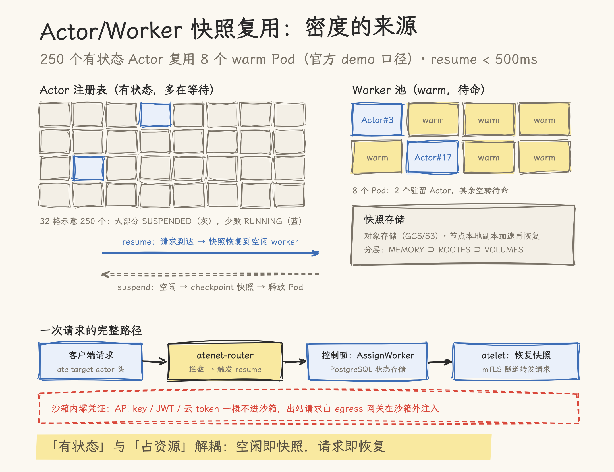

# Agent Substrate 深拆：Google 给百万级 Agent 造的沙箱底座

> 本文基于 [agent-substrate/substrate](https://github.com/agent-substrate/substrate) 仓库（commit `cf5768a0`，2026-11-14 浅克隆核对）与其官方文档撰写。文中全部性能数字（resume < 500ms、500 activations/sec、10 倍密度、北极星目标）均为项目官方口径，未含独立测量；产品迭代较快，使用前建议以官方文档复核。

---

## 一、Agent 沙箱的成本账

一个典型的编码 Agent 会话长什么样：用户发出指令，模型思考十几秒，调用工具改几个文件，跑一次测试，然后停下来等用户看结果。等一分钟很正常，等一小时也不稀奇。把时间轴摊开看，Agent 真正在消耗 CPU 的部分占比很低，绝大部分生命周期花在等待上：等模型、等工具、等人类。

而沙箱的需求恰恰把这种「大部分时间闲置」的负载变得更贵。跑不可信代码（模型生成的命令、第三方 MCP 工具）意味着每个 Agent 需要隔离边界；单租户实例是常见的安全基线；于是 N 个并发会话就是 N 个常驻沙箱，无论它们是否在干活。现有三条路线各有代价：

- **托管沙箱服务**（E2B 一类）：API 调用即得 Firecracker microVM，省心，但成本随会话数线性增长，且代码要过第三方
- **自建 Pod 池**：每个 Agent 一个 Kubernetes Pod，隔离可控，但空闲 Pod 吃着真实成本，密度上不去
- **单机方案**（Bubblewrap 一类进程沙箱）：轻便，但只覆盖开发者的本机场景，不解决集群级的多租户

Agent Substrate 给出的答案是第四条路：**把「有状态」与「占资源」解耦**。它由 Google 团队主导设计（19 名 maintainer 中 16 名来自 Google，含 Kubernetes SIG-Node 的多位核心成员），代码以 CNCF 名义捐赠（仓库提交记录 `274605f1`："Update Copyright for CNCF. All Code was donated"），使用 CNCF 的 Slack、DCO 与官方 maintainers 列表治理，已发布 1.0 并承诺不破坏公开 API、CLI 与配置格式（README.md:85）。项目自述定位为一句话：_Zero-trust sandboxing for millions of agents on Kubernetes_（README.md:10）。

## 二、集群级沙箱的四道坎

把沙箱搬到 Kubernetes 集群规模，会撞上四道坎。官方架构文档对前两道的表述很直白（architecture.md:151-159）：

1. **K8s apiserver 不适合这个负载形态**。它擅长跨多个 controller 异步 reconcile 资源，却不擅长存储百万级离散资源、应对巨大写入流量，而百万 Agent 的状态变更恰恰是每秒上千次的高频写。
2. **调度延迟不可接受**。在 K8s 上调度一个工作负载需要多个异步流程收敛加多次网络跳转，Pod 秒级启动对跑几小时的服务很好，对毫秒到低位数秒的 Agent 唤醒完全不可接受。
3. **状态管理没有现成答案**。K8s 的 PersistentVolume 体系不为「百万级卷、数据量差异巨大、高速挂载卸载」设计。
4. **隔离与密度的矛盾**。沙箱要求单租户，密度要求共享，两者在传统部署里只能二选一。

Agent Substrate 的回答是：基础设施生命周期管理（worker Pod 的供给与隔离）继续交给 Kubernetes 擅长的部分，Agent 特有的高频调度、快照与路由由一个专门的轻量控制面接管。

## 三、方案：Actor/Worker 解耦，快照复用

### 3.1 核心模型：大注册表映射小池子

模型只有一句话：把大量 **Actor**（有状态的 Agent 实例）映射到少量就绪的 **Worker**（warm 沙箱 Pod）上。Actor 空闲时被 suspend，内存与文件状态以快照形式卸下，Worker 立即释放；请求到达时把快照恢复到池中任意空闲 worker，流量随后转发过去。

官方给出的数字（均为自述口径）：resume 操作 < 500ms、超过 500 activations/sec、密度为标准容器的 10 倍（README.md:30）；demo 中约 250 个有状态 Actor 复用 8 个物理 Pod，超售比 10x-30x（README.md:50,56）。北极星指标写得更激进：激活延迟 P95 100ms、单集群 10 亿 actor、1000 次唤醒/秒（architecture.md:102-110）。

### 3.2 双层资源模型：绕开 apiserver 的设计

这是全项目最关键的架构决策。资源按状态变更频率分成两层：

| 层             | 资源                          | 存储                | 变更频率     |
| -------------- | ----------------------------- | ------------------- | ------------ |
| 声明式（低频） | `WorkerPool`、`SandboxConfig` | Kubernetes CRD      | 管理员操作时 |
| 动态（高频）   | `Actor`、`Worker` 记录        | PostgreSQL 状态存储 | 每秒上千次   |

Actor/Worker 的实时记录不进 apiserver，原因文档写得毫不含糊：apiserver「不为存储大量离散资源或处理巨大写入流量设计」，而实现 100ms 恢复需要「低延迟状态查询与原子 worker 分配，绕开标准 Kubernetes API 服务器的最终一致性与延迟波动」（architecture.md:151-159、207-227）。基础设施资源留在 K8s 也有治理上的理由：平台团队可以沿用熟悉的 RBAC、审计与策略机制管理底层，工作负载定义（ActorTemplate）则走 substrate 自己的 gRPC API。

### 3.3 组件与一次 resume 的完整链路

组件分三组：

- **控制面**：`ate-api-server`（gRPC API、PostgreSQL 状态存储、调度器、suspend/resume 工作流引擎；mTLS 与 OIDC 认证，内嵌 OpenFGA 模型按 atespace 逐 RPC 授权）、`atecontroller`（把 WorkerPool CRD reconcile 成 Kubernetes Deployment）
- **节点**：`atelet`（DaemonSet 监督者，管理本地 worker pod 与快照移动）、`ateworker`（worker pod 内的沙箱镜像，每沙箱类一个，向 atelet 提供 `RunWorkload` / `CheckpointWorkload` / `RestoreWorkload` gRPC 接口）
- **网络**：`atenet-router`（Envoy 入口路由）、`atenet-egress`（出口网关）、`atunnel`（worker 内 mTLS 隧道）

一次请求的完整链路（architecture.md:353-375 与生命周期时序）：上游系统带 `ate-target-actor: <atespace>/<actor>` 头请求路由器；Envoy 的 `ext_proc` 调控制面 `ResumeActor`；调度器从 WorkerPool 分配一个空闲 worker；节点上的 atelet 把该 actor 的最新快照恢复进 worker；恢复完成后控制面返回 worker 分配，路由器建立到 worker `atunnel` 8443 端口的 mTLS CONNECT 隧道，请求转发给 Actor。Actor 的状态机为 `SUSPENDED → RESUMING → RUNNING → SUSPENDING → SUSPENDED`（architecture.md:436-443）。

### 3.4 快照工程：分层、双后端与位置性

快照按累积层捕获，由 ActorTemplate 的 `preferredFidelity` 控制：`VOLUMES`（持久卷）、`ROOTFS`（卷 + 容器可写层的文件）、`MEMORY`（再加进程树与内存，默认档）。三层是包含关系而非并列选项（architecture.md:537-541）。

两种沙箱后端的 checkpoint/restore 机制不同：

- **gVisor**（默认类）：用 `runsc` 对沙箱内进程树做原生 checkpoint/restore。文档注明当前依赖 `runsc` 的 `--allow-connected-on-save` 参数绕过 checkpoint 时网络恢复的一个 bug（architecture.md:335,345）。
- **microVM**（Kata Containers + Cloud Hypervisor）：内存快照用 userfaultfd 按需分页恢复；容器 rootfs 的写入落在 host 侧 overlay（只读 OCI lower 加每 actor 可写 upper），经 virtio-fs 共享给 guest，写文件只占可回收的 host page cache，不占 guest 内存（architecture.md:347）。

三个精打细算的设计：

- **位置性（locality）**：suspend 后节点本地保留一份快照副本，同节点再 resume 免去对象存储往返；`--snapshot-detach-delay` 之后清除本地副本（architecture.md:78-80,458-461）。
- **异步 suspend 是默认**：本地 checkpoint 落盘即返回，快照后台经 `--snapshot-upload-delay` 上传对象存储。代价文档明说：后台上传完成前节点故障，该次状态丢失（architecture.md:80-82）。
- **Golden snapshot**：ActorTemplate（不可变的 actor 版本定义）预热生成「黄金快照」，同模板的新实例直接从快照秒起，不走冷启动（architecture.md:175-177）。快照 tag 是不可变别名兼保留 pin，可以发布给其他 atespace 复用（architecture.md:520-525）。

### 3.5 请求停车：超售系统的必备补丁

超售的另一面是突发流量打光 warm 池。`AssignWorkerStep` 返回 `ResourceExhausted`（「no worker has room for the actor」）时，路由器不直接回 503，而是**停车**：请求被挂住，指数退避重试 resume，默认预算 5 秒（`--parked-request-budget`，停车默认开启）。超售系统里池饱和通常是亚秒级波动（另一个 Actor suspend 就腾出了 worker），快速失败会把亚秒级抖动放大成用户可见错误。

设计里最见功力的一条约束：**预算只限制发起新尝试，绝不取消 in-flight 的恢复**。预算耗尽时，已经在跑的恢复不被取消，恢复超时的请求被「迟到服务」而非失败；lot 容量默认取 `--parked-request-max`（默认 1024）的两倍，留出等量 fast-path 余量，保证停满的 lot 不会饿死访问已运行 Actor 的请求（request-parking.md:41-90）。

### 3.6 零信任安全：四件套与未完成清单

每个 Actor 被假定为不可信且互相敌对，租户共享物理节点但不共享安全边界。四条主线：

1. **VM 级边界是底线**：普通 Linux 容器明确不支持，security 文档原话「A linux container is not sufficient or supported」（security.md:61）。
2. **每 Agent 密码学身份**：活跃 Actor 默认持有短生命周期（1 小时）SPIFFE X.509 证书，egress gateway 按需铸 per-actor JWT（README.md:41、security.md:81）。
3. **沙箱内零凭证**：Actor 不持有身份 JWT/证书、API key 或云 token；出站请求由 `atenet-egress` 在沙箱外注入凭证。这条设计贯穿到 atelet 自身：节点代理没有对象存储凭证，快照经 sidecar 插件加双重 sha256 校验链交付（architecture.md:337）。安全文档将「Zero Ambient Credentials」列为已达成原则（security.md:80）。快照的存储侧凭证做到了 per-actor 粒度：GCS 上节点用仅限单个 actor 的凭证移动快照，S3 的 per-actor 作用域在计划中（security.md:24,90）。
4. **默认拒绝网络 + 可插拔策略**：Actor 起始于私有网络栈，除 ingress router 外无入站路径、无横向访问；egress gateway 是可替换的策略执行点，DLP、prompt-injection 扫描、云 IAM 引擎均可外挂，策略代码不进沙箱。

诚实清单同样重要，security 文档把两条关键能力标为 In Progress：worker pod 目前仍以 root + SYS_ADMIN/NET_ADMIN 运行（用户名字空间未就位，security.md:65）；跨调度周期的本地卷清理与擦除（Delete Guarantee，防跨租户数据残留）尚未完成（security.md:64）。评估这套方案的安全水位时，这两条与「已达成」清单要放在一起看。

## 四、取舍与边界

**快照数据管理的复杂度是真实的代价**。官方文档开门见山：这套方案把「大量空闲 Pod 消耗资源」换成了「大规模快照数据管理」，百万 actor 的状态高频更新需要本地副本、对象存储、异步上传与位置性策略协同，异步 suspend 的丢状态窗口是明码标价的设计让步（architecture.md:78-82）。

**运维门槛不低**。跑好这套系统需要同时驾驭 Kubernetes、PostgreSQL 状态存储、gVisor/microVM 沙箱集群与 Envoy 网络栈的复合知识；系统 infra 组件（控制面、postgres）建议放在独立节点池以防 worker 负载挤占。小团队或沙箱用量不大的场景，托管沙箱服务的总成本可能更低。

**性能数字全部是官方口径**：resume < 500ms、500 activations/sec、10 倍密度是自述，P95 100ms / 10 亿 actor / 1000 wakeups 是「目标」值，security 文档另有「预期单个大集群可运行数亿 mostly-idle agent」的「预期」表述（security.md:72）。目标与预期是两种口径，引用时注意区分。截至核对日没有独立第三方的压测数据。

**生态归属**：项目由 Google 团队主导（16/19 maintainer），与 Google 自家 [google/ax](https://github.com/google/ax) Agent Executor 和 CNCF Sandbox 项目 kagent 深度集成（README.md:80-81）。对非 Google 生态的团队，这既是成熟度的保证，也是需要纳入评估的路线因素。

## 五、总评

**这套方案回答对了什么**：Agent Substrate 把 Agent 沙箱从「每会话一个常驻隔离环境」的成本模型里解放出来，用的不是什么新技术（checkpoint/restore、warm 池、超售都是老朋友），而是把四件老技术在正确的层组装起来：沙箱引擎（gVisor/microVM）管隔离，进程级 checkpoint/restore 管状态迁移，PostgreSQL 控制面管毫秒级调度，egress 网关管凭证与出站。它对「Agent 是 mostly-idle 负载」的观察、以及由此推出的 actor/worker 复用模型，对任何做大规模 Agent 平台的团队都是值得对照的参考答案。

**它没有回答什么**（折扣清单）：

- 全部性能数字为官方口径，无独立第三方压测；北极星目标（P95 100ms、10 亿 actor）与当前承诺（resume < 500ms）之间还有距离
- 安全模型两条关键能力仍在进行中：worker pod 的 root 权限收敛、跨租户数据清理保证
- 异步 suspend 的丢状态窗口需要应用层自行权衡（要强持久就用同步 suspend，接受更高的 suspend 延迟）
- 运维复合度高（K8s + PostgreSQL + gVisor/microVM + Envoy 四套知识），中小团队落地成本不可忽视
- 非默认端口入口当前仅支持 HTTP(S)，raw TCP 场景尚不可达（architecture.md:374-375）

**何时值得采用**：自建 Agent 平台、会话规模在数千以上、不可信代码执行是刚需、且有 K8s 平台团队兜底运维的场景。沙箱用量少、或代码可过第三方的团队，托管沙箱服务仍是更简单的选择。

## 源文件索引

仓库 agent-substrate/substrate @ `cf5768a0`（1.0 后，2026-11-14 核对）：

| 文件                                   | 关键内容                                                                           | 引用点                                                                     |
| -------------------------------------- | ---------------------------------------------------------------------------------- | -------------------------------------------------------------------------- |
| `README.md`                            | 定位口号、性能口径、安全四原则、兼容矩阵、生态案例                                 | `README.md:10,30,40-42,50,56,80-81,85`                                     |
| `docs/concepts/architecture.md`        | 问题陈述、双层资源模型、组件、状态机、快照分层、双后端、parking 前置、生命周期时序 | `:102-110,151-159,175-177,207-227,312-375,436-443,450-461,520-525,537-541` |
| `docs/concepts/request-parking.md`     | 停车预算、in-flight 不取消、lot 容量与 fast-path 余量                              | `:41-59,76,87-90`                                                          |
| `docs/security/security.md`            | 威胁模型、Zero Ambient Credentials、In Progress 项、per-actor 存储凭证             | `:24,61,64-65,72,80-81,90`                                                 |
| `docs/concepts/sandbox-asset-cache.md` | 沙箱资产缓存（sha256 内容寻址）                                                    | 全文                                                                       |
| `MAINTAINERS.md`                       | 19 名 maintainer、16 名 Google                                                     | `:7-25`                                                                    |
| `pkg/sandboxclass/sandboxclass.go`     | 沙箱类定义（gVisor 默认 / microVM）                                                | `:24-28`                                                                   |
| `cmd/atelet/main.go`                   | snapshot-upload-delay / detach-delay 参数                                          | `:136-137`                                                                 |

## 参考资料

- [agent-substrate/substrate（GitHub）](https://github.com/agent-substrate/substrate) —— 项目主仓库
- [Architecture 文档](https://github.com/agent-substrate/substrate/blob/main/docs/concepts/architecture.md) —— 本文架构部分的官方依据
- [Request Parking](https://github.com/agent-substrate/substrate/blob/main/docs/concepts/request-parking.md) —— 请求停车机制
- [Security Guide](https://github.com/agent-substrate/substrate/blob/main/docs/security/security.md) —— 威胁模型与安全原则清单
- [google/ax：Agent Executor](https://github.com/google/ax) —— 基于 Substrate 的分布式 Agent 运行时
- [kagent（CNCF Sandbox）](https://github.com/kagent-dev/kagent) —— 使用 Substrate 跑沙箱化有状态 Agent 的 K8s 框架
- [ate.dev](https://ate.dev) —— 项目官网
