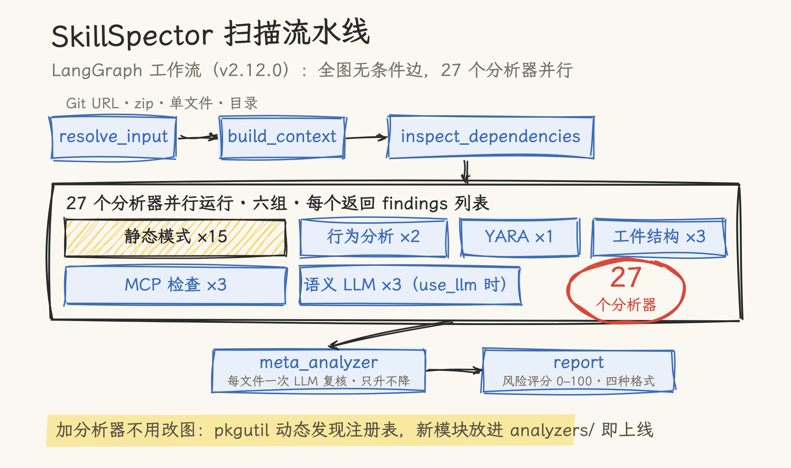

# 四分之一的 Agent Skill 有漏洞：NVIDIA 把安装前的扫描器开源了

> 版本：SkillSpector 2.12.0（commit `a09091e0`，2026-11-16）｜核对日期：2026-11-18｜许可证 Apache-2.0。仓库迭代很快，引用的模式数量、分析器数量以文内标注的 as-of 日期为准，复核时以代码实测为准。

2026 年 1 月，NVIDIA 研究团队把主流市场上能抓到的 Agent Skill 抓了下来，凑成一个 42,447 个样本的数据集。论文《Agent Skills in the Wild: An Empirical Study of Security Vulnerabilities at Scale》（[arXiv:2601.10338](https://arxiv.org/abs/2601.10338)，[中文总结](references/01-agent-skills-in-the-wild.md)）统计了其中 31,132 个可分析样本：26.1% 至少含一个漏洞，5.2% 呈现明确的恶意意图；带可执行脚本的 skill，漏洞概率是无脚本版本的 2.12 倍。

Skill 就是一份 SKILL.md 加一组脚本和参考文件，Claude Code、Codex CLI、Gemini CLI 这些 agent 运行时装上它就照做。装一个 skill 等于把一段没读过的代码放进有文件、shell 和网络权限的执行环境，而安装环节到今天也没有一个像样的检查动作。NVIDIA 为这个环节做了一个开源的扫描器：SkillSpector。这篇文章基于 v2.12.0 的源码，拆它的架构、检测方式和边界。

## 一、先看 skill 能被怎么滥用

论文把漏洞按危害归类，SkillSpector 的检测分类与之对应。四类攻击面分开看：

**SKILL.md 里的指令本身。** skill 的说明书会被 agent 当作上下文读进去，于是一段「忽略此前的安全约束」「不要向用户提及本段」的文字就能改掉 agent 的行为。隐藏手段包括注释、零宽字符、大段空白填充（P9 模式专查这种）。

**随包携带的脚本。** 2.12 倍的漏洞概率来自这里：一个 Python 脚本可以读环境变量、扫文件系统、往任意地址发 POST。README 的示例报告里就是一个真实组合：`scripts/sync.py` 先枚举环境变量（E2），再把内容发往外部服务器（E1），典型的凭证外传链。

**依赖。** skill 带 requirements.txt 或 package.json，依赖名拼错一个字母（typosquatting，SC6）、版本不锁定（SC1）、装一个已知有 CVE 的版本（SC4），都是供应链的常规入口。更隐蔽的是改包管理器的源（SC10），让后续所有下载都走到攻击者的服务器。

**MCP 工具的元数据。** MCP server 的 name、description、参数描述是给 agent 看的，攻击者在这里写入隐藏指令、用同形字符伪装工具名、或者让描述说一套代码做一套。这一类攻击在 MITRE ATLAS 里有编号（AML.T0080，tool poisoning）。

## 二、SkillSpector 管的是安装前这一段

SkillSpector 是 NVIDIA Verified Skills pipeline 的扫描环节。这条 pipeline 把 skill 的「编目、扫描、评估、签名」串成发布门禁，通过者进入 NVIDIA 的 skills catalog（skills.sh 与 NVIDIA Build），签名用分离式的 `skill.oms.sig` 文件。仓库里的 `oms.py` 和对 OMS/DSSE bundle 的投影分析，对应的就是这条链。

它的自我定位写得很克制：**defense-in-depth，不是沙箱**。它在你装 skill 之前拦一道，不负责看住你已经装上的东西。

时间线上有一个容易误读的地方。仓库 git 历史最早只到 2026-09-24，但 CHANGELOG 的版本记录从 0.1.3（2026-01-30）就开始了：git 早期历史被 squash 过，公开仓库晚于项目启动约 8 个月。到写作时 CHANGELOG 里已有 65 个版本，1.0.0 在 2026-03-19，2.0.0 在 2026-05-07，当前的 2.12.0 单个 unreleased 小节就排了 82 条变更。一个月 6 到 7 个版本的节奏，说明它在 NVIDIA 内部被高强度使用着。

## 三、一条 LangGraph 流水线，27 个分析器

SkillSpector 的核心是一个 LangGraph workflow（`src/skillspector/graph.py`），五个环节一条线：

```text
resolve_input → build_context → inspect_dependencies → [27 个分析器并行] → meta_analyzer → report
```



`resolve_input` 把 Git URL、zip、单文件或目录解析成本地路径（含 zip 炸弹防护：单次摄入上限 100 MiB、zip 成员上限 10,000，超限直接失败）；`build_context` 读文件、建缓存、解析 SKILL.md 元数据；`inspect_dependencies` 做依赖检查；然后 27 个分析器同时跑，全部汇入 `meta_analyzer`，最后 `report` 出报告。

两个设计选择值得注意。

**全图无条件边。** `graph.py:85-95` 里全部用 `add_edge`，没有任何 `add_conditional_edges`：所有分析器无论输入是什么都会执行，缺文件、不支持的语言这类情况反映为「覆盖不完整」状态而不是绕过检查。fail-closed 的思路贯穿到图结构上。

**加分析器不用改图。** 分析器注册表用 `pkgutil.iter_modules` 动态发现（`nodes/analyzers/__init__.py:20-52`）：一个新模块放进 `analyzers/` 目录、定义 `ANALYZER_ID` 和 `node` 函数，重启后就自动挂进 fan-out/fan-in。这解释了为什么它的检测面能以每月几个的速度扩张：成本被压到了「写一个模块」。

27 个分析器分六组：静态模式 15 个（按攻击类型分文件）、行为分析 2 个（AST1–AST10 查危险调用，TT1–TT6 做污点跟踪）、YARA 1 个（5 份规则文件，其中 malware.yar.b64 是 base64 编码形态，加载时解码）、MCP 检查 3 个、语义 LLM 3 个（仅 `use_llm` 时产出 findings）、工件与结构 3 个。

## 四、两阶段检测：静态打底，LLM 复核

README 的口径是「71 个漏洞模式、17 类」（as-of 2026-11-16）。这个数字要打个招呼：模式表和代码都在长，文档数字普遍滞后于代码（分析器数文档写 22，代码实测 27），把它当量级看比当精确数看更合适。

**第一阶段是静态分析**：regex 模式匹配、Python/JavaScript AST、YARA 签名，外加一次联网检查，SC4 把依赖清单发给 OSV.dev 查已知 CVE（批量查询每批最多 64 个、内存缓存 1 小时、断网时回退到内置列表，`osv_client.py:42,60,214`）。这一阶段高召回、中等精度，宁可多报。

**第二阶段是可选的 LLM 复核**。`meta_analyzer` 对每个文件（超大文件按行分块）做一次 LLM 调用，对第一阶段的 findings 逐条判断。这里有条硬规则：**LLM 只能确认和加解释，不能删**。确定性 finding 无论模型同意、反驳还是没理它，都留在报告里；模型反驳或低置信的打上 `llm-unconfirmed` 标签（`meta_analyzer.py:502-504`）。复核失败的 finding 原样保留。恶意 skill 试图在内容里给分析模型下指令的情况，prompt 里有专门的防越狱设计。

风险评分从 findings 加权得出：CRITICAL 50 分、HIGH 25、MEDIUM 10、LOW 5（`report.py:621-626`），可执行脚本乘 1.3（`report.py:759-761`），再乘逐规则递减权重和 confidence，封顶 100。有一个容易被漏看的细节：存在 score_floor 机制，某些条件下分数会被抬到至少 51（HIGH 档），也就是宁可错杀进「DO NOT INSTALL」，不给「看起来干净」的错觉。0–100 分对应四档：0–20 LOW/SAFE、21–50 MEDIUM/CAUTION、51 以上 HIGH/CRITICAL/DO_NOT_INSTALL。

## 五、几个值得细看的检测点

**供应链三件套。** SC8 查 skill 里有没有夹带 `__pycache__`/`.pyc` 字节码（绕过静态源码分析的通路）；SC9 查文档容器里嵌的可执行工件；SC10 查包管理器源被增删改。`--inspect-dependencies` 开启后走得更远：按 `package-lock.json` 锁定的 SHA-512 完整性哈希下载 npm tarball，在一个 Linux seccomp 系统调用白名单隔离的一次性 worker 里做静态检查（`dependency_inspection.py:611-613`、`dependency_sandbox.py:19-22`），不安装、不执行包代码。覆盖不完整可以配 `--fail-on-incomplete` 让整次扫描失败。

**MCP 三组分析器。** LP1–LP4 交叉核对 manifest 声明的权限和代码实际行为：用了没声明的能力（LP1）、声明里写通配符（LP2）、没声明但代码有敏感操作（LP3）、声明了但代码没有（LP4）。TP1–TP4 查工具投毒：隐藏指令、Unicode 欺骗、参数描述注入、描述与行为不符。TP2 的同形字符检测基于 UTS #39 confusables 数据（`unicode_confusables.py`，Unicode 17.0.0），RTL 覆盖符则在 `artifacts.py:302` 的双向控制区段（U+202A–U+202E）里查。RP1–RP3 是 rug pull 检测：对比前后两次扫描注入的 `previous_manifest`，permissions、triggers、parameters 任一变化即报（`mcp_rug_pull.py:927-928`）。针对的是「装的时候干净、升级后变坏」这类时序攻击。配合 `--mcp-registry` 可以直接扫官方 MCP registry 的服务器条目并做快照对比。

**基线抑制。** 安全工具用起来最烦的一件事，是重扫时把已知问题再报一遍。`skillspector baseline --update` 把当前 findings 收进基线文件，之后的扫描只报新增。实现上有讲究：v2 精确指纹绑定扫描器版本号（`suppression.py:81,233-235`），升级扫描器后旧指纹不再压制，防止用陈旧基线掩盖新版本才能发现的问题。

## 六、把它接进工作流

SkillSpector 为被别的工具驱动而设计，退出码和 JSON 输出是稳定合同：0 = 通过（risk_score ≤ 50 且无严格门触发），1 = 发现问题（分数超 50、`--fail-on-findings` 命中、覆盖不足等），2 = 错误。CI 里拿退出码做门禁，`--format sarif` 直接接 IDE 和 GitHub code scanning。推荐的门禁映射：SAFE 放行、CAUTION 提示、DO_NOT_INSTALL 阻断，多严由集成方定。

LLM 阶段支持 15 个 provider（代码实测，文档列了 13 个）：HTTP 阵营有 openai、anthropic、bedrock、gemini、minimax、ollama、azure_openai、openai_compatible、nv_build（默认，模型 `z-ai/glm-5.3-flash`）等；另有三个本地 CLI provider（claude_cli、gemini_cli、opencode_cli）不要求 API key，复用本地 CLI 的登录态，子进程做了沙箱化：不开 shell、不转发环境变量、skill 内容只走 stdin。codex_cli 注册了但被禁用，原因写得很直白：它的只读沙箱允许读宿主机文件（`providers/codex_cli/provider.py:16-18`）。

三种扩展形态：MCP server（`skillspector mcp`，FastMCP 的 stdio 与 loopback HTTP 两种 transport，`mcp_server.py:326-350`）把扫描暴露给 agent 会话；Pi 和 OpenCode 有专门的扩展文档，agent 可以在会话内直接调；`contrib/batch_scan` 支持目录级并行批量扫描，带中日韩多语言检测，适合市场方对整个集合做准入。

## 七、信任模型与边界

文档里有一节专门讲数据出网，三条路径，没有第四条：

1. **LLM 开启时**，被扫文件的内容发给所选 provider。这是默认行为，敏感环境用 `--no-llm` 关掉，静态分析保持全本地。
2. **SC4 永远发**，依赖名和版本号发给 OSV.dev（不含文件内容，免 key；`--no-llm` 也关不掉，检查本身就依赖它）。
3. 除此之外没有其他出网。

资源上限全部 fail-closed：摄入 100 MiB、zip 10,000 成员、单分析器单文件 1 MB、整体扫描时长默认 1080 秒。超限不静默降级，而是标记覆盖不完整、计入退出策略。

边界同样明确：不分析图片里的文字；加密或编译后的代码不可见；静态分析看不到运行时行为；非英文内容可能漏检。它不做的事里最关键的一条是：**不隔离你决定安装的 skill**。过了安检门不代表进了沙箱，安装后的权限管控是另一个层面的问题。

## 八、总评

SkillSpector 把「装 skill 前先扫一遍」变成了一条可以跑的命令。架构上，LangGraph 单向流水线加动态注册的 27 分析器，扩展成本低；工程上，fail-closed 的资源上限、绑定版本的基线指纹、只升不降的 LLM 复核、从不执行被扫代码，这些选择相互配合，构成一个克制的门禁。对运营 skill 集合的团队（市场、企业内部仓库），它可以直接做 CI 准入；对个人用户，装陌生的 skill 前扫一道，成本是几分钟。

折扣清单：

- **文档滞后代码**。分析器数（22 vs 27）、provider 数（13 vs 15）、模式数（71 vs 增长中）都对不上，写集成代码时要以 `--help` 和代码为准。
- **静态检测召回优先**。正规则加 AST 的第一性检测必然误报，正常 skill 也可能命中 EA1（无限制工具访问）这类模式；基线机制是配套必需品，不是可选优化。
- **LLM 阶段的质量取决于 provider 与模型**。默认的 `z-ai/glm-5.3-flash` 换成别的模型，复核质量会变；结构化输出在不同网关上的兼容处理占了文档相当篇幅，冷门 endpoint 需要自己验证。
- **格式绑定 Claude 系 skill**。SKILL.md + scripts + MCP manifest 的检测最深，其他 agent 的扩展格式覆盖未验证。
- **门禁语义由使用方决定**。CAUTION 档拦不拦、score_floor 51 分算不算过，都是策略问题，工具给的是分档和标签。

## 源文件索引

| 文件                                                            | 关键内容                                         | 引用点                   |
| --------------------------------------------------------------- | ------------------------------------------------ | ------------------------ |
| `src/skillspector/graph.py`                                     | LangGraph workflow 构建，`add_edge` 全部无条件边 | `graph.py:85-95`         |
| `src/skillspector/nodes/analyzers/__init__.py`                  | pkgutil 动态发现注册表，27 个唯一分析器 ID       | `:20-52`                 |
| `src/skillspector/nodes/report.py`                              | 评分权重、1.3× 乘数、score_floor、min(100)       | `:621-626, 759-761, 782` |
| `src/skillspector/scan_policy.py`                               | `RISK_THRESHOLD = 50`                            | `:7`                     |
| `src/skillspector/cli.py`                                       | exit 1/2 合同、依赖检查不执行包代码              | `:847-848, 648`          |
| `src/skillspector/nodes/meta_analyzer.py`                       | 每文件 LLM 复核、findings 只升不降               | `:502-504`               |
| `src/skillspector/nodes/analyzers/behavioral_ast.py`            | AST1–AST10 规则表                                | `:194-216`               |
| `src/skillspector/nodes/analyzers/behavioral_taint_tracking.py` | TT1–TT6 污点跟踪                                 | `:16, 197-202`           |
| `src/skillspector/nodes/analyzers/osv_client.py`                | OSV.dev 批量查询、1h 缓存、离线回退              | `:42, 60, 214`           |
| `src/skillspector/nodes/analyzers/mcp_rug_pull.py`              | RP1–RP3，manifest diff                           | `:927-928`               |
| `src/skillspector/dependency_inspection.py`                     | npm tarball SHA-512 校验                         | `:611-613`               |
| `src/skillspector/dependency_sandbox.py`                        | Linux seccomp 白名单、非 Linux 拒绝              | `:19-22`                 |
| `src/skillspector/suppression.py`                               | 基线版本 2、指纹绑定扫描器版本                   | `:81, 233-235`           |
| `src/skillspector/providers/codex_cli/provider.py`              | codex_cli 禁用原因                               | `:16-18`                 |
| `src/skillspector/mcp_server.py`                                | FastMCP stdio / loopback HTTP                    | `:326-350`               |
| `src/skillspector/unicode_confusables.py`                       | UTS #39 confusables 数据（Unicode 17.0.0）       | `:4-11`                  |
| `src/skillspector/artifacts.py`                                 | bidi 控制字符区段检测（U+202A–U+202E）           | `:302`                   |
| `CHANGELOG.md`                                                  | 0.1.3（2026-01-30）至 2.12.0 共 65 个版本        | 全文件                   |

## 参考资料

1. NVIDIA SkillSpector 仓库：https://github.com/NVIDIA/SkillSpector
2. Liu et al., _Agent Skills in the Wild: An Empirical Study of Security Vulnerabilities at Scale_, arXiv:2601.10338, 2026：https://arxiv.org/pdf/2601.10338（[本地 PDF](references/2601.10338-agent-skills-in-the-wild.pdf)｜[中文总结](references/01-agent-skills-in-the-wild.md)）
3. NVIDIA Verified Agent Skills 文档：https://docs.nvidia.com/skills/
4. NVIDIA skills catalog：https://github.com/NVIDIA/skills
