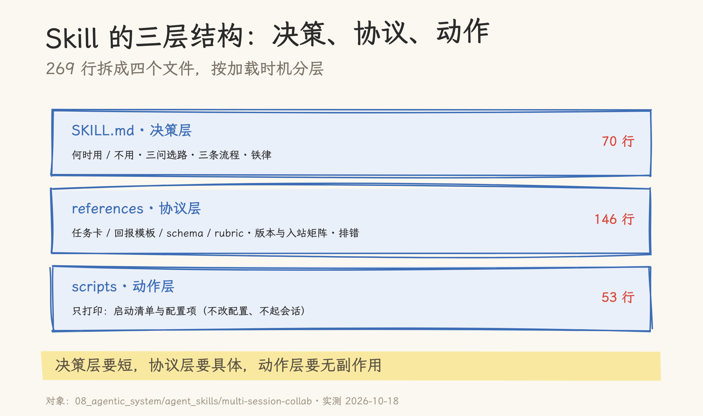
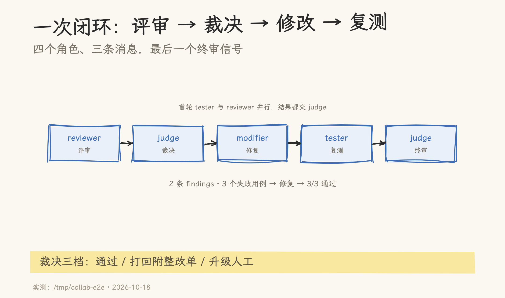
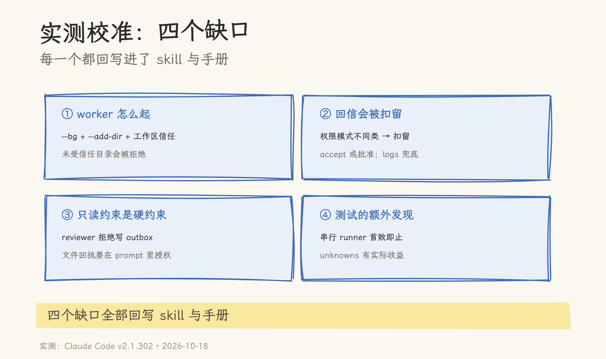

# 从手册到 Skill：把多会话协作交给 Agent 执行

> 2026-10-18 | 实践记录。对象：skill `multi-session-collab`（4 个文件、269 行，仓库副本在 `08_agentic_system/agent_skills/multi-session-collab/`）与配套手册《评审、修改、测试、裁决：Claude Code 多会话协作实践手册》；实测环境 Claude Code v2.1.302（macOS arm64）。事实核对 16 项：15 成立、1 处措辞修正（消息是「扣留→放行」，不能写成「过期」）。E2E 测试仓库在 `/tmp/collab-e2e`，为一次性产物，未入库。

先看结果：一次真实的四角色协作跑完了。reviewer 找出一段代码的两个缺陷，tester 复现出三个失败用例，judge 出裁决单，modifier 按单修复，tester 复测全绿，judge 终审通过。整个过程里，四个会话没有互相读过对方的上下文，只交换了十来条消息和两份结果表。

跑通之后回头整理，这次修复本身没什么可写的；需要记录的是为了让 agent 自己跑完这套流程而补的那一层东西。手册回答的是人怎么做，skill 回答的是 agent 何时做、按什么格式做、被卡住怎么办。这篇就从这里讲起。

## 一、闭环是怎么发生的

测试仓库是一个故意留了 bug 的 `average` 函数：空列表返回 0（规格要求抛 `ValueError`），非空时除数是 `len(values) - 1`。四个会话的角色与分工按手册设定：

| 角色     | 职责               | 产出                                             |
| -------- | ------------------ | ------------------------------------------------ |
| reviewer | 对照规格做静态评审 | 2 条 confirmed findings，带 `file:line` 与实测值 |
| tester   | 跑测试与复现       | 3 个用例全 fail，附堆栈                          |
| modifier | 只按裁决单修改     | 只改 `calc.py`，自验后交回                       |
| judge    | 汇总与裁决         | 打回（附整改单）→ 终审通过                       |

tester 还多报了一条：串行执行的 `__main__` 在首个失败处中止，后两个用例根本没执行，逐例结果得单独调用才拿得到。这条不在任何任务卡里，是它自己看出来的。

闭环本身不难。难的是跑之前：谁先说话、消息长什么样、被拒绝了怎么办。这些原则在[手册](../../multi_agent/docs/claude-code-multi-session-playbook.md)里已经写成操作流程；本文接着讲后半程：要让 agent 照着执行，还得把流程封装成可加载的 skill。

## 二、为什么是 skill

先说不是什么。它不该是 MCP。跨会话消息、Agent Teams、Dynamic Workflow 都是 Claude Code 的原生能力；MCP 是模型与工具之间的协议，没有 agent 间通信能力。用 MCP 再包一层协作总线，等于重写原生的会话发现、审批与投递语义，投入产出不划算。

也不该是更长的文档。文档不会被自动加载，读者是人；agent 需要的是触发条件（什么时候用、什么时候不用）、强制顺序（先选路再配置）、失败处理（消息被扣、名字冲突）。这些放在 SKILL.md 里，agent 才会在合适的时机读到。

skill 的定位因此很明确：它不提供机制，它编排机制。一句话概括就是「把口头约定换成可执行的流程包」。三个载体的分工可以列成一张表：

| 载体 | 读者 | 写什么 |
| --- | --- | --- |
| [手册](../../multi_agent/docs/claude-code-multi-session-playbook.md) | 人 | 操作流程：四窗口、消息矩阵、模板、rubric、排错 |
| skill | agent | 触发条件、协议形状、约束、只读脚本 |
| 本文 | 两者 | 为什么这样拆分、一次实测补了哪些缺口 |

## 三、三层结构：决策、协议、动作



`multi-session-collab` 一共 269 行，拆成四层：

| 层   | 文件                     | 行数 | 写什么                                              |
| ---- | ------------------------ | ---- | --------------------------------------------------- |
| 决策 | `SKILL.md`               | 70   | 何时用/不用、三个问题选路线、三条操作流程、安全铁律 |
| 协议 | `references/protocol.md` | 71   | 任务卡、回报模板、findings schema、rubric、裁决三档 |
| 环境 | `references/setup.md`    | 75   | 版本要求、后台会话、命名与发现、入站矩阵、故障排查  |
| 动作 | `scripts/print-setup.sh` | 53   | 打印启动清单与配置项                                |

这个拆法的依据是加载时机：SKILL.md 每次触发都会进上下文，必须短；references 只在需要时读；scripts 是可执行动作，只做「打印」这类无副作用的事，不改配置、不启动会话。脚本的边界是有意画死的：让 skill 能安全地重复运行。

## 四、实测校准：四个缺口

手册写得再细，没跑过就不算数。这次端到端测试暴露了四个缺口，每一个都回写进了 skill 与手册。先看实际下发的一张任务卡（节选）：

```text
@reviewer 任务：对照 /tmp/collab-e2e/docs/spec.md 评审 calc.py。
输出格式（只输出 JSON，不修改任何文件）：
{"verdict":"pass|fail","findings":[{"id":"F-001","file":"calc.py","line":12,"issue":"...","evidence":"calc.py:12","confidence":"observed","verdict":"confirmed"}],"unknowns":["..."]}
时限：5 分钟；拿不准的写进 unknowns，不要猜。
```

缺口一：worker 怎么起。手册默认开终端窗口，但无人值守时更顺手的是后台会话。`claude --bg --name reviewer --add-dir <目标目录> --settings <配置>` 能起一个可寻址的 worker，它会出现在 `/list-agents` 里（kind 为 `bg`），用 `claude agents` / `claude logs <id>` / `claude stop <id>` 管理。第一次在 `/tmp/collab-e2e` 直接启动时被拒，报错是「Workspace not trusted」；改成在已受信任的仓库启动、用 `--add-dir` 授权目标目录才通过。这条回写进了 skill 的 `references/setup.md:10-23` 与[手册 §3.1](../../multi_agent/docs/claude-code-multi-session-playbook.md)。

缺口二：回信会被扣留。双方权限模式不同类时，接收方会扣下跨会话消息。实测里 reviewer 的第一条就绪消息一直没送到；后续的回报多次出现「扣留→放行」，日志原文是 released after approval。把接收方的 `crossSessionInbound` 设为 `accept` 可以稳定收信；消息被扣住时，`claude logs <id>` 能从后台会话的日志里读回内容，这次 tester 的完整 JSON 就是靠它捞回来的。这条写进了[手册 §3.2](../../multi_agent/docs/claude-code-multi-session-playbook.md) 与 skill 的入站矩阵。

缺口三：只读约束是硬约束。我们原本让 worker 把结果同时写一份到 outbox 文件，reviewer 直接拒绝了：它的角色 prompt 写着只读、禁止修改任何文件。这说明角色约束会真实生效；反过来也提醒，若要用文件回执，必须在角色 prompt 里显式授权路径，不能想当然。

缺口四：测试能报出任务卡之外的信息。串行 runner 首败即止、`__pycache__` 由谁产生，这些不在任务卡里，但 tester 都写进了 unknowns。回报模板里给 unknowns 留位置，是有实际收益的。

四个缺口补完之后，闭环变成这样：





## 五、边界：什么该固化，什么不该

skill 写多了会僵化，写少了不顶用。这次实践里，边界大致是这样：

该固化：协议形状（任务卡、回报模板、findings schema、rubric）、决策规则（三个问题选路线）、安全边界（消息不能代批权限、judge 不改代码）、排错表（名字冲突、消息被扣、审批过期）。

不该固化：版本敏感的命令细节（指向官方文档，不抄参数表）、实验特性的开关（Agent Teams 明确标注「实验」）、权限配置（`crossSessionInbound` 只给建议，由使用者选择）、组织习惯（会话命名、人数上限）。

三个反模式：

1. 文档搬运：把手册整段复制进 SKILL.md，触发时上下文被撑大，agent 反而抓不住重点。
2. 替机制：用 skill 假装成 MCP 或工作流引擎，该由协议层做的事硬塞进提示词，最后不可维护。
3. 过度脚本化：脚本改配置、起会话、删文件，skill 变成半成品工具，失去「可安全重复运行」的性质。

判断一个流程该不该做成 skill，四个问题够用：它会重复发生吗？中间有需要判断的决策点吗？有必须遵守的顺序或门禁吗？会跨项目复用吗？四个都答「是」，才值得做成 skill；只有一两个「是」，写进 CLAUDE.md 或一篇文档就够。

## 六、收尾

现在这个 skill 是 269 行、4 个文件：70 行的决策层、146 行的协议与环境参考、53 行的只读脚本。一次实测跑了 6 个回合、4 个角色、十来条跨会话消息，暴露出 4 个缺口，全部回写。仓库里对应的是那篇[手册](../../multi_agent/docs/claude-code-multi-session-playbook.md)，两者分工：手册给读者，skill 给执行者，本文记录两者之间的转换与实测。

## 源文件索引

| 文件                                                                       | 关键内容                                       | 引用点                          |
| -------------------------------------------------------------------------- | ---------------------------------------------- | ------------------------------- |
| `08_agentic_system/agent_skills/multi-session-collab/SKILL.md`            | 触发条件、三问选路、三条流程、铁律             | `:10-62`                        |
| `08_agentic_system/agent_skills/multi-session-collab/references/protocol.md` | 任务卡、回报模板、schema、rubric、裁决三档     | `:3-70`                         |
| `08_agentic_system/agent_skills/multi-session-collab/references/setup.md` | 后台会话（实测）、入站策略、故障排查           | `:10-23`、`:37-53`、`:61-70`    |
| `08_agentic_system/agent_skills/multi-session-collab/scripts/print-setup.sh` | tmux 四窗与配置清单                            | `:23-44`                        |
| `08_agentic_system/multi_agent/docs/claude-code-multi-session-playbook.md` | 配套手册：多会话理由、四窗口剧本、入站实测补充 | `:13-21`、`:85-115`、`:227-258` |
| `/tmp/collab-e2e/calc.py`                                                  | 终态实现（修复后）                             | `:9-11`                         |
| `/tmp/collab-e2e/test_calc.py`                                             | 三个用例                                       | `:4-18`                         |

## 参考资料

- [Claude Code 文档：跨会话消息](https://code.claude.com/docs/en/cross-session-messaging) · [Agent Teams](https://code.claude.com/docs/en/agent-teams) · [Dynamic Workflow](https://code.claude.com/docs/en/workflows)
- [Claude Code 文档：工具参考（ListAgents / SendMessage）](https://code.claude.com/docs/en/tools-reference) · [Settings 参考](https://code.claude.com/docs/en/settings-reference)
- 配套手册（本仓库）：[评审、修改、测试、裁决：Claude Code 多会话协作实践手册](../../multi_agent/docs/claude-code-multi-session-playbook.md)
- skill 仓库副本：`08_agentic_system/agent_skills/multi-session-collab/`；安装到用户级目录：`cp -R 08_agentic_system/agent_skills/multi-session-collab ~/.claude/skills/`
