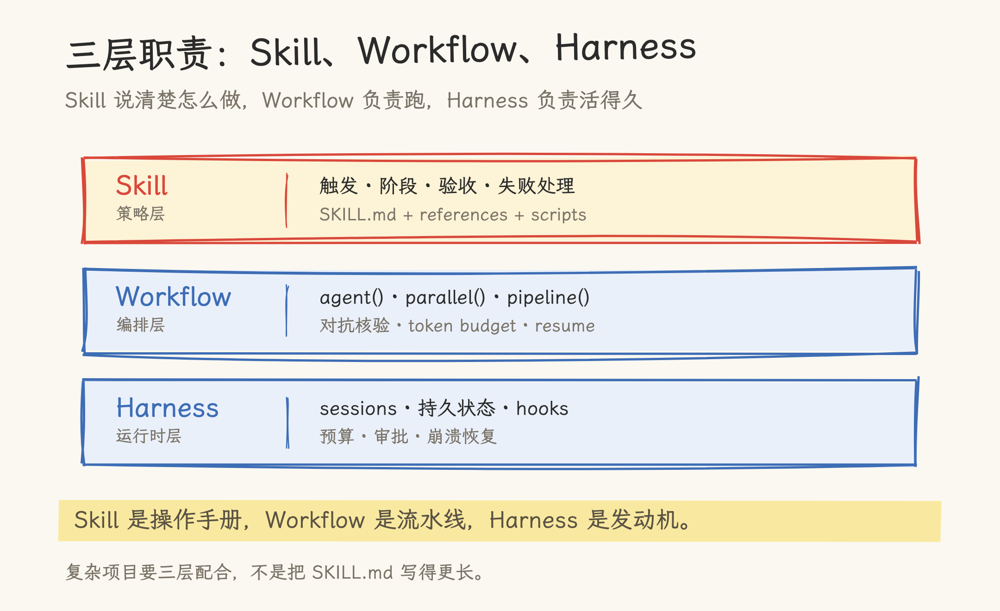
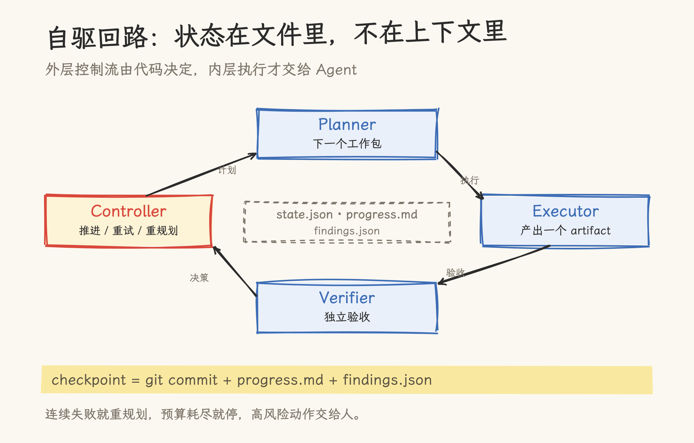
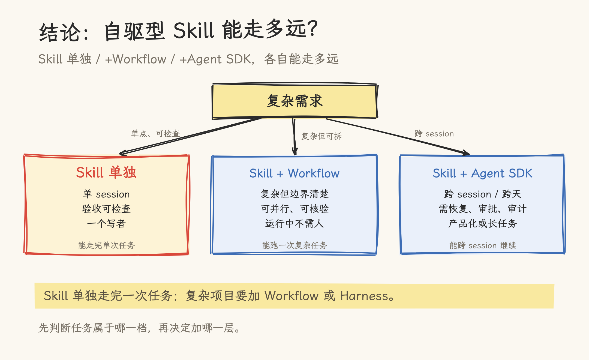

# 12 小时、636 个测试：自驱型 Skill 能走多远

> Agent Skills 与 harness 实践分析。基于 Claude Code Skills / Agent SDK 官方文档、Anthropic 的长任务 harness 与 dynamic workflows 文章、Simon Willison 的 SPARQLite 实验，以及本仓库的 skill 实测与 Harness 文章。SPARQLite 为单次公开实验，数字为作者自述，不代表成功率。

2026 年 10 月 16 日，Simon Willison 在 Claude Code for web 的 Ultracode 模式里下了一个需求：用 Rust 写一个 SQLite 扩展，把 SPARQL 1.1 嵌进去，跑得快，最好能直接读 SQLite 的 B-tree 行。他在手机上打错了一个词，把 direct 写成了 delete。这个 typo 没有阻止 Claude Code。

第二天回来看，它已经跑了超过 12 小时，交出一个完整的 Rust SQLite 扩展：SPARQL 查询和更新在 SQLite 进程内执行，RDF 四元组存在普通表里，带代价模型、批量 join、可选 B-tree reader。它过了 636/639 个适用的 W3C 测试；作者测到的加速是 count 模式 3.5×、返回完整结果 2.8×。随后 Simon 追加了一个请求，让它给每个 crate 补 README、教程和示例数据。

Ultracode 模式会用 dynamic workflow 协调一组子 Agent。这也是后文要拆的编排层。

然后他写了更值得注意的一句：这些代码，review 不了。

这个案例暴露了两个问题。Agent 已经能在一句话需求下连续工作十几个小时；但“跑完”不等于“交付”。如果自驱只是“Agent 不停下来”，它离可用还很远。

这篇文章只回答三个问题：Skill 能不能实现自驱？不能的话，要不要自己写一个 Agent？在 vibe coding 场景里，复杂需求应该怎么搭？

结论是：Skill 能封装自驱的策略，但封装不了自驱的运行时。复杂项目需要协作层、编排层、运行时层三层配合；自建 Agent 是最后一种选择。

## 一、12 小时之后，问题变了

Simon 的实验不是 benchmark。它是一次公开的单点尝试，说明上限，不说明成功率。但它把长任务的几个真实问题暴露得很清楚。

生成本身已经不是瓶颈。一句话需求，12 小时，636 个测试，这个产出超过了大多数人对“AI 写代码”的预期。

验证成了瓶颈。测试能证明一部分行为，但 Simon 说，review 这些代码不现实；他甚至不确定自己愿不愿意投入时间去理解这个项目。

再往后是交付。代码能跑，不等于有人能维护、能改、能在出问题时定位。

这也是 vibe coding 和 vibe engineering 的分界。Simon 对 vibe coding 的概括是“不评审、全盘接受”，适合一次性脚本和探索性原型；认真做工程时，他用的是 vibe engineering，测试、计划、文档、版本控制、代码评审一样不少。12 小时的实验看起来像 vibe coding 的极限，实际暴露的是 vibe engineering 的必要性。

把“自驱”定义得可操作一点：

> 一次触发后，Agent 能自己规划、执行、验证、恢复，直到满足预先写好的验收标准；人只在三个点出现：定义什么算完成、批准高风险动作、做最终验收。

这个定义里没有“无限 autonomy”。它要求的是一套有边界的循环。

单个上下文里做长任务，会反复遇到三种失败。Anthropic 在 dynamic workflows 的文章里把它们点得很直接：

- **agentic laziness**：任务还没做完，Agent 就宣布完成。比如安全审查 50 项，做到 35 项就停了。
- **self-preferential bias**：Agent 评判自己的输出时，倾向于给自己打高分。
- **goal drift**：轮次一多，尤其是压缩之后，原始目标里的边界条件、例外、“不要做 X”会逐渐丢失。

这三种失败不是靠“再写长一点的提示词”能解决的。提示词越长，越容易在压缩时丢东西；同一个上下文越久，越容易自我强化。复杂项目要的是把工作拆出去、把验证拆出去、把状态放到上下文之外。

## 二、Skill 的边界：策略层，不是运行时

Claude Code 官方文档对 Skill 的定义很朴素：一个目录，里面有 `SKILL.md`，YAML frontmatter 告诉 Claude 什么时候用它，Markdown 正文写它被调用后要遵循的指令。目录里还可以放 references、scripts、assets。Skill 按需加载，正文进入上下文后不会在后续轮次重新读取。

这个设计解决的是“知识怎么在正确的时机进入上下文”。它不解决“谁来驱动循环”。

官方文档没有给 skill 定义 skill 级的循环、调度器或持久状态 API。Skill 可以写“生成后运行检查，失败就修，最多三轮”，但执行这个循环的是宿主 Agent；skill 只是把循环写成指令。Skill 可以引用一个状态文件，但读写仍然由 Agent 调工具完成，skill 正文本身不维护状态。Skill 可以注册 hooks，让某个生命周期事件触发检查，但 hooks 是会话内的机制，不是跨会话的进程。

这就是“策略”和“运行时”的区别。策略说清楚做什么、按什么顺序、什么算通过；运行时负责真的跑、保存状态、在失败后恢复、在预算耗尽时停下。

Skill 的强项在几个地方：

- 把“怎么做”写成可触发、可复用的操作手册，而不是塞进系统提示词。
- 用 references 做渐进式披露，让正文保持短小。
- 用 scripts 执行确定性动作，比如检查、渲染、收集。
- 用 `context: fork` 把任务放进隔离子 Agent，适合只读研究或评审。
- 用 hooks 把门禁挂到工具调用或会话事件上，比如 Stop 时跑测试，不过就阻止“完成”。

这些能力足以让一个 skill 在**单会话、边界清楚、验收可检查**的任务里表现得像自驱：它触发后自己生成、自己跑检查、自己修，直到检查通过。比如把验收写进 `scripts/check.sh`，生成后跑检查，非零退出就修，最多三轮。这类任务不需要 workflow，也不需要 SDK。很多日常任务就停在这一层，而且这一层已经很有价值。

但一旦任务跨 session、跨天，需要暂停恢复、需要独立验证、需要预算和审计，skill 就不够了。它没有自己的时钟，没有自己的状态存储，也没有办法在会话结束后继续推进。

三种形态的能力边界如下：

| 能力            | Skill 单独           | Skill + Workflow                 | Skill + Agent SDK            |
| --------------- | -------------------- | -------------------------------- | ---------------------------- |
| 触发与流程      | 宿主 Agent 执行      | JS 脚本编排                      | 代码控制 agent loop          |
| 并行子 Agent    | 靠指令调用           | 原生 `parallel()` / `pipeline()` | 原生 subagents               |
| 跨 session 状态 | 外置文件，靠宿主维护 | 依赖 session resume              | sessions + 持久 store        |
| 循环与预算      | 宿主决定             | JS 循环 + token budget           | agent loop + 预算/停止条件   |
| 人工介入        | 宿主随时可停         | 运行中不介入                     | hooks / permissions / resume |

第一个问题的答案因此变得具体：**Skill 单独实现自驱，在有界任务里可行；在复杂长任务里不够。** 不是 skill 写得不够长，而是它缺运行时。



**图 1**｜三层职责。Skill 负责策略，Workflow 负责编排，Harness 负责跨 session 运行。

## 三、协作层：先把“谁来评”拆出来

复杂项目要先解决“谁来做，谁来评”，再谈加多少 Agent。

本仓库之前把“评审、修改、测试、裁决”四个角色封装成了 `multi-session-collab` skill。整个 skill 269 行，拆成 70 行决策层、146 行协议参考、53 行只读脚本；一次实测跑了 6 个回合、4 个角色、十来条跨会话消息。它解决的不是“让 Agent 自己跑”，而是“让不同角色的判断互相独立”。

这套结构里有几条规则，对自驱同样重要：

- 研究可以并行，写作必须单线程。多个 researcher 可以同时找资料，但只能有一个 writer 拥有正文文件。
- reviewer 用干净上下文，只看 artifact、验收标准和来源，不看 writer 的推理过程。
- judge 不改稿，writer 不给自己判通过。
- 角色之间传文件路径和结构化 JSON，不传整段对话。

Cognition 在《Don't Build Multi-Agents》里给过同样的判断：并行写代码的多个 Agent 会做出互相冲突的隐含决策，最后拼不起来。后来他们在《Multi-Agents: What's Actually Working》里补了一句更实用的结论：让写保持单线程，其他 Agent 提供分析、评审和协调。这和上面的规则是同一件事。

但协作层不是自驱层。四个窗口可以保证每一步有人评，不能保证项目在没人盯着时继续往前走。它更像“监督式协作”：人还在场，只是把注意力从写代码移到裁决和分工。

Anthropic 的多 Agent 研究系统也说明了边界：orchestrator-worker 适合广度优先的研究，多个 worker 各自搜索、各自压缩，最后汇总；代价是多 Agent 大约比普通 chat 多 15 倍 token。它适合“读多写少”的探索，不适合需要共享上下文、频繁交叉修改的任务。

## 四、编排层：把流程写成可重放的脚本

协作层解决“谁评”，编排层解决“按什么顺序跑、每步交什么、失败怎么办”。

Claude Code 的 dynamic workflow 是这一层的代表。它执行一个 JavaScript 文件，文件里用三个原语编排子 Agent：`agent()` 启动一个子 Agent，`parallel()` 和 `pipeline()` 组合多个。脚本可以决定每个子 Agent 用哪个模型、是否在独立 worktree 里跑；如果运行被中断，恢复 session 可以接着跑。

一个最小的 workflow 骨架大概是这样：

```js
export const meta = {
  name: "research-and-verify",
  description: "并行研究，逐条对抗核验，最后汇总",
};

const sources = await parallel(
  ["官方文档", "源码", "公开案例"].map(
    (topic) => () =>
      agent(`研究 ${topic}，只返回来源卡片`, { schema: SOURCE_CARD }),
  ),
);

const claims = await agent("把来源卡片合并成断言清单", {
  schema: CLAIMS,
});

const verdicts = await parallel(
  claims.map(
    (claim) => () => agent(`核验这条断言：${claim.text}`, { schema: VERDICT }),
  ),
);

return { confirmed: verdicts.filter((v) => v.is_real) };
```

这段是结构示意，字段以实际 API 为准。重点是三个模式：

- **fan-out / synthesize**：先拆成多个独立子任务，各自在干净上下文里做，最后合并。
- **adversarial verification**：每个产出再交给一个独立 Agent 按 rubric 反驳，只留经得起反驳的结果。
- **loop until done**：任务量不确定时，循环启动 Agent，直到没有新发现、没有新错误，或者预算耗尽。

dynamic workflow 的文章还提到一个对“自驱型 skill”很有用的做法：可以把 workflow 的 JavaScript 文件放进 skill 目录，在 `SKILL.md` 里引用。这样 skill 负责触发和说明，workflow 负责实际编排。这是“Skill + 编排层”最直接的组合方式。

但 workflow 不是持久运行时。它适合一次复杂的、边界相对清楚的任务；运行中通常没有人工介入，脚本本身也没有文件系统和 shell 权限，文件操作仍由子 Agent 完成。官方文章也提醒，workflow 往往消耗更多 token，适合复杂、高价值的任务，不是每个任务都值得上。

所以编排层解决的是“把一次复杂任务跑得更有结构”，不是“让一个项目跨天活下去”。

## 五、运行时层：让项目跨 session 活下去

需要跨 session 时，问题变成：状态放在哪，失败了怎么恢复，谁来控制预算，什么时候必须停下来问人。

这一层需要 Agent SDK 或等价的 harness。Claude Agent SDK 提供的是 Claude Code 同款的 agent loop、内置工具、sessions、hooks、subagents、permissions。它的形态是可以嵌入 Python 或 TypeScript 应用的运行时；提示词再长也替代不了它。Session 可以 resume 或 fork；生产环境要把 session 状态放进持久存储，而不是进程内存。

Anthropic 在长任务 harness 的文章里给了一个很具体的做法：

- 第一个 session 由 **initializer agent** 建立环境：`init.sh`、`claude-progress.txt`、初始 git commit，以及一份 JSON 功能清单。示例里的清单有 200 多个功能，初始全部标为未通过。
- 后续每个 **coding agent** session 先读 git log 和 progress 文件，跑一次端到端测试确认起点没坏，然后只挑一个最高优先级的功能来做。
- 做完必须端到端验证，才允许把功能标成通过；结束前提交 git、更新 progress，保证环境是干净、可合并的。

这套结构解决的是长任务最常见的三个问题：一次想做太多、过早宣布完成、留下半成品。它把“项目进度”从模型的上下文里搬到了文件系统和 git 里。

把自驱回路画出来，大概是这样：

```text
load brief + state + progress
while not done and budget_left:
    wp = planner.next(state)
    artifact = executor.run(wp)
    verdict = verifier.check(artifact, wp.acceptance)
    state = controller.apply(state, wp, artifact, verdict)
    checkpoint(state, artifact)
```

关键在 `controller.apply`。它不是一个让模型自由发挥的 while 循环，而是一个确定性的状态机：通过就推进，不通过就重试，连续失败就重规划，预算用完就停，遇到高风险动作就升级给人。

状态至少要放在四个文件里：

- `brief.md`：目标、读者、范围、非目标、验收标准。
- `state.json`：当前阶段、当前工作包、已完成项、开放问题、预算。
- `progress.md`：这一轮改了什么、下一轮从哪开始、有什么阻塞。
- `findings.json`：验证结果、证据、严重级别、未解决问题。



**图 2**｜自驱回路。状态放在文件里，checkpoint 落在 git；控制流由代码决定。

外层控制流是确定性的，内层执行是 agentic 的。这是复杂项目能跨 session 继续跑的前提。

除了状态，长任务还要留下设计的层级。人理解一个系统，通常从原则走到系统设计，再到架构取舍、接口契约，最后才是代码和测试。Agent 的内部推理不必模仿这条路径，但它交给人的工件应该按这个顺序组织。只有代码和测试，评审者只能从实现反推设计；有了原则、架构和接口文档，评审者可以在任何一层打回，不必先读完全部实现。

落到文件上，就是在 `brief.md` 和 `state.json` 之外再加一个 `design/` 目录：`01-principles.md` 写边界和非目标，`02-architecture.md` 写组件、数据流和失败路径，`03-interfaces.md` 写 API、schema 和类型契约。关键取舍单独记 ADR，提交信息关联到对应的设计条目。这样 12 小时后留下的是一份能读的决策记录，不是一堆代码。

## 六、三条路径：Skill-only、Skill+Workflow、Skill+SDK

现在可以回答“用什么实现”了。不是所有复杂需求都要自建 Agent，先看任务形态：

| 任务形态                                    | 推荐路径            | 原因                                  |
| ------------------------------------------- | ------------------- | ------------------------------------- |
| 单 session，验收可检查，一个写者            | Skill 单独          | 宿主 Agent 就是循环，加脚本和检查即可 |
| 复杂但边界清楚，可并行，运行中不需要人      | Skill + Workflow    | 编排、隔离、对抗核验都在 workflow 里  |
| 跨 session 或跨天，需要暂停恢复、审计、审批 | Skill + Agent SDK   | sessions、hooks、持久状态、预算控制   |
| 多个窗口人工监督、独立裁决                  | 协作层 + 任意运行时 | 协作层负责判断独立性，不负责持续推进  |

这里的“自己实现一个 Agent”，更准确的说法是“自己搭一个 harness”。不需要从零写 agent loop；Agent SDK 已经把 loop、工具、会话、权限这些基础设施给你了。只有当你有自定义调度、多租户、特殊沙箱或非 Claude 模型路由时，才值得继续往下写。

一个最小可用的自驱型 skill，可以只有这几类东西：

```text
self-driving-project/
├── SKILL.md          # 何时用、阶段、门禁、失败处理
├── design/
│   ├── 01-principles.md
│   ├── 02-architecture.md
│   └── 03-interfaces.md
├── workflow.js       # agent()/parallel()/pipeline() 编排
├── state.json        # 阶段、工作包、预算、开放问题
└── scripts/check.sh  # 确定性检查，退出码就是判决
```

`SKILL.md` 不写长篇方法论，只写三件事：什么时候触发，按什么顺序做，什么情况下必须停。workflow 负责并行和验证，state 负责跨轮次记忆，check 脚本负责机器能判的部分。

这也是 skill 和 workflow 最容易踩的坑：把 workflow 当成 skill 的全部，或者把 skill 写成 workflow 的说明书。前者会让 skill 变成不可维护的脚本堆，后者会让 skill 在压缩后失去关键约束。两者应该分工，而不是互相替代。

## 七、代价与边界

自驱不是免费的。至少有五类代价。

token 与时间。Anthropic 的多 Agent 研究系统大约比普通 chat 多 15 倍 token；dynamic workflow 也明确说往往更费 token。Anthropic 另一个全栈 harness 例子跑了约 3 小时 50 分，成本 124.70 美元。12 小时的实验更不是“零成本自动化”。

可审查性。SPARQLite 的测试过了，但 Simon 说代码 review 不了。测试通过只能证明被测行为，不证明可维护、可理解、可交接。自驱系统必须留下小步提交、progress 日志、决策记录和可追溯的验收证据，否则只是把风险推迟到未来。

harness 假设会过期。本仓库对 Anthropic Managed Agents 的拆解里提到，Sonnet 4.5 会出现“上下文焦虑”并过早结束任务，于是 harness 用上下文重置来对抗；到 Opus 4.5 行为消失，重置反而成了多余负担。把某一代模型的缺陷写死进 skill，下一次模型升级就会变成技术债。Agent SDK 目前仍是 pre-1.0，接口变化频繁；固定 Agent SDK 的版本，别让 skill 依赖会变的 API。

权限与安全。Skill 可以给自己授予很宽的工具权限，官方文档专门提醒要审查 `allowed-tools`。自驱系统还需要沙箱、只读边界、不可逆动作的人工审批；这些不该只靠提示词约束。

适用边界。一次性脚本、验收标准说不清的任务、高风险不可逆操作、没有观测手段的项目，不适合自驱。多 Agent 也只在任务能拆成独立分支时才划算；共享上下文很重、需要频繁交叉修改的任务，单线程反而更稳。

## 八、结论：能自驱，但不能单独自驱复杂项目

回到开头那 12 小时。它说明复杂项目可以在一个设计良好的 harness 里连续推进很久；生成之后的验证、理解和交接，仍然是人的工作。

回到标题里的问题：自驱型 Skill 能走多远？

单会话、验收能用脚本判、一个写者的任务，Skill 单独就能自驱，能走完整个任务。

复杂但边界清楚、能拆成并行分支、运行中不需要人的任务，加上 Workflow 就能自驱；这时运行时是 Workflow，不是 Skill。

跨 session、跨天、需要暂停恢复、审批或审计的任务，要再加 Agent SDK。Skill 仍然是策略层，负责触发、顺序和验收。

单独一个 Skill 不能自驱复杂项目，缺的是循环、状态和恢复；提示词再长也补不上。



**图 3**｜自驱边界。Skill 单独能走完一次任务；复杂但边界清楚的任务加 Workflow；跨 session 的任务加 Agent SDK。

三层可以这样分工：

- Skill 是操作手册，负责告诉 Agent 什么时候做、按什么顺序做、什么算通过。
- Workflow 是流水线，负责把复杂任务拆开、并行、对抗核验、在预算内跑完。
- Harness 是发动机，负责跨 session 的状态、恢复、权限和停止条件。

`design/` 目录属于这套系统的一部分：评审者要先看到原则、架构和接口，再看代码。否则 12 小时后留下的仍然是一堆需要反推的实现。

自驱是把人从每一步操作里挪出来，放到三个高杠杆点：定义什么算完成，批准高风险动作，做最终验收。

下次接到一个复杂项目，先判断它属于上面哪一档，再画三张表：谁写、怎么编排、状态放在哪。三张表都清楚了，再决定是加 workflow，还是搭 harness。

## 参考资料

- Claude Code Docs：[Extend Claude with skills](https://code.claude.com/docs/en/skills)
- Claude Code Docs：[Agent SDK overview](https://code.claude.com/docs/en/agent-sdk/overview)
- Anthropic Engineering：[Harness design for long-running application development](https://www.anthropic.com/research/harness-design-long-running-apps)
- Anthropic Engineering：[Effective harnesses for long-running agents](https://www.anthropic.com/research/effective-harnesses-for-long-running-agents)
- Anthropic Engineering：[How we built our multi-agent research system](https://www.anthropic.com/research/multi-agent-research-system)
- Anthropic Blog：[A harness for every task: dynamic workflows in Claude Code](https://claude.dev/blog/a-harness-for-every-task-dynamic-workflows-in-claude-code/)，2026-06-02
- Simon Willison：[sparqlite: SPARQL 1.1 inside SQLite, written in Rust](https://simonwillison.net/2026/Oct/16/sqlite-sparql-rust/)，2026-10-16
- Simon Willison：[Vibe engineering](https://simonwillison.net/2025/Oct/7/vibe-engineering/)，2025-10-07
- Cognition：[Don't Build Multi-Agents](https://cognition.com/blog/dont-build-multi-agents)，2025-06
- Cognition：[Multi-Agents: What's Actually Working](https://cognition.com/blog/multi-agents-working)
- HumanLayer：[12-Factor Agents](https://github.com/humanlayer/12-factor-agents)
- 本仓库：[给 Claude 写本“标准操作手册”：Agent Skills 实战与深度解析](claude_skills_guide.md)
- 本仓库：[一个人调度四个角色：多会话协作 Skill 的实测与边界](multi-role-agent-skill.md)
- 本仓库：[评审、修改、测试、裁决：Claude Code 多会话协作实践手册](../../multi_agent/docs/claude-code-multi-session-playbook.md)
- 本仓库：[驾驭工程：为什么你的 AI 编程助手总在失控？](../../../98_llm_programming/Harness_Engineering.md)
- 本仓库：[别让写代码的 Agent 评审自己：AI 代码评审的三道闸门](../../../11_ai_native_everything/vibe_coding/docs/ai-code-review-three-gates.md)

## 源文件索引

| 文件                                                                       | 关键内容                                         | 引用点                  |
| -------------------------------------------------------------------------- | ------------------------------------------------ | ----------------------- |
| `08_agentic_system/agent_skills/docs/claude_skills_guide.md`               | Skill 的定位、渐进式披露、执行上下文与并发边界   | `:261-272`、`:325-346`  |
| `08_agentic_system/agent_skills/docs/multi-role-agent-skill.md`            | 四角色协作 skill 的 269 行结构与实测缺口         | `:34`、`:46-54`、`:160` |
| `08_agentic_system/multi_agent/docs/claude-code-multi-session-playbook.md` | Dynamic Workflow 的用法、限制与 judge 设计       | `:189-241`              |
| `98_llm_programming/Harness_Engineering.md`                                | Harness 三支柱、6 小时长任务、OpenAI 组织级案例  | `:5`、`:144`            |
| `11_ai_native_everything/vibe_coding/docs/ai-code-review-three-gates.md`   | vibe coding 与 vibe engineering 的分界、评审闸门 | `:105-109`              |
| `08_agentic_system/agent_infra/docs/scaling-managed-agents.md`             | 长任务 harness 的假设会随模型迭代过期            | `:9-11`                 |
