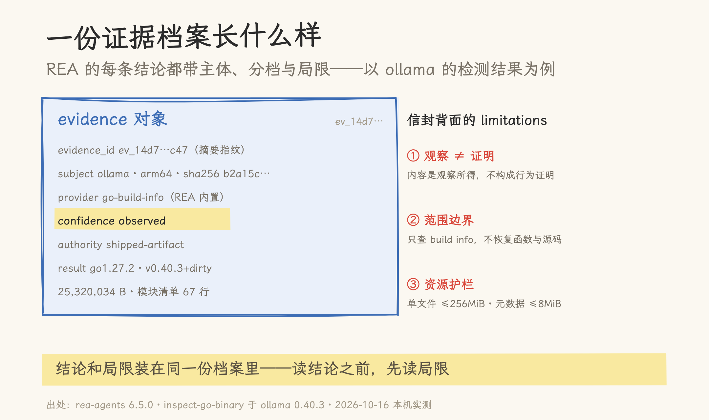
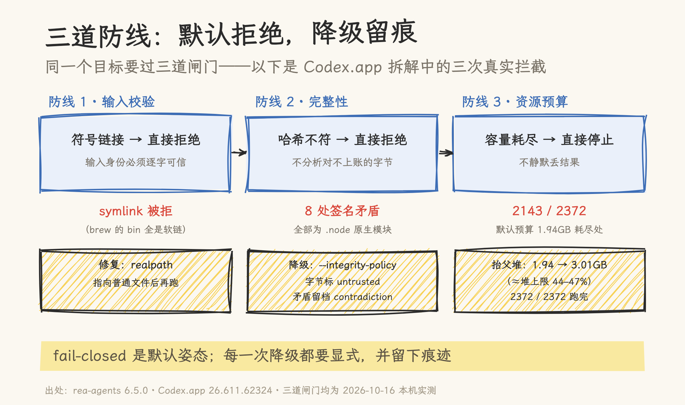
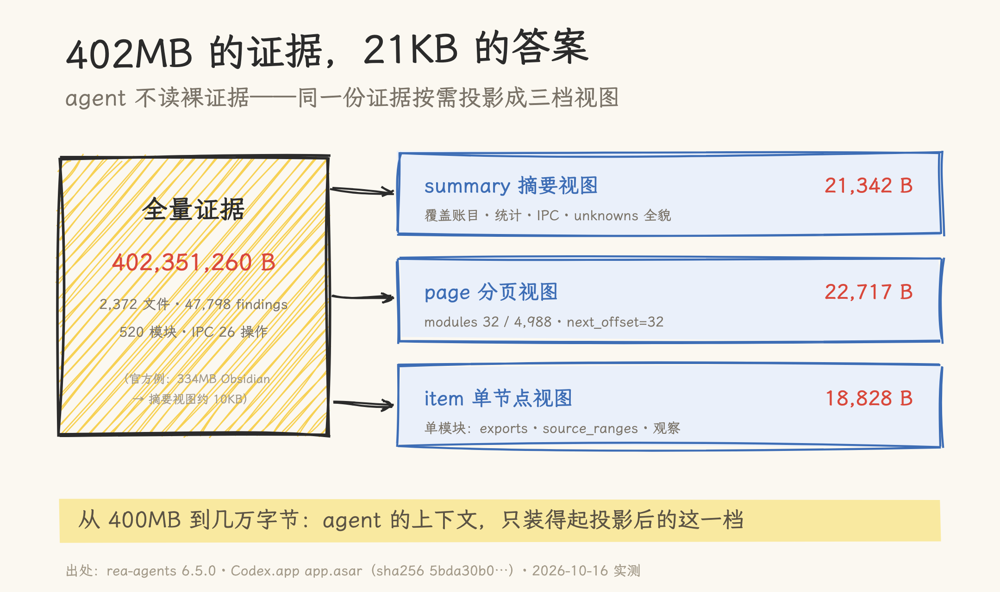

# 402MB 的证据、21KB 的答案：REA 拆解 Codex.app 实战

> 2026-10-16 | 实践记录。基于 `rea-agents` 6.5.0（npm，当日经 npx 安装）在 macOS arm64（Node 26.11.1，16GB 内存）上的本机实测；分析目标为 ollama 0.40.3 与 Codex.app 26.611.62324（app.asar sha256 `5bda30b0…`）。星标、fork 数为 2026-10-16 GitHub API 快照。文中全部数字与错误原文来自本机原始输出；未实测的能力（Ghidra 深反编译、MCP 注册路径等）在第九节明确标注。

## 一、半年 27 万 star 的逆向工程 MCP

REA（Reverse Engineer Anything）把反汇编器、反编译器、抓包工具、APK 拆解器这些重型工具的用法收进同一套工作流，统一成一个 MCP 服务加一套 CLI。它的自我定位是一句话：「One MCP for reverse engineering across binaries, applications, and runtime behavior.」README 的目标表列了 23 类可分析对象：原生二进制（Hopper / Ghidra / IDA / Kuna，引擎自带）、Go 与 Rust 二进制的构建元数据（内置静态检查，零依赖）、WASM、EVM 字节码、.NET、JavaScript / Electron、网站、HAR / SAZ 抓包、pcap、SQLite、Linux crash dump、APK 与 Android 设备、固件、逻辑信号、进程行为等等。

| 硬指标（2026-10-16） | 值                                                                                                      |
| -------------------- | ------------------------------------------------------------------------------------------------------- |
| 仓库                 | [github.com/morluto/rea](https://github.com/morluto/rea)，**276,649 star** / 69,716 fork / 954 watcher  |
| 创建与节奏           | 2026-04-14 创建，2026-10-16 仍在推送；1,039 个未关 issue                                                |
| 许可与语言           | MIT，TypeScript                                                                                         |
| 分发                 | npm `rea-agents` 6.5.0；官网 [rea.tools](https://rea.tools/)；MCP registry（`server.json`）与 skills.sh |
| 运行要求             | Node.js 22.19+ / 24.11+ / 26+，npm                                                                      |

半年到这个量级，靠功能表解释不了。agent 做逆向绕不开一个问题：模型会瞎猜，而逆向的结论一旦是猜的，下游全错。伪代码对不对、函数认没认对、哪些有证据、哪些只是推测，如果全糊在一段输出里，agent 拿着它写代码就是连环翻车。

REA 的答案是给每条结论配一个「信封」：证据分档、来源标注、局限随行，「不知道」也照实输出。这篇不转述功能表，直接在一台「装了什么就有什么」的 Mac 上把三层目标跑一遍，看这套纪律在真实软件上长什么样。

三层目标是：ollama（Go 二进制，热身）、Codex.app 的 JavaScript/Electron 主体（1.2GB 应用，147MB 的 app.asar）、以及 Codex.app 里两个 Rust 原生二进制。选 Codex.app 的理由很直接：本机安装的软件，分析范围没有争议；主题也合适，agent 工具在拆另一个 agent 应用；结论还能和公开信息交叉验证。

## 二、先看规矩：就绪检查与证据分档

### 2.1 doctor：把「不可用」分成三类说清楚

动手前先跑 `rea doctor`。本机的结果是 `healthy: false`，但这份 221 行的报告没有停在「不健康」三个字上，而是把 13 项检查按三类分好了：

- **healthy**：node 26.11.1 ✓、host ✓。零引擎路径（Go / Rust / JS / artifact 静态检查）都可用；
- **missing_analysis_engine**：hopper、ghidra、ida、jadx 四项缺失，每项附各自的补法。Ghidra 的补法是「设 `GHIDRA_INSTALL_DIR` 指向 12.1.x 的解压目录」，IDA 是「设 `REA_IDA_MCP_CONFIG`」，jadx 明确写了「REA 不下载也不安装它」；
- **config_drift**：六个 agent 客户端的注册项（Claude Code、Codex、Cursor、dsh、opencode、qoder）与 REA skill 本体都未配置，补法都指向 `rea setup`（注册项补完后需要重启客户端）。

这台机器没有 Hopper、没有 Ghidra，JDK 17 也不满足 Ghidra 12.1.x 的要求。没关系，接下来要用的三层目标全部落在零引擎路径上，一个分析引擎都不需要。

### 2.2 一条结论的骨架

先看 REA 的产出结构。用 `inspect-go-binary` 对 ollama 跑一条，拿到的 JSON 顶层有 16 个字段，其中六个构成了结论的骨架：`subject`（分析对象：名字、sha256 摘要、格式、架构）、`provider`（产出这条结论的提供者：`go-build-info`，即 REA 内置的 Go 构建信息读取器）、`confidence`（分档，这里是 `observed`，观察档）、`authority`（权威来源，这里是 `shipped-artifact`，出厂产物档）、`limitations`（这个结论的边界）、`evidence_id`（整条证据的摘要指纹）。

| 字段              | ollama 这条的值                                                        |
| ----------------- | ---------------------------------------------------------------------- |
| subject           | ollama · Mach-O · arm64 · sha256 `b2a15c47…`                           |
| provider          | `go-build-info`（REA Go build-information reader, v1）                 |
| confidence        | `observed`                                                             |
| authority         | `shipped-artifact`                                                     |
| normalized_result | go1.27.2 · `github.com/ollama/ollama` `v0.40.3+dirty` · 模块清单 67 行 |
| limitations       | 3 条（见下）                                                           |

三条 limitations 的原文（它们示范了 REA 里「结论」这个词的用法）：

1. 「Embedded build metadata is observed file content, not proof of compiler identity, dependency authenticity or runtime behavior.」内嵌的构建元数据是观察到的文件内容，不构成编译器身份、依赖真实性或运行时行为的证明。
2. 「Only Go build information is inspected; function names, source mappings, type metadata and decompiled code are not recovered.」只查构建信息；函数名、源映射、类型元数据、反编译代码一概不恢复。
3. 资源护栏明细：单文件读取与 header 搜索各限 256MiB、嵌入字符串合计 1MiB、结构表 16MiB、元数据 8MiB，并注明「这些不是操作系统的内存或 CPU 限制」：上限由工具自设，与运行环境无关。



`confidence: observed` 和 `authority: shipped-artifact` 是「分档」：观察与推断、出厂产物与二手转述，在数据结构层面就不是一回事。limitations 更像随结论一起出厂的边界说明书：这条结论是什么、不是什么、在多大的资源范围内得出。第 1 条尤其关键，它防的正是「拿构建信息当编译器取证」这类过度解读。

## 三、热身：ollama 与一次 fail-closed 的拒绝

按 README 的示例直接跑：

```bash
npx -y rea-agents@latest inspect-go-binary /opt/homebrew/bin/ollama --json
```

退出码 1，返回的是一份结构化错误：

```json
{
  "code": "invalid_request",
  "category": "invalid_input",
  "retryable": true,
  "message": "Analysis input is invalid. Check the arguments and try again.",
  "remediation": { "action": "Correct the listed arguments and retry." },
  "details": {
    "issues": [
      {
        "path": ["path"],
        "reason": "invalid_format",
        "message": "Expected a regular file without a symlink: /opt/homebrew/bin/ollama"
      }
    ]
  }
}
```

`:path` 一层层指到出错参数，原因写着「期望一个不带符号链接的普通文件」。Homebrew 的 `bin` 目录全是软链，这条链最终指向 `/opt/homebrew/Cellar/ollama/0.40.3/libexec/ollama`。REA 拒绝替调用方解析链接：软链可以指向别处，工具的报告必须绑定一个身份确定的字节流。用 `realpath` 换成真实路径后重跑，通过。

结果落进证据信封：go1.27.2 编译、主模块 `github.com/ollama/ollama`、版本 `v0.40.3+dirty`（`+dirty` 表示构建时的源码树有未提交改动）、二进制 25,320,034 字节、模块清单 67 行。一个命令拿到这些信息，没有启动 ollama 的任何代码。

这次拒绝比成功更有信息量：fail-closed 是默认姿态。输入不合规就拒绝，附一份「改哪个参数、怎么改」的清单，不猜意图；后面几道闸门都是同一个风格。

## 四、拆 Codex.app（上）：两道闸门

目标先量一下尺寸：`/Applications/Codex.app` 整体 1.2GB，由四块拼成：147MB 的 `app.asar`（Electron 的 JavaScript 主体）、225MB 的 `codex` 原生二进制（Rust：内含 Rust panic 字符串、捆绑 SQLite、链接 AppKit）、4.3MB 的 `codex_chronicle`（同为 Rust）、以及 Electron Framework 本体。版本 26.611.62324。

### 4.1 完整性闸门：8 个被签名的二进制

第一次跑 `analyze-javascript-application`，被挡了。错误码 `artifact_integrity_mismatch`，details 里给出完整账目：

```json
{
  "logical_path": "node_modules/@worklouder/…/node-hid/prebuilds/HID-darwin-arm64/node-napi-v4.node",
  "declared_sha256": "ba4eee95…",
  "calculated_sha256": "f38067bf…",
  "unpacked": true
}
```

asar 头部对每个文件声明了完整性哈希，但这个 `.node` 文件的实际字节和声明值对不上。工具在错误里直接给出了行业解释：「packaging tools commonly sign or strip unpacked native binaries after writing the archive」：打包工具常在写完 archive 之后再对解包的原生二进制做签名或剥离，macOS 的代码签名恰好会改写文件字节。

默认行为是拒绝分析：字节对不上账就不分析。remediation 给了一条显式降级路径 `--integrity-policy record-and-continue`，语义是「retain observed bytes as untrusted」：照常保留观察到的字节，但在证据里标记为不可信。加上开关后用 `inspect-artifact` 做全量清单，全清点下来总共 8 处矛盾，清一色是原生模块：

- `node-hid` × 2（darwin-arm64 / darwin-x64）
- `serialport` 的 bindings
- `better-sqlite3`
- `node-pty` × 2（`pty.node` 与 `spawn-helper`）
- `objc-js` × 2

这些模块指向同一个公开事实：Codex.app 里有 `@worklouder/device-kit-oai`，对应 OpenAI 与键盘厂商 Work Louder 联名的「Codex Micro」编程小键盘（约 $230，2026 年中发售，多个科技媒体报道过）。`node-hid` 与 `serialport` 正是它的硬件通信栈。8 处「矛盾」更合理的解释是 macOS 签名流程的正常产物，而非投毒痕迹；不过 REA 不替你下这个结论，它只把账目摊开，由你决定要不要知情接受。

接受之后，降级也不是免费的：清单证据里留了一份形式化的矛盾记录，`contradiction_id`、涉及文件、declared 与 observed 两个哈希都在；限制条目里写着「8 integrity contradiction(s) were recorded; mismatched content is observed-untrusted.」。事后翻这份证据的人，不会误以为那些字节是可信的。

### 4.2 资源闸门：2143 / 2372

完整性闸门放行后，全量 JavaScript 分析跑了 3 分 59 秒，然后停在半路：

```text
The parent's result capacity was exhausted after retaining static facts for
webview/assets/thread-side-panel-tabs-CvFaBaXm.js; remaining sources were not analyzed
```

2,372 个相关文件处理到第 2,143 个，结果容量耗尽。报告的限额账目（reported_limits）写得很具体：worker 堆 1GiB、单项超时 300 秒、父进程结果预算 1,940,736,048 字节（约 1.81GiB）。失败没有丢结果：错误封套里的 `partial_observation` 是一份完整的证据对象，包含已处理文件的图与统计（后面能看到它的内容有多全）。

这次失败留下三点可复用的经验：预算有上限，上限写进了报告；断点在报告里点名到具体文件；已处理的部分以完整证据的形态保留了下来。

## 五、拆 Codex.app（中）：把预算抬高一半

### 5.1 单变量实验

「父进程结果预算」从哪来？本机 Node 26 的默认 V8 堆上限是 4.09375GiB。把单变量换成 `NODE_OPTIONS=--max-old-space-size=6144` 再跑一次，其他参数一律不动：

| 运行 | 差异                                     | parent_result_budget       | 结果                       | 输出                       |
| ---- | ---------------------------------------- | -------------------------- | -------------------------- | -------------------------- |
| A    | 默认                                     | 1,940,736,048 B（1.81GiB） | 2143/2372 处终止，exit 1   | 303MB：错误封套 + 部分证据 |
| B    | `NODE_OPTIONS=--max-old-space-size=6144` | 3,014,066,932 B（2.81GiB） | **2372/2372 完成，exit 0** | 402MB：全量证据            |

两次的比值分别是 44.2% 与 46.8%：结果预算随父进程堆上限等比浮动，大约是堆上限的一半。这解释了上一次为什么在 1.94GB 处停住（默认堆就只有 4GiB），也给出遇到 `resource_constraint` 时的两个旋钮：抬高父堆（本次的做法），或者收窄输入（`--source-path` 精确选文件、降 `--max-semantic-nodes`）。

### 5.2 一份完整的账本

运行 B 的 402MB 证据里，统计与 Electron 边界的账本是这样的：

| 统计项                | 值                          |
| --------------------- | --------------------------- |
| 相关文件 / 解析成功   | 2,372 / 2,148（113MB 文本） |
| AST 节点访问量        | 16,844,266                  |
| 发现（findings）      | 47,798                      |
| 模块                  | 520                         |
| 解析失败 / 非法 UTF-8 | 0 / 0                       |

| Electron 边界                    | 值                                |
| -------------------------------- | --------------------------------- |
| browser window / web preferences | 1 / 5                             |
| contextBridge API                | 2                                 |
| IPC 操作                         | 26（literal 1 + **动态通道 25**） |
| renderer 发送 / 监听             | 18 / 8                            |
| main handlers / 成功配对         | 0 / 0                             |
| 发送方校验观察                   | 13                                |

把 IPC 那两行连起来看：26 个操作里 25 个是动态构造的通道表达式，于是 main 侧处理器与 renderer 发送端的静态配对为 0。工具没有用字符串相似度去凑配对（限制里原话：「Dynamic IPC channel expressions remain unresolved and are never paired by textual similarity.」），而是把「未知」如实报出来。对静态分析工具来说，克制凑答案的冲动，比多报几条结论难得多。

### 5.3 越分析，未知越多

拿失败运行的 partial 与这次的全量做同口径对照：

| 指标                    | 部分（2143/2372） | 全量（2372/2372） |
| ----------------------- | ----------------- | ----------------- |
| findings                | 42,807            | 47,798            |
| 解析文件                | 1,921             | 2,148             |
| 语义图 unknown          | 170,134           | **261,341**       |
| 应用图 unknown          | 3,875             | 3,191             |
| 投影覆盖 examined/total | 2883 / 9671       | 4988 / 11170      |
| Electron 边界统计       | —                 | 与部分版完全一致  |

初看反直觉的是：语义 unknown 涨了 9 万余条，应用 unknown 反而降了近 700 条。两件事并不矛盾：处理更多文件，既消解了一些悬而未决的应用层问题，也暴露出更多此前没走到、无从记录的语义层未知。把「未知」当账来记，账会随分析深入而变大；如果哪个工具号称「越分析未知越少」，多半是它把未知改写成了结论。对照表里还有一行：Electron 边界统计在两份证据里完全一致，说明断点之后的 229 个文件没有带来新的 IPC 事实，部分证据在边界这个切面上已经是完整的。

限制条目本身也会被视图截断。投影的末行写着「3192 additional limitations omitted from this view; consult source parent Evidence `ev_8676aeb9…` for the complete list」：超出视图容量的条目只留计数，并附完整列表的溯源指针（父证据里这类限制共 3,209 条）。免责声明也逃不过 token 预算，被截掉的部分留了回查的路。



## 六、拆 Codex.app（下）：21KB 的答案与 Rust 侧的诚实

### 6.1 官方投影配方

402MB 的证据文件不适合任何 agent 直接读。REA 的官方文档把这一点写得很直白：

> The complete application Evidence can be hundreds of megabytes for a real application. When an agent or a person reads the result, save it to a file and project a summary, a module page or one module from the saved Evidence.

官方的示例数据是「一个 334MB 的 Obsidian 应用证据文件，摘要视图约 10KB」。配方是三条命令：

```bash
rea analyze-javascript-application /absolute/path/to/app --json > app-evidence.json
jq -c '{source: {kind: "inline", evidence: .}, view: {kind: "summary"}}' app-evidence.json > app-view.json
rea inspect-analysis-view app-view.json
```

在我们的 402,351,260 字节上照方抓药，得到 21,342 字节的摘要视图，里面是全量账本的压缩版：统计、Electron 边界、覆盖账目、unknown 计数。同一份证据还能按需换档：`page` 视图给出 32 行一页的模块清单（覆盖账目写着 examined 32 / total 4,988、`next_offset: 32`，翻页协议是显式的），`item` 视图按 `node_id` 取单个模块的详情（exports、source_ranges、逐条观察）。三档视图的体积分别是 21,342、22,717 与 18,828 字节。



整个过程里 agent 没有读过 402MB 的裸证据：拿到的一直是投影视图，投影自带覆盖账目、翻页协议，缩略到什么程度由调用方决定。这与本仓库上下文工程那一章的原则同源，只是这次由工具在设计层面替 agent 省 token。

### 6.2 文档比发布版新

配方之外还有一处摩擦。REA 的 main 分支文档里介绍了一种 `javascript-facts` 视图，写好了示例 JSON；照着跑，得到的是参数校验错误，而错误恰好给出 6.5.0 的合法视图清单：`summary, facet, item, page, native, inventory, wasm, macho, interface-builder, evm, managed, managed-members, android, api-surface, capture, qlog, pcap, dart-aot`。`javascript-facts` 不在其中，它是发布版尚未包含的新功能，main 分支的文档领先于 npm 上的 6.5.0。

顺着报错把 schema 一层层问出来，倒是体验了一次「结构化错误即文档」：第一轮报错列出合法 `kind`；换成 `item` 后报错要求 `collection`（`modules / sections / symbols`）；再补 `selector` 对象，通过。每一步的报错都指名错误参数路径、期望值与修正动作，三次试探拿到了正确的请求形状。

### 6.3 Rust 侧：null 与 inferred

`inspect-rust-binary` 对 225MB 的 `codex` 二进制给出的结果只有 2,969 字节，但两个字段足够看出它怎么对待「不知道」：

```json
{
  "auditable_metadata": null,
  "rustc_commit": {
    "evidence_kind": "inferred",
    "hashes": [{ "hash": "59807616…", "file_offset": 166865522 }]
  }
}
```

`auditable_metadata: null`：二进制里没有 cargo-auditable 的 `.dep-v0` 段，依赖清单是空的。注意，空清单不等于「没有依赖」。限制条目里专门有一句防误读：「No .dep-v0 section was found. Absence of .dep-v0 does not mean the binary has no dependencies.」这句话值得所有做元数据提取的工具照抄：无证据不等于不存在；把「没找到」静默渲染成「没有」，是在制造错误的确定性。

`rustc_commit` 标着 `evidence_kind: "inferred"`：从一个 `/rustc/<40-hex>/` 路径字符串推断出编译器提交号，并注明「它本身不能证明是哪个编译器产出了这个二进制」。对比 ollama 那条的 `observed`：同是「一条结论」，一个来自直接观察，一个来自推断，分档标签把它们区分开。推断本身没问题，把推断伪装成观察才是问题。

## 七、能搬走的六条纪律

跑完三层目标，可以把这套纪律整理成六条；它们和逆向本身无关，做 agent 工具的人都能搬走：

1. 证据分档。observation / inference / unknown / absent 各占其位；`confidence` 与 `authority` 是数据字段，不是文档里的形容词。
2. fail-closed 默认，降级显式留痕。输入不合规就拒绝，字节对不上账也拒绝；确需继续时，用显式开关把结果标记为不可信，并把矛盾写成可回查的记录。
3. 资源账目化。预算、断点、逐文件限额、截断计数全部上报；失败输出的是「保留了什么、停在哪里」，不是一句「出错了」。
4. 投影阶梯，token 优先。原始证据与呈现给模型的视图分离，视图按需缩放到几万字节，翻页有协议；CLI 层面还有 `--token-count / --token-limit / --token-offset` 这类直接面向 token 预算的开关。
5. 结构化错误即文档。`code` / `category` / `retryable` / `remediation` / `issues` 五件套，出错时顺便告诉调用方合法取值；我们靠这套报错把视图 schema 试了出来。
6. 主动交接。清单证据里除了观察，还有 `hypotheses`（假设）、`unexplored_branches`（没走的岔路）与 `next_probes`（下一步该跑什么）。工具对自己的「未完成」有明确表达，agent 不用猜接下来做什么。

六条合起来是同一件事：不确定性消不掉，就给它数据结构、预算和出口，别让它漏进结论。证据信封与投影阶梯都是这个思路的产物。

## 八、总评：REA 值不值得用

适用场景很具体：你已经在某个支持 MCP 的 agent 里工作（Claude Code、Codex、Cursor 都行），需要把一个没有源码的软件「看明白一层」：某个功能怎么实现、数据格式长什么样、依赖里有什么。零引擎路径开箱即用（Go / Rust 元数据、JS/Electron、.NET 都不需要额外装东西），本机上不到半小时就把一个 1.2GB 的 Electron 应用拆出了完整结构与 IPC 账本。它不承诺「AI 替你逆」；报告里的每句话都标着来源，这对 agent 写下游代码很重要。

折扣也有四条。

- 协议复杂度是真实成本。16 字段的信封、18 种视图、上千条 limitations，是给 agent 消费的门面，人类直接读要花时间适应。想要 IDA/Ghidra 那种交互式工作台体验的会失望；REA 更像「agent 的基础设施」，不是「人的图形界面」。
- 大目标是重活。1.2GB 应用在 16GB 机器上跑全量分析会撞预算墙，抬堆后才跑完；402MB 的证据文件也需要自己会投影。旋钮都给全了，但「会调」是使用前提。
- 分析质量本文只验证了一层。Go / Rust 的构建元数据是格式解析，好验证；JS 语义图（47,798 条 findings）的准确率没有第三方基准，用公开信息交叉验证的只有 Work Louder 一处。把它的输出当「证据」而不是「结论」来用，心态就对了；好在工具自己也是这么设定的。
- 热度与成熟度有落差。main 文档领先发布版、参数以 `--help` 为准，是高速迭代项目的常态，但意味着使用者要跟着版本走。

这份实践里我们自己的取舍是：REA 最值得借鉴的部分是它把不确定性工程化的那套做法（证据分档、fail-closed、资源账目、投影阶梯）。23 类目标的覆盖面会随版本变，这几条纪律不会。即便不装 REA，这套纪律拿到任何 agent 工具的设计里都能直接用。

## 九、边界与诚实声明

**未实测的部分**。MCP 注册路径没走：本文全部通过 CLI 完成（CLI 与 MCP 共享同一套工作流，但 MCP 侧的工具契约未逐条运行，相关描述来自 `docs/mcp-contracts.md` 与 README）。Ghidra 深反编译没做（本机无引擎，JDK 也不满足要求）。`trace-application-feature`、`compare-*`、浏览器与 adb 等分支未触碰。Hopper 是商业软件，本文没有涉及任何绕过授权的路径。

**发布版差异**。文中部分引用来自克隆的 main 分支文档，与 npm 6.5.0 存在已知差距（`javascript-facts` 视图即一例）；REA 迭代很快（2026-10-16 当天仍在推送），命令与参数以安装后的 `--help` 与报错为准。

**数据时效**。星标等数字为 2026-10-16 快照。Codex.app 相关结论绑定版本 26.611.62324 与 app.asar 的 sha256，换版本后需重跑。8 处完整性矛盾的解释（macOS 签名改写字节）来自工具提示与公开信息交叉印证，本文未对签名流程本身做独立取证。

**法律与伦理边界**。本文分析对象为本机安装的软件，属于 REA 免责声明中「软件保存、互操作、对自有软件的检查」的范畴。商业工具授权是另一条红线，REA README 的原话：「You must legally obtain and be authorized to use commercial tools… Cracked copies, stolen keys, unauthorized key sharing, and bypassing license restrictions are not authorized.」另外，**本地分析不等于数据不出本机**：目标不上传，但工具结果要进 agent 的上下文，最终受你所用模型提供商的数据政策约束。这一点 REA 的 FAQ 写得很清楚，用 agent 做分析的人都该记住。

## 附录：实测材料索引

环境：macOS arm64（Darwin 25.6.0），16GB 内存，Node 26.11.1，npm 11.20.0，rea-agents 6.5.0。

| 步骤                 | 命令（节选）                                                                                                                         | 产出                                           |
| -------------------- | ------------------------------------------------------------------------------------------------------------------------------------ | ---------------------------------------------- |
| 就绪检查             | `npx -y rea-agents@latest doctor`                                                                                                    | 221 行报告：13 项检查×三类分类                 |
| Go 元数据            | `rea inspect-go-binary /opt/homebrew/Cellar/ollama/0.40.3/libexec/ollama --json`                                                     | 22KB 证据（go1.27.2，模块清单 67 行）          |
| asar 清单            | `rea inspect-artifact …/app.asar --json --integrity-policy record-and-continue`                                                      | 3.9MB 清单（3,139 节点，8 处完整性矛盾）       |
| 全量分析（失败）     | `rea analyze-javascript-application …/app.asar --json --integrity-policy record-and-continue`                                        | 303MB：错误封套 + 部分证据（2143/2372 处断点） |
| 全量分析（成功）     | `NODE_OPTIONS=--max-old-space-size=6144 rea analyze-javascript-application …/app.asar --json --integrity-policy record-and-continue` | 402MB 全量证据（3 分 44 秒）                   |
| 摘要 / 分页 / 单节点 | `jq -c '{source:{kind:"inline",evidence:.},view:{…}}' … > req.json && rea inspect-analysis-view req.json`                            | 21,342 / 22,717 / 18,828 字节三档视图          |
| Rust 元数据          | `rea inspect-rust-binary …/codex --json`                                                                                             | 3KB（auditable null + rustc commit inferred）  |

原始输出的关键数字已整理进 [references/01-rea-practice-log.md](references/01-rea-practice-log.md)；数百 MB 的原始证据文件为一次性产物，不入库。

## 参考资料

- [morluto/rea](https://github.com/morluto/rea)（仓库，MIT）与 [rea.tools](https://rea.tools/)（官网，含 showcase 与 guides）
- [npm: rea-agents](https://www.npmjs.com/package/rea-agents)（6.5.0）
- REA 文档：`docs/cli.md`、`docs/mcp-contracts.md`、`docs/javascript-application-workflows.md`（克隆于 2026-10-16，最新提交 `2c75835`）
- Work Louder × OpenAI「Codex Micro」键盘报道：[Engadget](https://www.engadget.com/2215952/openai-launches-a-physical-keypad-for-controlling-agents/)、[TechPowerUp](https://www.techpowerup.com/350810/openai-announces-the-codex-micro-ai-assistant-keypad)
- 星标、fork 数：GitHub API，2026-10-16 实测
