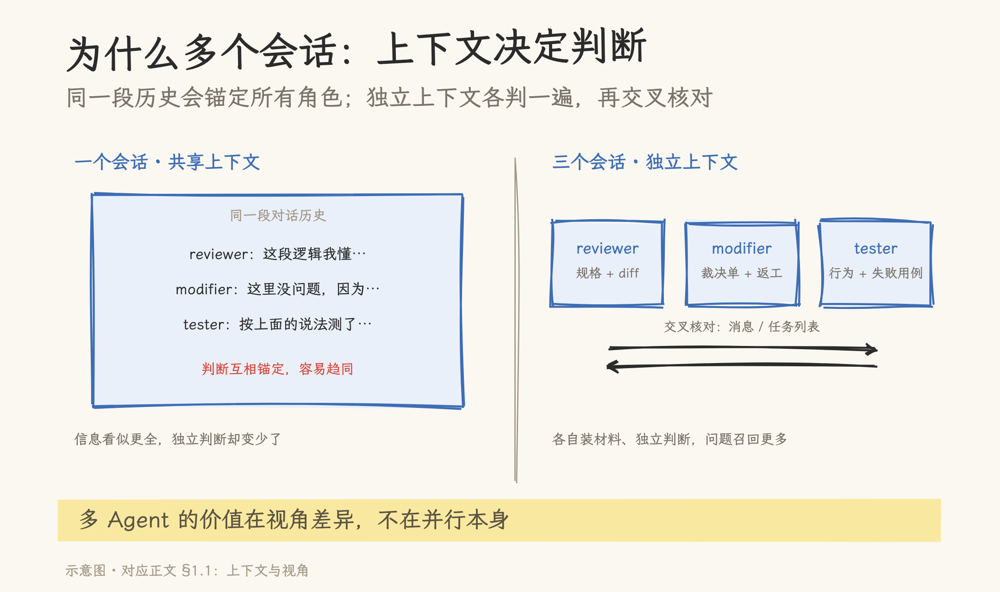
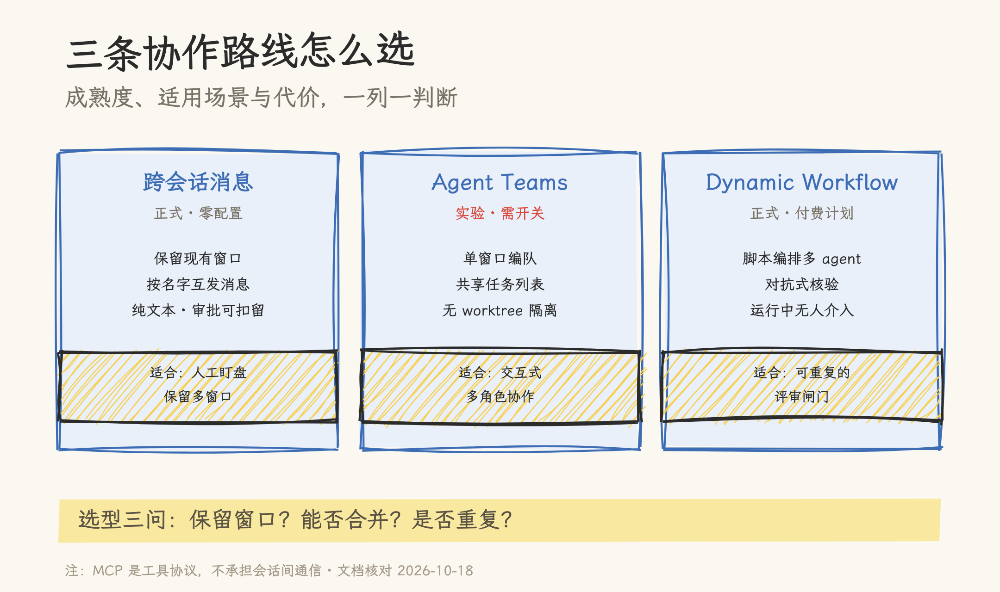
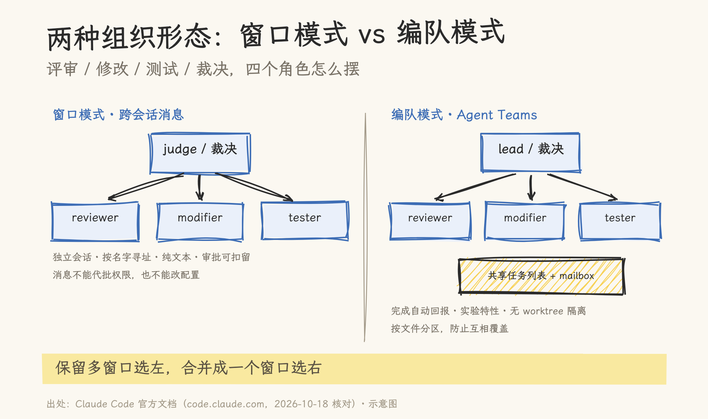

# 评审、修改、测试、裁决：Claude Code 多会话协作实践手册

> 2026-10-18 | 实践手册。能力与参数对照 Claude Code 官方文档（code.claude.com，2026-10-18 核对）：跨会话消息需 v2.1.224+（macOS / Linux / WSL 2）或 v2.1.234+（原生 Windows），Agent Teams 为实验特性。文中的会话发现部分来自本机 `ListAgents` 实测；送达语义、审批规则与限制来自官方文档，未做跨会话收发演练（避免打扰本机既有会话），读者可按第三、四章自测。
>
> 配套实践：本手册的操作流程已封装为 skill `multi-session-collab`（仓库副本在 `08_agentic_system/agent_skills/multi-session-collab/`，复制到 `~/.claude/skills/` 即可使用）；从手册到 skill 的设计、三层结构与一次端到端实测（评审→测试→裁决→修改→复测），见《[一个人调度四个角色：多会话协作 Skill 的实测与边界](../../agent_skills/docs/multi-role-agent-skill.md)》。

从一个具体需求开始：系统要上一个复杂功能，横跨数据模型、接口和后端逻辑，改动面大，评审、修改、测试都得排上。手边最顺手的做法是开四个 Claude Code 窗口，各管一摊，需要传话时人肉复制粘贴。

真跑起来，麻烦会慢慢露头：三个窗口各自攒着上下文，评审意见与修改记录对不上；「这版可以吗」要在四个窗口之间来回问；窗口一多，谁是最终裁决、哪次改动经过谁的手，只能靠记忆。

这份手册先回答「为什么要多开几个会话」，再把口头约定换成可配置的机制：先选形态（跨窗口消息、编队或流水线），再立规矩（谁能给谁发消息、什么消息会被扣下），最后把裁决做成有 rubric 和门禁的流程。

## 一、为什么需要多个 Agent，以及四条路线

### 1.1 上下文与视角：多会话的第一性理由

同一段对话里，评审者读得到修改者的全部解释，修改者也读得到评审者每一次自我更正。信息看似更全，判断反而更容易趋同：修改者刚说完「这里没问题」，评审再指出同一处的风险，就要先绕过这段解释，锚定效应在同一个上下文里格外强。

拆成独立会话，每个角色带自己的上下文入场：评审者拿规格、验收标准和 diff；修改者拿裁决单和上次的返工意见；测试者拿行为描述和失败用例。谁也不必读别人的过程噪声，判断是独立做出的，再通过消息与任务列表交叉核对。多 Agent 的价值主要在这里：不同视角、不同上下文各判一遍，问题召回率通常高于一个人从头看到尾。

代价同样明确：上下文不共享，信息就必须显式传递。角色之间传什么、按什么格式回报、裁决依据什么，都要提前定，否则多开会话只是把混乱并行化。后文的模板、审批矩阵和 rubric，解决的正是这个「显式传递」问题。这与上下文工程的原则一致：上下文不是越多越好，装着什么决定判断的质量。



### 1.2 四条路线一张表

| 路线             | 组织形式                            | 成熟度（2026-10）        | 适合                                 |
| ---------------- | ----------------------------------- | ------------------------ | ------------------------------------ |
| 跨会话消息       | 多个独立窗口，按名字互发消息        | 正式功能，零配置         | 保留现有窗口、人工盯盘、角色间低耦合 |
| Agent Teams      | 一个窗口当 lead，带 2–5 个 teammate | 实验，需环境开关         | 交互式多角色协作，lead 即裁决者      |
| Dynamic Workflow | JS 脚本编排多 agent 流水线          | 正式（付费计划、API 等） | 可重复的评审闸门（如每次 PR）        |
| Agent SDK        | 代码托管并发会话                    | 正式                     | 产品化、批量执行、自建裁决           |

回到开头那个需求：四个角色、一个裁决者。落到选型上就是三个问题：要保留多个窗口？走跨会话消息。能接受合并成一个窗口？走 Agent Teams。同一个流程要反复跑？走 Dynamic Workflow。要做成工具给别人用，再看 SDK。

MCP 在这张表之外。MCP 是模型与工具之间的协议，没有 agent 间通信能力，官方也没有 A2A 支持；`claude mcp serve` 只把 Claude Code 的工具暴露给外部客户端，不暴露会话与消息。硬要用 MCP 搭消息总线，只有「共享 HTTP MCP server 当拉取式信箱」（每个会话自己轮询，无推送）或 Channels（研究预览，受 allowlist 限制、无投递确认）两条自建路，都拿不到原生的会话发现、命名与审批语义。原生跨会话消息已经覆盖这个需求，不必绕道。



## 二、会话即地址：基础机制

### 2.1 命名与发现

每个交互式会话都有一个名字，这就是它的地址。

```bash
claude --name reviewer     # 启动时命名
# 或在会话内
/rename reviewer
```

人类查看可达会话用 `/list-agents`（别名 `/peers`），第一行是本会话自己的名字（v2.1.239+）。Claude 侧对应的是内置工具 `ListAgents` 与 `SendMessage`：你用自然语言下指令（「问一下 reviewer 那个迁移做完了没」），Claude 自己找人、发信；也可以在输入框里打 `@` 加首字母从候选里选（v2.1.232+），名字含空格或特殊字符时加引号：`@"release notes"`。

几条硬规则：只有绑定了收件 socket 的会话能被寻址，bare 模式启动的会话没有 socket，不会出现在列表里；同名会话由系统附加短标识区分；`/status` 里的 `Peer address` 能看到本会话的收件地址。

### 2.2 送达语义

| 情形                   | 行为                                                                                                  |
| ---------------------- | ----------------------------------------------------------------------------------------------------- |
| 接收方忙（回合进行中） | 在两次工具调用之间读取，不打断正在跑的工具                                                            |
| 接收方空闲             | 直接开一个新回合处理消息                                                                              |
| 消息内容               | 纯文本，不带发送方的对话历史与文件；`@` 文件引用在接收侧只是字面文本                                  |
| 体积与频率             | 超过约 100 万字符拒发；突发超过限额在发送侧被拒；接收侧对同一发送方限流、短窗口内去重、最多排队 50 条 |
| 空闲通知               | `notify_when_idle` 可订阅对方下一次空闲或退出的一次性通知，12 小时过期，仅主会话、仅同机              |

### 2.3 本机实测记录

在 macOS 上运行 `ListAgents`，返回形如（会话名做了脱敏）：

```text
本会话：公众号
Peer sessions（4）：
  reviewer-demo   · interactive · idle  · started 2h ago
  modifier-demo   · interactive · busy  · started 15h ago
  tester-demo     · interactive · idle  · started 2d ago
  judge-demo      · interactive · idle  · started 1h ago
```

能列出、能寻址，跨会话协作的前提就成立了。注意 `busy` 的会话不是不能发，消息会在它两次工具调用之间被处理。

## 三、路线一：跨会话消息，四窗口剧本



### 3.1 拉起四个窗口

```bash
# 终端 1（只读，做评审）
claude --name reviewer
# 终端 2（可写，做修改）
claude --name modifier
# 终端 3（跑测试）
claude --name tester
# 终端 4（汇总与裁决）
claude --name judge
```

modifier 与 tester 会写文件、跑命令，建议给它们单独的工作目录或 git worktree，避免和你的主工作区互相覆盖。reviewer 与 judge 只读，不需要。

也可以不开终端窗口，直接起后台会话当 worker：`claude --bg --name reviewer --add-dir <目标目录> --settings <配置>`。后台会话同样出现在 `/list-agents` 里，用 `claude agents`（列表）、`claude logs <id>`（输出）、`claude stop <id>`（停止）管理。注意 `--bg` 要求当前工作区已受信任，跨目录访问用 `--add-dir` 授权；在未受信任的临时目录直接启动会被拒绝（实测）。

### 3.2 入站策略与权限模式

跨会话消息能不能进来，由接收方的 `crossSessionInbound`（`accept` / `hold` / `refuse`）决定，也可以在 `/config` 的「Messages from your other sessions」里改。未显式设置时，按双方权限模式推导：

| 接收方                                             | 发送方                                    | 结果       |
| -------------------------------------------------- | ----------------------------------------- | ---------- |
| 会弹权限（默认、`acceptEdits`、`auto`、`dontAsk`） | 非 bypass                                 | 直接送达   |
| 会弹权限                                           | bypass（交互式终端里的 plan 也算 bypass） | 扣留待批准 |
| bypass                                             | bypass                                    | 直接送达   |
| bypass                                             | 非 bypass                                 | 扣留待批准 |

被扣留的消息会弹审批框，显示发送方与预览，默认 5 分钟过期（`dialogExpiry` 可调，支持 `"never"`）。`-p` 会话没有审批框，默认扣留的消息到期即丢；无人值守的 worker 要在 `--settings` 里设 `crossSessionInbound: "accept"`，否则消息进不来。跨机发送想加一道人工确认，设 `isolatePeerMachines: true`（同机消息不受影响）。

实测补充：双方权限模式不同类时，回信会被扣留，首条消息可能一直送不到；把接收方的 `crossSessionInbound` 设为 `accept` 可以稳定收信（或在审批框放行，实测里两种路径都出现过）。消息被扣住时，`claude logs <id>` 能从后台会话的日志里读回内容，可作为兜底通道。

### 3.3 协作剧本与消息模板

跨会话消息是纯文本，没有结构化协议，所以模板要自己定。下发给 worker 的任务卡建议包含三件事：

```text
@reviewer 任务：评审「租户权限」功能的实现分支，对照 docs/specs/rbac.md 的验收标准，diff 用 git diff main...HEAD。
输出格式（只输出这个 JSON，不修改任何文件）：
{"verdict":"pass|fail","findings":[{"line":42,"severity":"high","issue":"...","evidence":"file:line"}],"unknowns":["..."]}
时限：10 分钟内给结论；拿不准的写进 unknowns，不要猜。
```

worker 回报时，judge 收到的消息带 `from` 字段，回信直接按发送方地址回发即可。judge 想等 worker 干完再行动，用 `notify_when_idle` 订阅一次空闲通知，不要轮询。

裁决有三种输出：通过；打回并附整改单（具体到文件行与验收标准）；升级人工。把这三档写死，评审就不会停在「感觉不太行」。

### 3.4 安全边界

跨会话消息在设计上有明确边界：它不能替你批准权限请求，不能修改配置或 CLAUDE.md，消息里的斜杠命令不会被执行，接收方自己的权限规则仍然管着消息要求的工作。反过来，消息按一次普通 prompt 计费；`SendMessage` / `ListAgents` 的 deny 规则会连 subagent 与 teammate 的消息一起禁掉，团队环境里慎用这两种封禁。

### 3.5 故障排查

| 现象                     | 原因                                                                                    | 处置                                                          |
| ------------------------ | --------------------------------------------------------------------------------------- | ------------------------------------------------------------- |
| 对方不在 `/list-agents`  | bare 模式无收件 socket；容器与宿主互不可达；WSL 2 与原生 Windows 互不可达；旧版本未启用 | 用普通交互模式重启；跨边界场景改用同容器会话                  |
| 消息一直不到             | 权限模式导致扣留                                                                        | 到接收会话处理审批框，或调整 `crossSessionInbound`            |
| 消息 5 分钟后消失        | 审批框到期                                                                              | 调大 `dialogExpiry` 或设 `"never"`；`-p` worker 改设 `accept` |
| 找不到名字或投递到错窗口 | 同名会话                                                                                | 使用列表里的短标识寻址，或 `/rename` 改名                     |
| 云会话没有回信           | 云会话当前可收不可回                                                                    | 让云会话把结果写进文件，或经 Remote Control 接手              |

## 四、路线二：Agent Teams，单窗口编队（实验）

### 4.1 开启

```json
{ "env": { "CLAUDE_CODE_EXPERIMENTAL_AGENT_TEAMS": "1" } }
```

写进 settings.json 或环境变量。官方原文是「实验性且默认关闭」：不设这个变量，不会组队、不写团队目录、Claude 也不会提议队友。开启后有一个副作用要知情：主会话里带 `name` 启动的 subagent 会**自动变成 teammate**（除非是 fork 或带 isolation），Claude 不会先征求你的确认。想恢复原来的行为，把变量设回 `0`。

### 4.2 组队与角色卡

用自然语言描述任务和队友即可，例如「组一个评审队：一个查安全、一个查性能、一个补测试覆盖」。底层是 Agent 工具带 `name` 启动 teammate，结构化能力来自各自的 subagent 定义。四张角色卡可以这样配：

| 角色          | 工具面                                  | 职责                               |
| ------------- | --------------------------------------- | ---------------------------------- |
| reviewer      | 只读（Read / Grep / Glob，Bash 限查询） | 按 checklist 出 findings，不改代码 |
| modifier      | 读 + Edit / Write                       | 只按裁决单修改，不自行扩大范围     |
| tester        | 读 + Bash                               | 跑测试与复现，产出证据             |
| lead（judge） | 全部，但自身不改代码                    | 派活、汇总、裁决、升级人工         |

teammate 有没有独立上下文？有，每个都是独立的 Claude 实例与上下文窗口。团队结构固定为：lead、teammates、共享任务列表、mailbox。mailbox 是 JSON 文件（`~/.claude/teams/{team-name}/inboxes/`），任务列表在 `~/.claude/tasks/{team-name}/`，团队名是 `session-` 加会话 ID 前八位。

### 4.3 共享任务与门禁

teammate 完成任务时，会**自动把最终答案发给 lead**；任何成员都能按名字给其他成员发消息，也都能自领未分配的任务（认领用文件锁，完成会自动解锁依赖它的后续任务）。lead 不需要轮询。

质量门禁用 hooks：`TeammateIdle` 退出码 2 让成员带着反馈继续干，`TaskCompleted` 退出码 2 阻止任务被标记完成。注意一个容易误解的点：teammate 的 plan approval 由 lead **自动批准**，它不是评审机制，别拿它当裁决。

### 4.4 限制清单

- 实验特性，仅交互模式；`-p` 与 Agent SDK 里不会组队，带 name 的 subagent 就是普通 subagent
- **没有 worktree 隔离**：teammate 共享你的工作区，必须按文件或目录分区，否则互相覆盖
- 一个会话只能有一个团队，不能嵌套，lead 在整个会话生命周期内固定
- 不能给每个 teammate 单独设权限模式；teammate 默认继承 lead 的模式（`dontAsk` 除外）
- in-process teammate 不能再起后台 subagent；带 in-process teammate 的会话不能 resume
- 分屏显示需要 tmux 或 iTerm2（`teammateMode` 设为 `tmux` / `iterm2` / `auto`），VS Code 终端、Windows Terminal、Ghostty 不支持
- 官方建议 3–5 个 teammate、每人 5–6 个任务；token 消耗随人数上涨

## 五、路线三：Dynamic Workflow，可重复的流水线

### 5.1 何时用

同一套评审流程要跑很多次（每次 PR、每次发布），需要留下可审计的执行记录，或者需要「独立 agent 交叉核验」这种结构化质量手段时，用 workflow。它由 Claude 写一段 JavaScript 脚本，在后台运行时里执行，脚本里用 `agent()`、`pipeline()`、`parallel()`、`phase()` 编排，`agent()` 可以带 `schema` 返回 JSON 而不是散文。

### 5.2 脚本骨架

```js
export const meta = {
  name: "review-gate",
  description: "评审→对抗核验→裁决的流水线",
  phases: [{ title: "评审" }, { title: "核验" }],
};

const dims = [
  { key: "correctness", prompt: "逐文件检查正确性问题，给出 file:line 证据" },
  { key: "risk", prompt: "检查改动面与回归风险，给出证据" },
];

// 多维度并行评审，结构化输出
const reviews = await parallel(
  dims.map(
    (d) => () =>
      agent(d.prompt, {
        label: `review:${d.key}`,
        phase: "评审",
        schema: FINDINGS,
      }),
  ),
);

// 逐条做对抗核验，只留经得起反驳的 findings
const verified = await parallel(
  reviews.flat().map(
    (f) => () =>
      agent(`对抗性核验：${f.title}`, {
        label: `verify:${f.file}`,
        phase: "核验",
        schema: VERDICT,
      }),
  ),
);

return { confirmed: verified.filter((v) => v.is_real) };
```

上面是结构示意，字段以官方文档为准。这个「先分维度评审、再逐条对抗核验、最后合并裁决」的写法就是文档自带的模式，内置的 `/deep-research` 也是这么干的：对每条主张投票，没通过交叉核验的过滤掉，无法核实的标记为未核实而不是判负。

运行中用 `/workflows` 查看进度，可以按 `s` 把一次运行存成可复用的斜杠命令（存到 `.claude/workflows/` 或 `~/.claude/workflows/`）。

### 5.3 限制

- 运行中**没有人工介入**；需要签核就拆成多段 workflow，每段结束回到会话
- 脚本本身没有文件系统与 shell 权限，不能 `import()`；`Date.now()`、`Math.random()`、无参 `new Date()` 会抛错
- 默认 16 个并发 agent（`CLAUDE_CODE_WORKFLOW_MAX_CONCURRENT_AGENTS`，1–256），单次运行上限 1,000 个 agent，单个 `parallel()` / `pipeline()` 最多 4,096 项
- 超过 25 个 agent 或预估 150 万 token 会提示「Large workflow」，但只是提示；CLI 没有默认硬性预算上限

## 六、评判者设计：把「裁决」变成可执行流程

### 6.1 结构化报告

judge 要能比较，worker 的回报就必须同构。建议的 findings schema：

```json
{
  "findings": [
    {
      "id": "F-001",
      "file": "src/rbac/guard.ts",
      "line": 42,
      "severity": "high",
      "issue": "缓存命中的权限检查跳过了租户归属校验",
      "evidence": "src/rbac/guard.ts:42-58",
      "confidence": "observed",
      "verdict": "confirmed"
    }
  ],
  "unknowns": ["无法静态确认的运行时分支：..."]
}
```

`confidence` 用证据分档（observed / inferred / unknown），`verdict` 用 confirmed / plausible / rejected。这比一段自然语言总结更容易被下一环节消费，也让「未知」有一等公民的位置。

### 6.2 Rubric 模板

| 维度   | 问题                      | 通过阈值                          |
| ------ | ------------------------- | --------------------------------- |
| 正确性 | 结论能否被证据复现？      | 每条 finding 带 file:line         |
| 完整性 | 声明的范围都检查了吗？    | 覆盖清单无缺口，缺口写进 unknowns |
| 风险   | 修改面是否超出裁决单？    | 只动授权文件                      |
| 成本   | 重跑一次的 token 与时间？ | 在预算内（人定）                  |

judge 的输出也只给三档：通过、打回（附整改单，具体到行与验收标准）、升级人工。打回必须附可检查的验收条件，否则下一轮修改没有终点。

### 6.3 门禁、升级与预算

- 自动门禁：teams 里用 `TeammateIdle` / `TaskCompleted` hooks（退出码 2 阻断）；workflow 里用核验阶段过滤；SDK 用 `maxBudgetUsd` 熔断（到顶后拒绝再起子 agent）
- 人工兜底：judge 的 confidence 低于阈值、或 findings 之间存在矛盾时，升级给人
- 反模式：judge 自己也改代码（失去独立性）；没有 rubric 的「感觉评审」；把 plan approval 当评审（teams 里它会被自动批准）

### 6.4 人当裁决者的三个界面

- **Remote Control**：`claude remote-control` 以 server 模式托管多个本机会话（`--capacity` 默认 32），从手机或网页远程盯屏与接管；适合盯盘，不适合批量
- **Desktop 应用**：并行会话侧栏，能看、能改名、能发消息，但只覆盖 Desktop 的 Code 标签会话（本地 / SSH / WSL），看不到终端 CLI 与其他客户端的会话
- **Projects**（公测，Pro / Max）：coordinator 会话加并行 threads，按「待评审 / 等你处理 / 进行中 / 已完成」归类；注意每个 thread 的审批要在 thread 里做，project 会话不能代批（安全设计）

## 七、安全与成本清单

**权限链路**：接收方的权限模式决定消息去向（见 3.2 的矩阵）；plan 在交互式终端里按 bypass 类算；`-p` 没有审批框。跨机发送想加人工确认，设 `isolatePeerMachines: true`。

**消息边界**：见 3.4（含 deny 规则的连带影响）。

**成本**：

- 每个 agent 是独立上下文，token 按各自消耗计；一条跨会话消息按一次普通 prompt 计费
- teammate 的 prompt 缓存 TTL 默认 5 分钟，调成 1 小时可以减少重复读，但写缓存更贵（`subagentPromptCacheTtl: "1h"`）
- workflow 默认 16 并发；teams 与 workflows 在 CLI 里都没有默认硬性预算上限，人数与阶段数要克制

**组织建议**：3–5 个角色起步；按文件或目录分区；reviewer 只读、judge 不改代码；先跑通一次单轮任务再做循环；每个角色任务不超过 5–6 个。

开头那个需求，到这里各环节都有了明确落点：评审、修改、测试各有窗口或 teammate，消息有固定格式，裁决有 rubric 与门禁。跑顺之后，消息记录与任务记录本身就是下一次评审的输入。把这套流程做成 skill 的过程、以及一次真实闭环暴露的四个缺口，见文首的配套实践。

## 附录：速查卡

**命令**：

| 命令                                  | 用途                                                 |
| ------------------------------------- | ---------------------------------------------------- |
| `claude --name <name>`                | 启动时给会话命名                                     |
| `/rename <name>`                      | 会话内改名                                           |
| `/list-agents`（`/peers`）            | 列出可达会话，首行是本会话名                         |
| `@<name>`                             | 输入框里定向提及会话（v2.1.232+）                    |
| `/status`                             | 查看本会话 `Peer address`                            |
| `/config`                             | 改 inbound 策略（Messages from your other sessions） |
| `claude agents`                       | 本地后台会话总览（研究预览）                         |
| `claude --bg "<prompt>"`              | 后台会话                                             |
| `claude remote-control --capacity 32` | 多会话远程托管                                       |
| `/workflows`                          | 查看 workflow 运行，`s` 保存为命令                   |

**设置**：

| 设置                                         | 作用                                          |
| -------------------------------------------- | --------------------------------------------- |
| `crossSessionInbound`                        | accept / hold / refuse；`-p` worker 设 accept |
| `dialogExpiry`                               | 审批框有效期，默认 5 分钟，可设 `"never"`     |
| `isolatePeerMachines`                        | 跨机发送需人工批准                            |
| `CLAUDE_CODE_EXPERIMENTAL_AGENT_TEAMS=1`     | 开启 Agent Teams（实验）                      |
| `teammateMode`                               | auto / tmux / iterm2 / in-process             |
| `CLAUDE_CODE_MAX_CONCURRENT_SUBAGENTS`       | 子 agent 并发上限，默认 20                    |
| `CLAUDE_CODE_MAX_SUBAGENT_SPAWN_DEPTH`       | 子 agent 嵌套深度，默认 3                     |
| `subagentPromptCacheTtl`                     | teammate 缓存 TTL，可设 `"1h"`                |
| `CLAUDE_CODE_WORKFLOW_MAX_CONCURRENT_AGENTS` | workflow 并发，默认 16                        |

**官方文档**：

- [跨会话消息](https://code.claude.com/docs/en/cross-session-messaging) · [Agent Teams](https://code.claude.com/docs/en/agent-teams) · [并行运行 Agent 对比](https://code.claude.com/docs/en/agents)
- [子代理与后台任务](https://code.claude.com/docs/en/sub-agents) · [工具参考（ListAgents / SendMessage）](https://code.claude.com/docs/en/tools-reference)
- [Dynamic Workflow](https://code.claude.com/docs/en/workflows) · [Channels（研究预览）](https://code.claude.com/docs/en/channels) · [MCP](https://code.claude.com/docs/en/mcp)
- [Remote Control](https://code.claude.com/docs/en/remote-control) · [Projects](https://code.claude.com/docs/en/claude-projects) · [Desktop](https://code.claude.com/docs/en/desktop)
- [Agent SDK](https://code.claude.com/docs/en/agent-sdk/overview) · [Settings 参考](https://code.claude.com/docs/en/settings-reference)
