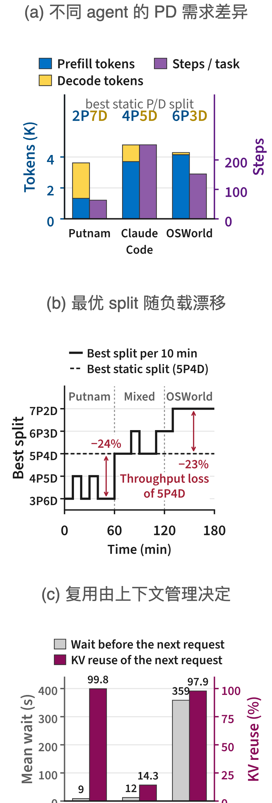
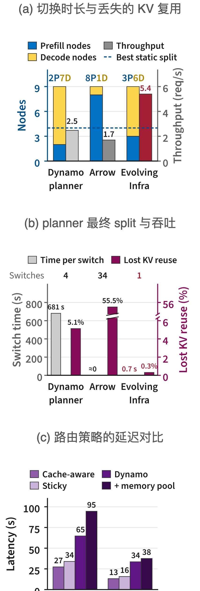
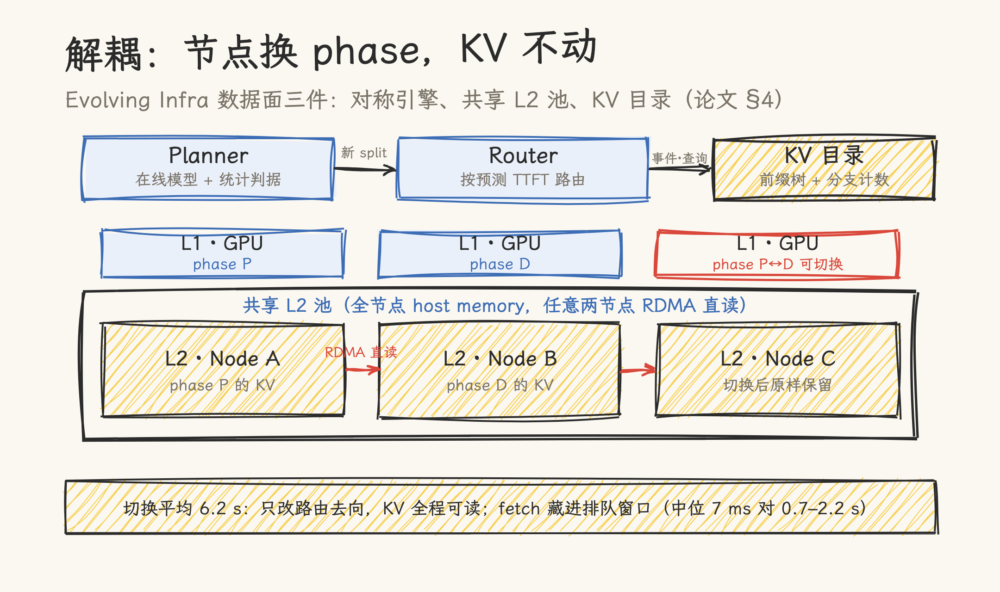
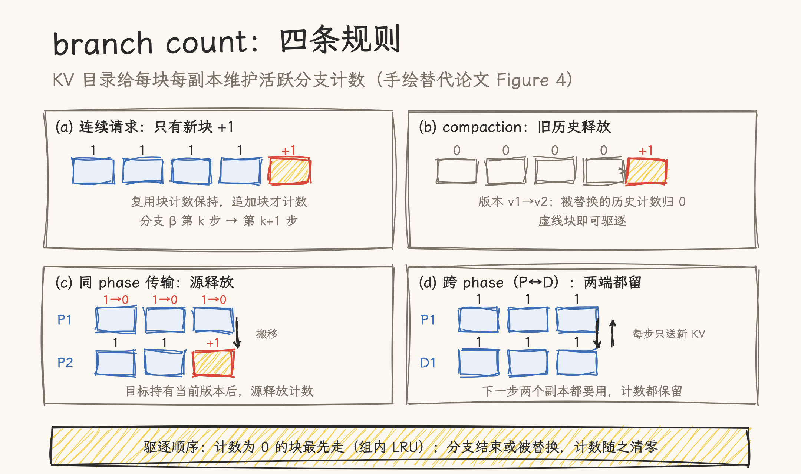
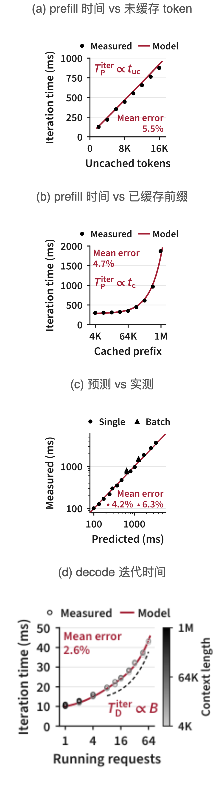
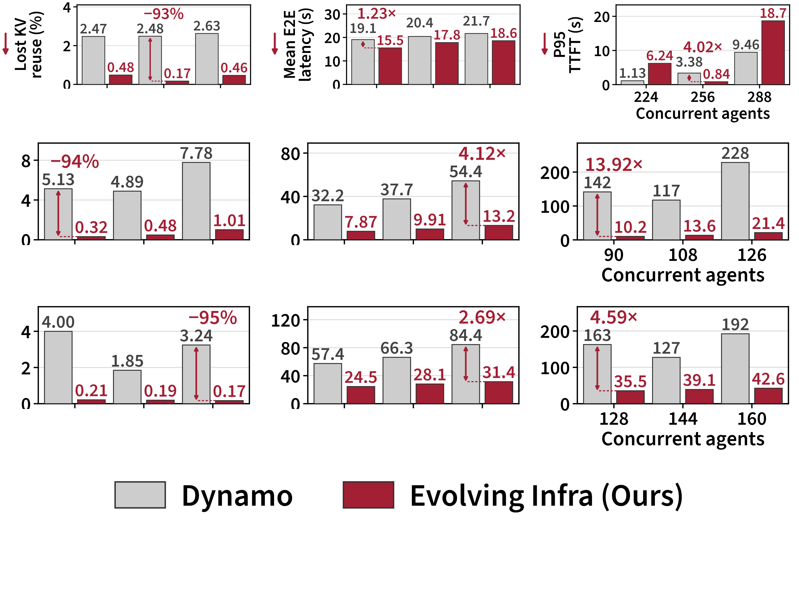
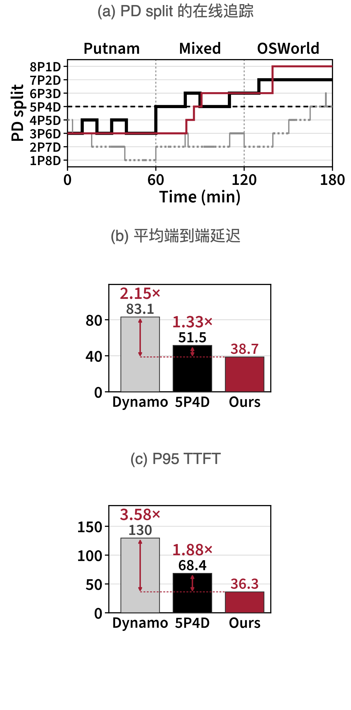

# Phase 切换从 681 秒到 6.2 秒：Evolving Infra 论文精读

> **元信息**：论文《Evolving Infra: Agent-Adaptive LLM Serving at Scale》（arXiv 2611.12304，2026-11，v1）。作者单位横跨 Georgia Tech、UIUC、Berkeley、NVIDIA、OpenAI 与 MIT（Hao Kang、Song Han、Ion Stoica、Tushar Krishna、Huizi Mao 等）。本文基于 arXiv HTML v1 核对，核对日期 2026-11-12。全部性能数字为作者方自报（厂商口径），主对照基线是 NVIDIA Dynamo v1.5.1；配套 trace 数据集 mit-han-lab/EvolvingInfra-trace 已公开。论文的动机数字已做第三方复测（§六 末，2026-11-12，基于公开 CC trace）。配图 7 张：论文原图 5 组（标 Figure 编号），本仓库手绘 2 张。

Agent 干活是一步一步来的：每步一个 LLM 请求，harness 在请求之间往上下文追加工具结果，也会拉起 sub-agent、把旧历史压缩成摘要。相邻请求因此共享很长的前缀，把前缀的 KV 缓存下来是推理系统最划算的省法，前提是驱逐和路由答得对一个问题：哪些 KV 之后还会被用？通用系统唯一的依据是访问时间。Claude Code 的真实 trace 给出相反的答案：一个分支等了 359 秒的 sub-agent 调用，回来后的请求仍复用了 98% 的 prompt 前缀；而一次 12 秒的 compaction 刚把旧历史换成摘要，被替换的 KV 明明刚访问过，下一个请求能复用的只剩 14%（Figure 2c）。复用与否由 harness 的上下文管理决定，时间近因预测不了：按 LRU 驱逐，系统丢掉等待分支的 KV，却留着已经死掉的历史。这篇论文的出发点就是把 agent 的上下文管理变成基础设施的输入信号，PD 分离 serving 的三个组件（planner、router、memory pool）全部改读这套信号。

## 一、Agent 负载的三个动态

论文的立论是三个「动态」相互叠加（Figure 2）：

- **负载间差异**：Putnam（数学证明，单分支长推理）是 decode-heavy，OSWorld 2.0（每步追加一张截图的计算机操作 agent）是 prefill-heavy，Claude Code 居中。三者各自的最优静态 split 从 2P7D 排到 6P3D（xxPyyD 即 xx 个 prefill 节点 + yy 个 decode 节点），没有一个静态配比能同时讨好三种负载（Figure 2a）。
- **构成漂移**：集群里三类负载的占比随时间变。把 Putnam→OSWorld 的三小时切换切成 10 分钟窗口，最优 split 从 3P6D 一路移到 7P2D；固定在全程最优的 5P4D 上，Putnam 时段损失 24%、OSWorld 时段损失 23% 的吞吐（Figure 2b）。
- **复用取决于上下文管理而非时间近因**：harness 会 fork、拉起 sub-agent、做 compaction。fork 出的分支带着完整前缀，等工具的分支暂停很久之后还要回来用；compaction 却把最近访问过的历史直接换成摘要。判断一块 KV 该不该留，需要知道「还有没有活跃分支引用它」，而这是访问时间戳给不出的。

## 二、现有 PD 分离系统的三个缺陷

把三个动态喂给现有系统（Dynamo v1.5.1 + SGLang Model Gateway + HiCache LRU），得到三组动机实验（§3，9 节点 4×GB300，GLM-5.2 TP4，90 并发 agent 回放 CC trace）：

- **换 phase 代价高**：Dynamo 的 planner 切一次要重启 worker，平均 681 秒节点离线；Arrow（arXiv 2505.11916）原地切换不重启，但切过去的节点 KV 变得不可达，34 次切换丢掉 55.5% 的可复用 KV（Figure 3a）。
- **算力需求估不准**：Dynamo 跟随队列深度与 KV 利用率，长上下文把 decode 节点利用率顶满，split 漂到 2P7D；Arrow 用全输入长度估 prefill 时间（把已缓存前缀也当工作），又对 sub-agent 短 burst 反应过度，漂到 8P1D、切换 34 次。两个在线 planner 分别比最优静态 split 少 49% 和 65% 吞吐（Figure 3b）。
- **KV 复用判反**：缓存感知路由（SGLang Model Gateway）把分支请求挤在持前缀的少数节点上，P95 TTFT 27–34 秒；Dynamo 的负载感知路由让请求去重算前缀，P95 TTFT 65 秒；给路由配上共享内存池，P95 TTFT 反而升到 95 秒：池子在 prefill 开始才把 KV 装进 GPU，取数延迟叠加进了 prefill（Figure 3c）。驱逐侧，LRU 丢掉的「等待分支的 KV」占 Dynamo 全部 KV 复用损失的 39%。

三个缺陷指向两个根因：计算分配与 KV 管理耦合（换 phase 就得丢 KV 或重启），以及三个组件都只用粗信号（延迟、输入长度、访问时间），这些信号看不见 agent 的上下文管理。

## 三、解耦数据面：对称引擎、共享 L2 池、KV 目录

**对称引擎**（§4.1）：在 SGLang 上扩展出一个调度循环同时服务两个 phase 的引擎，配一条任意两节点双向搬 KV 的传输通路（复用 Mooncake 的 RDMA 传输层）。planner 换 split 时，router 只改变发给某节点的请求类型，节点不重启。排空在跑请求后完成切换，平均 6.2 秒（含排空），对 Dynamo 的 754 秒（九组设置平均，§C.1）。

**共享 L2 池**（§4.2）：把全节点的 host memory（HiCache 语义里的 L2）池化成集群级 KV 池。与上游 HiCache 经 L3（Mooncake Store）中转不同，prefill 节点经 RDMA **直读对端 L2**，省掉第三节点副本与 master RPC；fetch 在请求排队期间**整批完成**（拉到本节点 L2、装入 L1、广播到节点内各 GPU），prefill 开始时零等待。

decode 节点只写不读：decode 从 host 取数会停整批，上游 SGLang 的这类停顿让 GPU 空闲 58.7%，它要的 KV 一律由 prefill 节点经 GPU 直送。MLA 的 KV 不被 TP 切分，节点内四个 rank 去重后每份只存一份，L2 有效容量变成 L1 的四倍（GLM-5.2 约 50 KB/token FP8，1 TB host 约装 2,000 万 token）。

**KV 目录**（§4.3）：在 Dynamo KV indexer 的事件驱动前缀树上，给「每个块在每个节点上的副本」加一列：有多少活跃分支引用它。harness 给每个请求打 branch ID，分支 fork 时上报新 ID，compaction 时版本号加一，分支结束上报。四条计数规则（手绘替代论文 Figure 4）：连续请求只给追加块 +1；compaction 升版本后释放被替换历史的计数；同 phase 的 KV 搬移在目标持有当前版本后释放源端；跨 phase 的副本两端计数都保留（分支下一步两边都要用）。

计数为零的副本（被 compaction 替换的历史、已结束 sub-agent 的上下文、同 phase 搬移留下的源副本）就是「没有任何活跃分支会再引用」的 KV，驱逐时最先清走。

## 四、在线适配：模型、planner、驱逐与路由

**迭代时间模型**（§5.1，Figure 5）：prefill 的迭代时间拆成四项：固定开销、未缓存 token 数、query-key 对数 A、以及从 host 恢复的 token 数。其中 A = t_uc·t_c + t_uc(t_uc+1)/2，即「未缓存 token 数 × 已缓存前缀长度」的 attention 计算量。把缓存前缀 t_c 与未缓存 t_uc 分开建模，是 agent 复用越多估得越准的原因。decode 拆成三项：固定开销（读全量稠密权重）、MoE 路由专家的期望激活比例 φ(B)（B 为并发请求数）与每请求项。

两组系数在热身期以 collocated 模式（所有节点同时跑两个 phase）在线最小二乘拟合，一分钟内收敛；GB300 + GLM-5.2 上设定外平均误差 4.2%（单请求）/6.3%（2–8 请求批），换 H200 + DeepSeek-V4-Flash 复验为 2.6%/1.9%。模型形式对滑动窗口、线性注意力、DSA 与 DeepSeek-V4 的 CSA/HCA 也成立（§B.2）：这些注意力变体的时间同样落在 t_uc 与 A 两个项上。

**Planner**（§5.2）：每个 600 秒窗口结束时，用「窗口内请求的平均工作 w̄」评估全部 N−1 个候选 split 的预测吞吐（取 P、D 两侧的较小值）。w̄ 刻画负载本身，sub-agent 短 burst 抬不动它；候选还要通过显著性判据（10 个切片上的平均增益 > 2×标准误）才允许切换。平均每 run 切 2.0 次（Dynamo 3.6 次），从任意初始 split 出发都收敛到同一 split（四初值间延迟差 ≤1.8%）。

**驱逐与路由**（§5.3）：驱逐按键（是否有活跃分支计数，组内 LRU）升序：零计数副本先走，活跃分支的 KV 在没有零计数块可清之前不动。路由对每个 prefill 节点预测 TTFT（在跑批剩余时间 + 队列请求的服务时间之和 + 本请求服务时间 + fetch 超出排队窗口的暴露部分 + 副本代价 κ·x），发给预测值最小的节点，配合异步 fetch 把取数藏进排队。

## 五、产能数字与口径

稳态负载（三类 agent × 三档并发，1 小时封闭回放，Table C.1/C.3）：

| 指标（对 Dynamo）     | 数字                                                                  |
| --------------------- | --------------------------------------------------------------------- |
| 吞吐                  | 1.10–2.73×                                                            |
| 平均 E2E 延迟         | 降 1.15–4.12×（CC 3.80–4.12×，OSWorld 2.34–2.69×，Putnam 1.15–1.23×） |
| P95 TTFT              | 降最高 13.92×（CC；Putnam 两档并发反而劣于 Dynamo，见下）             |
| 丢失 KV 复用          | 减少 81–95%（绝对值 0.17–1.01% 对 1.85–7.78%）                        |
| phase 切换            | 平均 6.2 s 对 754 s（>100×）                                          |
| 对最优静态 split 吞吐 | 0.98–1.38×（最低并发档；0.98× 出现在 Putnam）                         |

漂移负载（Putnam→混合→OSWorld 三小时）：吞吐 2.14× Dynamo、1.28× 最优静态 split；E2E 降 2.15×/1.33×；planner 的 split 贴着每 10 分钟窗口的最优解走（Figure 7）。

规模（§6.4、附录 D）：256 卡实测中静态 PD 的 P95 TTFT 从 142 s 涨到 418 s，本方法稳在 10–14 s。Frontier 模拟 3,072 卡（8 分区）：聚合 PD 需求仅 ±7% 漂移，但分区内 PD 配比漂移达 42.4%，分区级 planner 在静态 split 上再提 1.42× 吞吐。

代价与消融：固定 4P5D 时「基础设施 + 感知驱逐路由」已值 1.37× 最优静态；异步 fetch 单独对上游 SGLang 值 1.12×（prefill 空闲 23.6%→14.4%）；在线适配自身只花 0.3% 吞吐；而离线搜最优 split 在 256 卡上要 10,752 GPU 时，等于服务同一条 trace 一遍成本的 14 倍。

## 六、数字怎么读

1. **摘要口径 vs 逐档口径**：「up to 4.1×」的 E2E 与「14×」的 P95 TTFT 是最好设置；正文九组的区间是 1.15–4.12× 与 3.25–13.92×。引用建议用区间。
2. **Putnam 的两处不利要如实带出**：decode-heavy 的数学 agent 上，planner 只留 1–2 个 prefill 节点换吞吐，224 与 288 并发两档的 P95 TTFT 劣于 Dynamo；最低并发档吞吐只有最优静态的 0.98×。
3. **Arrow 的结论只对重实现成立**：其代码不公开，作者在自己的对称引擎上重实现其 planner/scheduler 再对比（论文诚实标注）。
4. **两个 baseline 的排除理由**：SGLang 2026-09 合入的 runtime role switch 因不支持投机解码被排除；Llumnix 因 GB300 的 Arm CPU 无法运行，在 H200 上补测（比最优静态少 12.2% 吞吐）。理由成立，但读者应知道这两个对照不是原生条件。
5. **Closed-loop + 单次运行**：稳态吞吐由 Little 定律从延迟反推（附录 C.4），每个配置只跑一次；open-loop（附录 D.3）补测中作者自曝一次 planner 决策失误导致 0.75 agents/min 档未达标。
6. **NVIDIA 的双重身份**：NVIDIA 既是作者单位又是被对比框架（Dynamo）的维护方，数字方向对自家生态不利，这是可信度的加分项；但 baseline 配置（v1.5.1、从 6P3D 起）由作者选定。
7. **ThunderAgent 对比的前提**：消融显示 ThunderAgent 的「暂停等工具的 agent」在 GB300 上一场都没触发，吞吐只有 cache-aware 路由的 0.95×：去重后的 host 层已吸收 KV 抖动，容量不是瓶颈，放置与驱逐才是。这个结论依赖大 host memory 与 NVLink-C2C，硬件较弱时结论会变。

**第三方复测（本仓，2026-11-12）**：论文的动机数字出自作者对这条 trace 的分析，我们下载同一公开数据集做了独立复算。方法：每请求带 `hash_ids`（prompt 的 64-token KV 块 ID 序列），相邻请求的复用率 = 公共前缀块数 × 64 ÷ 输入规模；等待间隔取请求自带的 think_time；compaction 以「同分支上下文骤降 >40%」为代理（非论文内部口径，不会逐位一致）。规模核对：393 条 trace / 56,798 主线请求 / 1,697 个 sub-agent 组 / 42,029 条内层请求，与数据集 README 四个数字逐一相等。

| 复测项                                    | 本仓复测                | 论文口径                                    | 结论                                           |
| ----------------------------------------- | ----------------------- | ------------------------------------------- | ---------------------------------------------- |
| 长等待（>300 s）后复用率，n=2,311         | 中位 99.8%，均值 92.8%  | 98% @ 359 s                                 | 吻合                                           |
| compaction 后复用率（骤降 >40%），n=926   | 中位 0.0%，均值 7.6%    | ~14%                                        | 方向与量级吻合；本仓取骤降后首请求，测得更极端 |
| sub-agent 首请求对主线上文的复用，n=1,697 | 中位 0.0%               | 仅定性区分 fork（复用）与 spawn（新上下文） | 量化补强：spawn 冷启动即全量 prefill           |
| 主线等待间隔                              | 中位 4.8 s，p90 120.6 s | 未给（Copilot 172 s 为另一来源）            | CC 节奏明显更紧                                |

复测给论文补了一个它没给的数字：sub-agent 首请求对主线上文的复用中位为 0%，Claude Code 的 sub-agent 拿的是新任务上下文，首请求是全量冷 prefill。这解释了论文 Figure 4(c)(d) 的设计动机：同 phase 搬移搬的是「已算过的」，spawn 产生的是「还没算的」，目录只需为前者维护计数。

## 七、总评与适用边界

判断一：这篇论文把 harness 的信号升级成了基础设施的一等输入。branch ID、fork/finish 事件、compaction 版本号，这三样来自 harness 的元数据分别喂给了驱逐（哪些副本没人引用）、路由（该不该迁就前缀）与 planner（真实 prefill 工作量）。三件套互为前提：没有共享池，换 phase 就丢 KV；没有对称引擎，池子的跨 phase 可读没意义；没有目录计数，驱逐退回 LRU。

判断二：解耦的代价藏在硬件与改造两个前提里。对称引擎要求节点同时装下两个 phase 的执行路径（异构并行场景装权重并集，B200 上约 10 GB/GPU，§D.4）；异步 fetch 敢藏进排队窗口，靠的是 52 GB/s RDMA、NVLink-C2C 的 host-GPU 重载带宽与四倍于 L1 的 L2 容量；论文引 ThunderAgent 在 PCIe 时代「offload 太慢」的旧结论作反例对照，说明这套设计对硬件代际是有要求的。另一个前提是 harness 必须改造：打 branch ID、上报 fork/finish/compaction。这使它区别于 Mooncake、Dynamo 那类纯引擎侧方案，基础设施与 agent 框架之间多了一份契约。

判断三：本仓 KV 复用总纲 §六 的「可声明接口」展望，在这篇论文里出现了第一批工程雏形。目录里的 branch ID 与版本号就是「这块 KV 属于谁、还有没有人要」的最小声明字段；总纲展望的三样（出处、对齐代价可知性、准入决策接口）里，出处这一栏有了实现，后两样（复用前的代价预估、把复用当准入变量）对应本文的路由预测公式，算半步。

**适用边界**：做 agent serving 基础设施的读者，§3 的动机实验与 §4.3 的计数规则是全文信息密度最高的两节；引用数字全部注意作者自报口径与「up to」取最好设置；复现或选型要对照三个 commit（Dynamo v1.5.1、SGLang 带 role-switch PR、Arrow 重实现）与 36 卡 GB300 的硬件前提；harness 侧需要评估打点改造的成本。

与本仓库已有内容的锚点：[Agent 推理服务总纲](01_agent-workload-serving.md)诊断的四个连锁问题（KV 生命周期错配、调度语义失真、会话粘性、容量公式失效）在这篇论文里逐一有了基础设施侧的回应，续篇《基础设施的回应》将按此映射展开；[KV 复用总纲](../kv_cache/06_kv_reuse/01_kv-reuse-overview.md) §六 的可声明接口展望与本文 §四/判断三对读；[CloudMatrix384 论文](../cloudmatrix_infer/cloudmatrix384-tokenfactory.md)的 PDC 三池固定角色与本文的对称角色 + 在线换角色是同一解耦思想的两个端点；[SGLang HiCache](../sglang/hicache_deep_dive.md) 与 [Dynamo KV 路由](../vllm/module_analysis/native_kv_offloading.md)是本文 §4.2/4.3 直接改造的机制底座。

## 论文图表索引

| 编号             | 内容                                                                | 本文位置 |
| ---------------- | ------------------------------------------------------------------- | -------- |
| Figure 2         | 三个 workload 动态（已嵌入，a/b/c 组合）                            | 一       |
| Figure 3         | 三个缺陷的动机实验（已嵌入，a/b/c 组合）                            | 二       |
| Figure 4         | branch count 四规则（原文为 flex-figure，由本仓手绘图替代）         | 三       |
| Figure 5         | 迭代时间模型与误差（已嵌入，a–d）                                   | 四       |
| Figure 6         | 稳态负载九组对照（已嵌入）                                          | 五       |
| Figure 7         | 漂移负载 split 追踪与延迟（已嵌入）                                 | 五       |
| Table C.1/C.3    | 逐设置切换时长、命中率、吞吐与延迟                                  | 五、六   |
| Appendix B       | 模型形式对 DSA/CSA/HCA 的适用性证明；H200 + DSv4-Flash 复验         | 四       |
| Appendix D.2–D.6 | 256/3072 卡规模、open-loop、异构并行、ThunderAgent 对照、异步 fetch | 五、六   |

## 参考资料

- 论文：[Evolving Infra: Agent-Adaptive LLM Serving at Scale](https://arxiv.org/abs/2611.12304)（v1，本文核对版本）
- 数据集：[mit-han-lab/EvolvingInfra-trace](https://huggingface.co/datasets/mit-han-lab/EvolvingInfra-trace)；CC trace 来源 [semianalysisai/cc-traces-weka-062126](https://huggingface.co/datasets/semianalysisai/cc-traces-weka-062126)，回放器 [Applied-Compute/trie](https://github.com/Applied-Compute/trie)
- 对照系统：[NVIDIA Dynamo v1.5.1](https://github.com/ai-dynamo/dynamo) · [Arrow（arXiv 2505.11916）](https://arxiv.org/abs/2505.11916) · ThunderAgent（ICML 2026，论文 §A.4 有对照分析） · [KVTether（arXiv 2609.39819）](https://arxiv.org/abs/2609.39819)
- 机制底座：[SGLang HiCache 设计](https://docs.sglang.io/docs/advanced_features/hicache_design) · [Mooncake Transfer Engine](https://github.com/kvcache-ai/Mooncake)
- 本仓库：[Agent 推理服务总纲](01_agent-workload-serving.md) · [KV 复用总纲](../kv_cache/06_kv_reuse/01_kv-reuse-overview.md) · [CloudMatrix384 论文精读](../cloudmatrix_infer/cloudmatrix384-tokenfactory.md) · [HiCache 深入详解](../sglang/hicache_deep_dive.md)
