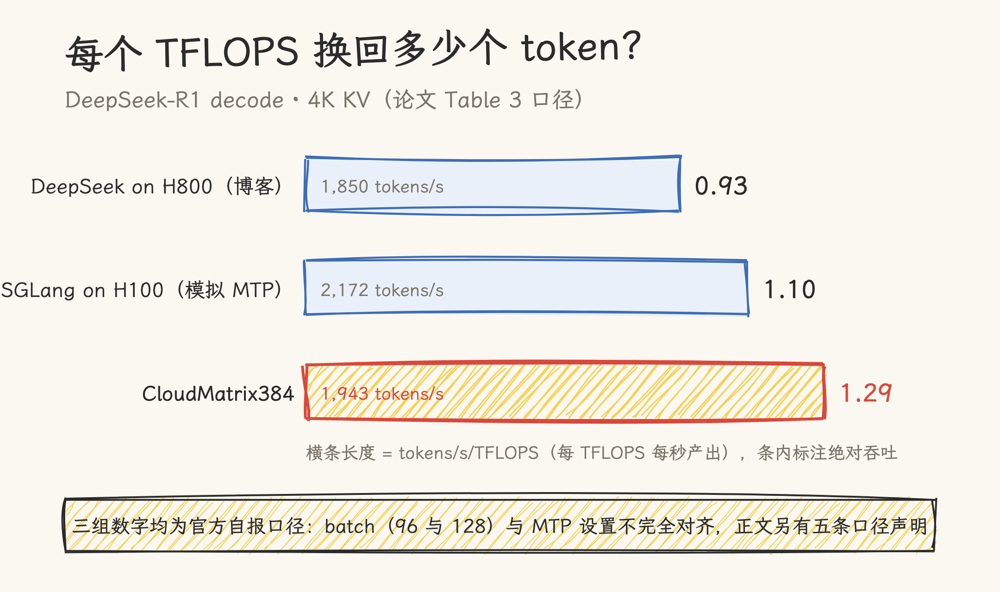
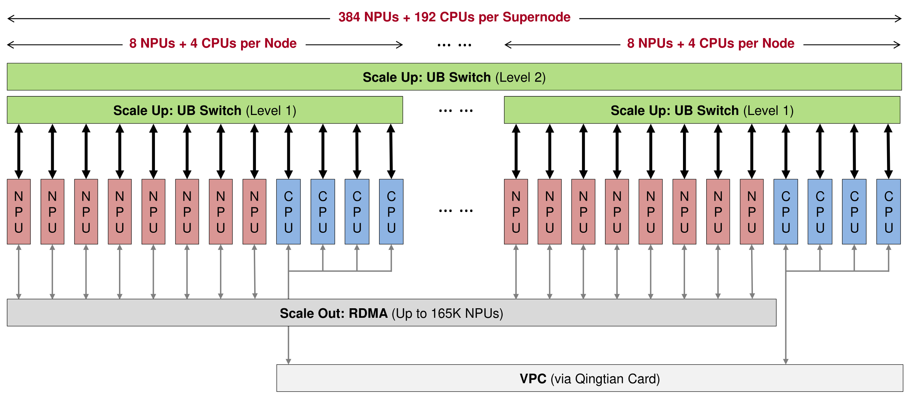
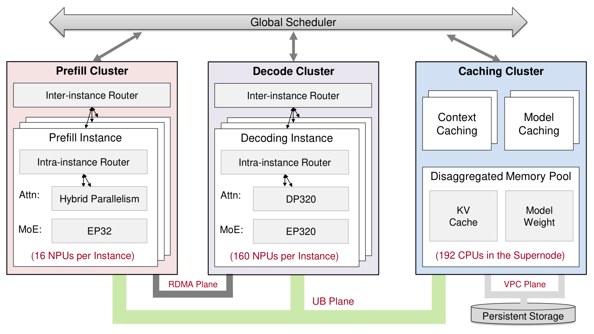
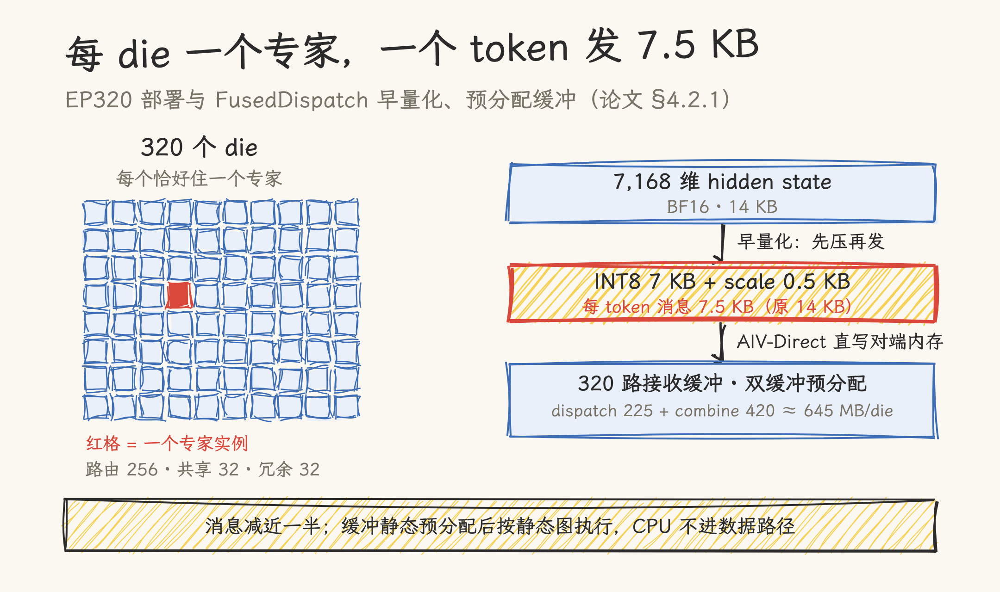
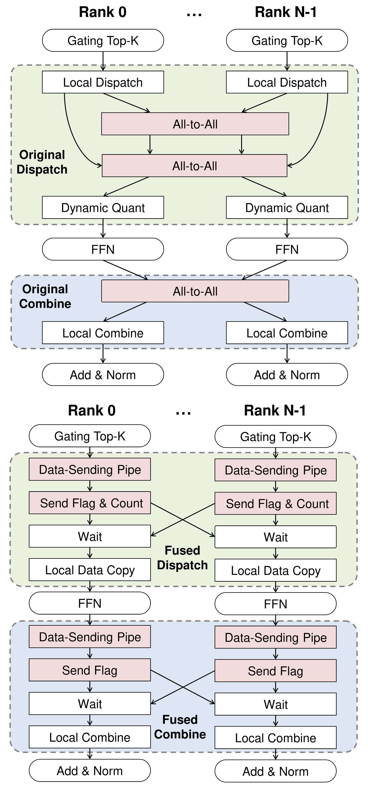
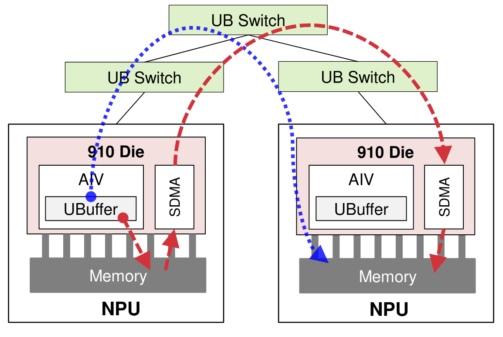
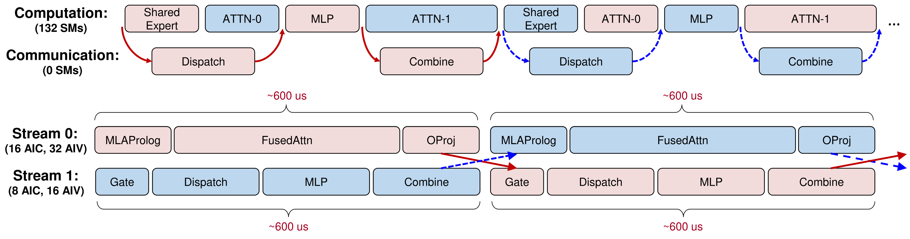
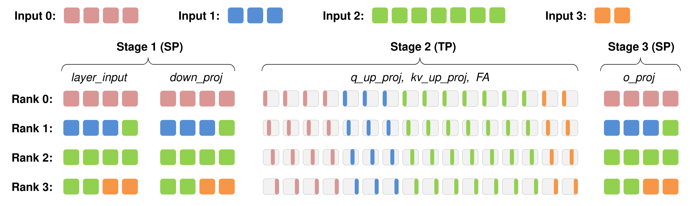
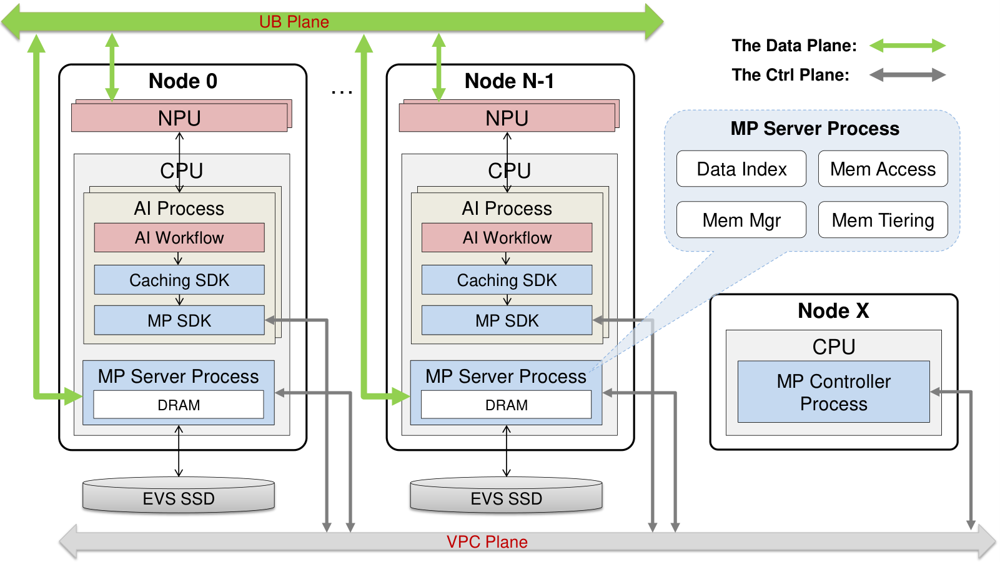
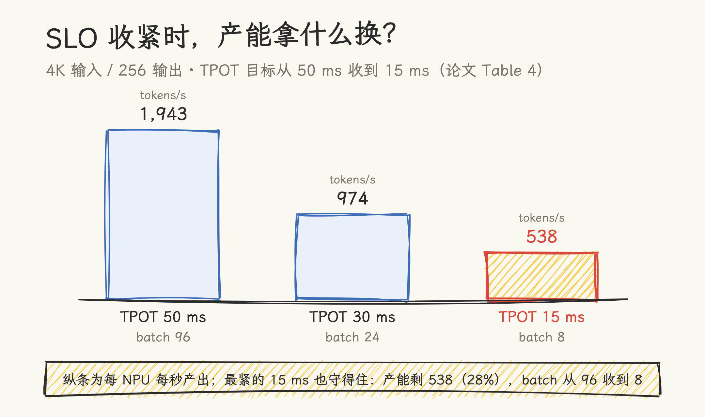

# 一座 384 卡的 TokenFactory：CloudMatrix384 论文精读

> **元信息**：论文《Serving Large Language Models on Huawei CloudMatrix384》（Huawei + SiliconFlow，arXiv 2506.12708，2025-06 首发）。本文基于 arXiv HTML v3 核对，核对与写作时点 2026-11-11。文中性能与精度数据均为作者方自报（厂商口径），对照基线取自 DeepSeek 官方博客/Profile 数据与 SGLang 官方博客，暂无独立第三方复测。

把推理系统看作生产 token 的工厂，产能有两个口径：每张卡每秒产出多少 token，以及每个 TFLOPS 换回多少 token。回看 2025 年：2 月，DeepSeek 在开源周公布了自家产线的数字，H800 上 decode 每卡 1,850 tokens/s（官方博客口径）；5 月，SGLang 团队在 96 张 H100 上做了大 EP 部署的公开复现；6 月，华为与 SiliconFlow 的这篇论文交出同一口径的答卷：prefill 每 NPU 6,688 tokens/s，decode 每 NPU 1,943 tokens/s（TPOT 49.4 ms）。

单看绝对吞吐，这座工厂没有碾压谁；换算成算力效率，数字变成 4.45 与 1.29 tokens/s/TFLOPS，高于上面两家的公开值。产能差距的秘密在厂房本身：384 张昇腾 910 与 192 颗鲲鹏 CPU 被连成逻辑上的一台机器，卡与卡之间的通信不再按「节点内」和「节点间」两个价格计费。论文的展开顺序也因此与多数推理系统论文不同，先讲厂房（超节点架构），再讲产线（CloudMatrix-Infer 服务栈），最后才给产能数字。本文按同样顺序走，数字逐一注明出处章节。

## 一、从 DeepSeek 的 H800 部署说起

DeepSeek-R1 是 671B 参数的 MoE 模型：256 个路由专家按 top-8 激活，MLA 把 KV 压到传统注意力的 6.7%，MTP 支持解码期投机验证，训练侧用 FP8（论文 §3.5.1）。它的 H800 部署是 PD 分离的经典样板：prefill 侧 4 节点 32 卡组成一个部署单元，DP32+EP32，每卡放 9 个路由专家加 1 个共享专家；decode 侧扩到 18 节点 144 卡，DP144+EP144，每卡 2 个路由专家加 1 个共享专家，全网维护 32 份路由专家冗余副本。双微批流水线让一个 microbatch 的 all-to-all 通信与另一个的计算重叠。这套配置下 prefill 每卡 9,213 tokens/s（56.3% 缓存命中），扣除命中后 4,026；decode 每卡 1,850 tokens/s。

这套部署有一条硬约束：TP 与 EP 出不了节点。NVLink 只覆盖 8 卡节点内部，跨节点走 400 Gbps InfiniBand（约 50 GB/s），带宽差了一个量级。专家并行想扩大 EP 度，通信开销就按节点边界的带宽计价，于是 256 个专家只能摊在十几张卡上，每卡挤多个专家，解码时专家串行执行拖长延迟。

这套数字是历史口径：开源周那篇推理系统概览发布于 2025 年 2 月；到本文写作时（2026 年 11 月），DeepSeek 已发布 V4 与 V4.1-Flash，生产栈换成自研 DeepInfer 引擎（[源码拆解见本仓库](../deepinfer/deepinfer-source-deep-dive.md)），V4 起注意力架构也已重写（见 [KV 压缩系列](../kv_cache/07_kv_compression/README.md)）。论文对照的 H800 上的 R1，在 DeepSeek 自己那里也已是上一代部署；它的对照价值在机制与口径，不在反映任何一方的当下产能。

CloudMatrix384 的回答是把交换层做进机柜：整个超节点单层 UB 全互联，论文给出的口径是跨节点通信的带宽损失低于 3%，延迟增量小于 1 µs（§3.2）。EP 度的上限从「节点大小」变成了「超节点大小」。时间线在这条架构判断里很关键：论文自述这套超节点的设计早于 MoE 架构大规模流行（§1），大型超节点系统的设计部署周期以年计，DeepSeek-R1 出现后，通信带宽才被普遍当成与算力、显存带宽同级的资源来对待。

## 二、把 384 张 NPU 连成一台机器

低于 3% 的带宽损失是怎么做到的？拆开机柜看（§3.3）：

- **芯片**：昇腾 910 是双 die 封装，两个同构 die 共享 8 个片上 memory stack。每个 die 有 24 个 AIC（矩阵核）与 48 个 AIV（向量核），支持 FP16/BF16/INT8，没有 FP8 单元；论文的表述是 INT8 可以达到接近原生 FP8 硬件的计算效率（厂商口径）。每个 die 接 7 条 UB 链路与 1 条 RDMA 接口。
- **节点**：8 张 910 加 4 颗鲲鹏 CPU，板上焊 7 片 UB 交换芯片。4 颗 CPU 全 mesh NUMA 互连；其中 1 颗挂擎天（Qingtian）DPU 卡，作为节点的南北向出口。
- **超节点**：48 个节点装进 16 个机柜（12 计算 + 4 通信），合计 384 NPU + 192 CPU。二级 UB 交换分 7 个子平面，每个子平面 16 片交换芯片、每片 48 口；节点内 7 片 L1 芯片与 7 个子平面一一对应，每片向对应子平面的全部 16 片 L2 各出一条链路。上行带宽因此等于节点内部 UB 容量，二级无收敛（non-blocking）。

_图源：CloudMatrix384 论文（arXiv 2506.12708v3）Figure 2。这张图看三层的连线方向：绿色 L2/L1 是 UB 的 scale-up 面，灰色 RDMA 条带是 scale-out 面，底部 VPC 条带管南北向。_

网络分三个平面（§3.2）：UB 面负责超节点内的 scale-up，全对等 all-to-all；RDMA 面（当前 RoCE）负责跨超节点的 scale-out，仅 NPU 参与，PD 之间的 KV 传输走这条物理隔离的通道；VPC 面走以太网/IP，承担管理面与对象存储访问。CloudMatrix384 的 UB 设计是 UB-Mesh 论文（arXiv 2503.20377）的前身，两篇可对读。

对等互连换来四个能力（§3.1）：TP/EP 组可以越过节点边界；CPU、NPU、内存按负载自由组合；AI 与数据密集负载共用一套基础设施；全节点的 CPU DRAM 池化后充当内存级存储（第六章的 EMS 就建在它上面）。

厂房有了，但主流推理软件用不上它：现有系统把请求调度绑死在 KV 所在的节点上。下一章讲这个前提是怎么被推翻的。

## 三、CloudMatrix-Infer：PDC 三池分离

传统集群里节点内内存访问（约 256 GB/s 量级）远快于节点间（约 25 GB/s 量级），远程取 KV 的代价太高，所以 NVIDIA Dynamo、Mooncake 这类 KVCache-centric 系统（§4.1）都让请求跟着 KV 走：路由到缓存所在的节点。这个设计有两个代价：调度逻辑复杂，动态负载下容易失衡；decode 节点的 DRAM 各自为政，凑不成全局缓存池。

CloudMatrix384 上这个前提变了：UB 让任意 NPU 以接近一致的带宽访问池内任意位置的数据，「本地」与「远程」的差距被抹平。CloudMatrix-Infer 顺势把系统拆成三个对等的子系统：prefill、decode、caching，各自独立伸缩（§4.1）。请求调度与 KV 物理位置解耦，调度变成无状态的：请求发给任何可用的 NPU 实例都行；prefill 与 decode 节点的 DRAM 合成一个统一的缓存池。

_图源：CloudMatrix384 论文（arXiv 2506.12708v3）Figure 9。这张图看三个集群各自的并行度标注（prefill EP32 / decode EP320+DP320 / 缓存池规模），以及底部两条 colored 通道：decode 的 MoE 流量走 UB 面，PD 之间 KV 走 RDMA 面。_

评测部署（§5.1）：decode 侧 1 个实例占 160 张 NPU（320 个 die），EP320；prefill 侧 6 个实例、每实例 16 张 NPU（32 die）、EP32，共 96 张。整个评测用掉超节点的 256 张 NPU，缓存池由这 32 个计算节点的鲲鹏 DRAM 组成。prefill 与 decode 的实例配比随负载动态调：输入长的流量加 prefill，输出长的加 decode，论文强调这个比例不固定。

三池之间的交接协议（KV 怎么传、调度怎么排、链路怎么摊）留到第五章展开。

## 四、EP320：每 die 一个专家

decode 侧把 EP 开到 320：256 个路由专家每个独占一个 die，另配 32 份共享专家与 32 份冗余路由专家做 EPLB。每 die 一个专家消灭了同 rank 内专家的串行执行，代价是把 320 个 die 的通信压给 UB 面。算一笔账：batch 96 时，一个 decode 步内每个 die 最多要向 319 个对端各发一批 token，而每条流跑完一个微批只有约 600 µs 的预算。这一章的四组技术都在回答同一个问题：怎么在预算内把账付清。

### FusedDispatch 与 FusedCombine：把三次 all-to-all 折进两个算子

朴素的 MoE 执行要三次 all-to-all（路由元数据、token 数据、专家输出回收），外加动态 shape 的内存分配与 CPU-NPU 同步（§4.2.1）。两个融合算子的做法：

- **AIV-Direct**：放弃走 SDMA 固件的常规通信路径，让 AIV 向量核直接经 UB 写远端 NPU 内存，砍掉 SDMA 的启动开销。decode 的消息小、对启动延迟敏感，这条路径收益最大。
- **早量化**：dispatch 前把 7,168 维 BF16 token 量化成 INT8（7 KB）加 scale（4 字节，对齐到 512 B），每 token 消息从 14 KB 降到 7.5 KB，在最吃带宽的 dispatch 阶段减一半流量。
- **静态预分配**：每个 rank 给其余 319 个 rank 各预分配接收缓冲（`rank_num × max_tokens × msg_size`），dispatch 缓冲约 225 MB、combine 缓冲约 420 MB，每 die 合计约 645 MB；两组缓冲物理分离（双缓冲），避免背靠背执行时快 rank 覆写慢 rank 未消费的数据。
- **发送流水线**：算子内部按 token 粒度流水：取下一个 token 到 UBuffer、算目标偏移并量化、AIV-Direct 写出，三段重叠。

_图源：CloudMatrix384 论文（arXiv 2506.12708v3）Figure 10。(a) 是三次 all-to-all 的朴素流，(b) 是折进 FusedDispatch/FusedCombine 后的流；粉色块从「All-to-All」变成了「Data-Sending Pipe + Send Flag」三段流水。_

_图源：CloudMatrix384 论文（arXiv 2506.12708v3）Figure 11。红色虚线是传统 SDMA 固件路径（绕行交换芯片），蓝色点线是 AIV 核经 UB 直写对端 UBuffer 的短路径。_

### MLA：三个瓶颈，三招

直接移植 DeepSeek 的 MLA 算子在 910 上有三个问题（§4.2.2）：细粒度算子（RMSNorm、投影、RoPE）逐个启动的延迟累积；KV cache 以 ND 格式存储、AIC 计算前要显式转成 NZ 格式，白耗带宽；开 MTP 后同 batch 内各 query 的有效序列长度不一，BNSD 布局下的固定 tiling 造成负载不均。

对策同样三条：MLAProlog 把 RMSNorm、Q/K/V 投影、RoPE 融合成一个算子，内部再按 AIC/AIV 分工流水；FA 算子把 FlashAttention 与前后的 Concat/Slice 合并；KV cache 原生按 NZ 格式写入（910 的搬数接口支持写时格式转换），省掉显式转换步；tiling 换 BSND 布局、沿 B/S 两个变化的轴动态切分。与手搓 MLA 一文的口径互为印证：decode 走 weight absorption 形态，prefill 不吸收（见第五章）。

### 双微批非对称流水线

融合算子把单次通信的开销压下来了，EP320 的通信时长仍然是延迟大头。DeepSeek 在 H800 上每卡放 3 个专家（1 共享 + 2 路由），attention 段的计算足以盖住 dispatch 的通信时间；CloudMatrix-Infer 每 die 只放 1 个专家，attention 段变短，盖不住了（§4.2.3）。于是流水线改成两条流非对称分工：

| 流                    | 内容                         | 资源            | 单微批延迟 |
| --------------------- | ---------------------------- | --------------- | ---------- |
| Stream 0（attention） | MLAProlog、FA、O_PROJ        | 16 AIC + 32 AIV | ~600 µs    |
| Stream 1（MoE）       | Gate、Dispatch、MLP、Combine | 8 AIC + 16 AIV  | ~600 µs    |

Stream 1 计算少但通信长，拿一半算力恰好两边延迟拉平，两个微批交错执行时重叠得干净。两条流的资源配比还可以随 KV 长度变化在线调整。图 14 的示例口径（4K 序列、batch 96、开 MTP）给的是每条流约 600 µs；两个微批交错之后，每层合计约 1,260 µs，与 MTP 消融的数据（§5.4.2）吻合。

_图源：CloudMatrix384 论文（arXiv 2506.12708v3）Figure 14。(a) 是 DeepSeek 在 H800 的排布：计算行标 132 SMs、通信行标 0 SMs；(b) 是两条 Stream 的 AIC/AIV 配额与 ~600 µs 的时间括号。_

### MTP 去 CPU 化

预算表的最后一项是投机解码。朴素 MTP 每个解码步要跑 k+1 个计算图（k 个投机 + 1 个验证），每图启动 0.6 到 0.8 ms，元数据初始化与 token 采样都要 CPU 介入，流水线被切断（§4.2.4）。两处改造：解码步开始时一次性算好全部元数据张量放进 NPU 内存；采样全流程（排序、前缀和、候选过滤）做成 NPU 算子并融合进投机与验证图。消融数据（§5.4.2）：单 token 投机、70% 接受率假设下，每层延迟从 874 µs 涨到 1,260 µs（+44%），但每迭代平均产出 1.7 个 token，吞吐净增 6% 到 49%，batch 越小收益越大。

## 五、prefill 侧：混合并行与三硬件分工

prefill 是另一类负载：算力密集、吃 TTFT，负载不均的来源从专家路由变成了输入长度本身。

### SP-TP-SP 三段混合并行

prefill 用纯 DP 有两个问题（§4.3.1）：输入长度不均时短序列的卡等长序列的卡；在途请求不足 DP 度时部分卡空转。论文把 MLA 计算拆三段，各用各的并行策略：第一段（输入与 down_proj）用 SP 加序列打包，多条请求拼成打包序列按段均分；第二段（q/kv 上投影与核心 attention）用 TP 按头均分；第三段（o_proj）回到 SP。段间补一次 All-Gather 与一次 All-to-All，都发生在降维后的小张量上，UB 带宽下开销可忽略。

第二段能按头切的前提是 prefill 不做 weight absorption，MLA 退化为标准的 128 头 MHA 处理。这与本仓库手搓 MLA 一文的口径一致：吸收形态省计算但把绑定按 latent 维展开，prefill 计算密集、算原始 MHA 更划算。

_图源：CloudMatrix384 论文（arXiv 2506.12708v3）Figure 17。四条不同长度的输入（色块数量不同）经 Stage 1 打包均分、Stage 2 按注意力头重分、Stage 3 回到 SP，每个 rank 各行的色块总数基本一致就是负载均衡的证据。_

### AIC/AIV/SDMA 三硬件分工

H800 的双微批靠预留一部分 SM 做通信换并发；910 的异构核允许更细的分工（§4.3.2）：AIC 专注 ATTN 与 MLP 等计算密集算子；AIV 承担 token 重排、元数据生成、专家输出累加这类轻量向量活；SDMA 引擎独占 all-to-all 的大流量搬运。三路并行，消融显示 prefill 吞吐提升 23% 到 31%，每层延迟降约 24%（§5.4.1）。

### PD 之间：RDMA 隔离与连接映射

prefill 完成后整份 KV 传给 decode。三条防干扰措施（§4.3.3）：传输走 RDMA 面，与 UB 面上的 decode 通信物理隔离，每请求只传一次，带宽充裕；prefill 调度挪到 decode 调度器的后台线程，分配缓冲、选低负载 prefill 节点、触发传输全部异步，decode 线程不被阻塞；最后一条是连接映射，要展开说。MLA 单 latent 头意味着同一 TP 组内每个 rank 持有完整相同的 KV 副本（这一点与本仓库 MLA TP 切分一文的分析一致），若 decode 侧所有 rank 都去拉同一个 prefill rank，那条链路就成了热点。论文用确定性公式摊平：`ratio = prefill_tp_size ÷ decode_tp_size`，`group_size = decode_dp_size ÷ ratio`，decode 侧 `(dp_rank, tp_rank)` 对应的 prefill 源 rank 取 `⌊dp_rank ÷ group_size⌋ × decode_tp_size + tp_rank`。

## 六、EMS 缓存池与 INT8 量化

NPU 显存之外，推理系统还需要一层仓库：历史 KV 和模型权重都放在那里。CloudMatrix384 的仓库建在全节点的 CPU DRAM 上。

### EMS：DRAM 池当内存级存储

EMS（Elastic Memory Service）把全超节点的 CPU DRAM 池化成统一的缓存层（§4.4.1），靠的是 UB 的三个硬件能力：对等互联、DMA over UB 零拷贝、远程内存注册原语。软件侧三件套：MP SDK（进程内，Put/Get 语义）、MP Controller（中心控制面，DHT 视图与命名空间）、MP Server（管本地内存）。数据定位走全局一致性哈希；本地分配用巨页加变长分区抗碎片；DRAM 之下挂 EVS SSD 做二级，全量落盘、两级 LRU，节点故障后可从 SSD 层恢复。单节点到 EVS 的带宽不足 400 Gbps，但 48 个节点聚合后总量可观，数据切成细粒度块后可经 UB 从多节点并发拉取。

_图源：CloudMatrix384 论文（arXiv 2506.12708v3）Figure 19。左半是普通计算节点内 Caching SDK 与 MP SDK/MP Server 的层叠关系，右侧气泡是 MP Server 的四个职责块，右下 Node X 专跑 MP Controller。_

### Context Caching：推理模型的 decode KV 不回存

KV 按块（128 到 512 token）存进池子，块哈希加前缀哈希做内容寻址与去重（§4.4.2）。prefill 收到请求先查前缀，命中即经 UB 直取，只算后缀，新块异步回存。

有一处细节与本仓库 KV 复用总纲的框架直接对应：DeepSeek-R1 这类推理模型，decode 阶段产生的 KV 通常不回存。原因是思考过程的中间 token 下一轮不会重现，而最终答案的 token 若进入后续 prompt，位置整体后移，position-sensitive attention 下缓存即失效。这等于「同前缀一致」约束在推理模型上的又一次显形；论文也提到，若采用容忍位置漂移的近似复用技术，选择性回存最终答案 token 的 KV 有收益空间。

消融数据（§5.4.3）：复用率 50% 时 prefill 吞吐升 1.42 倍、TTFT 降 861 ms（34%）；90% 时吞吐 2.28 倍、TTFT 降 1,505 ms（59%）。同一命中率下走 UB 比走 VPC 吞吐高至 1.52 倍，这条对照算是「缓存访问带宽决定架构」的直接证据。

### Model Caching：8 份模型共享 1 份缓存

671B 的 INT8 权重约 671 GB，从 OBS（桶带宽 2.5 GB/s）冷加载超过 5 分钟；8 个实例并发加载时因争用拖延到约 2,560 秒（§4.4.3）。EMS 让 8 个实例共享池内同一份模型块：冷启动降到约 320 秒，热启动约 5 秒，DRAM 开销从 8 份降到 1 份；模型切换时命中率 100%、平均 5 秒，本地 DRAM 缓存方案只有 12.5% 命中、281 秒。论文注明这组延迟为示意口径（Table 1）。

### INT8 量化五件套

910 没有 FP8 单元，论文的替代方案是 training-free 的分层 INT8（§4.5）：混合精度（FFN 与 attention 的大矩阵走 INT8，norm 与 gate 等敏感小算子保留 BF16/FP32）；离线自适应 scale 搜索；对长尾分布做结构变换压制 outlier；激活按 token、权重按输出通道的混合粒度；块级 clipping 加误差补偿项插进推理图。精度对照（§5.3，Table 5）抽几行：

| 基准          | INT8（910） | 官方 API | 官方报告 |
| ------------- | ----------- | -------- | -------- |
| MMLU          | 90.82       | 91.05    | 90.8     |
| GPQA Diamond  | 71.66       | 71.77    | 71.5     |
| AIME 2024     | 78.96       | 78.12    | 79.8     |
| MATH-500      | 94.46       | 94.62    | –        |
| LiveCodeBench | 63.80       | 63.44    | 65.9     |
| C-Eval        | 82.05       | 79.92    | –        |

16 个基准整体与官方 API 持平。注意评测设置：AIME 与 CNMO 各跑 32 次取均值；MATH-500、SimpleQA 系列的打分模型用 Qwen2.5-72B 而官方报告用 GPT-4 系，与报告数字的偏差有相当部分来自这个口径差。

## 七、产能数字与口径

先看 prefill 总产能（4K 输入，Table 2）：

| 配置                              | 吞吐（tokens/s/NPU） | 算力效率（tokens/s/TFLOPS） |
| --------------------------------- | -------------------- | --------------------------- |
| CloudMatrix-Infer（默认）         | 5,655                | 3.76                        |
| CloudMatrix-Infer（Perfect EPLB） | 6,688                | 4.45                        |
| SGLang on H100（默认）            | 6,288                | 3.18                        |
| SGLang on H100（Perfect EPLB）    | 7,417                | 3.75                        |
| DeepSeek on H800（博客）          | 4,026                | 2.03                        |
| DeepSeek on H800（Profile 数据）  | 7,839                | 3.96                        |

Decode（4K KV，Table 3）：

| 配置                       | batch | TPOT     | 吞吐（tokens/s/NPU） | 效率（tokens/s/TFLOPS） |
| -------------------------- | ----- | -------- | -------------------- | ----------------------- |
| CloudMatrix-Infer          | 96    | 49.4 ms  | 1,943                | 1.29                    |
| SGLang（模拟 MTP）on H100  | 128   | ~55.6 ms | 2,172                | 1.10                    |
| DeepSeek（Profile）on H800 | 128   | ~50.2 ms | 2,325                | 1.17                    |
| DeepSeek（博客）on H800    | –     | ~50 ms   | 1,850                | 0.93                    |

延迟收紧时的取舍（Table 4）：TPOT SLO 从 50 ms 收到 15 ms，batch 从 96 降到 8，吞吐从 1,943 落到 538 tokens/s/NPU；换短序列（1K 输入 1K 输出）则能到 2,733。

算子层（§5.5）：Dispatch 算子 EP8 时延迟 116 µs、带宽 71 GB/s，对照 DeepEP on H800 的 163 µs、46 GB/s；Combine 差距更大，EP8 时 118 µs、131 GB/s 对 318 µs、46 GB/s，接近三倍带宽。但 Dispatch 的带宽随 EP 度增大持续退化，EP256 时落到 54 GB/s，论文自己标注为当前实现的可扩展性瓶颈。MLA 算子的利用率对照：计算 65.4% 对 FlashMLA 的 66.7%，带宽 84.1% 对 89.6%，单算子打平略逊。INT8 GEMM 计算利用率 77.4% 到 82.7%，带宽 195 到 327 GB/s，明显是计算受限。

读这些数字前先对齐几处口径：

1. Perfect EPLB 一栏是理想负载均衡下的投影，默认配置低一档（5,655 对 6,688），论文把差距明示为负载均衡算法的改进空间。
2. SGLang 的 decode 对照是「模拟 MTP」，接受率假设 70%，非实测；双方 batch 96 对 128 不对齐，绝对吞吐的对比要打折看。
3. DeepSeek 侧博客与 Profile 两套数字吞吐差近一倍（4,026 对 7,839），选哪套作基线直接影响结论。
4. 通信算子的对照对象是 DeepEP on H800 的公开数据，硬件与实现同时不同，归因要小心。
5. 全部数字为厂商自报，尚无独立第三方复测；Table 1 的加载延迟论文标注为示意口径。

## 八、总评与适用边界

判断一：论文论证的主线是通信带宽已成一等资源。UB 把 all-to-all 做成域内原语之后，EP320、PDC 分离、DRAM 池三件事才同时成立。单看芯片利用率，910 的 MLA 算子（65.4% 计算、84.1% 带宽）与 H800 上的 FlashMLA（66.7%、89.6%）打平略逊；优势不在单卡，在系统把通信成本压到可以按超节点规模自由组网的程度。

判断二：架构赌注的代价是交付粒度。16 个机柜是一个部署单元，scale-out 只有 RoCE，TP/EP 依然出不了超节点边界；跨超节点只剩 DP/PP 流量，论文把统一 VPC 与 RDMA 平面列为未来方向（§6.1.1）。对租用方，华为云按超节点粒度供给（评测即经 ModelArts Lite 取用 384 卡中的 256 卡）。

判断三：INT8 是无 FP8 硬件下的务实选择。16 个基准对官方 API 基本持平，证据厚度超过多数 INT8 部署报告；打分模型口径差与「training-free」的边界值得留意，复现时按论文给出的评测框架（simple-evals 与 OpenCompass）与生成参数（temperature 0.6、top-p 0.95）对齐。

**适用边界**：研究 PD 分离、大 EP 调度、MoE 通信优化的读者，这篇论文的机制章节（§4）信息密度很高；做硬件选型的读者要记住全部数字是厂商口径，Perfect EPLB 与模拟 MTP 两处投影不能直接当实测引用；关注国产算力栈的读者可把它与 DeepSeek 昇腾开源栈一文对读，注意 910 存量卡不在那条开源栈的支持范围（全线绑定 Ascend 950）。

与本仓库已有内容的锚点：DeepSeek H800 部署数字（9,213/4,026/1,850、56.3% 命中）与 KV 复用总纲的 prefix caching 口径同源；prefill 不吸收、decode 吸收在 MLA 一文有算式推导；TP 组内 KV 全副本与副本冗余的调度影响见 MLA TP 切分一文；UB 与 UB-Mesh 的网络细节论文只点到为止，深读需另读 arXiv 2503.20377；工厂视角的叙事骨架见 TokenFactory 演讲项目。

论文第六章自己列出了下一步：统一 VPC 与 RDMA 平面、更大的超节点（按生产 trace 模拟，平均耦合块 10.08 卡时 384 卡单元分配率超 94%，224 卡单元低于 91%）、CPU 物理分离成独立资源池。这三个方向都还停留在讨论章节，没有数字。

## 论文图表索引

| 编号      | 内容                                                 | 本文位置 |
| --------- | ---------------------------------------------------- | -------- |
| Fig 2     | CM384 三平面硬件架构（已嵌入）                       | 二       |
| Fig 9     | PDC 三池分离架构（已嵌入）                           | 三       |
| Fig 10–12 | 融合算子、AIV-Direct、发送流水线（Fig 10/11 已嵌入） | 四       |
| Fig 13    | MLAProlog 与 FA                                      | 四       |
| Fig 14    | decode 双微批流水线，H800 对照（已嵌入）             | 四       |
| Fig 15    | MTP 流水线化                                         | 四       |
| Fig 16–18 | SP-TP-SP 与 prefill 微批（Fig 17 已嵌入）            | 五       |
| Fig 19    | EMS 内存池部署（已嵌入）                             | 六       |
| Table 1   | 模型加载/切换对照（示意口径）                        | 六       |
| Table 2–4 | prefill/decode 总吞吐、TPOT SLO 缩放                 | 七       |
| Table 5   | 16 基准精度对照                                      | 六       |
| Table 6   | 通信算子延迟/带宽                                    | 七       |
| Table 7–9 | MLA 算子利用率、INT8 GEMM                            | 七       |

本仓库手绘图：`img/cm384-01-capacity.png`（产能双口径）、`img/cm384-02-ep320-dispatch.png`（EP320 与消息账）、`img/cm384-03-slo-tradeoff.png`（SLO 交换）。

## 参考资料

- 论文：[Serving Large Language Models on Huawei CloudMatrix384](https://arxiv.org/abs/2506.12708)（v3，本文核对版本）
- [UB-Mesh: a Hierarchically Localized nD-FullMesh Datacenter Network Architecture](https://arxiv.org/abs/2503.20377)（CloudMatrix384 UB 的后继设计）
- [DeepSeek Open Infra: V3/R1 推理系统概览](https://github.com/deepseek-ai/open-infra-index)与 [Profile 数据](https://github.com/deepseek-ai/profile-data)（H800 部署数字来源）
- [Deploying DeepSeek with PD Disaggregation and Large-Scale Expert Parallelism on 96 H100 GPUs](https://lmsys.org/blog/2025-05-05-large-scale-ep/)（SGLang 对照数字来源）
- [Mooncake: KVCache-centric 架构](https://github.com/kvcache-ai/Mooncake)（FAST '25，KVCache-centric 架构对照）
- [NVIDIA Dynamo 发布公告](https://nvidianews.nvidia.com/news/nvidia-dynamo-open-source-library-accelerates-and-scales-ai-reasoning-models)
- [华为云 EMS 产品页](https://www.huaweicloud.com/product/ems.html)
- 本仓库：[DeepSeek 昇腾开源栈](../deepseek_ascend/README.md) · [DeepInfer 源码拆解](../deepinfer/deepinfer-source-deep-dive.md) · [KV 压缩系列](../kv_cache/07_kv_compression/README.md) · [Ascend950 微架构速查](../../01_hardware_architecture/ascend/Ascend950_微架构速查.md) · [手搓 MLA](../kv_cache/01_concepts/01_basic/07_hand_roll_mla.md) · [MLA 的 TP 切分](../vllm/module_analysis/mla_tp_kv_redundancy.md) · [KV 复用总纲](../kv_cache/06_kv_reuse/01_kv-reuse-overview.md) · [TokenFactory 演讲](../../99_misc/token_factory_talk/README.md)
