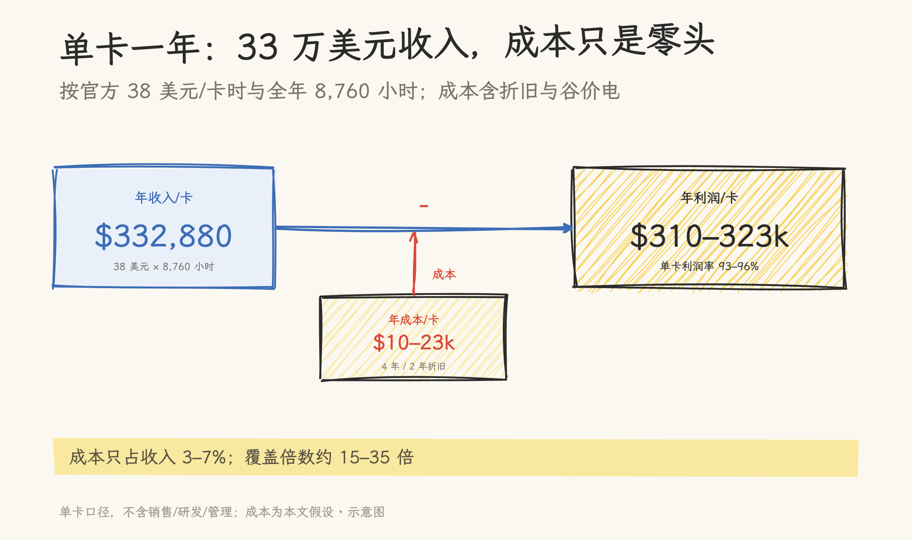
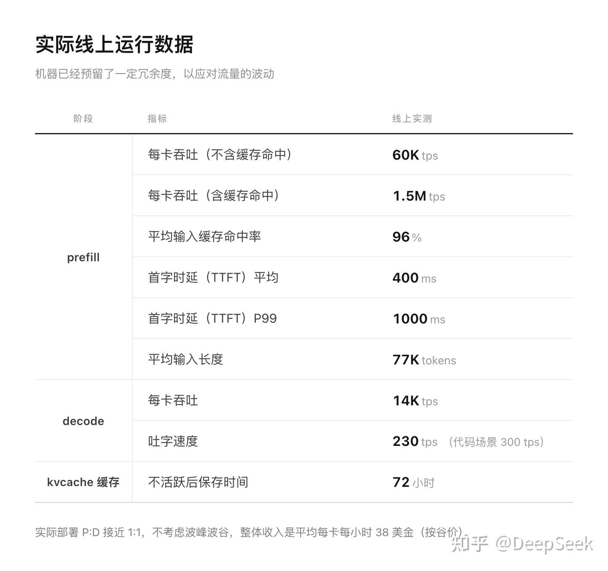
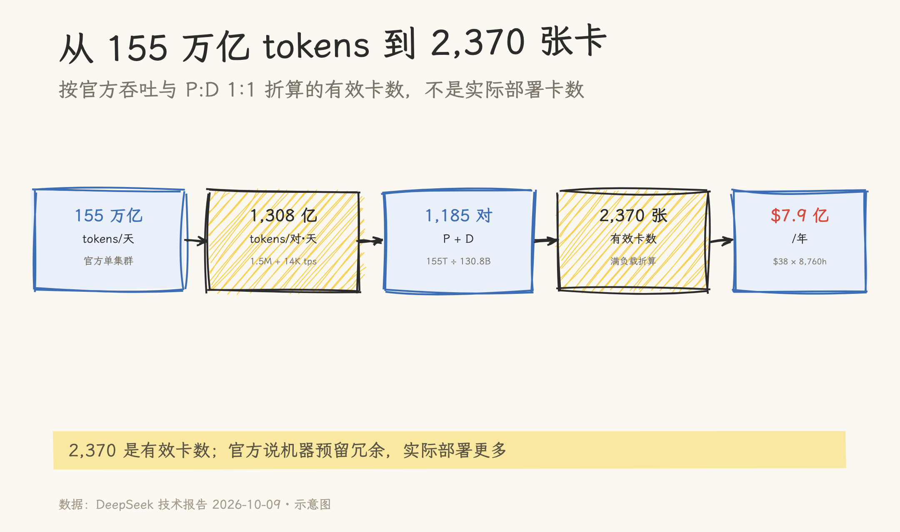
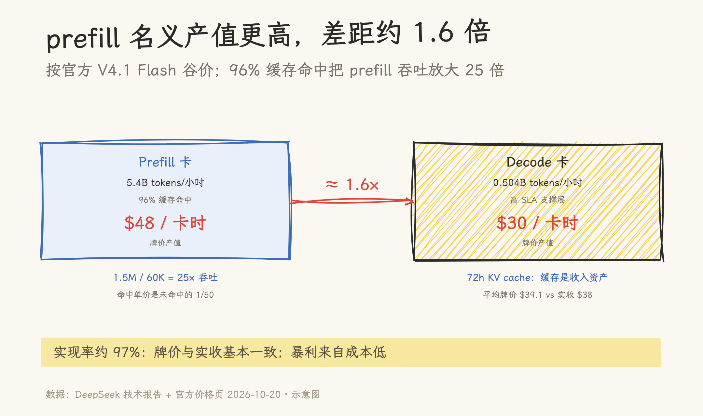

# 155 万亿 tokens/天，单卡运营利润率 93%：token 生意可以做成暴利

> DeepSeek 官方披露的运营数字，加上一组保守成本假设：单卡年收入 33 万美元，成本只占 3–7%。这套账本只属于长上下文、高缓存命中、满载运营的玩家。

按官方数据，一张卡一年收入 33 万美元；按 2 年折旧，单卡运营利润率 93%，按 4 年折旧是 96%。**token 生意可以做成暴利。**

这些数字都有出处：155 万亿 tokens/天、96% 缓存命中、38 美元/卡时都是 DeepSeek 官方披露的生产参数；这篇文章把它们拆成可复算的单卡账本，并标出哪些是官方数据、哪些是成本假设。

前提是 77K 长输入、96% 命中、P:D 1:1、满载运营。DeepSeek 的推理架构会按负载调整 P/D 配比、缓存和调度，换一种负载不能直接套用。



## 一、官方披露的生产参数

DeepSeek 这次给了一张“实际线上运行数据”表。核心参数如下：

| 阶段    | 指标                       | 线上实测                    |
| ------- | -------------------------- | --------------------------- |
| prefill | 每卡吞吐（不含缓存命中）   | 60K tps                     |
| prefill | 每卡吞吐（含缓存命中）     | 1.5M tps                    |
| prefill | 平均输入缓存命中率         | 96%                         |
| prefill | 首字时延（TTFT）平均 / P99 | 400ms / 1000ms              |
| prefill | 平均输入长度               | 77K tokens                  |
| decode  | 每卡吞吐                   | 14K tps                     |
| decode  | 吐字速度（每用户）         | 230 tps（代码场景 300 tps） |
| kvcache | 不活跃后保存时间           | 72 小时                     |
| 部署    | P:D 比例                   | 接近 1:1                    |
| 收入    | 平均每卡每小时             | 38 美元（按谷价）           |



官方对 38 美元的口径是：按谷价、不考虑波峰波谷的平均每卡收入。

38 美元是结果。三个配套数字说明它是怎么来的。

96% 的输入缓存命中率让 prefill 处理的 token 绝大多数直接从缓存读取，不需要重新计算。77K 的平均输入长度对应长上下文、多轮工具调用的 agent 类负载；P:D 接近 1:1，prefill 和 decode 各占一半卡，系统按“长输入、短输出”的负载配比。

官方同时注明了“机器已经预留了一定冗余，以应对流量的波动”。这会影响后面的卡数折算。

另外，14K tps 的 decode 吞吐、230 tps 的单用户吐字速度，可以反推出每张 decode 卡大约服务 50–60 路并发（代码场景约 47 路）。这是一个推导值，不是官方直接给出的指标。

这套服务背后的推理框架是 DeepInfer。DeepSeek 用它支撑 V4.1 Flash 的高吞吐、低延迟推理；2026-10-20，官方公众号宣布将 DeepInfer 开源（Apache 2.0），同步开源 deepseek-recipe 编解码组件（MIT）。

DeepInfer 支持分布式推理、推测解码、SWA Bounded Replay、结构化输出，兼容 NVIDIA 与华为昇腾。生产参数本身来自官方知乎技术报告。

## 二、155 万亿 tokens/天，折合多少张卡

官方文章称，单一集群每天处理 155 万亿 tokens。这个总量和每卡吞吐可以互相校验。

按一对卡（1 张 prefill + 1 张 decode）计算：

- prefill：1.5M tps × 86,400 秒 ≈ 1,296 亿 tokens/天（含缓存命中）
- decode：14K tps × 86,400 秒 ≈ 12.1 亿 tokens/天
- 合计：约 1,308 亿 tokens/对·天

用 155 万亿除以 1,308 亿：

```text
155 × 10^12 ÷ (1.308 × 10^11) ≈ 1,185 对 ≈ 2,370 张卡
```

2,370 是按满负载吞吐折算出的有效卡数，不是实际部署的物理卡数。官方说机器预留了冗余，实际部署只会更多，不会更少。把它当成“这套系统等效需要多少张卡在满负荷工作”更准确。

按每卡每小时 38 美元、全年 8,760 小时粗算：

```text
2,370 张 × $38 × 8,760 h ≈ $7.9 亿/年
```

它按“有效卡数”和官方“平均每卡收入”折算，不是审计过的集群营收；官方说机器预留了冗余，实际部署卡数可能更多，所以这个数字只作规模参考，单卡账本仍以 38 美元/卡时为准。

另一个交叉校验是隐含实收单价：

```text
$76/对·小时 ÷ 5,450M tokens/对·小时 ≈ $0.0139/M tokens
```

这是被缓存命中与谷价折扣稀释后的全口径实收价，不是牌价。



## 三、单卡账本：33 万美元收入，成本多少

收入端按官方口径：

```text
$38/卡时 × 8,760 小时 = $332,880/卡·年
```

成本端需要一组假设。这里用一套偏保守的全栈 capex 估算：整卡、服务器、网络、机房加起来，按 GPU 采购价的 1.5–2 倍计，折合 3–4 万美元/卡；电力按谷价；不考虑销售、研发、管理等公司级费用。折旧分两种口径：

| 折旧口径                       |  年成本/卡 |   单卡年利润 | 单卡利润率 |
| ------------------------------ | ---------: | -----------: | ---------: |
| 4 年直线（正常会计）           | 约 $10–13k | 约 $320–323k |     约 96% |
| 2 年（按更快的迭代节奏）       | 约 $17–23k | 约 $310–316k |     约 93% |

成本折到每卡小时是：

- 4 年折旧：约 $1.1–1.5/卡时，只相当于 38 美元实收的 3–4%；
- 2 年折旧：约 $1.9–2.6/卡时，相当于实收的 5–7%。

无论按哪种折旧，成本都只占实收的个位数百分比；实收约为成本的 15–35 倍。即使收入跌到每小时 3 美元，折旧和电费仍然能覆盖。这个成本比例的分母是实收，不是牌价产值。

把折旧压到 1 年、只算 capex，成本约 $3.4–4.6/卡时，单卡利润率仍约 88–91%；加上电费会略低，结论不变。

93–96% 是单卡层面的运营利润率，只扣了折旧和电费，不含销售、研发、管理等费用，也不是公司净利润。官方给的 38 美元是收入，不是利润。

## 四、杠杆在哪里：prefill 卡与 96% 缓存命中

prefill 卡的名义产值更高，decode 卡更像高 SLA 支撑层；差距约 1.6 倍，不是数量级差异。

按 DeepSeek 官方英文价格页的 USD 谷价（2026-10-20 查询）：`deepseek-flash` / V4.1-Flash-1017 的 cache hit $0.003/M、cache miss $0.15/M、output $0.60/M；高峰时段价格翻倍。官方 38 美元/卡时也按谷价，口径一致。

|                   |                    Prefill 卡 |                 Decode 卡 |
| ----------------- | ----------------------------: | ------------------------: |
| 每小时处理 tokens |       54 亿（96% 为缓存命中） |                  0.504 亿 |
| 牌价产值/卡时     | 5,400M × $0.00888/M ≈ $48 | 50.4M × $0.60/M ≈ $30 |

prefill 卡的每小时牌价产值约为 decode 卡的 1.6 倍。差距来自两件事：

1. 96% 缓存命中把 prefill 的等效吞吐放大了 25 倍（1.5M / 60K）；
2. 命中单价是未命中的 1/50（$0.003 vs $0.15），但 prefill 处理量足够大，名义产值仍然更高。

72 小时 KV cache 的价值主要在吞吐，不在单价：它把缓存读取变成可计价的 token 处理量，降低 prefill 单位成本。命中单价只有未命中的 1/50，产值杠杆没有 25 倍的吞吐放大那么夸张。

$48 和 $30 是牌价产值，不是实际收入。两张卡的平均牌价产值是 $39.1/卡时，官方实收是 $38/卡时，实现率约 97%。差距只有约 3%，更可能来自取整、流量结构和口径，而不是大幅折扣。官方 38 美元与按当前谷价和 96% 命中算出的平均 token 收入基本一致；暴利来自成本低，而不是“高牌价、低实收”的折扣差。



## 五、价格与折旧：两个敏感性变量

这套账本对应 77K 输入、96% 缓存命中、P:D 1:1 的当前负载。DeepSeek 的推理架构会按负载调整 P/D 配比、缓存和调度，其他负载下的单卡数字不能直接套用；这是当前 agent 负载口径下的单卡模型，不是通用推理利润率。敏感性只做两项：牌价和折旧。

先看牌价。收入以 token 牌价计价，成本主要是锁死的折旧和电费。假设用量不变、牌价减半，单卡收入减半，折旧不变；按 2 年折旧口径，利润率会从 93% 降到 86% 左右。牌价继续下行，压力会逐步显现。现实中价格下降可能带来用量增长，结果取决于需求弹性，不能只看单价。

折旧年限是最不敏感的变量。按 1 年折旧、只算 capex，单卡利润率仍有 88–91%；按 4 年折旧则是 96%。只要负载和价格不崩，折旧年限决定赚多少，不决定是否赚钱。

| 变量 | 变化             | 对单卡账本的影响                        |
| ---- | ---------------- | --------------------------------------- |
| 牌价 | 减半（用量不变） | 收入减半，利润率约降到 86%              |
| 折旧 | 4 年 → 1 年      | 成本升到 $3.4–4.6/卡时，利润率仍 88–91% |

## 六、行业影响

推理不是一门同质化生意。同样是卖 token，输入长度、缓存命中率、并发密度不同，运营者会按自己的负载调整架构，单卡产出也会不同。DeepSeek 这组数据描述的是一种把长上下文、缓存和 P:D 配比做到极致的运营形态。

同样的 GPU，在不同运营者手里是不同的资产。高负载、高缓存命中的集群，单卡能产生稳定现金流；低利用率、短上下文的集群，同一张卡可能连折旧都覆盖不了。对 GPU 租赁、融资和资产处置来说，抵押品的价值不只取决于卡的价格，还取决于运营者的负载质量。

价格战能打到多低，由工程效率最高的玩家决定。头部玩家的单卡成本只占实收的个位数百分比，有空间主动降价；效率较低的玩家，降价空间小得多，价格压到头部水平，可能连折旧和电费都覆盖不了。这解释了为什么同样做推理服务，有的厂商能打价格战，有的不能。

据 21 世纪经济报道 2026-08-28 的报道，截至 2026 年 6 月，我国日均词元调用量已突破 500 万亿。155 万亿/天大约相当于这个数字的 31%。两个数字的口径和统计时点都不完全可比（单集群 tokens vs 全国词元调用量；前者 2026-10，后者 2026-06），这里只作规模参照，不作市场份额结论。

DeepSeek 这次同时开源了 DeepInfer（Apache 2.0），这套调度和缓存优化可以被更多团队复用；框架开源降低了复现门槛，但没有消除经营门槛：模型权重、负载质量和运营能力仍然要自己解决。

## 七、口径、假设与限制

- 155 万亿 tokens/天、96% 缓存命中、38 美元/卡时均来自 DeepSeek 官方披露，这篇文章直接采用。
- 38 美元是收入，不是利润。93–96% 是单卡层面的运营利润率，只扣折旧和电费，不含销售、研发、管理等费用，也不是公司净利润。
- 3–4 万美元/卡的全栈 capex、谷价电、4 年/2 年/1 年折旧都是这里的估算；真实 capex、电价、利用率和融资成本会改变结果。
- 牌价按官方英文价格页（2026-10-20）的 USD 谷价：`deepseek-flash` / V4.1-Flash-1017 的 cache hit $0.003/M、miss $0.15/M、output $0.60/M；高峰时段翻倍。若后续调价，$48/$30 和 97% 的实现率要按比例重算。
- 2,370 是有效卡数。官方说机器预留了冗余，实际部署卡数可能更多；集群收入只能作量级参考。
- 500 万亿是媒体口径。该数字来自公开报道，统计时点为 2026 年 6 月；155 万亿是 2026-10 的单集群数字，两者统计时点不同，比较只作规模参照。
- 不构成投资建议。

## 信源

- DeepSeek 官方公众号：《[DeepSeek 开源推理框架：走向真正普惠的未来](https://mp.weixin.qq.com/s/5MEu2eeqNfBWXlkCKTd6sg)》，2026-10-20。
- DeepSeek 官方知乎账号：《[DeepSeek V4.1 Flash 大规模推理部署实践](https://zhuanlan.zhihu.com/p/2095560295930508953)》，2026-10-20。
- DeepInfer（Apache 2.0）：[github.com/deepseek-ai/DeepInfer](https://github.com/deepseek-ai/DeepInfer)；deepseek-recipe（MIT）：[github.com/deepseek-ai/deepseek-recipe](https://github.com/deepseek-ai/deepseek-recipe)。
- 21 世纪经济报道：《[我国日均词元调用量已突破 500 万亿](https://m.21jingji.com/article/20260828/herald/c6fefb8682297807c9c5293dc735bc8a.html)》，2026-08-28。
- DeepSeek 开放平台价格页（2026-10-20 查询；USD 价格取自英文页）：[中文页](https://api-docs.deepseek.com/zh-cn/quick_start/pricing/)｜[英文页](https://api-docs.deepseek.com/quick_start/pricing)。
