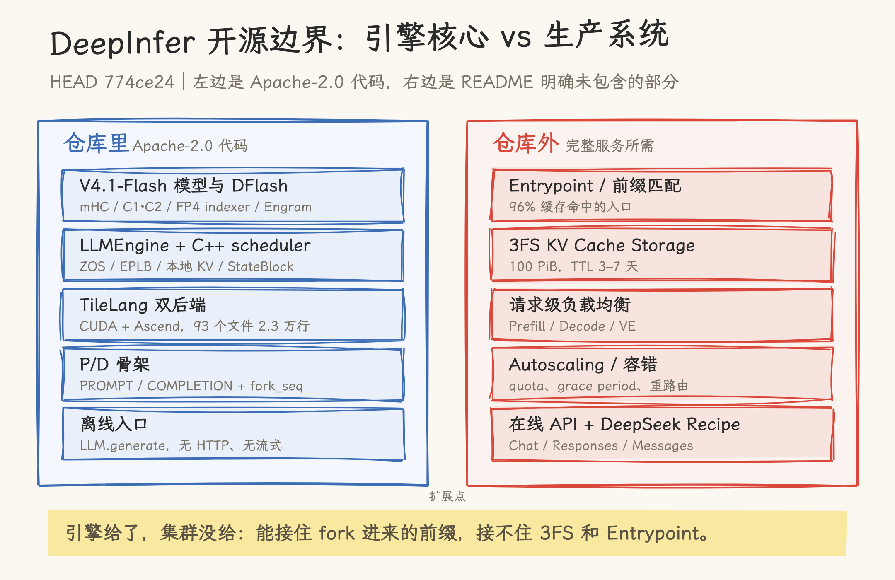
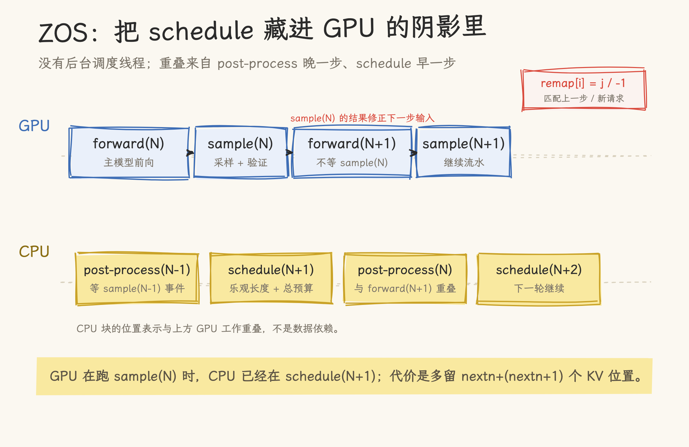
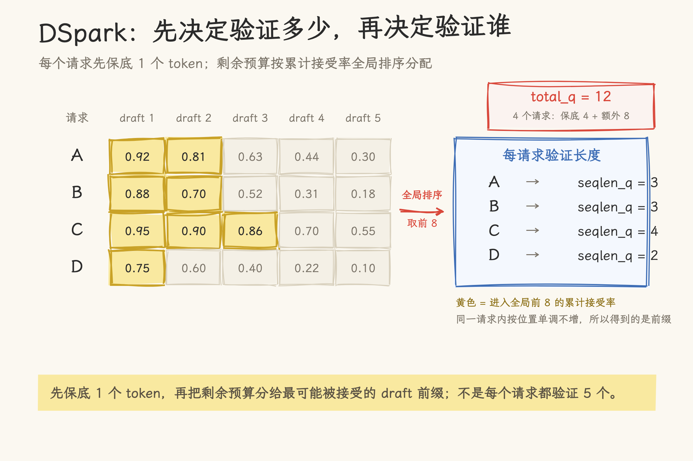

# DeepInfer 源码拆解：155 万亿 tokens/天背后的引擎，开源了哪一半

> 2026-10-20 | 源码深读。基于 [deepseek-ai/DeepInfer](https://github.com/deepseek-ai/DeepInfer) HEAD `774ce24`（2026-10-20）的 README、`doc/inference_deployment_qa.md` 与源码；未在 SM100 / Ascend 950 上实测，性能数字除注明外均为官方口径。以下路径均相对 DeepInfer 仓库根目录。

155 万亿 tokens/天、38 美元/卡时、96% 输入缓存命中。DeepSeek 在 2026-10-20 把 DeepInfer 和这组生产数字一起放了出来。仓库 4 天拿到约 9k stars，但 clone 下来第一眼是一个反差：README 写的是 offline inference，入口是 `LLM.generate`，不是在线服务。

README 第 38–42 行把缺口列得很清楚：KV cache system、VE/Prefill/Decode disaggregation、DP 副本间的请求级负载均衡。边界之内那套引擎更值得读：它怎么把 schedule 藏进 GPU 的阴影里，怎么用 confidence 分配验证预算，怎么只重算末尾 140 个 token。

要回答的问题有三个：DeepInfer 开源了什么，没开源什么，读者能拿走什么。

## 一、开源边界：引擎核心，不是生产系统

官方 Q&A 描述的是完整的 E/P/D 生产架构：Entrypoint、Prefill、Decode、Vision Encoder、3FS KV Cache Storage、四个负载均衡器、autoscaling。这些是生产系统的设计，不是本仓库的功能清单。README 的定位是 "offline inference with the core features needed for serving at scale"（`README.md:3`）。



**图 1**｜左边是仓库里的代码，右边是 README 明确未包含的完整服务组件。

| 层 | 仓库里有 | 仓库里没有 |
| --- | --- | --- |
| 模型 | V4.1-Flash 完整实现；权重在 Hugging Face | 内部更新的 draft model |
| 引擎 | `LLMEngine`、C++ scheduler、ZOS、DSpark、YOCO、EPLB | 在线 Entrypoint、请求级 LB、autoscaling |
| KV cache | 本地 paged block、`StateBlock`、SWA/compressed cache | 3FS KV store、前缀匹配、GDR swap-in |
| P/D | `PROMPT`/`COMPLETION` 引擎模式、state 序列化 helper | 跨机 KV 传输、编排、端到端 P/D |
| API | 离线 `LLM.generate` | HTTP/streaming、OpenAI 协议（Recipe 是独立仓库） |

最容易误会的是 P/D。代码里确实有 `EngineType.PROMPT` / `COMPLETION`，C++ scheduler 在 PROMPT 下只做 prefill、在 COMPLETION 下只做 decode（`csrc/engine/scheduler.hpp:288-295`）；`fork_seq` 还能接收外部 block 列表（`csrc/engine/scheduler.hpp:1061-1122`）；`cache_engine.py:766-848` 有 `TO_CE` 的 state 截取和装载，专门为 prefill→completion 搬运准备。

但 base `LLMEngine` 的 `init_pd_split`、`do_save_kvcache`、`pe_prepare_save_kvcache`、`pe_do_save_kvcache`、`send_processed_prompts` 全是空实现（`deepinfer/engine/llm_engine.py:800-858`），仓库里没有覆盖这些虚函数的子类，也没有 KV 传输层。这是“接得住”，不是“跑得通”。

前缀缓存同理。`BlockManager` 只有带引用计数的 GPU block 空闲链表（`csrc/engine/block_manager.hpp:27-187`），没有 hash、radix tree 或 LRU。`prefix_caching_hit` 这个名字容易误解：它在首次 prefill 且 `block_table` 为空、或 fork 序列的 `branch_id` 以 `_` 开头时置真，唯一用途是跳过 `lookahead_tokens` 断言（`csrc/engine/scheduler.hpp:373-451`），不参与缓存查找。

代码能接住一个已经算好的前缀（`fork_seq` + block table），但不会自己去 3FS 里找这个前缀。生产里的 96% 命中率是 Entrypoint 的前缀匹配加 3FS 读取的结果，这部分不在仓库里。


**图 2**｜官方 Q&A 的参考架构：Entrypoint、三个 LB、E/P/D 服务与 3FS KV Cache Storage。图片来自 DeepInfer 仓库 `doc/images/architecture_overview.png`，Apache-2.0。

图中 Entrypoint、三个 LB、E/P/D 与 3FS 都是生产系统组件。DeepInfer 仓库对应的是每个服务内部的引擎，不是这些服务之间的编排。

## 二、代码地图：vLLM 的壳，DeepSeek 的调度与算子

仓库 348 个文件；核心代码约 5.3 万行 Python/C++/TileLang（不含示例与测试）。其中 `tilelang_ops/` 93 个文件 2.33 万行，占全部代码约 44%。6 个 vendor 子模块默认不拉，clone 下来是空目录，`build.sh` 才会 `git submodule update --init`。

骨架来自 vLLM。23 个文件头标着 `Derived from vLLM; modified by DeepSeek`，包括 `llm_engine.py`、`worker.py`、`model_runner.py`、`cache_engine.py`、`sampling_params.py`。`LLM` / `LLMEngine` / `add_request` / `step` 这些名字和调用顺序都能在 vLLM 里找到对应。

关键运行时是重写的。C++ scheduler 负责每步调度、DP 投票、prefill/decode 决策、block 管理和 sequence 记账（`csrc/engine/scheduler.hpp`）；Python 只做驱动和模型执行。并行维度只有 DP/CP/EP/Engram，没有 TP/PP（`deepinfer/config.py:151-173`）。

模型侧是 V4.1 专用：mHC 多路残差、C1/C2 压缩 KV、FP4 indexer、Engram、DFlash；HF 配置锁死 `model_type == "deepseek_v41"` 和 FP8/FP4 量化格式（`deepinfer/hugging_face/config.py:241-262`）。把它当通用推理框架会失望：它只认 V4.1-Flash 一个架构，NVIDIA 只认 SM100，Ascend 文档限定 950。

这也解释了代码的形状。通用框架要处理 TP/PP、任意 HF 架构、OpenAI 协议、多模型注册，DeepInfer 把这些全部砍掉，换来的是调度器可以假设固定层数、固定 KV 布局、固定 P:D 比例。它的优化建立在专用性上，代价是只能跑 V4.1。

## 三、ZOS：把 schedule 藏进 GPU 的阴影里

DeepInfer 没有后台调度线程，也没有 C++ 异步调度队列。`Scheduler::schedule` 仍由 Python 主线程同步调用、同步返回（`csrc/engine/scheduler.hpp:275-277`），`_schedule` 只是释放 GIL 并持有 BlockManager 锁。

官方叫 asynchronous scheduling，代码里叫 ZOS（zero-overhead scheduling），做法是把一步拆成三段，让 post-process 晚一步：

```text
1. forward(N)          发射到 GPU
2. post-process(N-1)   等上一步 sample 完成，CPU 处理
3. sample(N)           发射到 GPU
4. post-process(N)     ZOS decode 时留到下一步
```

`deepinfer/worker/worker.py:96-187` 的 docstring 写得很直接：prompt 步和非 ZOS 步当场 post-process，ZOS decode 把当前步存进 `prev_step_state`，下一步再处理。GPU 在跑 `forward(N)` 时，CPU 在处理 `post-process(N-1)`；GPU 在跑 `sample(N)` 时，CPU 可以 `schedule(N+1)`。



**图 3**｜GPU 跑 `sample(N)` 时，CPU 已经在 `schedule(N+1)`；CPU 块的位置表示与上方 GPU 工作重叠，不是数据依赖。

因为 `schedule(N+1)` 发生在 `post-process(N)` 之前，CPU 看到的 `seq.cache` 是旧状态，长度只能先乐观估计。GPU 侧用 `remap` 把当前 batch 映射到上一步：`remap[i] = j` 表示当前第 i 个序列对应上一步第 j 个序列，`-1` 表示新序列（`csrc/engine/zos.cpp:142-195`）。匹配上的行直接取上一步 GPU 输出，新行才用 CPU 准备好的 token。

开启 MTP varlen 后，`compute_seqlens_q_by_confidence_rates` 还会用上一轮 confidence 在 GPU 上重算每个请求验证多少 draft（`deepinfer/worker/worker.py:191-245`）。CPU 只固定总预算，GPU 负责最终的行映射，这就是 Q&A 里“GPU 重算每请求长度”的实现。

代价写在 `deepinfer/config.py:13-16`：ZOS 要额外预留 `nextn + (nextn + 1)` 个 KV 位置。nextn=5 时是 11 个位置，再算上 draft 的 5 个，`runtime_max_model_len` 比 `max_model_len` 多 16。ZOS 用这些额外的 KV 位置换重叠时间。

另一个代价是复杂度。`execute_model_step` 要维护 `prev_step_state`、`sample_end_evt`、`remap_cpu`、`seqlens_q_cpu` 一堆跨步状态，任何一处时序错都会变成数值错。`tests/test_cuda_sync_guards.py` 测的是 `forbid_cuda_sync` 的作用域，确保 launch 阶段不会误入同步。

这条流水线只在连续 decode step 之间成立。prompt step 会当场 post-process 并清空 `prev_step_state`（`deepinfer/worker/worker.py:182-187`），流水线在每次 prefill 处排空。生产里 P/D 是分开的引擎，decode 引擎可以一直跑这条流水线；离线 NORMAL 引擎在 prefill 和 decode 之间切换时，会反复排空。

## 四、DSpark：先决定验证多少，再决定验证谁

DFlash 每步为每个请求生成 `DEEPINFER_USE_NEXTN_DECODE` 个 draft，默认 5 个（`deepinfer/environ.py:129`）。draft 不是简单地从 target logits 里取 top-k：每个位置先过 Markov 调整，再由 confidence head 打分，最后用 `process_sampling(..., tag="mtp")` 采样（`deepinfer/model_executor/models/mtp/dflash.py:309-334`）。

confidence head 是一个单层线性投影，输入是当前 draft 位置的 pre-norm hidden，拼接 Markov embedding，输出经温度缩放、截断到 ±60、再 sigmoid 成接受率（`deepinfer/model_executor/models/mtp/dflash.py:46-79`；kernel 在 `tilelang_ops/cuda/dflash.py:67-70`）。权重从 checkpoint 的 `confidence_head.proj.weight` 读取（`dflash.py:181-186`），仓库里没有训练或校准代码。

验证布局是“1 个 golden 行 + 最多 nextn 个 draft 行”，最后一行是 fresh sample；拒绝采样后输出接受前缀加一个最终 token（`deepinfer/model_executor/layers/sampler.py:55-88`，`tilelang_ops/sampler.py:411-430`）。

调度分两层。

第一层，CPU 决定总预算。`MTPVarlen::schedule` 用 N-2 轮的累计接受率和一条启动时 profile 出来的 decode 性能曲线，按 `cur_expected / time_ms` 贪心选择总验证行数 `best_bsz`（`csrc/engine/mtp_varlen.hpp:228-267`）。

第二层，再决定每个请求分多少。非 ZOS 下 CPU 用 N-1 轮接受率把 `best_bsz - num_seqs` 个额外行分给排名靠前的请求；ZOS 下 CPU 只固定总预算，GPU 用 `cumprod + 全局稳定排序 + win count` 重算每个请求的 `seqlen_q`（`deepinfer/model_executor/layers/tilelang_ops/schedule_mtp_varlen.py:35-100`）。



**图 4**｜每个请求先保底 1 个 token，剩余预算按累计接受率全局排序；同一请求内按位置单调不增，所以得到的是前缀。

每个请求先保底 1 个 golden token，剩余预算按累计接受率全局排序分配。这也是为什么变长验证不需要一个复杂的 per-request 搜索：全局排序天然给出前缀。

官方数据：动态验证把每步验证的 draft 数从 5.00 降到 3.2–4.4，平均接受长度基本不变（3.29 vs 3.20），60 并发下吞吐 +4–7%。但 16 并发时是 -1.5%（`doc/inference_deployment_qa.md:244-260`）。这不是普遍加速，只在高并发生产点划算。

默认也不开启：需要 `DEEPINFER_ENABLE_MTP_VARLEN=1`，启动时先 profile 性能曲线；没有曲线时回退为验证全部 draft（`csrc/engine/mtp_varlen.hpp:153-158`）。这条优化把“投机解码快不快”从模型问题变成了调度问题：draft 质量决定上限，预算分配决定实际拿到多少。

## 五、YOCO/SWA：只算末尾 140 个 token

V4.1 的层不是同一种注意力。`compress_ratios` 为 0 的层是纯 SWA；从第一个 `compress_ratio == 1` 的层开始，是 YOCO consumer 层（`deepinfer/model_executor/models/v4_modules/yoco.py:19-21`）。`n_prefill_layer` 就是这个边界，它之前的层做完整 prefill，之后的 consumer 层在 prefill 时只算末尾一段。

`compact` 模式只保留每序列末尾 `KEEP_TOKENS` 个 query 行，README 的 V4.1 默认是 140；`mask` 模式保留全部 query，只收窄 SWA 可见域，不省计算（`deepinfer/environ.py:187-194`）。`KEEP_TOKENS` 必须至少覆盖 `window_size + DEEPINFER_MAX_BACKTRACKING_TOKENS`（`deepinfer/worker/model_runner.py:104-113`）。

被截断的是 consumer 层的 query 行，不是主 KV。主压缩 KV 和 index KV 仍由 full hidden 写成全长；只有 SWA cache 只保留末尾 suffix（`v4_modules/attn.py:672-721`）。

官方 Q&A 说的 128-token bounded replay，是 SWA 缓存缺失时只重算最近 128 个 token，让重算成本与上下文长度无关（`doc/inference_deployment_qa.md:183-187`）。两者相关，但不是同一件事：一个是 prefill 时少算 query，一个是缓存缺失时重建 SWA。

SWA state 的存储也很省：20 层 × 134 token × 528 B ≈ 1.4 MB/序列，按 128 token 粒度落盘，ring buffer 多留 6 个位置吸收越界（Q&A 的 KV cache storage 一节）。这项优化是 prefill 计算量接近减半的来源之一，但它依赖 V4.1 的 CED/YOCO 结构，不是能直接搬到其他模型的通用技巧。

对 77K 平均输入、96% 缓存命中的生产负载，这个优化的意义很直接：命中前缀的 block KV 可以直接复用，SWA 只补末尾一小段；如果没有 bounded replay，每次命中都要把 decoder 层重算一大段，缓存命中省下的 prefill 会被吃掉。

代码里还有一个容易忽略的细节：`mask` 模式只改 SWA 可见域，query 数不变，所以它适合做数值等价验证；`compact` 才真正减少 consumer 层 query。`examples/yoco/README.md` 的 `yoco_equiv.py` 就是在两种模式之间做逐元素 logprob/top-K 对比。

## 六、Wide-EP：峰值只高 6%，高交互区翻倍

生产配置是 prefill EP2–8、decode EP64–128，没有 TP/PP（`doc/inference_deployment_qa.md:47-49`）。代码里也确实没有 `tensor_parallel_size` 或 `pipeline_parallel_size`，只有 DP/CP/EP/Engram 四个维度（`deepinfer/config.py:151-173`）。

README 写的 “Attention DP / balanced CP”，在代码里没有同名符号：注意力按 DP 副本复制、每 rank 算全部 query head；CP 是 prefill 专用的 zigzag/mirror 切分，每条序列切 `2*cp_size` 块，rank 取 `(rank, 2*cp-1-rank)` 两端（`tilelang_ops/prepare_cp_mirror.py:133-156`）。

官方 EP64 vs EP8 的 decode 曲线，峰值吞吐只高约 6%，但在 250–300 tok/s/user 的高交互区，EP64 的吞吐约为 EP8 的 2 倍。生产平均 230 tps/user，正好落在 EP8 开始塌陷、EP64 还在高位的区间。Wide-EP 的收益主要不在峰值，而在高交互区。


**图 5**｜官方 EP64DP64 与 EP8DP8 的 decode 曲线；两组冗余专家数不同（384+64 vs 384+32），不是严格的单变量对比。图片来自 DeepInfer 仓库 `doc/images/wide_ep_decode_pareto.png`，Apache-2.0。

官方那张图两组配置的冗余专家数不同，它反映的是生产策略下的量级，不是“只改 EP 宽度”的干净实验。即便如此，曲线形状仍然说明问题：EP8 在 250–300 tok/s/user 区间迅速塌陷，EP64 还能维持约 1 万 tok/s/GPU 以上。

EPLB 按峰值负载做贪心放置。`rebalance_experts_global` 先给热点 logical expert 增加冗余副本，目标是让各历史 step 的最大每副本负载之和尽量小；`_batch_greedy_indices` 再把所有 physical expert 贪心装到各 rank，目标是最小化逐 step 峰值负载之和（`deepinfer/model_executor/eplb/policy.py:73-140`）。权重 shuffle 在 NVL domain 内走 symm_mem/IPC，跨节点走 NCCL P2P。

这套 EPLB 是 EP 内的 expert 放置，不是请求级 LB。README 第 42 行说的 prefill/decode DP 负载均衡，以及 Q&A 第 33 行提到的 Prefill/Decode/VE/EP 四个 LB，都不在这个仓库里。

## 七、可复现性：batch invariant 的代价

`DEEPINFER_BATCH_INVARIANT=1` 时，FlashMLA 打开 `enable_batch_invariant`，DeepGEMM 和 TileKernels 切到确定性算法，dense packed-KV 的融合 norm/rope/cast 被关闭，DeepEP 只允许单 reduction（`deepinfer/worker/runtime_config.py:61-69`、`v4_modules/attn.py:87-92`、`parallel_utils/userbuffer.py:79`）。NPU 上直接 assert 不支持（`runtime_config.py:61-63`）。

这项机制的动因是数值一致性：GPU 的归约顺序会随 batch 组成变化，同一段 prompt 在不同 batch 里可能得到最后几位不同的 logits。对普通聊天无所谓，对 RL 训练、评测复现、agent 轨迹回放就是问题。

测试方法很硬：64 条序列一起跑一遍，再用 `golden_token_ids` 把每条序列单独跑一遍，要求 token ids、logprobs、top token ids、top logprobs 完全相等（`tests/models/test_batch_invariant.py:99-105`）。肉眼看起来一样不算，测试要求逐位一致。

确定性采样还要多两个条件：关闭 varlen，固定 `seq_seed`。因为 varlen 的验证深度取决于该请求的接受率在全局排序中的位置，同一 batch 里其他请求会改变它的验证长度，进而改变随机流。README 的 `DEEPINFER_BATCH_INVARIANT=1 DEEPINFER_ENABLE_MTP_VARLEN=0` + 固定 seed 就是这个原因（`README.md:28`）。

同一套引擎还支持结构化输出：`so_args` 传 JSON schema、regex 或 EBNF，xgrammar 编译成自动机，采样前把非法 token 的 logits 置为 `-inf`（`deepinfer/structure_output/compiler.py:54-71`，`deepinfer/model_executor/layers/sampler.py:433-437`）。编译在进程内 `ThreadPoolExecutor` 异步做，请求拿到 matcher 后才入调度（`structure_output/so_matcher_builder.py:97-121`）。Q&A 说生产用“dedicated SO machine”，这个仓库里只有进程内线程池，没有专用编译服务。

这些机制都有代价：batch invariant 关掉融合 kernel、NPU 不支持、varlen 与确定性互斥。DeepInfer 的选择是先把可复现性做出来，再让需要性能的人显式打开 varlen。

## 八、结论：能拿走的是方法，拿不走的是集群

DeepInfer 的核心是几套“按负载重排计算”的机制，kernel 只是其中一层。ZOS 把 schedule 藏进 GPU 的阴影里，DSpark 把验证预算分给最可能被接受的前缀，YOCO/SWA 把 consumer 层的 prefill 截到末尾 140 个 token。三套机制都建立在同一个负载上：77K 长输入、96% 前缀命中、P:D 1:1、EP64 解码。换一种负载，参数和收益都要重算。

开源边界与 README 写的一致。模型、引擎、算子、本地 KV、P/D 骨架在；Entrypoint、3FS KV store、请求级 LB、autoscaling、在线 API 不在。代码能接住一个 fork 进来的前缀，但不会自己去 3FS 里找前缀；能表达 P/D 两种引擎模式，但没有跨机 KV 传输。96% 的缓存命中率和 155 万亿 tokens/天，是系统能力，不是单机引擎能力。

发布节奏是早期的：v0.1.0、3 条 commit、0 release/tag、issues 关闭、58 个 open PR/0 merged（截至 2026-10-20）；e2e 要 4–16 张 SM100/Ascend 950 和约 475 GiB 权重。代码风格是生产级的，公共维护是代码 drop 式的。它适合研究 DeepSeek 怎么把 V4.1 跑起来，不适合直接替代 vLLM/SGLang 做通用在线服务。

README 第 38 行列了三项缺失：KV cache system、VE/Prefill/Decode disaggregation、DP 负载均衡。这三项恰好是 155 万亿 tokens/天里最难复制的部分。DeepInfer 开源了引擎，没开源那套让这个数字成立的系统。

## 源文件索引

以下路径均相对 DeepInfer 仓库根目录。

| 文件 | 关键内容 | 引用点 |
| --- | --- | --- |
| `README.md` | 发布定位、支持特性、缺失组件、确定性采样条件 | 3, 38–42, 28 |
| `doc/inference_deployment_qa.md` | 生产架构、EP 配置、SWA、DSpark、ZOS、SO | 17–21, 47–49, 183–187, 244–274 |
| `deepinfer/entrypoints/llm.py` | 离线 `LLM.generate`、请求入队、结果回收 | 23, 90–195 |
| `deepinfer/engine/llm_engine.py` | 引擎初始化、`add_request`、`step`、PD 虚函数 | 200–275, 471–631, 800–858 |
| `deepinfer/worker/worker.py` | `execute_model_step`、ZOS 延迟 post-process、长度修正 | 96–245 |
| `deepinfer/worker/cache_engine.py` | 本地 KV/state 布局、`TO_CE` 截取与装载 | 205–306, 708–849 |
| `deepinfer/config.py` | ZOS 额外 KV 开销、并行维度 | 13–16, 151–183 |
| `csrc/engine/scheduler.hpp` | C++ 调度、P/D 模式、fork、prefix 分支 | 275–345, 373–451, 1061–1122 |
| `csrc/engine/zos.cpp` | ZOS remap 与 metadata 修正 | 142–305 |
| `csrc/engine/mtp_varlen.hpp` | MTP 变长验证预算与性能曲线 | 133–267 |
| `deepinfer/model_executor/models/mtp/dflash.py` | confidence head、draft 采样 | 46–79, 279–345 |
| `deepinfer/model_executor/layers/tilelang_ops/schedule_mtp_varlen.py` | GPU 侧全局预算分配 | 11–100 |
| `deepinfer/model_executor/models/v4_modules/yoco.py` | YOCO consumer 边界 | 19–21 |
| `deepinfer/model_executor/models/v4_modules/attn.py` | 全量 KV 写入、SWA 可见域 | 672–721 |
| `deepinfer/model_executor/eplb/policy.py` | EPLB 副本放置与 rank 装箱 | 73–140 |
| `deepinfer/worker/runtime_config.py` | batch invariant 的 kernel 配置 | 61–69 |
| `tests/models/test_batch_invariant.py` | 逐位一致性测试 | 99–105 |

## 参考资料

- [DeepInfer 仓库](https://github.com/deepseek-ai/DeepInfer)，Apache-2.0，HEAD `774ce24`。
- [DeepSeek V4.1 Flash Inference Deployment Q&A](https://github.com/deepseek-ai/DeepInfer/blob/main/doc/inference_deployment_qa.md)，2026-10-20。
- 深度求索公众号：《[DeepSeek 开源推理框架：走向真正普惠的未来](https://mp.weixin.qq.com/s/5MEu2eeqNfBWXlkCKTd6sg)》，2026-10-20。
- [DeepSeek-V4.1-Flash-1017](https://huggingface.co/deepseek-ai/DeepSeek-V4.1-Flash-1017)，模型权重。
- [deepseek-recipe](https://github.com/deepseek-ai/deepseek-recipe)，MIT，API 协议与 token 编解码组件。
- [vLLM](https://github.com/vllm-project/vllm)、[SGLang](https://github.com/sgl-project/sglang)，对照框架。
- 本站：[DeepSeek-V4 端到端推理 Pipeline 走读](../vllm/module_analysis/deepseek_v4_inference_pipeline.md)、[Engram：条件记忆与主机内存参数](../engram/01-engram-deep-dive.md)、[vLLM WideEP 架构](../vllm/hardware_optimization/deepseek_blackwell_wide_ep.md)。
- 本站：[DeepSeek 推理集群单卡经济学](../cost_analysis/deepseek_inference_cluster_unit_economics.md)，这篇算的是账本，本篇拆的是引擎。
