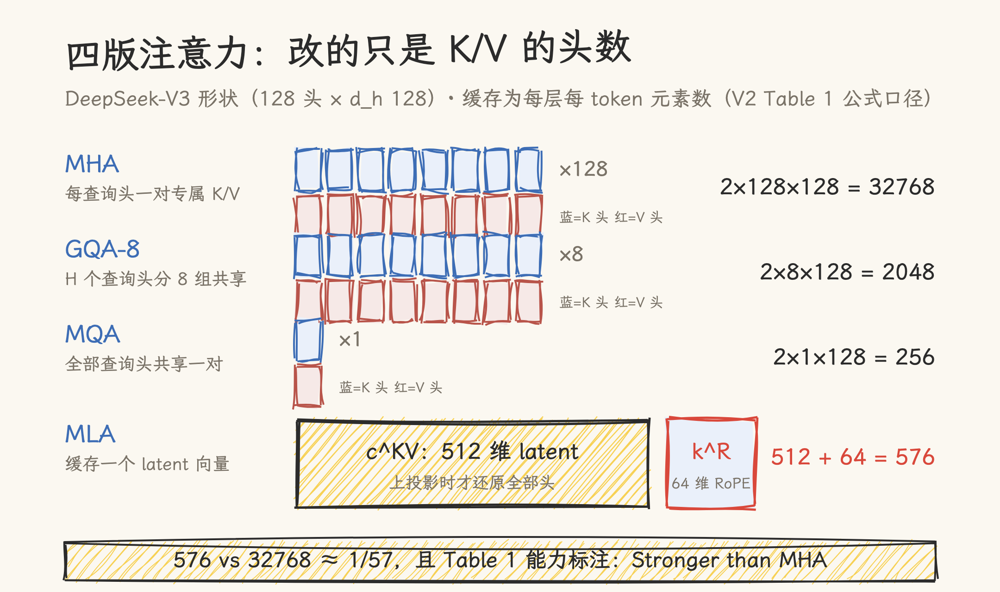
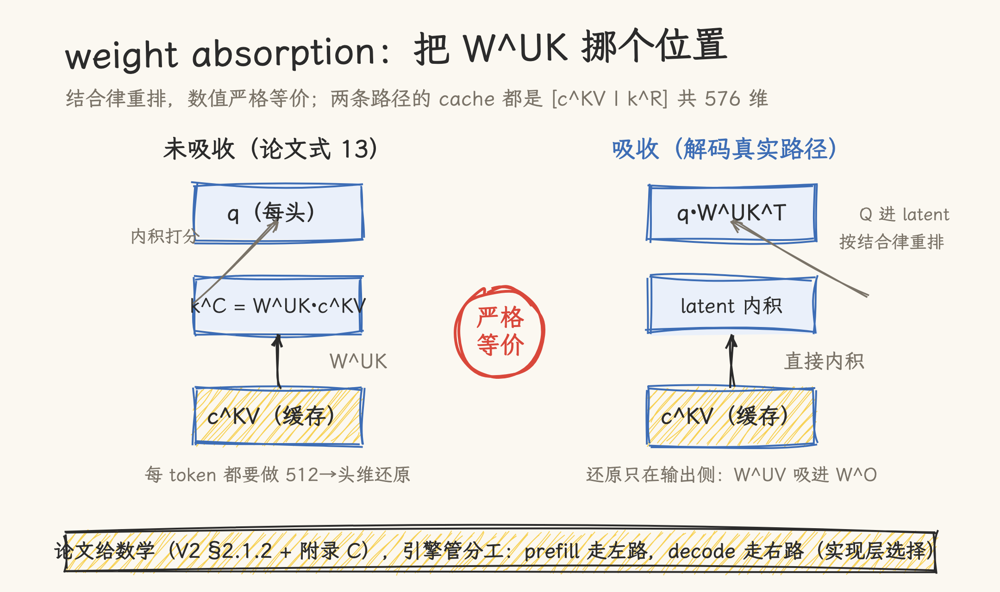
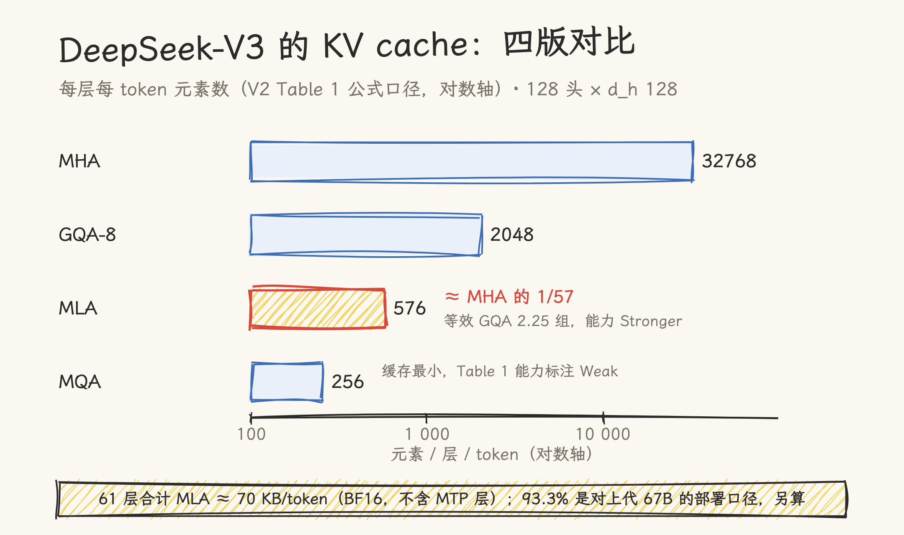

# 手搓 MLA：从 MHA 到 weight absorption，看懂 DeepSeek 的 KV 压缩

> 核对基准：DeepSeek-V2（[arXiv 2405.04434](https://arxiv.org/abs/2405.04434)，v3）、DeepSeek-V3（[arXiv 2412.19437](https://arxiv.org/abs/2412.19437)）、GQA（[arXiv 2305.13245](https://arxiv.org/abs/2305.13245)）、MQA（[arXiv 1911.02150](https://arxiv.org/abs/1911.02150)）、HuggingFace 公开 config（DeepSeek-V3 / GLM-4.7-Flash）、本地 vLLM（commit `8b365ff9`）与 SGLang 快照，核对日期 2026-11-09。真机验证在公开模型权重上完成，过程见 §四。论文记号与工程命名有两套体系（d_c ↔ kv_lora_rank、d_h^R ↔ qk_rope_head_dim），文中桥接标注。

## 一、decode 的账本上，KV 形状是主线

2024 年初，DeepSeek 67B 还是自家最强的开源模型：GQA-8、95 层，每 token 的 KV cache 约 380 KB。想开一条 128K 长上下文的服务，光一条请求的 KV 就是 380 KB × 131072 ≈ 47 GB，并发数被这一项死死限住。DeepSeek-V2 摘要里「KV cache 减少 93.3%」这个数字，对比的就是这个模型；把 KV 压下来的机制叫 Multi-head Latent Attention（MLA），也就是本文的主角。

这也是手搓系列的第五步。前四篇走过了 [Tokenizer](../../../../06_llm_theory_and_fundamentals/llm_basic_concepts/token/hand_roll_bpe_tokenizer.md)、[RoPE](../../../../06_llm_theory_and_fundamentals/llm_basic_concepts/positional_encoding/hand_roll_rope.md)、[Attention](../../../../02_gpu_programming/02_cuda/21_write_attention_from_scratch.md) 和 [KV Cache 分页](03_hand_roll_kv_cache.md)，这一篇处理第五个问题：KV cache 本身能不能压小。

decode 阶段每生成一个 token，都要把全部历史 token 的 K/V 读一遍，这是 memory-bound 的经典场景（本仓《[CUDA 性能调优方法论](../../../../02_gpu_programming/02_cuda/17_roofline_optimization.md)》的天花板分析从这里入手）。能读多少历史、跑多大 batch，取决于 KV cache 装不装得下；每秒能 decode 多少 token，取决于这些字节搬得多快。注意力这几年的演进，相当一部分是在给 KV cache 瘦身。

DeepSeek-V2 论文 §2.1 给出了一张对照表（Table 1），把四种注意力的每 token KV 缓存排在一起：MHA 是 2n_h·d_h，MQA 是 2d_h，GQA 是 2n_g·d_h，MLA 是 (d_c + d_h^R)。这张表是本文的地图：§二手搓前三版的实现，§三拆 MLA 的压缩结构，§四啃它最绕的一步 weight absorption，§五按 DeepSeek-V3 的公开 config 把这张表算成具体字节。

## 二、MHA、MQA、GQA：改的只是 K/V 的头数

四版注意力的差别，一句话说完：查询头永远 H 个，K/V 用几个头。MHA 每个查询头配一对专属 K/V 头；MQA 全部查询头共享一对（Shazeer 2019 提出，论文标题就叫 One Write-Head is All You Need）；GQA 介于两者之间，H 个查询头分成 G 组共享 G 对（[arXiv 2305.13245](https://arxiv.org/abs/2305.13245)）。手搓实现只需要在标准 attention 外面套一层 reshape：

```python
def mha(x, Wq, Wk, Wv, Wo, H, dk, dv, pos):
    q = (x @ Wq.T).reshape(T, H, dk); k = ...; v = ...   # K/V 各 H 头
    return attention(rope(q), rope(k), v).reshape(T, H * dv) @ Wo.T

def mqa_gqa(x, Wq, Wk, Wv, Wo, H, G, dk, dv, pos):
    k = (x @ Wk.T).reshape(T, G, dk)                     # K/V 只造 G 个头
    k = np.repeat(k, H // G, axis=1)                     # 广播给 H 个查询头
    ...                                                  # 其余与 MHA 相同
```

完整代码见配套脚本 `07_hand_roll_mla.py`（[本目录](07_hand_roll_mla.py)）。缓存大小随之确定：MHA 每层每 token 存 2·H·d_h 个元素（K、V 各一份，统一按每头 d_h 维计，这是 V2 论文 Table 1 的口径），MQA 存 2·d_h，GQA 存 2·n_g·d_h。GQA-1 就是 MQA，GQA-H 退化回 MHA。

GQA 论文另给了一个工程衔接：把训好的 MHA 检查点转成 GQA 时，对组内所有 K/V 头做 mean-pooling，再用 5% 的预训练步数 uptrain 即可，论文的实验平台是 T5.1.1，8 组被称为 a favorable middle ground。（常见说法「Llama-2-70B 用 GQA-8」出自 Llama 2 论文，时间在 GQA 论文之后，别混为同一出处。）

三版的取舍也在这张表里：MQA 缓存最小但能力标注为 Weak，GQA 随组数增加逐步找回质量。MLA 在这张表里是最特殊的一行：它的缓存写成 (d_c + d_h^R)，与头数无关，且论文标注能力为 Stronger than MHA，而缓存只有 GQA 两组多的水平。下一节拆它怎么做到。



## 三、MLA：把 K/V 压进一个 latent 向量

MLA 的核心动作：不再让每个头各自生成 K/V，而是把整层的 K/V 联合压缩成一个低秩 latent 向量，注意力计算时再从 latent 还原。用论文记号（V2 §2.1.2 式 9–11）：

```text
c^KV_t = W^DKV · h_t        # 下投影：hidden → d_c，每 token 只缓存它
k^C_t  = W^UK  · c^KV_t     # 上投影：还原每头 K（不含 RoPE 部分）
v^C_t  = W^UV  · c^KV_t     # 上投影：还原每头 V
```

c^KV 对应 HF config 里的 `kv_lora_rank`（论文记号 d_c），对 DeepSeek-V3 是 512。缓存随之从「每头一对 K/V」变成「每 token 一个向量」。

**RoPE 必须解耦出来。** 直接对 c^KV 上投影后的 k^C 做 RoPE 会坏掉吸收性质，V2 论文 §2.1.3 把原因讲得很直白：RoPE 对 key 和 query 都是位置敏感的，若对 k^C 施加 RoPE，W^UK 就与一个随位置变化的 RoPE 矩阵耦合，推理时 W^UK 无法再吸收进 W^Q，那意味着每生成一个 token 都要为全部前缀重算 key，缓存压缩就白做了。

所以 MLA 把位置信息拆出来单独走：额外一组多头查询 q^R 和一个全头共享的键 k^R（维度 d_h^R，即 config 的 `qk_rope_head_dim` = 64）承担 RoPE，缓存里也要存这个 k^R。每 token 每层的缓存就是 c^KV + k^R = 512 + 64 = 576 个元素，即 1152 B（BF16）。

Q 侧也做了低秩压缩（先压到 q_lora_rank 再升维），但注意论文给出的动机：这是为了降低训练时的激活显存，对 KV cache 没有影响（V2 §2.1.2），别把这笔收益算到缓存头上。

手搓实现（`mla_unabsorbed`，即论文式 13 的逐字翻译）：

```python
c_kv = rmsnorm(x @ W_DKV.T, W_KVN)              # 缓存开始：[T, 512]
k_pe = rope(x @ W_KR.T)                          # 共享键的 RoPE 部分 [T, 64]
kv_up = c_kv @ W_UKV.T                           # 还原，计算时才发生
k_nope, v = split(kv_up)                         # 每头 K（无 RoPE）与 V
k = concat(k_nope, broadcast(k_pe)); q = concat(q_nope, rope(q_pe))
out = attention(q, k, v) @ Wo.T
```

到这里功能就对了，但推理时还不会这么算：每个 token 都要做一次从 512 维到头维的上投影，压缩省下的带宽在计算时又还了回去。推理真正走的是下一节的吸收变换。

## 四、weight absorption：把 W^UK 吸进 Q 里

未吸收路径里，注意力的打分是 `q_nope · (W^UK c^KV)`。矩阵乘法满足结合律，把这个乘积重排成 `(W^UK^T q_nope) · c^KV`，数值完全等价：上投影从 K 侧消失，Q 侧先乘一个固定矩阵投影进 512 维 latent 空间，然后直接对缓存的 c^KV 做内积。V2 论文正文 §2.1.2 与附录 C 各写了一遍：「由于 W^UK 可吸收进 W^Q（附录口径为 W^UQ），W^UV 可吸收进 W^O，我们甚至不需要为注意力还原 keys 和 values」，依据是结合律，是精确等价，没有近似。

手搓两路径对照（`mla_absorbed` vs `mla_unabsorbed`）：

```python
q_lat = np.einsum("thd,hdc->thc", q_nope, W_UK)          # 吸收：Q 进 latent 空间
scores  = np.einsum("thc,sc->hts", q_lat, c_kv) \        # 直接对缓存内积
        + np.einsum("thd,shd->hts", q_pe, k_pe_h)         # RoPE 分量照常
out_lat = np.einsum("hts,sc->thc", softmax(scores), c_kv) # 对 latent 聚合
out     = np.einsum("thc,hdc->thd", out_lat, W_UV) @ Wo.T # 输出侧还原
```

**真机验证**：脚本在 GLM-4.7-Flash 第 0 层的真实权重上运行（权重经 HuggingFace 公开发布），吸收与未吸收两路输出：fp64 下 max|Δ| ≈ 3×10⁻¹⁷、余弦相似度 1.0；fp32 下逐位相等。

这套「吸收路径」就是两个主流引擎的真实解码路径，可以到源码里对号：

- vLLM（`vllm/model_executor/layers/attention/mla_attention.py`）：类文档串 :65-117 给出两套公式并命名为 forward_mha（compute-friendly）与 forward_mqa（data-movement friendly）；:98 的 einsum 把 q_nope 投进 latent 空间，解码分支 :1077-1097 用 `torch.bmm` 完成吸收，缓存大小 :479 写作 `kv_lora_rank + qk_rope_head_dim`。
- SGLang（`python/sglang/srt/models/deepseek_common/attention_forward_methods/forward_mla.py`）：:567-570 的 `torch.bmm` 做同一件事，:739-745 吸收后对 latent cache 做 MQA 式注意力，缓存池 `memory_pool.py:4456-4460` 同样是 `kv_lora_rank + qk_rope_head_dim`。

prefill 用未吸收、decode 用吸收，论文里并没有这个分工的表述：它是实现层的选择，两家的注释给的理由分别是「对计算友好」与「对数据搬运友好」（vLLM 文档串原话）。论文管数学，引擎管调度，这条边界在阅读源码时容易混淆，特此说明。



## 五、算账：三个口径，各归各位

按 DeepSeek-V3 公开 config（61 层、128 头、kv_lora_rank 512、rope 64）算：

| 注意力 | 每层每 token（元素） | 每层每 token（BF16） | 出处口径        |
| ------ | -------------------- | -------------------- | --------------- |
| MHA    | 2×128×128 = 32768    | 65536 B              | V2 Table 1 公式 |
| GQA-8  | 2×8×128 = 2048       | 4096 B               | 同上            |
| MQA    | 2×1×128 = 256        | 512 B                | 同上            |
| MLA    | 512+64 = 576         | 1152 B               | V2 §2.1.3 口径  |

MLA 对同形状 MHA：32768 / 576 ≈ 57，即压到约 1/57（减少 98.2%）。61 层合计每 token 约 70 KB（不含可选的 MTP 层）。Table 1 的表注还给了个有趣的定位：按 DSv2 的形状假设（d_c = 4d_h、d_h^R = d_h/2），MLA 的缓存等于一个只有 2.25 组的 GQA，能力却标注为 Stronger than MHA。另一个可引用的论文自有口径是附录 D.2 Table 9 的消融：MLA 的 KV 元素数为 MHA 的 14%（16B MoE）与 4%（250B MoE）。

两个容易混淆的流行数字，口径与上面完全不同，引用时要注意：

**「KV cache 减少 93.3%」**（V2 摘要）：对比对象是上一代 DeepSeek 67B，就是开场那笔 380 KB 账的模型（GQA-8、95 层），且按部署口径计：V2 同时做了 KV cache 6-bit 量化（§3.2.3）。按 config 复算：67B 约 380 KB/token，V2 的 BF16 口径约 67.5 KB/token（同精度对比是减少 82.2%），叠加上 6-bit 量化后 25.3 KB/token，1 − 25.3/380 = 93.3%。所以这个数的完整表述是「对上一代模型、含部署量化的端到端口径」，不是 MLA 对 MHA 的结构压缩率。

**「5.76× 生成吞吐」**（V2 摘要）：8×H800 单节点上对 DeepSeek 67B 的部署吞吐对比，叠加了 FP8 权重、KV 量化和 MLA，同样不是 MLA 单独的加速比。

顺带一个反直觉的观察：MLA 的 576 元素比 MQA 的 256 还大。它的卖点是「接近 MQA 的缓存，MHA 级的能力」，Table 1 里 MQA 虽然缓存最小，能力标注却是 Weak。



## 六、总评

MLA 的价值在一张表里看得最清楚：它用 2.25 组 GQA 的缓存拿到 Stronger than MHA 的能力标注（V2 Table 1 表注），而支撑这个结果的是两步数学：latent 压缩把缓存与头数解耦，weight absorption 把还原开销从推理路径上拿掉。手搓完再看 vLLM/SGLang 的解码路径，会发现引擎做的事就是论文附录 C 的吸收公式加上工程调度：Q 投进 latent 空间，对每 token 576 维的缓存做 MQA，输出侧 W^UV 还原。DeepSeek 开源的 FlashMLA kernel（2025-02 首发时自述 H800 上 3000 GB/s 访存、580 TFLOPS 算力；此后仓库已演进为覆盖多平台与稀疏注意力的算子库，引用时注意版本口径）是这条路径的专用实现。

这些判断的适用边界：

- 本文的压缩比一律采用 V2 Table 1 公式口径（同形状 MHA 32768 元素 → 576 元素 ≈ 1/57）；93.3% 与 5.76× 是对上一代模型的部署口径，含量化叠加，不可与结构压缩率混用
- 吸收是「算力换带宽」：Q 侧多一个 [H×d_nope×d_c] 的投影矩阵与一次 bmm，换掉每 token 的 K/V 还原；小 batch decode 收益最大，Prefill 阶段引擎普遍走未吸收路径（实现层选择）
- 真机验证仅覆盖第 0 层、短序列、FP32/FP64 精度；未覆盖多层堆叠、极长序列与 FP8 缓存口径
- MLA 是 DeepSeek-V2/V3 的选择；DeepSeek-V4 已转向 CSA/HCA 等新架构（本仓《[MLA→CSA/HCA 进化](../../../vllm/module_analysis/deepseek_attention_evolution_mla_to_csa_hca.md)》另有拆解），MLA 的工程资产（FlashMLA、各引擎 MLA 后端）仍在服务存量模型
- GLM-4.7-Flash 等非 DeepSeek 模型沿用同一缓存结构（transformers 官方实现自述沿用 Deepseek V2 的 MLA），但头维度是非对称的（d_nope ≠ d_v），手搓时别把 DSv3 的形状照抄过去

## 源文件索引

| 来源                                                            | 关键内容                                                            | 引用点                                   |
| --------------------------------------------------------------- | ------------------------------------------------------------------- | ---------------------------------------- |
| arXiv 2405.04434（DeepSeek-V2）                                 | MLA 定义、RoPE 解耦理由、吸收公式、Table 1、93.3% 与 5.76×、Table 9 | §2.1.2、§2.1.3、§2.1.4、附录 C、附录 D.2 |
| arXiv 2412.19437（DeepSeek-V3）                                 | MLA 沿用与 §4.2 超参                                                | §2.1.1、§4.2                             |
| arXiv 2305.13245（GQA）                                         | 分组共享、mean-pooling uptrain、8 组选择                            | §2.2、§3.1、§4                           |
| arXiv 1911.02150（MQA）                                         | 多查询注意力提出                                                    | 摘要                                     |
| HF config：deepseek-ai/deepseek-llm-67b-chat                    | 上一代 67B：GQA-8、95 层，开场显存账的算术来源                      | §一、§五                                 |
| HF config：DeepSeek-V3 / GLM-4.7-Flash                          | 全部超参（61 层 / kv_lora_rank 512 等）                             | §五、§四                                 |
| vLLM `mla_attention.py`                                         | 双公式文档串、吸收 bmm、缓存大小                                    | :65-117、:98、:1077-1097、:479           |
| SGLang `forward_mla.py`、`memory_pool.py`                       | 吸收实现、MQA 路径、缓存池                                          | :567-570、:739-745、:4456-4460           |
| deepseek-ai/FlashMLA                                            | MLA decode kernel（初版口径）                                       | §六                                      |
| 本仓：`03_hand_roll_kv_cache.md`、`17_roofline_optimization.md` | 分页机制、天花板分析                                                | §一                                      |
| 本仓：`deepseek_attention_evolution_mla_to_csa_hca.md`          | MLA 之后的架构演进                                                  | §六                                      |
| 配套脚本：`07_hand_roll_mla.py`                                 | 四版实现与真实权重验证                                              | 全文                                     |

## 参考资料

- DeepSeek-V2: A Strong, Economical, and Efficient Mixture-of-Experts Language Model. <https://arxiv.org/abs/2405.04434>
- DeepSeek-V3 Technical Report. <https://arxiv.org/abs/2412.19437>
- GQA: Training Generalized Multi-Query Transformer Models from Multi-Head Checkpoints. <https://arxiv.org/abs/2305.13245>
- Fast Transformer Decoding: One Write-Head is All You Need. <https://arxiv.org/abs/1911.02150>
- DeepSeek-V3 config（HuggingFace）：<https://huggingface.co/deepseek-ai/DeepSeek-V3/blob/main/config.json>
- FlashMLA. <https://github.com/deepseek-ai/FlashMLA>
- GLM-4.7-Flash（HuggingFace）：<https://huggingface.co/zai-org/GLM-4.7-Flash>
