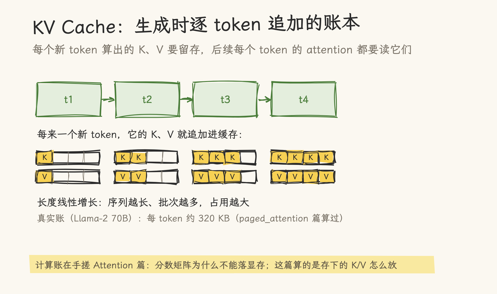
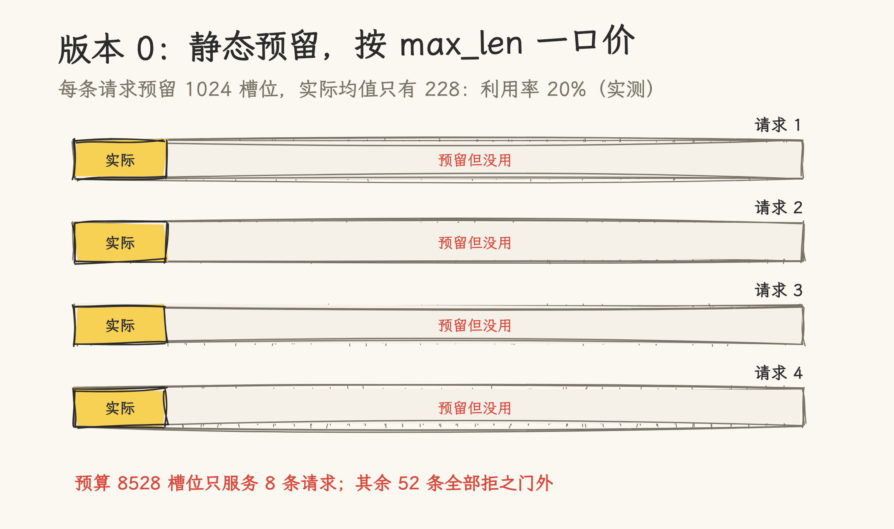
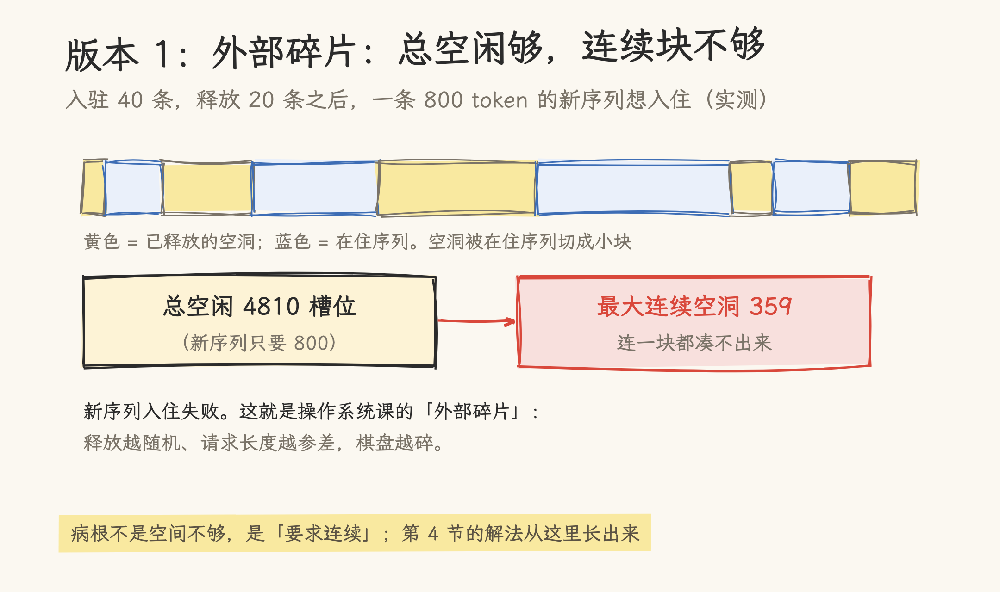
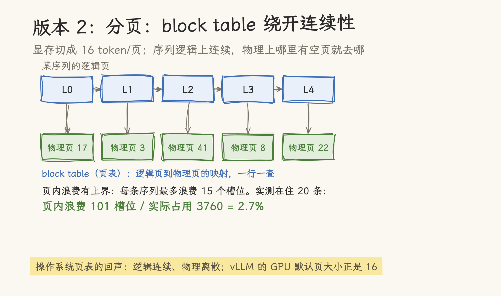
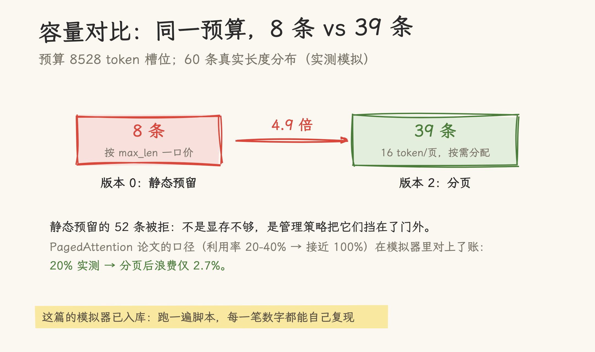

# 手搓 KV Cache：从静态预留到 PagedAttention 的页表

本站[手搓 Attention](../../../../02_gpu_programming/02_cuda/21_write_attention_from_scratch.md)那篇算的是 attention 的**计算账**：分数矩阵为什么不能落显存、online softmax 怎么滚。这篇算另一本账：**存储账**：算过的 K/V 得留在显存里给后续 token 用，而这些中间状态怎么放，直接决定一块卡同时能伺候多少条请求。同样的显存预算，管理策略从「按最大长度预留」换成「按页分配」，容量实测差 5 倍。三个版本递进，每一笔账都是模拟器实跑出来的。

> 验证方法：一个离散事件模拟器（纯标准库 Python，脚本已入库同目录 [hand_roll_kv_cache.py](hand_roll_kv_cache.py)）。口径：显存预算 8528 个 token 槽位（恰好装下第一批入驻序列，消除尾部空白干扰）；60 条序列长度按高斯分布生成（seed 42，均值 228，最长 593）；页大小 16（vLLM GPU 默认口径，`vllm/_custom_ops.py:55` 核对）。模拟器只管「token 槽位怎么分配」，不模拟张量本身的计算。

## 1. 这本账在算什么

自回归生成时，每生成一个 token，它的 K 和 V 就要留在一个可查询的地方：后续每个新 token 的 attention 都要读全部历史的 K/V。这笔缓存的增长是线性的：序列越长、批次越多，占用越大。具体的「每 token 多大」公式与真实模型数字（如 Llama-2 70B 每 token 约 320 KB），[KV Cache 原理简介](kv_cache_basics.md)和[PagedAttention 讲解](paged_attention.md)都算过，不重复。

这篇关心的是更底层的一个问题：这些 K/V 在显存里**怎么摆放**。它看起来是个工程细节，实际决定了同样的卡能同时跑几条请求。手搓一个管理器，三种策略各跑一遍模拟，数字自己会说话。



## 2. 版本 0：静态预留，按 max_len 一口价

最简单的管理策略：每条请求来了，按最大长度（max_len = 1024）一口价预留。

```python
capacity = TOTAL_SLOTS // MAX_LEN      # 8528 // 1024 = 8 条
```

模拟器实测：预算 8528 个槽位，只放得下 **8 条**请求。而 60 条序列的实际长度均值只有 228：每条预留的 1024 个槽位里，平均只有两成多真的被用到。8 条序列合计预留 8192 槽位，实际占用约 1600，**平均利用率 20%**。



剩余 52 条请求全部被拒。浪费的根源：为「可能永远不会到的长度」提前占了坑。

## 3. 版本 1：动态连续区，以及外部碎片

改进思路：按需增长。请求先占一小段，生成多少占多少，但要求占的是**连续**槽位（这样序列的 K/V 在显存里是一整块，地址好算）。

模拟器跑一个更接近真实服务的三阶段场景：40 条序列入驻（占去 8496 槽位）；然后 20 条完成使命被释放（隔一放二地释放，模拟请求陆续结束）；最后一条 800 token 的新序列想入驻。实测结果：

- 总空闲 **4810** 槽位，远大于新序列要的 800；
- 但最大的一块**连续**空洞只有 **359** 槽位；
- 入住**失败**。

这就是操作系统课上见过的**外部碎片**：空闲是够的，但被在住序列切成了棋盘状的小块，每一块都单独不够用。[PagedAttention 讲解](paged_attention.md)里那个「浏览器、IDE、终端共挤 4 GB 内存」的类比说的就是它，这里我们用数字把它跑了出来：释放越随机、请求长度越参差，棋盘越碎。



## 4. 版本 2：分页，用页表绕开连续性

既然病根是「要求连续」，那就不要连续。把显存切成固定大小的页（16 token/页，vLLM 的 GPU 默认口径），每条序列维护一张**块表**（block table）：逻辑上第 i 页的内容存在哪个物理页，查表即得。新序列要 800 个槽位？凑 50 个空闲页就行，页在显存的哪个位置无所谓。

实测同样的三阶段场景：新序列成功凑齐 50 页入驻；在住 20 条序列的页内浪费（最后一页没填满的部分）合计 101 槽位，占实际占用 3760 的 **2.7%**。对比一下：外部碎片是不定型的（取决于释放模式，极端时丢一半容量），页内浪费是有上界的（每条序列最多浪费 15 个槽位，2.7% 是这次实测值）。



容量账也随之改变：不再按 max_len 预留，同样 8528 槽位的预算，静态预留只服务 8 条，分页实测放进 **39 条**（第 40 条按页取整后差 1 个页没进；页取整的代价后文有账），**约 5 倍**。论文里的说法是「有效利用率从 20-40% 提升到接近 100%」：模拟器的 20% 对 97.3%，正落在同一个区间。



## 5. 对照真实系统

模拟器与真实系统的三个对账点：

| 项目           | 模拟器实测   | 真实系统                                     |
| -------------- | ------------ | -------------------------------------------- |
| 静态预留利用率 | 20%          | PagedAttention 论文口径 20-40%               |
| 分页后浪费     | 2.7%（页内） | 「接近 100%」有效利用                        |
| 页大小         | 16           | vLLM GPU 默认 16（`vllm/_custom_ops.py:55`） |

模拟器省略了很多真实复杂度：没有 prefill/decode 两阶段的分配节奏，没有前缀共享（多条请求共用同一段系统提示词的页，进一步省显存），没有页的换入换出。但「分页消灭外部碎片、页内浪费有上界」这个核心结论，与真实系统一致。

## 6. 什么时候轮到自己写

生产环境用 vLLM、SGLang 的现成实现，它们的 BlockSpaceManager 还处理了页共享、写时复制、驱逐与换出，都是这篇模拟器没有的。手搓的价值在于：现在读 vLLM 的 `block_table`、`num_gpu_blocks` 这些字段，对应关系是清楚的：每条请求的 block table 就是模拟器里那张页表，`num_gpu_blocks` 就是那个总预算。

接得上的几篇：[KV Cache 原理简介](kv_cache_basics.md)讲缓存为什么必须存在；[PagedAttention 讲解](paged_attention.md)有完整的 OS 类比与交互可视化；前缀共享的展开见 [KV 复用](../../06_kv_reuse/)目录；[手搓 Attention](../../../../02_gpu_programming/02_cuda/21_write_attention_from_scratch.md)是配套的计算账。

## 参考资料

- Kwon et al., 2023, _Efficient Memory Management for Large Language Model Serving with PagedAttention_（arXiv:2309.06180）：分页管理的原始论文
- vLLM 仓库：<https://github.com/vllm-project/vllm>（页大小 16 的实现见 `vllm/_custom_ops.py`）
- 本站[KV Cache 目录](../../README.md)：从原理到分布式管理的 60+ 篇进阶内容
