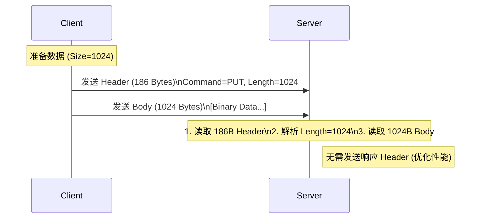

# LMCache Server 源码分析

[< 返回架构概览](./01_lmcache_overview.md)

> 核对基线：LMCache v0.5.1（commit 979719d7，2026-07-02）；本文核对日期 2026-11-05

**LMCache Server** 是 LMCache 项目自带的一个轻量级、高性能的远程 KV 存储服务。它设计用于在没有部署 Redis 或 Mooncake 等复杂分布式存储系统的环境中，快速提供跨实例的 KV Cache 共享能力。

> **核心定位**: 它是 "**集中式共享** (Centralized Sharing)" 模式下的默认数据平面 (Data Plane) 组件，与 LMCache Client 通过自定义的 TCP 协议进行通信。

代码主要位于 `lmcache/v1/server/` 目录下。

---

## 1. 架构与组件

LMCache Server 采用经典的 **多线程阻塞 I/O (Threaded Blocking I/O)** 模型，包含如下核心组件：

1. **LMCacheServer (`__main__.py`)**

   - **角色**: 服务端入口与连接管理器。
   - **职责**: 监听 TCP 端口，接受客户端连接，并为每个连接创建一个独立的线程 (`threading.Thread`) 进行处理。
   - **设计**: 这种 Thread-per-Client 模型在客户端数量较少（数百个）时表现良好，且代码逻辑简单清晰。

2. **LMSBackendInterface (`storage_backend/abstract_backend.py`)**

   - **角色**: 存储后端抽象层。
   - **职责**: 定义了标准的存储接口 (`put`, `get`, `contains`, `list_keys`, `close`)，使得底层存储实现与网络层解耦。

3. **具体存储实现**

   - **LMSLocalBackend (`storage_backend/local_backend.py`)**: 基于内存的存储实现，`OrderedDict` 存储 `LMSMemoryObj`（数据 + 元数据）。
   - **LMSLocalDiskBackend**: 基于磁盘的实现，**当前版本已整段注释停用**，仅保留接口占位（详见 §3.3）。

4. **通信协议 (`protocol.py`)**

   - 定义了客户端和服务端交互的二进制消息格式，包括 `ClientMetaMessage` 和 `ServerMetaMessage`。

---

## 2. 通信协议

LMCache Server 使用一套紧凑的自定义二进制协议，代码定义位于 [`lmcache/v1/protocol.py`](https://github.com/LMCache/LMCache/blob/main/lmcache/v1/protocol.py)。

### 2.1 协议设计 (Protocol)

该协议的核心设计思想是 **"定长 Header + 变长 Body"**。这种设计允许接收端先读取固定长度的元数据（包含 Body 长度），再精确读取后续的数据载荷，从而有效解决了 TCP 粘包问题并支持零拷贝读取。

协议主要包含两种消息类型：客户端发起的请求消息 (`ClientMetaMessage`) 和服务端回复的响应消息 (`ServerMetaMessage`)。

#### 2.1.1 客户端请求消息 (ClientMetaMessage)

所有客户端请求都以一个固定的 **186 字节** 的 Header 开始。

- **总长度**: 186 Bytes（9 个 int32 + 150 字节 Key）
- **格式字符串**: `iiiiiiiii{MAX_KEY_LENGTH}s` (对应 `struct.pack`)

| 偏移 (Offset) | 长度 (Bytes) | 字段名    | 类型      | 说明                                                                        |
| :------------ | :----------- | :-------- | :-------- | :-------------------------------------------------------------------------- |
| 0             | 4            | `command` | int32     | 指令类型 (1=PUT, 2=GET, 3=EXIST, 4=LIST, 5=HEALTH)                          |
| 4             | 4            | `length`  | int32     | 后续 Body (数据载荷) 的字节长度。对于无 Payload 的请求 (如 GET)，此值为 0。 |
| 8             | 4            | `fmt`     | int32     | MemoryFormat 枚举值（数据布局格式）。                                       |
| 12            | 4            | `dtype`   | int32     | 数据类型（经 `DTYPE_TO_INT` 映射，如 float16=2, bfloat16=3）。              |
| 16            | 4            | `location`| int32     | 数据来源位置（None=0, LocalCPUBackend=1, LocalDiskBackend=2）。             |
| 20            | 16           | `shape`   | int32×4   | 张量形状，补齐到 4 维（bytes 型数据为 `[length, 0, 0, 0]`）。               |
| 36            | 150          | `key`     | char[150] | KV Cache 的 Key。使用 UTF-8 编码，不足 150 字节时**必须**补齐。             |

> **版本注**: 旧版帧只有 `ii{MAX_KEY_LENGTH}s`（158 字节，command/length/key 三字段）。v0.4.x 起为支持零拷贝分配与形状还原，帧内扩展了 fmt/dtype/location/shape 元数据，Header 变为 186 字节。新旧不互通。

```python
# 序列化代码示例 (lmcache/v1/protocol.py)
packed_bytes = struct.pack(
    f"iiiiiiiii{MAX_KEY_LENGTH}s",
    self.command.value,
    self.length,
    int(self.fmt.value),
    DTYPE_TO_INT[self.dtype],
    LOCATION_TO_INT[self.location],
    padded[0], padded[1], padded[2], padded[3],  # shape 补齐到 4 维
    key_str.encode().ljust(MAX_KEY_LENGTH), # 关键：必须补齐到 150 字节
)
```

#### 2.1.2 服务端响应消息 (ServerMetaMessage)

服务端对每个请求都会回复一个固定的 **36 字节** 的 Header。

- **总长度**: 36 Bytes（9 个 int32）
- **格式字符串**: `iiiiiiiii`

| 偏移 (Offset) | 长度 (Bytes) | 字段名    | 类型    | 说明                              |
| :------------ | :----------- | :-------- | :------ | :-------------------------------- |
| 0             | 4            | `code`    | int32   | 状态码 (200=SUCCESS, 400=FAIL)    |
| 4             | 4            | `length`  | int32   | 后续 Body (返回数据) 的字节长度。 |
| 8             | 4            | `fmt`     | int32   | MemoryFormat 枚举值。             |
| 12            | 4            | `dtype`   | int32   | 数据类型（`DTYPE_TO_INT` 映射）。 |
| 16            | 16           | `shape`   | int32×4 | 张量形状，补齐到 4 维。           |
| 32            | 4            | `location`| int32   | 数据位置（`LOCATION_TO_INT` 映射）。 |

响应携带 fmt/dtype/shape 的原因：客户端收到 Header 后即可按元数据**直接分配目标 Tensor 缓冲区**（`allocate(shape, dtype, fmt)`），再用 `recv_into` 把 Body 读进 Tensor 内存——这是零拷贝接收链路的前提（参见 [remote_connector.md §3.2](./12_remote_connector.md)）。

### 2.2 指令交互流程

目前支持以下四种指令，每种指令的交互流程如下表所示：

| 指令 (Command) | 值  | 描述              | 请求流程 (Client -> Server)                          | 响应流程 (Server -> Client)                                                       |
| :------------- | :-- | :---------------- | :--------------------------------------------------- | :-------------------------------------------------------------------------------- |
| **PUT**        | 1   | 上传 KV Cache     | **[Header 186B]** (length=N) -> **[Body]** (N bytes) | 无响应 (由 Client 直接发送)                                                       |
| **GET**        | 2   | 下载 KV Cache     | **[Header 186B]** (length=0)                         | **[Header 36B]** (code/length/fmt/dtype/shape) -> **[Body]** (N bytes, if success) |
| **EXIST**      | 3   | 检查 Key 是否存在 | **[Header 186B]** (length=0)                         | **[Header 36B]** (code=200/400, length=0)                                         |
| **HEALTH**     | 5   | 健康探针          | **[Header 186B]** (length=0)                         | **[Header 36B]** (code=200)                                                        |
| **LIST**       | 4   | 列出所有 Key      | ——                                                   | 服务端分支已注释，**暂未实现** (TODO)                                              |

**交互时序图解 (以 PUT 为例)**：



---

## 3. 关键功能实现分析

本章将深入分析 LMCache Server 的核心代码实现，包括消息处理循环、内存存储后端以及磁盘存储后端的设计细节。这些实现决定了 Server 的并发性能、数据一致性以及扩展能力。

### 3.1 协议解析与消息循环

在 `LMCacheServer.handle_client` 中，服务端运行一个死循环来处理长连接上的请求。该方法负责解析定长 Header，根据 Command 分发请求，并处理数据传输。

```python
    def handle_client(self, client_socket):
        try:
            while True:
                # 1. 接收固定长度的 Header (ClientMetaMessage.packlength() = 186字节)
                header = self.receive_all(client_socket, ClientMetaMessage.packlength())
                if not header:
                    break

                # 2. 反序列化 Header (含 fmt/dtype/shape 元数据)
                meta = ClientMetaMessage.deserialize(header)

                # 3. 根据 Command 分发处理
                match meta.command:
                    case ClientCommand.PUT:
                        t0 = time.perf_counter()
                        # 接收 Body 数据
                        s = self.receive_all(client_socket, meta.length)
                        t1 = time.perf_counter()
                        # 写入存储 (put 连同元数据一起存入 LMSMemoryObj)
                        self.data_store.put(meta, s)
                        t2 = time.perf_counter()
                        # 注意：此处源码不发响应，Client 发送完即视为成功
                        logger.debug(
                            f"Time to receive data: {t1 - t0}, time to store "
                            f"data: {t2 - t1}"
                        )

                    case ClientCommand.GET:
                        t0 = time.perf_counter()
                        # 从存储获取数据
                        lms_memory_obj = self.data_store.get(meta.key)
                        t1 = time.perf_counter()
                        if lms_memory_obj is not None:
                            # 发送成功 Header (包含 length/fmt/dtype/shape)
                            client_socket.sendall(
                                ServerMetaMessage(
                                    ServerReturnCode.SUCCESS,
                                    lms_memory_obj.length,
                                    lms_memory_obj.fmt,
                                    lms_memory_obj.dtype,
                                    lms_memory_obj.shape,
                                ).serialize()
                            )
                            t2 = time.perf_counter()
                            # 发送 Body 数据
                            client_socket.sendall(lms_memory_obj.data)
                            t3 = time.perf_counter()
                            logger.debug(
                                f"Time to get data: {t1 - t0}, time to send "
                                f"meta: {t2 - t1}, time to send data: {t3 - t2}"
                            )
                        else:
                            # 发送失败 Header
                            client_socket.sendall(
                                ServerMetaMessage(
                                    ServerReturnCode.FAIL,
                                    0,
                                    MemoryFormat(1),
                                    torch.float16,
                                    torch.Size((0, 0, 0, 0)),
                                ).serialize()
                            )

                    case ClientCommand.EXIST:
                        # 检查 Key 是否存在
                        code = (
                            ServerReturnCode.SUCCESS
                            if self.data_store.contains(meta.key)
                            else ServerReturnCode.FAIL
                        )
                        client_socket.sendall(
                            ServerMetaMessage(
                                code,
                                0,
                                MemoryFormat(1),
                                torch.float16,
                                torch.Size((0, 0, 0, 0)),
                            ).serialize()
                        )

                    case ClientCommand.HEALTH:
                        client_socket.sendall(
                            ServerMetaMessage(
                                ServerReturnCode.SUCCESS,
                                0,
                                MemoryFormat(1),
                                torch.float16,
                                torch.Size((0, 0, 0, 0)),
                            ).serialize()
                        )
                        logger.debug("Health check successful")

                    # TODO(Jiayi): Implement List
                    # case ClientCommand.LIST:
                    #     ...

        finally:
            logger.info("Client disconnected")
            client_socket.close()
```

**代码亮点**:

- **定长 Header**: `ClientMetaMessage.packlength()` 返回固定的 186 字节 (`4 × 9 + 150`)。这使得服务端可以先精确读取 Header，解析出 Body 长度 (`meta.length`)，再精确读取 Body。这种设计避免了粘包问题。
- **元数据随行**: Header 内含 fmt/dtype/shape，服务端据此构造 `LMSMemoryObj` 存储、客户端据此零拷贝分配接收缓冲区。
- **性能优化 (PUT)**: 在 PUT 操作中，服务端接收并存储数据后，**不再发送任何响应**。这种设计减少了一次网络往返 (RTT)，显著提升了写入吞吐量。

### 3.2 内存存储后端 (LMSLocalBackend)

这是默认的后端实现，核心是一个线程安全的字典，代码位于 `lmcache/v1/server/storage_backend/local_backend.py`。

```python
class LMSLocalBackend(LMSBackendInterface):
    def __init__(self):
        self.dict: OrderedDict[CacheEngineKey, LMSMemoryObj] = OrderedDict()
        self.lock = threading.Lock()
        # TODO(Jiayi): please add evictor

    def put(self, client_meta: ClientMetaMessage, kv_chunk_bytes: bytearray):
        with self.lock:
            self.dict[client_meta.key] = LMSMemoryObj(
                kv_chunk_bytes,
                client_meta.length,
                client_meta.fmt,
                client_meta.dtype,
                client_meta.shape,
            )

    def get(self, key: CacheEngineKey) -> Optional[LMSMemoryObj]:
        with self.lock:
            return self.dict.get(key, None)
```

> **LMSMemoryObj**（`lmcache/v1/server/utils.py`）是服务端的数据单元：`data`（bytearray）+ `length/fmt/dtype/shape` 元数据。PUT 时从请求 Header 直接取得元数据打包成 `LMSMemoryObj`，GET 时无需解析数据本体即可拼出响应 Header——这正是协议帧携带元数据的收益。

**分析**:

- **全局大锁 (`lock`)**: 所有的读写操作 (`put`, `get`, `list_keys`, `contains`) 都由一把锁保护。这简化了并发控制，但在高并发下会成为瓶颈（所有客户端线程争抢这把锁）。
- **无驱逐机制**: 架构上预留了 evictor 的 TODO，但当前实现**没有任何驱逐逻辑**。这意味着如果数据量超过内存限制，服务进程将最终 OOM。

### 3.3 磁盘存储后端 (LMSLocalDiskBackend)：当前已停用

历史版本中这里有一个基于文件系统的 `LMSLocalDiskBackend`（内存元数据索引 + 磁盘数据文件）。**当前版本该后端已被整段注释停用**——源文件 `lmcache/v1/server/storage_backend/local_backend.py` 末尾只剩注释形式的接口占位（"TODO: please implement the remote disk backend"）。

启动入口 `CreateStorageBackend`（`lmcache/v1/server/storage_backend/__init__.py`）也随之收敛：

```python
def CreateStorageBackend(device: str) -> LMSBackendInterface:
    match device:
        case "cpu":
            return LMSLocalBackend()
        case _:
            raise ValueError(f"Unsupported device: {device}")
        # TODO(Jiayi): 磁盘分支已注释停用
```

也就是说：`lmcache-server <host> <port>` 只能以纯内存模式运行，传入任何非 `cpu` 的存储设备都会直接抛 `ValueError`。需要磁盘持久化的共享缓存，请使用 **GdsBackend**（见 [gds_backend.md](./10_gds_backend.md)）或 NixlStorageBackend 方案。

---

## 4. 深度思考与设计权衡

LMCache Server 的设计在简单性、性能和可靠性之间做了明确的取舍。本章将探讨这些设计决策背后的逻辑，以及它们对实际应用场景的影响。

### 4.1 I/O 模型选择: Threading vs Asyncio

在并发模型的选择上，LMCache Server 采用了传统的多线程模型，而非目前流行的异步 I/O (Asyncio)。这一决策基于以下考量：

- **现状**: 采用 `socketserver` 风格的多线程阻塞 I/O 模型。
- **权衡**:
  - **优势**: 实现极其简单，符合 Python 同步编程直觉。更重要的是，纯内存后端 (`LMSLocalBackend`) 的字典操作本身极快，线程阻塞主要发生在 socket 收发上，多线程足以覆盖；若未来引入磁盘后端（阻塞式文件 I/O），`asyncio` 反而需要 `aiofiles` 等异步文件库配合，增加复杂度。
  - **适用性**: 在 KV Cache 共享场景下，连接数通常与 GPU 实例数挂钩（通常在几十到几百量级），远未达到 C10K 问题的规模，因此线程开销不是主要矛盾。

### 4.2 协议效率与零拷贝 (Zero-Copy)

LMCache 的协议设计初衷是支持零拷贝，但在目前的 Python 实现中，尚未完全发挥这一潜力。

- **设计目标**: 协议采用 "Header + Body" 结构，理论上支持零拷贝接收（直接将 Socket 数据读入 Tensor 的显存或内存缓冲区）。
- **实现差距**: 当前 Python 实现中使用了 `bytearray` 和 `data.extend`，这实际上涉及了多次内存拷贝（Kernel -> Python Bytes -> Python ByteArray）。
- **优化方向**: 未来可以利用 `socket.recv_into` 配合 `memoryview` 或预分配的 Tensor Buffer，实现真正的应用层零拷贝。

### 4.3 可靠性与性能的取舍 (PUT 无响应)

在 PUT 操作的设计中，LMCache Server 采取了一种激进的策略：**Fire-and-Forget**。

- **现状**: `PUT` 操作在服务端接收完数据后**不发送任何响应**，客户端发送完毕即认为成功。
- **权衡**:
  - **收益**: 节省了一个 RTT (Round-Trip Time)，在跨地域或高延迟网络下能显著降低写入延迟。
  - **风险**: 牺牲了应用层的可靠性确认。如果服务端在接收数据后发生 OOM 或 crash，客户端无法感知，可能导致后续读取失败（Cache Miss）。这符合 LMCache "Soft State"（软状态）的设计哲学——缓存丢失是可以接受的，重新计算即可。

### 4.4 锁机制与并发瓶颈

为了保证数据一致性，当前的存储后端采用了最简单的全局锁机制。

- **现状**: `LMSLocalBackend` 使用一把全局大锁 (`lock`) 保护所有操作。
- **瓶颈**: 读 (`GET`) 和写 (`PUT`) 操作互斥。在模型并行 (TP) 场景下，多个 Worker 可能同时请求相同的 KV Cache，全局锁将导致严重的串行化等待。
- **改进**: 引入读写锁 (Reader-Writer Lock) 或分段锁 (Sharded Locks) 是必要的优化方向。

### 4.5 生产环境缺失特性

尽管 LMCache Server 功能完备，但要将其部署到生产环境，仍需填补以下关键特性的空白。

1. **内存驱逐 (Eviction)**: 当前实现没有任何驱逐逻辑，Server 实际上是一个无限增长的内存黑洞，生产环境必须补齐（如 `LRUEvictor`）。
2. **磁盘持久化 (Persistence)**: 磁盘后端已停用，Server 目前**没有**故障恢复与持久化能力。需要持久化的共享缓存请改用 GdsBackend 或 NixlStorageBackend 方案（见 [gds_backend.md](./10_gds_backend.md)、[nixl_backend.md](./11_nixl_backend.md)）。

---

## 5. 总结

LMCache Server 的定位非常明确：**轻量级、开箱即用的 KV Cache 共享组件**。它填补了在没有复杂基础设施（如 Redis Cluster, RDMA 网络）环境下的能力空白。

| 场景                      | 推荐度     | 理由                                                                                                             |
| :------------------------ | :--------- | :--------------------------------------------------------------------------------------------------------------- |
| **开发调试 / POC**        | ⭐⭐⭐⭐⭐ | 零依赖启动，协议简单，非常适合快速验证 LMCache 的跨实例共享逻辑。                                                |
| **单机多卡共享**          | ⭐⭐⭐⭐   | 利用本地 Loopback 网络，延迟极低，可作为简单的 "Shared Memory" 替代方案。                                        |
| **中小规模集群 (数节点)** | ⭐⭐⭐     | 在总 KV Cache 大小可控的前提下，可作为低成本的共享后端。                                                         |
| **生产级大规模服务**      | ⭐         | **不推荐**。缺乏驱逐策略 (OOM 风险)、无高可用 (HA) 保障、单点性能瓶颈。建议使用 **Redis** 或 **Mooncake** 后端。 |
