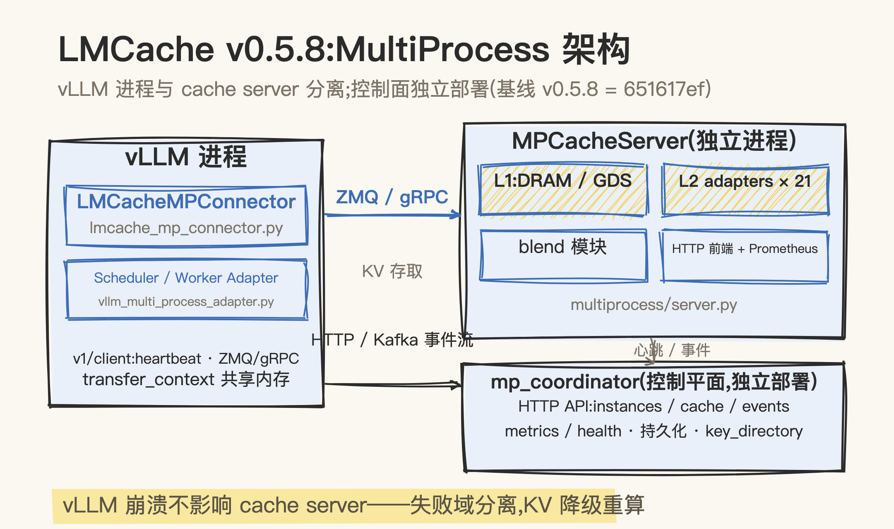
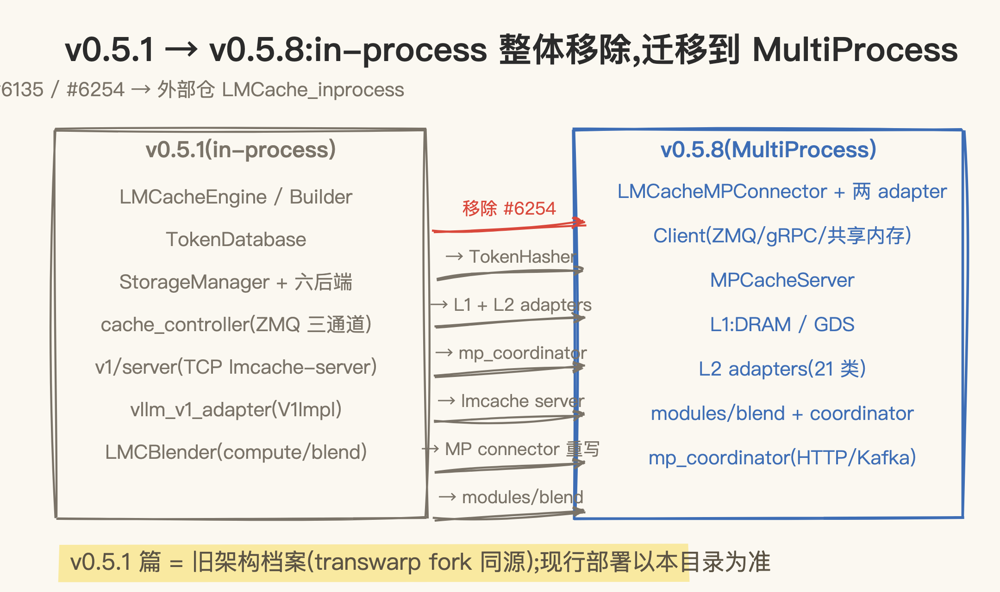

# LMCache v0.5.8：MultiProcess 架构与迁移指南

> 核对基线：LMCache **v0.5.8**（tag `651617ef`；对比旧基线 v0.5.1 = `979719d7`）；写作日期 2026-11-25
> 区间规模：v0.5.1→v0.5.8 共 1063 个 commit，`lmcache/` 下 932 个文件变更（+120k/−101k 行）

## 为什么单独开一版

v0.5.7–v0.5.8 之间，LMCache 把 v0.5.1 时代的 **in-process 架构整体移出主仓**：legacy TCP cache server（#5785）、storage backends 与 compute/blend（#6007、#6135）、in-tree InProcess 实现（#6254）先后删除；TCP 协议与 CacheGen 序列化迁入外部仓 `LMCache_inprocess`。v0.5.8 的主仓只保留 **MultiProcess（MP）架构**：独立的 cache server 进程 + vLLM connector/adapter + client 传输 + coordinator 控制平面。

因此 [../01_lmcache/](../01_lmcache/) 的 17 篇深读（钉 v0.5.1）**不再适用于 v0.5.8 部署**——它们对 v0.5.1（与 transwarp fork 同源）仍然有效，作为旧架构档案保留。本目录按 v0.5.8 重写，两代对照见下方映射表。

## 新架构一页图



```text
vLLM Worker/Scheduler
   │  KVConnectorBase_V1
   ▼
LMCacheMPConnector（lmcache_mp_connector.py）
   │  LMCacheMPSchedulerAdapter / LMCacheMPWorkerAdapter
   ▼  （vllm_multi_process_adapter.py）
LMCache Client（v1/client：heartbeat、ZMQ/gRPC 传输、transfer_context 共享内存）
   │
   ▼  ZMQ / gRPC
MPCacheServer（独立进程，multiprocess/server.py）
   ├── L1 存储：DRAM L1 Manager / GDS L1（distributed/l1_manager/）
   ├── L2 存储：l2_adapters/ 注册表（21 类：fs、nixl、mooncake、s3、resp…）
   ├── blend 模块（multiprocess/modules/blend/）+ coordinator blend 索引
   └── 可观测：mp_observability（OTel）+ coordinator Prometheus pull

mp_coordinator（控制平面，独立部署）
   ├── HTTP API：instances / cache / events / metrics / health
   ├── cache-event 流：POST /events 或 Kafka（ingest/）
   ├── 持久化：persistence/checkpoint.py
   └── key_directory / blend_index / prefetch_manager
```



## 旧 → 新组件映射表（v0.5.1 → v0.5.8）

| v0.5.1（旧架构）                                                          | v0.5.8（MP 架构）                                                                                                                 | 备注                                                                      |
| ------------------------------------------------------------------------- | --------------------------------------------------------------------------------------------------------------------------------- | ------------------------------------------------------------------------- |
| `LMCacheEngine` / `LMCacheEngineBuilder`                                  | 移除，无直接对应物                                                                                                                | 职责拆入 connector / server / client                                      |
| `StorageManager` + 六类 backend（LocalCPU/LocalDisk/GDS/P2P/Nixl/Remote） | `v1/distributed/`：L1 Manager（DRAM `l1_manager/dram.py`、GDS `l1_manager/gds.py`）+ L2 adapters（`l2_adapters/`，21 类注册表）   | 两级模型：L1 在 GPU 节点本地，L2 经 adapter 外接                          |
| `TokenDatabase`                                                           | `v1/common/token_hasher.py` `TokenHasher`（chunk 256 不变；默认 hash 改 **blake3**）                                              | key 编码在 `distributed/key_codec.py`                                     |
| `cache_controller/`（ZMQ 三通道 + msgspec 消息族 + FullSync）             | `mp_coordinator/`（HTTP API + event 流 HTTP/Kafka + persistence/checkpoint + key_directory）                                      | 控制平面重写；ZMQ 仅存于 client 传输                                      |
| `v1/server/`（legacy TCP `lmcache-server`）                               | `lmcache server` 子命令（`multiprocess/server.py` MPCacheServer，ZMQ/gRPC + HTTP 前端）                                           | legacy server 已删（#5785）                                               |
| `vllm_v1_adapter.py`（`LMCacheConnectorV1Impl`）                          | `lmcache_mp_connector.py` `LMCacheMPConnector`（`KVConnectorBase_V1, SupportsHMA`）+ `vllm_multi_process_adapter.py` 两个 adapter | 四接口名（start_load_kv 等）保留，实现重写                                |
| `retrieve_layer` / `store_layer` 层级生成器流水线                         | MP 传输路径（client/transfer_context、object_group_transfer）；`wait_for_layer_load` 退化为兼容空壳                               | 生成器机制删除                                                            |
| `PDBackend`（PD 分离 push 后端）                                          | 无对应物                                                                                                                          | PD 场景走 `examples/disagg_prefill_mp/disagg_proxy_server.py` + MP server |
| `LMCBlender`（`v1/compute/blend/`）                                       | `multiprocess/modules/blend/` + coordinator `blend_index/blend_lookup/blend_client`                                               | 机制改为 coordinator 匹配 + fingerprint + reorder                         |
| `LMCStatsMonitor` / `PrometheusLogger`（8 个 `lmcache:*` 指标）           | `v1/mp_observability/`（OTel）+ coordinator Prometheus pull                                                                       | 旧指标名全部失效                                                          |
| `LMCacheEngineConfig` + `LMCACHE_*` 环境变量                              | `MPServerConfig`（`multiprocess/config.py`）+ `distributed/config.py` + `lmcache.mp.*` extra-config + CLI 旗标                    | 配置面整体更换                                                            |
| `remote_serde="cachegen"`                                                 | serde：fp8 / turboquant / aesgcm / asym_k16_v8（`distributed/serde/factory.py`）；CacheGen 外移 `LMCache_inprocess`               | 官方口径：CacheGen「coming soon」                                         |

## 配置面速查

| 层      | 位置                                                                                 | 要点                                                                                                                                                  |
| ------- | ------------------------------------------------------------------------------------ | ----------------------------------------------------------------------------------------------------------------------------------------------------- |
| server  | `multiprocess/config.py` `MPServerConfig`                                            | `--host/--port/--l1-size-gb/--eviction-policy {LRU,ARC,IsolatedLRU,noop}--transport {zmq,grpc}`                                                       |
| L1      | `distributed/config.py`                                                              | `size_gb`；GDS 走 `GdsL1Config`（cuFile/hipFile/uGDS/Phoenix，`:351` 起）                                                                             |
| L2      | `l2_adapters/*` 各自 `*Config`（如 `NixlStoreL2AdapterConfig{backend,pool_size,…}`） | 经 `lmcache.mp.*` extra-config 传入                                                                                                                   |
| 驱逐    | `distributed/config.py` `eviction`                                                   | `trigger_watermark` + `eviction_ratio`                                                                                                                |
| P2P     | `multiprocess/config.py`                                                             | `--p2p-listen-url/--p2p-advertise-url/--p2p-rpc-port/--p2p-lookup-timeout 30/--p2p-load-timeout 30/--p2p-transfer-engine nixl/--p2p-store-timeout 30` |
| vLLM 侧 | `lmcache.mp.*` extra-config                                                          | 如 `lmcache.mp.save_unfull_chunk`（**默认 False**，与旧版「自动 True」语义反转）                                                                      |

## 本目录各篇

| 篇                                                           | 内容                                      |
| ------------------------------------------------------------ | ----------------------------------------- |
| [01_mp_architecture.md](01_mp_architecture.md)               | MP 四角色总架构与请求生命周期             |
| [02_lmcache_mp_connector.md](02_lmcache_mp_connector.md)     | vLLM 集成：connector/adapter/extra-config |
| [03_mp_server.md](03_mp_server.md)                           | MPCacheServer：端点、HTTP API、驱逐与配置 |
| [04_storage_l1_l2.md](04_storage_l1_l2.md)           | L1/L2 两级存储与 21 类 adapter            |
| [05_p2p_grpc.md](05_p2p_grpc.md)                     | P2P gRPC 控制面与新配置                   |
| [06_blend_mp.md](06_blend_mp.md)                     | CacheBlend 的 MP 模块组实现               |
| [07_observability.md](07_observability.md)           | OTel + coordinator 指标面                 |
| [08_serde_and_cachegen.md](08_serde_and_cachegen.md) | serde 选项与 CacheGen 外移                |
| [09_cli.md](09_cli.md)                               | `lmcache` CLI 子命令收敛                  |

## 与旧版文档的关系

- [../01_lmcache/](../01_lmcache/)：v0.5.1 in-process 架构档案（17 篇），对本仓 transwarp fork 部署仍有效；
- 对照阅读时以代码为准：`8b365ff949`（旧）/ `v0.5.8`（新）两棵树都在本地对象库，`git show <ref>:<path>` 可逐行核对。
