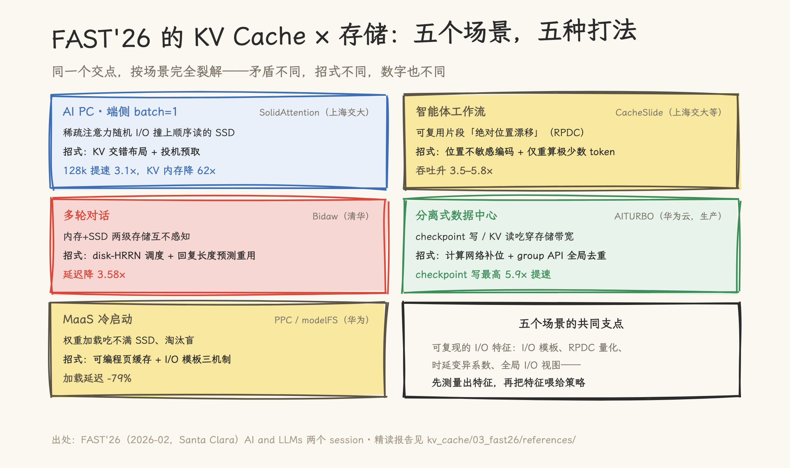
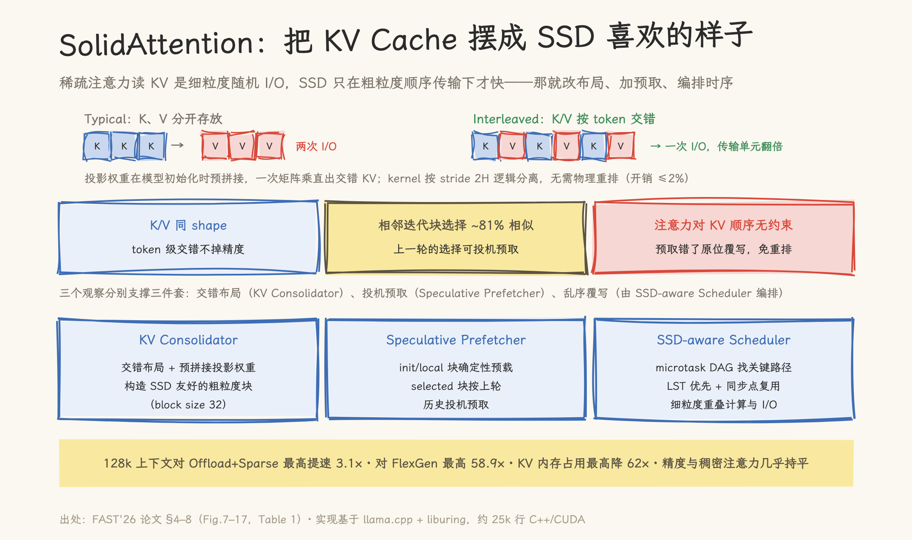
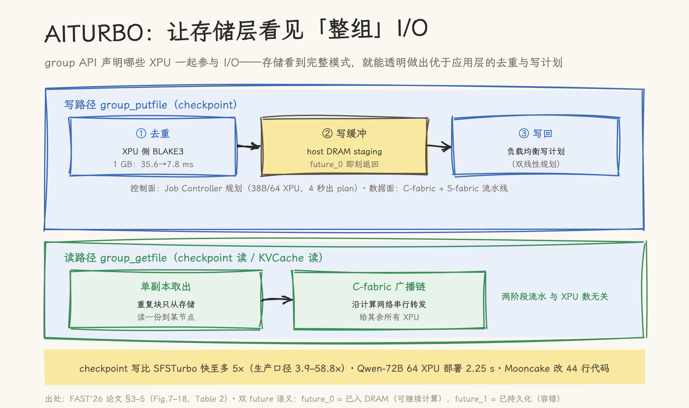
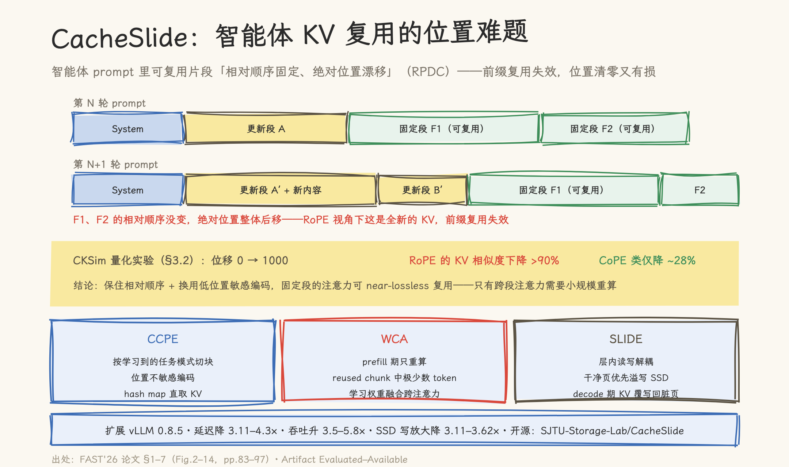
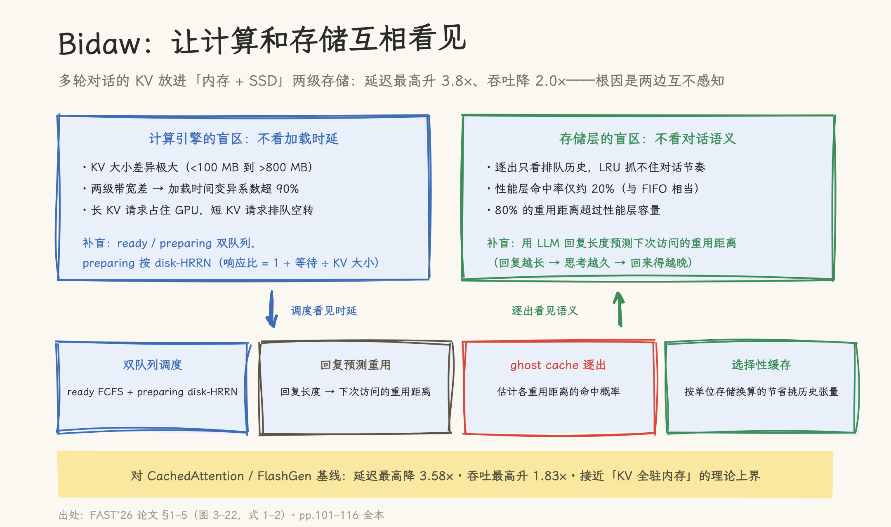
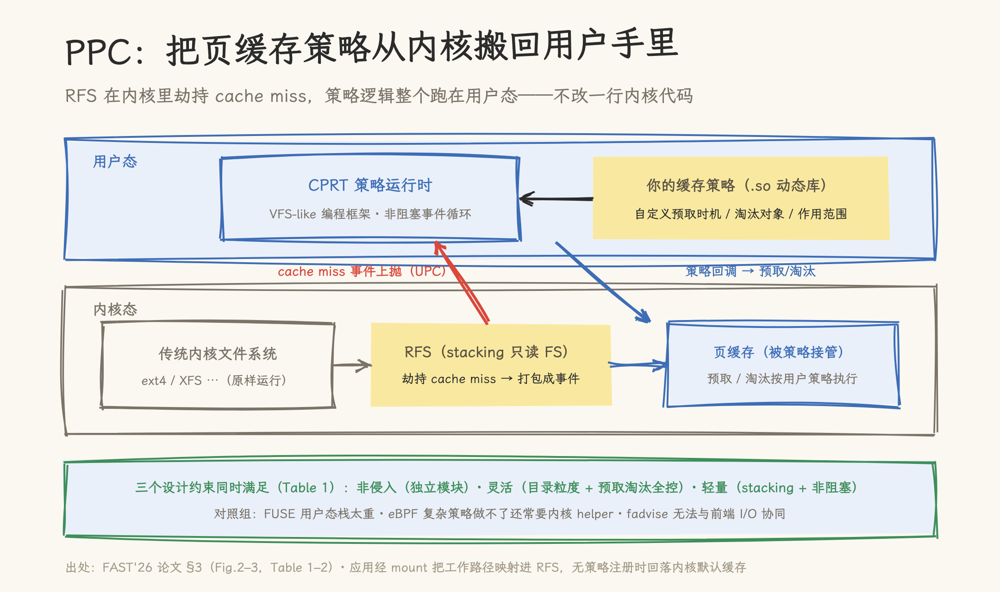

# 当 KV Cache 装不进内存：FAST'26 五篇论文给出的五个不同答案

> **元信息**：本文是 FAST '26（24th USENIX Conference on File and Storage Technologies，2026-02-24~26，Santa Clara）「AI and LLMs」两个 session 的系列总纲。五篇 KV Cache × 存储核心论文均有单篇精读：[SolidAttention](solidattention.md) · [CacheSlide](cacheslide.md) · [Bidaw](bidaw.md) · [AITURBO](aiturbo.md) · [PPC/modelFS](../../deployment/fast26-programmable-page-cache.md)（另 2 篇训练检查点、2 篇支撑性工作计入口径，Agent 精读报告见 [references/](references/)）。本文数字已与论文原文逐条对照；整理日期 2026-10-10。

FAST '26 的「AI and LLMs」两个 session 共九篇论文，本文只精读其中五篇。筛选标准只有一条：**是否在处理「KV Cache 与存储系统打交道」这个问题**。剩下的四篇不在交点上——GCR 与 AdaCheck 优化的是训练检查点的存取（对象是参数与优化器状态，不是 KV），Seneca 处理训练数据的预处理管道，SYSSPEC（最佳论文）讲的是用 LLM 生成文件系统的方法论。这四篇里 SYSSPEC 值得后续单独写，其余与本系列主题无关，故不展开。

入选的五篇，按「KV Cache 和存储怎么交互」排开，会发现它们在回答同一个问题的五个不同切面：**当 KV Cache 装不进内存、必须和存储打交道时，性能是怎么丢的，又能怎么拿回来。**

答案没有通吃版。端侧、智能体、对话服务、数据中心、冷启动，五个场景的矛盾各不相同，招式也各不相同——但拆到最底下，五篇论文踩的是同一块支点。

## 一、五篇论文，五个象限

| 论文（单位）                | 场景               | 核心矛盾                              | 招式                                    | 关键数字                                              |
| --------------------------- | ------------------ | ------------------------------------- | --------------------------------------- | ----------------------------------------------------- |
| SolidAttention（上海交大）  | AI PC 端侧 batch=1 | 稀疏注意力的随机 I/O 撞上顺序读的 SSD | KV 交错布局 + 投机预取 + microtask 调度 | 128k 最高提速 3.1×；KV 内存降 62×；能耗 −46%          |
| CacheSlide（上海交大等）    | 智能体工作流       | 可复用片段「绝对位置漂移」（RPDC）    | 位置不敏感编码 + 仅重算 12% token       | 吞吐升 3.5–5.8×；写放大降 3.11–3.62×                  |
| Bidaw（清华）               | 多轮对话           | 内存+SSD 两级存储互不感知             | disk-HRRN 调度 + 回复长度预测重用       | 延迟降 3.58×；吞吐升 1.83×                            |
| AITURBO（华为云，生产部署） | 分离式数据中心     | checkpoint 写 / KV 读吃穿存储带宽     | 计算网络补位 + group API 全局去重       | checkpoint 写最高 5.9× 提速；Qwen-72B 64 卡部署 2.25s |
| PPC / modelFS（华为）       | MaaS 冷启动        | 权重加载吃不满 SSD、淘汰盲            | 可编程页缓存 + I/O 模板三机制           | 加载延迟 −79%；弹性吞吐 +13%/28%                      |

口径说明：九篇的完整清单见[官方议程](https://www.usenix.org/conference/fast26/technical-sessions)。

## 二、「数据放不对」：布局与带宽

**SolidAttention** 处理的是最窘迫的场景：8–16 GB 内存的 AI PC 跑 128k 上下文，8B 模型的 KV Cache 就要 16 GB 以上（权重的 4 倍多），必须上 SSD。而稀疏注意力读 KV 是细粒度随机 I/O，SSD 偏偏只在粗粒度顺序传输下才快——batch=1 时，加载 1k token 的 KV 要 40 ms，占 decode 一半时间。

解法是让数据形状迁就介质，三个观察各撑一个组件。K/V 同 shape，按 token 粒度交错后顺序读就能拿到一个注意块的完整 KV，且投影权重在初始化时预拼接、一次矩阵乘直出交错 KV，kernel 按 stride 2H 逻辑分离、无需物理重排（开销 ≤2%）——这避开了「压缩 token 换粒度」的老路：块越大精度越差，recall 随 block size 从 32 到 256 一路下滑。相邻两次迭代的稀疏块选择约 81% 相似（LongBench 多模型实测），上一轮的选择可以投机预取，预取错了也能原位覆写——注意力对 KV pair 的全局顺序无约束，错误预取不需要重排。SSD-aware Scheduler 再把注意力分解成 microtask 建 DAG，按关键路径优先加 LST（最晚开始时间）调度，同步点合并复用。

数字：128k 上下文对 Offload+Sparse 基线最高加速 3.1×（三模型 2.8×/3.1×/2.4×），对 FlexGen 最高 58.9×；KV 内存占用最高降 62×；精度与稠密注意力几乎持平（三模型平均 57.67/65.93/70.76 vs 57.82/65.76/71.39，而 KV INT4 量化在 Qwen 上崩到 18.63）。全本补充的评估把边界刻画得很细：相对全内存约 11% 的吞吐损失；context budget 超过 4k 后延迟陡增（I/O 无法再被计算掩盖）；两块 SSD 在 4k budget 下差异 45%——盘越好收益越大；背景 I/O 干扰下吞吐降 58%；能耗账是正的（3.68 vs 5.37 J/token，改善 46%）；精读推算约五分之一的预取块仍需补读。细读全部机制与消融见[单篇精读](solidattention.md)。

**AITURBO** 把镜头拉到数据中心。AI 负载正在吃穿分离式云存储的带宽：训练侧周期性 checkpoint 写是数百 GB 级倾泻，推理侧弹性扩容读 checkpoint、agent 工作流读共享前缀 KVCache。华为云称 AI 任务已占其本地数据中心存储带宽的 10% 以上（厂商口径）；补带宽的代价是每 GB 成本涨 16 倍（1.6→80 GBps）；应用自己优化的代价是 Megatron 用了四分之一个代码库做 checkpoint I/O，仍不最优——因为它看不到云存储的分离式架构。

AITURBO 算的是另一笔账：AI 集群里有两条闲置资源——host DRAM，和加速器之间 200 Gbps 的计算网络（存储网络只有 100 Gbps/节点）。做法是一个 group API：应用声明「这组 XPU 将一起参与这次 I/O」，存储层看到完整的跨客户端 I/O 模式，就能透明做出优于应用层的计划。写路径三步：XPU 侧 BLAKE3 去重（1 GB 从 CPU 的 35.6 ms 降到 7.8 ms）→ host DRAM staging（`future_0` 即刻返回，训练不阻塞；`future_1` 等持久化，容错用）→ 按双线性规划（最小化端到端时间 t，7 条约束）生成的负载均衡写计划流水线写回，38B/64 XPU 场景 4 秒出 plan。读路径：重复块只从存储取一份到某节点，再沿计算网络串行广播链分发给其余所有 XPU。

数字：checkpoint 写比 SFSTurbo 快至多 5×、在 Gemini 关闭去重的配置下再快 5.9×（生产口径 3.9–58.8×）；存储瓶颈下所有系统读 Qwen-72B 都要 173 秒，单副本进 DRAM 后 AITURBO 64 XPU 部署只要 2.25 秒（ServerlessLLM 1384 秒）；KVCache 读 Mean TTFT 降 23%；工程账是 Megatron 自研 2228 行换 AITURBO 286 行、Mooncake 44 行。已在华为云生产运行。有两点要单独标注：其 Mooncake 对比实验并未真正走 group API，推理侧收益并非组去重贡献；DRAM 富余与计算网络空闲两大前提在别的集群未必成立。细读写路径与读路径见[单篇精读](aiturbo.md)。

## 三、「复用算不对」：位置漂移

智能体工作流是 KV 复用的新考验。多轮对话里前缀复用（PDC）靠绝对位置匹配就行；但智能体的 prompt 是「系统段 + 更新段 + 固定段」的拼接，可复用片段的**相对顺序固定、绝对位置却每次漂移**——CacheSlide 把这个模式形式化为 RPDC，并自述这项形式化「推进了这个新兴领域的 state of the art」。

为什么位置漂移是致命的？CKSim 量化实验（逐头 K/V 余弦相似度均值）给出证据：位移 0→1000 时，RoPE 的 KV 相似度下降超过 90%，而 CoPE 类位置不敏感编码仅降约 28%。另一条佐证：window padding（预留 1K/2K/3K 空位）在多轮推理后 F1 比基线低 78% 以上。顺带的系统层发现：主流框架（vLLM/SGLang/TensorRT-LLM）的 KV 读写逐层串行形成 load-before-write 锁；LRU 淘汰不感知脏页，部分更新的页被驱逐带来随机写放大。

CacheSlide 的做法分三层：**CCPE** 按学习到的任务模式切块，块内用位置不敏感编码 CoPE（经 LoRA 继续预训练学得、backbone 不动、可随时切回 RoPE）；**WCA** 在 prefill 时只对复用块中约 12% 的 token 重算注意力（对比 CacheBlend 的 18%、EPIC 的每分段 64 token），用偏差加权融合恢复跨注意力，并每 4 层做一次 CKSim 门控——已收敛的 token 移出重算集合；**SLIDE** 在存储侧做层内读写解耦、干净页优先溢写、脏页按 selected-token 计数降序逐出，合并覆写成顺序写回。

实现扩展 vLLM 0.8.5，在 Mistral-7B/MPT-30B/Llama-3-70B 三模型 × Reflexion/MemGPT/SWE-Agent 三 agent 上落在精度–TTFT 的 Pareto frontier：对比 ContextCache TTFT 降 2.4–3.3× 且精度损失可忽略；对比 CacheBlend 再降 1.21–2.11×；对比 PromptCache 降 1.97–2.88× 且 accuracy 提升 1.41–3.95×。总口径延迟降 3.11–4.3×、吞吐升 3.5–5.8×、写放大降 3.11–3.62×；吞吐稳定性（标准差）比 CacheBlend/EPIC 低 58.6–77.4%。需要留意的是：CCPE 的任务模式需要一次 LoRA 级别的继续预训练（backbone 不动、dual-style 可切回），新任务类别要重做；RPDC 之外的场景（纯前缀重复、真乱序 RAG）收益未验证。开源在 [SJTU-Storage-Lab/CacheSlide](https://github.com/SJTU-Storage-Lab/CacheSlide)。全文细节见[单篇精读](cacheslide.md)。

## 四、「调度看不见」：双向补盲

**Bidaw** 的场景是多轮对话的 KV 两级存储（内存 + SSD），量化出的根因很扎眼，两组数字各打一边：请求调度不看 KV 加载时延——KV 大小从不到 100 MB 到超过 800 MB，叠加两级带宽差，加载时间的变异系数超过 90%，长 KV 请求占住 GPU、短 KV 请求排队空转；逐出策略不看对话语义——80% 的重用距离超过 200 GB 性能层容量，命中率只有约 20%，与 FIFO 相当。

答案是双向补盲。计算侧感知存储：ready 与 preparing 双队列分离，preparing 队列按 disk-HRRN（响应比 = 1 + 等待时间 / KV 大小）排序——小 KV 先发读，等待时间累积又防止大 KV 饿死；从 preparing 提升时按原始到达时间插入，避免尾延迟。存储侧感知计算：用 LLM 刚生成回复的长度预测用户下次访问的重用距离（回复越长，思考越久，回来得越晚）——这个相关性有硬数据支撑，12 组 trace 的 Spearman 秩相关系数 0.94–0.98；配合 ghost cache 估计各重用距离区间的命中概率做预测式逐出（总命中潜力 = 小桶概率 × 1.0 + 各 promise 桶概率 × 命中率 + extreme 桶 × 0.0），并按「单位存储换算的节省」选择性缓存历史张量（评估发现 tensor 6 的成本效率 51.0，远超其他）。

数字：对 CachedAttention/FlashGen 基线延迟最高降 3.58×、吞吐最高升 1.83×；延迟较 vLLM 降 83.9%；排队时间降 57%（5.76s→2.45s）；调度开销每次 0.62ms、逐出 0.35ms；五模型（OPT-6.7B/Qwen-7B/OPT-13B/Qwen-14B/OPT-30B）与 ShareGPT 公开负载均验证，P90/P95/P99 尾延迟较两基线降 47–67%；消融显示三个机制各自独立贡献（调度 1.58×、逐出再 1.25×、张量缓存再 1.10×）。一个安静的卖点：Bidaw 只调度不重算，精度与直接推理完全一致。边界：回复长度当思考时间代理的启发式在秒回、并行会话、批处理场景失效——论文用 ShareGPT（无时间戳）场景如实承认逐出机制在此失效；机制依赖「按用户归因请求」的部署。

**PPC/modelFS** 的「调度看不见」发生在另一端：模型权重加载是一次性读，内核页缓存的采样加 LRU 认不出这种时序局部性，该释放的页赖着不走——页缓存缩到模型大小的 45% 时加载延迟恶化 38%；预取线程也不知道 I/O 从哪来，带宽只用 17%。解法在[单篇精读](../../deployment/fast26-programmable-page-cache.md)里已经展开：把页缓存策略从内核搬回用户态（RFS 劫持 cache miss 上抛，CPRT 执行用户策略），再借 MaaS 服务模板化预启动带来的 I/O 可复现性，离线预建 I/O 模板驱动可中断预取、XPU 亲和与阅后即焚淘汰。加载延迟降 79%（受限内存 74%），推理启动延迟降 38%/51%，弹性部署吞吐升 13%/28%。

## 五、第二个交叉点：淘汰策略的三个流派

把四篇涉及「页该不该留」的论文单独抽出来，能看到一个总纲初版没展开的交叉点：**淘汰策略的信息含量决定命中率**。

最弱的一档是内核默认的采样 + LRU：它只看访问时间戳，不知道「模型页读进加速卡后这辈子不会再读」。Bidaw 量出这种盲态的代价（命中率 20%），PPC/modelFS 量出另一种代价（45% 缓存下延迟恶化 38%）。

第二档是用领域知识换命中率：MAIO 的「阅后即焚」把「模型页是一次性读」这个最强先验直接写进淘汰策略——只要 I/O 模板能定位「已读进 XPU」的位置，就立即释放。代价是这条先验只在模型加载场景成立。Bidaw 的选择性缓存则用「每单位存储换回多少计算」的成本效率公式挑张量（评估发现 tensor 6 成本效率 51.0 远超其他），是同一思路在训练侧的变体。

第三档是概率化：当先验不可用时，Bidaw 的 ghost cache 用历史 trace 拟合各重用距离区间的命中率、用回复长度做下界剪枝，把「猜」变成「带概率的估计」。三档的本质区别是**喂给淘汰器的信息**：时间戳 < 领域先验 < 带概率的访问模式预测。

## 六、五篇论文踩在同一块支点上

把五个招式并排看，方法论是同一个：**先测量出可复现的 I/O 特征，再把特征喂给策略**。modelFS 预建 I/O 模板，CacheSlide 量化出 RPDC 模式（CKSim），Bidaw 量出加载时延变异系数，AITURBO 让存储层看到全局 I/O 视图，SolidAttention 量出 81% 的块选择相似度——没有一篇靠通用启发式，全部靠「这一类负载的 I/O 是可复现的」这个前提。

这个前提同时是它们共同的边界。模板会过时、工作流会变、用户不按脚本回复——特征一旦不可复现，特征驱动的策略就退化回普通缓存。所以评估这类系统时，第一个该问的问题是：**你的 I/O 特征是怎么来的、多稳、多久校准一次？**论文里对此最诚实的是 Bidaw：ShareGPT 负载上逐出机制直接失效，作者把这个反例写进了正文。

第二个交叉点是**淘汰策略的信息档位**（上一节）：时间戳、领域先验、概率预测，三档信息的获取成本与命中率上限各不相同，选型时值得按自己场景的先验强度对号。

## 七、选型对号表

| 你的场景                      | 看哪篇         | 适用前提                                      | 不适用 / 边界                                          | 开源入口                                                                      |
| ----------------------------- | -------------- | --------------------------------------------- | ------------------------------------------------------ | ----------------------------------------------------------------------------- |
| AI PC / 端侧单用户长上下文    | SolidAttention | batch=1、预算压在 1k context budget、SSD 较好 | budget >4k 陡增；并发场景未测；精度 LongBench 单项略降 | 论文基于 llama.cpp + liburing（25k 行）                                       |
| Agent 平台（多轮拼接 prompt） | CacheSlide     | 任务模式可学习、能接受一次 LoRA 适配          | 纯前缀重复（APC 已够）、真乱序 RAG                     | [SJTU-Storage-Lab/CacheSlide](https://github.com/SJTU-Storage-Lab/CacheSlide) |
| 多用户对话服务（两级存储）    | Bidaw          | 请求可按用户归因、有真实时间戳                | 秒回/批处理/无用户归因场景逐出失效                     | 论文未提及开源                                                                |
| 数据中心分离式存储            | AITURBO        | DRAM 富余 + 计算网络空闲、大块 I/O 为主       | 小块 I/O 不受益；推荐类 DRAM 满的场景前提不成立        | 华为云生产系统（论文未提开源）                                                |
| MaaS 冷启动 / 弹性扩缩容      | PPC/modelFS    | 服务模板化预启动、I/O 可复现、openEuler 栈    | 模板不可复现场景打折；RFS 只读                         | [openEuler/ModelFS](https://gitee.com/openeuler/ModelFS)                      |

对号之前还有一条通用检查：这五篇的评估都绑定各自的硬件与负载口径（华为栈、A800+OPT、两台笔记本、AI PC），跨口径迁移时数字不可直接比。

## 论文与报告索引

| 论文           | 单篇精读                                                                      | 精读报告                                                                   | USENIX 页面                                                                    |
| -------------- | ----------------------------------------------------------------------------- | -------------------------------------------------------------------------- | ------------------------------------------------------------------------------ |
| SolidAttention | [solidattention.md](solidattention.md)                                        | [references/solidattention-report.md](references/solidattention-report.md) | [zheng](https://www.usenix.org/conference/fast26/presentation/zheng)           |
| CacheSlide     | [cacheslide.md](cacheslide.md)                                                | [references/cacheslide-report.md](references/cacheslide-report.md)         | [liu-yang](https://www.usenix.org/conference/fast26/presentation/liu-yang)     |
| Bidaw          | [bidaw.md](bidaw.md)                                                          | [references/bidaw-report.md](references/bidaw-report.md)                   | [hu-shipeng](https://www.usenix.org/conference/fast26/presentation/hu-shipeng) |
| AITURBO        | [aiturbo.md](aiturbo.md)                                                      | [references/aiturbo-report.md](references/aiturbo-report.md)               | [hao](https://www.usenix.org/conference/fast26/presentation/hao)               |
| PPC / modelFS  | [单篇精读（deployment/）](../../deployment/fast26-programmable-page-cache.md) | —                                                                          | [liu-yubo](https://www.usenix.org/conference/fast26/presentation/liu-yubo)     |

---

## 延伸阅读：本仓其他论文速览（按主题）

> 以下为与本系列互补的既有文章速览；完整映射见 [KV Cache 技术体系门户](../README.md) 与其 §5 核心参考文献。

**基础与注意力机制**：

- FlashAttention（NeurIPS 2022）/ FlashAttention-3 / **PagedAttention**（SOSP 2023）/ GQA（EMNLP 2023）/ **MLA**（DeepSeek-V2）/ RoPE → [KV Cache 原理](../01_concepts/basic/kv_cache_basics.md) · [注意力类型与 KV 形态](../01_concepts/basic/attention_kv_cache_formats.md)

**淘汰与压缩**：

- **StreamingLLM**（ICLR 2024）/ **H₂O**（NeurIPS 2023）/ **SnapKV**（NeurIPS 2024）/ **SamKV**（AAAI 2026）/ KIVI（2bit 量化）→ [淘汰策略：从滑动窗口到精确淘汰](../01_concepts/eviction/attention_sinks_and_eviction.md) · [Key-Key 语义亲和度](../01_concepts/eviction/key_key_semantic_affinity.md) · [量化深度解析](../01_concepts/compression/kv_cache_quantization.md) · [压缩技术详解](../01_concepts/compression/kv_cache_compression.md)

**复用与融合**：

- **CacheBlend**（EuroSys 2025，RAG 非前缀融合）/ **CacheGen**（SIGCOMM 2024，压缩流式传输）→ [CacheBlend 源码剖析](../02_systems/lmcache/cache_blend.md) · [CacheGen](../02_systems/lmcache/cachegen.md)

**系统与分层管理**：

- **Mooncake**（FAST '25，KVCache 中心化分离架构）/ **LMCache**（L1–L4 分层全家桶）/ **KVBM**（NVIDIA Dynamo）/ **Tair KVCache** / **SGLang HiCache** / NIXL 传输库 → [§3 系统与管理系统](../README.md#3-进阶架构与管理系统)（各系统源码分析齐全）

**调度、传输与执行**：

- Chunked Prefill / 投机解码的 KV 交互 / **PD 分离 KV 传输**（三维度对比与 handoff 四轴）/ 层级流水线预取 / CUDA Graph 与动态 block table → [§2.2 调度、传输与执行优化](../README.md#22-调度传输与执行优化)

**跨模型与容量**：

- NVIDIA 跨模型 KV 线性映射（arXiv:2608.03893）→ [跨模型复用的可能与代价](../01_concepts/cross_model/cross_model_kv_transfer.md)
- HBM KV Pool 三态记账与并发上限 → [L1 KV Pool 才是系统并发的上限](../01_concepts/capacity_planning/hbm_kv_pool_concurrency.md)

---

## 参考资料

- [FAST '26 技术议程](https://www.usenix.org/conference/fast26/technical-sessions)（USENIX 官方，含各篇 presentation 页与 PDF）
- [openEuler ModelFS](https://gitee.com/openeuler/ModelFS) · [SJTU-Storage-Lab/CacheSlide](https://github.com/SJTU-Storage-Lab/CacheSlide)
- 第三方解读（数字互核一致）：[marsggbo 的 CacheSlide 论文解读](https://marsggbo.github.io/blog/2026/cacheslide/)
- 同仓库相关：[可编程页缓存单篇精读](../../deployment/fast26-programmable-page-cache.md) · [KV Cache 技术体系门户](../README.md)
