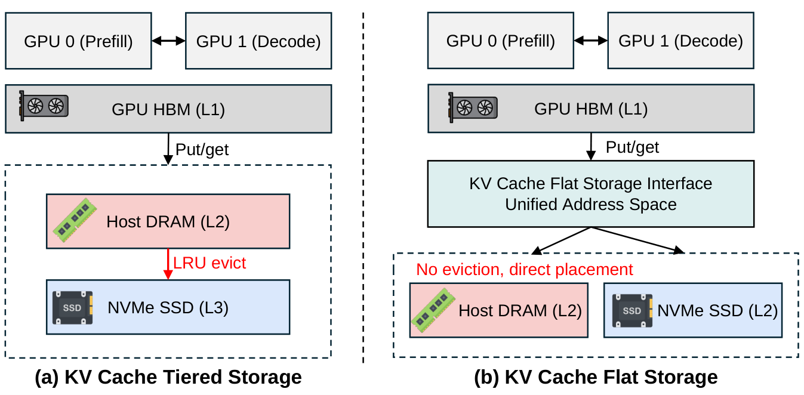
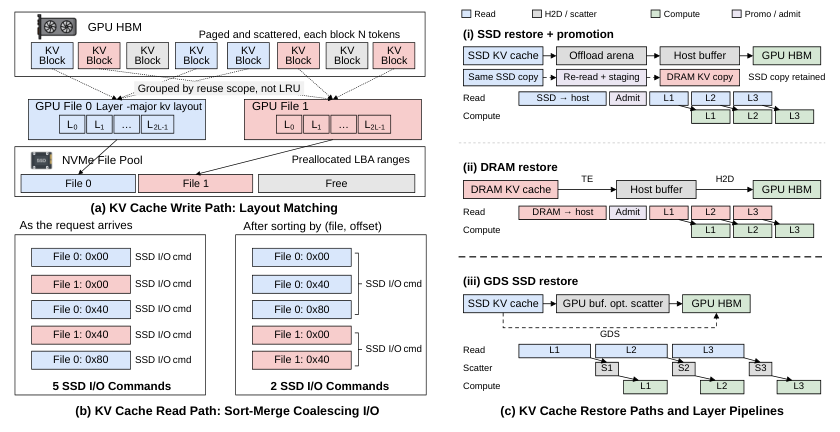

# 分层存储的两个前提同时破产：FlatCake 把 DRAM 和 SSD 放到同一层

> **元信息**：论文 _FlatCake: A Flat KVCache Storage Architecture for LLM Serving_，arXiv:2610.38355v1（2026-10 提交，尚未见正式 venue）。作者来自复旦大学先进计算研究院、北京大学集成电路学院、中科院计算所、沐曦（MetaX）与小红书，通讯作者 Youwei Zhuo（北大）。精读方式：arXiv HTML 全文（v1）逐节通读，数字逐条对照原文；PDF 存档于 [references/papers/2610.38355-flatcake.pdf](references/papers/2610.38355-flatcake.pdf)。阅读日期 2026-11-18。

Mooncake 在生产 trace 上跑到高负载，缓存命中率从 87.9% 跌到 64.26%，而它手握 4 TiB 的 NVMe SSD。同一负载下，FlatCake 把命中率按在 94.2%–94.6%，距离 94.72% 的理论上限不到 0.6 个百分点，峰值 mean TTFT 降 1.6×，SSD 读放大（6.5×–6.7×）被直接清零。

差的不是带宽，是存储的组织方式。Mooncake、LMCache、SGLang HiCache 代表的三层体系（GPU HBM → host DRAM → NVMe SSD）继承了通用存储系统的分级假设，而 FlatCake（arXiv:2610.38355）论证：这层假设在真实 LLM 负载下两个前提同时破产。它给出的替代方案是把 DRAM 和 SSD 当作平级介质：写入时直接落位，此后永不迁移。

这篇文章在本系列里的位置需要先说清楚：前四篇精读（DirectKV、NEO、eLLM、Strata）都在回答「分了层之后怎么搬得更好」，FlatCake 的姿态不同，它质疑的是「为什么要分层」。它是本专题第一篇把 DRAM 从「中间缓存」降级为「平级介质」的论文。

## 一、分层的两个前提

三层体系把 host DRAM 放在 SSD 前面，承担两个角色：一是**时间过滤**（temporal filtering），用 DRAM 缓存捕获活跃工作集，让慢速 SSD 只服务冷 miss、离开关键路径；二是 **staging 与合并**（staging and coalescing），增量淘汰会打乱盘上布局与读取顺序的对应关系，所以 SSD 读要经 host DRAM buffer 重新组装、掩盖设备延迟。

_图 1（引自论文 Figure 1）：两种 KV cache 存储组织。(a) 分层：DRAM 排在 SSD 之上，block 只在被 LRU 淘汰时才到达 SSD；(b) FlatCake：统一地址空间接口之下 DRAM 与 SSD 同层，block 写入时直接落到目标介质，没有任何迁移。_

作者剖析了 8 条生产 trace（Mooncake、Qwen Bailian 各若干条，加上 SemiAnalysis 的 Claude Code agentic trace，合计约 45 万请求），结论是两个前提同时不成立。

**前提一破产：双峰复用（bimodal reuse）击穿 DRAM 时间过滤。** 8 条 trace 的理想命中率（无限容量缓存下）从 36.6% 到 98.3%，分裂成两个 regime：

- 对话与 API 类的 7 条 trace，53.2%–94.0% 的 KV block 只被访问一次（Qwen to-B API 达 94.0%、Mooncake ToolAgent 78.5%），而可复用前缀的复用距离是重尾分布：Qwen to-B 的均值 2,550 个请求、P99 达 54,728 个请求。所有新 block 先进 DRAM 的策略，等于让一次性 block 不断把可复用的 session 前缀冲刷到 SSD，下一轮到来时前缀已经不在。换淘汰策略救不了：引用 Hu et al.（FAST '26）的数据，即便让快层容纳 40% 的总 block，LRU、FIFO、队列增强策略的 DRAM 命中率都只落在 20% 附近。
- Claude Code 这类 agentic coding 正好相反：83.4% 的 block 被复用（理想命中率 98.31%），复用距离均值只有 0.85 个请求，几乎立即复用。但单请求平均 3,421 个 block（219,922 tokens），FP8 压缩下单请求的 history KV 每 GPU rank 中位数 0.52 GiB、8 rank 合计中位 4.1 GiB、P90 达 16.0 GiB。多会话并发下，活跃工作集很快吃穿 DRAM。

一个 regime 稀疏且复用距离长，另一个 regime 密集但单体太大，两个方向都把大部分缓存命中推给了 NVMe SSD。

**前提二破产：DRAM staging 与淘汰序布局把 SSD 恢复变成瓶颈。** 既然 SSD 在关键读路径上，端到端性能取决于恢复路径。而分层机制里那些「用来平滑 SSD 访问」的设计恰好成了瓶颈：

- 恢复一个 SSD 前缀要把整个 in-flight 前缀驻留在 host staging buffer 里直到 H2D 完成，staging 内存按 O(上下文 × 并发) 增长。并发一高，staging 池耗尽，引擎撤销被阻塞的 prefetch、回退到 GPU 重算：已经花成本存在 SSD 上的 block，变成了更贵的计算 miss。
- 即使绕过 DRAM 上 GPUDirect Storage（GDS），SSD 空间是按 LRU 淘汰序填充、按粗粒度 FIFO bucket 回收的：同一 session 的 block 散布在非连续偏移上，每条 NVMe 读命令要求连续 LBA 区间，恢复一个前缀就是 O(层数 × block 数) 次小读。Mooncake 实测的读放大是 6.5×–6.7×。两条交叉佐证：SSD 带宽提升 3.3× 只换来 1.33× 吞吐（Hu et al.）；把 SSD 模拟成 16.9 GiB/s 的 DRAM，KV offload 也只跑到 2.0 GiB/s（Ren et al.），瓶颈不在原始带宽。

## 二、洞察：write-once、不可变、session 作用域

分层的根源在于它为「可变页」设计：写入时不知道页未来的访问模式和空间分组，只能事后按近期性迁移。KV block 恰好是反面：写入一次后永不修改（无脏数据、无回写）；一个 turn 生成的 block 属于已知的 session 前缀；恢复时跨层整组一起读。三条性质合起来意味着：**写入时，一个 block 的理想盘上布局就已经完全确定**。

既然如此，直接在写入时把 block 放到它的目标介质上，按 session 连续、layer-major 排布，之后永不迁移：SSD 恢复自然顺序化，DRAM 的缓存与重组两个角色同时消失。

FlatCake 按请求生命周期把这个想法拆成三个组件，各回答一个问题。

**FC-GVA（全局虚拟地址管理器）回答「写入时如何 O(1) 定位」。** 每个新生成 block 在创建时一次性绑定 DRAM 或 SSD：radix tree 引用计数 > 1 的全局 system prompt、短回复交互 turn 进 DRAM；agentic 大会话（上下文超过阈值）、长回复 turn、未共享的单轮请求、以及 DRAM 满时的兜底写入进 SSD。后续 turn 的新 block 绑定到同一 session scope，历史始终成组在同一种介质上。

位置创建后不变，于是物理位置可以直接烤进地址：64 位 GVA 编码 MediaType（4 bits）、NodeID（12 bits，4,096 节点）、字节偏移（48 bits，256 TiB/节点）。读取时在 Level 1 哈希表做一次 O(1) 查询，寄存器级位掩码提取字段即路由到四种传输后端（本地 DRAM `cudaMemcpyAsync`、远端 RDMA、本地 SSD cuFile/GDS、远端 NVMe-oF），没有逐层页表，也没有锁保护的 LRU 链。注意 GVA 空间只覆盖 offload 侧的 DRAM 与 SSD：GPU HBM 里的 KV 仍由引擎的 paged KV pool 自管，两者的衔接点是 HBM 里一块固定注册的双缓冲 staging window，数据流经窗口即交回引擎控制。MediaType 放在最高位还有一个妙处：DRAM 与 SSD 的地址空间数值上不重叠（DRAM 段全部小于 2^60），调度器一次整数比较即可完成介质分类；4 bits 的介质编码还为未来介质（如 CXL 内存）预留了扩展位。

SSD 回收也简化了：block 不可变，回收零写回；按 session extent 粒度整体回收（原子引用计数 + 高水位触发）。对比 Mooncake 的 FIFO bucket 回收：一个 bucket 横切 k 个 session，按各 session 的再访问概率算，废掉活跃前缀的概率 1−∏(1−pᵢ) 随 k 趋近必然。

值得单独说的是设计论证里的「误判成本不对称」：写时分类放错了也不会引发 miss 风暴，SSD 上的 block 照样以合并 GDS 读服务，只是用 SSD 带宽而非 DRAM 带宽。这是「写时决策」能成立的容错前提。

**FC-MAS（介质感知请求调度器）回答「没有 DRAM 预 staging，如何不让慢介质饿死快介质」。** 去掉 staging 直接暴露 DRAM 与 SSD 约 5× 的带宽差。共享 FCFS 队列会让多 GiB 的 SSD 恢复阻塞亚毫秒级 DRAM 命中（队头阻塞）；严格 DRAM 优先又会饿死大 session。FC-MAS 的三件事：按「请求所需最慢介质」分双队列（任一 block 落在 SSD 即进 SSD 预备队列，混合请求也算）；SSD 队列内部用 size-aware HRRN 调度，优先级 = 1 + 等待时间 / KV 体积，小的恢复先走压平均延迟，等待时间线性增长保证大 session 最终必被调度；prefetch 完成后按**原始到达时间**插回就绪队列，在 SSD 队列里耗掉的时间计入排队资历，防止 DRAM 突发把 SSD 会话饿死。

**FC-CIO（合并直通 I/O 引擎）回答「没有 host buffer，如何把碎片 block 读变成顺序流」。** GDS 的 scatter-gather 只在源字节占据单一连续 LBA 区间时才能散布进非连续 GPU 页，所以关键是盘上布局。三个环节咬合成一条管线：

- **写时 layer-major scope layout**：每个 session 的 SSD scope 映射到预分配单连续 extent 的 GPU File，turn 内 block 按 layer-major 排布，layer l 的全部 token 在盘上物理连续，后续 turn 追加到同一 GPU File。排布依据是消费顺序：prefill 时 layer l 的 attention 消费完 layer l 的全部前缀 token 才前进到 l+1，盘上顺序对齐消费顺序，恢复一个 layer 就是一个连续 LBA 段，理想读次数从 O(层数 × block 数) 降到 O(层数)。
- **读时 sort-merge coalescing**：radix tree 按 page 粒度吐出数十万个乱序 block 描述符，按 (gpu_file_id, offset) 排序后线性扫描合并相邻区间，64 KiB 以内的空洞直接顺带读掉，消除命令拆分开销。
- **layer-pipelined GPU streaming**：合并后的 layer extent 经 GDS 流进一个固定注册的双缓冲 GPU HBM 窗口（每 stream 约两个 layer 大小），计算 layer l 的同时异步读 layer l+1，再用轻量 scatter kernel 把连续 buffer 散布进 SGLang 非连续的 256-token paged slots。staging 内存从 O(上下文 × 并发) 压到每 GPU 一个 O(1) 窗口。高负载窗口满时，新 restore 在 CUDA stream event 上等待，而不是像 Mooncake 那样撤销 prefetch 转重算。

_图 2（引自论文 Figure 5）：FC-CIO 的设计与数据路径。(a) 写路径：session 按 layer-major 布局在预分配的 GPU File 里；(b) 读路径：按 (file, offset) 排序合并，5 条 SSD I/O 命令缩成 2 条；(c) 三种恢复路径对比：(i) SSD 恢复经 staging + promotion、(ii) DRAM 恢复经 host buffer、(iii) GDS 直接恢复配 layer 流水。_

## 三、实验与归因

主实验：8×B200 + 3 TB DRAM + 8 盘 Samsung PM9A3 NVMe RAID 0，对比系统统一 1 TiB DRAM + 4 TiB SSD 预算；SGLang v0.5.19、Mooncake v0.3.13、GDS 1.16.1；模型 DeepSeek-V4-Flash（284B hybrid MoE，43 层 MLA，FP8 KV，1M 上下文）；负载为 SemiAnalysis 生产 Claude Code trace（98,827 请求、21.6B input tokens、393 个多轮 session）。

端到端最有说服力的是交付命中率曲线。FlatCake 在全部负载点维持 94.16%–94.57%，距 trace 的 94.72% 前缀复用上限不到 0.6 个百分点；Mooncake 低载 87.9%，0.5 QPS 以上跌到 64.26%，手握 4 TiB SSD，却只比纯 DRAM 缓存（恒 53.30%）多救回 11 个百分点。峰值负载（1.0 QPS）下 mean TTFT 7.57 s 对 Mooncake 12.24 s（1.6×）、对 +L2 Host DRAM 17.51 s（2.3×）；吞吐 98.3K tokens/s，1.6× 于 Mooncake。命中率崩塌的机制讲得很清楚：staging 内存饱和 → SGLang 撤销 prefetch → 重算已缓存前缀；FlatCake 的对应做法是让 restore 在 stream event 上排队等窗口。

三个组件各有独立归因。FC-GVA：SSD 直接供给 52.6%–69.3% 的复用 token，DRAM 份额稳定在 8.0%–11.7%（不被污染）；负载升高时 GPU HBM 命中份额从 13.6% 升到 33.6%，合并恢复足够快，邻近 turn 在 HBM 里就命中了；对照 Mooncake 的 L3 贡献从 51.7% 崩到 18.4%。写放大 FlatCake 恒 1.000×（写一次、无回写、无重算重写），Mooncake 1.007×–1.018×。FC-MAS 消融：mean TTFT 降 10–11%、P99 尾延迟降 27%、吞吐升 12%，P99 改善最大，说明它消灭的主要是跨介质队头阻塞。FC-CIO：SSD 读带宽 5.03 GB/s 对 Mooncake 2.69 GB/s（1.9×）；负载 10× 增长下 prefetch 延迟几乎水平（1.47–1.75 s），Mooncake 从 3.16 s 恶化到 9.50 s；6.5×–6.7× 读放大归零。

跨模型实验（Llama-3.1-70B，GQA，4×A100，8K–128K）里有一组关键的对照：Mooncake-GDS（保留分层淘汰序布局、只把读路径换成 GDS）在 16K token 与 FlatCake 打平（2.31 s 对 2.32 s），到 64K 劣化到 1.8×（6.60 s 对 3.74 s）。这组对照专门隔离了「GDS 传输原语」与「盘上布局设计」的贡献，结论是：只开 GDS 不改布局，16K 以内够用，上下文一长淘汰序碎片化立刻反噬，FlatCake 对 1.5×–2.4× 于 Mooncake、至多 1.8× 于 Mooncake-GDS。

## 四、与内存层级专题的对话

放在本系列的坐标系里，FlatCake 与前四篇的姿态差异值得说透。DirectKV（零拷贝搬运）、NEO（attention 下移 CPU）、eLLM（内存池并账）、Strata（搬运与调度重排）回答的都是「分了层之后，跨层的那一跳怎么做便宜」；FlatCake 回答的是「这一跳能不能不发生」。它把 [总纲 §五](01_memory-tiering-overview.md) 设想的「统一命名空间，地址段本身即层级标签」做成了纯软件实现：GVA 的 MediaType 位段就是「地址段即层级标签」的字面形态，只是它不依赖 GH200 统一页表或 CXL 这类硬件，而是利用 KV block write-once 的领域性质，让软件自己造出了地址即位置的语义。总纲那句话在这里应验了：「统一命名空间改变的是软件的结构（少写管道），不改变瓶颈的数学（带宽比还在）」。FlatCake 没有消除 DRAM 与 SSD 的 5× 带宽差，它只是不再假装 DRAM 能过滤掉它。

对总纲的四条路线（去搬运 / 挪计算 / 并账本 / 重排调度）而言，FlatCake 算第五条：**不迁移**。前提是介质对等可直读（DRAM 与 SSD 都能被 GPU 直接访问）加上负载的 write-once 性质。两条前提缺一条，就退回前四条路线的世界。

## 五、边界与存疑

- **单机评估**。端到端实验全部在一台 8-GPU 服务器上。GVA 预留了 12 位 NodeID（4,096 节点），跨节点 coordinator 只做轻量容量协调（作者以「读主导 KV 流量」论证其不在关键读路径上），但 Mooncake 原生的场景是多机分离式 PD 集群，扁平架构在集群尺度的表现本文没有数据。
- **实现未开源**。论文（arXiv v1）未附代码仓库链接，GitHub 上也没有公开的 FlatCake 仓库（截至 2026-11-18 检索）；复现只能依赖论文第 4 节的机制描述与组件接口约定。
- **写时分类的敏感性未消融**。Table 2 给出了四种 scope 的写时信号：Shared prompt（前缀引用计数 > 1）与 Short-turn chat（Turn > 1 且 prior reply < τ）进 DRAM，Agentic/Long（Context ≥ L_agent 或 reply ≥ τ）与 One-shot/Spill（Turn = 1 或 DRAM 满）进 SSD。但阈值 τ 与 L_agent 的取值全文未披露；全文唯一的消融是 FC-MAS（单队列对照），没有 FC-GVA 放置决策的消融（无「全放 SSD」或随机放置的极端对照），也没有误分类分析：放置的验证只有 Figure 7 的结果归因（DRAM 份额稳定、SSD 供给过半），证明的是放置结果的分布，不是分类决策相对理想策略的准确率。设计论证依赖「误判成本不对称」的定性推理。生命周期复杂的负载（同一会话先短聊后长 agentic）下，写死介质、永不迁移可能从优点变成约束。
- **负载谱偏向有利场景**。主打 trace 是 Claude Code（高复用、大 session），恰是扁平架构最有利的形态；对 Table 1 里 94% one-shot 的 Qwen to-B 类负载，一次性 block 大量占 SSD 的代价着墨较少。
- **基线版本**。对比基线为 SGLang v0.5.19 与 Mooncake v0.3.13；Related Work 里的 SolidAttention（FAST '26）、KVDrive、Bidaw（FAST '26）等更近期工作只有定性区分，未进实验。

## 诚实声明

本文基于 arXiv HTML 全文（v1）逐节通读，数字逐条对照原文；PDF 已存档 [references/papers/2610.38355-flatcake.pdf](references/papers/2610.38355-flatcake.pdf)，HTML 版无印刷页码，故未标页码。「与内存层级专题的对话」一节的坐标系判断（第五条路线、总纲 §五的软件实现）是本仓的整理观点，论文原文只陈述自身设计。批判性观察（第四节）为整理者评估，非论文内容。

## 参考资料

1. 论文：FlatCake: A Flat KVCache Storage Architecture for LLM Serving（arXiv:2610.38355v1），https://arxiv.org/abs/2610.38355
2. 本系列总纲：[当 KV 装不进显存：四篇论文的四种内存账](01_memory-tiering-overview.md)
3. 前四篇精读：[DirectKV](02_directkv.md) · [NEO](03_neo.md) · [eLLM](04_ellm.md) · [Strata](05_strata.md)
4. 引用的负载刻画：Wang et al., KVCache cache in the wild（USENIX ATC '25）；Hu et al., Bidaw（FAST '26）；SemiAnalysis CC Traces（HuggingFace 数据集）
