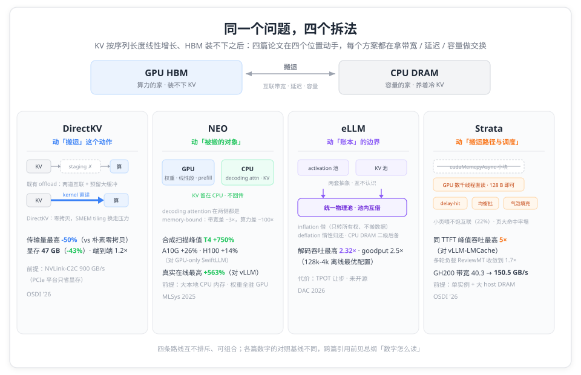
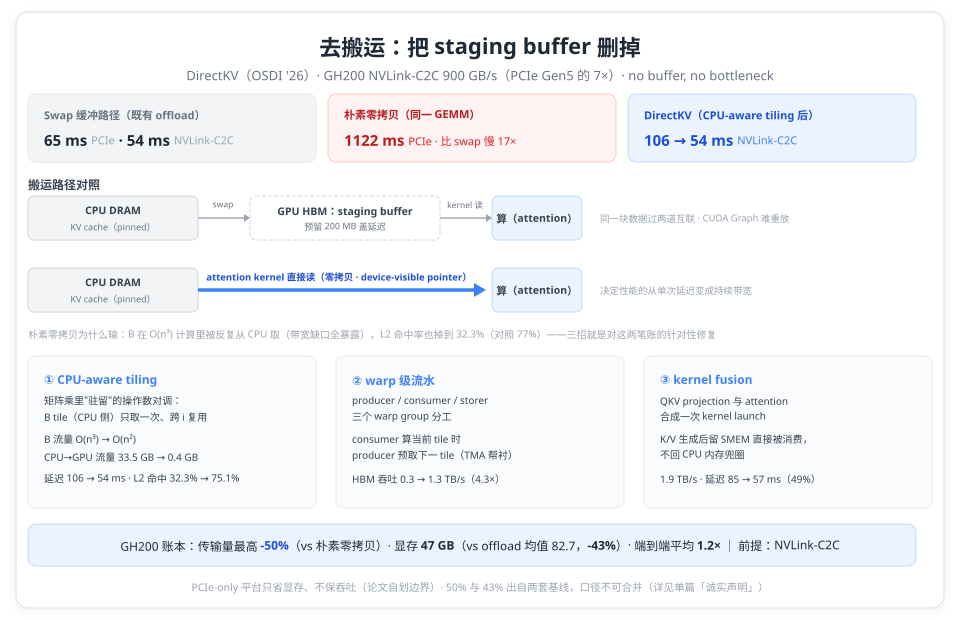
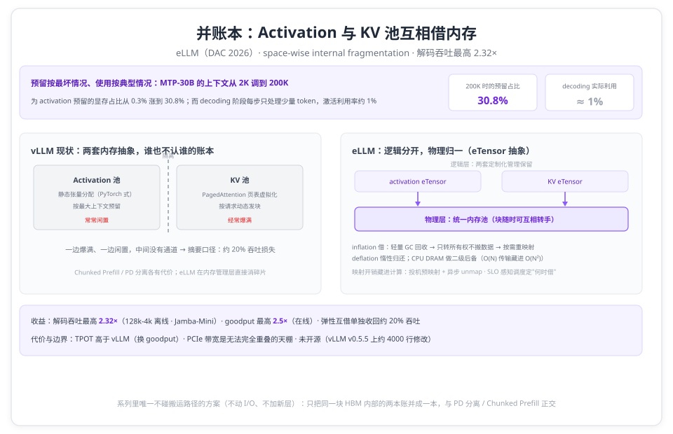
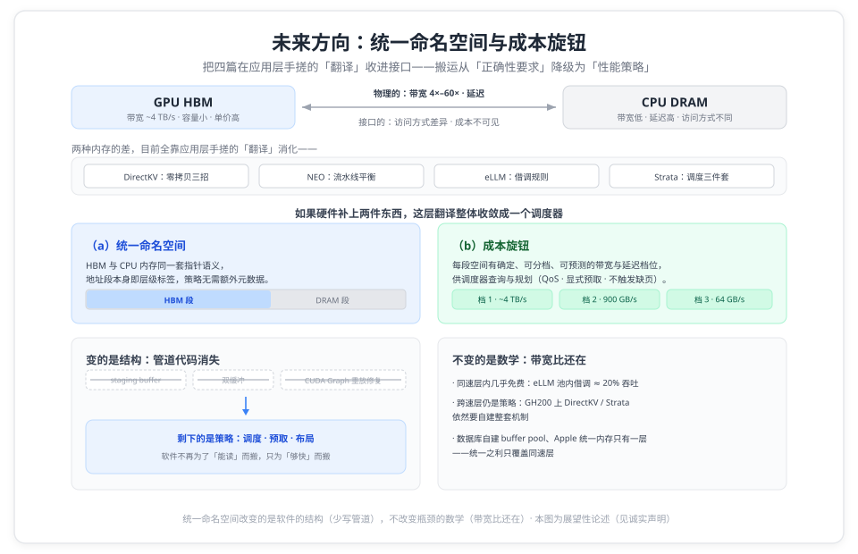

# 当 KV 装不进显存：四篇论文的四种内存账，与一个「统一命名空间 + 成本旋钮」的设想

> **元信息**：本文是「KV Cache 内存层级」系列总纲。系列含四篇单篇精读：[DirectKV](directkv.md)（OSDI '26，零拷贝去搬运）· [NEO](neo.md)（MLSys 2025，计算下移）· [eLLM](ellm.md)（DAC 2026，抽象虚拟化）· [Strata](strata.md)（OSDI '26，分层调度），每篇都附逐条页码核对的精读报告（`references/`），论文原文 PDF 在 `references/papers/`。本文只做横向组织与口径提示，机制细节与数字以单篇为准。整理日期 2026-10-12。

两个数字放在一起，能看出这个交叉点的分裂。DirectKV 的图 2(a)：同一个 10240 方阵乘法，用 200 MB 显存缓冲把 CPU 内存里的数据换进来（swap），PCIe 上 65 ms；换成零拷贝、让 GPU 直接读 CPU 内存，1122 ms，慢 17 倍（p.42）。而 NEO 在 T4 上把 decoding attention 连同 KV 一起卸给 CPU，吞吐反而最高涨 7.5 倍（合成负载扫描峰值，§5.4，pp.8–9）。

同一个总前提——KV 装不下显存——一边是「别碰这套搬运」，一边是「搬出去反而赢」。两个答案都只在特定条件下成立：DirectKV 的小前提是 NVLink-C2C，NEO 的小前提是小显存 GPU 加上大容量本地 CPU。把四篇论文并排看，看的不是谁更好，而是每种账本各自记在什么条件下。这些条件里，哪些是物理的（带宽与容量的台阶），哪些只是接口的（访问方式差异、成本不可见），决定了这四笔账接下来会怎么走。§五 把这条线展开。

## 一、同一个问题，四个拆法

KV cache 按序列长度线性增长，HBM 装不下之后，每一层外部内存都在拿三样东西做交换：带宽（搬得动吗）、延迟（藏得住吗）、容量与利用率（放着划算吗）。四篇论文在四个不同位置动手：

- **DirectKV 动的是搬运这个动作本身**：既然最贵的是「先搬进 HBM 再算」，就把 staging buffer 删掉，让 attention kernel 直接读 CPU 侧 KV；
- **NEO 动的是被搬的对象**：KV 之所以要搬回 GPU，是因为计算在 GPU 上；那就把 decoding attention 的计算一起挪到 CPU，KV 干脆不回来；
- **eLLM 动的是账本的边界**：activation 和 KV cache 分属两套内存抽象、两个池子，一边爆满一边闲置；把物理层并成一本账，互相借；
- **Strata 动的是搬运的路径与调度**：搬运保留，但把 I/O 从 DMA 引擎换到 GPU 数千线程手里、把布局解耦、再把搬运藏进 cache-aware 调度。

| 论文（单位）                    | 场景定位                                | 核心矛盾                                    | 招式                                            | 代表账本                                       |
| ------------------------------- | --------------------------------------- | ------------------------------------------- | ----------------------------------------------- | ---------------------------------------------- |
| DirectKV（弗吉尼亚大学）        | 节点内长上下文 · GH200/GB200 高带宽互联 | staging buffer 双程搬运、大缓冲盖延迟       | 零拷贝直读 + tiling / warp 流水 / kernel fusion | 传输量最高 -50% · 显存 -43% · 端到端 1.2×      |
| NEO（UC Berkeley + Harvard）    | 小显存 GPU + 在线服务                   | decode attention 的 KV 卡死 batch、CPU 空转 | decoding attention 下移 CPU + 非对称流水线      | T4 合成峰值 7.5× · 在线最高 +563%              |
| eLLM（上海交大 + 期智研究院等） | vLLM 单机 · activation 与 KV 互挤       | 两套内存抽象互不借账（空间内部碎片）        | eTensor 统一池 + inflation / deflation          | 解码吞吐 2.32× · goodput 2.5×                  |
| Strata（Stanford + NVIDIA）     | SGLang 系分层缓存 · agent/长上下文负载  | 小页喂不饱互联、调度看不见搬运              | GPU-assisted I/O + cache-aware 三件套           | 同 TTFT 峰值 5× · GH200 带宽 40.3 → 150.5 GB/s |

口径说明：数字均为论文自测，对照基线各不相同，引用前先过 §六「数字怎么读」。

## 二、四条路线

### 2.1 去搬运：DirectKV（OSDI '26）

既有 offload 方案的共同假设是「KV 必须先到 HBM」（p.39）。这条假设带来三笔代价：预留大块 GPU 缓冲盖延迟、swap 让互联流量翻倍、`cudaMemcpyAsync` 的动态地址让 CUDA Graph 无法原样重放（p.41）。DirectKV 押注的是硬件变化：GH200/GB200 的 NVLink-C2C 有 900 GB/s（"7× higher than PCIe Gen5"，p.39），零拷贝的细粒度访问在这条通道上能凑出 MB 级聚合流量，决定性能的从单次延迟变成持续带宽。

机制三招：**CPU-aware tiling** 把矩阵乘里"驻留"的操作数从 CPU 侧换成 HBM 侧（B tile 只取一次，流量 O(n³) 降到 O(n²)，换 HBM 流量约 2×，p.42–43）；**warp 级流水**用 producer/consumer/storer 三个 warp group 把搬运藏进计算（HBM 吞吐 0.3 → 1.3 TB/s，p.43）；**kernel fusion** 把 QKV projection 与 attention 合成一次 launch，K/V 生成后留在 SMEM 直接被消费，不回 CPU 内存兜圈（延迟 85 → 57 ms，p.43）。

账本（GH200，对 offload 系统基线）：传输量最高降 50%、显存 47 GB（对照 offload 系统均值 82.7 GB，降 43%）、端到端平均 1.2×（p.48–49）。前提取自论文自己的边界声明：高带宽互联是硬条件，"on PCIe-only platforms … throughput benefits are often limited"（p.50）。

### 2.2 挪计算：NEO（MLSys 2025）

NEO 的起点是一句反向的前提检查：decoding attention 在 GPU 和 CPU 上都是 memory-bandwidth-bound，而两类硬件的带宽差距远小于算力差距：A10G 的 600 GB/s 对现代 x86 服务器的约 200 GB/s，只差约 3 倍，算力差约 100 倍（§2.2，p.3）。既然瓶颈是带宽，把这段计算搬去 CPU 的损失就有限；而腾出来的显存能换更大的 batch。

机制是 **asymmetric pipelining**（partial offloading + prefill 并入 batch-0 + layer-wise swapping + asymmetric batch division，§3.1，p.5）加**负载感知调度**（每迭代六步、始终保留退回 GPU-only 的选项，§3.2，p.6）。论文先用两个 strawman 划掉错误答案：全量卸载让 CPU 在线性层阶段空转；均分的对称流水线既闲置 GPU 内存又制造 bubble（§3.1，p.4–5）。

账本分两组口径：合成负载扫描对 GPU-only 基线，T4/A10G/H100 最高 +750% / +26% / +14%（§5.4，pp.8–9）；真实在线对 vLLM、固定时延点，是 14.3% / 6.40% / 563%（§5.2，p.7）。CPU 容量敏感性显示增益由**带宽而非核数**决定（§5.5，p.9）。前提：大容量本地 CPU 内存（"NEO relies on large CPU memory"，p.10）、权重全部驻留 GPU。

### 2.3 并账本：eLLM（DAC 2026）

论文把「activation 预留按最坏情况、使用按典型情况」的错位量化了：MTP-30B 的上下文从 2K 调到 200K 时，为激活预留的显存占比从 0.3% 涨到 30.8%，而 decoding 阶段激活利用率约 1%（p.2）。两块内存分属两套抽象（activation 走静态张量分配、KV 走页表虚拟化），谁也不认识对方的账本，论文称之为 **space-wise internal fragmentation**，「leading to suboptimal utilization and 20% throughput degradation」（p.1）。

eLLM 的抽象叫 **eTensor**：逻辑层保留两套定制化管理，物理层共享一个统一内存池（p.3）。KV 池不够时向 activation 池 inflation：轻量 GC 回收不活跃块、只转所有权不搬数据、再按需映射进目标虚拟地址空间；deflation 惰性归还（p.4）。第二级弹性把 CPU DRAM 当溢出 buffer，靠 layer-wise pipelining 把 O(N) 的 KV 传输藏进 O(N²) 的 prefill 计算（p.4）。调度按 SLO 分阶段调整 logical buffer 的可用尺寸（p.4）。

账本：解码吞吐最高 2.32×（128k-4k 离线配置、Jamba-Mini、2 GPU，p.6），goodput 最高 2.5×（p.5）。代价论文自己认：CPU buffer 引入 prefill 偏好、TPOT 高于 vLLM（p.5），PCIe 带宽是无法完全重叠的天花板（p.6）。前提：单机 A100 + 大 CPU DRAM + PCIe。实现未开源（vLLM v0.5.5 上约 4000 行修改）。

### 2.4 重排调度：Strata（OSDI '26）

Strata 的起点是一组「搬运效率」的实测：8192 个 token 的 KV 从 CPU 内存搬回 GPU，只吃到 PCIe 5.0 理论带宽的约 22%；换 GH200 用 NVLink，这个比例掉到 5%（p.3–4）。根因是页太小：PagedAttention 为省显存把 KV 切成 1–32 token 的页，单页几十 KB 喂不饱互联（p.2–4）。按 Little's Law `X = C·S/L`，要吃满 PCIe 需要 1–2MB 的单次传输（p.3），但放大页会让命中率塌掉（页 1→512，P90 TTFT 最高涨 2.9×，p.3）。

机制分两条线。**搬运线**：GPU-assisted I/O，不再发 cudaMemcpyAsync 传小块，而是 launch kernel、数千线程直接读源写目标，128 bytes 粒度就高效（2 block × 1024 线程达成 48 GB/s，prefill 干扰 <5%，p.5）；同一套线程顺带完成 layer-first ↔ page-first 的布局转换，"negligible overhead"（p.6）。**调度线**：cache-aware 三件套：delay hit 规避（把撞在计算中的重复 miss 推迟到即将命中，p.7）、均衡批（load/compute 比超阈值 `loading_bound`=100 就移出，p.7）、气泡填充（用 decoding batch 去填加载空档，p.7）。

账本：同 TTFT 下峰值吞吐最高 5×（对 vLLM-LMCache）/ 3.75×（对 TensorRT-LLM），对应 Llama-70B + LooGLE + H200 的最优点；多轮负载 ReviewMT 上收敛到 1.7×/2.3×（p.9）。GH200 上持续传输带宽从 40.3 GB/s 提到 150.5 GB/s（p.12）。前提：单实例、大 host DRAM、SGLang 系生态；主力基线 SGLang-HiCache 是作者自实现版本（p.8）。

## 三、对号入座：你手上是什么条件

| 你的条件                                                              | 该看哪篇 | 先决条件与口径提示                                                                                                     | 开源入口                                                  |
| --------------------------------------------------------------------- | -------- | ---------------------------------------------------------------------------------------------------------------------- | --------------------------------------------------------- |
| GH200/GB200 或带高带宽互联的平台，节点内长上下文                      | DirectKV | NVLink-C2C 是硬前提，纯 PCIe 上只省显存不保吞吐；「50% 传输降幅」对照朴素零拷贝，「43% 显存降幅」对照 offload 系统均值 | [DirectKV](https://github.com/shutianluo/DirectKV)（MIT） |
| 小显存 GPU（T4/A10G 一类）、本地 CPU 内存大、要在线服务               | NEO      | 前提是「随卡白送」的本地 CPU 与大 host 内存；峰值倍数看合成扫描，真实收益看固定时延点（563% 对 7.5× 是两组账）         | [NEO](https://github.com/NEO-MLSys25/NEO)（论文承诺开源） |
| vLLM 上长上下文跑满、activation 与 KV 互相挤                          | eLLM     | 单机 + PCIe；收益最大的形状是长序列 + 高 activation-to-KV 比；代价是 TPOT 让步；未开源，先学思路                       | 论文未开源                                                |
| SGLang 系 + 大 host DRAM + agent/长上下文负载，分层缓存已开但搬运浪费 | Strata   | 单实例范围；主力基线的 HiCache 是自实现版；「5×/3.75×」是 "up to" 最优点，多轮负载收敛到 1.7×/2.3×                     | 论文未提及                                                |

四条路线互不排斥：DirectKV 的零拷贝消除的是 eLLM 仍要付的 PCIe 账单；NEO 的 CPU attention 与 Strata 的 CPU↔GPU 传输是两个方向；eLLM 的池内弹性与 Strata 的层级调度正交。混用的边界，四篇的「局限与边界」小节里都有各自的答案。

## 四、共同的支点与边界

**先量缺口，再对数字设计。** 四篇的机制都能回指一组事先被测出来的数字：DirectKV 量出朴素零拷贝把 B 的流量放大到 33.5 GB、L2 命中率掉到 32.3%，三招各自对着这两笔账修；NEO 量出带宽差约 3×、算力差约 100×，才敢把 bandwidth-bound 的 decoding attention 搬走；eLLM 量出预留占比 30.8% 对实际利用率约 1% 的错位，才有了互借的池；Strata 量出 22% 的带宽利用率、最高 24% 的加载停顿与 38% 的 delay hit 撞车率，才去换 I/O 机制与调度。

**第二个交叉点：把搬运藏起来的四种配对手法。** 四篇走的都是同一条路：把传输藏进另一份资源面的计算里（DirectKV 消掉的也只是 staging 这一个动作），配对方式各不相同：kernel 内藏（DirectKV 的 warp 级流水，producer 预取下一 tile 与 consumer 的计算同 kernel 掩护）、两侧互藏（NEO 的双 batch，CPU attention 与 GPU 线性段互为掩护，调度约束落成 `Tl0 ≥ Tca1` 这样的不等式）、层间藏（eLLM 的 layer-wise pipelining，O(N) 的 KV 传输藏进 O(N²) 的 prefill）、批间藏（Strata 的气泡填充，加载吃 PCIe、解码吃 HBM，资源面错开）。手法不同、约束相同：掩护窗口要盖得下传输，且两份负载不能抢同一种资源。

**都建立在当代硬件的某道新缝隙上。** DirectKV 赌 NVLink-C2C 把互联和 HBM 的差距缩进一个数量级；NEO 赌 CPU 带宽与 GPU 只差约 3 倍；eLLM 赌 GPU VMM 支持映射转手；Strata 赌数千个 GPU 线程搬 KB 级数据的效率。硬件前提变了，账就要重算。四篇论文各自的局限章节都在谈硬件，原因就在这里。

**精度账普遍缺席。** DirectKV 全文没有 accuracy/perplexity 实验；eLLM 是纯内存管理、理论上不影响精度但没报告；NEO 也没有质量数据。内存层级重构在数值上"免费"到什么程度，四篇里没有一篇测完。

**与 FAST'26 系列的分工。** 那边的五篇是「KV × 存储的五个场景」（端侧、智能体、多轮对话、分离式、冷启动），对象是 SSD 与文件系统；这边四篇的对象是显存之外的第一层：DRAM、互联、内存抽象与调度。串起来读的顺序是：先把内存层级用对（本系列），再和存储打交道（[FAST'26 系列](../03_fast26/fast26-kv-storage-five-scenarios.md)）。

## 五、未来方向：统一命名空间与成本旋钮

四篇有个共同处境：每个团队都在应用层手搓一层「翻译」：把两种内存的物理成本差（带宽 4× 到 60×、延迟、访问方式）翻译成显式策略（DirectKV 的三招、NEO 的流水线平衡、eLLM 的借调规则、Strata 的调度三件套）。翻译层之所以存在，是因为接口只提供了两种形态：「两个地址空间 + 显式拷贝」，或「统一地址空间 + 自动迁移」（Unified Memory 式的缺页加页迁移；主流推理栈的 KV 热路径基本不用它：页粒度迁移对 token 粒度、带 stride 的 KV 访问并不合身）。

如果硬件补上另外两件东西，这层翻译可以整体收敛成一个调度器：

- **统一命名空间**：HBM 与 CPU 内存同一套指针语义，**地址段本身即层级标签**，策略不需要额外元数据，就能知道自己在跟谁说话；
- **成本旋钮**：每段空间有确定、可分档、可预测的带宽与延迟档位（带宽 QoS、显式预取、不触发缺页的访问），供调度器查询与规划。

有这两样，搬运从「正确性要求」降级为「性能策略」：staging buffer、双缓冲、`cudaMemcpyAsync` 动态地址造成的 CUDA Graph 重放问题这些管道代码都会消失。软件不必再为了「能读」而搬，只需为了「够快」而搬。eLLM 已经给了同速层内的小样板：activation 池与 KV 池并账后，借调只转所有权、不搬数据，约 20% 吞吐几乎白得。反过来看，四篇里最重的部分恰好全是跨过成本台阶的那部分，一件都省不掉。

反面教材也现成：数据库几十年来宁可自建 buffer pool，也不把页缓存交给虚拟内存的缺页逻辑；Apple 的统一内存让推理软件变简单，是因为它只有一层。统一在同速层内几乎免费，跨了层就重新变成策略问题。 GH200 的统一页表与 CXL 是最接近这组设想的硬件，而经验事实是：GH200 上 DirectKV、Strata 依然要自建整套机制。统一命名空间改变的是软件的结构（少写管道），不改变瓶颈的数学（带宽比还在）。这也正是 vLLM KV Connector、LMCache 分层与 HiCache 预取正在走的路：把「怎么搬」从各系统的私有实现，收敛成可替换的策略层。

## 六、数字怎么读

- **DirectKV**：「50% 传输量降幅」的对照是朴素零拷贝，不是 Pie/Neo/FlexGen（§7.4.1，p.49）；43% 显存降幅的基线是 Neo/Pie/FlexGen 三者均值 82.7 GB（不含 SGLang 的 92 GB）；1.2× 是跨上下文长度的平均值，优势随长度放大。
- **NEO**：7.5×/26%/14% 是合成负载扫描的峰值（对 GPU-only 的 SwiftLLM）；真实在线是 14.3%/6.40%/563%（对 vLLM、固定时延点）；79.3% 由 CPU 带宽决定、论文未逐一点名实例型号；2 卡实验的 CPU 资源被限在 1/4 NUMA 节点。
- **eLLM**：2.32× 是 128k-4k 离线最优配置（Jamba-Mini，2 GPU）；「128K batch 扩约 3×」是 Figure 7 读图值、正文没有；295×/140× 的 TTFT 倍数取自 vLLM 排队崩溃区，不是稳态对比。
- **Strata**：5×/3.75× 均为 "up to"，对应 Llama-70B + LooGLE + H200 的同 TTFT 最优点；主力基线 SGLang-HiCache 是作者自实现，与 SGLang 发行版功能的关系论文未说明；22%/5% 两个带宽利用率是同为「搬 KV、页大小 32、Llama-3.1-8B」条件下的测量（p.3–4）。

## 系列篇目

- [不搬 KV 反而更快：OSDI'26 DirectKV 让显存少占 43%](directkv.md)——**去搬运**（OSDI '26）
- [显存卡死 batch 的 GPU 上：NEO 把 decoding attention 搬给了随卡白送的 CPU](neo.md)——**挪计算**（MLSys 2025）
- [30.8% 的显存按 200K 上下文预留，实际只用 1%：eLLM 让 Activation 与 KV Cache 互相借内存](ellm.md)——**并账本**（DAC 2026）
- [8192 个 token 的 KV 只跑出 22% PCIe 带宽：Strata 重做分层缓存的搬运与调度](strata.md)——**重排调度**（OSDI '26）
- 精读报告（逐条页码核对版）：[DirectKV](references/directkv-report.md) · [NEO](references/neo-report.md) · [eLLM](references/ellm-report.md) · [Strata](references/strata-report.md)；论文原文 PDF 在 `references/papers/`（已核页数与首末页）

## 诚实声明

- 四篇的数字均为论文自测，本仓未复现；本文的横向比较跨论文、跨硬件、跨负载，除注明外**不可直接互比**。
- 本文每个数字都取自对应单篇精读；各单篇的「诚实声明」列出了自己的口径限定与未核实项（如 DirectKV 的精度实验缺席、Strata 的自实现基线、NEO 的 NUMA 限制、eLLM 的读图值）。
- 「未来方向」一节是展望性论述：由四篇的实测经验与公开的硬件背景（Unified Memory、GH200 统一页表、CXL 等）并读推演而来，不是任一论文的主张，其中的硬件侧细节未按本系列的逐条核对标准核验。

## 延伸阅读：本仓相关（按主题）

> 本系列只管「显存之外的第一层」；上下游的传输、系统与存储线索按主题列在这里，完整映射见 [KV Cache 技术体系门户](../README.md)。

**卸载与预取**（把 KV 搬到 CPU/盘，并隐藏搬运延迟）：

- [KV Offloading 架构对比](../01_concepts/offloading/01_kv_offloading.md) · [KV Cache 层级流水线并行](../01_concepts/offloading/02_layerwise_pipeline.md) · [KV Cache Prefetching：三层预取](../01_concepts/offloading/03_kv_cache_prefetching.md) · [稀疏注意力 × KV Cache Offloading：跨层联动必须回答的八个问题](../01_concepts/offloading/sparse_attention_driven_offloading_problems.md)

**PD 分离与跨节点传输**（搬运走出单机之后）：

- [PD 分离架构下的 KV Cache 传输](../01_concepts/pd_transfer/01_disaggregated_prefill_kv_transfer.md) · [压缩、重叠、复用、隔离：PD 状态交接优化的四条轴](../01_concepts/pd_transfer/02-pd-state-handoff-optimization-map.md) · [分卡之后再跨机：DCP 与 PD 分离叠加时的 KV 传输](../01_concepts/pd_transfer/03-dcp-pd-transfer.md)

**系统与容量**（分层缓存的工业实现与并发账本）：

- [SGLang HiCache 深读](../../sglang/hicache_deep_dive.md) · [LMCache 概览](../02_systems/lmcache/lmcache_overview.md) · [L2 还有大半空着，TTFT 为什么先崩了？L1 KV Pool 才是系统并发的上限](../01_concepts/capacity_planning/hbm_kv_pool_concurrency.md)

**压缩与淘汰**（把 KV 变小的经典两条腿）：

- [KV Cache 压缩技术详解](../01_concepts/compression/kv_cache_compression.md) · [KV Cache 淘汰策略：从滑动窗口到注意力引导的精确淘汰](../01_concepts/eviction/attention_sinks_and_eviction.md)

**KV × 存储的五个场景**（本系列的下一层：SSD 与文件系统）：

- [当 KV Cache 装不进内存：FAST'26 五篇论文给出的五个不同答案](../03_fast26/fast26-kv-storage-five-scenarios.md)

## 参考资料

- Shutian Luo, Haiying Shen. _No Buffer, No Bottleneck: Efficient Zero-Copy KV Cache Offloading for Long-Context LLMs_. OSDI '26, pp. 39–54. [USENIX 论文页](https://www.usenix.org/conference/osdi26/presentation/luo)
- Xuanlin Jiang et al. _NEO: Saving GPU Memory Crisis with CPU Offloading for Online LLM Inference_. MLSys 2025. [arXiv:2411.01142](https://arxiv.org/abs/2411.01142)
- Jiale Xu et al. _eLLM: Elastic Memory Management Framework for Efficient LLM Serving_. DAC '26. [arXiv:2506.15155](https://arxiv.org/abs/2506.15155)
- Zhiqiang Xie et al. _Strata: Hierarchical Context Caching for Long Context Language Model Serving_. OSDI '26. [USENIX 论文页](https://www.usenix.org/conference/osdi26/presentation/xie-zhiqiang)
- 本仓相关：[FAST'26 KV × 存储五场景](../03_fast26/fast26-kv-storage-five-scenarios.md) · [SGLang HiCache 深读](../../sglang/hicache_deep_dive.md)
