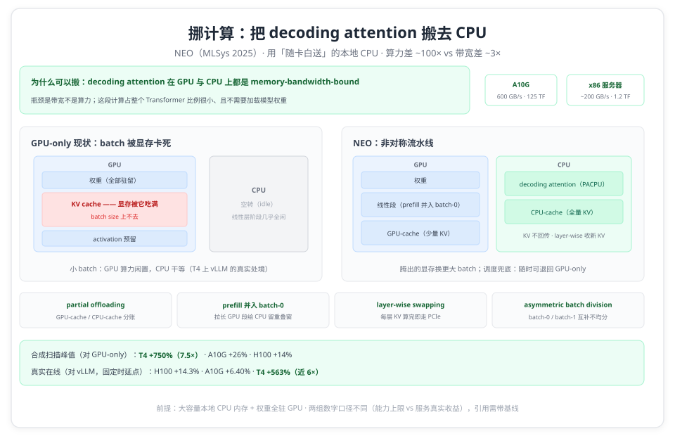

# 显存卡死 batch 的 GPU 上：NEO 把 decoding attention 搬给了随卡白送的 CPU

> **元信息**：论文 _NEO: Saving GPU Memory Crisis with CPU Offloading for Online LLM Inference_，UC Berkeley + Harvard（Xuanlin Jiang、Yang Zhou、Shiyi Cao、Ion Stoica、Minlan Yu），MLSys 2025。arXiv:2411.01142v1（2024-11-02），PDF 共 13 页（正文 pp.1–10，参考文献 pp.11–13），本文页码均指该 PDF。精读方式：全文抽取逐条对照 + Agent 精读交叉核对（报告见 [references/neo-report.md](references/neo-report.md)），未核实项集中在文末「诚实声明」。阅读日期 2026-10-12。

在 T4 上跑 LLaMa-2-7B 加摘要负载，vLLM 会撞上一个很具体的墙：论文的表述是 "the T4 GPU has an extremely constrained memory budget for the KV cache, severely limiting vLLM batch size"（§5.2，p.7）。批大小卡住，GPU 的算力就大面积闲着，而机箱里那颗 CPU 在全部线性层阶段完全空闲。

NEO 的做法是把 decoding attention 的计算连同它的 KV cache 一起下放给这颗 CPU。摘要里给出的账：对比 GPU-only 方案，T4、A10G、H100 上吞吐最高提升 7.5×、26%、14%，时延不变（p.1）。低端卡上的倍数来自 vLLM 被显存卡死、而 NEO 可以把 KV 挪走换更大的 batch（§5.2，p.7）。

这条路线在成本上容易走歪，论文点名了最接近的先行者：FastDecode "uses 8 32-core AMD Epyc CPUs in remote servers to handle the offloaded compute of only one A10G GPU, where the CPUs cost much more than the GPU"（p.1）。NEO 的立论基础相反：只用 "local host CPUs as the offloading target that comes with the GPU 'as free'"（p.1），并且只卸载一部分，既不让 CPU 过载，也不让 GPU 内存空置。

## 一、显存危机的两笔账

第一笔账在批大小上。论文引用的测量结论是，吞吐会随批大小近似线性增长直到数百，而现实是 "these GPUs fail to accommodate hundreds or even dozens of batch size, leaving significant GPU compute resources unutilized"（§2.1，p.2）。所谓 GPU 显存危机，论文的描述是 "the memory-bounded LLM inference workloads have created the GPU memory crisis where people demand expensive high-end GPUs with large memory sizes"（p.1）。

第二笔账是既有出路各自的代价。量化直接损失精度；offload 系工作（FlexGen、PowerInfer、TwinPilots、HeteGen、FastDecode）大多 "trades inference latency for throughput by using huge GPU batch sizes and layer-by-layer swapping"，因此 "not suitable for online inference"（p.1）。NEO 要抢的是在线场景：吞吐上去，时延不许变差。

那为什么偏偏是 attention 可以被搬走？§2.2 给了两条论证（p.3）。其一，只有 decoding 阶段的 attention 依赖 KV cache，"offloading this part of computation to the CPU would help avoid repetitively transferring the KV cache between the GPU and CPU"；而且这部分计算占整个 transformer 的比例很小、还 "doesn't require loading model weights"。其二是一笔带宽账：decoding attention 在 GPU 和 CPU 上都是 memory-bandwidth-bound（算术强度低），而两类硬件的带宽差距远小于算力差距。论文给的对照是 A10G 的 600 GB/s 带宽 + 125 TFLOPS，对现代 x86 服务器的约 200 GB/s + 1.2 TFLOPS——算力差约 100 倍，带宽只差约 3 倍，所以 "The memory bandwidth gap between GPUs and CPUs is much smaller than their compute gap."；文中还提到 AWS Graviton4 每 socket 可达 537.6 GB/s 作为旁证（§2.2，p.3，数据引自 He & Zhai 2024 与 WikiChip）。

挑战落在两处（§2.3，p.3）：单次迭代内，怎么重叠 GPU 与 CPU 的负载而不过载任何一方；跨迭代，怎么在请求输入/输出长度动态变化的真实负载下持续做对调度决策。第二个问题上，论文指认 FlexGen 与 FastDecode 假设长度固定，靠 "one-time offline profiling" 定静态策略，动态负载一来就不再最优（p.1；§2.3，p.3）。

## 二、非对称流水线：不让任何一侧干等



### 2.1 两个被否掉的方案

论文先用两个 strawman 划掉错误答案（§3.1，Figure 3/4，p.4）。

**simple offloading**：把全部 decoding attention 连同 KV 卸给 CPU，其余（prefill attention 与 token-wise 的线性运算）留在 GPU。问题一句话："during these linear operations, the CPU always remains idle"，CPU 的算力和内存被浪费（p.4）。图注交代了这种方案的数据流语义：TrQKV 是把 Q,K,V 张量传到 CPU，TrO 是把 attention 输出传回 GPU（p.4）。

**symmetric pipelining**（FastDecode 等采用）：把一个 decoding batch 均分成两个相同的 sub-batch，让 GPU 的线性段与 CPU 的 attention 段对跑。论文列了三条否掉它的理由（pp.4–5）：

- GPU 内存显著闲置：GPU 只保留权重和 activation，原本放 KV cache 的那部分内存全空着；
- 重叠不平衡：prefill 与 KV swap-out 期间 CPU 空转，而 CPU 的 attention 段通常比 GPU 的线性段长，"causing the CPU to become the bottleneck"；
- 均分做不到："it is nearly impossible to ensure that a single batch can be divided into two identical sub-batches"，不同输入长度与不可预测的输出长度会让管线里冒出大量 bubble。

### 2.2 四个设计选择

NEO 的非对称流水线（§3.1，Figure 5，p.5）由四个选择拼成：

**partial offloading**。KV cache 系统拆成两份：GPU HBM 上的 GPU-cache 与 CPU 主存里的 CPU-cache。已经 prefill 完的请求整段驻留其中一侧，分别称为 GPU-request 与 CPU-request；分配时 "Requests are prioritized for storage in the GPU-cache to maximize GPU memory utilization."。这一条是与 FastDecode 全量卸载的分水岭，目的写在 §1：限制卸到 CPU 侧的计算量与带宽消耗，避免压垮 CPU（p.2）。

**prefill 并入 batch-0**。prefill 计算被放进 GPU 侧的 decoding sub-batch，让它与 CPU 的 attention 计算并行，思路与 Orca 的 selective batching 同源（p.5）。效果是拉长 GPU 侧的计算时长，给 CPU 留出更长的重叠窗口，从而能多装一些 CPU-request。

**layer-wise swapping**。新 prefill 请求的 KV 是一层一层算出来的，所以 "we can initiate PCIe transmission immediately after each layer's KV value is computed, rather than deferring this process until the end of the entire iteration."（p.5）。KV 传输就此叠在后续层的计算底下。

**asymmetric batch division**。不做均分，而是把所有 prefilling 请求、GPU decoding 请求和少量 CPU decoding 请求放进 batch-0，把大多数 CPU decoding 请求放进 batch-1。两个 batch 互补：batch-0 线性段长、CPU attention 少；batch-1 attention 段长、线性段很短。迭代由此呈现 "alternative 'long-stages' and 'short-stages'"，而非对称方案的均匀分段（p.5）。

附带两个好处：首尾的非重叠段被压小；GPU attention kernel 每迭代只需调用一次。原文是 "the GPU attention kernel is only invoked once per iteration, as only one sub-batch will need the GPU attention, compared to twice in symmetric pipelining"，而 kernel 启动在 Python 的 GIL 下是实打实的 CPU 开销（p.5）。

### 2.3 一次迭代的时间线

论文没有给流水线伪代码，Figure 5 是时间线加文字描述。按 §3.1 与 §3.2 的计价符号整理，一次迭代大致是（精读员注：据论文正文与公式转写，非论文原图）：

```text
batch-0 = [全部 prefilling 请求] + [GPU decoding 请求] + [少量 CPU decoding 请求]
batch-1 = [其余 CPU decoding 请求]
GPU 侧：batch-0 逐层算线性段（pr/po + FFN），需要时跑 GPU attention（ga0）
CPU 侧：batch-1 的 decoding attention（ca1）与 batch-0 的线性段重叠
        batch-0 中少量 CPU 请求的 attention（ca0）与 batch-1 的线性段重叠
KV 传输：batch-0 每层 KV 算完立即走 PCIe（layer-wise swapping）
```

## 三、负载感知调度：每个迭代做一次取舍

### 3.1 四条原则与一张代价模型

调度器面对的问题比 vLLM 多一层：要同时决定 batch 里放谁（batch selection）和两个 batch 怎么切（batch splitting）。论文还专门否掉了一个直觉做法："blindly putting as many requests as possible into the CPU decoding runqueue does not work well"，CPU 的内存带宽或算力会被压垮；同时，非对称双 batch 并不总是优于 GPU-only：两个 sub-batch 并跑时每个最多只能拿一半 batch size，卸得不够多时 "the sub-batch size might be even smaller than the GPU-only inference, yielding lower throughput"（§3.2，p.5）。

为此论文立了四条原则（§3.2，p.6）：

- **Greedy**：每个迭代同时构造一个 GPU-only 方案和一个两 batch 方案，取估算吞吐更高者；
- **Balancing**：让估算的 CPU busy time 与 GPU busy time 尽量接近，压小 pipeline bubble；
- **Hiding CPU**：不允许出现 CPU 忙而 GPU 闲的窗口；
- **Maximizing GPU**：从 prefill waitqueue、GPU runqueue、CPU runqueue 里尽量多取请求。

代价模型以单迭代时间 T 与批大小 x 为基础，目标是最大化 T/x。T 的主体是 transformer 层时间 Ttr（"usually takes more than 95% of time in each iteration"，p.6），估算式为：

```text
T ≈ Ttr = L × ( max{Tpo0 + Tpr0, Tca1} + max{Tpo1 + Tpr1 + Tga0, Tca0} )
```

其中 Tpr/Tpo/Tga/Tca 分别是 batch 的 pre-projection、post-projection（+FFN）、GPU attention、CPU attention 耗时。这些量不做在线测量，而是 "offline profiling for typical input/output lengths and uses linear interpolation" 外推（p.6）。Balancing 与 Hiding CPU 落地成两条不等式：**Tl0 ≥ Tca1** 与 **Tl1 + Tga0 ≥ Tca0**，且尽量缩小两侧差距（p.6）。

### 3.2 六步调度流程

论文把每迭代的调度写成六步，本身就是伪代码（§3.2，p.6，以下为逐条转述）：

1. **Initialization**：batch-0 以 GPU 为主（装 prefill 与 decoding 请求），batch-1 以 CPU 为主（只装 decoding attention 请求）；
2. **Schedule GPU decoding requests**：GPU runqueue 的请求尽量进 batch-0，不够装就 swap out 腾显存，有余量则 swap in；
3. **Schedule prefilling requests**：从 prefilling waitqueue 取请求进 batch-0，显存够就把新生成的 KV 留在 GPU，否则 swap out；重复到 "the GPU cannot hold the activations in the batch" 为止；
4. **Schedule CPU decoding requests**：扫 CPU runqueue，把请求分进 batch-0 或 batch-1，维持 Tca0 ≤ Tl1 + Tga0 与 Tca1 ≤ Tl0；会破坏不等式的请求跳过、留给下一迭代；
5. **Reduce prefilling requests**：在不破坏不等式的前提下，把 batch-0 里「需要把新 KV swap out」的 prefill 请求移出去，避免 CPU 空转；
6. **Make decisions**：由 batch-0（剔除第 4 步加入的 CPU 请求）构造 GPU-only 方案，比较两者的估算 Ttr / x，取大者。

第 6 步是这套调度的兜底：任何一轮都能退回 GPU-only 模式。论文在对比 FastDecode+ 时把这条写成了明确优势："NEO is always better in throughput than baseline because its scheduler can always decide to fall back to GPU-only mode."（§5.3，p.8）。

## 四、实现：4K 行 Python、1.5K 行 C++ 与一个 CPU attention 核

NEO 建在 SwiftLLM 上，论文称它 "a simplified copy of vLLM"，约 2K 行代码，单卡默认调度下达到 vLLM 等价性能；NEO 自身 "4K lines of Python and 1.5K lines of C++"（§4，p.6）。论文同时说明这套设计可迁移到 vLLM 与 SGLang（p.2）。

CPU 侧的 attention 由自定义 torch 扩展 PACPU（Paged-Attention-for-CPU）承担：Python 直接调多线程 C++，内层用 ISPC（Intel SPMD Program Compiler）写 SPMD 代码，可编译到 AVX2、AVX512、ARM Neon 等目标，"making it perfectly portable between different types of CPUs"；KV 管理沿用 vLLM 式 paged KV cache 抗碎片（§4，p.6）。访存优化分两层：单核内用 ISPC 的 SIMD load/store 并刻意保证访存连续性；跨核借用 Flash Decoding 的思路：按 request 维切任务、每个任务在 block 粒度访问独占的连续内存、按 block 数均分到所有线程，最后聚合部分输出（pp.6–7）。

GPU 侧做了一件跟内存无关但很关键的事：Python 的 GIL 让数据面的 CPU kernel 无法与控制面的 CUDA 启动调用并行，kernel 启动落在关键路径上。NEO 的对策是把 SwiftLLM 里大部分 Triton-JIT kernel 换成手写 CUDA C++，削掉 JIT 带来的 kernel 选择与启动开销（§4，p.7）。

多卡方面，SwiftLLM 原本只支持单卡，NEO 为其补上 model sharding 与 tensor parallelism：Ray actors 持有模型分片，跨 GPU 通信走 PyTorch 预建通信库（NCCL）；每个 Ray actor 同时持有自己那份 CPU KV cache 分片，按 KV heads 划分，"to avoid cross-CPU communication"（§4，p.7）。

## 五、评估：数字与口径

测试床（§5.1，Table 1，p.7）：AWS g5.2/4/8/16xlarge（1×A10G，默认用 g5.4xlarge）与 g4dn.4xlarge（T4），外加本地 8×H100 SXM 服务器；2 卡实验限定在 HGX 的单个 CPU NUMA 节点上，即 "1/4th of the total memory size and bandwidth"（p.7）。模型为 LLaMa-3.1-8B、LLaMa-3.1-70B、LLaMa-2-7B；负载用 Azure 代码 trace（AC，用于 H100/A10G）与 OpenAI 摘要数据集（OSC，用于 T4），另有合成的定长输入输出扫描（§5.1，p.7）。三个基线：vLLM（开 `--enable-chunked-prefill` 以启用 selective batching）、FastDecode+（论文自实现的版本，沿用 NEO 的流水线与调度，但把**全部**请求的 decoding attention 卸到 CPU）、以及 GPU-only 的 SwiftLLM（§5.1，p.7）。

**峰值相对吞吐（对 GPU-only 的 NEO，即 SwiftLLM；synthetic 扫描，Figure 9）**：固定输入长度扫输出长度，H100（2×H100 + 70B）最高 +14%、A10G（8B）最高 +26%、T4（7B）最高 +750%（§5.4，pp.8–9）。论文同时给出这条曲线的形状：输出很短时 NEO 可能略低于基线（仍会尝试卸载再换回，产生额外开销）；输出变长后增益先升到最大值（"where GPU and CPU times are exactly balanced"），随后随 GPU-only batch 占比上升而回落，长到一定程度会贴近基线，甚至因离线 profiling 误差带来的次优决策而略低（§5.4，pp.8–9）。

**在线时延-负载（对 vLLM，固定时延点看吞吐，Figure 6）**：2×H100 + 70B + AC 在 2 s 时延点上吞吐高 14.3%；A10G + 8B + AC 在 2 s 时延点上高 6.40%；T4 + LLaMa-2-7B + OSC 在 1 s 时延点上高 563%，同段文字亦称 "nearly 6×"（§5.2，p.7）。低负载下 NEO 与 vLLM 的时延曲线重合；请求率升高后 NEO 的时延略高，论文归因两点：vLLM 工程优化更重，以及 "NEO actively seeks opportunities to offload requests, even though offloading may not help"，带来额外的调度与 swap 开销（§5.2，p.8）。Figure 7 的 CDF 对比显示吞吐增益没有以时延分布为代价（p.8）。

**对全量卸载基线 FastDecode+（2×H100 + 70B，Figure 8）**：FastDecode+ 在 CPU 侧请求多而 prefill 队列空时只能强行发 CPU batch，时延更高；吞吐方面，随输出变长它因 CPU 瓶颈 "drops quickly to less than 60% of baseline's performance"，而 NEO 因为能退回 GPU-only，吞吐始终不低于基线（§5.3，p.8）。

**CPU 容量敏感性（同 1×A10G，Figure 10a）**：换成 g5.2/4/8/16xlarge 四档实例后，NEO 相对基线的峰值吞吐增益依次为最高 12.2%、13.3%、29.7%、79.3%（§5.5，p.9；精读员注：论文按列举顺序给数，未逐一点名配对）。CPU KV cache 容量按核数等比设置（p.9）。结论指向带宽而非核数："the memory bandwidth, rather than computing power (i.e., number of cores), is the factor that determines the performance of attention operation on CPUs"（p.9）。

**基线自身的误差棒**：SwiftLLM 在单卡 A10G + 8B 上与 vLLM 吞吐相当，在 2 卡（2×H100 + 论文写作 "LLaMa-3.1-80B"）场景低 8.8%，论文归因于自己较弱的 tensor parallelism 实现（§5.5，pp.9–10）。

## 六、讨论与边界

### 6.1 论文自己划的边界

- 4 卡与 8 卡收益未测："We leave as future work integrating NEO into vLLM to measure our 4-GPU and 8-GPU performance gains."（p.10）
- 调度依赖离线 profiling + 线性插值，估值失准会让决策次优，输出很长时可能落到基线之下（§5.4，pp.8–9）。
- 收益依赖大 CPU 内存："NEO relies on large CPU memory to ensure throughput gains."（§6，p.10，讨论与 chunked-prefill 的对比时给出）
- 前提是权重全部驻留 GPU："NEO implicitly assumes putting all model weights on the GPU and only offloading attention computation to the CPU is the most efficient way"；把 dense 算子也卸到 CPU 只在输出极短的极端负载下可能有益，"the actual gain needs to be validated by further exploration"（p.10）。远端 CPU 方案被留作 future work，理由是商业云上 CPU 内存带宽仍贵、跨机传输延迟可能是新瓶颈（p.10）。
- 目标场景的判据很明确：显存受限到拖住 batch size、进而闲置 GPU 算力的场合；论文认为这类场合会长期存在："H100 triples the compute of A100 but with the same 80GB memory size"（p.10）。

### 6.2 精读员注

- **术语更正**：NEO 论文里没有 "Streaming Forward Loading" 与 "Partial Overlap" 这两个词，它们是 FastDecode 的机制名，精读时全文检索后确认。对应的职能在 NEO 里由 layer-wise swapping（传输与逐层计算重叠）与 partial offloading（部分卸载）承担，转述时不要张冠李戴。
- **两组数字别混用**：摘要的 7.5×/26%/14% 基线是 GPU-only 的 SwiftLLM、取自合成负载扫描的峰值；§5.2 的 14.3%/6.40%/563% 基线是 vLLM、取固定时延点。前者是「能力上限」，后者是「服务时的真实收益」。
- **跨 GPU 不可直接互比**：T4 用 OSC（短请求）、H100/A10G 用 AC（长请求）；且 2 卡 H100 实验的 CPU 资源被人为削到 1/4 NUMA（§5.1，p.7）。
- 论文未给出 PCIe 的代数、带宽或单次迭代传输量，传输时间也没有进入代价模型（§3.2 的两条不等式只约束 attention 与线性段），PCIe 成为瓶颈的临界点未核实。
- 原文明文的小瑕疵：§5.5 的模型名 "LLaMa-3.1-80B"（p.10）与 LLaMA-3.1 家族不符，疑为 70B 笔误；§6 有 "to balance GPU and GPU loads"（p.10）；Table 1 的 Memory 列是主机内存（按 g5.nxlarge = 16n GB 可核对），不是显存。

## 论文结构索引

| 论文位置         | 内容                                                                                                 |
| ---------------- | ---------------------------------------------------------------------------------------------------- |
| §1 / p.1–2       | 显存危机与批大小天花板；既有 offload 不适在线、FastDecode 的 CPU 成本反例；「随卡白送」的主机 CPU 立论 |
| §2.1–2.3 / p.2–3 | 背景（iteration-level scheduling、selective batching、paged attention）；attention 可下移的两条论证与带宽-算力对照；Challenge #1/#2（Fig.1） |
| §3.1 / p.4–5     | 两个 strawman（simple offloading、symmetric pipelining 三宗罪）与非对称流水线四设计（Fig.3–5）        |
| §3.2 / p.5–6     | 调度难点、Greedy/Balancing/Hiding CPU/Maximizing GPU 四原则、代价模型公式与两条不等式、六步调度流程   |
| §4 / p.6–7       | 实现：SwiftLLM 基座、PACPU + ISPC 内核、SIMD 与 Flash Decoding 式并行、Triton→CUDA C++、Ray + NCCL 多卡 |
| §5.1 / p.7       | 测试床与 Table 1；模型（7B/8B/70B）、三个基线（vLLM / FastDecode+ / SwiftLLM）、三类负载（AC/OSC/synthetic） |
| §5.2 / p.7–8     | 在线时延-负载：14.3% / 6.40% / 563%；低负载与 vLLM 重合、高负载略高的归因（Fig.6/7）                 |
| §5.3 / p.8       | 对全量卸载基线 FastDecode+：时延不灵活、吞吐随输出长度跌破基线 60%（Fig.8）                          |
| §5.4 / p.8–9     | 合成扫描：+14% / +26% / +750% 及增益随输出长度的先升后降形状（Fig.9）                                |
| §5.5 / p.9–10    | CPU 容量敏感性 12.2% / 13.3% / 29.7% / 79.3% 与「带宽决定论」；SwiftLLM vs vLLM 差 8.8%（Fig.10）     |
| §6 / p.10        | 讨论：与 chunked-prefill 对比、dense 算子下移、使用场景（H100 算力 ×3 / 显存不变）、远端 CPU 留作未来 |
| §7–8 / p.10–11   | 相关工作（offload 系 / 稀疏与量化系 / 在线 offload）与结论（承诺开源）                                |
| References / p.11–13 | 参考文献                                                                                         |

## 与系列其他篇目

四篇是对同一块 CPU 内存的四种花法：NEO 挪计算（decoding attention 连同 KV 下移）、[DirectKV](directkv.md) 去搬运（零拷贝直接寻址）、[eLLM](ellm.md) 并账本（activation 与 KV 池内弹性互借）、[Strata](strata.md) 重排调度（分层缓存的 I/O 路径与调度重做）。四篇并排看，覆盖「数据怎么搬、内存怎么管、层怎么排、算力放哪」四个正交问题；横向组织与口径提示见总纲[《当 KV 装不进显存：四篇论文的四种内存账，与一个「统一命名空间 + 成本旋钮」的设想》](memory-tiering-overview.md)。

## 诚实声明

- 本文所有性能数字均为论文自测值（arXiv:2411.01142v1），本仓未复现；MLSys 2025 camera-ready 是否修订数字未核实。
- **精度未测**：论文只在 §1 声明 "without compromising accuracy or latency"（p.1）、§7 重申 "NEO does not compromise accuracy."（p.10），§5 评估里没有 accuracy / perplexity 等任何质量实验；「不损精度」目前是设计主张而非实测结论。
- 「12.2% / 13.3% / 29.7% / 79.3% 对应 g5.2/4/8/16xlarge」为按论文行文顺序的推断，论文未逐一点名。
- 「T4 上的近 6×」与摘要的「T4 最高 7.5×」来自不同负载与口径（前者 OSC + 固定 1 s 时延点对 vLLM，后者合成扫描对 SwiftLLM），引用时请带口径。
- 第 2.3 节的时间线为据论文正文与公式的转写，非论文原图。

## 参考资料

- Xuanlin Jiang, Yang Zhou, Shiyi Cao, Ion Stoica, Minlan Yu. _NEO: Saving GPU Memory Crisis with CPU Offloading for Online LLM Inference_. MLSys 2025. [arXiv:2411.01142](https://arxiv.org/abs/2411.01142) · 本地 PDF：[references/papers/neo-arxiv-2411.01142.pdf](references/papers/neo-arxiv-2411.01142.pdf)
- 精读报告（Agent 交叉核对，含逐条页码）：[references/neo-report.md](references/neo-report.md)
- 代码仓库：[github.com/NEO-MLSys25/NEO](https://github.com/NEO-MLSys25/NEO)（论文承诺开源 "We will open source NEO codebase"，p.11；仓库为外部核实）
- 系列相关：[FAST'26 五场景总纲](../03_fast26/fast26-kv-storage-five-scenarios.md)
