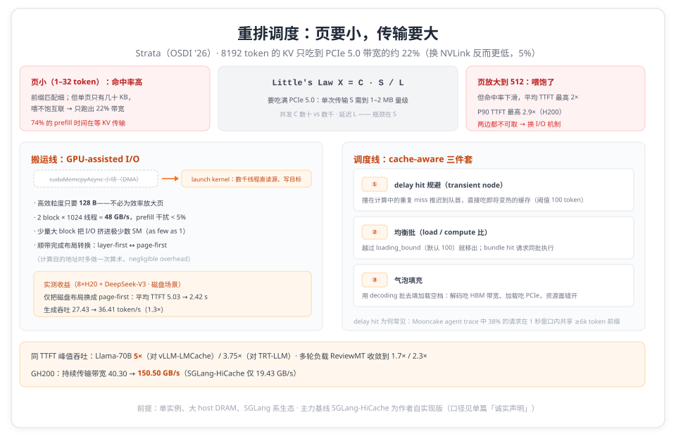

# 8192 个 token 的 KV 只跑出 22% PCIe 带宽：Strata 重做分层缓存的搬运与调度

> **元信息**：论文 _Strata: Hierarchical Context Caching for Long Context Language Model Serving_，Stanford/NVIDIA（Zhiqiang Xie、Christos Kozyrakis 等 8 人），OSDI '26 正式论文集，2026-07-13~15，Seattle。本仓 PDF 共 17 页：USENIX 封面 + 正文印刷页 pp.1–16，下文页码均为论文印刷页码。精读方式：全文逐页通读、数字逐条对照原文（报告见 [references/strata-report.md](references/strata-report.md)）。阅读日期 2026-10-12。

8192 个 token 的 KV Cache 从 CPU 内存搬回 GPU（Llama-3.1-8B、页大小 32），实测只吃到 PCIe 5.0 理论带宽的约 22%（p.3，Figure 3）。换到 GH200，用 NVLink 替代 PCIe、峰值带宽 6 倍的机器，这个比例掉到 5%（p.4）。同样是 SGLang，把 KV offload 到 CPU 内存按常规配置跑 LooGLE（Qwen2.5-14B），74% 的 prefill 时间阻塞在 KV 传输上，吞吐最高掉 4 倍（p.1，Figure 1）。

Strata 要回答的就是这批数字：长上下文服务的 prefill，一大半时间在等数据。KV 缓存已经分了三层（GPU HBM、CPU 内存、SSD），但跨层的搬运方式和调度逻辑都还停留在「假设 I/O 免费」的时代。

## 一、两难：页要小，传输要大

冲突的源头在页大小。PagedAttention 为省显存把 KV 切成小页，主流系统的典型页大小在 1–32 token（TensorRT-LLM 32、vLLM 16、SGLang 1），单个 token 的 KV 从几十 KB 到几 MB（p.3）。小页让前缀匹配更细、命中率更高，但一个逻辑页在显存里可能只有几 KB，论文的说法是 "sometimes only a few kilobytes"，这个小传输喂不饱 PCIe（p.2）。

用 Little's Law 描述这个约束：可持续吞吐 X = C·S/L（C 为并发 I/O 数，S 为单次传输大小，L 为延迟）。要吃满 PCIe 5.0 的 75–80%，S 需要到 1–2MB 量级（p.3）。放大页是最直觉的杠杆，代价立刻出现：Mistral-24B、ShareGPT、H200 上把页从 1 调到 512，KV 命中率显著下滑，平均 TTFT 最高涨 2×、P90 最高涨 2.9×（p.3，Figure 2）。论文的结论句是 "This fundamental trade-off between transfer efficiency and caching benefit underscores the need for a more effective I/O mechanism"（p.4）：既要小页的命中率，又要大传输的效率。

## 二、调度器的盲区：24% 的停顿与 delay hit

第二笔账在调度器这边。既有系统的隐含假设是「层 N+1 的 KV 加载会被层 N 的计算盖住」（p.4）。在长缓存前缀、少量新 token 的请求上这个假设失效：加载时间可以超过 prefill 新 token 的计算时间，而重算又随上下文变长越来越贵，两条路都堵（p.4）。论文的测量是，即使换上一个能达到 75% 理论 PCIe 带宽的 I/O 机制，prefill 执行时间里仍有最高 24% 卡在加载上（p.2、p.4）。

比 I/O 停顿更隐蔽的是 **delay hit**（延迟命中），这个词借自网络缓存社区（SIGCOMM '20 的 "Caching with delayed hits"）：多个请求在首个 cache miss 还没解决时到达同一个数据对象，本应命中的后到者被当成 miss 重新计算（p.2、p.4）。长上下文 agent 负载把概率放大：Mooncake 的 agent tool trace 里，38% 的请求与至少另一个请求在 1 秒窗口内共享 ≥6k token 的前缀（不含 system prompt）（p.4）。现代引擎的异步调度（当前批还没跑完就准备下一批）把 miss 解决窗口拉长到整批执行时间，撞车概率再上一截（p.4）。

论文因此给调度器定了新职责：把 CPU-GPU 带宽当一等资源，"balancing computation and data transfer when batching requests"（p.4）。

## 三、搬运：GPU-assisted I/O 与布局解耦

### 3.1 用 GPU 的几千个线程搬 KB 级数据

Strata 的第一板斧把搬运的活从 DMA 引擎换到计算侧：不再反复调用 cudaMemcpyAsync 传小块，而是 launch 一个 CUDA kernel、起数千线程，每个线程把一小块数据从源（GPU 全局显存或注册过的 CPU pinned memory）读进寄存器，再写到对端（p.5）。

这个选择逐项对上 Little's Law（p.5）：并发 C 从 CPU 侧的数十提到 GPU 的数千；单次传输可以小，GPU-assisted I/O 的高效粒度只需 128 bytes（"the granularity required for efficient GPU-assisted I/O is only 128 bytes on most architectures"），单页 KV 的 KB 级完全够用，不必为了效率放大页；kernel 里的轻量计算近乎免费，布局转换可以顺带做。

GPU 干搬运的老问题是和计算 kernel 抢 SM、抢寄存器、污染 cache，硬件调度器管不好这种争抢（p.5）。Strata 反过来利用调度器的行为：launch 少量大 CUDA block，把 I/O kernel 挤进极少数 SM（"as few as 1"），再用绕过 cache 的低层指令压低污染（p.5）。H200 上的微基准给出了默认配额：2 个 1024 线程的 block 达成 48 GB/s 传输吞吐，prefill 干扰低于 5%、decode 低于 10%（p.5，Figure 5）；CPU→GPU 加载（关键路径）用 2 block，GPU→CPU 备份（非关键路径）用 1 block（p.5）。

### 3.2 让 host 和 GPU 各用各的布局

第二板斧在数据布线上。GPU 侧偏好 layer-first：一层所有 token 连续存放，attention kernel 顺序读 K/V 最舒服；但这对传输是最差布局，一个逻辑页被打散成 L 个 KB 级碎片（L 为层数）。host 与磁盘侧需要的是反向的 page-first：一页跨所有层连续，一次搬出大块（p.6，Figure 6）。

传统做法只能二选一。Strata 借 GPU-assisted I/O 同时满足：搬运线程在计算目的地址时多做一次算术就能完成布局转换，"This operation has negligible overhead"（p.6）。磁盘场景实测过收益：8×H20 上跑 DeepSeek-V3，页大小 32、12 req/s，仅把磁盘布局换成 page-first，平均 TTFT 从 5.03 s 降到 2.42 s（2.1×），生成吞吐从 27.43 升到 36.41 token/s（1.3×）（p.12，Figure 13）。

## 四、调度：cache-aware 三件套

### 4.1 delay hit：把重复的 miss 推迟到即将命中

Strata 在 HiRadixTree（SGLang RadixTree 的扩展，兼任页表与逐页元数据）（p.5）里引入 transient node：不指向内存索引，只标 in-queue（有请求引用了该新上下文）或 in-flight（该上下文正在计算）（p.6–7）。队列迭代时，匹配到 transient node 的请求推迟到下一轮调度，但插回等待队首——等首请求算完，它直接吃「即将变热」的缓存，对 TTFT 影响最小（p.7）。防误伤靠阈值：匹配 token 数超过默认值 100 才推迟，短前缀的偶然撞车直接放行（p.7）。

### 4.2 均衡批：load/compute 比与 bundle hit

批形成默认 FIFO，不看加载需求是否失衡。Strata 改成逐请求试算：加入后批的聚合 load/compute 比越过阈值（`loading_bound`，默认 100，对应 Figure 1 中停顿开始出现的位置）就移入 deprioritized 列表；否则入批，并优先补入与它 **bundle hit** 的请求——共享同一上下文的请求同批执行，"bundle hit, the counterpart of a delay hit"，同时省显存与 on-device 带宽（p.7，Algorithm 1）。防饥饿：deprioritized 请求保持原序，每轮批形成都从队首算起、批没满时回填（p.7）。

### 4.3 气泡填充：让解码批去填加载的空档

均衡之后仍会剩下 loading-bound 的批。最后一招是推迟 prefill，先发一个 decoding batch 与加载并发（p.7）。两者资源面错开：解码主要吃 HBM 带宽，加载吃 PCIe（p.7）。P-D 分离部署里也可以改用 prefill batch 填这个气泡（p.7）。

## 五、组织：写策略与存储层

数据面还有几个工程决策值得单列。备份时机分三档（p.8）：write-back 只在濒临驱逐时备份，省带宽省容量，适合资源紧张的部署；write-through 每次生成即备份，适合要求持久化的会话场景；默认档是 selective-write-through，节点带访问计数、超阈值才备份（默认阈值 2，调到 1 即退化为 write-through）。三层缓存默认 LRU 驱逐（p.8）。执行期间，GPU executor 用 CUDA events 与 Cache Controller 同步逐层 KV 的就绪状态（p.5）。磁盘层命中时会在请求排队期间做 best-effort 预取，一旦被调度选中就终止未完成预取、用已有缓存；也可以配置成 wait-complete 或 timeout 策略（p.6）。

## 六、评估：数字与条件

三台机器：8×H200（每 GPU 一条 PCIe 5.0 x16，64 GB/s，1.6TB DRAM）；8×H20 + P5510 NVMe（盘读 7 GB/s）；GH200（H100 + Grace，464 GB LPDDR5X，CPU 侧带宽 384 GB/s）（p.8）。基线：vLLM v0.8.5 + LMCache v0.2.1（chunk 256、页 32）、TensorRT-LLM v0.17.0 + HiCache（页 32）、SGLang v0.4.5，其中 SGLang-HiCache 是作者按 CachedAttention/Pensieve/FlashGen 路线自实现的逐层重叠基线（页 32）；Strata 与 SGLang 用页 1（p.8）。模型覆盖 Llama-3.1-8B/70B 与 Qwen2.5-14B-Instruct-1M，数据集 LooGLE、NarrativeQA、ReviewMT、ShareGPT；Poisson 到达、在途请求上限 128、host 侧 1TB pinned DRAM（p.8–9）。

主要结果（同 TTFT 下比较高吞吐；除注明外为 H200）：

- 开启分层缓存后各系统命中率都到约 95%；Strata 相对三个基线的吞吐优势（SGLang-HiCache / vLLM-LMCache / TRT-LLM-HiCache）最高为：Llama-8B 3.2×/2.6×/1.9×，Qwen-14B 3.9×/2.1×/1.9×，Llama-70B 5×/5×/3.75×（p.9）。
- 多轮对话负载 ReviewMT（decode 占比上升）增益收敛到 1.7×/2.3×/2.3×（Llama-8B）（p.9）。
- 预热全部上下文后跑 NarrativeQA，对 vLLM-LMCache 为 2.3×（8B）/2.6×（14B）/2.5×（70B）（p.9）。
- 短上下文 ShareGPT 上平均 TTFT 与其他系统可比，论文同时说明 SGLang 引擎本身在 8B/70B 上有轻微 kernel 劣势（p.9–10）。
- 消融（在 SGLang-HiCache 之上）：调度组件最高贡献 1.8×、I/O 组件最高 2.3× 峰值吞吐；低请求率时调度收益更大，高请求率时 I/O 是瓶颈（p.10）。
- 页大小不再需要纠结：SGLang-HiCache 调到最优页（512）也只有 Strata-IO 的 93%，差在命中率低 2.4%（p.11）。
- cache distance 三负载分解：delay hit 规避在最小距离负载下贡献 +42% 峰值吞吐，最大距离负载下无收益；I/O 机制在 shuffle / 最大距离负载下 +76%/+95%；均衡批 +11%/+12%；气泡填充 +8%/+3%（p.11）。
- GH200：Strata-IO 把持续传输带宽从 40.30 GB/s（PCIe）提到 150.50 GB/s；SGLang-HiCache 在 GH200 上只有 19.43 GB/s，纯靠硬件升级打不过 H200 上的 Strata-IO；Strata-GH 接近 Oracle（模拟无限带宽）水平（p.12，Figure 15）。

## 七、局限与边界

论文自认（§6，p.13）：GPU-assisted I/O 用少量 SM 争抢换传输效率；CUDA 12.8 的 cudaMemcpyBatchAsync 不占 SM 但同一微基准只有 38 GB/s（本文 kernel 48 GB/s），论文建议配置成加载走 kernel、备份走 batch API，长期寄望片上 I/O 加速器。调度优先聚合效率，个别请求可能吃亏、有 SLO 违规风险，公平感知的批形成留作未来工作。当前只隐藏 host DRAM→HBM 的延迟。只覆盖标准注意力的 dense KV，sparse/linear 等 hybrid 模型不在范围内。作用域是单计算实例，与 Mooncake/MemServe 类分布式池互补。

精读员注：所有平台都是 NVIDIA，ROCm/AMD 兼容仅有声明、无实测；主力基线 SGLang-HiCache 是作者自实现，不是 SGLang 发行版功能的直测；「最高 5×/3.75×」对应 Llama-70B + LooGLE + H200 的最优点，ReviewMT 上只有 1.7×/2.3×；delay hit 的严重性研究（Figure 12）是模拟执行；短上下文只测了 ShareGPT 的 TTFT。

## 论文结构索引

| 论文位置（§/页码） | 内容 |
| ------------------ | ---- |
| §1 / p.1–2 | 动机与贡献：长上下文趋势、40 GB HBM ≈ 0.3M token、74% prefill 阻塞 / 4×、SGLang 集成与生产部署声明 |
| §2 / p.2–3 | 背景：PagedAttention 页大小（TensorRT-LLM/vLLM/SGLang 为 32/16/1）、跨请求前缀缓存与分层存储 |
| §3.1 / p.3–4 | I/O 效率：Little's Law X=C·S/L、75–80% PCIe 5.0 需 1–2MB、页 1→512 的命中率与 TTFT 代价（Fig.2）、8192 token ≈22%、GH200 低至 5%（Fig.3） |
| §3.2 / p.4 | 调度盲区：layer-wise 重叠假设失效、仍剩最高 24% 停顿、delay hit（SIGCOMM '20 [8]）、Mooncake trace 38%、异步调度放大 |
| §4.1 / p.4–5 | 架构总览：Scheduler + Cache Controller、HiRadixTree、P-D co-location、CUDA events 逐层同步（Fig.4） |
| §4.2 / p.5 | GPU-assisted I/O：CUDA kernel 千线程寄存器中转、128B 粒度、少量大 block 压 SM、默认 2/1 block 配额（Fig.5：48 GB/s、干扰 <5%/10%） |
| §4.2.1 / p.6 | 存储层预取（best-effort / wait-complete / timeout）与 layer-first↔page-first 布局解耦（Fig.6，一次算术完成转换） |
| §4.3.1 / p.6–7 | delay hit 规避：transient node（in-queue/in-flight）、推迟至队首、默认 100 token 阈值 |
| §4.3.2–4.3.3 / p.7 | 均衡批（loading_bound 默认 100、bundle hit、反饥饿，Alg.1）与气泡填充（解码批填加载空档） |
| §4.4 / p.7–8 | 缓存控制器：三档写策略（write-back / write-through / selective-write-through，默认阈值 2）、LRU 驱逐 |
| §5.1 / p.8–9 | 评估配置：三平台（H200 / H20-storage / GH200）、四基线版本、三模型、四数据集（Table 1） |
| §5.2 / p.9–10 | 端到端：约 95% 命中率；最高 3.2×/2.6×/1.9× 至 5×/5×/3.75×；ReviewMT 1.7×/2.3×/2.3×；暖缓存 2.3×/2.6×/2.5×；ShareGPT 可比 |
| §5.3.1–5.3.3 / p.10–11 | 分解：调度最高 1.8×、I/O 最高 2.3×；页大小 93%/2.4%；cache distance 42%/76%/95%/11%/12%/8%/3%（Fig.9–11） |
| §5.3.4–5.3.5 / p.11–12 | delay hit 成因（resolve time 数百 ms–数秒，模拟）；磁盘 page-first：TTFT 5.03→2.42 s、吞吐 1.3×（Fig.12/13） |
| §5.4 / p.12 | GH200：持续带宽 40.30→150.50 GB/s、SGLang-HiCache 19.43、Strata-GH 近 Oracle（Fig.14/15） |
| §6–8 / p.13 | 讨论（kernel 干扰 / 公平性 / 模型覆盖）、相关工作、结论；致谢与参考文献 pp.14–16 |

## 与系列其他篇目

本文是「KV Cache 内存层级」系列的分层调度篇：把层级间搬运做便宜（GPU-assisted I/O），再把搬运藏进调度（cache-aware 三件套）。同系列另三篇各占一个方向：[DirectKV](directkv.md)（OSDI '26 同会）在 NVLink-C2C 上做零拷贝去搬运、[NEO](neo.md)（MLSys 2025）把 attention 连同 KV 下移到 CPU 计算、[eLLM](ellm.md)（DAC 2026）用弹性抽象合并内存账本；四篇的横向比较与口径提示见总纲[《KV Cache 内存层级》](memory-tiering-overview.md)。

## 诚实声明

本文数字全部转录自论文，未独立复测；「最高」均对应原文 "up to"，条件是同 TTFT 比较。论文声称的 ROCm/AMD 兼容、生产部署情况（"deployed in production environments at several leading AI companies"，p.2）均无公开细节。论文的 SGLang-HiCache 基线是作者自实现，与 SGLang 发行版 HiCache 功能的关系论文未说明；工程对照可读本仓 [HiCache 深读](../../sglang/hicache_deep_dive.md)。

## 参考资料

- Zhiqiang Xie et al., _Strata: Hierarchical Context Caching for Long Context Language Model Serving_, OSDI '26. [USENIX 页面](https://www.usenix.org/conference/osdi26/presentation/xie-zhiqiang)
- 论文原文（本仓 PDF）：[references/papers/strata-osdi26.pdf](references/papers/strata-osdi26.pdf)
- 精读报告：[references/strata-report.md](references/strata-report.md)
- 相关阅读：[SGLang HiCache 深读](../../sglang/hicache_deep_dive.md) · [LMCache 概览](../02_systems/lmcache/lmcache_overview.md) · [FAST'26 KV 存储五场景](../03_fast26/fast26-kv-storage-five-scenarios.md)
