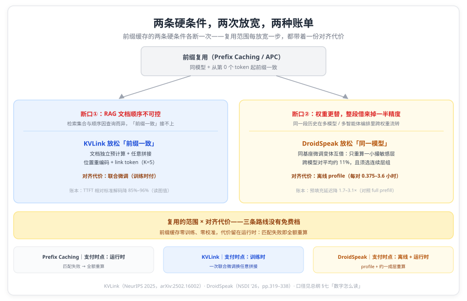
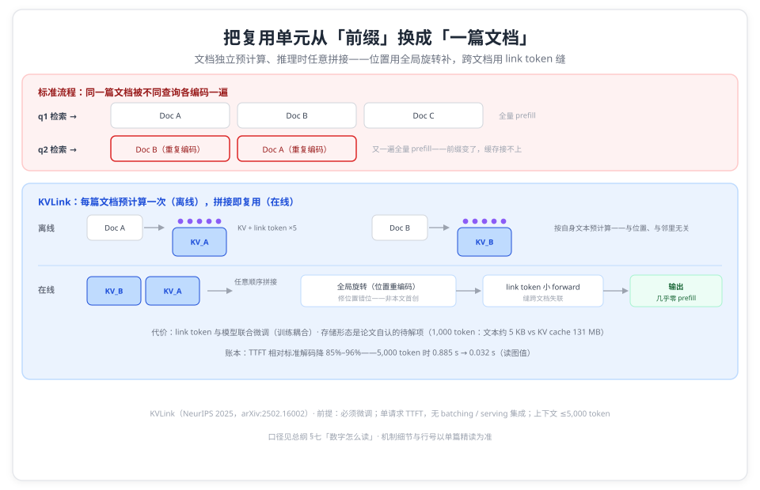
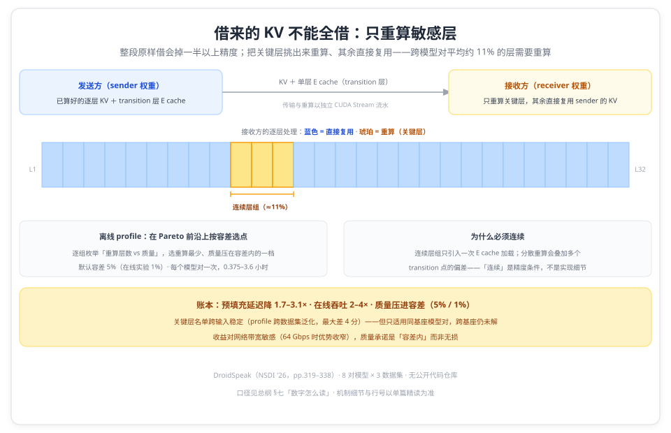
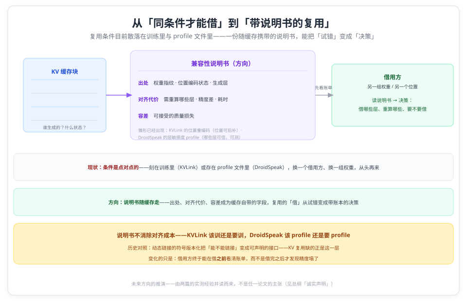

# 当复用跨出同前缀与同模型：两篇论文给出的两条扩展路径

> **元信息**：本文是「KV Cache 复用」系列总纲。系列含两篇单篇精读：[KVLink](kvlink.md)（NeurIPS 2025，文档级预计算 + 任意拼接）· [DroidSpeak](droidspeak.md)（NSDI '26，跨微调变体共享 + 关键层重算），每篇都附逐条页码核对的精读报告（`references/`），论文原文 PDF 在 `references/papers/`。本文只做横向组织与口径提示，机制细节与数字以单篇为准。整理日期 2026-10-13。

## 一、背景：前缀缓存能复用什么，不能复用什么

「复用」是推理系统里最便宜的一层优化：一段算过的上下文，下一次请求撞上，就省掉整段 prefill。主流引擎都默认开着它——vLLM 的 Automatic Prefix Caching、SGLang 的 RadixAttention——匹配以 token 块为单位（逐块哈希或沿树比对），命中多长就省多长；机制细节可看 [Prefix Caching 原理与实现](../01_concepts/prefix_caching/prefix_caching.md) 与 [RadixAttention 原理与 SGLang 实践](../01_concepts/prefix_caching/radix_attention.md)。

但它认的条件很硬，任何一条不满足，想复用的那段内容就要**从头计算（full prefill）**：

- **从第 0 个 token 起逐 token 一致**：匹配的是「前缀」本身——共享内容前面只要多一个不同的 token，或者两段共享内容之前的上下文不同，再长的相同部分也接不上。RAG 的多文档拼接是这类失败的日常形态；CacheBlend 对「非前缀」的近似复用，也是在这个框内做选择性重算的补救；
- **同一个模型（同一组权重）**：KV 是这组权重对输入所做的中间表示，换一组权重即作废——跨模型、跨微调变体都接不上。

两条条件各自对应着一份真实的重复账：每一次断裂，想复用的那段内容就白算一次。**可复用的上下文越长，从头计算的账单越大。**

## 二、同一个条件，两条放松路线

两条硬条件在两种真实负载里各断一次，断口就是两份看得见的重复账。RAG 这边：检索回来的文档集合与顺序因查询而异，同一篇文档在 prompt 里的位置随时在变——1,000 token 的文档存成文本只要约 5 KB，存成 Llama3-8B 的 KV cache 要 131 MB（p.4），顺序一变，这笔编码就得从头再来。多智能体与多模型编排这边：同一段历史会在不同权重的变体之间流转——40K token 输入的理想账是把现成 KV 直接拿来用，prefill 从 4 秒缩到 0.08 秒（p.322），但另一组权重的 KV 原样借来，HotpotQA 上多数模型对会掉一半以上的精度（p.322）。两篇论文各认领一次断裂：

- **KVLink 放松「复用的位置」**：复用单元从 token 前缀变成**一篇文档**——知识库里每篇文档按自身文本预计算一次 KV，推理时按检索结果任意顺序拼接；位置错位用延迟施加的全局旋转（positional re-encoding）修，跨文档失联用可训练的 link token 缝。代价：link token 与模型需要联合微调——**这是一条训练耦合的路线**；
- **DroidSpeak 放松「复用的权属」**：复用对象从「同一个模型」扩到**同一基座的微调变体**——发送方模型算的 KV，接收方模型只重算一小撮敏感层（跨模型对平均约 11%、且须选连续层组），其余直接复用。代价：每个模型对要离线 profile 一次（0.375–3.6 小时），质量承诺是「容差内」（默认 5%）而非无损。

| 论文（单位）                                                     | 场景定位                              | 核心矛盾                         | 招式                                                     | 代表账本                                                      |
| ---------------------------------------------------------------- | ------------------------------------- | -------------------------------- | -------------------------------------------------------- | ------------------------------------------------------------- |
| [KVLink](kvlink.md)（UC Santa Barbara + Accenture）              | RAG：知识库文档被不同查询反复检索     | 文档顺序不可控，前缀路线够不着   | 文档级预计算 + 位置重编码 + link token（与模型联合微调） | TTFT 相对标准解码降 85%–96%；5,000 token 时 0.885 s → 0.032 s |
| [DroidSpeak](droidspeak.md)（University of Chicago + Microsoft） | 同基座微调变体的多智能体 / 多模型编排 | 权重不同，整段复用掉一半以上精度 | 离线 profile 选连续层组，只重算约一成层（约 11%）        | 预填充延迟降 1.7–3.1×；在线吞吐 2–4×；质量压进容差（5% / 1%） |

口径说明：两篇的数字均为论文自测，对照基线各不相同，引用前先过 §七「数字怎么读」。

两条路径可以放进同一根轴：**复用的范围 × 对齐代价**。前缀缓存零训练但复用面最窄；KVLink 复用面大（任意文档）但训练耦合；DroidSpeak 复用面跨了模型、也不要训练，但要为每个模型对做一次性校准。三者「免费程度」的递减不是优劣排序，是适用条件的不同——省得越多，欠得越多，而三份账单各自在哪个时点支付，是 §五 要展开的。

## 三、两条路径

两篇各把一条条件向外推，推法不同：KVLink 动的是模型（link token 与模型联合微调），DroidSpeak 动的是服务（离线校准加运行时重算）。逐篇按「起点 → 机制 → 账本 → 前提」展开，机制细节与行号以单篇为准。

### 3.1 文档级复用：KVLink（NeurIPS 2025）

**起点**：RAG 场景里同一篇文档会被不同查询反复检索到，标准流程逐次重复 prefill（p.2）；而前缀缓存要求从第 0 个 token 起一致，不同查询检索到的文档集合与顺序各异，共享文档前的上下文随时在变——前缀路线够不着（"prefix-only reuse"，p.9）。

**机制**：两个组件。**KV cache positional re-encoding**：预计算时跑段内注意力但存**不带旋转**的 `W_{k,v} x_i`，拼接后按全局位置统一施加 rotary（论文注明这与先前并行编码工作 [6, 8] 一致，非本文首创，p.3）。**Link tokens**（本文的增量）：每篇文档末尾追加 K=5 个可训练 token，配定制 attention mask——link token 能看到前序全部文档与当前文档，普通 token 只看局部；推理时只对追加的 link token 做一次小 forward，且 link token 与模型联合 fine-tune（pp.3–4）。

**账本**：7 个数据集（5 QA + 2 摘要）上 QA 准确率平均比 SOTA 高 4%（摘要口径，逐格重算见 §七）、TTFT 相对标准解码降 85%–96%，5,000 token 时标准解码 0.885 s vs KVLink 0.032 s（读图值，Fig.3，pp.7–8）。存储账：A.7 给出 25× 请求量与每百万请求 9 vs 246 GPU 小时（$16 vs $440）的换算（p.27，口径见 §七）。

**前提**：必须微调（link token 与模型联合优化）；存储形态是论文自认的待解问题（"Efficiently organizing and storing the pre-computed KV cache remains a challenge for large-scale deployment"，p.28）；评估为单请求 TTFT，无 batching/吞吐/与 serving 系统的集成；上下文 ≤5,000 token。

### 3.2 跨变体复用：DroidSpeak（NSDI '26）

**起点**：compound AI 系统里同一段上下文被不同的微调变体轮流读（多智能体、多模型/多 LoRA 服务、个性化助手，p.321）；一篇真实 LangGraph 应用 trace 里平均 49% 的 token 属于前缀复用（p.321）。但现有跨节点 KV 共享（vLLM Production Stack、Dynamo、AIBrix）只服务同款模型——不同权重的模型间怎么借缓存是空白（摘要，p.319）。

**机制**：先建三条直觉：整段复用质量塌方（HotpotQA 多数模型对掉 >50% 精度）；但只有一小撮层敏感——逐层测（仅复用该层）F1 掉超 10% 的标记为 critical，跨模型对平均 11%（pp.322–323）；且关键层名单跨输入稳定。方案：离线 profiling 在「重算层数 vs 质量」的 Pareto 前沿上按容差选一个**连续层组**（连续是为了只引入一次 E cache 加载、避免偏差叠加，p.324）；在线发送方把 transition 层的 E cache 传给接收方，接收方只重算这一组、其余复用，传输与重算以独立 CUDA Stream 流水（pp.325–326）。

**账本**：8 对模型 × 3 数据集上预填充延迟降 1.7–3.1×（平均 2.1×，对照 full prefill）、在线吞吐 2–4×（最高 4×）、同延迟下质量比（作者扩展的跨模型版）CacheBlend 高 5–33%（平均 16%）（pp.326–328）；质量压在 5%（profiling 默认）/1%（在线实验）F1 容差内。

**前提**：只适用同基座模型对（"as-is only works for ... the same foundational model"，p.330）；评估只做两两模型；每对需一次性离线 profile；无公开代码仓库；收益对网络带宽敏感（§5.5）。

## 四、对号入座：你手上是什么条件

| 你的条件                                           | 该看哪篇                    | 先决条件与口径提示                                                                                                                | 开源入口                                                                 |
| -------------------------------------------------- | --------------------------- | --------------------------------------------------------------------------------------------------------------------------------- | ------------------------------------------------------------------------ |
| RAG/多文档问答，同一模型、同一知识库反复检索       | [KVLink](kvlink.md)         | 前提是**可以微调**（link token 与模型联合训练）；存储治理（KV 缓存进不进向量库）是论文未解项；TTFT 为单请求口径                   | [KVLink](https://github.com/UCSB-NLP-Chang/KVLink)（仓库未检出 license） |
| 多微调变体服务（同基座、不同权重轮流读同一段历史） | [DroidSpeak](droidspeak.md) | 限同基座、两两模型对；每对一次离线 profile（0.375–3.6 小时）；关键层比例因对而异，「连续层组」是精度条件不是实现细节；质量=容差内 | 无公开仓库                                                               |
| 既不能微调、又要跨模型                             | 两条路都够不着              | 跨基座仍未解（DroidSpeak 自认 as-is 不行）；免训练路线回到 Prefix Caching / CacheBlend 的原有边界                                 | —                                                                        |
| 想判断「这单复用该不该做」                         | 两篇对读                    | 轴是「复用范围 × 对齐代价」：训练（KVLink）/ profile + 重算（DroidSpeak）/ 前缀约束（Prefix Caching）——每次放宽条件都新增一种账单 | KVLink 开源，DroidSpeak 未开源                                           |

## 五、两条路径共同的边界

**每次放宽复用条件，都新增一种「对齐代价」。** KVLink 用微调把模型对齐到「文档可任意拼接」；DroidSpeak 用离线 profile 加约一成层重算把缓存对齐到另一组权重；Prefix Caching 的对齐代价是「必须前缀一致」本身。没有一条路径是「更聪明的搬运」——都是在复用的范围与对齐的成本之间选点。

**第二个交叉点：对齐账单的支付时点。** 三条路线把账付在不同的时间：Prefix Caching 零训练、零校准，成本全留在运行时——匹配失败即全额重算，用复用面换便宜；KVLink 前置到训练时——一次联合微调换来任意拼接，代价是模型改动与仍未解决的存储治理；DroidSpeak 一分为二——离线付 profile（每个模型对 0.375–3.6 小时）买「哪些层可信」，运行时再付约一成层的重算。改动面随之分层：动模型、加离线校准、或什么都不动——三条路线没有免费档，只有付款时点的区别。

**两篇的账本都还是早期形态。** KVLink 无 serving 集成、无 batching/吞吐、存储形态未解；DroidSpeak 有 vLLM + K8s 在线实验，但无公开代码、profile 成本与「一个 sender 服务多个 receiver」的缓存治理未摊开。两条路径的收益数字（85%–96% / 1.7–3.1×）都出自论文自测环境，距离生产部署各有一笔没算完的账。

**与 04、05 系列的分工。** [内存层级系列](../04_memory_tiering/memory-tiering-overview.md)算「KV 放哪层」的账（显存装不下之后，DRAM、互联、调度怎么做交换）；本系列算「KV 借给谁」的账（复用条件怎么放宽）；[安全系列](../05_kv_security/kv-security-overview.md)算「KV 被谁看见」的账——它攻击的正是本系列所依赖的共享机制（前缀缓存与调度行为），复用的收益面与风险面共用同一套机制。

## 六、未来方向：从「同条件才能借」到「带说明书的复用」

两篇论文打的是同一件事的两面：**借用的条件**。KVLink 把「文档独立」写进模型（联合微调）；DroidSpeak 把「哪些层可信」写进 profile（每个模型对一份）。两条路都成立，但都还是**点对点**的——条件要么刻在训练里，要么存在一份校准文件里；换一个借用方、换一组权重，从头再来。「谁能借谁的 KV」目前没有一个通用的表达方式。

如果这个条件可以成为缓存随身携带的**说明书**，复用的面就会被重新划一遍。说明书需要装三样东西：

- **出处（provenance）**：这份 KV 由哪组权重、哪个位置编码状态、哪些层产生——KVLink 的位置重编码证明位置可以「后补」，DroidSpeak 的层敏感度证明「哪些层可信」可测，两边的机制各自补上了说明书的一栏；
- **对齐代价的可知性**：借用方在借之前就看到「要重算什么、精度差多少、要等多久」——DroidSpeak 的 Pareto 前沿（重算层数 vs 质量）就是这一栏的雏形；
- **准入决策的接口**：把说明书接进调度器，让「借哪条路」像读 token 预算一样，成为准入公式里可计算的变量。

一个历史对照：动态链接也曾困在「这个二进制能不能链接到那个库」的试错上，直到符号版本化（symbol versioning）把兼容性变成可声明的接口——今天没人靠试错判断 ABI。KV 复用缺的正是这一层：把「这缓存跟谁兼容」从论文实验变成缓存自带的字段。

需要防的一个误读：说明书不消除对齐成本。KVLink 该训还是要训，DroidSpeak 该 profile 还是要 profile——变化的是借用方终于可以在**借之前**看清账单，而不是借完之后才发现精度塌了。

## 七、数字怎么读

- **KVLink**：摘要「+4%」无法精确复现（Table 1 逐格重算为 1B +4.32 / 3B +4.00 / 8B +1.12），引用以 Table 1 为准；TTFT「85%–96%」是文字区间（按读图值换算 84.2%–96.4%），两个绝对值（0.885 s / 0.032 s）为读图值；「35% 相对下降」是先前工作 [6–8] 的数字、非本文实测；「25×」与 A.7 的 246/9≈27.3 算术不符（疑按 96% 反推），引用时宜附 9 vs 246 GPU 小时原值；「GPU 显存省 98% / 吞吐 8.5×」无法溯源（v4 全文与 v1 摘要均未见），不要引用。
- **DroidSpeak**：「1.7–3.1×」（摘要 "about 3.1×"）是**预填充延迟（TTFT）对照 full prefill** 的缩减；「2–4×（最高 4×）」是**在线吞吐**；「5–33%（平均 16%）」是**同预填充延迟下对（作者扩展的跨模型版）CacheBlend 的质量优势**——三个数字三套口径，不可合并叙述。关键层「约 11%」是跨模型对平均值，且必须落成**连续层组**；质量承诺是「容差内」（profiling 默认 5% / 在线实验 1%），不是无损；Fig.15 的带宽敏感性为读图值；40K token 的 4 s→0.08 s 是理想会计（50× 为换算值）。

## 系列篇目

- [缓存不必同前缀：NeurIPS 2025 KVLink 把 RAG 首 token 延迟最高降 96%](kvlink.md)——**文档级复用**（NeurIPS 2025）
- [借来的 KV 不能全借：NSDI'26 DroidSpeak 只重算约一成层，预填充最高快 3.1×](droidspeak.md)——**跨变体复用**（NSDI '26）
- 精读报告（逐条页码核对版）：[KVLink](references/kvlink-report.md) · [DroidSpeak](references/droidspeak-report.md)；论文原文 PDF 在 `references/papers/`

## 诚实声明

- 两篇的数字均为论文自测，本仓未复现；本文的横向比较跨论文、跨任务、跨环境，除注明外**不可直接互比**。
- 本文每个数字都取自对应单篇精读；各单篇的「诚实声明」列出了自己的口径限定与未核实项（KVLink 的 v4 口径与读图值、单请求 TTFT；DroidSpeak 的容差口径、同基座限定与无公开代码）。
- 「复用范围 × 对齐代价」的框架与「支付时点」分析是本文的组织视角，不是任一论文的主张。
- 「未来方向」一节是展望性论述：由两篇的实测经验与公开背景（动态链接的符号版本化）并读推演而来，不是任一论文的主张，其中的机制与产品侧细节未按本系列的逐条核对标准核验。

## 延伸阅读：本仓相关（按主题）

> 本系列放松的是前缀缓存的两条复用条件；被放松的机制本身、与它并列的另外两条复用路线、以及同一条共享机制在其他维度的账，分别在下面这些文章里。

**被放松的机制本身**（两条条件从哪里来）：

- [Prefix Caching 原理与实现](../01_concepts/prefix_caching/prefix_caching.md) · [RadixAttention 原理与 SGLang 实践及 vLLM APC 对比](../01_concepts/prefix_caching/radix_attention.md) · [Claude 提示词缓存机制与源码实现深度分析](../01_concepts/prefix_caching/claude_prompt_caching.md) · [RoPE 与 Prefix Caching 的互作用](../01_concepts/prefix_caching/rope_and_prefix_caching.md) · [KV Cache 压缩技术详解](../01_concepts/compression/kv_cache_compression.md)（含系统层 I/O 优化与共享背景）

**跨模型复用的另一条路线**（不借 KV，直接映射）：

- [把 14B 的 KV 交给 32B：跨模型复用的可能与代价](../01_concepts/cross_model/cross_model_kv_transfer.md)

**近前缀复用的工程路线**（框内补救）：

- [CacheBlend：RAG 场景下的 KV Cache 动态融合机制与源码剖析](../02_systems/lmcache/cache_blend.md)

**同一条共享机制的其他账**（位置 / 安全 / 压缩）：

- [KV Cache 内存层级总纲（04）](../04_memory_tiering/memory-tiering-overview.md) · [KV Cache 安全总纲（05）](../05_kv_security/kv-security-overview.md) · [KV Cache 压缩总纲（07）](../07_kv_compression/kv-compression-overview.md)

## 参考资料

- Jingbo Yang, Bairu Hou, Wei Wei, Yujia Bao, Shiyu Chang. _KVLink: Accelerating Large Language Models via Efficient KV Cache Reuse_. NeurIPS 2025. [arXiv:2502.16002](https://arxiv.org/abs/2502.16002)（本地为 v4）
- Yuhan Liu et al. _DroidSpeak: KV Cache Sharing Across Fine-tuned Model Variants_. NSDI '26, pp. 319–338. [USENIX 论文页](https://www.usenix.org/conference/nsdi26/presentation/liu-yuhan)
