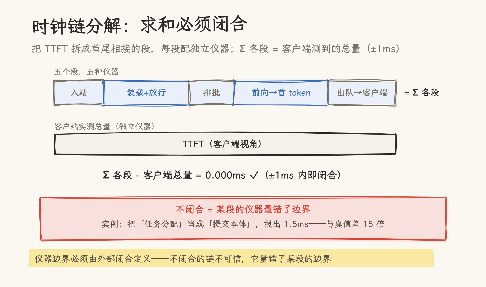
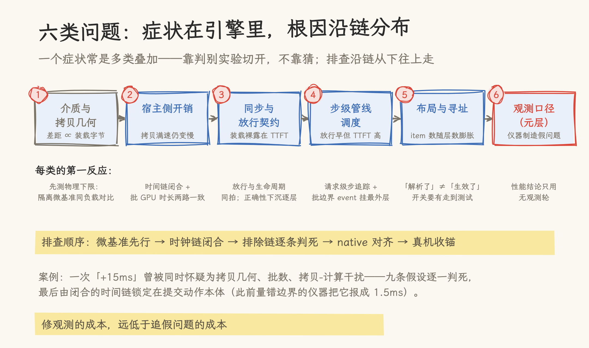

# TTFT 多了 15 毫秒之后：一套实证过的 KV Cache 性能分析方法论

最近为推理引擎接入一个新的 KV Connector，把 KV Cache 的存取指向一个远端存储层。上线前压测与本地基线对照，两份配置只差一个 KV 来源，TTFT 稳定多出 15 毫秒。拷贝带宽跑满、GPU 大部分时间空闲、日志里没有任何报错。这 15 毫秒去了哪里，一时难以定位。

排查从九条假设开始，逐条检验，每条配一个判别实验。怀疑批数：隔离微基准中 N 批与 1 批速度相同，排除。怀疑 pageable 主存拷贝拖慢装载：更换执行器后耗时无变化，排除。怀疑拷贝与计算相互干扰：2×2 对照矩阵两侧结果一致，排除。其余假设以同样的方式逐一否决。

最终由一条五段分解的时间链定位：五段求和与客户端测得的 TTFT 误差 0.000 毫秒，链条闭合，差额锁定在提交段。该段的仪器读数一直是「稳态 1.5 毫秒」，真实成本为 22.5 毫秒：仪器量了任务分配，未量真正向显存填充数据的环节。向量化改写后，这笔开销降到 0.94 毫秒（见 3.2）。修复完成后，接入远端层的配置端到端反超本地基线 5.8%（过程见 2.5）。

我们把这次排查与同类实践中反复奏效的方法整理成本文，供大家参考。同类场景还有几种形态：PD 分离要跨实例传输 KV，KV 卸载要把历史块搬入第二级存储，分层缓存要在多级介质之间搬运，排查面对的是同一条链。本文组织为六件工具、六类问题与一份七步操作清单。数字口径说明如下：全部数字出自生产级推理引擎（vLLM、SGLang 系）的真机轮次与隔离微基准；介质绝对带宽、端到端时延包络与模型指纹按发布口径脱敏，只保留比值与结论，其余工程数字原样保留（写于 2026-11）。

> 阅读前提：熟悉 vLLM/SGLang 的调度模型与 KV 传输接口。本站[PD 分离架构下的 KV Cache 传输](../01_concepts/08_pd_transfer/01_disaggregated_prefill_kv_transfer.md)与[KV Offloading 架构对比](../01_concepts/07_offloading/01_kv_offloading.md)讲这些机制的「是什么」，本文回答「慢了怎么查」。

## 一、性能问题分布在一条很长的链上

KV Cache 的性能问题分布在这条链上：介质 → 拷贝几何 → 宿主侧开销 → 同步与放行契约 → 步级调度 → 观测口径本身。这条链很长，症状（TTFT 高）与根因隔着好几层，一个症状还常常是多类叠加，仅凭直觉难以定位。开场那次排查里，拷贝几何、批数、拷贝-计算干扰几条线索同时在场，最后靠排除链切开。

## 二、六件分析工具

### 2.1 时钟链分解 + 闭合校验

把目标指标拆成首尾相接的段，每段配独立仪器，然后做闭合校验：Σ 各段 = 客户端测到的总量，误差 ±1ms 内才算闭合。

实证：那次压测的 +15ms 就是这么定位的。链拆成五段（入站 / 装载+放行 / 排批 / 前向→首 token / 出队→客户端），五段求和与客户端 TTFT 的误差为 0.000ms，差额一次锁定在提交段。仪器边界必须由外部闭合定义：那台一直报「稳态 1.5ms」的旧仪器量错了边界，量了任务分配，未量引擎填充，与真值差 15 倍。

### 2.2 排除链 + 判别实验

对每个候选假设：先写下判别实验和两种结果的读法，再跑。结论只有三种——证实、证伪、仪器不足以判。判别测试要用变异自证钉住：把假设的机制摘掉，测试必须变红，否则测试本身没有判别力。

那次压测共列出九条候选假设，逐一证伪，每条都有一条一锤定音的判据：

- 装载粒度（N 层 / N 个张量，计数核对）
- 提交开销
- store 积压（对照配置）
- pageable 主存拷贝（换执行器无变化）
- 批数（隔离微基准，N 批与 1 批同速）
- 拷贝几何（隔离环境全形态实测）
- 层等待暴露（实测合计 0.15ms）
- 拷贝-计算干扰（2×2 矩阵两侧都不掉）
- 整段重算（store 计数逐字相同）

配套纪律：夹具会掩盖真问题。mock 引擎的同步拷贝把「放行与完成回执不同批」的窗口偶然闭合，单测全绿之下藏着真机崩溃窗；CPU mock 测不出带宽与拷贝几何。单测保 roundtrip，性能语义必须真机或隔离微基准证明。跑 CPU mock 还有一个环境问题：容器里必须把 `CUDA_VISIBLE_DEVICES` 置空，否则 torch 在 GPU 上分配张量，而 CPU mock 对设备指针做主机 memcpy，进程直接 SIGSEGV，连断言都不会触发。

### 2.3 同轮对照 + 锚点归一

比较只在同轮、同镜像、同协议内有效。跨轮数字不可直接比：实测的最大漂移源是观测开关本身，同一配置开关 trace 后，单段耗时漂移可达 4ms 级；同一观测状态的多轮之间则收敛到 1.6ms 以内。需要跨阶段比较时，用跨阶段都在场的锚点配置归一，同时报裸差与归一差。

复跑还要看漂移方向。两组配置的复跑漂移方向相反时，单轮「对齐」的结论可能落在噪声带内。落到流程上：判据锚（指标阈值）收锚之前不动其他改动，一次一变量，每轮读数独立入账。

### 2.4 观测口径纪律：仪器自身是嫌疑人

四条实证过的口径陷阱，外加一招定界法：

- **poll 压缩**。异步框架里 per-job 的 transfer_time 实际是「提交到下次轮询」的上界，所有 job 几乎同值，不能反推 GPU 时长或带宽。我们曾据此把主机拷贝带宽低估一半以上，那组「7.4/15.3 GB/s」的对比就是这类伪值；如今能引用的只有「两种几何不等价」这个方向。带宽唯一可信源是隔离微基准。
- **仪器扰动**。DEBUG 日志里展开一次列表，TTFT 抬高 16ms；每步几十个计时 event 也有成本；trace 开关的实测扰动在 1.5–4.0ms，不同配置敏感度不同。性能结论只用无观测的轮次；要时间链就另跑 traced 轮，两组数字永不混比。
- **配对与聚合口径**。请求级时间线必须按 req_id 配对，全局时间戳配对产出过 900ms 级伪值。取数聚合同理：同一请求匹配到两条日志、末条的命中标记为 0——聚合应取首条或最大值，而非窗口末条。
- **指标语义**。指标名字与语义可能错位：SGLang 的 `full_token_usage`（`srt/managers/scheduler_components/pool_stats_observer.py`）名字里写着 usage，量的却是被运行请求锁住的活跃 KV，不是容量水位。我们误读了两次才确立判读标准。指标语义与实现对照过一次之后才可信。
- **金丝雀定界法**。仪器零输出时，一个顶格金丝雀可以将问题三分支一次定位：金丝雀未触发 = 补丁不在实际执行的路径上；金丝雀触发而钩子未触发 = 路径被图捕获或编译分支绕过；两者都触发而数据未产生 = 排空卡死，最可能的原因是静默 except。

仪器内的异常必须记录一行日志后再吞掉。宽 except 是静默出口：首次异常之后所有仪器失效，而表面上一切正常。

### 2.5 参照系优先：native 对齐清单

与 native 路径（本地基线、上游实现）逐项对齐盘点：框架契约层对齐之后，数据面、执行器、时窗的每一处偏离都是嫌疑人，直到解释清楚。native 用更简单的形态达到了目的，优先复刻而不是发明新机制。

实证：自研拷贝路径相对 native 有三处未对账偏离（专用流+跨流屏障、自研执行器、自有布局），其中「每提交一次跨流屏障 × N 层」实测每装载 3.9ms，修掉后语义不变。对齐同样有反向收益：过程中发现 native 自身的装载是串行暴露的，而重叠执行可以把它藏进管线，最终端到端反超本地基线 5.8%。

### 2.6 微基准先行，单变量推进

机制问题先在隔离微基准里定死（受控、便宜、变量干净），再上引擎改动，最后才起真机验证。「微基准搞清楚 → 修引擎 → 轮次验证」一轮定案，避免在线上以十几分钟一次的节奏试错。

## 三、六类问题与解法

六类的分布与每类的第一反应如下；排查沿链走，不按猜测走。

### 3.1 介质与拷贝几何（物理层）

实例：接入远端 KV 层的第一轮压测，同步形态下两组配置的差距随装载字节线性拉大，更换执行器、调整批数均无变化。隔离微基准给出物理解释：同一份拷贝负载，远端层的耗时约为本地 pinned 内存的 2 倍，介质差与两配置的观测差距基本相等，说明已经压到物理下限，没有软件开销可压缩。团队随后把精力转向正确的方向：用流水线将这段拷贝藏进非关键窗口（见 3.3），而不是继续在拷贝实现里寻找软件开销。

症状：差距与装载字节成正比，与软件形态无关。

判别：隔离微基准测物理下限，并与观测差距对照，介质差 ≈ 观测差距即到下限（如上例）。

解法：承认物理差，用流水线把它藏进非关键窗口。拷贝几何不从别的负载外推等价性：连续布局与跨步取行不是同一吞吐（实测前者明显更高），这是逐层布局必须用连续几何的原因。粒度同理：page_size=1 的 host 装载是逐 token 小块拷贝，实测约 0.94ms/token，page_size>1 是现成的杠杆。run 合并失效是这条链上常见的隐性损失：块降序分配会把一次装载拆成上万条单体拷贝，连续化后单体拷贝提速约 9%。

### 3.2 宿主侧逐项开销（Python 税，最被低估的一类）

实例：一次排查中拷贝满速、GPU 空闲、日志全绿，TTFT 却居高不下。时间链闭合后查看批 GPU 时长：两组配置一致，税不在 GPU 侧。沿调度线程逐项对账，定位到三处主要开销：逐层拆分把一次装载展开 12,032 项，ctypes 逐项填充约 1.5µs/项，合计 22.5ms；逐层 store 展开 24K 项 = 37ms/次提交；DEBUG 日志展开分块列表 = +16ms TTFT。三者合计一度抵消重叠执行的全部收益并有所超出。

症状：步进线程上的一切 Python 循环直接进 TTFT/ITL；与数据面健康并存——数据面越健康，CPU 侧的嫌疑越大。

判别：时间链闭合，且批 GPU 时长两组一致而总时长差（如上例）。

解法：向量化批量填充（numpy 结构化视图 + 显式 offsets + ABI 字节守卫，逐字节等价验证）把 22.5ms 压到 0.94ms；store 用整块布局让条目数不随层数膨胀；日志惰性求值（日志级别门内才展开）。观测自身也不例外：每层两个计时 event 在无人查看时同样是税，观测关闭路径零成本是硬性要求。挂账项仍在：helper 提交侧 45K 段写路径实测 105–150ms，待整块化。

### 3.3 同步与放行契约（调度器层）

实例：最初按 native 契约做请求级同步：请求被 vLLM 的 `WAITING_FOR_REMOTE_KVS` 闸按住，待装载全部完成才放行，装载段整段裸露在 TTFT 中。提前放行的第一版撞上调度器内部断言（native 契约默认「能被调度的请求没有在途装载」），且 mock 同步后端的单测全部通过，崩溃只在真机环境出现。最终形态是放行与任务生命周期同拍闭合、正确性下沉到逐层等待，装载段从 21.4ms 降到 8.3ms。

症状：请求级同步把装载时延整段裸露在 TTFT 里；提前放行则撞调度器内部断言。

解法：放行与任务生命周期同拍闭合，提交时即报完成接收并标记完成，否则同一步抢占会触发断言崩溃窗（mock 同步后端测不出，见 2.2 的夹具纪律）。正确性下沉到逐层等待：每层 attention 前用 `cudaStreamWaitEvent` 等该层事件，GPU 侧阻塞、CPU 不阻塞，装载藏进前向与管线的公共底。事件表不许按请求过滤——前缀缓存提前发布的半装载块依赖全局等待保安全。

实证：层等待实测合计 0.055–0.15ms、单次最大 0.017ms，拷贝始终先于计算就位。

配套：抢占或中止时，块可能已被复用而在途拷贝仍在写；「有在途装载的请求被丢块」即同步排空传输流，命中时才付出一次同步的代价。

### 3.4 步级管线与调度（引擎循环层）

实例：放行时点实测 4.9ms，很早，但 TTFT 依旧高，批 GPU 时长两组一致，时间消失在 engine step 的调度循环中。引入请求级步追踪 + 批边界 CUDA event，第一版探针挂在内层，仪器零输出；部署金丝雀后完成三分支定位：补丁已执行、钩子未触发，路径被 V2 runner 分支绕过。探针改挂最外层 `execute_model` 边界后，步级账目第一次完整。

症状：放行很早但 TTFT 仍高；批 GPU 时长两组一致。

判别：请求级步追踪（步数、每步耗时、首 token 时点）+ 批边界 CUDA event。event 要挂最外层的 `execute_model` 边界，挂内层会错过 V2 runner 与图捕获分支（金丝雀定界法见 2.4）。

解法方向：削每步 CPU 成本（见 3.2）、削步数、收紧完成观测（轮询节拍每多一轮，差距随之增大）。公共底要单列：几组配置都付的段（如 HTTP+tokenize 入站 13.8ms）不是差异化原因，但它是下一轮全体的头号候选，先有数再立项。

### 3.5 布局与寻址（数据结构层）

实例：两个不报错的问题。一是分组旋钮：配置解析正常、单测通过，性能却毫无起色，排查发现旋钮已解析但从未透传，修完透传又发现序号取错；「解析了」与「生效了」之间隔着两处断点。二是更换代码树后重建：镜像中的代码是新的，vendored 引擎库是旧的，ABI minor 不匹配在启动期直接拒启。护栏拦下了这次错配；若没有这道护栏，就会是一次静默的布局错位。

症状：拷贝慢但介质无罪；或条目数按层数膨胀；或开关行为与预期不符。

解法：①窗口布局用序号恒等式表达「每层一个布局、每布局携带全张量表、单条 plan entry」，既保逐层事件粒度又保连续拷贝几何。②分组旋钮（每任务覆盖 G 层）是条目数与重叠窗口的调节杆，但「旋钮解析了」不等于「旋钮生效了」，每个开关要有「走到」的判别测试。③依赖开关的判据还要盯配置生命周期：框架的 prepare 阶段会撤掉继承的环境变量，依赖某开关的判据必须显式重传并断言在位。④块降序分配让 run 合并失效属分配器层问题，引擎侧反序 run 或 staging 中转可解，单独立项。⑤布局 ABI 与源码同版本：vendored 引擎库的 ABI minor 必须与适配层期望一致，换树后必须重建库并核对启动日志。

### 3.6 观测与口径自身（元层）

实例：读错仪器的代价两次真实发生。一次是 poll 压缩读数（2.4 的第一条陷阱），主机带宽被低估一半以上，伪值险些写进对比结论。一次是 A/B 只比 CPU：一条全层融合路径 CPU 侧更快、TTFT 反而更慢——判据不落在用户可见指标上，输赢就判反了。

这一类单列，因为它制造假问题也掩盖真问题：夹具同步掩盖崩溃窗，跨轮漂移能制造或抹平 7% 级的「差距」（机理见 2.3、2.4）。修正观测的成本，远低于追查假问题的成本。

## 四、操作清单（按序执行）

1. 定判据与锚：指标、阈值、验收数，预登记判读规则。
2. 同轮多组起测；协议面（预热、重试、命中语义）先过。
3. 差距出现 → 时钟链分解 + 闭合校验（±1ms）。
4. 逐假设跑判别实验（微基准先行），排除链入档。
5. 修法落地：native 对齐清单过一遍，一次一变量；依赖开关显式重传并断言在位。
6. 复测收锚；trace 扰动对照（±2ms 门）；复跑看漂移方向。
7. 归档：结论、判据量与排除链；被证伪的假设是下一轮的地图。

## 五、案例索引

| 案例               | 类别    | 关键数字                                                 |
| ------------------ | ------- | -------------------------------------------------------- |
| +15ms 之谜         | 2.1/2.2 | 五段闭合误差 0.000ms；九条假设判死；锁定提交本体 22.5ms  |
| ctypes 逐项填充税  | 3.2     | 12,032 项 = 22.5ms → 0.94ms                              |
| store 展开税       | 3.2     | 24K 项 = 37ms/提交 → 整块布局                            |
| 日志税             | 3.2     | DEBUG 展开列表 +16ms TTFT                                |
| 装载段藏进管线     | 3.3     | 21.4 → 8.3ms；端到端反超基线 5.8%                        |
| 层等待开销         | 3.3     | 合计 0.055–0.15ms，单次最大 0.017ms                      |
| 跨流屏障税         | 2.5     | 每装载 3.9ms，修掉后语义不变                             |
| run 合并失效       | 3.1     | 上万条单体拷贝，连续化后单体提速约 9%                    |
| 介质下限           | 3.1     | 远端层拷贝耗时约为本地 pinned 的 2 倍；介质差 ≈ 观测差距 |
| poll 压缩伪值      | 3.6     | 主机带宽一度被低估一半以上                               |
| 逐 token 拷贝      | 3.1     | page_size=1 时约 0.94ms/token，page_size>1 是杠杆        |
| 提交碎片化（挂账） | 3.2     | 45K 段写路径 105–150ms，待整块化                         |
| 指标语义错位       | 2.4     | `full_token_usage` ≠ 池水位，误读两次                    |
| A/B 只比 CPU       | 3.6     | CPU 更快、TTFT 更慢，判据落在用户可见指标                |

## 六、适用边界

这套框架来自 KV Cache 的接入实战，但六类问题的划分对一切「把数据搬进引擎」的场景成立：PD 分离的 KV 传输、缓存卸载分层、跨实例复用，链路同构。方法论本身没有一条来自文献，全部来自被验证或被证伪的假设。要复用，从操作清单的第一步开始：定判据与锚。

## 参考资料

- vLLM 官方文档《KV Offloading Usage Guide》：OffloadingConnector 与 KV 分层卸载的公开行为（<https://docs.vllm.ai/en/stable/features/kv_offloading_usage>）
- Zheng et al., 2024, _SGLang: Efficient Execution of Structured Language Model Programs_（arXiv:2312.07104）：RadixAttention 与 SGLang 运行时
- vLLM 公开源码 `vllm/v1/request.py`：`RequestStatus.WAITING_FOR_REMOTE_KVS`（本文 3.3 节的放行闸）；SGLang 公开源码 `srt/managers/scheduler_components/pool_stats_observer.py`：`full_token_usage`（本文 2.4 的指标语义案例）
- 本站[PD 分离架构下的 KV Cache 传输](../01_concepts/08_pd_transfer/01_disaggregated_prefill_kv_transfer.md)、[KV Offloading 架构对比](../01_concepts/07_offloading/01_kv_offloading.md)、[KV Cache 层级流水线并行](../01_concepts/07_offloading/02_layerwise_pipeline.md)——本文分析对象的机制侧
